# Catálogo de narrativas de casos de uso

**Proyecto:** Sistema Web P2P con algoritmo de recomendación para la personalización de mentorías académicas en la EPIS-UPT.

**Versión del catálogo:** propuesta consolidada 2.3 — DOC-H02, 28 de noviembre de 2026.

**Línea base de contraste:** [`044d2a8`](https://github.com/JMedina255/sistema_web_p2p/commit/044d2a8473908def9a40503cc9692426e02198a8). Se utiliza el archivo adjunto como modelo y los identificadores de `docs/narrativas/CONTROL_AVANCE.md` como índice canónico de esta iteración. Los nombres de los módulos MOD-03 a MOD-05 son agrupaciones de trabajo propuestas; requieren homologación con el SRS y SAD.

**Alcance y estado:** contiene las 24 narrativas. CUS-001 se conserva literalmente; CUS-010 y CUS-006 se consolidan a partir de las versiones aprobadas en la conversación, con redacción compactada (no reproducción literal); CUS-008 se incorpora como propuesta previamente presentada, aún sin aprobación expresa. Los restantes casos son propuestas para revisión documental basadas en inspección estática. Las partes no acreditadas se redactan en futuro y se identifican explícitamente. No se modificó el repositorio, ni se ejecutaron pruebas nuevas.

**Diagramas (DOC-H04-R).** DOC-H04 renderizó e inspeccionó las figuras 1 a 48. DOC-H04-R corrigió y comparó las 19 figuras observadas. El [control de avance](docs/narrativas/CONTROL_AVANCE.md) registra el resultado por figura y la aprobación documental pendiente. El Anexo A conserva las discrepancias funcionales del catálogo.

## Índice de casos de uso

| Módulo | Identificador | Caso de uso | Estado documental |
|---|---|---|---|
| MOD-01 | CUS-001 | Iniciar sesión institucional con 2FA | Aprobado; texto original |
| MOD-01 | CUS-010 | Gestionar asignación de roles de usuario | Aprobado en conversación; consolidado |
| MOD-02 | CUS-006 | Registrar oferta de mentoría académica | Aprobado en conversación; consolidado |
| MOD-02 | CUS-008 | Gestionar demanda insatisfecha de mentoría | Propuesta previamente presentada; pendiente de aprobación explícita |
| MOD-02 | CUS-005 | Postular al rol de estudiante mentor | Implementación parcial: postulación en perfil |
| MOD-02 | CUS-021 | Evaluar postulaciones a mentor por comité | Pendiente: sin flujo de comité identificado |
| MOD-03 | CUS-002 | Consultar catálogo de mentorías con recomendación | Implementación identificada; revisión estática |
| MOD-03 | CUS-003 | Reservar cupo para sesión de mentoría | Implementación identificada; revisión estática |
| MOD-03 | CUS-004 | Ratificar asistencia a sesión de mentoría (T-24h) | Implementación identificada; revisión estática |
| MOD-03 | CUS-023 | Evaluar quórum y ejecutar corte automático (T-24h) | Evaluación identificada; ejecución periódica en entorno real no certificada |
| MOD-03 | CUS-024 | Cancelar reserva de cupo por estudiante | Implementación identificada; revisión estática |
| MOD-04 | CUS-007 | Registrar asistencia y bitácora pedagógica | Implementación identificada; revisión estática |
| MOD-04 | CUS-012 | Registrar calificación y feedback bidireccional | Implementación parcial: encuesta del asistente y bitácora del mentor |
| MOD-04 | CUS-013 | Consultar historial académico de mentorías | Implementación parcial: historial de reservas y sesiones |
| MOD-04 | CUS-014 | Emitir constancia de horas de mentoría | Implementación identificada; constancia DEMO y validación real pendiente |
| MOD-04 | CUS-018 | Gestionar justificación de inasistencia a sesión | Pendiente: no se identificó trámite específico |
| MOD-04 | CUS-019 | Consultar bitácoras de mentoría por tutor | Implementación parcial: auditoría por Administrador; tutor no identificado |
| MOD-05 | CUS-009 | Consultar analítica institucional de mentorías | Implementación parcial: monitoreo de quórum; analítica integral pendiente |
| MOD-05 | CUS-011 | Exportar reportes ejecutivos consolidados | Pendiente: no se identificó exportación ejecutiva |
| MOD-05 | CUS-015 | Configurar parámetros del algoritmo de recomendación | Pendiente: interfaz de parametrización no identificada |
| MOD-05 | CUS-016 | Gestionar auditoría de eventos de seguridad | Pendiente: bandeja integral de seguridad no identificada |
| MOD-05 | CUS-017 | Configurar ambientes físicos y virtuales | Implementación parcial: importación y consulta de cronogramas; configuración virtual pendiente |
| MOD-05 | CUS-020 | Gestionar catálogo curricular y asignaturas | Implementación identificada; revisión estática |
| MOD-05 | CUS-022 | Configurar parámetros de corte y penalización | Pendiente: edición administrativa no identificada |

---

## MOD-01: Seguridad, Autenticación y Gobernanza

### CUS-001 — Iniciar sesión institucional con 2FA

#### 7.1. Ficha descriptiva

| Atributo | Detalle |
|---|---|
| **Id Caso de Uso** | **UC-001** (CUS-001) |
| **Nombre** | Iniciar sesión institucional con 2FA |
| **Tipo** | Obligatorio |
| **Requisito ID (RF)** | RF-001, RF-002; RN-01, RN-02 |
| **Versión** | 2.3 (H01-CUS001) |
| **Autor** | Antayhua Mamani, Renzo Antonio / Medina Quispe, Joan Cristian |
| **Actores** | Estudiante mentoreado, estudiante mentor, administrador institucional; servicio de correo institucional y, cuando está disponible, servicio de identidad de Google |
| **Interacción** | Acceso web mediante un código temporal enviado al correo institucional o mediante el botón oficial de Google habilitado por la configuración del entorno. |
| **Descripción** | Permite verificar una cuenta `@virtual.upt.pe` o `@upt.pe`, consultar el consentimiento informado bajo la Ley N.° 29733 y abrir el panel inicial correspondiente al rol. El acceso por correo utiliza un código de seis dígitos con vigencia de cinco minutos; la credencial de sesión emitida tiene una vigencia máxima de ocho horas. |
| **Referencias** | SWEBOK v3.0, ISO/IEC/IEEE 29148:2018, Ley N.° 29733 |
| **Precondiciones** | El usuario dispone de una cuenta institucional y acceso al buzón correspondiente. Para usar Google, el entorno debe tener habilitado el servicio de identidad y una cuenta institucional válida. |
| **Postcondiciones** | La identidad queda verificada y, si existe consentimiento vigente, el sistema abre el panel del rol asignado. Si el consentimiento se rechaza o el usuario cierra la sesión, el sistema retorna al acceso sin mantener una sesión activa. |

#### 7.2. Flujo normal de eventos

| **Acción del Actor** | **Respuesta del Sistema** |
|---|---|
| **Fase 1: Solicitud del código de verificación** | |
| **1.** El usuario accede al Sistema Web P2P y selecciona «Iniciar sesión». | |
| | **2.** El sistema muestra la tarjeta «Iniciar Sesión Institucional». Cuando el acceso con Google está configurado y disponible, presenta primero el botón oficial de Google y el separador «O con código OTP por correo». También muestra la etiqueta «Correo Electrónico Institucional UPT», el campo con la sugerencia «ej: ra2022073504@virtual.upt.pe», la indicación de los dominios admitidos y el botón «Continuar con Código OTP →», inicialmente inactivo mientras el campo está vacío. Si el usuario elige Google, continúa en A001. |
| **3.** El usuario ingresa una dirección institucional y presiona «Continuar con Código OTP →». | |
| | **4.** El sistema valida el formato y el dominio. Si la dirección no es institucional, continúa en E001. Si no puede emitir o enviar el código, continúa en E002; si aplica una restricción temporal de solicitudes, continúa en E006. Cuando la solicitud es aceptada, envía un código numérico de seis dígitos con vigencia de cinco minutos y muestra la pantalla de verificación. Esta pantalla identifica el «Destino de verificación», ofrece «Cambiar correo», presenta el campo «Código de 6 dígitos», el contador «⏳ Expira en: 05:00», el botón «Verificar y Acceder», el contador «Reenviar código en 60s» y la opción «Cancelar». |
| **Fase 2: Verificación del código temporal** | |
| **5.** El usuario escribe los seis dígitos recibidos y presiona «Verificar y Acceder». | |
| | **6.** El sistema comprueba el código y su vigencia. Si no coincide, continúa en E003; si expiró, continúa en E004; si el desafío alcanzó cinco intentos fallidos, continúa en E005. Si el código es correcto, verifica si existe un consentimiento informado vigente. Cuando ya existe, continúa en A003. |
| **Fase 3: Consentimiento informado** | |
| | **7.** Si no existe consentimiento vigente, el sistema muestra la ventana «Consentimiento Informado Digital», la referencia «Protección de Datos Personales · Ley N° 29733», el estado «⚠️ PENDIENTE DE FIRMA», la política de tratamiento de datos, una casilla de aceptación expresa y los botones «🚫 Rechazar y Salir» y «✓ Aceptar y Continuar». El botón de aceptación permanece inactivo hasta marcar la casilla. |
| **8.** El usuario marca la casilla y presiona «✓ Aceptar y Continuar». Si decide no aceptar, continúa en E007. | |
| | **9.** El sistema registra la aceptación con su versión y fecha. Si no puede completar la operación, continúa en E008. |
| **Fase 4: Acceso al panel del rol** | |
| | **10.** El sistema abre el panel inicial del rol: «Explorar mentorías» para mentoreado, «Mis sesiones» para mentor o «Administración» para administrador. En el encabezado muestra «Sesión: [correo]», el rol activo, «⚖️ Consentimiento OK» y «Cerrar Sesión». La credencial emitida tiene una vigencia máxima de ocho horas. |

#### 7.3. Flujos alternativos

##### A001: Acceso mediante Google institucional
* **Paso origen:** Paso 2 del Flujo Normal.
* **Condición de activación:** El botón oficial de Google está disponible y el usuario lo selecciona.

| **Acción del Actor** | **Respuesta del Sistema** |
|---|---|
| **A001-1.** El usuario selecciona el botón oficial de Google y elige una cuenta. | |
| | **A001-2.** Google solicita o confirma la identidad. El Sistema Web P2P acepta únicamente cuentas verificadas de los dominios institucionales y, si la validación concluye correctamente, continúa en el Paso 7 o en A003 según el estado del consentimiento. Si la cuenta no es institucional, continúa en E001. **La operación completa con una cuenta real institucional permanece pendiente de validación manual en el entorno autorizado.** |

##### A002: Reenvío del código de verificación
* **Paso origen:** Paso 4 del Flujo Normal.
* **Condición de activación:** El usuario no recibió el código y terminó el periodo de espera, o el código ya expiró.

| **Acción del Actor** | **Respuesta del Sistema** |
|---|---|
| | **A002-1.** El sistema habilita «🔄 Reenviar nuevo código» cuando termina la espera de 60 segundos o cuando el código expira. |
| **A002-2.** El usuario presiona «🔄 Reenviar nuevo código». | |
| | **A002-3.** El sistema invalida el código anterior, genera y envía uno nuevo, reinicia la vigencia a cinco minutos y restablece la espera de reenvío. Si la solicitud excede los límites permitidos, continúa en E006. |

##### A003: Acceso con consentimiento vigente
* **Paso origen:** Paso 6 del Flujo Normal o A001.
* **Condición de activación:** La identidad fue verificada y existe un consentimiento vigente.

| **Acción del Actor** | **Respuesta del Sistema** |
|---|---|
| | **A003-1.** El sistema omite la ventana de consentimiento y continúa en el Paso 10 del Flujo Normal. |

##### A004: Cambiar correo o cancelar el desafío visible
* **Paso origen:** Paso 4 del Flujo Normal.
* **Condición de activación:** El usuario desea corregir la dirección o abandonar la verificación actual.

| **Acción del Actor** | **Respuesta del Sistema** |
|---|---|
| **A004-1.** El usuario presiona «Cambiar correo» o «Cancelar». | |
| | **A004-2.** El sistema descarta el formulario de verificación visible, limpia el código escrito y vuelve a la pantalla de ingreso de correo. |

##### A005: Cierre voluntario de sesión
* **Paso origen:** Paso 10 del Flujo Normal.
* **Condición de activación:** El usuario decide finalizar su acceso.

| **Acción del Actor** | **Respuesta del Sistema** |
|---|---|
| **A005-1.** El usuario presiona «Cerrar Sesión». | |
| | **A005-2.** El sistema elimina la sesión activa del navegador, restablece el rol visible y retorna a «Iniciar Sesión Institucional». |

#### 7.4. Flujos de excepción

##### E001: Correo no institucional o no válido
* **Paso origen:** Paso 4 del Flujo Normal o A001.
* **Condición de activación:** La dirección tiene un formato no válido o no pertenece a `@virtual.upt.pe` ni `@upt.pe`.

| **Acción del Actor** | **Respuesta del Sistema** |
|---|---|
| | **E001-1.** El sistema no solicita el envío del código y muestra el motivo. Para un dominio ajeno presenta: «Acceso restringido: Solo se permiten correos institucionales con dominio @virtual.upt.pe o @upt.pe.». |
| **E001-2.** El usuario corrige la dirección y vuelve a presionar «Continuar con Código OTP →». | |
| | **E001-3.** El sistema retoma el Paso 4 del Flujo Normal. |

##### E002: No se puede emitir o enviar el código
* **Paso origen:** Paso 4 del Flujo Normal o A002.
* **Condición de activación:** El servicio no puede registrar el desafío o entregar el correo institucional.

| **Acción del Actor** | **Respuesta del Sistema** |
|---|---|
| | **E002-1.** El sistema informa que no fue posible generar o enviar el código. No presenta la solicitud como completada y permite reintentar cuando el servicio esté disponible. |

##### E003: Código incorrecto
* **Paso origen:** Paso 6 del Flujo Normal.
* **Condición de activación:** El código ingresado no coincide con el código activo.

| **Acción del Actor** | **Respuesta del Sistema** |
|---|---|
| | **E003-1.** El sistema muestra que el código es incorrecto e indica cuántos intentos quedan antes de bloquear ese desafío. |
| **E003-2.** El usuario corrige el código y vuelve a presionar «Verificar y Acceder». | |
| | **E003-3.** El sistema retoma el Paso 6 del Flujo Normal. |

##### E004: Código vencido
* **Paso origen:** Paso 6 del Flujo Normal.
* **Condición de activación:** Transcurrieron cinco minutos desde la emisión del código.

| **Acción del Actor** | **Respuesta del Sistema** |
|---|---|
| | **E004-1.** El contador llega a «⏳ Expira en: 00:00», el campo y «Verificar y Acceder» quedan inactivos, y el sistema informa: «El código OTP ha expirado (5 minutos). Por favor solicita un nuevo código.». Se habilita el reenvío. |
| **E004-2.** El usuario solicita un nuevo código. | |
| | **E004-3.** El sistema continúa en A002. |

##### E005: Máximo de intentos de verificación alcanzado
* **Paso origen:** Paso 6 del Flujo Normal.
* **Condición de activación:** El usuario registra cinco códigos incorrectos para el mismo desafío.

| **Acción del Actor** | **Respuesta del Sistema** |
|---|---|
| | **E005-1.** El sistema bloquea de forma definitiva ese desafío e informa que se alcanzó el máximo de cinco intentos. Para continuar, el usuario debe volver al ingreso de correo y solicitar un código nuevo. |

##### E006: Espera obligatoria o límite de solicitudes
* **Paso origen:** Paso 4 del Flujo Normal o A002.
* **Condición de activación:** Se intenta solicitar o reenviar un código durante la espera, o se supera el límite de solicitudes permitido en la ventana de seguridad.

| **Acción del Actor** | **Respuesta del Sistema** |
|---|---|
| | **E006-1.** El sistema rechaza temporalmente la solicitud e indica el tiempo de espera o que se realizaron demasiadas solicitudes. |
| **E006-2.** El usuario espera el periodo indicado y vuelve a solicitar el código. | |
| | **E006-3.** El sistema retoma el Paso 4 o A002, según corresponda. |

##### E007: Rechazo del consentimiento informado
* **Paso origen:** Paso 8 del Flujo Normal.
* **Condición de activación:** El usuario presiona «🚫 Rechazar y Salir».

| **Acción del Actor** | **Respuesta del Sistema** |
|---|---|
| **E007-1.** El usuario rechaza el tratamiento de datos. | |
| | **E007-2.** El sistema registra el rechazo cuando corresponde, cierra la sesión y retorna al acceso. No habilita las funciones protegidas. |

##### E008: Fallo de comunicación o servicio no disponible
* **Paso origen:** Cualquier operación remota del flujo.
* **Condición de activación:** La red, la base de datos o un servicio requerido no responde.

| **Acción del Actor** | **Respuesta del Sistema** |
|---|---|
| | **E008-1.** El sistema muestra el error disponible sin presentar la operación como completada. |
| **E008-2.** El usuario comprueba su conexión y reintenta la acción. | |
| | **E008-3.** Si el servicio se restablece, el sistema retoma el paso correspondiente. |

#### 7.5. Diagrama de flujo de actividades

**Figura 1. Diagrama de actividades — CUS-001: Iniciar sesión institucional con 2FA.**

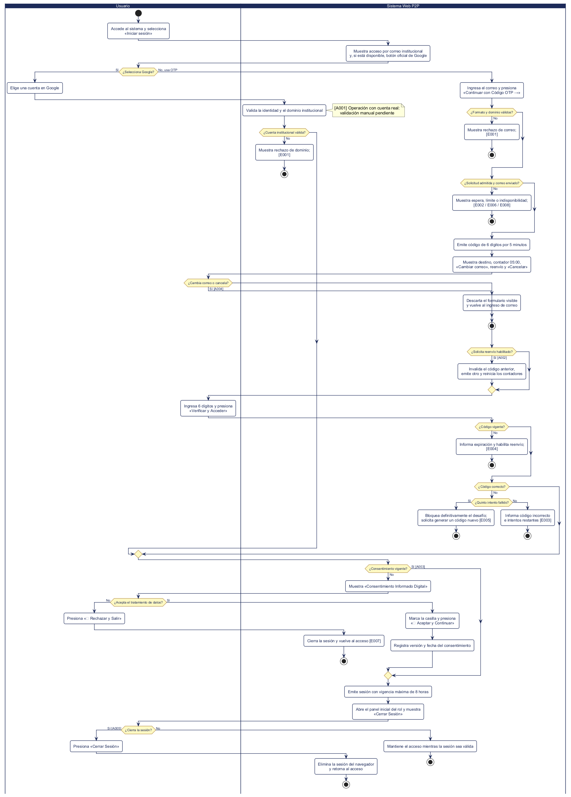

Fuente PlantUML: [CUS-001_actividades.puml](docs/narrativas/diagramas/plantuml/CUS-001_actividades.puml).

Fuente: Elaboración propia.

#### 7.6. Diagrama de caso de uso

**Figura 2. Diagrama de caso de uso — CUS-001: Iniciar sesión institucional con 2FA.**

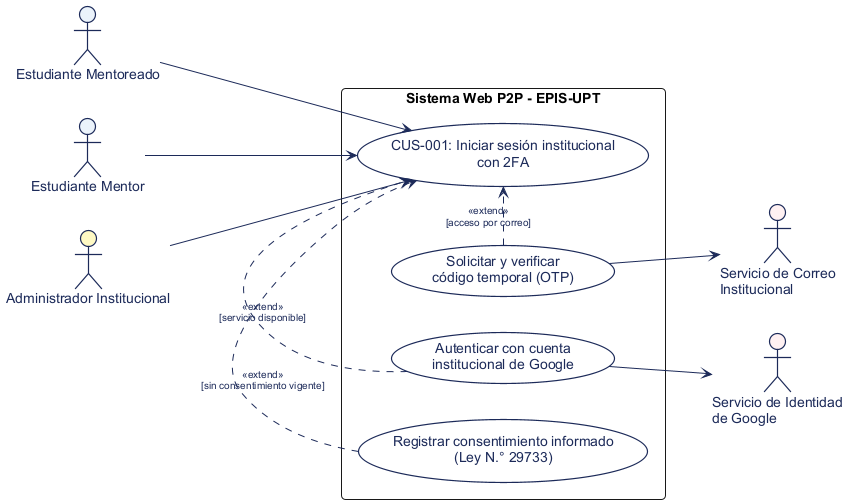

Fuente PlantUML: [CUS-001_caso_de_uso.puml](docs/narrativas/diagramas/plantuml/CUS-001_caso_de_uso.puml).

Fuente: Elaboración propia.

### CUS-010 — Gestionar asignación de roles de usuario

#### 7.1. Ficha descriptiva

| Atributo | Detalle |
|---|---|
| **Id Caso de Uso** | **UC-010** (CUS-010) |
| **Nombre** | Gestionar asignación de roles de usuario |
| **Tipo** | Obligatorio |
| **Requisito ID (RF)** | RF-003; RN-03 |
| **Versión** | 2.3 (DOC-H02 — consolidación) |
| **Autor** | Antayhua Mamani, Renzo Antonio / Medina Quispe, Joan Cristian |
| **Actores** | Administrador institucional |
| **Interacción** | Interacción web institucional; comportamiento descrito conforme a la evidencia identificada. |
| **Descripción** | Permite consultar los roles asociados a un correo institucional, promover al estudiante a Mentor o revocar esa condición. |
| **Referencias** | SWEBOK v3.0, ISO/IEC/IEEE 29148:2018, SRS y reglas de negocio EPIS-UPT. |
| **Precondiciones** | Sesión administrativa vigente; correo del estudiante conocido. Para promover, información de ciclo disponible. |
| **Postcondiciones** | Se muestran los roles consultados; si la operación es exitosa, se incorpora o retira Mentor y se conserva Mentoreado. |

**Estado de evidencia:** Aprobado en conversación; consolidado.

#### 7.2. Flujo normal de eventos

| **Acción del Actor** | **Respuesta del Sistema** |
|---|---|
| **Fase 1: Acceso y consulta** |  |
| **1.** Selecciona «Administración». |  |
|  | **2.** Muestra «Panel de Administración y Supervisión EPIS», correo del administrador y pestañas «Gestión de Roles», «Monitoreo de Quórum», «Auditoría de Bitácoras», «Catálogo Curricular (RF05)», «Cronograma de Aulas (RF10)» y «Salud del Sistema». Si no hay autorización, E001. |
| **3.** Selecciona «Gestión de Roles». |  |
|  | **4.** Resalta la pestaña en dorado y muestra «Asignación y Validación de Mérito de Mentores», requisito de ciclo VII o superior, campo de correo y botón «🔍 Buscar Estudiante». |
| **5.** Ingresa el correo y presiona «🔍 Buscar Estudiante» o Enter. |  |
|  | **6.** Comprueba el correo; muestra «Consultando...» durante la operación. Si no lo admite, E002; si falla, E004. |
| **7.** Revisa el expediente. |  |
|  | **8.** Presenta «Expediente Institucional», correo y distintivos de roles (MENTOREADO, MENTOR, ADMINISTRADOR, según corresponda). Si figura Mentor ofrece «🚫 Revocar Rol de Mentor» (A001); si no, «⭐ Promover a Mentor (Verificar Mérito Académico)». Puede consultar sin modificar (A002). |
| **Fase 2: Promoción y confirmación** |  |
| **9.** Presiona «⭐ Promover a Mentor (Verificar Mérito Académico)». |  |
|  | **10.** Comprueba autorización y ciclo; inhabilita temporalmente las acciones. Si el ciclo es inferior a VII, E003. |
| **11.** Espera la respuesta. |  |
|  | **12.** Si concluye correctamente, muestra «Rol de Mentor asignado exitosamente tras verificar mérito académico (RN-03).», incorpora el distintivo MENTOR y ofrece revocarlo. Si falla, E004. |
| **13.** Verifica los roles y decide finalizar o consultar otro correo. |  |
|  | **14.** Mantiene el expediente y permite una nueva búsqueda (A003). |

#### 7.3. Flujos alternativos

##### A001: Revocación del rol Mentor

* **Paso origen:** 8.
* **Condición de activación:** Expediente con Mentor.

| **Acción del Actor** | **Respuesta del Sistema** |
|---|---|
| **A001-1.** Presiona «🚫 Revocar Rol de Mentor». |  |
|  | **A001-2.** Comprueba autorización, procesa el retiro y muestra «Rol de Mentor revocado exitosamente.»; actualiza los distintivos y ofrece nuevamente la promoción. Si falla, E004. |
| **A001-3.** Verifica el expediente actualizado. |  |

##### A002: Consulta sin modificación

* **Paso origen:** 8.
* **Condición de activación:** Expediente disponible.

| **Acción del Actor** | **Respuesta del Sistema** |
|---|---|
| **A002-1.** Revisa los distintivos sin presionar las acciones de cambio. |  |
|  | **A002-2.** Mantiene los roles sin cambios. |
| **A002-3.** Finaliza o busca otro correo. |  |

##### A003: Consulta de otro estudiante

* **Paso origen:** 14.
* **Condición de activación:** Consulta terminada.

| **Acción del Actor** | **Respuesta del Sistema** |
|---|---|
| **A003-1.** Sustituye el correo y busca nuevamente. |  |
|  | **A003-2.** Retira el aviso anterior al iniciar una consulta válida y sustituye el expediente al recibir la respuesta. |
| **A003-3.** Retorna a la revisión del expediente. |  |

#### 7.4. Flujos de excepción

##### E001: Acceso no autorizado

* **Paso origen:** 2.
* **Condición de activación:** Sesión ausente o sin privilegios.

| **Acción del Actor** | **Respuesta del Sistema** |
|---|---|
|  | **E001-1.** Restringe la interfaz y rechaza cambios no autorizados. |
| **E001-2.** Inicia sesión con una cuenta autorizada. |  |

##### E002: Correo no admitido

* **Paso origen:** 6.
* **Condición de activación:** Campo vacío o comprobación inicial fallida.

| **Acción del Actor** | **Respuesta del Sistema** |
|---|---|
|  | **E002-1.** Muestra «Ingrese un correo institucional válido con dominio @upt.pe.» sin realizar nueva consulta. |
| **E002-2.** Corrige el correo y repite la búsqueda. |  |

##### E003: Ciclo inferior a VII

* **Paso origen:** 10.
* **Condición de activación:** Promoción no elegible.

| **Acción del Actor** | **Respuesta del Sistema** |
|---|---|
|  | **E003-1.** Rechaza la promoción y conserva los roles consultados. |
| **E003-2.** Revisa el resultado o consulta otro estudiante. |  |

##### E004: Fallo de consulta o modificación

* **Paso origen:** 6, 12.
* **Condición de activación:** Problema de comunicación o registro.

| **Acción del Actor** | **Respuesta del Sistema** |
|---|---|
|  | **E004-1.** Muestra alerta roja; si falla la búsqueda, retira los roles anteriores; si falla el cambio, conserva la información presentada. |
| **E004-2.** Consulta de nuevo antes de repetir la operación. |  |

#### 7.5. Diagrama de flujo de actividades

**Figura 3. Diagrama de actividades — CUS-010: Gestionar asignación de roles de usuario.**

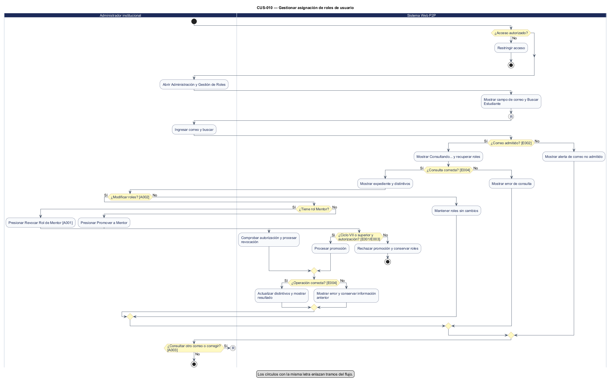

Fuente PlantUML: [CUS-010_actividades.puml](docs/narrativas/diagramas/plantuml/CUS-010_actividades.puml).

Fuente: Elaboración propia.

#### 7.6. Diagrama de caso de uso

**Figura 4. Diagrama de caso de uso — CUS-010: Gestionar asignación de roles de usuario.**

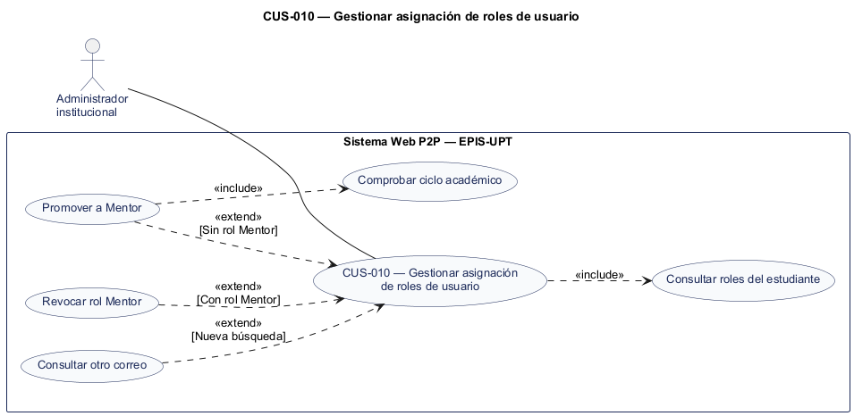

Fuente PlantUML: [CUS-010_caso_de_uso.puml](docs/narrativas/diagramas/plantuml/CUS-010_caso_de_uso.puml).

Fuente: Elaboración propia.

---

## MOD-02: Ofertas de Mentoría y Gestión de Recursos

### CUS-006 — Registrar oferta de mentoría académica

#### 7.1. Ficha descriptiva

| Atributo | Detalle |
|---|---|
| **Id Caso de Uso** | **UC-006** (CUS-006) |
| **Nombre** | Registrar oferta de mentoría académica |
| **Tipo** | Obligatorio |
| **Requisito ID (RF)** | RF-008, RF-009; RN-01, RN-03 a RN-07; relacionado con RF-007 |
| **Versión** | 2.3 (DOC-H02 — consolidación) |
| **Autor** | Antayhua Mamani, Renzo Antonio / Medina Quispe, Joan Cristian |
| **Actores** | Estudiante Mentor |
| **Interacción** | Interacción web institucional; comportamiento descrito conforme a la evidencia identificada. |
| **Descripción** | Permite programar y publicar una sesión con asignatura, tema, modalidad, fecha, duración e infraestructura; opcionalmente vinculada a una solicitud por demanda. |
| **Referencias** | SWEBOK v3.0, ISO/IEC/IEEE 29148:2018, SRS y reglas de negocio EPIS-UPT. |
| **Precondiciones** | Sesión de Mentor vigente, consentimiento aceptado, catálogo disponible y, si es presencial, cronograma con un ambiente libre durante toda la sesión. |
| **Postcondiciones** | Oferta con código único y estado PUBLICADA; si es dirigida y se registra correctamente, la solicitud vinculada pasa a ATENDIDA. |

**Estado de evidencia:** Aprobado en conversación; consolidado.

#### 7.2. Flujo normal de eventos

| **Acción del Actor** | **Respuesta del Sistema** |
|---|---|
| **Fase 1: Acceso al formulario** |  |
| **1.** Selecciona «Publicar mentoría» o «Publicar Nueva Oferta» en «Mis sesiones». |  |
|  | **2.** Muestra «Publicar Nueva Oferta de Mentoría», distintivo «Rol: Mentor Académico», nombre y correo, antelación mínima superior a 24 h y recomendada de 48 h o más. Si no está autorizado, E001. |
| **3.** Revisa el formulario. |  |
|  | **4.** Presenta ocho campos numerados. Inicialmente establece modalidad presencial, 60 minutos, aforo 10 y fecha sugerida con antelación recomendada. Si procede del banco de demanda, A002. |
| **Fase 2: Selección curricular** |  |
| **5.** Despliega «1. Asignatura Formativa Crítica (Catálogo EPIS) *». |  |
|  | **6.** Muestra código, nombre y ciclo de las asignaturas disponibles; si no hay catálogo, E002. |
| **7.** Selecciona asignatura y «2. Unidad Temática / Tema Conceptual del Sílabo *». |  |
|  | **8.** Actualiza las unidades y temas al cambiar de curso; conserva un tema seleccionado. Si no hay temas, E002. |
| **Fase 3: Modalidad, fecha y duración** |  |
| **9.** Selecciona «Presencial» en «3. Modalidad Pedagógica *». |  |
|  | **10.** Resalta la modalidad; «4. Aforo Reglamentario Inmutable» muestra 10 estudiantes, no editable. Si elige virtual, A001. |
| **11.** Define «5. Fecha y Hora de Inicio *». |  |
|  | **12.** Calcula antelación: aviso azul «Antelación válida» cuando supera 24 h y es menor de 48 h; verde «Antelación óptima» desde 48 h. Si fecha pasada o antelación menor o igual a 24 h, E003. |
| **13.** Selecciona «6. Duración de la Sesión *»: 60 o 90 minutos. |  |
|  | **14.** Muestra «Término estimado» y vuelve a consultar aulas libres para la duración completa. |
| **Fase 4: Infraestructura** |  |
| **15.** Revisa «7. Asignación de Infraestructura (Aula / Laboratorio) *». |  |
|  | **16.** Lista los ambientes libres durante toda la sesión, excluyendo coincidencias con mentorías activas; sugiere el primero disponible. Si no hay aula, E004. |
| **17.** Selecciona un ambiente. |  |
|  | **18.** Conserva el aula elegida. Si cambia fecha, duración o modalidad, actualiza la disponibilidad (A004). |
| **Fase 5: Revisión y publicación** |  |
| **19.** Completa «8. Observaciones Pedagógicas y Requisitos Previos (Opcional)». |  |
|  | **20.** Conserva las indicaciones de materiales, ejercicios o preparación previa; comprueba los campos obligatorios y mantiene el botón inactivo si faltan datos (E005). |
| **21.** Revisa los datos y presiona «🚀 Publicar Oferta de Mentoría». |  |
|  | **22.** Muestra «Publicando Oferta...»; comprueba identidad, elegibilidad, antelación, aforo y disponibilidad del espacio. Si hay conflicto de aula, E006; si no se admite la solicitud dirigida, E007. |
| **23.** Espera el resultado. |  |
|  | **24.** Registra la oferta con código único y estado PUBLICADA; si existe demanda vinculada, la registra como ATENDIDA. Si ocurre un fallo, E008. |
| **Fase 6: Confirmación** |  |
| **25.** Consulta el resultado. |  |
|  | **26.** El formulario dispone de tarjeta verde «¡Oferta de mentoría publicada exitosamente!» con código, estado, asignatura, tema, modalidad, aforo, inicio, duración e infraestructura. En la aplicación integrada se redirige a «Mis sesiones», por lo que la tarjeta puede dejar de verse. |
| **27.** Verifica la nueva oferta en «Mis sesiones». |  |
|  | **28.** La sesión queda disponible para consulta, recomendación y reserva conforme a sus reglas; permite iniciar otra oferta (A005). |

#### 7.3. Flujos alternativos

##### A001: Modalidad virtual

* **Paso origen:** 10.
* **Condición de activación:** Selección de modalidad.

| **Acción del Actor** | **Respuesta del Sistema** |
|---|---|
| **A001-1.** Presiona «Virtual»; define fecha y duración y conserva o reemplaza el enlace, o pulsa «Generar automáticamente por el sistema». |  |
|  | **A001-2.** Fija 20 estudiantes; reemplaza el selector de aula por el enlace virtual. Acepta una dirección propia o genera una de respaldo si falta o no reconoce la entrada como dirección web; no acredita creación real de reunión. |
| **A001-3.** Continúa con observaciones y publicación. |  |

##### A002: Mentoría dirigida por demanda

* **Paso origen:** 4.
* **Condición de activación:** Acceso desde banco RF07.

| **Acción del Actor** | **Respuesta del Sistema** |
|---|---|
| **A002-1.** Selecciona «Proponer Mentoría Dirigida» y revisa la solicitud. |  |
|  | **A002-2.** Muestra panel ámbar con correo, asignatura, tema y observaciones; precompleta y bloquea curso y tema, añade referencia en observaciones. Si no coincide el contenido, E005. |
| **A002-3.** Configura fecha, modalidad e infraestructura y publica. |  |

##### A003: Desvincular solicitud

* **Paso origen:** Flujo normal, en la operación indicada por la condición.
* **Condición de activación:** Formulario dirigido.

| **Acción del Actor** | **Respuesta del Sistema** |
|---|---|
| **A003-1.** Presiona «✕ Desvincular Solicitud». |  |
|  | **A003-2.** Retira el vínculo y habilita curso y tema; la solicitud no se marca atendida. |
| **A003-3.** Revisa datos y continúa como oferta general. |  |

##### A004: Modificar programación

* **Paso origen:** 18.
* **Condición de activación:** Antes de publicar.

| **Acción del Actor** | **Respuesta del Sistema** |
|---|---|
| **A004-1.** Cambia modalidad, fecha o duración. |  |
|  | **A004-2.** Recalcula antelación, hora estimada, aforo y espacios; si virtual muestra campo de enlace. |
| **A004-3.** Revisa infraestructura y vuelve a la revisión. |  |

##### A005: Publicar otra oferta

* **Paso origen:** 28.
* **Condición de activación:** Publicación terminada.

| **Acción del Actor** | **Respuesta del Sistema** |
|---|---|
| **A005-1.** Accede a «Publicar mentoría» o «Publicar Nueva Oferta»; si permanece en confirmación, pulsa «+ Publicar Otra Oferta». |  |
|  | **A005-2.** Dispone el formulario; el botón de la tarjeta limpia avisos y observaciones y restablece fecha sugerida. |
| **A005-3.** Configura la nueva sesión. |  |

#### 7.4. Flujos de excepción

##### E001: Sin autorización o elegibilidad

* **Paso origen:** 2.
* **Condición de activación:** Acceso o envío.

| **Acción del Actor** | **Respuesta del Sistema** |
|---|---|
|  | **E001-1.** Restringe acceso o rechaza el registro; no confirma la oferta. |
| **E001-2.** Retorna a funciones permitidas o regulariza su perfil. |  |

##### E002: Catálogo no disponible

* **Paso origen:** 6, 8.
* **Condición de activación:** Carga de asignaturas o temas.

| **Acción del Actor** | **Respuesta del Sistema** |
|---|---|
|  | **E002-1.** Muestra alerta y «Reintentar» si falla el catálogo general; si faltan temas, selector vacío y publicación bloqueada. |
| **E002-2.** Reintenta o selecciona otra asignatura. |  |

##### E003: Fecha inválida o antelación insuficiente

* **Paso origen:** 12.
* **Condición de activación:** Fecha pasada o 24 h o menos.

| **Acción del Actor** | **Respuesta del Sistema** |
|---|---|
|  | **E003-1.** Muestra «Ingrese una fecha válida en el futuro» o «Antelación insuficiente»; bloquea publicación. |
| **E003-2.** Corrige la fecha y revisa el indicador. |  |

##### E004: Sin ambientes físicos

* **Paso origen:** 16.
* **Condición de activación:** Franja no cubierta o consulta fallida.

| **Acción del Actor** | **Respuesta del Sistema** |
|---|---|
|  | **E004-1.** Muestra «Sin aulas disponibles para esta franja» o «No se pudo consultar la disponibilidad de aulas». |
| **E004-2.** Cambia fecha, duración o modalidad. |  |

##### E005: Campos incompletos o demanda inconsistente

* **Paso origen:** 20.
* **Condición de activación:** Formulario inválido.

| **Acción del Actor** | **Respuesta del Sistema** |
|---|---|
|  | **E005-1.** Muestra «Corrija los campos señalados antes de publicar» o aviso del tema solicitado no disponible. |
| **E005-2.** Completa los datos o desvincula la solicitud. |  |

##### E006: Aula dejó de estar disponible

* **Paso origen:** 22.
* **Condición de activación:** Revalidación al publicar.

| **Acción del Actor** | **Respuesta del Sistema** |
|---|---|
|  | **E006-1.** Rechaza con «El aula no está disponible durante toda la sesión en el cronograma vigente.» y consulta nuevamente ambientes. |
| **E006-2.** Selecciona otra aula o modifica horario. |  |

##### E007: Demanda ya no pendiente

* **Paso origen:** 22.
* **Condición de activación:** Oferta dirigida.

| **Acción del Actor** | **Respuesta del Sistema** |
|---|---|
|  | **E007-1.** Rechaza con «La solicitud ya no está pendiente o no corresponde a la asignatura y al tema seleccionados.» |
| **E007-2.** Actualiza banco o desvincula. |  |

##### E008: Fallo de registro o comunicación

* **Paso origen:** 24.
* **Condición de activación:** Envío sin confirmación.

| **Acción del Actor** | **Respuesta del Sistema** |
|---|---|
|  | **E008-1.** Muestra «Error al publicar:» con el motivo; restablece controles y vuelve a consultar aulas si corresponde. |
| **E008-2.** Comprueba Mis sesiones antes de reintentar para evitar duplicados. |  |

#### 7.5. Diagrama de flujo de actividades

**Figura 5. Diagrama de actividades — CUS-006: Registrar oferta de mentoría académica.**

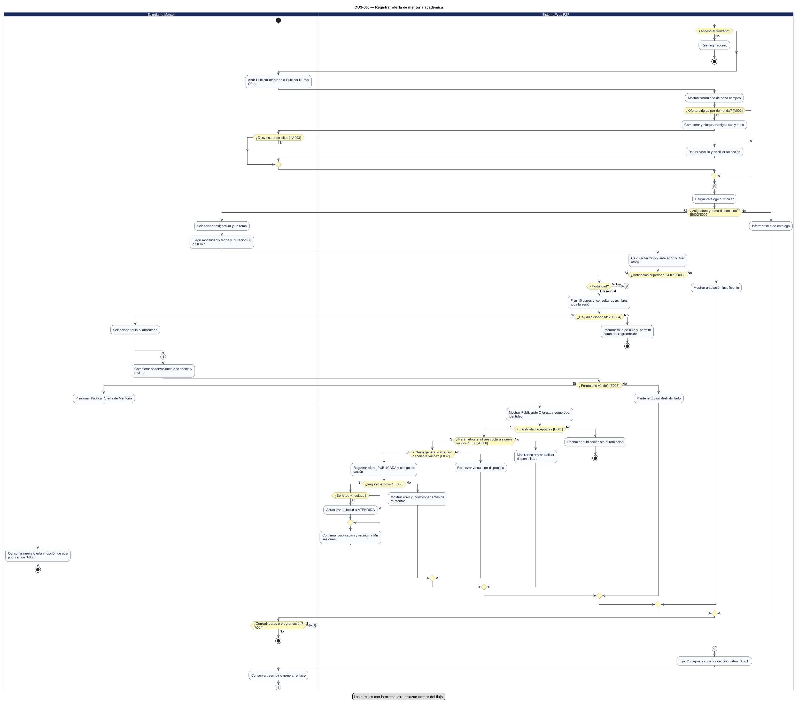

Fuente PlantUML: [CUS-006_actividades.puml](docs/narrativas/diagramas/plantuml/CUS-006_actividades.puml).

Fuente: Elaboración propia.

#### 7.6. Diagrama de caso de uso

**Figura 6. Diagrama de caso de uso — CUS-006: Registrar oferta de mentoría académica.**

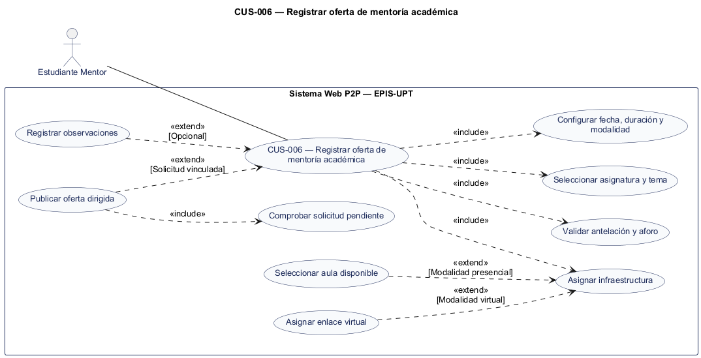

Fuente PlantUML: [CUS-006_caso_de_uso.puml](docs/narrativas/diagramas/plantuml/CUS-006_caso_de_uso.puml).

Fuente: Elaboración propia.

---

### CUS-008 — Gestionar demanda insatisfecha de mentoría

#### 7.1. Ficha descriptiva

| Atributo | Detalle |
|---|---|
| **Id Caso de Uso** | **UC-008** (CUS-008) |
| **Nombre** | Gestionar demanda insatisfecha de mentoría |
| **Tipo** | Opcional |
| **Requisito ID (RF)** | RF-007; relacionado con RF-006, RF-008 y RN-04 |
| **Versión** | 2.3 (DOC-H02 — consolidación) |
| **Autor** | Antayhua Mamani, Renzo Antonio / Medina Quispe, Joan Cristian |
| **Actores** | Estudiante Mentoreado; Estudiante Mentor |
| **Interacción** | Interacción web institucional; comportamiento descrito conforme a la evidencia identificada. |
| **Descripción** | Registra necesidades académicas no cubiertas y permite a mentores consultar y formular ofertas dirigidas. |
| **Referencias** | SWEBOK v3.0, ISO/IEC/IEEE 29148:2018, SRS y reglas de negocio EPIS-UPT. |
| **Precondiciones** | Sesiones institucionales de los actores en sus respectivas interacciones; catálogo disponible para registrar. |
| **Postcondiciones** | Solicitud PENDIENTE con folio; pasa a ATENDIDA únicamente al completarse una publicación vinculada. No reserva cupo. |

**Estado de evidencia:** Propuesta previamente presentada; pendiente de aprobación explícita.

#### 7.2. Flujo normal de eventos

| **Acción del Actor** | **Respuesta del Sistema** |
|---|---|
| **Fase 1: Identificación de la necesidad** |  |
| **1.** Accede a «Explorar mentorías» y consulta la cartelera. |  |
|  | **2.** Si no hay resultados para el filtro, muestra «No se encontraron recomendaciones en este momento» y «¿Necesitas asesoría en un tema específico?» con «Registrar Solicitud por Demanda». Si se detecta aforo agotado en el cuadro de reserva, A001. |
| **3.** Presiona «Registrar Solicitud por Demanda». |  |
|  | **4.** Abre ventana «Registrar Solicitud de Mentoría por Demanda» con encabezado azul marino, cierre ×, campos de asignatura, tema, observaciones y botones «Cancelar» y «Enviar Solicitud». |
| **Fase 2: Selección y registro** |  |
| **5.** Espera el catálogo y despliega «Asignatura Curricular *». |  |
|  | **6.** Muestra «Cargando catálogo curricular...» durante la consulta; presenta código, nombre y ciclo. Si falla, E002. |
| **7.** Selecciona la asignatura y el «Tema o Unidad Específica *». |  |
|  | **8.** Actualiza temas por unidad y nombre, con una opción inicial. Si no hay temas, E003. |
| **9.** Completa si desea «Observaciones o Justificación de Necesidad Formativa». |  |
|  | **10.** Conserva el texto opcional; el servicio admite hasta 500 caracteres. Puede cancelar antes de enviar (A002). |
| **11.** Revisa los campos y pulsa «Enviar Solicitud». |  |
|  | **12.** Comprueba selección de curso y tema; muestra «Registrando...» e inhabilita edición, envío y Cancelar. Comprueba identidad, existencia curricular y longitud. Si falta información, E004; si no existe curso/tema, E005; si excede longitud, E006. |
| **13.** Espera confirmación. |  |
|  | **14.** Registra folio y estado PENDIENTE. Si falla, E007. |
| **Fase 3: Confirmación del solicitante** |  |
| **15.** Revisa el panel de resultado. |  |
|  | **16.** Muestra «¡Solicitud Registrada con Éxito!», folio #DEM-[número], estado, correo y fecha de registro. Informa que los mentores podrán revisarla. |
| **17.** Presiona «Entendido». |  |
|  | **18.** Cierra la ventana y retorna a la cartelera; la solicitud sigue pendiente, sin garantizar atención ni reserva. |
| **Fase 4: Consulta independiente del mentor** |  |
| **19.** En otro momento, el mentor abre «Mis sesiones» y «Banco de Solicitudes por Demanda (RF07)». |  |
|  | **20.** Muestra «Banco de Solicitudes Temáticas por Demanda (RF07)»; consulta pendientes y muestra filtro «Todas las Asignaturas» con total y «Actualizar». Si falla, E008; si no hay resultados, A004. |
| **21.** Filtra por asignatura o revisa todas las solicitudes. |  |
|  | **22.** Presenta tarjetas con asignatura, fecha, tema, correo, observaciones si existen, estado PENDIENTE y «Proponer Mentoría Dirigida» (A003). |
| **Fase 5: Atención de la solicitud** |  |
| **23.** Presiona «Proponer Mentoría Dirigida» sobre una tarjeta. |  |
|  | **24.** Abre el formulario de CUS-006, vincula la solicitud y precompleta curso, tema y observaciones. |
| **25.** Configura y publica conforme al CUS-006. |  |
|  | **26.** Verifica que la solicitud siga pendiente y corresponda al curso/tema; si dejó de estar disponible, E009. Si se desvincula o abandona, A005. |
| **27.** Verifica el resultado y vuelve al banco. |  |
|  | **28.** Al publicarse correctamente, registra oferta PUBLICADA y solicitud ATENDIDA; al actualizar, la solicitud desaparece del banco de pendientes. |

#### 7.3. Flujos alternativos

##### A001: Aforo agotado

* **Paso origen:** 2.
* **Condición de activación:** Cuadro de reserva con falta de vacantes.

| **Acción del Actor** | **Respuesta del Sistema** |
|---|---|
| **A001-1.** Pulsa «Registrar Solicitud por Demanda». |  |
|  | **A001-2.** Cierra el cuadro de reserva y abre la solicitud; no se garantiza la preselección del curso y tema. |
| **A001-3.** Selecciona los datos requeridos. |  |

##### A002: Cancelar registro

* **Paso origen:** 10.
* **Condición de activación:** Antes de enviar.

| **Acción del Actor** | **Respuesta del Sistema** |
|---|---|
| **A002-1.** Presiona «Cancelar», × o Escape. |  |
|  | **A002-2.** Cierra sin registrar; al reabrir limpia observaciones y consulta el catálogo. |
| **A002-3.** Retorna a la cartelera. |  |

##### A003: Filtrar o actualizar

* **Paso origen:** 22.
* **Condición de activación:** Banco disponible.

| **Acción del Actor** | **Respuesta del Sistema** |
|---|---|
| **A003-1.** Selecciona asignatura, «Todas las Asignaturas» o «Actualizar». |  |
|  | **A003-2.** Filtra las tarjetas; al actualizar muestra «Cargando...» y renueva resultados. |
| **A003-3.** Consulta sin cambiar estados o selecciona una solicitud. |  |

##### A004: Banco vacío

* **Paso origen:** 20.
* **Condición de activación:** Sin pendientes o sin coincidencias.

| **Acción del Actor** | **Respuesta del Sistema** |
|---|---|
| **A004-1.** Revisa el panel, cambia filtro o pulsa «Actualizar». |  |
|  | **A004-2.** Muestra «No hay solicitudes pendientes en el banco de demanda» y explicación; actualiza si se solicita. |
| **A004-3.** Retorna a Mis sesiones o revisa otros resultados. |  |

##### A005: Abandonar o desvincular

* **Paso origen:** 26.
* **Condición de activación:** Oferta dirigida no publicada.

| **Acción del Actor** | **Respuesta del Sistema** |
|---|---|
| **A005-1.** Pulsa «Desvincular Solicitud» o abandona la publicación. |  |
|  | **A005-2.** No marca la demanda atendida; permite publicar una oferta general. |
| **A005-3.** Retorna al banco o sigue CUS-006. |  |

#### 7.4. Flujos de excepción

##### E001: Acceso no autorizado

* **Paso origen:** Flujo normal, en la operación indicada por la condición.
* **Condición de activación:** Sesión inválida o vista restringida.

| **Acción del Actor** | **Respuesta del Sistema** |
|---|---|
|  | **E001-1.** Restringe la interfaz; si el registro no está autorizado, rechaza la solicitud. |
| **E001-2.** Inicia sesión con el rol correspondiente. |  |

##### E002: Catálogo no disponible

* **Paso origen:** 6.
* **Condición de activación:** Error al consultar asignaturas.

| **Acción del Actor** | **Respuesta del Sistema** |
|---|---|
|  | **E002-1.** Muestra alerta con error recibido o «Error al consultar el catálogo curricular». |
| **E002-2.** Cierra y vuelve a abrir el formulario. |  |

##### E003: Sin temas

* **Paso origen:** 8.
* **Condición de activación:** No se obtienen temas.

| **Acción del Actor** | **Respuesta del Sistema** |
|---|---|
|  | **E003-1.** Muestra «No hay temas registrados para esta materia» y deshabilita selector/envío. |
| **E003-2.** Elige otro curso o cancela. |  |

##### E004: Datos incompletos

* **Paso origen:** 12.
* **Condición de activación:** Falta curso o tema.

| **Acción del Actor** | **Respuesta del Sistema** |
|---|---|
|  | **E004-1.** Bloquea envío; si se intenta procesar, informa que seleccione una asignatura y tema válidos. |
| **E004-2.** Completa la selección. |  |

##### E005: Curso o tema inexistente

* **Paso origen:** 12.
* **Condición de activación:** Datos retirados del catálogo.

| **Acción del Actor** | **Respuesta del Sistema** |
|---|---|
|  | **E005-1.** Rechaza con el error correspondiente. |
| **E005-2.** Vuelve a consultar el catálogo. |  |

##### E006: Observaciones demasiado extensas

* **Paso origen:** 12.
* **Condición de activación:** Más de 500 caracteres.

| **Acción del Actor** | **Respuesta del Sistema** |
|---|---|
|  | **E006-1.** Rechaza la solicitud y comunica el error disponible. |
| **E006-2.** Reduce el texto y revisa. |  |

##### E007: Fallo de registro

* **Paso origen:** 14.
* **Condición de activación:** Comunicación o almacenamiento.

| **Acción del Actor** | **Respuesta del Sistema** |
|---|---|
|  | **E007-1.** Muestra alerta; conserva datos y restablece controles, sin confirmación. |
| **E007-2.** Comprueba conexión antes de reintentar; puede haberse registrado aunque no se recibiera respuesta. |  |

##### E008: Fallo del banco

* **Paso origen:** 20.
* **Condición de activación:** Consulta comunica error.

| **Acción del Actor** | **Respuesta del Sistema** |
|---|---|
|  | **E008-1.** Muestra «No fue posible cargar las solicitudes de asesoría por demanda». |
| **E008-2.** Pulsa «Actualizar». |  |

##### E009: Demanda no disponible

* **Paso origen:** 26.
* **Condición de activación:** Solicitud atendida o datos distintos.

| **Acción del Actor** | **Respuesta del Sistema** |
|---|---|
|  | **E009-1.** Rechaza publicación vinculada con aviso de solicitud no pendiente o no correspondiente. |
| **E009-2.** Actualiza banco o desvincula. |  |

#### 7.5. Diagrama de flujo de actividades

**Figura 7. Diagrama de actividades — CUS-008: Gestionar demanda insatisfecha de mentoría.**

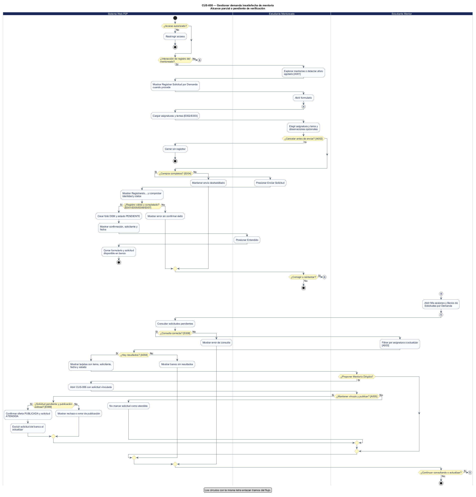

Fuente PlantUML: [CUS-008_actividades.puml](docs/narrativas/diagramas/plantuml/CUS-008_actividades.puml).

Fuente: Elaboración propia.

#### 7.6. Diagrama de caso de uso

**Figura 8. Diagrama de caso de uso — CUS-008: Gestionar demanda insatisfecha de mentoría.**

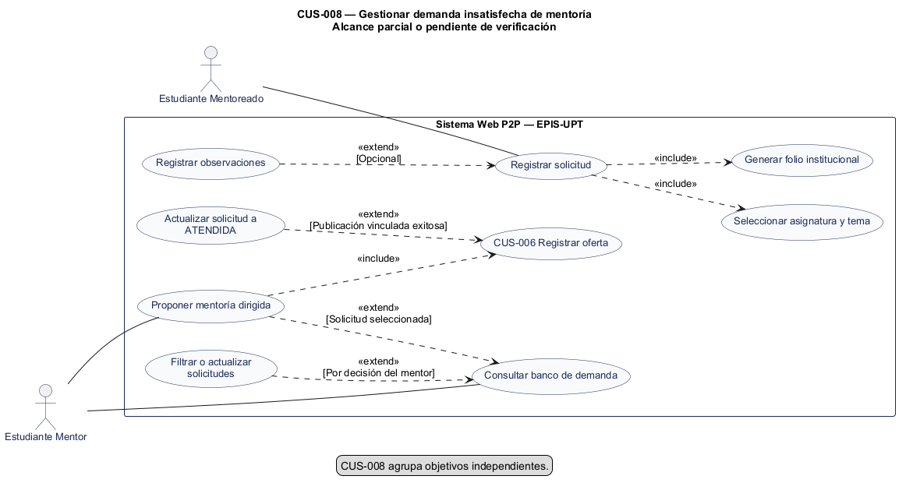

Fuente PlantUML: [CUS-008_caso_de_uso.puml](docs/narrativas/diagramas/plantuml/CUS-008_caso_de_uso.puml).

Fuente: Elaboración propia.

---

### CUS-005 — Postular al rol de estudiante mentor

#### 7.1. Ficha descriptiva

| Atributo | Detalle |
|---|---|
| **Id Caso de Uso** | **UC-005** (CUS-005) |
| **Nombre** | Postular al rol de estudiante mentor |
| **Tipo** | Opcional |
| **Requisito ID (RF)** | RF-004, RF-003; RN-03 |
| **Versión** | 2.3 (DOC-H02 — consolidación) |
| **Autor** | Antayhua Mamani, Renzo Antonio / Medina Quispe, Joan Cristian |
| **Actores** | Estudiante Mentoreado |
| **Interacción** | Interacción web institucional; comportamiento descrito conforme a la evidencia identificada. |
| **Descripción** | Permite manifestar interés en enseñar y registrar fortalezas académicas y disponibilidad semanal. La postulación no equivale a la asignación del rol. |
| **Referencias** | SWEBOK v3.0, ISO/IEC/IEEE 29148:2018, SRS y reglas de negocio EPIS-UPT. |
| **Precondiciones** | Sesión institucional y consentimiento; perfil y catálogo consultables. |
| **Postcondiciones** | Preferencia de participación y datos formativos guardados si el envío se completa. La asignación efectiva se gestiona en CUS-010; no se acredita expediente de comité. |

**Estado de evidencia:** Implementación parcial: postulación en perfil.

#### 7.2. Flujo normal de eventos

| **Acción del Actor** | **Respuesta del Sistema** |
|---|---|
| **Fase 1: Acceso al perfil** |  |
| **1.** Selecciona «Mi perfil». |  |
|  | **2.** Muestra «1. Perfil Formativo Académico» y «2. Matriz Semanal de Disponibilidad» con contador de horas. Presenta el correo y los datos del perfil. Si no puede cargarlos, E001. |
| **3.** Selecciona «Perfil Formativo Académico». |  |
|  | **4.** Presenta «Configuración del Perfil Académico», selector «Ciclo Académico Actual (EPIS)» de I a X, rol de participación, modalidad preferida, asignaturas y semblanza. |
| **Fase 2: Postulación** |  |
| **5.** Selecciona su ciclo y «🌟 Postulante a Mentor (Enseñar)». |  |
|  | **6.** Actualiza la intención de participación y las etiquetas de fortalezas; si el ciclo es inferior a VII muestra advertencia de mérito (E002). No cambia por sí solo el rol de acceso. |
| **7.** Selecciona la modalidad preferida y las asignaturas que domina. |  |
|  | **8.** Resalta las materias elegidas con código y ciclo; mantiene la selección. |
| **9.** Completa «Semblanza y Temas de Enfoque Específico». |  |
|  | **10.** Conserva la descripción de fortalezas, dudas o temas de interés. |
| **Fase 3: Disponibilidad y guardado** |  |
| **11.** Abre «Matriz Semanal de Disponibilidad». |  |
|  | **12.** Presenta una cuadrícula de franjas semanales y contador de horas; permite seleccionar franjas individuales o usar «Mañanas», «Tardes» y «Limpiar» (A001). |
| **13.** Selecciona las franjas que puede dedicar a mentorías y pulsa «Guardar Perfil y Disponibilidad». |  |
|  | **14.** Muestra «Guardando datos...», valida el perfil, registra sus datos y agenda mediante operaciones diferenciadas. Si falla, E003. |
| **15.** Revisa el resultado y el rol activo del encabezado. |  |
|  | **16.** Mantiene el perfil actualizado según la respuesta obtenida. La condición de Mentor requiere habilitación administrativa; no muestra resolución de comité en este flujo. |

#### 7.3. Flujos alternativos

##### A001: Selección rápida de disponibilidad

* **Paso origen:** 12.
* **Condición de activación:** Agenda abierta.

| **Acción del Actor** | **Respuesta del Sistema** |
|---|---|
| **A001-1.** Pulsa «Mañanas (08:00-12:00)», «Tardes (14:00-18:00)» o «Limpiar». |  |
|  | **A001-2.** Actualiza las franjas y horas indicadas. |
| **A001-3.** Revisa y guarda. |  |

##### A002: Mantener perfil Mentoreado

* **Paso origen:** Flujo normal, en la operación indicada por la condición.
* **Condición de activación:** Antes de guardar.

| **Acción del Actor** | **Respuesta del Sistema** |
|---|---|
| **A002-1.** Selecciona «Mentoreado (Solicitar Asesoría)». |  |
|  | **A002-2.** Cambia la selección y presenta asignaturas como necesidades de apoyo. |
| **A002-3.** Guarda los datos sin postular como mentor. |  |

#### 7.4. Flujos de excepción

##### E001: Perfil o catálogo no disponible

* **Paso origen:** 2.
* **Condición de activación:** Carga inicial fallida.

| **Acción del Actor** | **Respuesta del Sistema** |
|---|---|
|  | **E001-1.** Informa el problema disponible; no acredita guardado. |
| **E001-2.** Reintenta la consulta. |  |

##### E002: Ciclo inferior a VII

* **Paso origen:** 6.
* **Condición de activación:** Selección de Postulante a Mentor.

| **Acción del Actor** | **Respuesta del Sistema** |
|---|---|
|  | **E002-1.** Muestra advertencia de requisito de mérito y rechaza guardar la postulación no elegible. |
| **E002-2.** Corrige el ciclo real o elige Mentoreado. |  |

##### E003: Fallo de guardado

* **Paso origen:** 14.
* **Condición de activación:** No se completa perfil o agenda.

| **Acción del Actor** | **Respuesta del Sistema** |
|---|---|
|  | **E003-1.** Comunica el error; no debe interpretarse como confirmación de ambos registros. |
| **E003-2.** Consulta los datos persistidos antes de repetir. |  |

#### 7.5. Diagrama de flujo de actividades

**Figura 9. Diagrama de actividades — CUS-005: Postular al rol de estudiante mentor.**

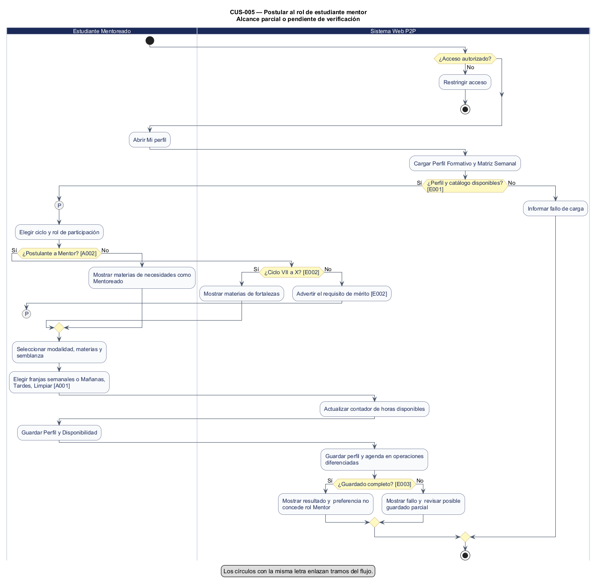

Fuente PlantUML: [CUS-005_actividades.puml](docs/narrativas/diagramas/plantuml/CUS-005_actividades.puml).

Fuente: Elaboración propia.

#### 7.6. Diagrama de caso de uso

**Figura 10. Diagrama de caso de uso — CUS-005: Postular al rol de estudiante mentor.**

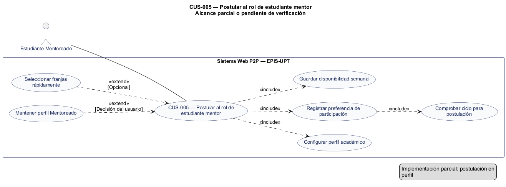

Fuente PlantUML: [CUS-005_caso_de_uso.puml](docs/narrativas/diagramas/plantuml/CUS-005_caso_de_uso.puml).

Fuente: Elaboración propia.

---

### CUS-021 — Evaluar postulaciones a mentor por comité

#### 7.1. Ficha descriptiva

| Atributo | Detalle |
|---|---|
| **Id Caso de Uso** | **UC-021** (CUS-021) |
| **Nombre** | Evaluar postulaciones a mentor por comité |
| **Tipo** | Obligatorio según proceso propuesto |
| **Requisito ID (RF)** | RF-003; RN-03 |
| **Versión** | 2.3 (DOC-H02 — consolidación) |
| **Autor** | Antayhua Mamani, Renzo Antonio / Medina Quispe, Joan Cristian |
| **Actores** | Comité evaluador (actor previsto); Administrador institucional |
| **Interacción** | Interacción web institucional; flujo propuesto pendiente de implementación. |
| **Descripción** | Propone que la evaluación de las postulaciones compruebe el mérito académico antes de habilitar al estudiante como mentor. |
| **Referencias** | SWEBOK v3.0, ISO/IEC/IEEE 29148:2018, SRS y reglas de negocio EPIS-UPT. |
| **Precondiciones** | Propuesta: comité autorizado, postulación registrada, información académica verificable y criterios institucionales aprobados. |
| **Postcondiciones** | Propuesta: decisión motivada y trazable; si se aprueba, habilitación mediante CUS-010 por actor autorizado. |

**Estado de evidencia:** Pendiente: sin flujo de comité identificado.

#### 7.2. Flujo normal de eventos

| **Acción del Actor** | **Respuesta del Sistema** |
|---|---|
| **Fase 1: Recepción de la postulación (propuesto)** |  |
| **1.** El evaluador accede a la bandeja de postulaciones pendientes. |  |
|  | **2.** Deberá presentar las solicitudes disponibles con identidad, fecha, ciclo y asignaturas declaradas; no existe una bandeja de comité acreditada. |
| **3.** Selecciona una postulación. |  |
|  | **4.** Deberá mostrar el expediente y los antecedentes necesarios para la evaluación. |
| **Fase 2: Evaluación (propuesto)** |  |
| **5.** Comprueba el ciclo VII a X y el mérito en las asignaturas a enseñar. |  |
|  | **6.** Deberá permitir registrar el resultado de cada criterio, incluyendo la nota mínima de 14 indicada en RN-03. Si falta evidencia, A001. |
| **7.** Registra la decisión y justificación. |  |
|  | **8.** Deberá comprobar que la evaluación esté completa; permite aprobar o rechazar conforme al reglamento (A002). |
| **Fase 3: Resolución (propuesto)** |  |
| **9.** Confirma la evaluación aprobatoria. |  |
|  | **10.** Deberá conservar la decisión, evaluador y fecha; la asignación se realizará mediante la operación autorizada del CUS-010, no automáticamente por expresar interés. |
| **11.** Consulta el resultado. |  |
|  | **12.** Deberá mostrar el estado final de la postulación y evitar decisiones simultáneas incompatibles. |

#### 7.3. Flujos alternativos

##### A001: Solicitar subsanación

* **Paso origen:** 6.
* **Condición de activación:** Evidencia insuficiente.

| **Acción del Actor** | **Respuesta del Sistema** |
|---|---|
| **A001-1.** Registra qué información requiere aclaración. |  |
|  | **A001-2.** Deberá conservar la evaluación pendiente y la observación. |
| **A001-3.** Retoma cuando exista evidencia. |  |

##### A002: Rechazar postulación

* **Paso origen:** 8.
* **Condición de activación:** Incumplimiento de mérito.

| **Acción del Actor** | **Respuesta del Sistema** |
|---|---|
| **A002-1.** Registra motivo y confirma rechazo. |  |
|  | **A002-2.** Deberá conservar decisión sin otorgar rol Mentor. |
| **A002-3.** Finaliza la evaluación. |  |

#### 7.4. Flujos de excepción

##### E001: Evaluador sin autorización

* **Paso origen:** Flujo normal, en la operación indicada por la condición.
* **Condición de activación:** No dispone de atribuciones.

| **Acción del Actor** | **Respuesta del Sistema** |
|---|---|
|  | **E001-1.** Deberá impedir consultar o resolver expedientes. |
| **E001-2.** Solicita acceso por canal institucional. |  |

##### E002: Expediente o decisión inválida

* **Paso origen:** Flujo normal, en la operación indicada por la condición.
* **Condición de activación:** Información incompleta o evaluación ya resuelta.

| **Acción del Actor** | **Respuesta del Sistema** |
|---|---|
|  | **E002-1.** Deberá impedir cierre y mostrar motivo. |
| **E002-2.** Revisa información o consulta estado actualizado. |  |

##### E003: Fallo de registro

* **Paso origen:** Flujo normal, en la operación indicada por la condición.
* **Condición de activación:** No se puede conservar resolución.

| **Acción del Actor** | **Respuesta del Sistema** |
|---|---|
|  | **E003-1.** Deberá informar el fallo sin declarar decisión confirmada. |
| **E003-2.** Comprueba el estado antes de repetir. |  |

#### 7.5. Diagrama de flujo de actividades

**Figura 11. Diagrama de actividades — CUS-021: Evaluar postulaciones a mentor por comité.**

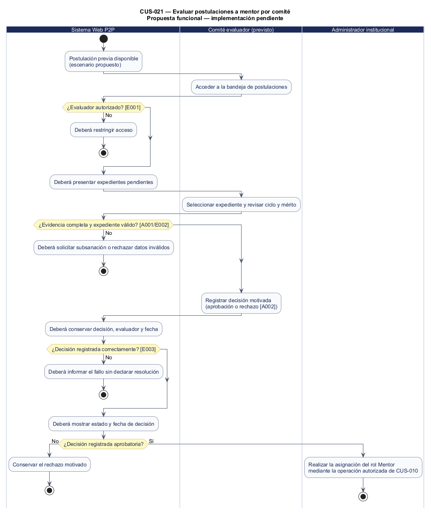

Fuente PlantUML: [CUS-021_actividades.puml](docs/narrativas/diagramas/plantuml/CUS-021_actividades.puml).

Fuente: Elaboración propia.

#### 7.6. Diagrama de caso de uso

**Figura 12. Diagrama de caso de uso — CUS-021: Evaluar postulaciones a mentor por comité.**

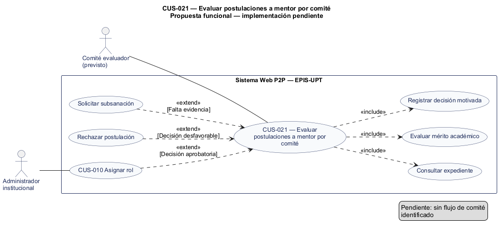

Fuente PlantUML: [CUS-021_caso_de_uso.puml](docs/narrativas/diagramas/plantuml/CUS-021_caso_de_uso.puml).

Fuente: Elaboración propia.

---

## MOD-03: Recomendaciones, Reservas y Quórum

### CUS-002 — Consultar catálogo de mentorías con recomendación

#### 7.1. Ficha descriptiva

| Atributo | Detalle |
|---|---|
| **Id Caso de Uso** | **UC-002** (CUS-002) |
| **Nombre** | Consultar catálogo de mentorías con recomendación |
| **Tipo** | Obligatorio |
| **Requisito ID (RF)** | RF-006; RN-04, RN-05, RN-11; relacionado con RF-007, RF-012 |
| **Versión** | 2.3 (DOC-H02 — consolidación) |
| **Autor** | Antayhua Mamani, Renzo Antonio / Medina Quispe, Joan Cristian |
| **Actores** | Estudiante Mentoreado |
| **Interacción** | Interacción web institucional; comportamiento descrito conforme a la evidencia identificada. |
| **Descripción** | Presenta una cartelera personalizada de sesiones y mentores según afinidad curricular, disponibilidad y criterios de recomendación, para orientar la selección y reserva. |
| **Referencias** | SWEBOK v3.0, ISO/IEC/IEEE 29148:2018, SRS y reglas de negocio EPIS-UPT. |
| **Precondiciones** | Sesión Mentoreado y consentimiento; perfil y servicios de recomendación disponibles. |
| **Postcondiciones** | El usuario visualiza resultados y puede iniciar reserva o demanda; la consulta por sí sola no modifica cupos. |

**Estado de evidencia:** Implementación identificada; revisión estática.

#### 7.2. Flujo normal de eventos

| **Acción del Actor** | **Respuesta del Sistema** |
|---|---|
| **Fase 1: Acceso a la cartelera** |  |
| **1.** Selecciona «Explorar mentorías». |  |
|  | **2.** Muestra «Cartelera de Mentorías Recomendadas», explicación de afinidad curricular, horario semanal y materias prioritarias, botón «Actualizar», y pestañas «Sesiones Recomendadas» y «Mentores Académicos» con contadores cuando hay resultados. Si no hay autorización, E001. |
| **3.** Espera la carga inicial. |  |
|  | **4.** Presenta «Calculando afinidad con sesiones disponibles...» y obtiene las recomendaciones. Si el servicio falla, E002. |
| **Fase 2: Configuración de resultados** |  |
| **5.** En «Sesiones Recomendadas», despliega «Asignatura». |  |
|  | **6.** Lista «Todas las materias formativas» y cursos disponibles con código; actualiza las recomendaciones con la selección. |
| **7.** Selecciona «Candidatos Top-k»: Top 3, Top 4 o Top 5 (Estándar SRS). |  |
|  | **8.** Solicita y muestra el conjunto ordenado de candidatos de acuerdo con el límite y filtros elegidos. Si no hay resultados, A001. |
| **Fase 3: Exploración de ofertas** |  |
| **9.** Revisa las tarjetas de sesiones. |  |
|  | **10.** Presenta datos de asignatura y tema, afinidad global, horario, modalidad, mentor responsable y cupos disponibles; distingue aforo completo y muestra «Reservar Cupo» o «Aforo Agotado» según corresponda. |
| **11.** Consulta la explicación de afinidad disponible en una tarjeta. |  |
|  | **12.** Presenta el desglose de criterios de recomendación; la afinidad ayuda a comparar, no garantiza reserva ni éxito académico. |
| **13.** Selecciona una oferta con vacantes y pulsa «Reservar Cupo». |  |
|  | **14.** Abre el cuadro de reserva del CUS-003 con la oferta seleccionada. No asigna cupo hasta confirmar la operación. |
| **15.** Alternativamente explora mentores. |  |
|  | **16.** Puede cambiar a «Mentores Académicos» (A002) o actualizar resultados (A003). |

#### 7.3. Flujos alternativos

##### A001: Sin recomendaciones

* **Paso origen:** 8.
* **Condición de activación:** No existen resultados para el filtro.

| **Acción del Actor** | **Respuesta del Sistema** |
|---|---|
| **A001-1.** Revisa el mensaje o pulsa «Registrar Solicitud por Demanda». |  |
|  | **A001-2.** Muestra «No se encontraron recomendaciones en este momento» y orientación de banco de demanda; abre CUS-008 si se selecciona. |
| **A001-3.** Cambia el filtro o registra necesidad. |  |

##### A002: Explorar mentores

* **Paso origen:** 16.
* **Condición de activación:** Cartelera disponible.

| **Acción del Actor** | **Respuesta del Sistema** |
|---|---|
| **A002-1.** Selecciona «Mentores Académicos». |  |
|  | **A002-2.** Muestra tarjetas de mentores con afinidad de perfil, asignaturas de asesoría y control «Contactar / Solicitar Asesoría». |
| **A002-3.** Revisa los resultados o regresa a sesiones. No se acredita mensajería directa. |  |

##### A003: Actualizar resultados

* **Paso origen:** 16.
* **Condición de activación:** Cartelera abierta.

| **Acción del Actor** | **Respuesta del Sistema** |
|---|---|
| **A003-1.** Pulsa «Actualizar» o cambia el número de candidatos. |  |
|  | **A003-2.** Vuelve a consultar y actualiza los resultados y contadores disponibles. |
| **A003-3.** Revisa las nuevas tarjetas. |  |

#### 7.4. Flujos de excepción

##### E001: Acceso restringido

* **Paso origen:** 2.
* **Condición de activación:** Sesión inválida o rol no permitido.

| **Acción del Actor** | **Respuesta del Sistema** |
|---|---|
|  | **E001-1.** Restringe la vista privada. |
| **E001-2.** Inicia sesión o cambia a un rol habilitado. |  |

##### E002: Error de recomendaciones

* **Paso origen:** 4.
* **Condición de activación:** Servicio no responde.

| **Acción del Actor** | **Respuesta del Sistema** |
|---|---|
|  | **E002-1.** Muestra «Error de servicio» y «Reintentar». |
| **E002-2.** Presiona «Reintentar» y revisa los resultados. |  |

##### E003: Oferta sin cupos

* **Paso origen:** Flujo normal, en la operación indicada por la condición.
* **Condición de activación:** Aforo completo o cambio de disponibilidad.

| **Acción del Actor** | **Respuesta del Sistema** |
|---|---|
|  | **E003-1.** Muestra «Aforo Agotado» y deshabilita la reserva desde la tarjeta; la operación de reserva revalida disponibilidad. |
| **E003-2.** Consulta otra oferta o utiliza la alternativa de demanda cuando esté disponible. |  |

#### 7.5. Diagrama de flujo de actividades

**Figura 13. Diagrama de actividades — CUS-002: Consultar catálogo de mentorías con recomendación.**

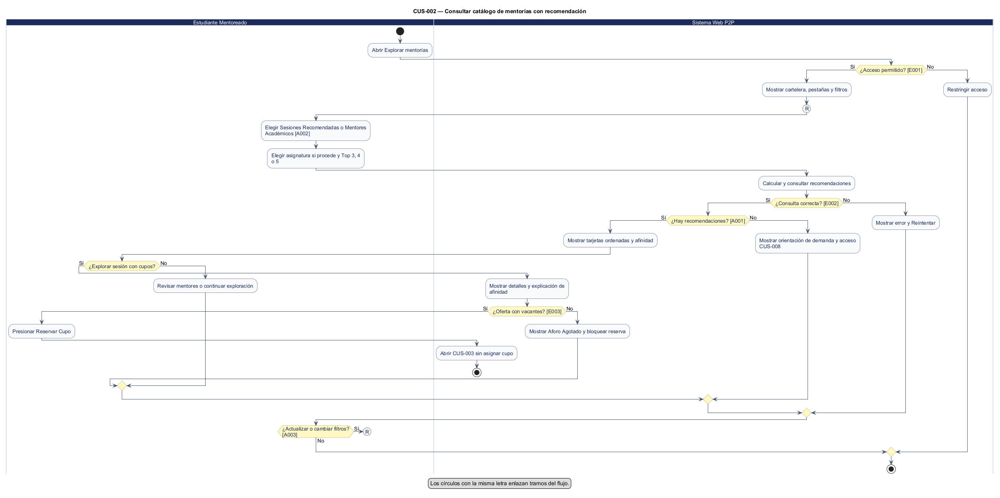

Fuente PlantUML: [CUS-002_actividades.puml](docs/narrativas/diagramas/plantuml/CUS-002_actividades.puml).

Fuente: Elaboración propia.

#### 7.6. Diagrama de caso de uso

**Figura 14. Diagrama de caso de uso — CUS-002: Consultar catálogo de mentorías con recomendación.**

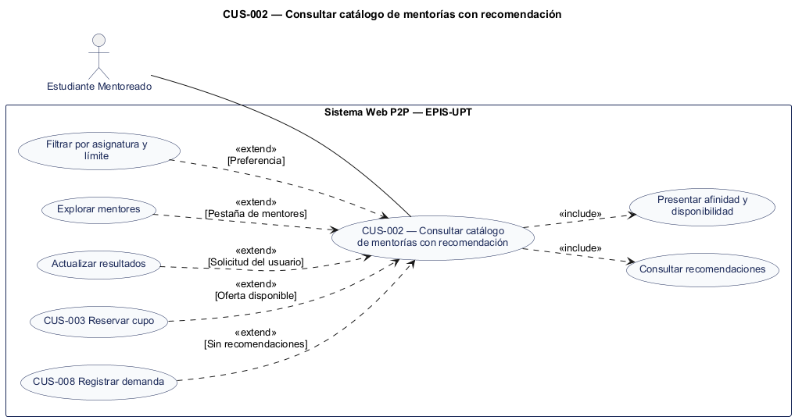

Fuente PlantUML: [CUS-002_caso_de_uso.puml](docs/narrativas/diagramas/plantuml/CUS-002_caso_de_uso.puml).

Fuente: Elaboración propia.

---

### CUS-003 — Reservar cupo para sesión de mentoría

#### 7.1. Ficha descriptiva

| Atributo | Detalle |
|---|---|
| **Id Caso de Uso** | **UC-003** (CUS-003) |
| **Nombre** | Reservar cupo para sesión de mentoría |
| **Tipo** | Obligatorio |
| **Requisito ID (RF)** | RF-012; RN-04, RN-05, RN-08 |
| **Versión** | 2.3 (DOC-H02 — consolidación) |
| **Autor** | Antayhua Mamani, Renzo Antonio / Medina Quispe, Joan Cristian |
| **Actores** | Estudiante Mentoreado |
| **Interacción** | Interacción web institucional; comportamiento descrito conforme a la evidencia identificada. |
| **Descripción** | Permite reservar provisionalmente una plaza de una sesión publicada, verificando aforo y condiciones de inscripción. |
| **Referencias** | SWEBOK v3.0, ISO/IEC/IEEE 29148:2018, SRS y reglas de negocio EPIS-UPT. |
| **Precondiciones** | Sesión institucional Mentoreado; oferta publicada, disponible y dentro de ventana de reserva; no ser mentor titular. |
| **Postcondiciones** | Reserva PENDIENTE_CONFIRMACION con identificador, fecha y cupo ocupado; requiere ratificación CUS-004. |

**Estado de evidencia:** Implementación identificada; revisión estática.

#### 7.2. Flujo normal de eventos

| **Acción del Actor** | **Respuesta del Sistema** |
|---|---|
| **Fase 1: Selección de oferta** |  |
| **1.** Desde «Explorar mentorías», selecciona una sesión con vacantes mediante «Reservar Cupo». |  |
|  | **2.** Abre ventana «Reserva de Cupo de Mentoría» / «Confirmar Reserva de Cupo» con información de la sesión seleccionada. Si no hay oferta válida, E001. |
| **Fase 2: Revisión de la sesión** |  |
| **3.** Revisa asignatura, tema, mentor, fecha, modalidad, infraestructura y disponibilidad mostrada. |  |
|  | **4.** Presenta información institucional: reserva PENDIENTE_CONFIRMACION y obligación de ratificar antes de las 24 h previas al inicio. Si se detecta autoreserva, E002; sin vacantes, E003; fuera de plazo, E004. |
| **5.** Decide continuar o cancelar (A001). |  |
|  | **6.** Mantiene habilitado «Confirmar Reserva de Cupo» únicamente cuando las condiciones del formulario lo permiten. |
| **Fase 3: Registro** |  |
| **7.** Presiona «Confirmar Reserva de Cupo». |  |
|  | **8.** Muestra «Procesando reserva...»; comprueba identidad, sesión, ventana, duplicidad y disponibilidad. Si ya posee una reserva incompatible, E005; si otra persona ocupó la última plaza, E003. |
| **9.** Espera el resultado. |  |
|  | **10.** Registra el cupo provisional y actualiza la disponibilidad. Si hay fallo, E006. |
| **Fase 4: Confirmación** |  |
| **11.** Revisa «¡Cupo Reservado Exitosamente!». |  |
|  | **12.** Presenta la confirmación de reserva provisional, sus datos y el compromiso de ratificación. Ofrece «Entendido, Cerrar» y «Ver Mis Reservas». |
| **13.** Presiona «Ver Mis Reservas» o cierra el diálogo. |  |
|  | **14.** Abre «Mis reservas» o retorna a la cartelera; la reserva queda pendiente de confirmación (CUS-004). |

#### 7.3. Flujos alternativos

##### A001: Cancelar antes de confirmar

* **Paso origen:** 6.
* **Condición de activación:** Cuadro abierto sin envío.

| **Acción del Actor** | **Respuesta del Sistema** |
|---|---|
| **A001-1.** Presiona «Cancelar» o cierra el cuadro antes de enviar. |  |
|  | **A001-2.** Cierra sin registrar reserva. |
| **A001-3.** Retorna a la cartelera. |  |

##### A002: Registrar demanda por aforo

* **Paso origen:** Flujo normal, en la operación indicada por la condición.
* **Condición de activación:** Cuadro de reserva detecta aforo agotado.

| **Acción del Actor** | **Respuesta del Sistema** |
|---|---|
| **A002-1.** Presiona «Registrar Solicitud por Demanda» si se ofrece. |  |
|  | **A002-2.** Cierra el cuadro y abre el formulario CUS-008. |
| **A002-3.** Selecciona curso y tema. |  |

##### A003: Consultar reserva después del éxito

* **Paso origen:** Flujo normal, en la operación indicada por la condición.
* **Condición de activación:** Confirmación visible.

| **Acción del Actor** | **Respuesta del Sistema** |
|---|---|
| **A003-1.** Presiona «Ver Mis Reservas». |  |
|  | **A003-2.** Abre la bandeja personal con el registro disponible. |
| **A003-3.** Revisa estado y fecha límite de ratificación. |  |

#### 7.4. Flujos de excepción

##### E001: Oferta no seleccionada o sesión inválida

* **Paso origen:** 2.
* **Condición de activación:** Sin oferta o sesión no apta.

| **Acción del Actor** | **Respuesta del Sistema** |
|---|---|
|  | **E001-1.** Muestra «Ninguna Sesión Seleccionada» o rechazo correspondiente. |
| **E001-2.** Cierra y elige otra oferta. |  |

##### E002: Autoreserva

* **Paso origen:** 4.
* **Condición de activación:** Usuario es mentor titular.

| **Acción del Actor** | **Respuesta del Sistema** |
|---|---|
|  | **E002-1.** Muestra «Restricción de Autoreserva» y no permite inscribirse. |
| **E002-2.** Selecciona otra sesión como mentoreado. |  |

##### E003: Aforo agotado

* **Paso origen:** 4, 8.
* **Condición de activación:** No quedan vacantes al consultar o registrar.

| **Acción del Actor** | **Respuesta del Sistema** |
|---|---|
|  | **E003-1.** Bloquea o rechaza la reserva y muestra motivo; puede orientar a demanda si está disponible. |
| **E003-2.** Elige otra sesión o registra demanda. |  |

##### E004: Ventana cerrada

* **Paso origen:** 4.
* **Condición de activación:** No cumple antelación requerida.

| **Acción del Actor** | **Respuesta del Sistema** |
|---|---|
|  | **E004-1.** Rechaza la inscripción o deshabilita el envío. |
| **E004-2.** Consulta una oferta vigente. |  |

##### E005: Reserva duplicada

* **Paso origen:** 8.
* **Condición de activación:** Ya existe inscripción incompatible.

| **Acción del Actor** | **Respuesta del Sistema** |
|---|---|
|  | **E005-1.** Rechaza el nuevo registro y comunica el motivo. |
| **E005-2.** Consulta Mis reservas. |  |

##### E006: Fallo de registro

* **Paso origen:** 10.
* **Condición de activación:** Error de comunicación o persistencia.

| **Acción del Actor** | **Respuesta del Sistema** |
|---|---|
|  | **E006-1.** Muestra error sin confirmación; restablece controles. |
| **E006-2.** Comprueba Mis reservas antes de reintentar. |  |

#### 7.5. Diagrama de flujo de actividades

**Figura 15. Diagrama de actividades — CUS-003: Reservar cupo para sesión de mentoría.**

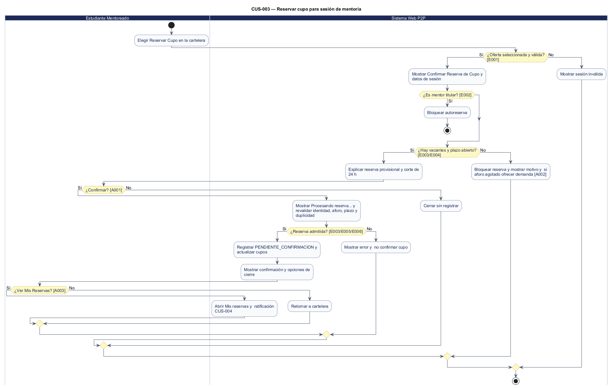

Fuente PlantUML: [CUS-003_actividades.puml](docs/narrativas/diagramas/plantuml/CUS-003_actividades.puml).

Fuente: Elaboración propia.

#### 7.6. Diagrama de caso de uso

**Figura 16. Diagrama de caso de uso — CUS-003: Reservar cupo para sesión de mentoría.**

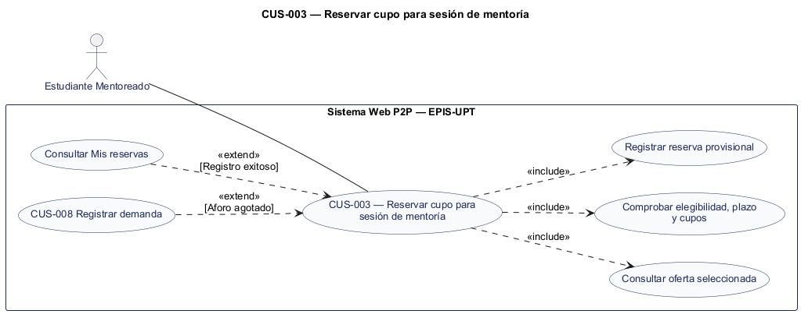

Fuente PlantUML: [CUS-003_caso_de_uso.puml](docs/narrativas/diagramas/plantuml/CUS-003_caso_de_uso.puml).

Fuente: Elaboración propia.

---

### CUS-004 — Ratificar asistencia a sesión de mentoría (T-24h)

#### 7.1. Ficha descriptiva

| Atributo | Detalle |
|---|---|
| **Id Caso de Uso** | **UC-004** (CUS-004) |
| **Nombre** | Ratificar asistencia a sesión de mentoría (T-24h) |
| **Tipo** | Obligatorio |
| **Requisito ID (RF)** | RF-013; RN-08, RN-09 |
| **Versión** | 2.3 (DOC-H02 — consolidación) |
| **Autor** | Antayhua Mamani, Renzo Antonio / Medina Quispe, Joan Cristian |
| **Actores** | Estudiante Mentoreado |
| **Interacción** | Interacción web institucional; comportamiento descrito conforme a la evidencia identificada. |
| **Descripción** | Permite ratificar una reserva provisional antes del corte de 24 horas para que compute en el quórum de la sesión. |
| **Referencias** | SWEBOK v3.0, ISO/IEC/IEEE 29148:2018, SRS y reglas de negocio EPIS-UPT. |
| **Precondiciones** | Sesión institucional, reserva propia PENDIENTE_CONFIRMACION y más de 24 horas hasta el inicio. |
| **Postcondiciones** | Reserva CONFIRMADA con fecha de ratificación; queda contabilizada para quórum sin garantizar por sí sola realización de sesión. |

**Estado de evidencia:** Implementación identificada; revisión estática.

#### 7.2. Flujo normal de eventos

| **Acción del Actor** | **Respuesta del Sistema** |
|---|---|
| **Fase 1: Acceso a reservas** |  |
| **1.** Selecciona «Mis reservas». |  |
|  | **2.** Muestra «Mis Reservas de Mentoría», botón «Actualizar», «+ Buscar Mentorías» y filtros de estados. Si no hay sesión válida, E001; si no carga, E004. |
| **3.** Selecciona el filtro de pendientes y revisa una reserva. |  |
|  | **4.** Presenta código, asignatura, fecha, modalidad, espacio, mentor, estado y corte definitivo. Ofrece «Confirmar Asistencia» mientras la ventana esté abierta; si cerró, E002. |
| **Fase 2: Ratificación** |  |
| **5.** Pulsa «✓ Confirmar Asistencia». |  |
|  | **6.** Abre «Ratificar Asistencia a Mentoría», identifica sesión y horario, explica compromiso de asistencia y quórum; ofrece «Cancelar» y «Confirmar Asistencia». |
| **7.** Lee el compromiso y confirma. |  |
|  | **8.** Muestra «Ratificando asistencia...», comprueba titularidad, estado y plazo. Si estado cambió, E003. |
| **Fase 3: Confirmación** |  |
| **9.** Espera el resultado. |  |
|  | **10.** Actualiza la reserva a CONFIRMADA y registra la fecha de ratificación; si falla, E004. |
| **11.** Revisa la tarjeta. |  |
|  | **12.** Muestra «Ratificación registrada el:» con fecha y nuevo estado; informa que la realización depende del quórum al corte. Puede desistir dentro del plazo mediante CUS-024. |

#### 7.3. Flujos alternativos

##### A001: Cancelar diálogo

* **Paso origen:** Flujo normal, en la operación indicada por la condición.
* **Condición de activación:** Antes de confirmar.

| **Acción del Actor** | **Respuesta del Sistema** |
|---|---|
| **A001-1.** Pulsa «Cancelar» o cierre. |  |
|  | **A001-2.** Cierra sin ratificar. |
| **A001-3.** Mantiene reserva provisional. |  |

##### A002: Consultar una reserva ya ratificada

* **Paso origen:** Flujo normal, en la operación indicada por la condición.
* **Condición de activación:** Reserva CONFIRMADA.

| **Acción del Actor** | **Respuesta del Sistema** |
|---|---|
| **A002-1.** Selecciona filtro de confirmadas. |  |
|  | **A002-2.** Muestra fecha y estado sin solicitar otra ratificación. |
| **A002-3.** Consulta el resultado. |  |

#### 7.4. Flujos de excepción

##### E001: Sesión o titularidad inválida

* **Paso origen:** 2.
* **Condición de activación:** No autorizado.

| **Acción del Actor** | **Respuesta del Sistema** |
|---|---|
|  | **E001-1.** Restringe vista o rechaza operación. |
| **E001-2.** Inicia sesión con la cuenta titular. |  |

##### E002: Corte alcanzado

* **Paso origen:** 4.
* **Condición de activación:** Faltan 24 h o menos.

| **Acción del Actor** | **Respuesta del Sistema** |
|---|---|
|  | **E002-1.** Muestra «Plazo Vencido (Cierre 24h)» y no permite ratificar. |
| **E002-2.** Consulta estado tras el corte. |  |

##### E003: Estado incompatible

* **Paso origen:** 8.
* **Condición de activación:** Reserva cancelada o modificada.

| **Acción del Actor** | **Respuesta del Sistema** |
|---|---|
|  | **E003-1.** Rechaza la acción y conserva el estado real. |
| **E003-2.** Actualiza Mis reservas. |  |

##### E004: Fallo de consulta o ratificación

* **Paso origen:** 2, 10.
* **Condición de activación:** Problema de servicio.

| **Acción del Actor** | **Respuesta del Sistema** |
|---|---|
|  | **E004-1.** Muestra error y permite reintentar si corresponde. |
| **E004-2.** Actualiza la reserva antes de repetir. |  |

#### 7.5. Diagrama de flujo de actividades

**Figura 17. Diagrama de actividades — CUS-004: Ratificar asistencia a sesión de mentoría (T-24h).**

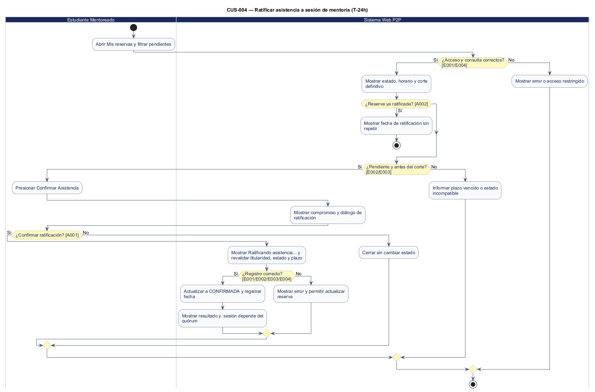

Fuente PlantUML: [CUS-004_actividades.puml](docs/narrativas/diagramas/plantuml/CUS-004_actividades.puml).

Fuente: Elaboración propia.

#### 7.6. Diagrama de caso de uso

**Figura 18. Diagrama de caso de uso — CUS-004: Ratificar asistencia a sesión de mentoría (T-24h).**

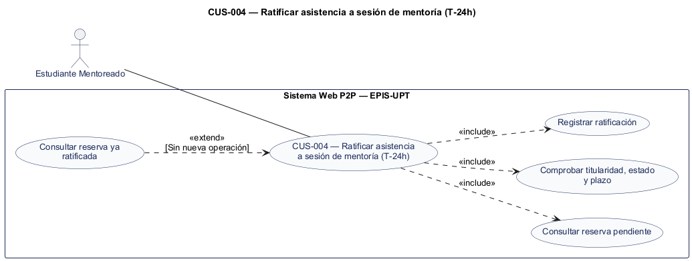

Fuente PlantUML: [CUS-004_caso_de_uso.puml](docs/narrativas/diagramas/plantuml/CUS-004_caso_de_uso.puml).

Fuente: Elaboración propia.

---

### CUS-023 — Evaluar quórum y ejecutar corte automático (T-24h)

#### 7.1. Ficha descriptiva

| Atributo | Detalle |
|---|---|
| **Id Caso de Uso** | **UC-023** (CUS-023) |
| **Nombre** | Evaluar quórum y ejecutar corte automático (T-24h) |
| **Tipo** | Obligatorio |
| **Requisito ID (RF)** | RF-015, RF-016; RN-08, RN-09, RN-10 |
| **Versión** | 2.3 (DOC-H02 — consolidación) |
| **Autor** | Antayhua Mamani, Renzo Antonio / Medina Quispe, Joan Cristian |
| **Actores** | Sistema (proceso automático); Administrador institucional (supervisión); Estudiante Mentor (resolución posterior) |
| **Interacción** | Interacción web institucional; comportamiento descrito conforme a la evidencia identificada. |
| **Descripción** | Determina al corte de 24 horas si una sesión alcanza el mínimo de reservas ratificadas, invalida reservas no confirmadas y deriva contingencias al mentor. |
| **Referencias** | SWEBOK v3.0, ISO/IEC/IEEE 29148:2018, SRS y reglas de negocio EPIS-UPT. |
| **Precondiciones** | Sesión en estado evaluable; fecha de inicio y reservas disponibles; porcentaje mínimo configurado (referencia 50 %). |
| **Postcondiciones** | Sesión CONFIRMADA o QUORUM_INSUFICIENTE según evaluación; reservas sin ratificación canceladas según reglas; evaluación registrada sin repetir efectos. |

**Estado de evidencia:** Evaluación identificada; ejecución periódica en entorno real no certificada.

#### 7.2. Flujo normal de eventos

| **Acción del Actor** | **Respuesta del Sistema** |
|---|---|
| **Fase 1: Inicio del corte** |  |
| **1.** El proceso programado alcanza la ventana de evaluación a 24 horas del inicio (sin acción manual del estudiante). |  |
|  | **2.** Identifica sesiones evaluables cuyo corte se ha alcanzado; excluye sesiones que no corresponden o ya fueron evaluadas (A001). |
| **3.** El sistema ejecuta la evaluación. |  |
|  | **4.** Cuenta reservas ratificadas y aforo; calcula el mínimo a partir del porcentaje configurado. Referencia: 5 de 10 presencial y 10 de 20 virtual con 50 %. |
| **Fase 2: Resultado del quórum** |  |
| **5.** No se requiere intervención del estudiante. |  |
|  | **6.** Si se alcanza el mínimo, confirma la sesión y cancela las reservas provisionales no ratificadas con el estado correspondiente. Si no se alcanza, A002. |
| **7.** El proceso completa la evaluación. |  |
|  | **8.** Conserva el resultado y evita volver a aplicar los cambios si se ejecuta nuevamente; si falla, E002. |
| **Fase 3: Supervisión** |  |
| **9.** El administrador abre «Administración» > «Monitoreo de Quórum». |  |
|  | **10.** Muestra «Supervisión de Quórum y Sesiones EPIS», tarjetas con inscritos, ratificados, mínimo y porcentaje configurado; permite «Actualizar». |
| **11.** El mentor revisa «Mis sesiones» y el estado de sus ofertas. |  |
|  | **12.** Presenta el estado de inscripción/quórum; ante insuficiencia ofrece la gestión de contingencia descrita en A002. Los estudiantes pueden revisar sus reservas en «Mis reservas». |

#### 7.3. Flujos alternativos

##### A001: Sesión ya evaluada

* **Paso origen:** 2.
* **Condición de activación:** Existe resultado de corte.

| **Acción del Actor** | **Respuesta del Sistema** |
|---|---|
| **A001-1.** El proceso vuelve a solicitar evaluación. |  |
|  | **A001-2.** Conserva el resultado sin repetir cambios de estado. |
| **A001-3.** Continúa con otras sesiones. |  |

##### A002: Quórum insuficiente

* **Paso origen:** 6, 12.
* **Condición de activación:** Ratificados por debajo del mínimo.

| **Acción del Actor** | **Respuesta del Sistema** |
|---|---|
| **A002-1.** El mentor consulta la sesión en Mis sesiones. |  |
|  | **A002-2.** Establece QUORUM_INSUFICIENTE y ofrece decisión: «Dictar de Todas Formas», «Reprogramar Sesión» o «Cancelar Sesión Definitivamente». |
| **A002-3.** El mentor selecciona una decisión según las reglas y confirma; el sistema procesa continuidad, nueva fecha válida o cancelación con motivo y liberación de inscritos. Si reprograma, exige nueva antelación superior a 24 h y aula disponible si presencial. |  |

##### A003: Supervisar sin modificar

* **Paso origen:** Flujo normal, en la operación indicada por la condición.
* **Condición de activación:** Administrador consulta panel.

| **Acción del Actor** | **Respuesta del Sistema** |
|---|---|
| **A003-1.** Pulsa «Actualizar». |  |
|  | **A003-2.** Renueva indicadores y estados sin que esa consulta implique forzar una evaluación. |
| **A003-3.** Revisa resultados. |  |

#### 7.4. Flujos de excepción

##### E001: Evaluación no procedente

* **Paso origen:** Flujo normal, en la operación indicada por la condición.
* **Condición de activación:** Antes del corte o estado no evaluable.

| **Acción del Actor** | **Respuesta del Sistema** |
|---|---|
|  | **E001-1.** No debe cambiar una sesión fuera de las condiciones admitidas. |
| **E001-2.** Consulta más tarde el estado correspondiente. |  |

##### E002: Fallo de evaluación

* **Paso origen:** 8.
* **Condición de activación:** Error durante procesamiento.

| **Acción del Actor** | **Respuesta del Sistema** |
|---|---|
|  | **E002-1.** No acredita un resultado exitoso; el proceso debe conservar coherencia y permitir recuperación. |
| **E002-2.** Verifica estado y registros antes de reejecutar. |  |

##### E003: Contingencia inválida

* **Paso origen:** Flujo normal, en la operación indicada por la condición.
* **Condición de activación:** Nueva fecha insuficiente, aula ocupada, falta motivo o decisión no autorizada.

| **Acción del Actor** | **Respuesta del Sistema** |
|---|---|
|  | **E003-1.** Rechaza la decisión y comunica el motivo. |
| **E003-2.** Corrige la opción y revisa la sesión. |  |

#### 7.5. Diagrama de flujo de actividades

**Figura 19. Diagrama de actividades — CUS-023: Evaluar quórum y ejecutar corte automático (T-24h).**

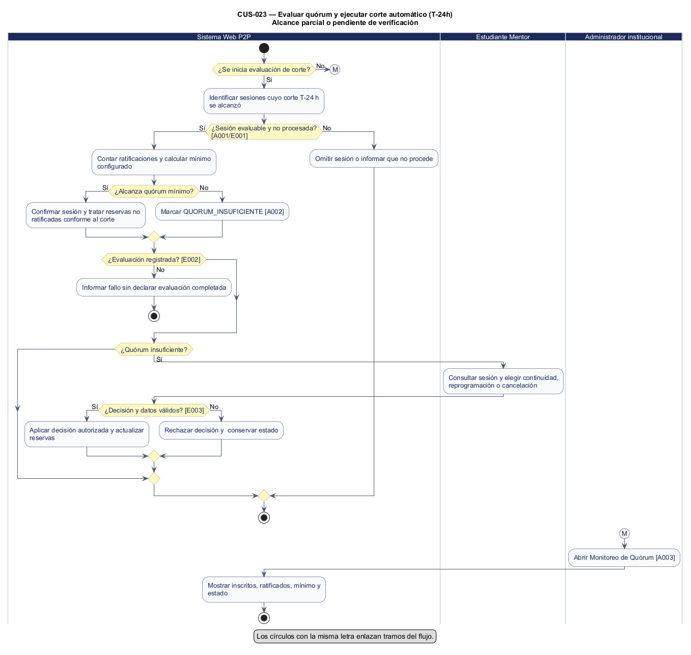

Fuente PlantUML: [CUS-023_actividades.puml](docs/narrativas/diagramas/plantuml/CUS-023_actividades.puml).

Fuente: Elaboración propia.

#### 7.6. Diagrama de caso de uso

**Figura 20. Diagrama de caso de uso — CUS-023: Evaluar quórum y ejecutar corte automático (T-24h).**

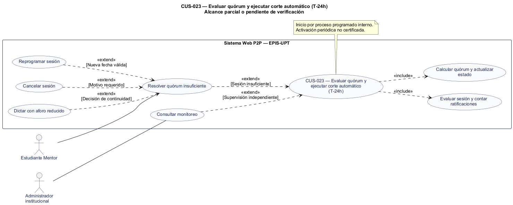

Fuente PlantUML: [CUS-023_caso_de_uso.puml](docs/narrativas/diagramas/plantuml/CUS-023_caso_de_uso.puml).

Fuente: Elaboración propia.

---

### CUS-024 — Cancelar reserva de cupo por estudiante

#### 7.1. Ficha descriptiva

| Atributo | Detalle |
|---|---|
| **Id Caso de Uso** | **UC-024** (CUS-024) |
| **Nombre** | Cancelar reserva de cupo por estudiante |
| **Tipo** | Opcional |
| **Requisito ID (RF)** | RF-014; RN-08, RN-10 |
| **Versión** | 2.3 (DOC-H02 — consolidación) |
| **Autor** | Antayhua Mamani, Renzo Antonio / Medina Quispe, Joan Cristian |
| **Actores** | Estudiante Mentoreado |
| **Interacción** | Interacción web institucional; comportamiento descrito conforme a la evidencia identificada. |
| **Descripción** | Permite desistir voluntariamente de una reserva propia antes del corte, liberando la plaza para otro estudiante. |
| **Referencias** | SWEBOK v3.0, ISO/IEC/IEEE 29148:2018, SRS y reglas de negocio EPIS-UPT. |
| **Precondiciones** | Sesión institucional; reserva activa propia y más de 24 horas de antelación. |
| **Postcondiciones** | Reserva CANCELADA_USUARIO y plaza liberada; sin penalización conforme a la política de desistimiento oportuno. |

**Estado de evidencia:** Implementación identificada; revisión estática.

#### 7.2. Flujo normal de eventos

| **Acción del Actor** | **Respuesta del Sistema** |
|---|---|
| **Fase 1: Identificación de reserva** |  |
| **1.** Abre «Mis reservas» y consulta reservas activas. |  |
|  | **2.** Presenta tarjetas con código, estado, datos de la sesión y fecha de corte; habilita «Cancelar Reserva / Desistir» si procede. |
| **3.** Selecciona la reserva a cancelar. |  |
|  | **4.** Si está cerrada la ventana, E001; si ya no es activa, E002. |
| **Fase 2: Confirmación del desistimiento** |  |
| **5.** Presiona «Cancelar Reserva / Desistir». |  |
|  | **6.** Abre «Desistimiento Voluntario de Cupo» con sesión, horario, política de cancelación sin penalización antes del corte y aviso de acción irreversible. Muestra campo «Motivo de desistimiento (opcional)», «Volver» y «Confirmar Desistimiento». |
| **7.** Ingresa un motivo si desea y confirma. |  |
|  | **8.** Muestra «Procesando desistimiento...», comprueba titularidad, estado y plazo. Si no puede completar, E003. |
| **Fase 3: Resultado** |  |
| **9.** Espera confirmación. |  |
|  | **10.** Registra CANCELADA_USUARIO y libera el cupo; presenta resultado y actualiza la bandeja. |
| **11.** Consulta el histórico. |  |
|  | **12.** Muestra la reserva cancelada; para volver a inscribirse debe realizar una nueva reserva si aún existe disponibilidad. |

#### 7.3. Flujos alternativos

##### A001: Volver sin cancelar

* **Paso origen:** Flujo normal, en la operación indicada por la condición.
* **Condición de activación:** Diálogo abierto.

| **Acción del Actor** | **Respuesta del Sistema** |
|---|---|
| **A001-1.** Pulsa «Volver» o cierre antes de enviar. |  |
|  | **A001-2.** Cierra sin modificar el estado. |
| **A001-3.** Retorna a Mis reservas. |  |

##### A002: Motivo omitido

* **Paso origen:** Flujo normal, en la operación indicada por la condición.
* **Condición de activación:** Campo opcional.

| **Acción del Actor** | **Respuesta del Sistema** |
|---|---|
| **A002-1.** Confirma sin escribir motivo. |  |
|  | **A002-2.** Admite la cancelación con la información de desistimiento disponible. |
| **A002-3.** Consulta resultado. |  |

#### 7.4. Flujos de excepción

##### E001: Corte vencido

* **Paso origen:** 4.
* **Condición de activación:** 24 h o menos.

| **Acción del Actor** | **Respuesta del Sistema** |
|---|---|
|  | **E001-1.** Muestra «Desistimiento Cerrado (Cierre 24h)» o rechazo equivalente. |
| **E001-2.** Consulta la política institucional; no fuerza la cancelación. |  |

##### E002: Reserva no activa o no propia

* **Paso origen:** 4.
* **Condición de activación:** Estado o titularidad incompatible.

| **Acción del Actor** | **Respuesta del Sistema** |
|---|---|
|  | **E002-1.** Rechaza la acción o muestra «Reserva no activa». |
| **E002-2.** Actualiza Mis reservas. |  |

##### E003: Fallo de comunicación

* **Paso origen:** 8.
* **Condición de activación:** No se obtiene confirmación.

| **Acción del Actor** | **Respuesta del Sistema** |
|---|---|
|  | **E003-1.** Muestra error y restablece los controles. |
| **E003-2.** Actualiza antes de repetir para verificar si ya se canceló. |  |

#### 7.5. Diagrama de flujo de actividades

**Figura 21. Diagrama de actividades — CUS-024: Cancelar reserva de cupo por estudiante.**

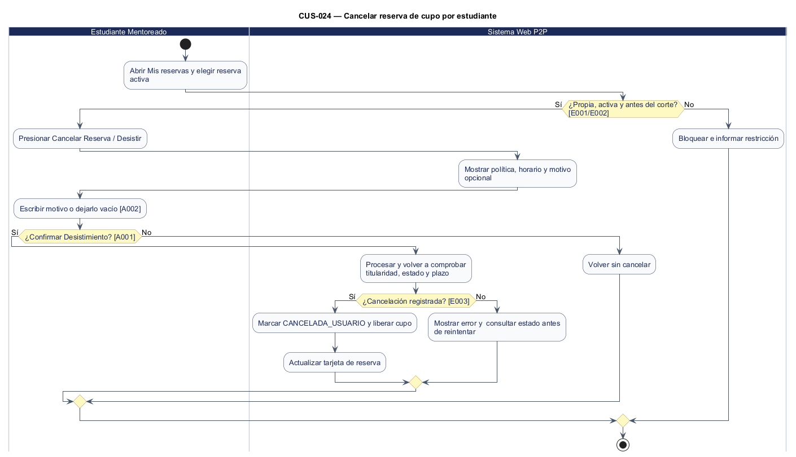

Fuente PlantUML: [CUS-024_actividades.puml](docs/narrativas/diagramas/plantuml/CUS-024_actividades.puml).

Fuente: Elaboración propia.

#### 7.6. Diagrama de caso de uso

**Figura 22. Diagrama de caso de uso — CUS-024: Cancelar reserva de cupo por estudiante.**

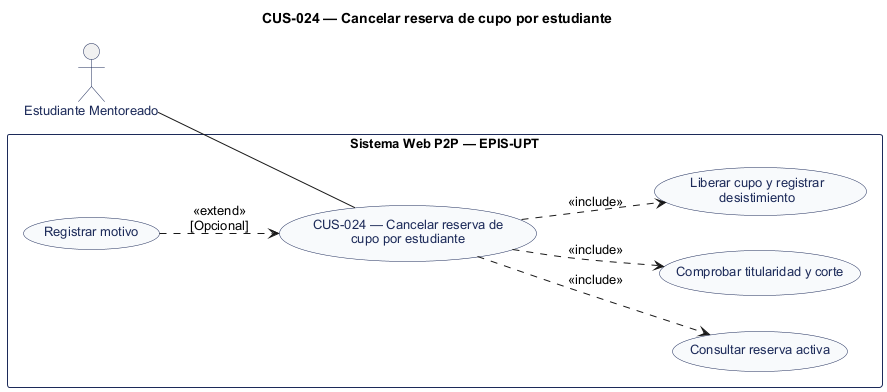

Fuente PlantUML: [CUS-024_caso_de_uso.puml](docs/narrativas/diagramas/plantuml/CUS-024_caso_de_uso.puml).

Fuente: Elaboración propia.

---

## MOD-04: Ejecución y Seguimiento Académico

### CUS-007 — Registrar asistencia y bitácora pedagógica

#### 7.1. Ficha descriptiva

| Atributo | Detalle |
|---|---|
| **Id Caso de Uso** | **UC-007** (CUS-007) |
| **Nombre** | Registrar asistencia y bitácora pedagógica |
| **Tipo** | Obligatorio |
| **Requisito ID (RF)** | RF-017, RF-018; RN-12 |
| **Versión** | 2.3 (DOC-H02 — consolidación) |
| **Autor** | Antayhua Mamani, Renzo Antonio / Medina Quispe, Joan Cristian |
| **Actores** | Estudiante Mentor; Estudiante Mentoreado |
| **Interacción** | Interacción web institucional; comportamiento descrito conforme a la evidencia identificada. |
| **Descripción** | Permite registrar asistencia a una mentoría mediante código temporal y documentar los contenidos impartidos y resultados de la sesión. |
| **Referencias** | SWEBOK v3.0, ISO/IEC/IEEE 29148:2018, SRS y reglas de negocio EPIS-UPT. |
| **Precondiciones** | Sesión autorizada, estudiantes inscritos y confirmados para asistencia; mentor titular; bitácora dentro de ventana de 48 horas posterior a la sesión. |
| **Postcondiciones** | Asistencia de estudiantes registrada; bitácora sellada con horas declaradas en espera del visado institucional. |

**Estado de evidencia:** Implementación identificada; revisión estática.

#### 7.2. Flujo normal de eventos

| **Acción del Actor** | **Respuesta del Sistema** |
|---|---|
| **Fase 1: Inicio del control de asistencia** |  |
| **1.** El mentor accede a «Mis sesiones», identifica la sesión y selecciona «📱 Asistencia». |  |
|  | **2.** Muestra «Control de Asistencia Digital · Modo Mentor», título de la sesión, panel «Proyección de Código QR Dinámico», código numérico de respaldo de seis dígitos y ciclo de validez. Si falla la consulta, E001. |
| **3.** Proyecta el código para los participantes. |  |
|  | **4.** Actualiza periódicamente el código temporal y muestra nómina de inscritos con estados «Presente», «Por registrar» o «Ausente»; permite «Actualizar». |
| **Fase 2: Registro del estudiante** |  |
| **5.** El mentoreado abre «Mis reservas» y pulsa «Registrar Asistencia (TOTP / QR)» cuando esté disponible. |  |
|  | **6.** Abre «Check-in de Asistencia en Vivo (RF17)» e identifica la sesión. Muestra campo «Código TOTP (6 dígitos) o contenido del QR» y controles de envío y cancelación. |
| **7.** Ingresa el código proyectado y envía el registro. |  |
|  | **8.** Comprueba identidad, reserva, ventana de asistencia y código vigente; si no es válido, E002; si no es elegible, E003. |
| **9.** Espera el resultado y consulta su reserva. |  |
|  | **10.** Registra asistencia si la validación concluye correctamente; actualiza el estado correspondiente. El mentor puede actualizar su nómina para verificar el resultado. |
| **Fase 3: Registro pedagógico posterior** |  |
| **11.** El mentor, una vez finalizada la sesión, selecciona «📝 Bitácora» en su sesión. |  |
|  | **12.** Muestra «Bitácora Pedagógica de Mentoría», identificación de sesión y formulario de registro pedagógico. Si se superaron 48 horas, E004. |
| **13.** Selecciona «1. Temas Silábicos Desarrollados en la Sesión» mediante las opciones disponibles. |  |
|  | **14.** Permite marcar los temas cubiertos y agregar un tema específico mediante «Agregar» (A002). |
| **15.** Selecciona «2. Nivel de Dificultad Percibido del Grupo»: Bajo, Medio o Alto. |  |
|  | **16.** Conserva la valoración de dificultad. |
| **17.** Completa «3. Observaciones Pedagógicas y Conclusiones». |  |
|  | **18.** Muestra contador de caracteres, exige al menos 50 caracteres de observación y conserva la descripción de ejercicios, dificultades y recomendaciones. |
| **19.** Marca «Declaración Jurada de Veracidad Académica» y pulsa «Firmar y Registrar Bitácora». |  |
|  | **20.** Comprueba campos, titularidad y plazo; muestra «Sellando Criptográficamente...» durante el registro. Si faltan datos, E005; si falla, E006. |
| **21.** Revisa el resultado. |  |
|  | **22.** Presenta «Bitácora Pedagógica Registrada y Sellada con Éxito», código, temas cubiertos, horas declaradas y firma de integridad; indica que las horas quedan a la espera del visado de Dirección. No acredita horas definitivamente sin CUS-019. |

#### 7.3. Flujos alternativos

##### A001: Código numérico en lugar de QR

* **Paso origen:** Flujo normal, en la operación indicada por la condición.
* **Condición de activación:** Participante no puede escanear.

| **Acción del Actor** | **Respuesta del Sistema** |
|---|---|
| **A001-1.** Ingresa los seis dígitos proyectados o el contenido del QR en el campo habilitado. |  |
|  | **A001-2.** Valida el registro con las mismas condiciones de asistencia. |
| **A001-3.** Consulta el resultado; la disponibilidad efectiva de escaneo con cámara requiere prueba. |  |

##### A002: Tema adicional

* **Paso origen:** 14.
* **Condición de activación:** Bitácora abierta.

| **Acción del Actor** | **Respuesta del Sistema** |
|---|---|
| **A002-1.** Escribe un tema específico y pulsa «Agregar». |  |
|  | **A002-2.** Incorpora el tema al conjunto de contenidos registrados. |
| **A002-3.** Continúa con dificultad y observaciones. |  |

##### A003: Consultar nómina

* **Paso origen:** Flujo normal, en la operación indicada por la condición.
* **Condición de activación:** Mentor en control de asistencia.

| **Acción del Actor** | **Respuesta del Sistema** |
|---|---|
| **A003-1.** Presiona «Actualizar». |  |
|  | **A003-2.** Recupera estados de inscritos. |
| **A003-3.** Revisa sin registrar asistencia en nombre del estudiante. |  |

#### 7.4. Flujos de excepción

##### E001: Control no disponible

* **Paso origen:** 2.
* **Condición de activación:** Sesión inválida, sin autorización o fallo de consulta.

| **Acción del Actor** | **Respuesta del Sistema** |
|---|---|
|  | **E001-1.** No presenta un código o nómina como válidos si no puede obtenerlos; informa error disponible. |
| **E001-2.** Verifica sesión y reintenta. |  |

##### E002: Código inválido o vencido

* **Paso origen:** 8.
* **Condición de activación:** Código no coincide o pierde vigencia.

| **Acción del Actor** | **Respuesta del Sistema** |
|---|---|
|  | **E002-1.** Rechaza registro de asistencia. |
| **E002-2.** Solicita el código actual al mentor y vuelve a introducirlo. |  |

##### E003: Estudiante no elegible

* **Paso origen:** 8.
* **Condición de activación:** Sin reserva confirmada, fuera de ventana o identidad incorrecta.

| **Acción del Actor** | **Respuesta del Sistema** |
|---|---|
|  | **E003-1.** Rechaza asistencia y comunica motivo. |
| **E003-2.** Consulta su reserva y condiciones. |  |

##### E004: Plazo de bitácora vencido

* **Paso origen:** 12.
* **Condición de activación:** Más de 48 h desde fin.

| **Acción del Actor** | **Respuesta del Sistema** |
|---|---|
|  | **E004-1.** Muestra «Formulario Bloqueado: Plazo Ordinario de 48 Horas Expirado». |
| **E004-2.** Consulta a Dirección; no se acredita reapertura en la aplicación. |  |

##### E005: Bitácora incompleta

* **Paso origen:** 20.
* **Condición de activación:** Faltan temas, declaración u observaciones suficientes.

| **Acción del Actor** | **Respuesta del Sistema** |
|---|---|
|  | **E005-1.** Mantiene envío bloqueado o rechaza el registro. |
| **E005-2.** Completa los campos y confirma. |  |

##### E006: Fallo de registro

* **Paso origen:** 20.
* **Condición de activación:** Error al sellar o guardar.

| **Acción del Actor** | **Respuesta del Sistema** |
|---|---|
|  | **E006-1.** Muestra error sin acreditar horas ni asistencia nueva. |
| **E006-2.** Verifica el estado antes de reintentar. |  |

#### 7.5. Diagrama de flujo de actividades

**Figura 23. Diagrama de actividades — CUS-007: Registrar asistencia y bitácora pedagógica.**

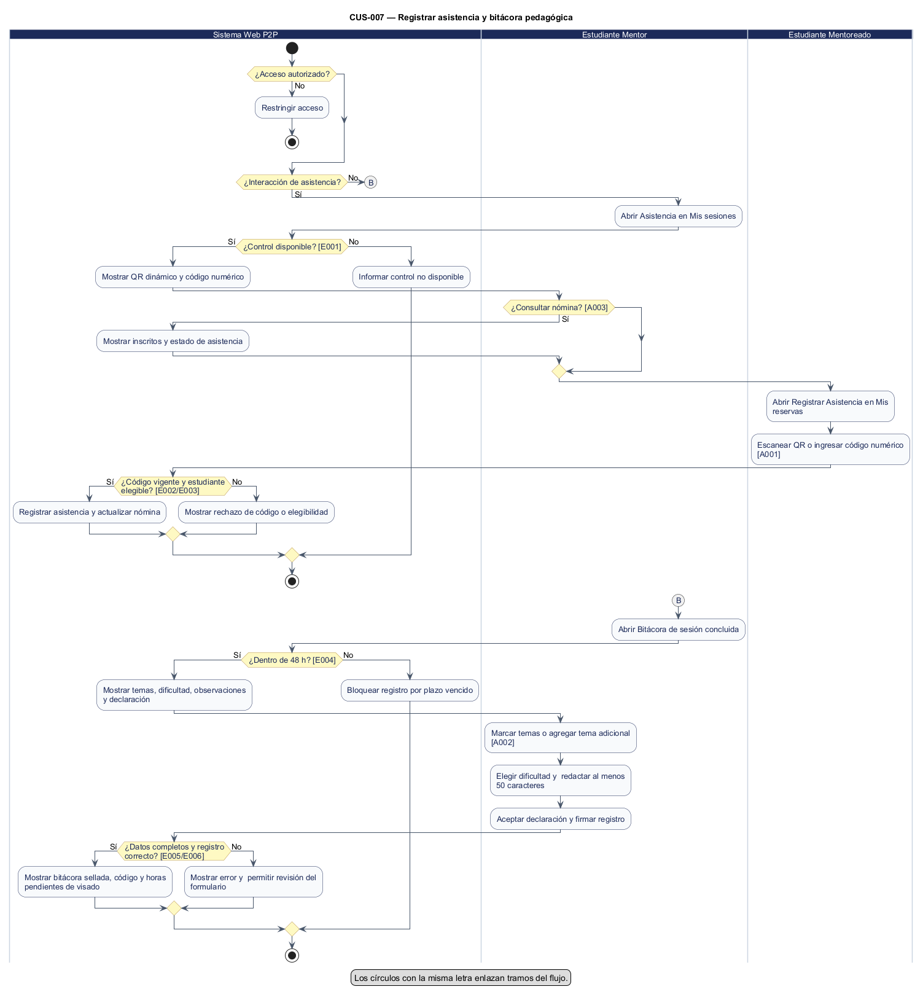

Fuente PlantUML: [CUS-007_actividades.puml](docs/narrativas/diagramas/plantuml/CUS-007_actividades.puml).

Fuente: Elaboración propia.

#### 7.6. Diagrama de caso de uso

**Figura 24. Diagrama de caso de uso — CUS-007: Registrar asistencia y bitácora pedagógica.**

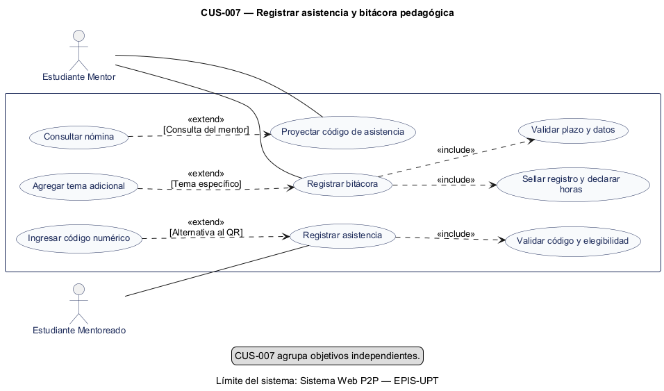

Fuente PlantUML: [CUS-007_caso_de_uso.puml](docs/narrativas/diagramas/plantuml/CUS-007_caso_de_uso.puml).

Fuente: Elaboración propia.

---

### CUS-012 — Registrar calificación y feedback bidireccional

#### 7.1. Ficha descriptiva

| Atributo | Detalle |
|---|---|
| **Id Caso de Uso** | **UC-012** (CUS-012) |
| **Nombre** | Registrar calificación y feedback bidireccional |
| **Tipo** | Opcional |
| **Requisito ID (RF)** | RF-020, RF-018; RN-12, RN-13 |
| **Versión** | 2.3 (DOC-H02 — consolidación) |
| **Autor** | Antayhua Mamani, Renzo Antonio / Medina Quispe, Joan Cristian |
| **Actores** | Estudiante Mentoreado; Estudiante Mentor (retroalimentación cualitativa parcial) |
| **Interacción** | Interacción web institucional; comportamiento descrito conforme a la evidencia identificada. |
| **Descripción** | Permite al asistente evaluar la calidad de una sesión y al mentor consignar observaciones pedagógicas mediante la bitácora. La evaluación recíproca individual no está acreditada. |
| **Referencias** | SWEBOK v3.0, ISO/IEC/IEEE 29148:2018, SRS y reglas de negocio EPIS-UPT. |
| **Precondiciones** | Sesión concluida, asistencia registrada y ventana de encuesta vigente (24 h); mentor titular para bitácora. |
| **Postcondiciones** | Encuesta registrada correctamente y, por separado, observaciones del mentor mediante CUS-007. |

**Estado de evidencia:** Implementación parcial: encuesta del asistente y bitácora del mentor.

#### 7.2. Flujo normal de eventos

| **Acción del Actor** | **Respuesta del Sistema** |
|---|---|
| **Fase 1: Acceso a evaluación** |  |
| **1.** El estudiante abre «Mis reservas» y localiza una mentoría asistida. |  |
|  | **2.** Muestra datos de la sesión y «⭐ Evaluar Mentoría» si corresponde. Si el plazo cerró, E001; si no es elegible, E002. |
| **3.** Pulsa «Evaluar Mentoría». |  |
|  | **4.** Abre «Encuesta de Calidad Docente» con sesión y mentor, cuatro dimensiones y opción de retroalimentación. |
| **Fase 2: Calificación** |  |
| **5.** Selecciona entre una y cinco estrellas para «Puntualidad e Inicio de Sesión», «Dominio Conceptual y Temático», «Claridad Expositiva y Metodología Didáctica» y «Calificación General del Servicio de Mentoría». |  |
|  | **6.** Resalta las estrellas elegidas para cada criterio y conserva los valores; permite corregir antes del envío. |
| **7.** Escribe en «Retroalimentación y observaciones constructivas». |  |
|  | **8.** Comprueba que el texto tenga al menos 20 caracteres y que las cuatro dimensiones estén calificadas; mantiene el envío inactivo si faltan datos (E003). |
| **Fase 3: Registro de evaluación** |  |
| **9.** Revisa y envía la encuesta. |  |
|  | **10.** Comprueba elegibilidad, plazo y registro previo; si ya evaluó, E004; si falla, E005. |
| **11.** Consulta la confirmación. |  |
|  | **12.** Muestra «¡Gracias por tu Evaluación!» y permite «Cerrar Ventana»; conserva el resultado recibido. |
| **Fase 4: Retroalimentación del mentor (independiente)** |  |
| **13.** El mentor abre «Bitácora» en su sesión y registra dificultad del grupo, observaciones y recomendaciones, conforme a CUS-007. |  |
|  | **14.** Conserva la retroalimentación pedagógica de la sesión. No presenta un formulario de calificación individual de cada mentoreado. |

#### 7.3. Flujos alternativos

##### A001: Cancelar evaluación

* **Paso origen:** Flujo normal, en la operación indicada por la condición.
* **Condición de activación:** Antes del envío.

| **Acción del Actor** | **Respuesta del Sistema** |
|---|---|
| **A001-1.** Pulsa «Cancelar» o cierra la ventana. |  |
|  | **A001-2.** Cierra sin registrar encuesta. |
| **A001-3.** Puede volver mientras sea elegible. |  |

##### A002: Modificar calificación antes del envío

* **Paso origen:** Flujo normal, en la operación indicada por la condición.
* **Condición de activación:** Encuesta abierta.

| **Acción del Actor** | **Respuesta del Sistema** |
|---|---|
| **A002-1.** Selecciona otras estrellas o edita comentarios. |  |
|  | **A002-2.** Actualiza valores pendientes. |
| **A002-3.** Revisa y envía cuando complete los campos. |  |

#### 7.4. Flujos de excepción

##### E001: Ventana vencida

* **Paso origen:** 2.
* **Condición de activación:** Más de 24 h tras cierre.

| **Acción del Actor** | **Respuesta del Sistema** |
|---|---|
|  | **E001-1.** Muestra «Encuesta Cerrada (Plazo de 24h Vencido)» e impide enviar. |
| **E001-2.** Consulta historial. |  |

##### E002: Sin asistencia elegible

* **Paso origen:** 2.
* **Condición de activación:** No figura asistencia o sesión no concluida.

| **Acción del Actor** | **Respuesta del Sistema** |
|---|---|
|  | **E002-1.** No habilita o rechaza la encuesta. |
| **E002-2.** Verifica reserva y asistencia. |  |

##### E003: Encuesta incompleta

* **Paso origen:** 8.
* **Condición de activación:** Faltan estrellas o comentario mínimo.

| **Acción del Actor** | **Respuesta del Sistema** |
|---|---|
|  | **E003-1.** Bloquea envío. |
| **E003-2.** Completa las cuatro dimensiones y al menos 20 caracteres. |  |

##### E004: Evaluación previa

* **Paso origen:** 10.
* **Condición de activación:** Encuesta ya registrada.

| **Acción del Actor** | **Respuesta del Sistema** |
|---|---|
|  | **E004-1.** No registra una segunda evaluación si no está permitida; comunica el resultado disponible. |
| **E004-2.** Cierra y revisa la sesión. |  |

##### E005: Fallo de envío

* **Paso origen:** 10.
* **Condición de activación:** Error de servicio.

| **Acción del Actor** | **Respuesta del Sistema** |
|---|---|
|  | **E005-1.** Muestra error y restablece controles sin confirmar. |
| **E005-2.** Comprueba si ya se registró antes de repetir. |  |

#### 7.5. Diagrama de flujo de actividades

**Figura 25. Diagrama de actividades — CUS-012: Registrar calificación y feedback bidireccional.**

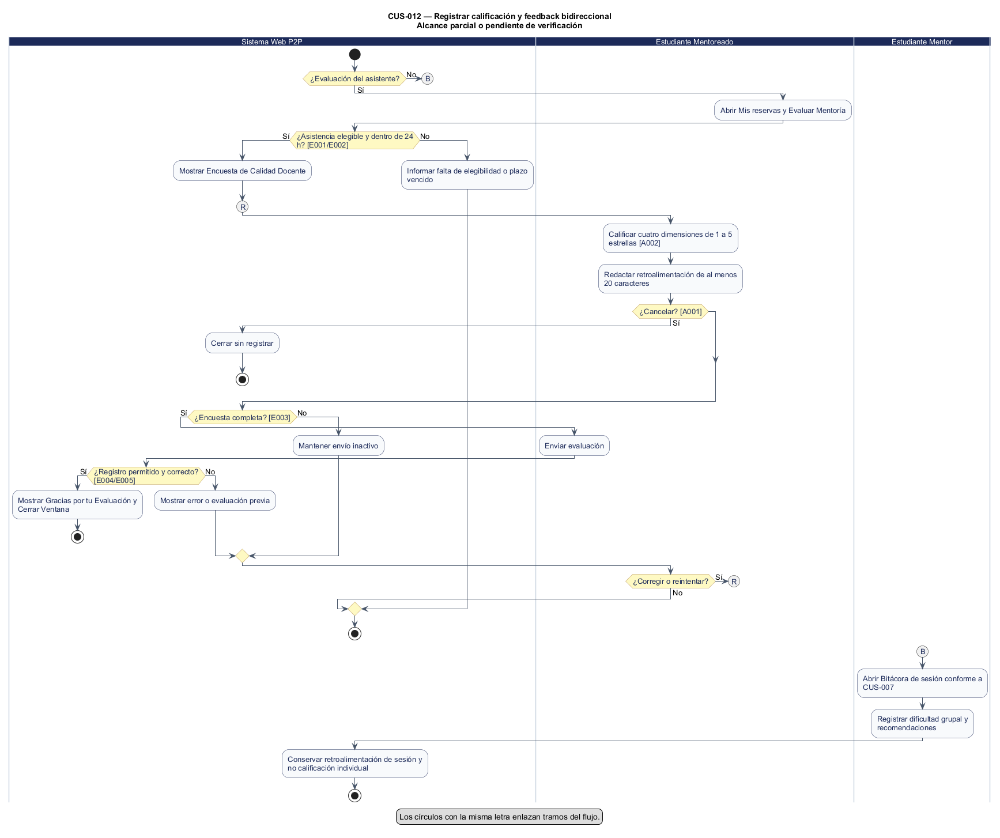

Fuente PlantUML: [CUS-012_actividades.puml](docs/narrativas/diagramas/plantuml/CUS-012_actividades.puml).

Fuente: Elaboración propia.

#### 7.6. Diagrama de caso de uso

**Figura 26. Diagrama de caso de uso — CUS-012: Registrar calificación y feedback bidireccional.**

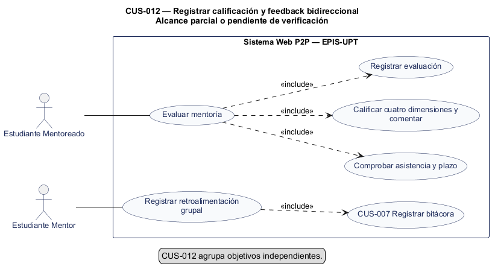

Fuente PlantUML: [CUS-012_caso_de_uso.puml](docs/narrativas/diagramas/plantuml/CUS-012_caso_de_uso.puml).

Fuente: Elaboración propia.

---

### CUS-013 — Consultar historial académico de mentorías

#### 7.1. Ficha descriptiva

| Atributo | Detalle |
|---|---|
| **Id Caso de Uso** | **UC-013** (CUS-013) |
| **Nombre** | Consultar historial académico de mentorías |
| **Tipo** | Opcional |
| **Requisito ID (RF)** | RF-019; relacionado con RF-012, RF-018, RF-020 |
| **Versión** | 2.3 (DOC-H02 — consolidación) |
| **Autor** | Antayhua Mamani, Renzo Antonio / Medina Quispe, Joan Cristian |
| **Actores** | Estudiante Mentoreado; Estudiante Mentor |
| **Interacción** | Interacción web institucional; comportamiento descrito conforme a la evidencia identificada. |
| **Descripción** | Permite revisar los registros de participación en mentorías y sus estados, diferenciando reservas personales y sesiones impartidas. |
| **Referencias** | SWEBOK v3.0, ISO/IEC/IEEE 29148:2018, SRS y reglas de negocio EPIS-UPT. |
| **Precondiciones** | Sesión institucional con rol correspondiente; registros consultables. |
| **Postcondiciones** | Se presenta la información histórica disponible sin modificar los registros. |

**Estado de evidencia:** Implementación parcial: historial de reservas y sesiones.

#### 7.2. Flujo normal de eventos

| **Acción del Actor** | **Respuesta del Sistema** |
|---|---|
| **Fase 1: Historial de reservas** |  |
| **1.** El mentoreado abre «Mis reservas». |  |
|  | **2.** Muestra «Mis Reservas de Mentoría», contadores y filtros de estado, controles «Actualizar» y «+ Buscar Mentorías». |
| **3.** Selecciona el filtro de histórico. |  |
|  | **4.** Presenta reservas canceladas, no confirmadas, asistidas o con inasistencia según sus estados disponibles. Si no hay registros, A001. |
| **5.** Revisa una tarjeta. |  |
|  | **6.** Presenta asignatura, código, tema, estado, fecha y hora, modalidad, espacio, mentor responsable y fecha de reserva; ofrece únicamente las acciones que procedan para esa reserva. |
| **7.** Consulta otro filtro o actualiza. |  |
|  | **8.** Renueva los registros disponibles; no cambia el estado por consultar. Si falla, E001. |
| **Fase 2: Historial de sesiones del mentor (interacción independiente)** |  |
| **9.** El mentor selecciona «Mis sesiones». |  |
|  | **10.** Muestra «Mis Mentorías Académicas Programadas» con sus sesiones, estados y seguimiento de inscritos; si no hay sesiones, A001. |
| **11.** Revisa una sesión y sus opciones. |  |
|  | **12.** Presenta información de programación, aforo y acciones de asistencia o bitácora cuando correspondan; la constancia de horas se consulta en «Mis constancias» (CUS-014). |

#### 7.3. Flujos alternativos

##### A001: Sin historial

* **Paso origen:** 4, 10.
* **Condición de activación:** No existen registros para el filtro.

| **Acción del Actor** | **Respuesta del Sistema** |
|---|---|
| **A001-1.** Cambia filtro o utiliza «Explorar Clases Recomendadas» (mentoreado). |  |
|  | **A001-2.** Muestra «No se encontraron reservas» o mensaje de ausencia de sesiones; ofrece navegación aplicable. |
| **A001-3.** Consulta otro resultado. |  |

##### A002: Actualizar información

* **Paso origen:** Flujo normal, en la operación indicada por la condición.
* **Condición de activación:** Vista abierta.

| **Acción del Actor** | **Respuesta del Sistema** |
|---|---|
| **A002-1.** Pulsa «Actualizar» donde esté disponible o reingresa a la vista. |  |
|  | **A002-2.** Vuelve a consultar los registros personales. |
| **A002-3.** Revisa cambios. |  |

#### 7.4. Flujos de excepción

##### E001: Fallo de consulta

* **Paso origen:** 8.
* **Condición de activación:** Servicio no disponible.

| **Acción del Actor** | **Respuesta del Sistema** |
|---|---|
|  | **E001-1.** Informa que no fue posible cargar reservas o sesiones; ofrece «Reintentar Consulta» en reservas. |
| **E001-2.** Restablece conexión y reintenta. |  |

##### E002: Acceso no autorizado

* **Paso origen:** Flujo normal, en la operación indicada por la condición.
* **Condición de activación:** Sesión inválida o rol no permitido.

| **Acción del Actor** | **Respuesta del Sistema** |
|---|---|
|  | **E002-1.** Restringe la vista personal. |
| **E002-2.** Inicia sesión con cuenta autorizada. |  |

#### 7.5. Diagrama de flujo de actividades

**Figura 27. Diagrama de actividades — CUS-013: Consultar historial académico de mentorías.**

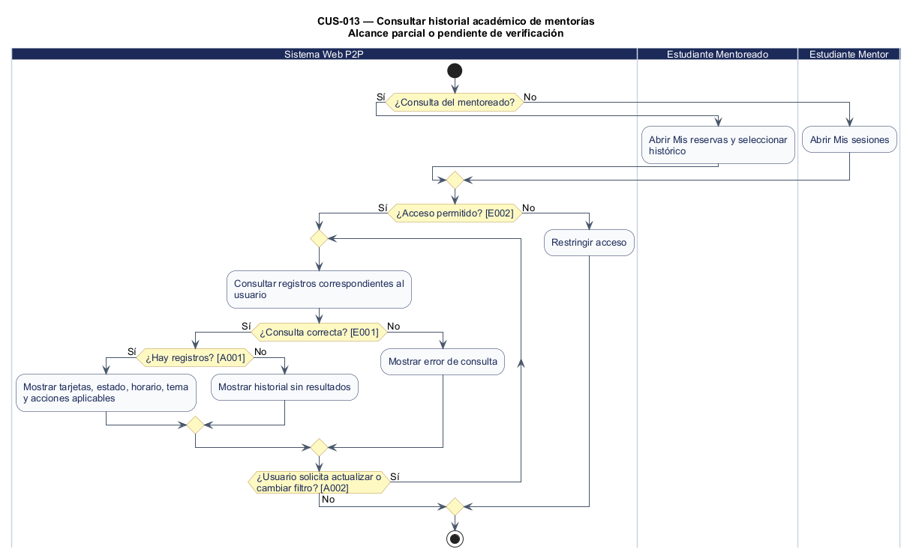

Fuente PlantUML: [CUS-013_actividades.puml](docs/narrativas/diagramas/plantuml/CUS-013_actividades.puml).

Fuente: Elaboración propia.

#### 7.6. Diagrama de caso de uso

**Figura 28. Diagrama de caso de uso — CUS-013: Consultar historial académico de mentorías.**

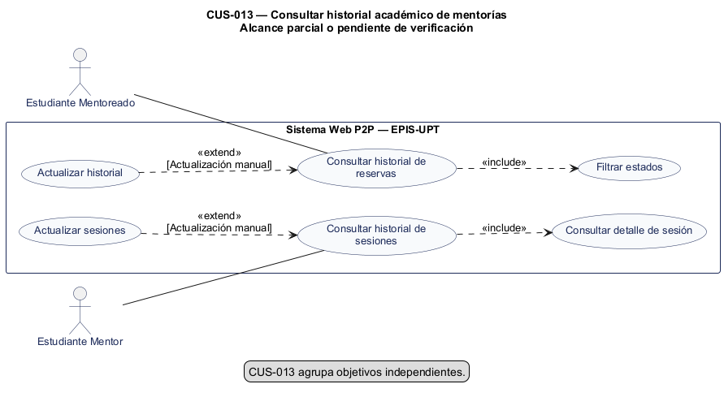

Fuente PlantUML: [CUS-013_caso_de_uso.puml](docs/narrativas/diagramas/plantuml/CUS-013_caso_de_uso.puml).

Fuente: Elaboración propia.

---

### CUS-014 — Emitir constancia de horas de mentoría

#### 7.1. Ficha descriptiva

| Atributo | Detalle |
|---|---|
| **Id Caso de Uso** | **UC-014** (CUS-014) |
| **Nombre** | Emitir constancia de horas de mentoría |
| **Tipo** | Opcional |
| **Requisito ID (RF)** | RF-022, RF-023; RN-14 |
| **Versión** | 2.3 (DOC-H02 — consolidación) |
| **Autor** | Antayhua Mamani, Renzo Antonio / Medina Quispe, Joan Cristian |
| **Actores** | Estudiante Mentor; Administrador institucional (visado previo) |
| **Interacción** | Interacción web institucional; comportamiento descrito conforme a la evidencia identificada. |
| **Descripción** | Permite consultar horas acreditadas, comprobar el umbral de certificación, emitir una constancia digital y descargarla o verificarla por folio. |
| **Referencias** | SWEBOK v3.0, ISO/IEC/IEEE 29148:2018, SRS y reglas de negocio EPIS-UPT. |
| **Precondiciones** | Mentor autenticado; horas declaradas en bitácoras y visadas por Dirección; umbral de referencia de 20 h acreditadas en el periodo. |
| **Postcondiciones** | Constancia emitida con folio, horas acreditadas y código de verificación; documento PDF disponible si se genera correctamente. |

**Estado de evidencia:** Implementación identificada; constancia DEMO y validación real pendiente.

#### 7.2. Flujo normal de eventos

| **Acción del Actor** | **Respuesta del Sistema** |
|---|---|
| **Fase 1: Consulta de horas** |  |
| **1.** Selecciona «Mis constancias». |  |
|  | **2.** Muestra «Acreditación y Constancias Oficiales de Mentoría», periodo académico y progreso hacia el umbral de acreditación. Si falla la consulta, E001. |
| **3.** Revisa «Horas Acreditadas (Visadas por Dirección)» y «Horas en Revisión Provisional». |  |
|  | **4.** Presenta valores separados, barra de avance, porcentaje y condición «ELEGIBLE PARA CERTIFICACIÓN» o cantidad de horas faltantes. Si no alcanza el umbral, A001. |
| **Fase 2: Emisión** |  |
| **5.** Cuando es elegible, pulsa «Emitir Constancia Oficial». |  |
|  | **6.** Muestra «Generando PDF Oficial y QR...», comprueba identidad, periodo y horas acreditadas. Si no cumple, E002; si ya existe constancia, A002. |
| **7.** Espera la respuesta. |  |
|  | **8.** Presenta confirmación de emisión con folio asignado y datos de acreditación; muestra controles de descarga y verificación. Si falla, E003. |
| **Fase 3: Descarga y autenticidad** |  |
| **9.** Pulsa «Descargar Constancia en PDF». |  |
|  | **10.** Entrega el documento generado si está disponible y muestra el estado de descarga. Si falla, E003. |
| **11.** Pulsa «Verificar QR». |  |
|  | **12.** Abre «Verificación de Autenticidad Institucional» y consulta folio; presenta el resultado, mentor titular y horas acreditadas cuando es válido. |
| **13.** Cierra la ventana de verificación. |  |
|  | **14.** Retorna a la constancia sin modificar las horas ni emitir otro documento. |

#### 7.3. Flujos alternativos

##### A001: Horas insuficientes

* **Paso origen:** 4.
* **Condición de activación:** Menos del umbral de horas visadas.

| **Acción del Actor** | **Respuesta del Sistema** |
|---|---|
| **A001-1.** Consulta las horas faltantes. |  |
|  | **A001-2.** Muestra aviso pedagógico RN-14 y bloquea emisión; orienta al registro y visado de bitácoras. |
| **A001-3.** Regresa a Mis sesiones o consulta más adelante. |  |

##### A002: Constancia ya emitida

* **Paso origen:** 6.
* **Condición de activación:** Existe documento para el periodo.

| **Acción del Actor** | **Respuesta del Sistema** |
|---|---|
| **A002-1.** Consulta la constancia mostrada. |  |
|  | **A002-2.** Ofrece descargar PDF y verificar QR sin necesidad de emitir otra. |
| **A002-3.** Descarga o verifica. |  |

##### A003: Revisar horas pendientes

* **Paso origen:** Flujo normal, en la operación indicada por la condición.
* **Condición de activación:** Existen bitácoras sin visado.

| **Acción del Actor** | **Respuesta del Sistema** |
|---|---|
| **A003-1.** Consulta el desglose de horas. |  |
|  | **A003-2.** Distingue las provisionales de las acreditadas. |
| **A003-3.** Consulta con Dirección según CUS-019. |  |

#### 7.4. Flujos de excepción

##### E001: Resumen no disponible

* **Paso origen:** 2.
* **Condición de activación:** Error al consultar horas.

| **Acción del Actor** | **Respuesta del Sistema** |
|---|---|
|  | **E001-1.** Informa el problema sin asegurar elegibilidad. |
| **E001-2.** Reintenta la consulta. |  |

##### E002: No elegible o no autorizado

* **Paso origen:** 6.
* **Condición de activación:** Horas insuficientes, periodo o identidad incompatible.

| **Acción del Actor** | **Respuesta del Sistema** |
|---|---|
|  | **E002-1.** Rechaza emisión o mantiene acción bloqueada. |
| **E002-2.** Regulariza las horas o sesión. |  |

##### E003: Fallo de emisión/descarga/verificación

* **Paso origen:** 8, 10.
* **Condición de activación:** Servicio o archivo no disponible, folio no reconocido.

| **Acción del Actor** | **Respuesta del Sistema** |
|---|---|
|  | **E003-1.** Muestra error o resultado no válido según operación. |
| **E003-2.** Comprueba si existe constancia antes de volver a emitir. |  |

#### 7.5. Diagrama de flujo de actividades

**Figura 29. Diagrama de actividades — CUS-014: Emitir constancia de horas de mentoría.**

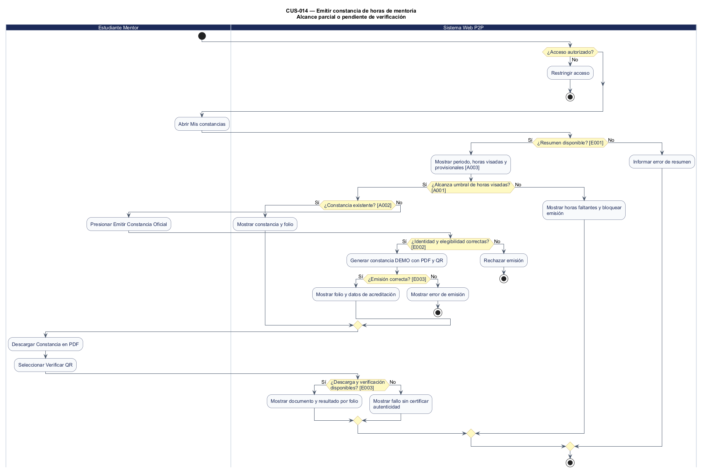

Fuente PlantUML: [CUS-014_actividades.puml](docs/narrativas/diagramas/plantuml/CUS-014_actividades.puml).

Fuente: Elaboración propia.

#### 7.6. Diagrama de caso de uso

**Figura 30. Diagrama de caso de uso — CUS-014: Emitir constancia de horas de mentoría.**

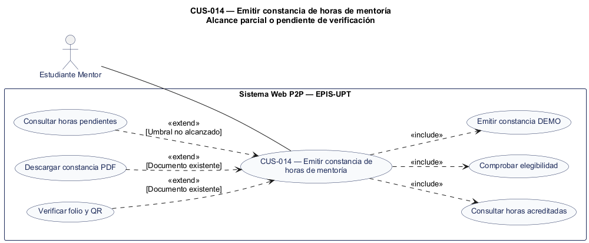

Fuente PlantUML: [CUS-014_caso_de_uso.puml](docs/narrativas/diagramas/plantuml/CUS-014_caso_de_uso.puml).

Fuente: Elaboración propia.

---

### CUS-018 — Gestionar justificación de inasistencia a sesión

#### 7.1. Ficha descriptiva

| Atributo | Detalle |
|---|---|
| **Id Caso de Uso** | **UC-018** (CUS-018) |
| **Nombre** | Gestionar justificación de inasistencia a sesión |
| **Tipo** | Opcional |
| **Requisito ID (RF)** | RF-014, RF-017 (relación funcional); requisito específico por formalizar |
| **Versión** | 2.3 (DOC-H02 — consolidación) |
| **Autor** | Antayhua Mamani, Renzo Antonio / Medina Quispe, Joan Cristian |
| **Actores** | Estudiante Mentoreado; Administrador o responsable académico (actor previsto) |
| **Interacción** | Interacción web institucional; flujo propuesto pendiente de implementación. |
| **Descripción** | Propone gestionar una justificación de ausencia posterior a una sesión, diferenciándola de la cancelación voluntaria antes del corte. |
| **Referencias** | SWEBOK v3.0, ISO/IEC/IEEE 29148:2018, SRS y reglas de negocio EPIS-UPT. |
| **Precondiciones** | Propuesta: reserva con estado INASISTENCIA, solicitante titular, plazo y responsable institucional definidos. |
| **Postcondiciones** | Propuesta: justificación registrada y resolución trazable; efecto académico conforme a política aprobada. |

**Estado de evidencia:** Pendiente: no se identificó trámite específico.

#### 7.2. Flujo normal de eventos

| **Acción del Actor** | **Respuesta del Sistema** |
|---|---|
| **Fase 1: Identificación de inasistencia (parcialmente disponible)** |  |
| **1.** El mentoreado abre «Mis reservas» y consulta el histórico. |  |
|  | **2.** Presenta las reservas y sus estados, incluida INASISTENCIA cuando corresponda. No hay opción de justificar acreditada. |
| **Fase 2: Registro de justificación (propuesto)** |  |
| **3.** Selecciona la reserva ausente y solicita registrar una justificación. |  |
|  | **4.** Deberá mostrar sesión y estado, motivo obligatorio y condiciones institucionales aplicables. Los documentos adjuntos y plazo requieren definición. |
| **5.** Describe la circunstancia y envía. |  |
|  | **6.** Deberá comprobar titularidad, elegibilidad y completitud; registrar la solicitud sin alterar automáticamente la asistencia. |
| **Fase 3: Revisión institucional (propuesto)** |  |
| **7.** El responsable autorizado consulta la justificación y analiza el motivo. |  |
|  | **8.** Deberá mostrar antecedentes y permitir una decisión motivada (A001/A002). |
| **9.** Registra la decisión. |  |
|  | **10.** Deberá conservar estado, fecha y responsable; aplicar únicamente los efectos académicos establecidos por el reglamento. |
| **11.** El solicitante consulta su resultado. |  |
|  | **12.** Deberá presentar la resolución sin confundir justificación con asistencia efectiva. |

#### 7.3. Flujos alternativos

##### A001: Solicitar información adicional

* **Paso origen:** 8.
* **Condición de activación:** Motivo insuficiente.

| **Acción del Actor** | **Respuesta del Sistema** |
|---|---|
| **A001-1.** El responsable solicita aclaración. |  |
|  | **A001-2.** Deberá conservar solicitud pendiente y observación. |
| **A001-3.** El estudiante subsana si la política lo permite. |  |

##### A002: Rechazar justificación

* **Paso origen:** 8.
* **Condición de activación:** No cumple los criterios.

| **Acción del Actor** | **Respuesta del Sistema** |
|---|---|
| **A002-1.** El responsable registra el motivo. |  |
|  | **A002-2.** Deberá conservar rechazo y estado de asistencia original. |
| **A002-3.** Finaliza el trámite. |  |

#### 7.4. Flujos de excepción

##### E001: Reserva no elegible

* **Paso origen:** Flujo normal, en la operación indicada por la condición.
* **Condición de activación:** No es inasistencia propia o está fuera de plazo definido.

| **Acción del Actor** | **Respuesta del Sistema** |
|---|---|
|  | **E001-1.** Deberá bloquear registro y explicar condición. |
| **E001-2.** Consulta estado o canal institucional. |  |

##### E002: Justificación incompleta o duplicada

* **Paso origen:** Flujo normal, en la operación indicada por la condición.
* **Condición de activación:** Falta motivo o existe trámite incompatible.

| **Acción del Actor** | **Respuesta del Sistema** |
|---|---|
|  | **E002-1.** Deberá impedir duplicidad y pedir corrección. |
| **E002-2.** Revisa los datos. |  |

##### E003: Fallo de registro

* **Paso origen:** Flujo normal, en la operación indicada por la condición.
* **Condición de activación:** No se puede conservar solicitud o resolución.

| **Acción del Actor** | **Respuesta del Sistema** |
|---|---|
|  | **E003-1.** Deberá informar error sin declarar éxito. |
| **E003-2.** Verifica estado antes de reintentar. |  |

#### 7.5. Diagrama de flujo de actividades

**Figura 31. Diagrama de actividades — CUS-018: Gestionar justificación de inasistencia a sesión.**

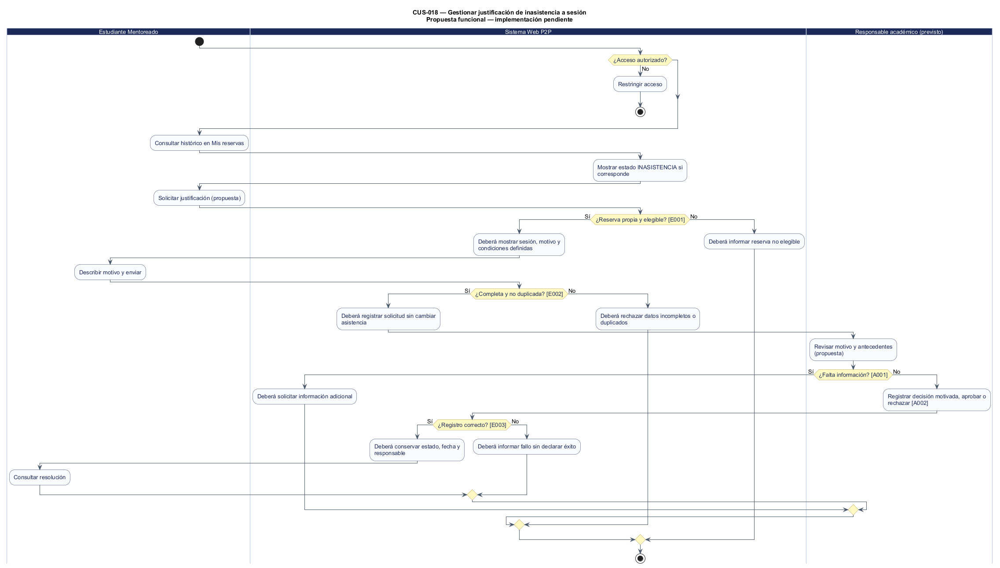

Fuente PlantUML: [CUS-018_actividades.puml](docs/narrativas/diagramas/plantuml/CUS-018_actividades.puml).

Fuente: Elaboración propia.

#### 7.6. Diagrama de caso de uso

**Figura 32. Diagrama de caso de uso — CUS-018: Gestionar justificación de inasistencia a sesión.**

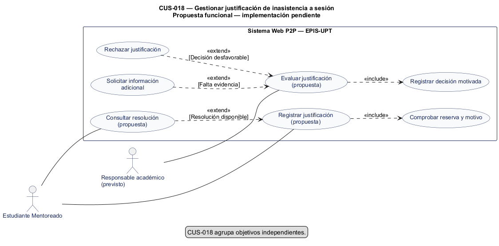

Fuente PlantUML: [CUS-018_caso_de_uso.puml](docs/narrativas/diagramas/plantuml/CUS-018_caso_de_uso.puml).

Fuente: Elaboración propia.

---

### CUS-019 — Consultar bitácoras de mentoría por tutor

#### 7.1. Ficha descriptiva

| Atributo | Detalle |
|---|---|
| **Id Caso de Uso** | **UC-019** (CUS-019) |
| **Nombre** | Consultar bitácoras de mentoría por tutor |
| **Tipo** | Opcional |
| **Requisito ID (RF)** | RF-018, RF-026; RN-12, RN-14 |
| **Versión** | 2.3 (DOC-H02 — consolidación) |
| **Autor** | Antayhua Mamani, Renzo Antonio / Medina Quispe, Joan Cristian |
| **Actores** | Tutor académico (actor previsto); Administrador institucional (función existente) |
| **Interacción** | Interacción web institucional; comportamiento descrito conforme a la evidencia identificada. |
| **Descripción** | Permite revisar el contenido y estado de las bitácoras. Actualmente la interfaz administrativa ofrece consulta, visado y observación; la función específica de tutor requiere definición. |
| **Referencias** | SWEBOK v3.0, ISO/IEC/IEEE 29148:2018, SRS y reglas de negocio EPIS-UPT. |
| **Precondiciones** | Sesión administrativa vigente para la función existente; bitácoras registradas. Para tutor, permisos y alcance por definir. |
| **Postcondiciones** | Se consultan las bitácoras; si el administrador visa u observa, se actualiza el estado según la operación. El acceso de tutor no está acreditado. |

**Estado de evidencia:** Implementación parcial: auditoría por Administrador; tutor no identificado.

#### 7.2. Flujo normal de eventos

| **Acción del Actor** | **Respuesta del Sistema** |
|---|---|
| **Fase 1: Consulta administrativa (disponible)** |  |
| **1.** El administrador selecciona «Administración» > «Auditoría de Bitácoras». |  |
|  | **2.** Muestra «Bandeja de Auditoría de Bitácoras y Visado Institucional de Horas» y explica que solo las visadas se acreditan. |
| **3.** Selecciona «Todas las Bitácoras», «Pendientes de Visado», «Horas Visadas y Acreditadas» u «Observadas para Corrección». |  |
|  | **4.** Filtra la tabla; presenta identificador, mentor titular, horas declaradas, estado y acciones disponibles. Si no hay datos, A001. |
| **5.** Abre el detalle de una bitácora. |  |
|  | **6.** Presenta «Detalle de Bitácora Pedagógica», mentor, temas cubiertos y observaciones docentes. Permite cerrar el detalle sin modificarlo. |
| **Fase 2: Revisión y visado administrativo (relacionado)** |  |
| **7.** Si cuenta con competencia administrativa y considera conforme el registro, pulsa «Aprobar y Visar Horas». |  |
|  | **8.** Procesa el visado; actualiza estado y horas acreditadas. Si detecta discrepancia, A002; si falla, E001. |
| **9.** Consulta el resultado mediante el filtro correspondiente. |  |
|  | **10.** Muestra la bitácora actualizada conforme a la respuesta del servicio. |
| **Fase 3: Consulta por tutor (propuesta)** |  |
| **11.** Un tutor autorizado consulta las bitácoras de sus estudiantes o sesiones asignadas. |  |
|  | **12.** Deberá mostrar únicamente las bitácoras de su ámbito y permitir consulta de detalle; no se presupone permiso de visado para el tutor. |

#### 7.3. Flujos alternativos

##### A001: Sin bitácoras

* **Paso origen:** 4.
* **Condición de activación:** Filtro sin resultados.

| **Acción del Actor** | **Respuesta del Sistema** |
|---|---|
| **A001-1.** Cambia filtro. |  |
|  | **A001-2.** Muestra «No se registraron bitácoras bajo el filtro seleccionado». |
| **A001-3.** Consulta otro conjunto. |  |

##### A002: Observar bitácora

* **Paso origen:** 8.
* **Condición de activación:** Administrador detecta discrepancia.

| **Acción del Actor** | **Respuesta del Sistema** |
|---|---|
| **A002-1.** Pulsa «Observar Bitácora», escribe motivo fundamentado y confirma. |  |
|  | **A002-2.** Muestra ventana de observación; si el registro se completa, actualiza estado a observado. |
| **A002-3.** Revisa bandeja de observadas. |  |

##### A003: Consulta sin visado

* **Paso origen:** Flujo normal, en la operación indicada por la condición.
* **Condición de activación:** Solo requiere lectura.

| **Acción del Actor** | **Respuesta del Sistema** |
|---|---|
| **A003-1.** Abre y cierra el detalle. |  |
|  | **A003-2.** No altera estado ni horas. |
| **A003-3.** Retorna a tabla. |  |

#### 7.4. Flujos de excepción

##### E001: Fallo de consulta o visado

* **Paso origen:** 8.
* **Condición de activación:** Servicio no disponible.

| **Acción del Actor** | **Respuesta del Sistema** |
|---|---|
|  | **E001-1.** Muestra mensaje de error sin acreditar horas nuevas. |
| **E001-2.** Revisa estado y reintenta si corresponde. |  |

##### E002: Acceso o alcance no permitido

* **Paso origen:** Flujo normal, en la operación indicada por la condición.
* **Condición de activación:** Rol no autorizado.

| **Acción del Actor** | **Respuesta del Sistema** |
|---|---|
|  | **E002-1.** Restringe funciones administrativas; para tutor deberá verificarse su ámbito. |
| **E002-2.** Solicita autorización institucional. |  |

##### E003: Observación sin motivo

* **Paso origen:** Flujo normal, en la operación indicada por la condición.
* **Condición de activación:** Motivo requerido no consignado.

| **Acción del Actor** | **Respuesta del Sistema** |
|---|---|
|  | **E003-1.** No debe confirmar observación incompleta. |
| **E003-2.** Completa el motivo. |  |

#### 7.5. Diagrama de flujo de actividades

**Figura 33. Diagrama de actividades — CUS-019: Consultar bitácoras de mentoría por tutor.**

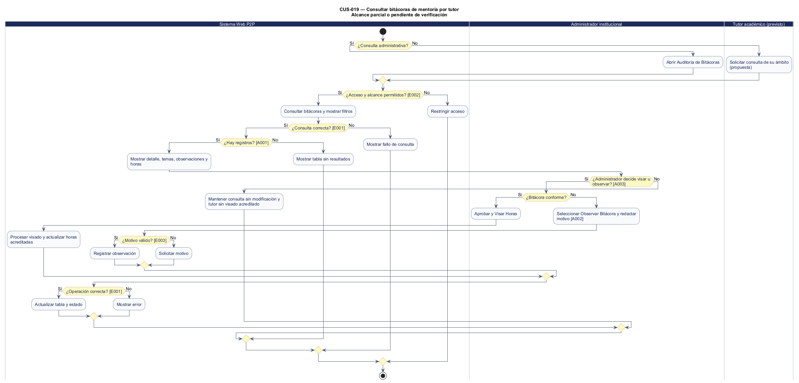

Fuente PlantUML: [CUS-019_actividades.puml](docs/narrativas/diagramas/plantuml/CUS-019_actividades.puml).

Fuente: Elaboración propia.

#### 7.6. Diagrama de caso de uso

**Figura 34. Diagrama de caso de uso — CUS-019: Consultar bitácoras de mentoría por tutor.**

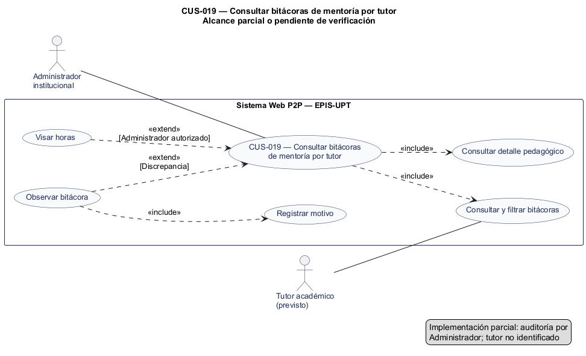

Fuente PlantUML: [CUS-019_caso_de_uso.puml](docs/narrativas/diagramas/plantuml/CUS-019_caso_de_uso.puml).

Fuente: Elaboración propia.

---

## MOD-05: Administración y Analítica Institucional

### CUS-009 — Consultar analítica institucional de mentorías

#### 7.1. Ficha descriptiva

| Atributo | Detalle |
|---|---|
| **Id Caso de Uso** | **UC-009** (CUS-009) |
| **Nombre** | Consultar analítica institucional de mentorías |
| **Tipo** | Opcional |
| **Requisito ID (RF)** | RF-025; relacionado con RF-015, RF-026, RN-09 |
| **Versión** | 2.3 (DOC-H02 — consolidación) |
| **Autor** | Antayhua Mamani, Renzo Antonio / Medina Quispe, Joan Cristian |
| **Actores** | Administrador institucional |
| **Interacción** | Interacción web institucional; comportamiento descrito conforme a la evidencia identificada. |
| **Descripción** | Permite supervisar información operativa de mentorías y propone consolidar indicadores institucionales de participación, retención y calidad. |
| **Referencias** | SWEBOK v3.0, ISO/IEC/IEEE 29148:2018, SRS y reglas de negocio EPIS-UPT. |
| **Precondiciones** | Sesión administrativa vigente; datos de sesiones y reservas disponibles. Para analítica integral, métricas y periodo definidos. |
| **Postcondiciones** | Se presentan indicadores consultados; no se modifican sesiones por consultar. Indicadores integrales quedan sujetos a implementación. |

**Estado de evidencia:** Implementación parcial: monitoreo de quórum; analítica integral pendiente.

#### 7.2. Flujo normal de eventos

| **Acción del Actor** | **Respuesta del Sistema** |
|---|---|
| **Fase 1: Acceso al monitoreo existente** |  |
| **1.** Selecciona «Administración» y «Monitoreo de Quórum». |  |
|  | **2.** Muestra «Supervisión de Quórum y Sesiones EPIS», explicación de cálculo por reservas ratificadas y porcentaje de aforo, y botón «Actualizar». |
| **3.** Espera la consulta de sesiones. |  |
|  | **4.** Muestra «Cargando sesiones y estados de quórum...» y, si existen ofertas, tarjetas con datos de sesión, estado, inscritos, ratificados, mínimo y porcentaje reglamentario. |
| **5.** Compara los indicadores entre sesiones. |  |
|  | **6.** Presenta el avance de cada sesión frente a su mínimo; no modifica reservas ni ejecuta corte por la sola consulta. |
| **7.** Presiona «Actualizar». |  |
|  | **8.** Renueva los datos. Si no hay sesiones, A001; si hay error, E001. |
| **Fase 2: Analítica consolidada (propuesta)** |  |
| **9.** Selecciona periodo e indicadores institucionales de interés. |  |
|  | **10.** Deberá presentar métricas agregadas de oferta, demanda, participación y calidad, con definiciones y fuente verificables. No hay panel integral acreditado. |
| **11.** Revisa resultados y solicita el reporte cuando corresponda. |  |
|  | **12.** Deberá presentar valores contextualizados por periodo, sin confundir simulación algorítmica con datos operativos reales; exportación corresponde a CUS-011. |

#### 7.3. Flujos alternativos

##### A001: Sin sesiones

* **Paso origen:** 8.
* **Condición de activación:** No hay ofertas disponibles.

| **Acción del Actor** | **Respuesta del Sistema** |
|---|---|
| **A001-1.** Consulta otro momento o actualiza. |  |
|  | **A001-2.** Muestra «No se registraron ofertas de mentoría activas en la plataforma». |
| **A001-3.** Retorna al panel. |  |

##### A002: Consulta específica

* **Paso origen:** Flujo normal, en la operación indicada por la condición.
* **Condición de activación:** Interés en una sesión.

| **Acción del Actor** | **Respuesta del Sistema** |
|---|---|
| **A002-1.** Revisa su tarjeta de quórum. |  |
|  | **A002-2.** Muestra inscritos, ratificados y mínimo. |
| **A002-3.** Compara con otras sesiones. |  |

#### 7.4. Flujos de excepción

##### E001: Fallo de consulta

* **Paso origen:** 8.
* **Condición de activación:** No se obtienen indicadores.

| **Acción del Actor** | **Respuesta del Sistema** |
|---|---|
|  | **E001-1.** Informa error disponible; no debe representar ausencia de datos como cero. |
| **E001-2.** Actualiza y revisa la conexión. |  |

##### E002: Acceso no autorizado

* **Paso origen:** Flujo normal, en la operación indicada por la condición.
* **Condición de activación:** Sesión sin privilegios.

| **Acción del Actor** | **Respuesta del Sistema** |
|---|---|
|  | **E002-1.** Restringe panel. |
| **E002-2.** Inicia sesión como administrador. |  |

##### E003: Indicador no definido

* **Paso origen:** Flujo normal, en la operación indicada por la condición.
* **Condición de activación:** Métrica o periodo sin datos suficientes (propuesta).

| **Acción del Actor** | **Respuesta del Sistema** |
|---|---|
|  | **E003-1.** Deberá informar que el indicador no está disponible. |
| **E003-2.** Ajusta el periodo o solicita definición. |  |

#### 7.5. Diagrama de flujo de actividades

**Figura 35. Diagrama de actividades — CUS-009: Consultar analítica institucional de mentorías.**

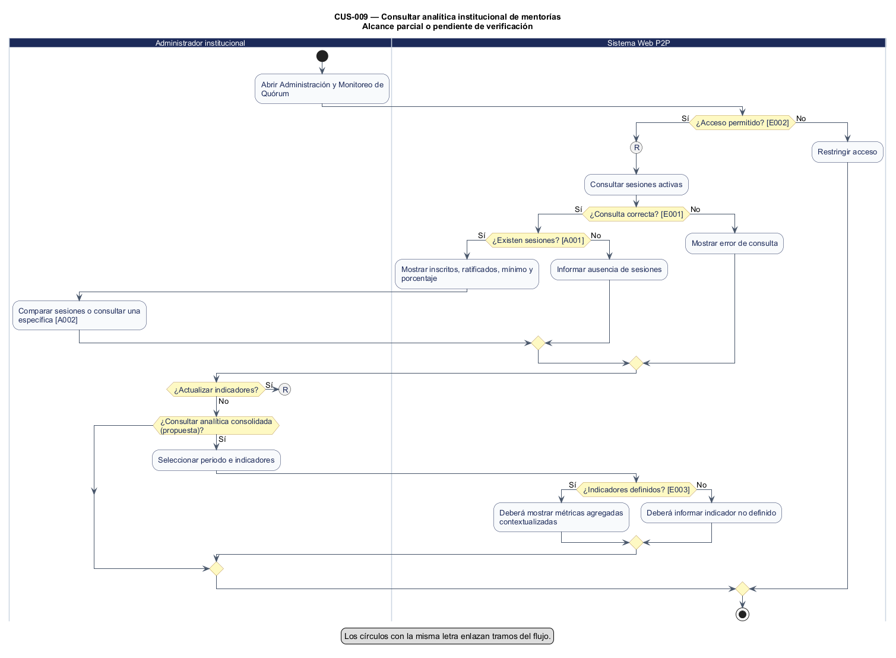

Fuente PlantUML: [CUS-009_actividades.puml](docs/narrativas/diagramas/plantuml/CUS-009_actividades.puml).

Fuente: Elaboración propia.

#### 7.6. Diagrama de caso de uso

**Figura 36. Diagrama de caso de uso — CUS-009: Consultar analítica institucional de mentorías.**

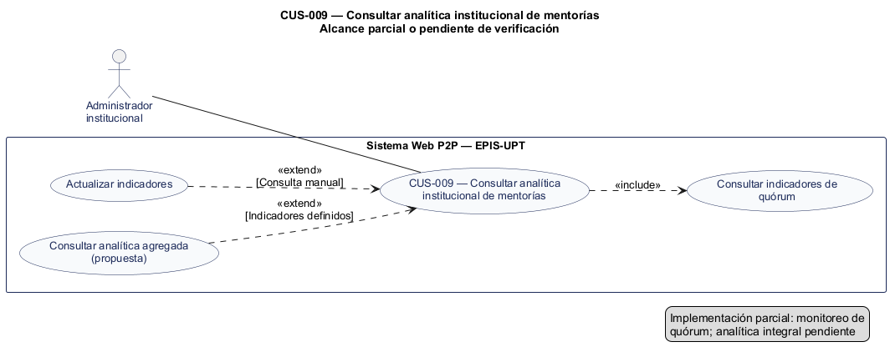

Fuente PlantUML: [CUS-009_caso_de_uso.puml](docs/narrativas/diagramas/plantuml/CUS-009_caso_de_uso.puml).

Fuente: Elaboración propia.

---

### CUS-011 — Exportar reportes ejecutivos consolidados

#### 7.1. Ficha descriptiva

| Atributo | Detalle |
|---|---|
| **Id Caso de Uso** | **UC-011** (CUS-011) |
| **Nombre** | Exportar reportes ejecutivos consolidados |
| **Tipo** | Opcional |
| **Requisito ID (RF)** | RF-025; relacionado con RF-026 |
| **Versión** | 2.3 (DOC-H02 — consolidación) |
| **Autor** | Antayhua Mamani, Renzo Antonio / Medina Quispe, Joan Cristian |
| **Actores** | Administrador institucional |
| **Interacción** | Interacción web institucional; flujo propuesto pendiente de implementación. |
| **Descripción** | Propone generar un archivo de reporte institucional consolidado a partir de indicadores y filtros aprobados. |
| **Referencias** | SWEBOK v3.0, ISO/IEC/IEEE 29148:2018, SRS y reglas de negocio EPIS-UPT. |
| **Precondiciones** | Propuesta: actor autorizado, datos de analítica disponibles, periodo y formato definidos. |
| **Postcondiciones** | Propuesta: reporte descargable con fecha, periodo, alcance y métricas verificables; no altera datos operativos. |

**Estado de evidencia:** Pendiente: no se identificó exportación ejecutiva.

#### 7.2. Flujo normal de eventos

| **Acción del Actor** | **Respuesta del Sistema** |
|---|---|
| **Fase 1: Preparación del reporte (propuesto)** |  |
| **1.** El administrador accede a la analítica institucional y selecciona un periodo. |  |
|  | **2.** Deberá presentar los filtros e indicadores autorizados y sus definiciones. La interfaz actual solo acredita monitoreo de quórum y auditoría de bitácoras. |
| **3.** Selecciona las métricas que requiere consolidar. |  |
|  | **4.** Deberá mostrar alcance de datos y una vista previa con totales y unidades. |
| **Fase 2: Generación (propuesto)** |  |
| **5.** Elige el formato de salida que haya sido aprobado y solicita la generación. |  |
|  | **6.** Deberá validar permisos, periodo, disponibilidad e integridad de datos; no exportar datos personales innecesarios. |
| **7.** Revisa la vista previa. |  |
|  | **8.** Deberá indicar periodo, fecha de generación y criterios utilizados. Si no hay datos, A001. |
| **9.** Confirma la descarga. |  |
|  | **10.** Deberá generar el archivo en el formato definido y permitir descargarlo; si falla, E002. |
| **11.** Verifica el reporte. |  |
|  | **12.** Deberá conservar los indicadores consultados y permitir una nueva generación con filtros distintos. |

#### 7.3. Flujos alternativos

##### A001: Cambiar filtros

* **Paso origen:** 8.
* **Condición de activación:** Antes de generar.

| **Acción del Actor** | **Respuesta del Sistema** |
|---|---|
| **A001-1.** Modifica periodo o indicadores. |  |
|  | **A001-2.** Deberá actualizar vista previa. |
| **A001-3.** Revisa y genera. |  |

##### A002: Sin información

* **Paso origen:** Flujo normal, en la operación indicada por la condición.
* **Condición de activación:** Periodo sin registros.

| **Acción del Actor** | **Respuesta del Sistema** |
|---|---|
| **A002-1.** Selecciona otro periodo. |  |
|  | **A002-2.** Deberá informar ausencia de datos sin inventar totales. |
| **A002-3.** Revisa el nuevo resultado. |  |

#### 7.4. Flujos de excepción

##### E001: Acceso restringido

* **Paso origen:** Flujo normal, en la operación indicada por la condición.
* **Condición de activación:** Usuario sin permiso.

| **Acción del Actor** | **Respuesta del Sistema** |
|---|---|
|  | **E001-1.** Deberá impedir generación y descarga. |
| **E001-2.** Solicita acceso autorizado. |  |

##### E002: Fallo de generación

* **Paso origen:** 10.
* **Condición de activación:** Datos o archivo no disponible.

| **Acción del Actor** | **Respuesta del Sistema** |
|---|---|
|  | **E002-1.** Deberá comunicar fallo sin afirmar descarga completada. |
| **E002-2.** Corrige filtros o reintenta. |  |

##### E003: Formato no definido

* **Paso origen:** Flujo normal, en la operación indicada por la condición.
* **Condición de activación:** Formato o conjunto de datos no aprobado.

| **Acción del Actor** | **Respuesta del Sistema** |
|---|---|
|  | **E003-1.** Deberá bloquear exportación no soportada. |
| **E003-2.** Selecciona formato autorizado. |  |

#### 7.5. Diagrama de flujo de actividades

**Figura 37. Diagrama de actividades — CUS-011: Exportar reportes ejecutivos consolidados.**

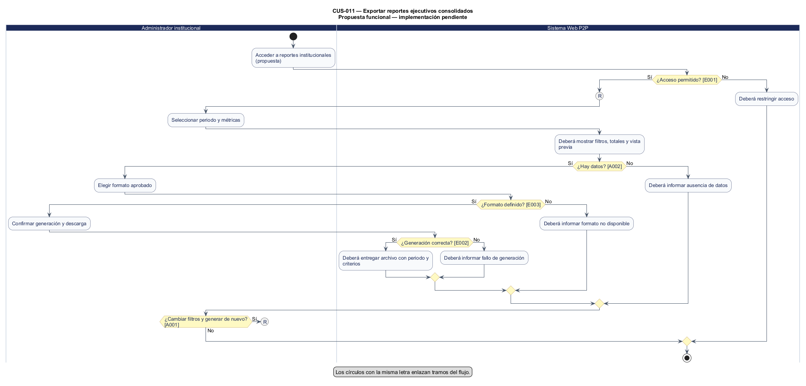

Fuente PlantUML: [CUS-011_actividades.puml](docs/narrativas/diagramas/plantuml/CUS-011_actividades.puml).

Fuente: Elaboración propia.

#### 7.6. Diagrama de caso de uso

**Figura 38. Diagrama de caso de uso — CUS-011: Exportar reportes ejecutivos consolidados.**

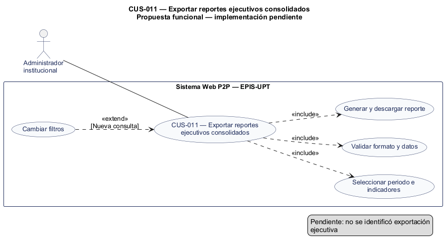

Fuente PlantUML: [CUS-011_caso_de_uso.puml](docs/narrativas/diagramas/plantuml/CUS-011_caso_de_uso.puml).

Fuente: Elaboración propia.

---

### CUS-015 — Configurar parámetros del algoritmo de recomendación

#### 7.1. Ficha descriptiva

| Atributo | Detalle |
|---|---|
| **Id Caso de Uso** | **UC-015** (CUS-015) |
| **Nombre** | Configurar parámetros del algoritmo de recomendación |
| **Tipo** | Opcional |
| **Requisito ID (RF)** | RF-006, RF-024; RN-11 |
| **Versión** | 2.3 (DOC-H02 — consolidación) |
| **Autor** | Antayhua Mamani, Renzo Antonio / Medina Quispe, Joan Cristian |
| **Actores** | Administrador institucional |
| **Interacción** | Interacción web institucional; flujo propuesto pendiente de implementación. |
| **Descripción** | Propone permitir al administrador consultar y ajustar criterios autorizados que intervienen en el orden de recomendaciones, sin modificar directamente la programación de mentorías. |
| **Referencias** | SWEBOK v3.0, ISO/IEC/IEEE 29148:2018, SRS y reglas de negocio EPIS-UPT. |
| **Precondiciones** | Propuesta: sesión administrativa, parámetros configurables y rangos aprobados, criterios de evaluación definidos. |
| **Postcondiciones** | Propuesta: configuración versionada, validada y aplicable a recomendaciones futuras; no afecta reservas existentes. |

**Estado de evidencia:** Pendiente: interfaz de parametrización no identificada.

#### 7.2. Flujo normal de eventos

| **Acción del Actor** | **Respuesta del Sistema** |
|---|---|
| **Fase 1: Consulta de configuración (propuesto)** |  |
| **1.** Accede a la configuración de recomendaciones. |  |
|  | **2.** Deberá presentar valores vigentes y explicación de los factores: afinidad curricular, reputación, carga y prioridad de materia, según RN-11. No existe panel de edición identificado. |
| **3.** Revisa el alcance de cada parámetro. |  |
|  | **4.** Deberá distinguir parámetros ajustables de reglas institucionales fijas y del número de candidatos seleccionable por el mentoreado (CUS-002). |
| **Fase 2: Edición (propuesto)** |  |
| **5.** Modifica los parámetros permitidos. |  |
|  | **6.** Deberá verificar tipo, rango y coherencia de los valores conforme a las reglas aprobadas. |
| **7.** Solicita una comprobación previa. |  |
|  | **8.** Deberá presentar el resultado de validación y, si se autoriza, una comparación controlada con datos de prueba, sin afectar ofertas reales. |
| **Fase 3: Aplicación (propuesto)** |  |
| **9.** Confirma la nueva configuración. |  |
|  | **10.** Deberá registrar valores anteriores y nuevos, responsable y fecha; aplicar la configuración solo si la validación concluye correctamente. |
| **11.** Consulta la configuración vigente. |  |
|  | **12.** Deberá mostrar los valores aplicados y permitir revisar cambios posteriores. |

#### 7.3. Flujos alternativos

##### A001: Cancelar edición

* **Paso origen:** Flujo normal, en la operación indicada por la condición.
* **Condición de activación:** Cambios sin confirmar.

| **Acción del Actor** | **Respuesta del Sistema** |
|---|---|
| **A001-1.** Abandona la edición. |  |
|  | **A001-2.** Deberá conservar configuración anterior. |
| **A001-3.** Retorna a consulta. |  |

##### A002: Restaurar valores aprobados

* **Paso origen:** Flujo normal, en la operación indicada por la condición.
* **Condición de activación:** Existe configuración previa autorizada.

| **Acción del Actor** | **Respuesta del Sistema** |
|---|---|
| **A002-1.** Solicita restauración y confirma. |  |
|  | **A002-2.** Deberá validar y registrar una nueva versión con los valores restaurados. |
| **A002-3.** Consulta valores vigentes. |  |

#### 7.4. Flujos de excepción

##### E001: Valores fuera de rango

* **Paso origen:** Flujo normal, en la operación indicada por la condición.
* **Condición de activación:** Parámetros inválidos.

| **Acción del Actor** | **Respuesta del Sistema** |
|---|---|
|  | **E001-1.** Deberá impedir guardar y señalar la restricción. |
| **E001-2.** Corrige valores. |  |

##### E002: Permisos insuficientes

* **Paso origen:** Flujo normal, en la operación indicada por la condición.
* **Condición de activación:** Usuario no autorizado.

| **Acción del Actor** | **Respuesta del Sistema** |
|---|---|
|  | **E002-1.** Deberá restringir consulta sensible y cambios. |
| **E002-2.** Solicita acceso. |  |

##### E003: Fallo de aplicación

* **Paso origen:** Flujo normal, en la operación indicada por la condición.
* **Condición de activación:** No se puede validar o guardar.

| **Acción del Actor** | **Respuesta del Sistema** |
|---|---|
|  | **E003-1.** Deberá conservar configuración vigente y comunicar fallo. |
| **E003-2.** Verifica estado antes de repetir. |  |

#### 7.5. Diagrama de flujo de actividades

**Figura 39. Diagrama de actividades — CUS-015: Configurar parámetros del algoritmo de recomendación.**

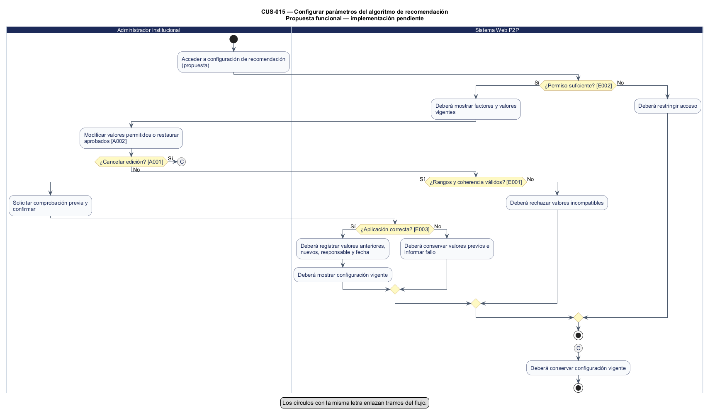

Fuente PlantUML: [CUS-015_actividades.puml](docs/narrativas/diagramas/plantuml/CUS-015_actividades.puml).

Fuente: Elaboración propia.

#### 7.6. Diagrama de caso de uso

**Figura 40. Diagrama de caso de uso — CUS-015: Configurar parámetros del algoritmo de recomendación.**

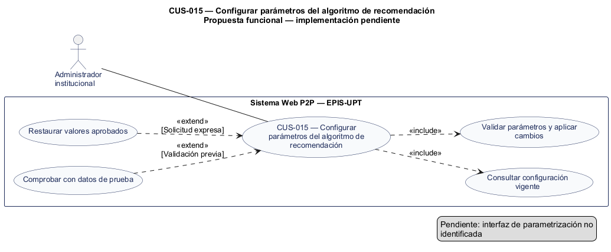

Fuente PlantUML: [CUS-015_caso_de_uso.puml](docs/narrativas/diagramas/plantuml/CUS-015_caso_de_uso.puml).

Fuente: Elaboración propia.

---

### CUS-016 — Gestionar auditoría de eventos de seguridad

#### 7.1. Ficha descriptiva

| Atributo | Detalle |
|---|---|
| **Id Caso de Uso** | **UC-016** (CUS-016) |
| **Nombre** | Gestionar auditoría de eventos de seguridad |
| **Tipo** | Obligatorio según alcance previsto |
| **Requisito ID (RF)** | RF-002, RF-026; RN-01, RN-02 |
| **Versión** | 2.3 (DOC-H02 — consolidación) |
| **Autor** | Antayhua Mamani, Renzo Antonio / Medina Quispe, Joan Cristian |
| **Actores** | Administrador institucional; responsable de seguridad (actor previsto) |
| **Interacción** | Interacción web institucional; flujo propuesto pendiente de implementación. |
| **Descripción** | Propone consultar eventos de autenticación, consentimiento y cambios de privilegios para supervisar el acceso y tratamiento de información institucional. |
| **Referencias** | SWEBOK v3.0, ISO/IEC/IEEE 29148:2018, SRS y reglas de negocio EPIS-UPT. |
| **Precondiciones** | Propuesta: responsable autorizado, registros de eventos disponibles y política de acceso, retención y privacidad definida. |
| **Postcondiciones** | Propuesta: consulta de eventos trazables sin modificar su contenido; incidentes derivados por el canal institucional. |

**Estado de evidencia:** Pendiente: bandeja integral de seguridad no identificada.

#### 7.2. Flujo normal de eventos

| **Acción del Actor** | **Respuesta del Sistema** |
|---|---|
| **Fase 1: Acceso a registros (propuesto)** |  |
| **1.** El responsable autorizado selecciona la función de auditoría de seguridad. |  |
|  | **2.** Deberá presentar filtros de periodo, tipo de evento y resultado, con acceso limitado a los datos necesarios. No se identificó una bandeja integral en la interfaz actual. |
| **3.** Selecciona un periodo y una categoría, por ejemplo acceso, consentimiento o cambio de rol. |  |
|  | **4.** Deberá recuperar los eventos correspondientes y mostrar fecha, categoría y resultado, evitando exponer códigos de acceso o secretos. |
| **Fase 2: Revisión (propuesto)** |  |
| **5.** Selecciona un evento para consultar su detalle. |  |
|  | **6.** Deberá mostrar información permitida para verificar origen y contexto; no debe permitir modificar o borrar el registro desde esta consulta. |
| **7.** Identifica una anomalía o consulta otro conjunto. |  |
|  | **8.** Deberá permitir filtrar nuevamente y conservar la evidencia de origen; la gestión de incidentes externos deberá definirse por separado. |
| **Fase 3: Finalización (propuesto)** |  |
| **9.** Cierra la consulta. |  |
|  | **10.** Deberá mantener la integridad de los registros y limitar la exposición de datos personales. |

#### 7.3. Flujos alternativos

##### A001: Consulta de consentimiento

* **Paso origen:** Flujo normal, en la operación indicada por la condición.
* **Condición de activación:** Evento relacionado con aceptación o rechazo.

| **Acción del Actor** | **Respuesta del Sistema** |
|---|---|
| **A001-1.** Selecciona el evento de consentimiento. |  |
|  | **A001-2.** Deberá presentar estado, versión y fecha disponibles, conforme al permiso. |
| **A001-3.** Retorna al listado. |  |

##### A002: Sin resultados

* **Paso origen:** Flujo normal, en la operación indicada por la condición.
* **Condición de activación:** Filtro sin eventos.

| **Acción del Actor** | **Respuesta del Sistema** |
|---|---|
| **A002-1.** Cambia filtros. |  |
|  | **A002-2.** Deberá indicar ausencia de resultados, no ausencia probada de incidentes. |
| **A002-3.** Consulta otro periodo. |  |

#### 7.4. Flujos de excepción

##### E001: Acceso no autorizado

* **Paso origen:** Flujo normal, en la operación indicada por la condición.
* **Condición de activación:** Rol o ámbito insuficiente.

| **Acción del Actor** | **Respuesta del Sistema** |
|---|---|
|  | **E001-1.** Deberá bloquear consulta y comunicar restricción. |
| **E001-2.** Solicita permisos institucionales. |  |

##### E002: Registros no disponibles

* **Paso origen:** Flujo normal, en la operación indicada por la condición.
* **Condición de activación:** Fallo o información incompleta.

| **Acción del Actor** | **Respuesta del Sistema** |
|---|---|
|  | **E002-1.** Deberá informar que no puede recuperar evidencia. |
| **E002-2.** Reintenta o deriva al responsable. |  |

##### E003: Filtro inválido

* **Paso origen:** Flujo normal, en la operación indicada por la condición.
* **Condición de activación:** Periodo o criterio inválido.

| **Acción del Actor** | **Respuesta del Sistema** |
|---|---|
|  | **E003-1.** Deberá solicitar corrección sin exponer datos. |
| **E003-2.** Ajusta filtros. |  |

#### 7.5. Diagrama de flujo de actividades

**Figura 41. Diagrama de actividades — CUS-016: Gestionar auditoría de eventos de seguridad.**

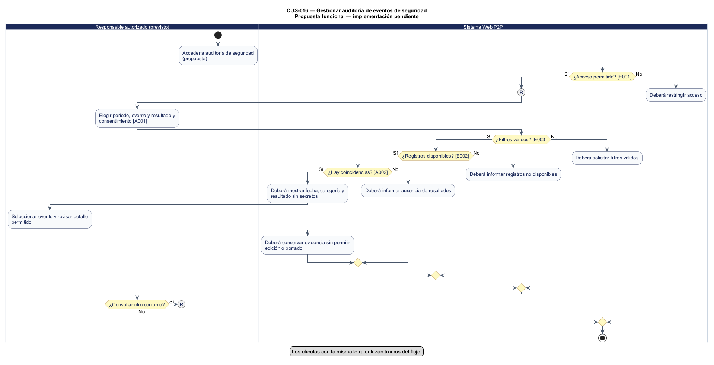

Fuente PlantUML: [CUS-016_actividades.puml](docs/narrativas/diagramas/plantuml/CUS-016_actividades.puml).

Fuente: Elaboración propia.

#### 7.6. Diagrama de caso de uso

**Figura 42. Diagrama de caso de uso — CUS-016: Gestionar auditoría de eventos de seguridad.**

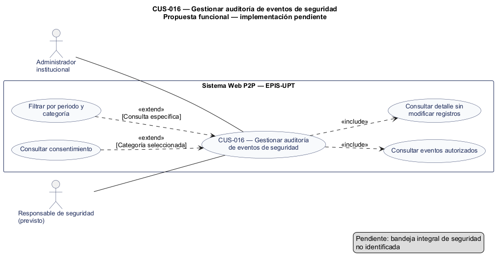

Fuente PlantUML: [CUS-016_caso_de_uso.puml](docs/narrativas/diagramas/plantuml/CUS-016_caso_de_uso.puml).

Fuente: Elaboración propia.

---

### CUS-017 — Configurar ambientes físicos y virtuales

#### 7.1. Ficha descriptiva

| Atributo | Detalle |
|---|---|
| **Id Caso de Uso** | **UC-017** (CUS-017) |
| **Nombre** | Configurar ambientes físicos y virtuales |
| **Tipo** | Obligatorio |
| **Requisito ID (RF)** | RF-009, RF-010; RN-06, RN-07 |
| **Versión** | 2.3 (DOC-H02 — consolidación) |
| **Autor** | Antayhua Mamani, Renzo Antonio / Medina Quispe, Joan Cristian |
| **Actores** | Administrador institucional; Estudiante Mentor (selección de infraestructura en CUS-006) |
| **Interacción** | Interacción web institucional; comportamiento descrito conforme a la evidencia identificada. |
| **Descripción** | Permite actualizar el banco de disponibilidad física a partir de cronogramas oficiales y consultar las franjas libres para programar mentorías; la asignación virtual se realiza en CUS-006. |
| **Referencias** | SWEBOK v3.0, ISO/IEC/IEEE 29148:2018, SRS y reglas de negocio EPIS-UPT. |
| **Precondiciones** | Sesión administrativa; archivo oficial de horarios compatible, con franjas y recintos identificables. |
| **Postcondiciones** | Cronograma procesado y franjas disponibles actualizadas si la importación termina correctamente; reservas vigentes preservadas según resultado del servicio. |

**Estado de evidencia:** Implementación parcial: importación y consulta de cronogramas; configuración virtual pendiente.

#### 7.2. Flujo normal de eventos

| **Acción del Actor** | **Respuesta del Sistema** |
|---|---|
| **Fase 1: Acceso a cronogramas** |  |
| **1.** El administrador abre «Administración» > «Cronograma de Aulas (RF10)». |  |
|  | **2.** Muestra sección de carga y análisis de horarios oficiales, área «Cargar Archivo Oficial de Distribución Horaria» y consulta de franjas. |
| **Fase 2: Carga de archivo** |  |
| **3.** Arrastra el documento oficial al área indicada o hace clic para explorar. |  |
|  | **4.** Admite formatos .xlsx, .xls y .pdf con máximo indicado de 15 MB; muestra nombre y tamaño del archivo seleccionado. Si no es admitido, E001. |
| **5.** Revisa archivo y pulsa «Procesar Cronograma con Parser». |  |
|  | **6.** Muestra «Procesando Cronograma con Parser...»; analiza el documento y actualiza las franjas de infraestructura. Si falla el procesamiento, E002. |
| **Fase 3: Consulta del resultado** |  |
| **7.** Espera la confirmación. |  |
|  | **8.** Muestra «¡Cronograma oficial procesado exitosamente por el Parser de Horarios!» y resumen de resultado, incluyendo disponibilidad identificada y reservas activas preservadas cuando se informa. |
| **9.** Consulta la tabla de franjas libres. |  |
|  | **10.** Muestra aulas, días, hora de inicio, hora de fin y referencias de origen cuando existen (fila Excel o página PDF). |
| **11.** Busca por aula o día, o selecciona filtros «Todas las Aulas» y «Todos los Días». |  |
|  | **12.** Actualiza la vista de franjas; permite volver a consultar. Si no hay coincidencias, A002. |
| **Fase 4: Asignación posterior** |  |
| **13.** El mentor programa una sesión presencial en CUS-006. |  |
|  | **14.** Consulta aulas disponibles para toda la duración y revalida al publicar. Para virtual, el formulario permite introducir o generar dirección de reunión; no hay panel administrativo de proveedores virtuales acreditado. |

#### 7.3. Flujos alternativos

##### A001: Cancelar archivo

* **Paso origen:** Flujo normal, en la operación indicada por la condición.
* **Condición de activación:** Antes de procesar.

| **Acción del Actor** | **Respuesta del Sistema** |
|---|---|
| **A001-1.** Pulsa «Cancelar». |  |
|  | **A001-2.** Retira la selección del archivo sin procesarlo. |
| **A001-3.** Selecciona otro documento si corresponde. |  |

##### A002: Filtrar franjas

* **Paso origen:** 12.
* **Condición de activación:** Consulta de disponibilidad.

| **Acción del Actor** | **Respuesta del Sistema** |
|---|---|
| **A002-1.** Busca por recinto o día o ajusta filtros. |  |
|  | **A002-2.** Muestra únicamente coincidencias; la consulta no reserva el aula. |
| **A002-3.** Retira filtros o actualiza. |  |

##### A003: Consultar infraestructura virtual

* **Paso origen:** Flujo normal, en la operación indicada por la condición.
* **Condición de activación:** Publicación en modalidad virtual.

| **Acción del Actor** | **Respuesta del Sistema** |
|---|---|
| **A003-1.** Selecciona Virtual en CUS-006. |  |
|  | **A003-2.** Presenta el campo de enlace; no constituye configuración institucional de salas. |
| **A003-3.** Continúa el caso de publicación. |  |

#### 7.4. Flujos de excepción

##### E001: Archivo no admitido

* **Paso origen:** 4.
* **Condición de activación:** Formato o tamaño fuera del límite.

| **Acción del Actor** | **Respuesta del Sistema** |
|---|---|
|  | **E001-1.** Rechaza selección/procesamiento y comunica restricción. |
| **E001-2.** Selecciona un archivo compatible. |  |

##### E002: Procesamiento fallido

* **Paso origen:** 6.
* **Condición de activación:** Documento inválido, estructura no reconocida o fallo del servicio.

| **Acción del Actor** | **Respuesta del Sistema** |
|---|---|
|  | **E002-1.** Muestra error; no confirma actualización exitosa. |
| **E002-2.** Corrige documento y verifica cronograma vigente antes de reintentar. |  |

##### E003: Consulta fallida

* **Paso origen:** Flujo normal, en la operación indicada por la condición.
* **Condición de activación:** No se pueden recuperar franjas.

| **Acción del Actor** | **Respuesta del Sistema** |
|---|---|
|  | **E003-1.** Informa problema disponible. |
| **E003-2.** Actualiza o reintenta cuando se restablezca. |  |

##### E004: Sin autorización

* **Paso origen:** Flujo normal, en la operación indicada por la condición.
* **Condición de activación:** Acceso no administrativo.

| **Acción del Actor** | **Respuesta del Sistema** |
|---|---|
|  | **E004-1.** Restringe la gestión de cronogramas. |
| **E004-2.** Inicia sesión como administrador. |  |

#### 7.5. Diagrama de flujo de actividades

**Figura 43. Diagrama de actividades — CUS-017: Configurar ambientes físicos y virtuales.**

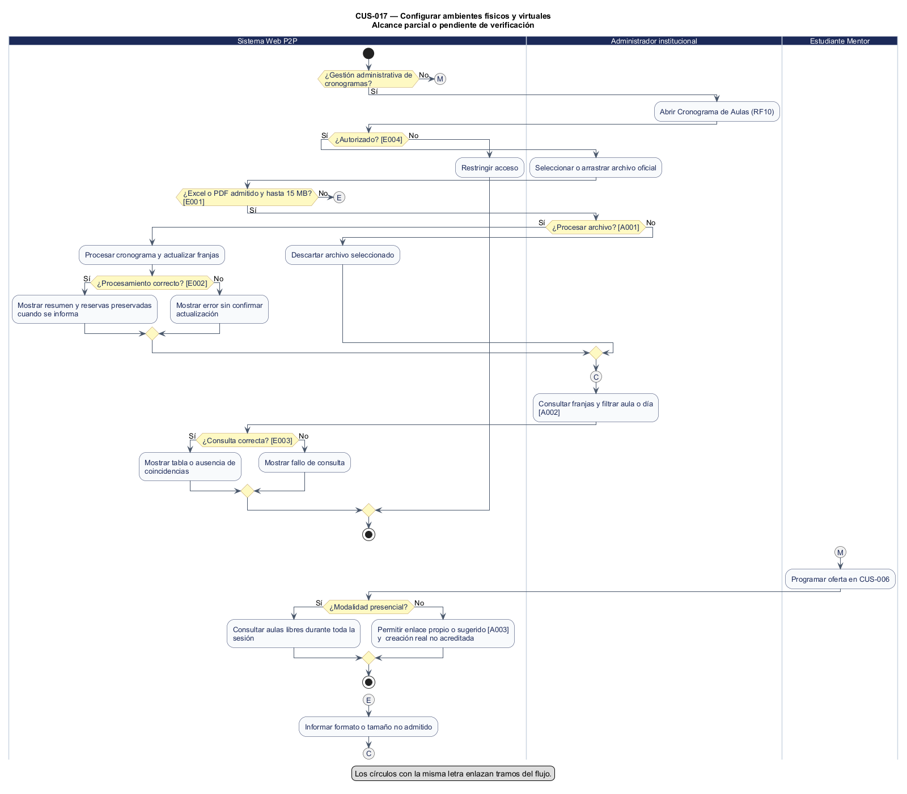

Fuente PlantUML: [CUS-017_actividades.puml](docs/narrativas/diagramas/plantuml/CUS-017_actividades.puml).

Fuente: Elaboración propia.

#### 7.6. Diagrama de caso de uso

**Figura 44. Diagrama de caso de uso — CUS-017: Configurar ambientes físicos y virtuales.**

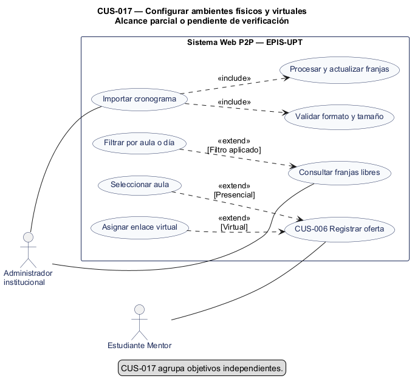

Fuente PlantUML: [CUS-017_caso_de_uso.puml](docs/narrativas/diagramas/plantuml/CUS-017_caso_de_uso.puml).

Fuente: Elaboración propia.

---

### CUS-020 — Gestionar catálogo curricular y asignaturas

#### 7.1. Ficha descriptiva

| Atributo | Detalle |
|---|---|
| **Id Caso de Uso** | **UC-020** (CUS-020) |
| **Nombre** | Gestionar catálogo curricular y asignaturas |
| **Tipo** | Obligatorio |
| **Requisito ID (RF)** | RF-005; relacionado con RF-006, RF-007, RF-008 y RN-11 |
| **Versión** | 2.3 (DOC-H02 — consolidación) |
| **Autor** | Antayhua Mamani, Renzo Antonio / Medina Quispe, Joan Cristian |
| **Actores** | Administrador institucional; visitantes, mentores y mentoreados (consulta pública relacionada) |
| **Interacción** | Interacción web institucional; comportamiento descrito conforme a la evidencia identificada. |
| **Descripción** | Permite gestionar asignaturas y temas del catálogo curricular para que los procesos de perfil, demanda, oferta y recomendación utilicen contenidos institucionales. |
| **Referencias** | SWEBOK v3.0, ISO/IEC/IEEE 29148:2018, SRS y reglas de negocio EPIS-UPT. |
| **Precondiciones** | Para modificaciones, sesión administrativa y consentimiento; catálogo disponible. La consulta de Cursos puede ser pública. |
| **Postcondiciones** | Asignaturas y temas registrados, editados o desactivados según la operación exitosa; la consulta no modifica datos. |

**Estado de evidencia:** Implementación identificada; revisión estática.

#### 7.2. Flujo normal de eventos

| **Acción del Actor** | **Respuesta del Sistema** |
|---|---|
| **Fase 1: Acceso y consulta** |  |
| **1.** El administrador abre «Administración» > «Catálogo Curricular (RF05)». |  |
|  | **2.** Presenta buscador por curso, código o tema, selector «Ciclo Formativo», «Actualizar», listado «Asignaturas del Plan Curricular» con contador y sección «Temario Silábico Oficial». |
| **3.** Busca una asignatura o selecciona ciclo I a IV o todos. |  |
|  | **4.** Filtra resultados y muestra código, ciclo y otros datos disponibles; al elegir una asignatura, presenta detalle y unidades conceptuales. Si no hay coincidencias, A001. |
| **Fase 2: Registrar asignatura** |  |
| **5.** Pulsa «Nueva Asignatura Crítica». |  |
|  | **6.** Abre «Registrar Asignatura Crítica (RF05)» con código, nombre oficial, ciclo (1 a 10), créditos, factor de ponderación y condición prioritaria, según los controles disponibles; ofrece «Cancelar» y «Registrar Asignatura». |
| **7.** Completa datos y presiona «Registrar Asignatura». |  |
|  | **8.** Muestra «Guardando...», comprueba los datos y registra la asignatura. Si hay error, E001; para modificar una existente, A002. |
| **9.** Revisa la nueva asignatura y selecciona su temario. |  |
|  | **10.** Actualiza el listado y presenta el detalle de la asignatura. |
| **Fase 3: Registrar tema silábico** |  |
| **11.** Pulsa «Nuevo Tema». |  |
|  | **12.** Abre «Incorporar Tema al Sílabo (RF05)» con título del concepto, unidad silábica y descripción. Ofrece «Cancelar» y «Incorporar Tema». |
| **13.** Completa los datos del tema y confirma. |  |
|  | **14.** Valida y registra el tema asociado a la asignatura; actualiza la lista de unidades y temas. |
| **Fase 4: Verificación del catálogo** |  |
| **15.** Revisa la información registrada. |  |
|  | **16.** Muestra el temario actualizado. Las acciones «Editar Asignatura», «Desactivar Asignatura», «Editar Tema» y «Desactivar Tema» permiten la gestión posterior (A002/A003). |

#### 7.3. Flujos alternativos

##### A001: Buscar o consultar sin modificación

* **Paso origen:** 4.
* **Condición de activación:** Catálogo abierto.

| **Acción del Actor** | **Respuesta del Sistema** |
|---|---|
| **A001-1.** Escribe un término, cambia ciclo o pulsa «Actualizar». |  |
|  | **A001-2.** Filtra o recarga el catálogo; si no hay temas, muestra aviso correspondiente. |
| **A001-3.** Selecciona otra asignatura o cierra. |  |

##### A002: Editar asignatura o tema

* **Paso origen:** 8, 16.
* **Condición de activación:** Registro existente.

| **Acción del Actor** | **Respuesta del Sistema** |
|---|---|
| **A002-1.** Pulsa «Editar Asignatura» o «Editar Tema», modifica campos y presiona «Guardar Cambios». |  |
|  | **A002-2.** Presenta formulario precompletado, valida y actualiza el registro si concluye correctamente. |
| **A002-3.** Revisa el resultado. |  |

##### A003: Desactivar registro

* **Paso origen:** 16.
* **Condición de activación:** Asignatura o tema seleccionado.

| **Acción del Actor** | **Respuesta del Sistema** |
|---|---|
| **A003-1.** Pulsa «Desactivar Asignatura» o «Desactivar Tema» y confirma cuando se solicita. |  |
|  | **A003-2.** Procesa la desactivación conforme a las restricciones del servicio y actualiza listado; no se presume eliminación física de relaciones históricas. |
| **A003-3.** Verifica estado. |  |

##### A004: Cancelar edición

* **Paso origen:** Flujo normal, en la operación indicada por la condición.
* **Condición de activación:** Formulario abierto antes del envío.

| **Acción del Actor** | **Respuesta del Sistema** |
|---|---|
| **A004-1.** Pulsa «Cancelar». |  |
|  | **A004-2.** Cierra sin guardar la modificación pendiente. |
| **A004-3.** Retorna al catálogo. |  |

#### 7.4. Flujos de excepción

##### E001: Datos inválidos o duplicados

* **Paso origen:** 8.
* **Condición de activación:** No cumplen requisitos del registro.

| **Acción del Actor** | **Respuesta del Sistema** |
|---|---|
|  | **E001-1.** Rechaza la operación y muestra el error disponible. |
| **E001-2.** Corrige código, nombre, ciclo, unidad u otro campo afectado. |  |

##### E002: Acceso sin privilegios

* **Paso origen:** Flujo normal, en la operación indicada por la condición.
* **Condición de activación:** Usuario de consulta intenta modificar.

| **Acción del Actor** | **Respuesta del Sistema** |
|---|---|
|  | **E002-1.** No presenta controles administrativos o rechaza la modificación. |
| **E002-2.** Consulta como visitante o inicia sesión autorizada. |  |

##### E003: Fallo de consulta o guardado

* **Paso origen:** Flujo normal, en la operación indicada por la condición.
* **Condición de activación:** Catálogo no disponible o persistencia fallida.

| **Acción del Actor** | **Respuesta del Sistema** |
|---|---|
|  | **E003-1.** Muestra el error disponible sin confirmar cambios. |
| **E003-2.** Actualiza y verifica datos antes de reintentar. |  |

##### E004: Registro no modificable

* **Paso origen:** Flujo normal, en la operación indicada por la condición.
* **Condición de activación:** Inexistente o restricción de relaciones.

| **Acción del Actor** | **Respuesta del Sistema** |
|---|---|
|  | **E004-1.** Rechaza la operación según respuesta del servicio. |
| **E004-2.** Revisa registro vigente y relaciones. |  |

#### 7.5. Diagrama de flujo de actividades

**Figura 45. Diagrama de actividades — CUS-020: Gestionar catálogo curricular y asignaturas.**

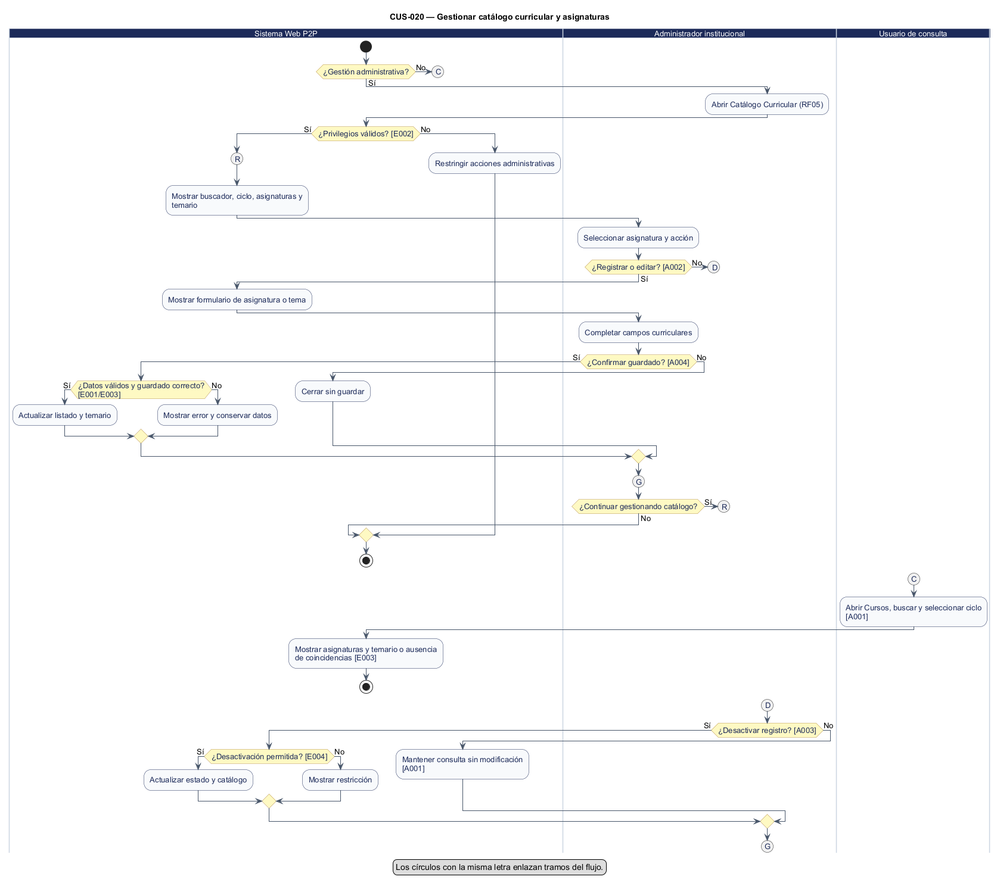

Fuente PlantUML: [CUS-020_actividades.puml](docs/narrativas/diagramas/plantuml/CUS-020_actividades.puml).

Fuente: Elaboración propia.

#### 7.6. Diagrama de caso de uso

**Figura 46. Diagrama de caso de uso — CUS-020: Gestionar catálogo curricular y asignaturas.**

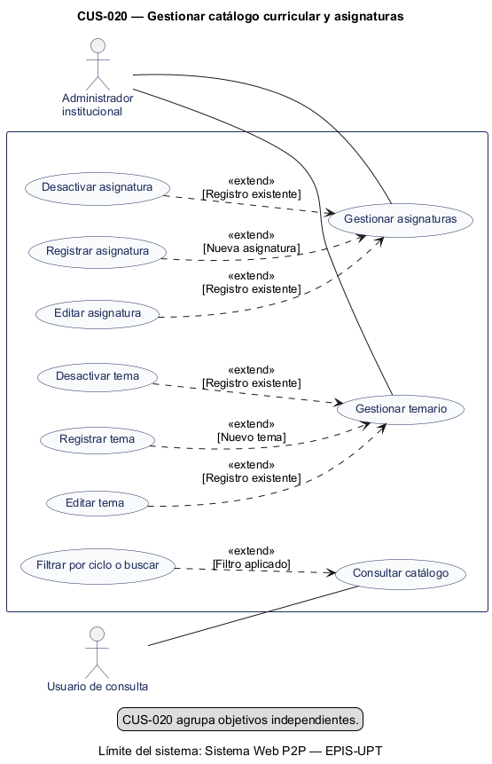

Fuente PlantUML: [CUS-020_caso_de_uso.puml](docs/narrativas/diagramas/plantuml/CUS-020_caso_de_uso.puml).

Fuente: Elaboración propia.

---

### CUS-022 — Configurar parámetros de corte y penalización

#### 7.1. Ficha descriptiva

| Atributo | Detalle |
|---|---|
| **Id Caso de Uso** | **UC-022** (CUS-022) |
| **Nombre** | Configurar parámetros de corte y penalización |
| **Tipo** | Opcional |
| **Requisito ID (RF)** | RF-013, RF-014, RF-015, RF-024; RN-08, RN-09, RN-10 |
| **Versión** | 2.3 (DOC-H02 — consolidación) |
| **Autor** | Antayhua Mamani, Renzo Antonio / Medina Quispe, Joan Cristian |
| **Actores** | Administrador institucional |
| **Interacción** | Interacción web institucional; flujo propuesto pendiente de implementación. |
| **Descripción** | Propone que el administrador consulte y gestione los parámetros institucionales que rigen corte, quórum y consecuencias académicas, preservando la coherencia de reservas ya registradas. |
| **Referencias** | SWEBOK v3.0, ISO/IEC/IEEE 29148:2018, SRS y reglas de negocio EPIS-UPT. |
| **Precondiciones** | Propuesta: actor autorizado, reglamento aprobado y parámetros/efectos formalmente definidos. |
| **Postcondiciones** | Propuesta: configuración registrada y vigente para el ámbito definido; no modifica retroactivamente estados sin política explícita. |

**Estado de evidencia:** Pendiente: edición administrativa no identificada.

#### 7.2. Flujo normal de eventos

| **Acción del Actor** | **Respuesta del Sistema** |
|---|---|
| **Fase 1: Consulta de parámetros (propuesto)** |  |
| **1.** El administrador accede a la configuración de corte y penalización. |  |
|  | **2.** Deberá presentar parámetros vigentes y su explicación. La referencia actual es corte T-24 h y quórum del 50 %; el monitoreo existente muestra mínimo y porcentaje por sesión. |
| **3.** Revisa las condiciones de ratificación, desistimiento y quórum. |  |
|  | **4.** Deberá distinguir restricciones obligatorias de los valores realmente editables. No existe interfaz de configuración acreditada. |
| **Fase 2: Edición y validación (propuesto)** |  |
| **5.** Selecciona los parámetros autorizados que necesita ajustar. |  |
|  | **6.** Deberá comprobar valores, rangos y compatibilidad con las reglas de negocio. La política de penalización debe estar previamente definida. |
| **7.** Revisa el alcance temporal del cambio. |  |
|  | **8.** Deberá indicar desde cuándo aplica y si afecta nuevas ofertas, evitando cambios retroactivos no autorizados. |
| **9.** Confirma la actualización. |  |
|  | **10.** Deberá registrar responsable, fecha y valores; aplicar cambios solo si son válidos y conforme a la política aprobada. |
| **11.** Consulta el resultado. |  |
|  | **12.** Deberá mostrar configuración vigente. El corte operativo se ejecuta mediante CUS-023, no mediante la sola consulta. |

#### 7.3. Flujos alternativos

##### A001: Cancelar modificación

* **Paso origen:** Flujo normal, en la operación indicada por la condición.
* **Condición de activación:** Antes de confirmar.

| **Acción del Actor** | **Respuesta del Sistema** |
|---|---|
| **A001-1.** Abandona los cambios. |  |
|  | **A001-2.** Deberá conservar parámetros vigentes. |
| **A001-3.** Retorna al monitoreo. |  |

##### A002: Consultar sin modificar

* **Paso origen:** Flujo normal, en la operación indicada por la condición.
* **Condición de activación:** Solo requiere comprobar corte y porcentaje.

| **Acción del Actor** | **Respuesta del Sistema** |
|---|---|
| **A002-1.** Revisa los parámetros. |  |
|  | **A002-2.** Deberá presentar información sin cambiar valores. En el sistema actual puede consultar el quórum en Administración. |
| **A002-3.** Cierra la consulta. |  |

#### 7.4. Flujos de excepción

##### E001: Valores incompatibles

* **Paso origen:** Flujo normal, en la operación indicada por la condición.
* **Condición de activación:** Rango o regla institucional no permitida.

| **Acción del Actor** | **Respuesta del Sistema** |
|---|---|
|  | **E001-1.** Deberá bloquear actualización y mostrar motivo. |
| **E001-2.** Corrige datos. |  |

##### E002: Sin permiso

* **Paso origen:** Flujo normal, en la operación indicada por la condición.
* **Condición de activación:** Actor no autorizado.

| **Acción del Actor** | **Respuesta del Sistema** |
|---|---|
|  | **E002-1.** Deberá rechazar la modificación. |
| **E002-2.** Solicita acceso institucional. |  |

##### E003: Fallo al aplicar

* **Paso origen:** Flujo normal, en la operación indicada por la condición.
* **Condición de activación:** No se puede registrar la configuración.

| **Acción del Actor** | **Respuesta del Sistema** |
|---|---|
|  | **E003-1.** Deberá conservar valores vigentes y no declarar éxito. |
| **E003-2.** Comprueba antes de reintentar. |  |

#### 7.5. Diagrama de flujo de actividades

**Figura 47. Diagrama de actividades — CUS-022: Configurar parámetros de corte y penalización.**

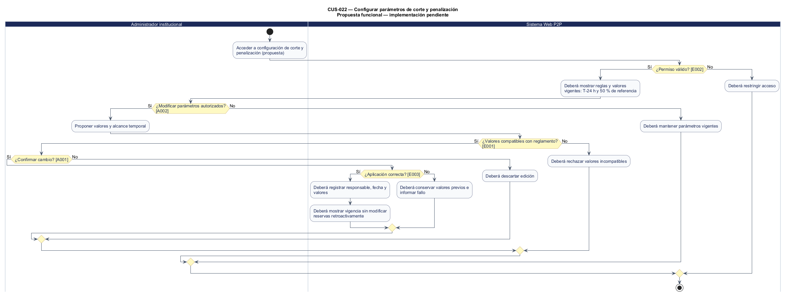

Fuente PlantUML: [CUS-022_actividades.puml](docs/narrativas/diagramas/plantuml/CUS-022_actividades.puml).

Fuente: Elaboración propia.

#### 7.6. Diagrama de caso de uso

**Figura 48. Diagrama de caso de uso — CUS-022: Configurar parámetros de corte y penalización.**

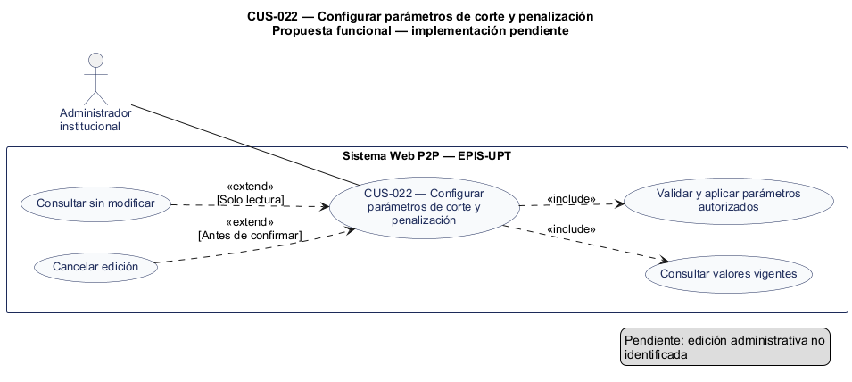

Fuente PlantUML: [CUS-022_caso_de_uso.puml](docs/narrativas/diagramas/plantuml/CUS-022_caso_de_uso.puml).

Fuente: Elaboración propia.

---

## Anexo A. Matriz de revisión y pendientes de homologación

Las observaciones siguientes son de control documental. No forman parte del flujo visible al usuario ni sustituyen pruebas de ejecución. Los requisitos propuestos no se declaran implementados.

| Caso | Evidencia / diferencia pendiente | Archivos de referencia en la línea base |
|---|---|---|
| CUS-001 | Se conserva texto aprobado. Validación externa Google y correo pendiente; ver matriz H01. | NARRATIVAS_CASOS_DE_USO.md; docs/revision_srs/CUS-001/MATRIZ_REVISION_H01.md |
| CUS-010 | El buscador no admite correctamente @virtual.upt.pe; la promoción no acredita notas mínimas; el resultado por defecto no acredita existencia de cuenta. No se certifica persistencia ante todos los fallos, cancelación de ofertas, cambio inmediato de permisos en sesiones abiertas, ni auditoría integral. No hay asignación general de Administrador/Coordinador ni confirmación previa. | AdminDashboardView.tsx; role_service.py; roles.py; profile_service.py; test_roles.py |
| CUS-006 | La elegibilidad acepta rol Mentor/Administrador O ciclo VII o superior; falta comprobar nota 14 y disponibilidad personal. El enlace generado no garantiza una reunión real, admite URLs genéricas; un solo tema, sin adjuntos separados, observaciones hasta 1000 caracteres sin límite visible. RN-04 exige >24 h. No se certificó la UI integrada en ejecución. | OfferPublishView.tsx; offerService.ts; offer_service.py; offer.py; virtual_room_service.py; MentorSessionsView.tsx; App.tsx; test_offers.py |
| CUS-008 | El SRS anterior asigna RF07 a CUS-003 y CUS-008 a espacios; prevalece el catálogo nuevo. No se acredita control de duplicados, matrícula, relación tema/curso, rol del solicitante ni autorización explícita de consulta del banco que expone correos. No hay horario tentativo, notificaciones, filtro visible por ciclo ni seguimiento/cancelación del solicitante. El cierre × no cancela un envío en curso. La tarjeta de oferta llena tiene reserva deshabilitada; no se garantiza acceso al flujo de aforo agotado. | MentoringDemandModalView.tsx; RecommendationFeedView.tsx; BookingModalView.tsx; MentorSessionsView.tsx; bookings.py; booking_service.py; offer_service.py; App.tsx |
| CUS-005 | No hay validación acreditada de notas de 14, documentos adjuntos, expediente de postulación, estados de evaluación o envío a comité. El ciclo se selecciona en el perfil y no equivale a certificación académica. La preferencia de mentor no concede privilegios. | ProfileAvailabilityView.tsx; profile_service.py; profiles.py; navigationConfig.ts; role_service.py |
| CUS-021 | No existe rol Comité en navegación ni bandeja, votación, expedientes o resoluciones de comité identificados. El único flujo operativo relacionado es la preferencia de rol en Mi perfil y promoción administrativa directa del CUS-010. Los pasos en futuro son diseño propuesto y requieren aprobación del responsable; no son pantallas reales. | ProfileAvailabilityView.tsx; AdminDashboardView.tsx; navigationConfig.ts; role_service.py; SRS_NUEVO.md (RF03/RN-03) |
| CUS-002 | El SRS describe el recomendador Top-k; no se certifica exactitud, rendimiento ni personalización en vivo en esta revisión. La acción de contacto no acredita mensajería. El filtro de asignatura se muestra en sesiones; el límite visible es 3, 4 o 5. | RecommendationFeedView.tsx; recommendationService.ts; recommendations.py; recommendation_service.py; App.tsx; test_recommendations.py |
| CUS-003 | El SRS anterior denomina esta función CUS-004; el catálogo nuevo usa CUS-003. No se debe confundir una reserva provisional con una sesión confirmada por quórum. La disponibilidad se comprueba nuevamente al registrar. | BookingModalView.tsx; RecommendationFeedView.tsx; bookingService.ts; booking_service.py; bookings.py; test_bookings.py; App.tsx |
| CUS-004 | La identificación previa era CUS-024. La ratificación no equivale a asistencia efectiva. El límite exacto se aplica en el servicio; la interfaz puede quedar desactualizada mientras está abierta. | StudentBookingsView.tsx; bookingService.ts; booking_service.py; bookings.py; test_bookings.py |
| CUS-023 | No se demuestra aquí que el planificador esté activo en staging/producción ni que se envíen notificaciones externas. El SRS anterior separa la resolución del mentor como CUS-007; se conserva como alternativa de CUS-023 en el catálogo nuevo. No cambiar el porcentaje sin evidencia de configuración. | quorum.py; booking_service.py; offer_service.py; AdminDashboardView.tsx; MentorSessionsView.tsx; StudentBookingsView.tsx |
| CUS-024 | El SRS anterior utiliza CUS-017 para desistimiento. El motivo es opcional; no confundir con justificación posterior de inasistencia (CUS-018), que no está acreditada como flujo propio. | StudentBookingsView.tsx; bookingService.ts; booking_service.py; bookings.py; test_bookings.py |
| CUS-007 | El SRS anterior separa asistencia CUS-012 y bitácora CUS-013. Se agrupan conforme al catálogo. No se certificó cámara/QR en dispositivo real, ni reapertura extemporánea. El sello de integridad no equivale a firma digital certificada ni visado. | SessionAttendanceView.tsx; StudentBookingsView.tsx; MentorSessionsView.tsx; BitacoraFormView.tsx; attendance.py; bitacora.py |
| CUS-012 | La denominación bidireccional del catálogo supera la implementación identificada: existe evaluación estudiante→mentor y observaciones grupales del mentor; falta definir/evidenciar calificación mentor→estudiante y consulta de feedback individual. | PostSessionSurveyModal.tsx; StudentBookingsView.tsx; survey.py; BitacoraFormView.tsx; bitacora.py |
| CUS-013 | El SRS exige historial con bitácoras y recursos compartidos. No se identificó un historial académico unificado con descarga de material o consulta de bitácoras por mentoreado; conservar como alcance pendiente. | StudentBookingsView.tsx; MentorSessionsView.tsx; bookingService.ts; bookings.py; offers.py; bitacora.py; SRS_NUEVO.md (RF19) |
| CUS-014 | La interfaz y el servicio se identifican como DEMO; no se acredita reconocimiento oficial por Dirección, firma certificada o emisión real de la universidad. El SRS anterior usa CUS-018. La verificación por folio no equivale a certificar validez legal externa. | CertificateDownloadView.tsx; certificates.py; certificateService.ts; AdminDashboardView.tsx; SRS_NUEVO.md (RF22/RF23/RN14) |
| CUS-018 | No se identificó formulario, servicio, política de plazo, evidencia requerida ni flujo de aprobación específico. No inventar botones ni sanciones; la propuesta requiere definir RF y reglas, y no confundir con el desistimiento de CUS-024. | StudentBookingsView.tsx; bookings.py; booking_service.py; navigationConfig.ts; CONTROL_AVANCE.md |
| CUS-019 | No se encontró rol Tutor ni interfaz de seguimiento por tutor. No acreditar visado o subsanación extemporánea por tutor. La administración sí dispone de consulta, visado y observación; la relación con certificados está en RN-14. | AdminDashboardView.tsx; bitacora.py; navigationConfig.ts; CertificateDownloadView.tsx; SRS_NUEVO.md (RF26) |
| CUS-009 | RF25 contempla métricas de retención y desempeño; no se identificó pantalla de analítica integral. El monitoreo de quórum sí está presente. Servicios de simulación no prueban un tablero de producción ni indicadores de impacto. | AdminDashboardView.tsx; quorum.py; simulation.py; recommendations.py; SRS_NUEVO.md (RF25) |
| CUS-011 | No se identificó botón, servicio ni formato de exportación ejecutiva. No confundir con importación de cronograma Excel/PDF o descarga de constancias individuales. El formato y las métricas requieren aprobación. | AdminDashboardView.tsx; simulation.py; SRS_NUEVO.md (RF25/RF26); navigationConfig.ts |
| CUS-015 | El recomendador y el selector Top 3/4/5 existen, pero no se identificó interfaz administrativa de pesos, umbrales, simulación o restauración. La prioridad curricular puede editarse en el catálogo (CUS-020); no equivale a cambiar pesos globales. Rangos y política de versionado son propuestas. | recommendation_service.py; RecommendationFeedView.tsx; AdminDashboardView.tsx; simulation.py; SRS_NUEVO.md (RF06/RF24/RN11) |
| CUS-016 | Existen mecanismos de autenticación, consentimiento y control de roles, pero no se acredita una bandeja integral de trazas de seguridad ni exportación, inmutabilidad o cobertura de todos los eventos. «Auditoría de Bitácoras» es pedagógica y no sustituye la auditoría de seguridad. | auth.py; consent.py; roles.py; AdminDashboardView.tsx; navigationConfig.ts; SRS_NUEVO.md (RF26/RN01/RN02) |
| CUS-017 | El SRS anterior usa CUS-008/CUS-011 para espacios y cronogramas. No se acredita CRUD separado de aulas, aforo/equipamiento individual, configuración de proveedores o creación de salas reales. La disponibilidad se calcula según franjas y ocupación, no por el solo hecho de que el aula aparezca en catálogo. | AdminScheduleUploadView.tsx; AdminDashboardView.tsx; spacesService.ts; spaces.py; schedule_parser_service.py; offer_service.py; virtual_room_service.py |
| CUS-020 | El filtro de consulta muestra ciclos I–IV, mientras que el formulario admite ciclo 1–10; requiere homologación con la política de materias prioritarias. No confundir este CUS con el CUS-021 del SRS anterior (consulta curricular), ni con el CUS-022 anterior (gestión del catálogo). | CurriculumCatalogView.tsx; curriculum.py; AdminDashboardView.tsx; navigationConfig.ts; SRS_NUEVO.md (RF05) |
| CUS-022 | No se identificó panel de modificación de corte, porcentaje o penalizaciones. La referencia de 24 h y 50 % no prueba que sean editables desde la interfaz. No se acredita tabla de sanciones o aplicación configurable de penalidades; requiere política institucional explícita. | AdminDashboardView.tsx; quorum.py; booking_service.py; offer_service.py; SRS_NUEVO.md (RF24/RN08/RN09/RN10) |

## Anexo B. Correspondencia con la numeración anterior del SRS

La equivalencia es funcional, no implica que los identificadores sean intercambiables. La numeración canónica de trabajo es la del nuevo catálogo. No reemplazar automáticamente los identificadores de código, pruebas o SRS sin revisar la matriz completa.

| Nuevo catálogo | SRS_NUEVO.md anterior (función relacionada) |
|---|---|
| CUS-001 | CUS-001 (autenticación) |
| CUS-010 | CUS-010 (roles) |
| CUS-006 | CUS-006 (publicar oferta), parte de CUS-008 (espacios) |
| CUS-008 | CUS-003 (registrar solicitud de demanda) |
| CUS-005 | CUS-005 (perfil y disponibilidad), relación con CUS-010 |
| CUS-021 | Sin caso equivalente de comité identificado; relación RF03/CUS-010 |
| CUS-002 | CUS-002 (recomendación) |
| CUS-003 | CUS-004 (reserva) |
| CUS-004 | CUS-024 (ratificación) |
| CUS-023 | CUS-023 (corte), CUS-007 (decisión del mentor) |
| CUS-024 | CUS-017 (desistimiento) |
| CUS-007 | CUS-012 (asistencia), CUS-013 (bitácora) |
| CUS-012 | Encuestas RF20; retroalimentación del mentor mediante bitácora |
| CUS-013 | CUS-014 (historial y bitácoras) |
| CUS-014 | CUS-018 (constancia) |
| CUS-018 | Sin equivalente directo de justificación identificado |
| CUS-019 | CUS-013/CUS-014 y auditoría RF26; sin rol tutor acreditado |
| CUS-009 | CUS-011/CUS-015 (reportes/retención) |
| CUS-011 | CUS-011 (reportes, exportación específica pendiente) |
| CUS-015 | CUS-020 (configuración/umbrales), RF06/RF24 |
| CUS-016 | CUS-016 (auditoría de seguridad) |
| CUS-017 | CUS-008 (espacios), RF10 (cronogramas) |
| CUS-020 | CUS-021 (consulta), CUS-022 (gestión curricular) |
| CUS-022 | CUS-020 (configuración y umbrales) |

## Anexo C. Fuentes generales de consulta

- [SRS_NUEVO.md](https://github.com/JMedina255/sistema_web_p2p/blob/044d2a8473908def9a40503cc9692426e02198a8/SRS_NUEVO.md): requisitos RF01–RF26, reglas RN01–RN14 y narrativas anteriores.
- [CONTROL_AVANCE.md](https://github.com/JMedina255/sistema_web_p2p/blob/044d2a8473908def9a40503cc9692426e02198a8/docs/narrativas/CONTROL_AVANCE.md): orden, títulos y módulos del nuevo catálogo.
- [Componentes de la interfaz](https://github.com/JMedina255/sistema_web_p2p/tree/044d2a8473908def9a40503cc9692426e02198a8/aplicacion/frontend/src/components): pantallas y controles.
- [Navegación institucional](https://github.com/JMedina255/sistema_web_p2p/blob/044d2a8473908def9a40503cc9692426e02198a8/aplicacion/frontend/src/navigation/navigationConfig.ts): nombres de menú y roles visibles.
- [Servicios de aplicación](https://github.com/JMedina255/sistema_web_p2p/tree/044d2a8473908def9a40503cc9692426e02198a8/aplicacion/backend/app/services) y [operaciones del servidor](https://github.com/JMedina255/sistema_web_p2p/tree/044d2a8473908def9a40503cc9692426e02198a8/aplicacion/backend/app/api/v1/endpoints): contraste de comportamiento y restricciones.

**Cierre documental:** 24/24 narrativas redactadas y 48/48 figuras renderizadas e inspeccionadas en DOC-H04, con 19 figuras corregidas y comparadas en DOC-H04-R. Quedan pendientes la revisión y aprobación del responsable, la homologación de requisitos e identificadores y las validaciones de ejecución indicadas en el Anexo A.
