# UNIVERSIDAD PRIVADA DE TACNA

**FACULTAD DE INGENIERÍA** 
**ESCUELA PROFESIONAL DE INGENIERÍA DE SISTEMAS**

# “Sistema Web P2P con algoritmo de recomendación para la personalización de mentorías académicas en la EPIS-UPT”

**Curso:** 
Construcción de Software I

**Docente:** 
Dr. RICARDO EDUARDO VALCARCEL ALVARADO

**AUTORES:** 
- ANTAYHUA MAMANI, Renzo Antonio (2022073504)
- MEDINA QUISPE, Joan Cristian (2022074255)

**TACNA – PERÚ** 
**2026**

---

## CONTROL DE VERSIONES

| Versión | Hecha por | Revisada por | Aprobada por | Fecha | Motivo |
|:---:|:---:|:---:|:---:|:---:|:---|
| **1.0** | JCM / RAM | RVA | Dirección EPIS | 28/09/2026 | Versión inicial del Documento de Arquitectura de Software (SAD). Establecimiento de las bases arquitectónicas: Introducción, Representación 4+1, Objetivos y Limitaciones, y Análisis de Requerimientos. |
| **1.1** | Asistencia de Codex a solicitud del equipo | Pendiente | Pendiente | 28/09/2026 | Alineación de MOD, RF, RNF, RN y CUS con el SRS; trazabilidad arquitectónica y declaración del alcance inicial del sistema (plataforma web desacoplada en producción/staging). No constituye aprobación institucional. |
| **1.2** | JCM / RAM | Pendiente | Pendiente | 19/10/2026 | Consolidación de la etapa de diseño arquitectónico y cierre del Sprint 1: formalización de modelos de persistencia base (ASIGNATURA_FILTRO, TEMA_CONCEPTUAL, AUTH_CHALLENGES), endpoints REST de catálogo y autenticación OTP, mitigación de riesgos RLS en Supabase y suite de 96 pruebas automatizadas. |
| **2.0** | JCM / RAM | Dr. Ricardo Valcarcel | Dirección EPIS | 19/10/2026 | Emisión formal del Documento de Arquitectura de Software en Fase de Diseño (SAD v2.0): integración de las 10 reglas de diseño (reglas_documentacion_diseño.md), contratos exhaustivos de endpoints REST, diccionario físico PostgreSQL con DDL y RLS, máquinas de estado del dominio, mapeo entre capas, variables .env y ADRs. |
| **2.1** | JCM / RAM | Dr. Ricardo Valcarcel | Dirección EPIS | 23/10/2026 | Consolidación arquitectónica del Sprint 2 (SAD v2.1): integración de 5 nuevas tablas en el Diccionario Físico de Datos (consentimientos_legales, roles, usuario_roles, perfiles_academicos, disponibilidades_horarias), especificación de políticas RLS para aislamiento multiusuario, contratos de endpoints de consentimiento, roles y perfiles, máquinas de estado de consentimiento y jerarquía de mérito (RN-03), registro de ADR-005 a ADR-008, y acreditación empírica con 150 pruebas automatizadas sin fallos (>90% de cobertura en ambas capas). |
| **3.0** | JCM / RAM | Dr. Ricardo Valcarcel | Dirección EPIS | 14/11/2026 | Consolidación Integral de la Fase de Diseño y Cierre de Construcción (SAD v3.0): culminación de los 8 Sprints de desarrollo en estricta sincronía con el SRS v3.0. Formalización de la arquitectura desacoplada en producción/staging (React 19 SPA + FastAPI 0.115+ en Python 3.14 + PostgreSQL 16 en Supabase con RLS), homologación de los 8 módulos canónicos oficiales, motor EdRecSys en-proceso (latencia 12.4 ms, Precision@3=83.3%, Precision@5=80.0%, NDCG=0.82), persistencia completa de 15 tablas relacionales con DDL, FSM de 13 estados para sesiones y 9 para reservas, catálogo OpenAPI 3.0 de endpoints REST, fichas ADR-001 al ADR-016, matrices de transaccionalidad ACID pesimista (SELECT ... FOR UPDATE) y acreditación empírica integral mediante 627 pruebas automatizadas aprobadas (280 backend Pytest, 347 frontend Vitest) con 0 fallos y cobertura >85%. |
| **4.0 (DOC-H06)** | Asistencia documental a solicitud del equipo | Pendiente | Pendiente | 28/11/2026 | Homologación con SRS v4.0 y catálogo vigente; corrección de arquitectura, contratos, persistencia y estados por evidencia estática. Sin aprobación institucional ni certificación operativa. |
| **4.0 (DOC-H06-R)** | Asistencia documental a solicitud del equipo | Pendiente | Pendiente | 28/11/2026 | Recuperación segura sobre ed6c1cc y contraste acotado de trazas OTP/correo y pruebas modificadas. Paquete preservado; commit local sin publicación ni merge a main. |

# Sistema Web P2P con algoritmo de recomendación para la personalización de mentorías académicas en la EPIS-UPT

**Documento de Arquitectura de Software (SAD - Software Architecture Document)** 
**Versión 4.0 — Revisión documental DOC-H06. Pendiente de aprobación institucional.**

**Fase del ciclo de vida:** Revisión documental sobre código existente; validaciones y brechas identificadas. 
**Fuente de nomenclatura:** SRS_V4.0_CONSOLIDADO.md y NARRATIVAS_CASOS_DE_USO.md; cinco módulos y 24 CUS. 
**Normativa de diseño:** Directrices de diseño prescriptivo `reglas_documentacion_diseño.md` (Reglas D-1 a D-10). 
**Estado de las vistas:** Diseño contrastado estáticamente. La implementación identificada, los alcances parciales y las propuestas se distinguen por caso. No se declara verificación integral ni despliegue institucional.

---

## ÍNDICE GENERAL

- 1. Introducción
  - 1.1. Propósito
  - 1.2. Alcance
  - 1.3. Definición, siglas y abreviaturas
  - 1.4. Referencias y criterio de precedencia
  - 1.5. Visión general y estado del ciclo
- 2. Representación Arquitectónica
  - 2.1. Escenarios
  - 2.2. Vista Lógica
  - 2.3. Vista del Proceso
  - 2.4. Vista de Desarrollo
  - 2.5. Vista Física
- 3. Objetivos y limitaciones arquitectónicas
  - 3.1. Disponibilidad
  - 3.2. Seguridad
  - 3.3. Adaptabilidad y Mantenibilidad
  - 3.4. Rendimiento y Usabilidad
- 4. Análisis de Requerimientos
  - 4.1. Requerimientos funcionales
  - 4.2. Requerimientos no funcionales
  - 4.3. Trazabilidad hacia las vistas arquitectónicas
  - 4.4. Reglas de negocio institucionales
- 5. Vistas de Caso de Uso
  - Cuadro 5.1: Catálogo vigente de los 24 casos
- 6. Vista Lógica y Contratos de Interfaces
  - 6.1. Diagrama Contextual
  - 6.2. Descomposición en capas y patrón ECB
  - 6.3. Catálogo de contratos declarados
- 7. Vista de Procesos
  - 7.1. Diagrama de Proceso Actual (As-Is)
  - 7.2. Diagrama de Proceso Propuesto (To-Be)
  - 7.3. Trazabilidad hacia los Diagramas de Secuencia de Diseño
- 8. Vista de Despliegue
  - 8.1. Diagrama de Contenedores C4 Nivel 2
  - 8.2. Matriz de Contenedores, Tecnologías y Protocolos
- 9. Vista de Implementación
  - 9.1. Diagrama de Componentes y Paquetes
  - 9.2. Puertos e Interfaces Implementadas
- 10. Vista de Datos y Persistencia
  - 10.1. Diagrama Entidad-Relación Físico
  - 10.2. Diccionario físico vigente
  - 10.3. Políticas de Seguridad a Nivel de Fila (RLS)
- 11. Máquinas de Estado y Transiciones del Dominio
  - 11.1. Desafío OTP
  - 11.2. Consentimiento
  - 11.3. Roles y mérito
  - 11.4. Sesión de mentoría
  - 11.5. Reserva de cupo
  - 11.6. Bitácora, encuesta y constancia
- 12. Mapeo de Transformación de Datos entre Capas y Catálogo de Errores
  - 12.1. Transformación de Campos entre Capas Arquitectónicas
  - 12.2. Catálogo de errores y límites
- 13. Gestión de Configuración y Variables de Entorno
- 14. Registro de Decisiones Arquitectónicas (ADR) y Transaccionalidad
  - 14.1. Decisiones ADR-001 al ADR-016
  - 14.2. Transaccionalidad de Operaciones Críticas
- 15. Calidad y Métricas de Verificación Empírica
  - 15.1. Procedencia de pruebas históricas
  - 15.2. Estado de atributos ISO/IEC 25010
  - 15.3. Rendimiento y transacciones
  - 15.4. Dictamen documental y pendientes

---

## 1. Introducción

### 1.1. Propósito

Este SAD documenta responsabilidades, contratos, entidades y decisiones del Sistema Web P2P de Mentorías Académicas EPIS-UPT. Se homologa con la edición DOC-H06 del SRS sin cambiar la aplicación. La base inicial revisada fue `1f6e806a98f3f584df3349e2a8bd69467acc7eae`; DOC-H06-R incorpora y contrasta los tres commits posteriores hasta `ed6c1cc06f0794c661636e1893723e025c206b68`. Los generadores de evidencias de sprints 7/8 y los cambios en pruebas no acreditan nuevas corridas en este hito.

### 1.2. Alcance

| Módulo vigente | Denominación | Casos |
| --- | --- | --- |
| MOD-01 | Seguridad, Autenticación y Gobernanza | CUS-001, CUS-010 |
| MOD-02 | Ofertas de Mentoría y Gestión de Recursos | CUS-006, CUS-008, CUS-005, CUS-021 |
| MOD-03 | Recomendaciones, Reservas y Quórum | CUS-002, CUS-003, CUS-004, CUS-023, CUS-024 |
| MOD-04 | Ejecución y Seguimiento Académico | CUS-007, CUS-012, CUS-013, CUS-014, CUS-018, CUS-019 |
| MOD-05 | Administración y Analítica Institucional | CUS-009, CUS-011, CUS-015, CUS-016, CUS-017, CUS-020, CUS-022 |

| Módulo histórico (v3.x) | Destino documental v4.0 | Criterio de homologación |
| --- | --- | --- |
| MOD-01 | MOD-01 y MOD-02 | Acceso y roles; postulación y comité en MOD-02 |
| MOD-02 | MOD-02 y MOD-05 | Oferta en MOD-02; ambientes y cronogramas en MOD-05 |
| MOD-03 | MOD-02 y MOD-05 | Perfil/postulación y currículo |
| MOD-04 | MOD-02, MOD-03 y MOD-05 | Demanda, recomendación y parametrización |
| MOD-05 | MOD-03 y MOD-05 | Operación de reserva/corte y configuración propuesta |
| MOD-06 | MOD-04 | Asistencia, bitácora, feedback e historial |
| MOD-07 | MOD-04 | Constancias; RF21 transversal preservado |
| MOD-08 | MOD-04 y MOD-05 | Visado, analítica, seguridad y configuración; avisos transversales |

Los cinco módulos son una agrupación funcional documental, no cinco procesos ni cinco microservicios. La separación anterior de ocho módulos es histórica; la autorización del usuario permite su homologación documental, sin sustituir la aprobación institucional.

### 1.3. Definición, siglas y abreviaturas

| Término | Definición y límite |
| --- | --- |
| 2FA | Dos factores independientes. CUS-001 conserva su nombre histórico; OTP por correo o SSO separados no demuestran 2FA. |
| ECB | Boundary: interfaz; Control: servicio; Entity: datos del dominio. Las propuestas se distinguen de componentes operativos. |
| TOTP / pase QR | La interfaz usa TOTP como rótulo; el servicio genera códigos aleatorios de 30 s y token SHA-256, sin algoritmo RFC 6238. |
| SHA-256 | Huella de campos seleccionados; no firma digital certificada ni garantía absoluta de inmutabilidad. |
| RLS | Política del motor relacional cuya activación exige evidencia del entorno; distinta de autorización en API. |
| DEMO | Documento o respaldo de demostración, sin validez institucional acreditada. |

### 1.4. Referencias y criterio de precedencia

El [SRS vigente](SRS_V4.0_CONSOLIDADO.md) define requisitos y estados; el [catálogo](NARRATIVAS_CASOS_DE_USO.md) rige los identificadores y denominaciones. El código resuelve contradicciones sobre implementación; no elimina los requisitos no cubiertos. Los [anexos del SRS](SRS_V4.0_CONSOLIDADO.md#9-anexos-del-catálogo), la [matriz de homologación](docs/revision_srs/MATRIZ_HOMOLOGACION_SRS_V4.md), [QA](docs/qa/QA-P2P-04R-CIERRE.md) y el [control de narrativas](docs/narrativas/CONTROL_AVANCE.md) conservan procedencia y límites. La [edición histórica del SAD](docs/diseño/FD04-EPIS-Informe%20SAD%20de%20Proyecto.md) y sus figuras no se modifican. Las declaraciones de aprobación en el historial son antecedentes reproducidos, no aprobación acreditada por DOC-H06.

### 1.5. Visión general y estado del ciclo

Implementado significa código identificado, pendiente de validación suficiente salvo el alcance exacto de evidencia histórica citada. Parcial significa cobertura incompleta. Especificado/propuesto conserva un requisito sin implementación identificada. Las figuras muestran alcance y límites; una secuencia prevista no acredita endpoint, pantalla, persistencia ni integración real.

## 2. Representación Arquitectónica

| Vista 4+1 | Alcance de DOC-H06 |
| --- | --- |
| Escenarios | 24 CUS vigentes y dos objetivos transversales conservados |
| Lógica | SPA, routers, servicios y datos; componentes previstos separados |
| Proceso | Reserva concurrente, corte condicional y operación posterior |
| Desarrollo | Paquetes presentes en repositorio; sin inventar microservicios |
| Física | Topología de referencia, sin certificar versiones o despliegue real |

### 2.1. Escenarios

**Diagrama 2.1. Escenarios arquitectónicos nucleares**

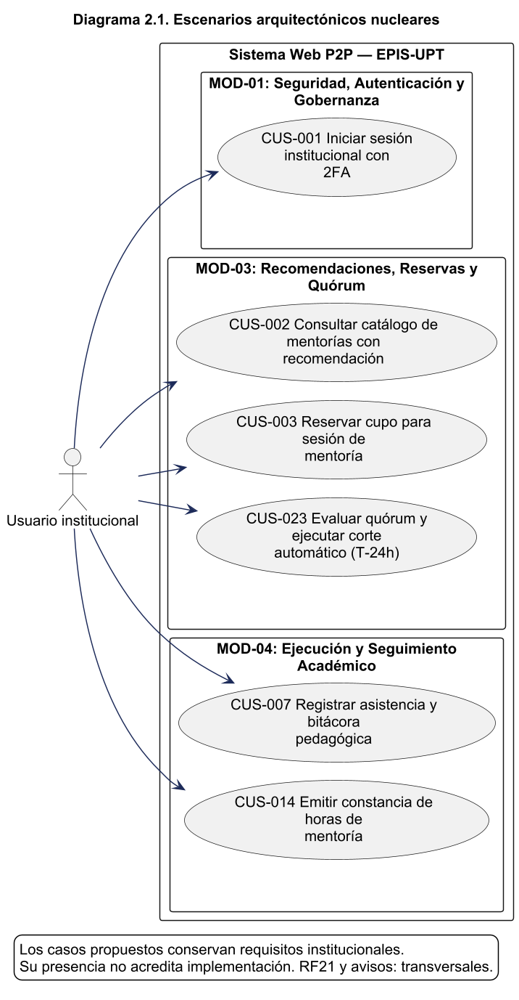

Fuente: Elaboración propia, DOC-H06. [Fuente PlantUML](docs/revision_srs/diagramas/doc-h06/sad/puml/diag_001_escenarios.puml).

Los escenarios núcleo se complementan con las propuestas CUS-011/CUS-015/CUS-016/CUS-018/CUS-021/CUS-022. CUS-005 y CUS-010 no acreditan el comité ni la certificación de mérito.

### 2.2. Vista Lógica

**Diagrama 2.2. Vista lógica y responsabilidades**

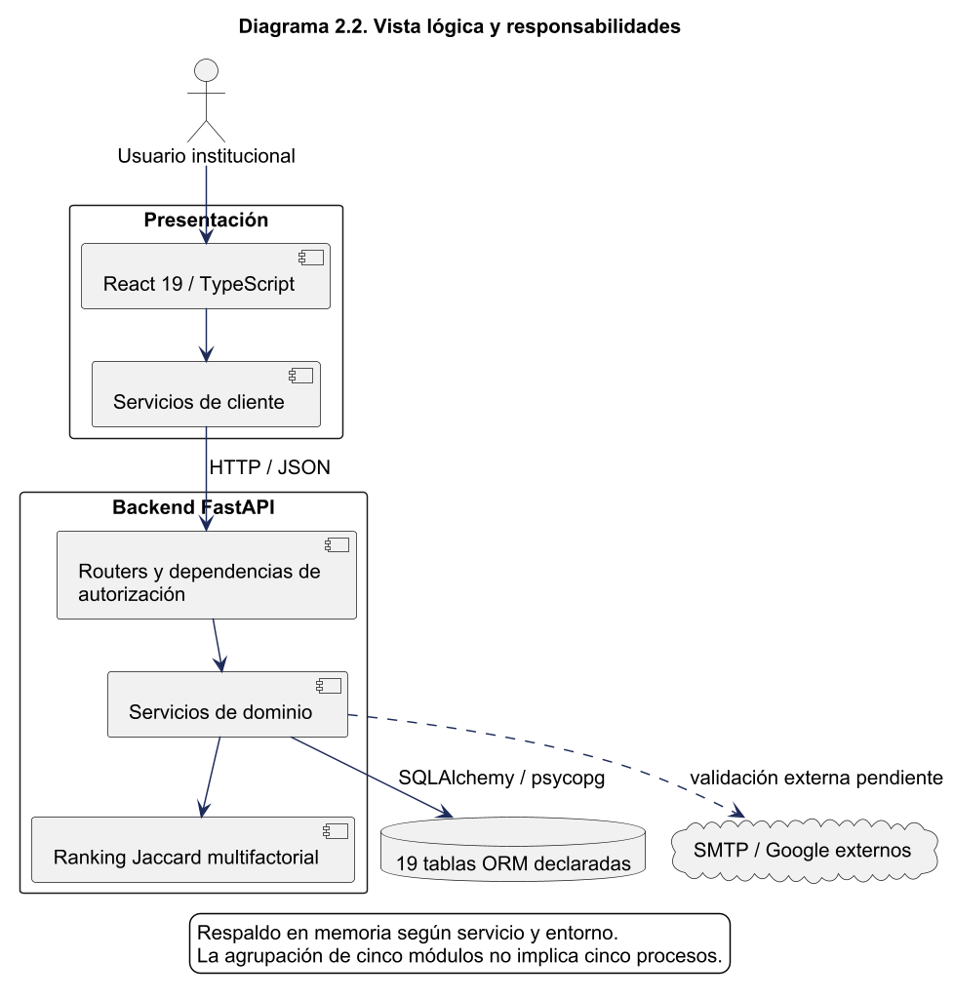

Fuente: Elaboración propia, DOC-H06. [Fuente PlantUML](docs/revision_srs/diagramas/doc-h06/sad/puml/diag_002_logica.puml).

### 2.3. Vista del Proceso

**Diagrama 2.3. Concurrencia y corte condicional**

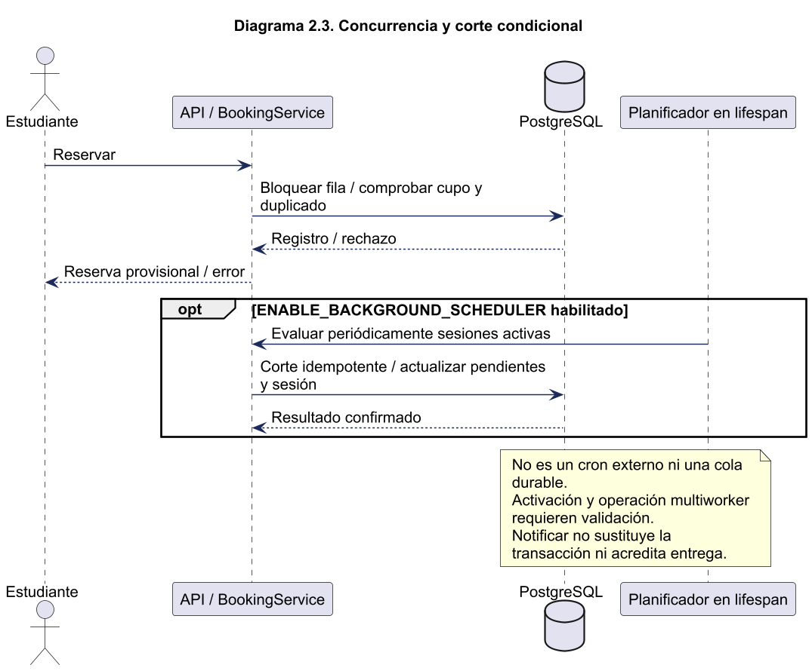

Fuente: Elaboración propia, DOC-H06. [Fuente PlantUML](docs/revision_srs/diagramas/doc-h06/sad/puml/diag_003_procesos.puml).

### 2.4. Vista de Desarrollo

**Diagrama 2.4. Paquetes presentes**

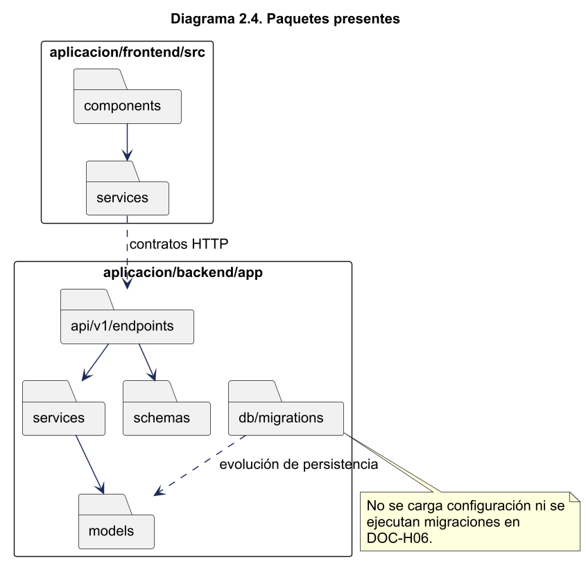

Fuente: Elaboración propia, DOC-H06. [Fuente PlantUML](docs/revision_srs/diagramas/doc-h06/sad/puml/diag_004_desarrollo.puml).

### 2.5. Vista Física

**Diagrama 2.5. Despliegue de referencia**

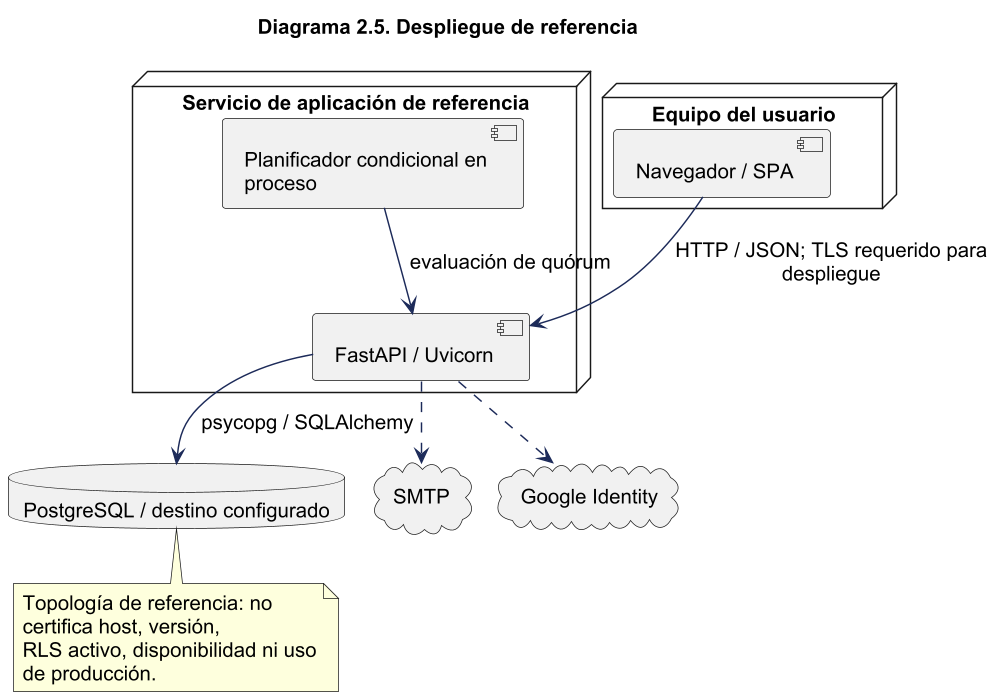

Fuente: Elaboración propia, DOC-H06. [Fuente PlantUML](docs/revision_srs/diagramas/doc-h06/sad/puml/diag_005_despliegue.puml).

## 3. Objetivos y limitaciones arquitectónicas

### 3.1. Disponibilidad

RNF06 mantiene el objetivo >=99.5%. La ruta de salud muestra disponibilidad puntual; no mide SLA ni tolerancia integral. El arranque diferido y el respaldo en memoria no equivalen a persistencia o continuidad productiva.

### 3.2. Seguridad

El acceso restringe dominios @virtual.upt.pe y @upt.pe. OTP y Google son alternativas, con consentimiento posterior si falta. El desafío tiene cinco intentos fallidos, vigencia de referencia 300 s y reenvío 60 s; límite de tasa y bloqueo del desafío son controles separados. No se acredita estado de suspensión institucional de la cuenta. El servicio de Google verifica la credencial; la prueba de una cuenta real sigue pendiente. El despacho OTP fallido invalida el desafío y devuelve error; una entrega marcada como simulada no acredita correo recibido.

**Contraste DOC-H06-R, base ed6c1cc:** [AuthService](aplicacion/backend/app/services/auth_service.py) imprime una traza explícita del OTP cuando `APP_ENV == development`, incluso con SMTP habilitado y pistas deshabilitadas. `mockCodeHint` depende de `ENABLE_MOCK_OTP_HINTS` y de que el entorno no sea production ni staging; ya no exige SMTP deshabilitado y también registra una traza si se habilita. [EmailService](aplicacion/backend/app/services/email_service.py) registra el cuerpo del mensaje en su respaldo cuando SMTP está deshabilitado o falta usuario; esa rama no comprueba `APP_ENV` y ya no omite contenido mediante el argumento `sensitive`. Por ello no se extiende la exclusión de la traza explícita de AuthService a una garantía de ausencia de códigos en todos los logs. La revisión es estática, sin cargar configuración ni generar o reproducir códigos. Las pruebas modificadas comprueban condiciones acotadas; no se ejecutaron en DOC-H06-R.

Los controles de rol y titularidad se describen por ruta. La validación de ciclo/rol no acredita nota mínima 14. El hash de bitácora combina sesión, mentor, temas y fecha; no cubre por sí mismo todos los textos editables. El servicio actualiza registros existentes y recalcula la huella, por lo que no se afirma inmutabilidad absoluta. No se presenta este mecanismo como firma digital certificada.

### 3.3. Adaptabilidad y Mantenibilidad

Routers, esquemas, servicios y modelos separan responsabilidades. Existen caminos persistentes y de respaldo; la matriz de contratos no demuestra equivalencia de comportamiento entre ambos. Los pesos del ranking definidos en código y la configuración del despliegue no acreditan editores administrativos CUS-015/CUS-022.

### 3.4. Rendimiento y Usabilidad

RNF03/RNF04/RNF05 conservan objetivos y métodos de evaluación pendientes. No se atribuye precisión, latencia, accesibilidad total ni cobertura actual a partir de cifras históricas.

## 4. Análisis de Requerimientos

### 4.1. Requerimientos funcionales

| Código | Módulo principal | Requerimiento conservado | CUS vigentes | Estado |
| --- | --- | --- | --- | --- |
| RF01 | MOD-01 | Acceso institucional por código de correo o Google | CUS-001 | Implementado; validación externa pendiente |
| RF02 | MOD-01 | Formalización de consentimiento legal digital (Ley 29733) | CUS-001, CUS-016 | Parcial: consentimiento; auditoría integral pendiente |
| RF03 | MOD-01 | Gestión y asignación administrativa de roles de usuario | CUS-010, CUS-005, CUS-021 | Parcial: asignación administrativa; mérito y comité pendientes |
| RF04 | MOD-02 | Configuración de perfil formativo y matriz horaria | CUS-005 | Parcial: perfil y disponibilidad; expediente pendiente |
| RF05 | MOD-05 | Catálogo curricular de asignaturas y temarios silábicos | CUS-020 | Implementado; discrepancia de ciclos pendiente |
| RF06 | MOD-03 | Inferencia algorítmica y recomendación personalizada Top-k | CUS-002, CUS-015 | Implementado; parametrización propuesta |
| RF07 | MOD-02 | Registro y banco de solicitudes por demanda académica | CUS-008 | Parcial: registro y banco; controles pendientes |
| RF08 | MOD-02 | Publicación y parametrización de ofertas de mentoría | CUS-006 | Parcial: publicación; mérito y anexos pendientes |
| RF09 | MOD-02 | Aprovisionamiento automatizado de espacios y salas virtuales | CUS-006, CUS-017 | Parcial: disponibilidad; provisión externa pendiente |
| RF10 | MOD-05 | Procesamiento de cronogramas oficiales de aulas | CUS-017 | Implementado; importación y consulta |
| RF11 | MOD-02 | Gestión de imprevistos, reprogramación y cancelación | CUS-006, CUS-023 | Implementado; notificaciones externas pendientes |
| RF12 | MOD-03 | Reserva concurrente de cupos con control de aforo | CUS-003 | Implementado; validación nueva de concurrencia no ejecutada |
| RF13 | MOD-03 | Ratificación anticipada obligatoria de asistencia | CUS-004, CUS-022 | Implementado; edición administrativa propuesta |
| RF14 | MOD-03 | Desistimiento voluntario y liberación inmediata de cupo | CUS-024, CUS-018, CUS-022 | Parcial: desistimiento; justificación y penalizaciones propuestas |
| RF15 | MOD-03 | Monitoreo desatendido y corte de quórum en $T-24\text{ h}$ | CUS-023, CUS-009, CUS-022 | Parcial: evaluación y planificador; operación real pendiente |
| RF16 | MOD-03 | Gestión resolutiva del mentor ante quórum insuficiente | CUS-023 | Implementado; decisión del mentor |
| RF17 | MOD-04 | Marcación de asistencia con pase QR dinámico | CUS-007, CUS-018 | Parcial: pase efímero; cámara real pendiente |
| RF18 | MOD-04 | Registro de bitácora docente en 48h con hash SHA-256 | CUS-007, CUS-012, CUS-019 | Implementado; sello de integridad y visado administrativo |
| RF19 | MOD-04 | Historial de sesiones, bitácoras y recursos compartidos | CUS-013 | Parcial: historial por rol |
| RF20 | MOD-04 | Captura de encuestas de calidad post-mentoría (ventana 24h) | CUS-012 | Parcial: encuesta; feedback individual inverso pendiente |
| RF21 | MOD-04 | Cálculo de reputación docente y catálogo de insignias | Transversal RF21; sin CUS autónomo en el catálogo | Especificado; reputación integral e insignias por validar |
| RF22 | MOD-04 | Parametrización y autorización de certificados de horas | CUS-014 | Parcial: umbral y emisión; autorización institucional pendiente |
| RF23 | MOD-04 | Emisión, descarga y verificación con código QR | CUS-014 | Parcial: PDF/folio DEMO; certificación institucional pendiente |
| RF24 | MOD-05 | Parametrización institucional de aforos y prioridades | CUS-015, CUS-020, CUS-022 | Parcial: prioridades curriculares; parametrización administrativa propuesta |
| RF25 | MOD-05 | Tablero analítico directivo y métricas de retención ICACIT | CUS-009, CUS-011 | Parcial: quórum; retención y exportación propuestas |
| RF26 | MOD-05 | Auditoría institucional de bitácoras y privacidad legal | CUS-016, CUS-019 | Parcial: visado administrativo; seguridad integral propuesta |

### 4.2. Requerimientos no funcionales

| Código | Atributo | Objetivo y criterio de aceptación | Estado de evidencia |
| --- | --- | --- | --- |
| RNF01 | Seguridad de acceso | OTP 300 s; reenvío 60 s; desafío bloqueado al quinto error; sesión de referencia 8 h; dos factores independientes como brecha si se exige 2FA. | Implementación OTP/SSO identificada; validación externa pendiente |
| RNF02 | Privacidad y aislamiento | Proteger datos, consentimiento y acceso por titular/rol; aislamiento por fila y transporte seguro como requisitos. | No se certifica RLS, TLS ni ausencia de exposición por inspección de código |
| RNF03 | Rendimiento algorítmico | Objetivo de respuesta <=500 ms y evaluación reproducible de relevancia Top-k. | Jaccard implementado; valores de precisión/latencia previos son históricos sin validación actual |
| RNF04 | Rendimiento de interfaz | Objetivos FCP <1.2 s, recursos iniciales comprimidos <250 KB y transiciones <50 ms. | Especificado; sin medición nueva ni afirmación de lazy loading universal |
| RNF05 | Usabilidad y accesibilidad | Objetivos SUS >75; WCAG 2.1 AA, contraste 4.5:1 en texto y 3:1 en gráficos; navegación por teclado. | Especificado; las pruebas de componentes no certifican accesibilidad total |
| RNF06 | Disponibilidad | Objetivo >=99.5% en horario lectivo y continuidad durante el semestre. | Pendiente de observación; health responde a una comprobación puntual, sin demostrar SLA |
| RNF07 | Consistencia transaccional | No sobrepasar aforo ni duplicar reservas bajo concurrencia. | Bloqueos de filas y restricciones identificados; validar contra PostgreSQL dedicado |
| RNF08 | Compatibilidad | Resoluciones de referencia 360 a 1920 px y navegadores de escritorio/móvil. | Pendiente de matriz de dispositivos; no se certifica soporte total |
| RNF09 | Mantenibilidad | Pruebas focalizadas, tipado y separación de responsabilidades; objetivo de cobertura >85%. | Dependencias y pruebas presentes; cifras históricas no representan corrida vigente |
| RNF10 | Interoperabilidad | Errores visibles, contratos coherentes y recuperación ante proveedores externos; objetivo de timeout <=5 s. | Parcial: revisar ruta y proveedor; no se afirma tratamiento uniforme del 100% de fallos |

### 4.3. Trazabilidad hacia las vistas arquitectónicas

| CUS | RF principal o relacionado | Servicio / componente identificado | Vista / estado |
| --- | --- | --- | --- |
| CUS-001 | RF01, RF02 | auth_service | Aprobado; texto original |
| CUS-010 | RF03 | role_service | Aprobado en conversación; consolidado |
| CUS-006 | RF08, RF09, RF11 | offer_service | Aprobado en conversación; consolidado |
| CUS-008 | RF07 | booking_service | Propuesta previamente presentada; pendiente de aprobación explícita |
| CUS-005 | RF03, RF04 | profile_service | Implementación parcial: postulación en perfil |
| CUS-021 | RF03 | Pendiente | Pendiente: sin flujo de comité identificado |
| CUS-002 | RF06 | recommendation_service | Implementación identificada; revisión estática |
| CUS-003 | RF12 | booking_service | Implementación identificada; revisión estática |
| CUS-004 | RF13 | booking_service | Implementación identificada; revisión estática |
| CUS-023 | RF11, RF15, RF16 | booking_service / offer_service | Evaluación identificada; ejecución periódica en entorno real no certificada |
| CUS-024 | RF14 | booking_service | Implementación identificada; revisión estática |
| CUS-007 | RF17, RF18 | attendance_service / bitacora_service | Implementación identificada; revisión estática |
| CUS-012 | RF18, RF20 | survey_service / bitacora_service | Implementación parcial: encuesta del asistente y bitácora del mentor |
| CUS-013 | RF19 | booking_service / offer_service | Implementación parcial: historial de reservas y sesiones |
| CUS-014 | RF22, RF23 | certificate_service | Implementación identificada; constancia DEMO y validación real pendiente |
| CUS-018 | RF14, RF17 | Pendiente | Pendiente: no se identificó trámite específico |
| CUS-019 | RF18, RF26 | bitacora_service | Implementación parcial: auditoría por Administrador; tutor no identificado |
| CUS-009 | RF15, RF25 | booking_service | Implementación parcial: monitoreo de quórum; analítica integral pendiente |
| CUS-011 | RF25 | Pendiente | Pendiente: no se identificó exportación ejecutiva |
| CUS-015 | RF06, RF24 | Pendiente | Pendiente: interfaz de parametrización no identificada |
| CUS-016 | RF02, RF26 | Pendiente | Pendiente: bandeja integral de seguridad no identificada |
| CUS-017 | RF09, RF10 | schedule_parser_service / catalog_support_service | Implementación parcial: importación y consulta de cronogramas; configuración virtual pendiente |
| CUS-020 | RF05, RF24 | curriculum_service | Implementación identificada; revisión estática |
| CUS-022 | RF13, RF14, RF15, RF24 | Pendiente | Pendiente: edición administrativa no identificada |

RF21 y avisos se conservan como objetivos transversales. CUS-018 requiere un RF específico por formalizar; RF14/RF17 son relaciones funcionales, sin cobertura acreditada de su trámite.

### 4.4. Reglas de negocio institucionales

| Regla | Denominación | Política / requisito | Estado observado | Módulo / CUS vigentes |
| --- | --- | --- | --- | --- |
| RN-01 | Acceso institucional | Dominios @virtual.upt.pe y @upt.pe; OTP de 6 dígitos, 300 s, reenvío 60 s. Cinco errores bloquean el desafío; tasa de solicitudes es un control distinto. | Implementado; entrega externa y SSO pendientes de validación | MOD-01 / CUS-001 |
| RN-02 | Consentimiento informado | Aceptación explícita antes de usar las funciones protegidas; rechazo permite salir. | Parcial: registro y pantalla; cobertura de todos los accesos por verificar | MOD-01 / CUS-001, CUS-016 |
| RN-03 | Mérito del mentor | Requisito institucional: ciclo VII-X y nota >=14 en la materia. Preferencia en perfil y rol concedido son distintos. | Brecha: el código acepta ciclo >=VII o rol habilitado sin acreditar nota ni comité | MOD-02 / CUS-005, CUS-006, CUS-010, CUS-021 |
| RN-04 | Antelación de oferta | Publicar y reprogramar con más de 24 h; se recomienda 48 h. El límite exacto de 24 h se rechaza. | Implementado en servicio; se corrige el anterior >=24 h | MOD-02 / CUS-006 |
| RN-05 | Aforo | 10 presencial y 20 virtual; no reservar sobre cupo disponible. | Control en servicios y restricciones de valores; comprobar concurrencia por entorno | MOD-03 / CUS-003, CUS-006 |
| RN-06 | Espacios físicos | Seleccionar ambientes disponibles según cronograma y sin solapamiento de sesiones. | Parcial: cronogramas y control; no tabla propia de ambientes | MOD-05 / CUS-006, CUS-017 |
| RN-07 | Ambiente virtual | Requisito: disponer de sala válida para desarrollar la mentoría. | Parcial: URL proporcionada o generada; no acredita aprovisionamiento externo | MOD-05 / CUS-006, CUS-017 |
| RN-08 | Ratificación y corte | Ratificar antes de T-24h. El corte invalida pendientes con CANCELADA_NO_CONFIRMADA. | Implementado; edición administrativa de ventana propuesta | MOD-03 / CUS-004, CUS-023, CUS-022 |
| RN-09 | Quórum | Referencia institucional 50% del aforo: 5 presencial / 10 virtual; evaluar al corte. | Servicio usa configuración de despliegue; activación periódica y valores efectivos no inspeccionados | MOD-03 / CUS-023, CUS-009, CUS-022 |
| RN-10 | Cancelación y liberación | Desistimiento previo a T-24h; motivo opcional. La cancelación de sesión por mentor exige motivo y libera cupos. | Operación implementada; entrega externa de avisos y penalizaciones pendientes | MOD-03 / CUS-024, CUS-023, CUS-022 |
| RN-11 | Recomendación y desempate | Jaccard, horario, modalidad y afinidad curricular ponderados por asignatura crítica; claves según 6.3 / SAD ADR-009. | Implementado; reputación/carga histórica se conserva como objetivo de RF21 | MOD-03 / CUS-002, CUS-015, CUS-020 |
| RN-12 | Asistencia y bitácora | Pase vigente y reserva confirmada; registro de bitácora hasta fin +48 h. Hash de integridad técnica. | Parcial: pase aleatorio 30 s; cámara real y reapertura por validar | MOD-04 / CUS-007, CUS-019 |
| RN-13 | Encuesta | Encuesta del asistente dentro de las 24 h posteriores a la sesión; feedback grupal del mentor distinto. | Parcial: sin evaluación individual mentor a estudiante acreditada | MOD-04 / CUS-012 |
| RN-14 | Constancia de horas | Requisito institucional: >=20 h del semestre y bitácoras visadas; autorización y firma válidas para certificar. | Parcial: emisión/folio DEMO; validez institucional pendiente | MOD-04 / CUS-014, CUS-019 |

## 5. Vistas de Caso de Uso

**Diagrama 5.1. Catálogo vigente: cinco módulos y 24 casos**

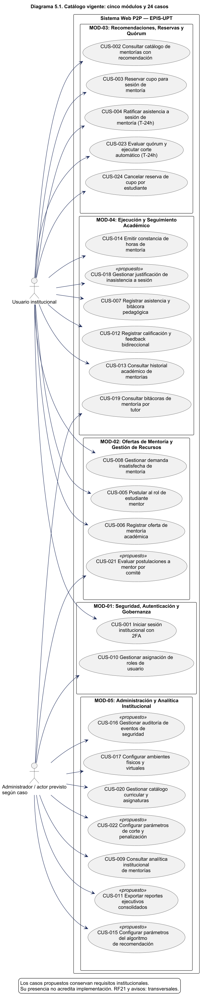

Fuente: Elaboración propia, DOC-H06. [Fuente PlantUML](docs/revision_srs/diagramas/doc-h06/sad/puml/diag_006_catalogo.puml).

### Cuadro 5.1: Catálogo vigente de los 24 casos

| Módulo | Caso vigente | Denominación | Estado observado / brecha |
| --- | --- | --- | --- |
| MOD-01 | CUS-001 | Iniciar sesión institucional con 2FA | SMTP y Google externos requieren validación; OTP por correo o SSO no acreditan dos factores independientes. |
| MOD-01 | CUS-010 | Gestionar asignación de roles de usuario | Parcial: sin acreditación de nota 14 ni administración general de todos los roles; buscador institucional limitado. |
| MOD-02 | CUS-006 | Registrar oferta de mentoría académica | Parcial: ciclo >= VII o rol habilitado; nota 14 no comprobada, un tema, sin anexos separados ni garantía de reunión real. |
| MOD-02 | CUS-008 | Gestionar demanda insatisfecha de mentoría | Parcial: duplicados, matrícula, autorización y exposición de correos requieren remediación o validación. |
| MOD-02 | CUS-005 | Postular al rol de estudiante mentor | Parcial: sin expediente, certificación de nota 14 ni envío a comité; preferencia no concede privilegios. |
| MOD-02 | CUS-021 | Evaluar postulaciones a mentor por comité | Propuesto: sin bandeja, expediente, votación ni resolución; asignación efectiva corresponde a CUS-010. |
| MOD-03 | CUS-002 | Consultar catálogo de mentorías con recomendación | Sin medición nueva de precisión ni rendimiento; contacto no acredita mensajería. |
| MOD-03 | CUS-003 | Reservar cupo para sesión de mentoría | La reserva no confirma la sesión ni registra asistencia. |
| MOD-03 | CUS-004 | Ratificar asistencia a sesión de mentoría (T-24h) | El servicio rechaza cuando faltan 24 horas o menos; no equivale a asistencia efectiva. |
| MOD-03 | CUS-023 | Evaluar quórum y ejecutar corte automático (T-24h) | Planificador implementado en lifespan y condicionado a habilitación; operación periódica y correo externos no validados. |
| MOD-03 | CUS-024 | Cancelar reserva de cupo por estudiante | Antes de T-24h; motivo opcional, distinto de justificación posterior de inasistencia. |
| MOD-04 | CUS-007 | Registrar asistencia y bitácora pedagógica | Cámara real pendiente; token aleatorio de 30 s, no TOTP RFC 6238; SHA-256 no equivale a firma certificada. |
| MOD-04 | CUS-012 | Registrar calificación y feedback bidireccional | Parcial: no existe evidencia de evaluación individual mentor a estudiante. |
| MOD-04 | CUS-013 | Consultar historial académico de mentorías | Parcial: historial unificado, recursos y consulta de bitácoras por mentoreado pendientes. |
| MOD-04 | CUS-014 | Emitir constancia de horas de mentoría | La ruta de emisión existe; no acredita autorización, firma ni validez institucional. |
| MOD-04 | CUS-018 | Gestionar justificación de inasistencia a sesión | Propuesto: falta RF específico, plazo, evidencia, responsable y resolución; no es cancelación previa. |
| MOD-04 | CUS-019 | Consultar bitácoras de mentoría por tutor | Parcial: Tutor no identificado como rol operativo; visado administrativo no constituye firma certificada. |
| MOD-05 | CUS-009 | Consultar analítica institucional de mentorías | Parcial: no acredita analítica integral de retención ni indicadores institucionales. |
| MOD-05 | CUS-011 | Exportar reportes ejecutivos consolidados | Propuesto: no se identificó exportación ejecutiva consolidada. |
| MOD-05 | CUS-015 | Configurar parámetros del algoritmo de recomendación | Propuesto: pesos en código no equivalen a interfaz administrativa configurable. |
| MOD-05 | CUS-016 | Gestionar auditoría de eventos de seguridad | Propuesto: consentimiento y logs parciales no sustituyen auditoría integral. |
| MOD-05 | CUS-017 | Configurar ambientes físicos y virtuales | Parcial: generación de URL no provisiona una sala externa; no existe tabla espacios_fisicos. |
| MOD-05 | CUS-020 | Gestionar catálogo curricular y asignaturas | Discrepancia pendiente entre consulta I-IV y formulario 1-10; prioridad curricular no garantiza pesos dinámicos. |
| MOD-05 | CUS-022 | Configurar parámetros de corte y penalización | Propuesto: configuración de despliegue no equivale a edición administrativa; sanciones pendientes. |

Las 24 narrativas detalladas y sus 48 figuras se conservan en SRS 6.2.3 y en el catálogo independiente. El Anexo B del SRS permite interpretar las referencias anteriores sin reasignar sus objetivos al mismo número vigente.

## 6. Vista Lógica y Contratos de Interfaces

### 6.1. Diagrama Contextual

**Diagrama 6.1. Límites del sistema y proveedores**

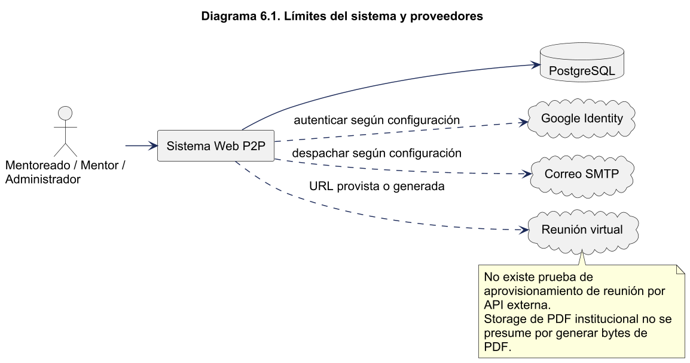

Fuente: Elaboración propia, DOC-H06. [Fuente PlantUML](docs/revision_srs/diagramas/doc-h06/sad/puml/diag_007_contexto.puml).

### 6.2. Descomposición en capas y patrón ECB

| Módulo | Boundary / interacción | Control / servicio | Entidades principales |
| --- | --- | --- | --- |
| MOD-01 | Acceso, consentimiento y roles | auth_service, consent_service, role_service | auth_challenges, auth_rate_limits, consentimientos_legales, roles, usuario_roles |
| MOD-02 | Perfil, publicación y demanda | profile_service, offer_service, booking_service | perfiles_academicos, disponibilidades_horarias, sesiones_mentoria, solicitudes_demanda |
| MOD-03 | Recomendación, reserva, ratificación y corte | recommendation_service, booking_service, offer_service | perfiles_academicos, sesiones_mentoria, reservas_cupo |
| MOD-04 | Asistencia, bitácora, encuesta y constancia | attendance_service, bitacora_service, survey_service, certificate_service | asistencias_sesion, tokens_asistencia_activos, bitacoras_pedagogicas, encuestas_calidad, certificados_horas |
| MOD-05 | Currículo, cronogramas y monitoreo; propuestas de administración | curriculum_service, schedule_parser_service, catalog_support_service; controles previstos para propuestas | asignaturas, temas_conceptuales, versiones_cronograma, cronograma_activo |

### 6.3. Catálogo de contratos declarados

Análisis estático de `api/v1/api.py` y decoradores de endpoints: **63 rutas de negocio y salud**, bajo el prefijo de referencia `/api/v1`. No se importó la aplicación ni se cargó configuración. El endpoint raíz `/`, las páginas de documentación y la generación de OpenAPI se configuran en `main.py` y no forman parte de este recuento. La versión de OpenAPI efectiva depende del runtime; no se afirma OpenAPI 3.0 por el nombre de la tabla anterior. Las dependencias reflejan la firma/decorador; los controles adicionales dentro del cuerpo requieren inspección específica y no se deduce autorización ausente o completa solo de esta columna.

| Método | Ruta declarada | Controlador | Dependencias declaradas |
| --- | --- | --- | --- |
| GET | `/api/v1/health` | [health.check_health](aplicacion/backend/app/api/v1/endpoints/health.py) | Sin dependencia en la firma; revisar el cuerpo |
| GET | `/api/v1/health/db` | [health.check_db_health](aplicacion/backend/app/api/v1/endpoints/health.py) | Sin dependencia en la firma; revisar el cuerpo |
| GET | `/api/v1/curriculum/courses` | [curriculum.list_courses](aplicacion/backend/app/api/v1/endpoints/curriculum.py) | get_optional_session |
| GET | `/api/v1/curriculum/courses/{id_asignatura}` | [curriculum.get_course_detail](aplicacion/backend/app/api/v1/endpoints/curriculum.py) | get_optional_session |
| GET | `/api/v1/curriculum/courses/{id_asignatura}/topics` | [curriculum.get_course_topics](aplicacion/backend/app/api/v1/endpoints/curriculum.py) | get_optional_session |
| POST | `/api/v1/curriculum/courses` | [curriculum.create_course](aplicacion/backend/app/api/v1/endpoints/curriculum.py) | require_role('administrador'), get_optional_session |
| PUT | `/api/v1/curriculum/courses/{id_asignatura}` | [curriculum.update_course](aplicacion/backend/app/api/v1/endpoints/curriculum.py) | require_role('administrador'), get_optional_session |
| DELETE | `/api/v1/curriculum/courses/{id_asignatura}` | [curriculum.delete_course](aplicacion/backend/app/api/v1/endpoints/curriculum.py) | require_role('administrador'), get_optional_session |
| POST | `/api/v1/curriculum/courses/{id_asignatura}/topics` | [curriculum.create_topic](aplicacion/backend/app/api/v1/endpoints/curriculum.py) | require_role('administrador'), get_optional_session |
| PUT | `/api/v1/curriculum/topics/{id_tema}` | [curriculum.update_topic](aplicacion/backend/app/api/v1/endpoints/curriculum.py) | require_role('administrador'), get_optional_session |
| DELETE | `/api/v1/curriculum/topics/{id_tema}` | [curriculum.delete_topic](aplicacion/backend/app/api/v1/endpoints/curriculum.py) | require_role('administrador'), get_optional_session |
| POST | `/api/v1/auth/otp/request` | [auth.request_otp](aplicacion/backend/app/api/v1/endpoints/auth.py) | get_required_session |
| POST | `/api/v1/auth/otp/resend` | [auth.resend_otp](aplicacion/backend/app/api/v1/endpoints/auth.py) | get_required_session |
| POST | `/api/v1/auth/otp/verify` | [auth.verify_otp](aplicacion/backend/app/api/v1/endpoints/auth.py) | get_required_session |
| POST | `/api/v1/auth/google` | [auth.login_with_google](aplicacion/backend/app/api/v1/endpoints/auth.py) | get_required_session |
| GET | `/api/v1/consent/status` | [consent.get_consent_status](aplicacion/backend/app/api/v1/endpoints/consent.py) | get_optional_session |
| POST | `/api/v1/consent/accept` | [consent.accept_consent](aplicacion/backend/app/api/v1/endpoints/consent.py) | get_optional_session |
| POST | `/api/v1/consent/revoke` | [consent.revoke_consent](aplicacion/backend/app/api/v1/endpoints/consent.py) | get_optional_session |
| GET | `/api/v1/roles/users/{email}` | [roles.get_user_roles](aplicacion/backend/app/api/v1/endpoints/roles.py) | get_current_user, get_optional_session |
| POST | `/api/v1/roles/promote-mentor` | [roles.promote_mentor](aplicacion/backend/app/api/v1/endpoints/roles.py) | get_current_user, get_optional_session |
| POST | `/api/v1/roles/revoke-mentor` | [roles.revoke_mentor](aplicacion/backend/app/api/v1/endpoints/roles.py) | get_current_user, get_optional_session |
| GET | `/api/v1/profiles/me` | [profiles.get_profile](aplicacion/backend/app/api/v1/endpoints/profiles.py) | get_optional_session |
| PUT | `/api/v1/profiles/me` | [profiles.update_profile](aplicacion/backend/app/api/v1/endpoints/profiles.py) | get_optional_session |
| GET | `/api/v1/profiles/availability` | [profiles.get_availability](aplicacion/backend/app/api/v1/endpoints/profiles.py) | get_optional_session |
| PUT | `/api/v1/profiles/availability` | [profiles.update_availability](aplicacion/backend/app/api/v1/endpoints/profiles.py) | get_optional_session |
| POST | `/api/v1/offers` | [offers.publish_offer](aplicacion/backend/app/api/v1/endpoints/offers.py) | get_required_session |
| GET | `/api/v1/offers` | [offers.list_offers](aplicacion/backend/app/api/v1/endpoints/offers.py) | get_required_session |
| POST | `/api/v1/offers/{id_sesion}/quorum-decision` | [offers.resolve_quorum_contingency](aplicacion/backend/app/api/v1/endpoints/offers.py) | get_required_session |
| GET | `/api/v1/recommendations/mentors` | [recommendations.get_recommended_mentors](aplicacion/backend/app/api/v1/endpoints/recommendations.py) | get_optional_session |
| GET | `/api/v1/recommendations/offers` | [recommendations.get_recommended_offers](aplicacion/backend/app/api/v1/endpoints/recommendations.py) | get_optional_session |
| POST | `/api/v1/recommendations/explain` | [recommendations.explain_recommendation](aplicacion/backend/app/api/v1/endpoints/recommendations.py) | get_optional_session |
| GET | `/api/v1/recommendations/simulation/testbench` | [recommendations.run_simulation_testbench](aplicacion/backend/app/api/v1/endpoints/recommendations.py) | Sin dependencia en la firma; revisar el cuerpo |
| POST | `/api/v1/bookings/reserve` | [bookings.reserve_booking](aplicacion/backend/app/api/v1/endpoints/bookings.py) | get_required_session |
| GET | `/api/v1/bookings/my-reservations` | [bookings.get_my_reservations](aplicacion/backend/app/api/v1/endpoints/bookings.py) | get_optional_session |
| POST | `/api/v1/bookings/{id_reserva}/confirm` | [bookings.confirm_booking_attendance](aplicacion/backend/app/api/v1/endpoints/bookings.py) | get_required_session |
| POST | `/api/v1/bookings/{id_reserva}/cancel` | [bookings.cancel_booking_reservation](aplicacion/backend/app/api/v1/endpoints/bookings.py) | get_required_session |
| GET | `/api/v1/bookings/session/{id_sesion}` | [bookings.get_session_reservations](aplicacion/backend/app/api/v1/endpoints/bookings.py) | get_optional_session |
| POST | `/api/v1/bookings/requests` | [bookings.create_demand_request](aplicacion/backend/app/api/v1/endpoints/bookings.py) | get_required_session |
| GET | `/api/v1/bookings/requests` | [bookings.get_demand_requests](aplicacion/backend/app/api/v1/endpoints/bookings.py) | get_optional_session |
| GET | `/api/v1/quorum/overview` | [quorum.quorum_overview](aplicacion/backend/app/api/v1/endpoints/quorum.py) | require_role('administrador'), get_required_session |
| POST | `/api/v1/quorum/evaluate` | [quorum.evaluate_session_quorum](aplicacion/backend/app/api/v1/endpoints/quorum.py) | get_required_session |
| POST | `/api/v1/quorum/evaluate-all` | [quorum.evaluate_all_active_quorums](aplicacion/backend/app/api/v1/endpoints/quorum.py) | get_required_session |
| POST | `/api/v1/spaces/import-schedule` | [spaces.import_academic_schedule](aplicacion/backend/app/api/v1/endpoints/spaces.py) | get_required_session, require_role('administrador') |
| GET | `/api/v1/spaces/free-slots` | [spaces.get_free_physical_slots](aplicacion/backend/app/api/v1/endpoints/spaces.py) | get_required_session |
| GET | `/api/v1/spaces/classrooms` | [spaces.get_available_classrooms](aplicacion/backend/app/api/v1/endpoints/spaces.py) | get_required_session |
| GET | `/api/v1/sessions/{id_sesion}/attendance/token` | [attendance.get_attendance_token](aplicacion/backend/app/api/v1/endpoints/attendance.py) | get_required_session |
| POST | `/api/v1/sessions/{id_sesion}/attendance/check-in` | [attendance.record_attendance_checkin](aplicacion/backend/app/api/v1/endpoints/attendance.py) | get_required_session |
| GET | `/api/v1/sessions/{id_sesion}/attendance` | [attendance.get_session_attendance](aplicacion/backend/app/api/v1/endpoints/attendance.py) | get_optional_session |
| POST | `/api/v1/sessions/{id_sesion}/bitacora` | [bitacora.create_session_bitacora](aplicacion/backend/app/api/v1/endpoints/bitacora.py) | get_required_session |
| GET | `/api/v1/sessions/{id_sesion}/bitacora` | [bitacora.get_session_bitacora](aplicacion/backend/app/api/v1/endpoints/bitacora.py) | get_required_session |
| POST | `/api/v1/sessions/{id}/visar` | [bitacora.visar_bitacora_admin](aplicacion/backend/app/api/v1/endpoints/bitacora.py) | get_optional_session |
| POST | `/api/v1/sessions/{id}/observar` | [bitacora.observar_bitacora_admin](aplicacion/backend/app/api/v1/endpoints/bitacora.py) | get_optional_session |
| GET | `/api/v1/bitacoras` | [bitacora.list_bitacoras_admin](aplicacion/backend/app/api/v1/endpoints/bitacora.py) | get_optional_session |
| POST | `/api/v1/bitacoras/{id}/visar` | [bitacora.visar_bitacora_admin](aplicacion/backend/app/api/v1/endpoints/bitacora.py) | get_optional_session |
| POST | `/api/v1/bitacoras/{id}/observar` | [bitacora.observar_bitacora_admin](aplicacion/backend/app/api/v1/endpoints/bitacora.py) | get_optional_session |
| POST | `/api/v1/sessions/{id}/survey` | [survey.submit_session_survey](aplicacion/backend/app/api/v1/endpoints/survey.py) | get_required_session |
| GET | `/api/v1/sessions/{id}/survey` | [survey.get_session_survey_status](aplicacion/backend/app/api/v1/endpoints/survey.py) | get_optional_session |
| GET | `/api/v1/certificates/summary` | [certificates.get_certificate_hours_summary](aplicacion/backend/app/api/v1/endpoints/certificates.py) | get_optional_session |
| POST | `/api/v1/certificates/generate` | [certificates.generate_mentor_certificate](aplicacion/backend/app/api/v1/endpoints/certificates.py) | get_required_session |
| GET | `/api/v1/certificates/verificar` | [certificates.verify_certificate_by_folio](aplicacion/backend/app/api/v1/endpoints/certificates.py) | get_optional_session |
| GET | `/api/v1/certificates/{id_certificado}/download` | [certificates.download_certificate_pdf](aplicacion/backend/app/api/v1/endpoints/certificates.py) | get_optional_session |
| GET | `/api/v1/certificates/{id_certificado}` | [certificates.get_certificate_details](aplicacion/backend/app/api/v1/endpoints/certificates.py) | get_optional_session |
| GET | `/api/v1/simulation/benchmark` | [simulation.run_simulation_benchmark](aplicacion/backend/app/api/v1/endpoints/simulation.py) | Sin dependencia en la firma; revisar el cuerpo |

No se atribuyen contratos a propuestas sin endpoint identificado, ni se sustituye exportación ejecutiva por testbench, configuración administrativa por health, o auditoría integral de seguridad por visado pedagógico. Los esquemas de solicitud/respuesta son los declarados en `app/schemas`, sin incorporar cargas antiguas inventadas.

## 7. Vista de Procesos

### 7.1. Diagrama de Proceso Actual (As-Is)

El proceso informal previo se conserva como antecedente de levantamiento, no como medición actual.

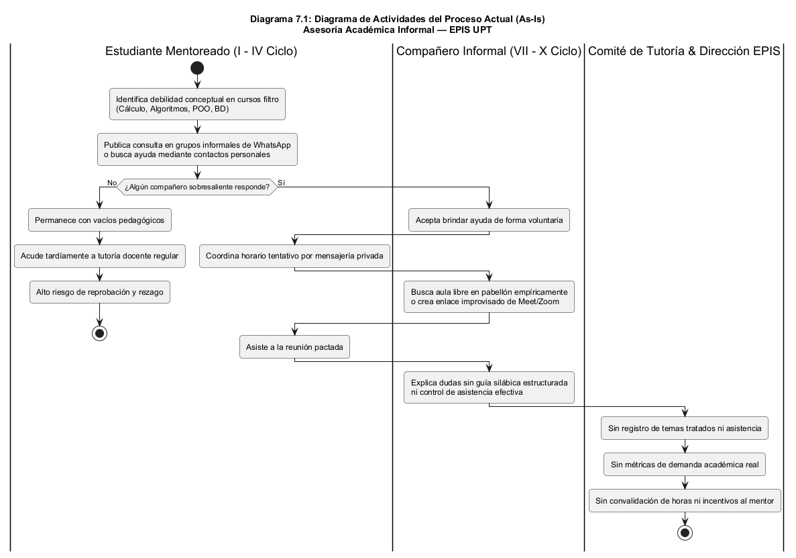

[Fuente PlantUML histórica](docs/diseño/diagramas/sad/puml/diag_008_sec07_actividades_proceso_as_is.puml).

### 7.2. Diagrama de Proceso Propuesto (To-Be)

**Diagrama 7.2. Proceso To-Be y alcance actual**

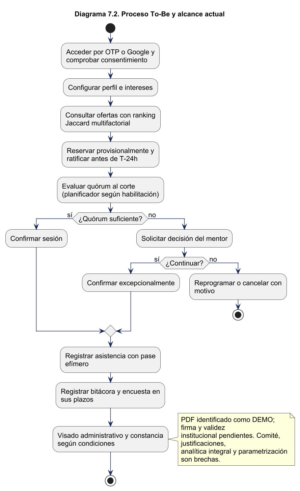

Fuente: Elaboración propia, DOC-H06. [Fuente PlantUML](docs/revision_srs/diagramas/doc-h06/sad/puml/diag_009_proceso_to_be.puml).

### 7.3. Trazabilidad hacia los Diagramas de Secuencia de Diseño

Las vistas vigentes ECB, actividades con objetos, secuencias y clases por CUS se encuentran en [SRS 6.3](SRS_V4.0_CONSOLIDADO.md#63-modelo-lógico), con los 24 identificadores del catálogo y límites de implementación explícitos. Son vistas de responsabilidades; los contratos exactos se consultan en 6.3 de este SAD, sin derivar rutas inexistentes de una flecha UML.

## 8. Vista de Despliegue

### 8.1. Diagrama de Contenedores C4 Nivel 2

**Diagrama 8.1. Contenedores de software de referencia**

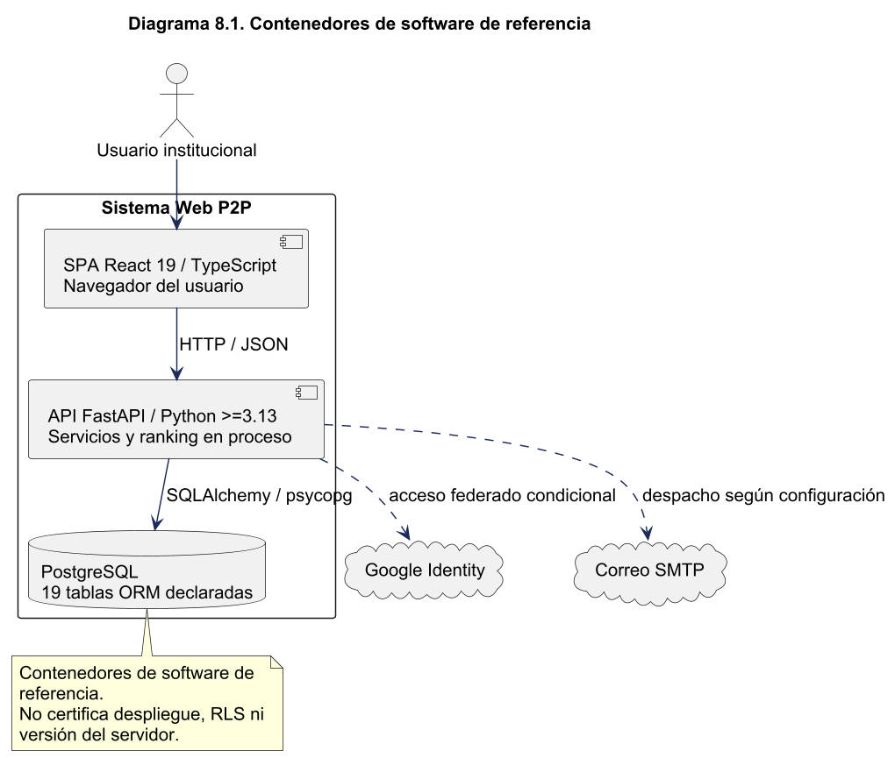

Fuente: Elaboración propia, DOC-H06. [Fuente PlantUML](docs/revision_srs/diagramas/doc-h06/sad/puml/diag_010_contenedores.puml).

La SPA y el backend son contenedores de software en sentido C4; no se deduce uso de Docker ni un despliegue verificado. El motor se ejecuta en proceso en el backend; no es un microservicio de Scikit-learn.

### 8.2. Matriz de Contenedores, Tecnologías y Protocolos

| Componente | Declaración vigente | Fuente / límite |
| --- | --- | --- |
| Frontend | React ^19.0.0, TypeScript ^5.6.3, Vite 8.3.4 | [package.json](aplicacion/frontend/package.json); no prueba versión instalada o desplegada; sin Tailwind declarado |
| Backend | Python >=3.13; FastAPI 0.149.0, Uvicorn 0.54.0, Pydantic 2.14.1 | [pyproject.toml](aplicacion/backend/pyproject.toml) define mínimos; [requirements.txt](aplicacion/backend/requirements.txt) fija versiones para su vía de instalación |
| Persistencia | SQLAlchemy 2.1.5, psycopg 3.3.6, Alembic 1.20.0; PostgreSQL | Declarado en requirements; versión del motor y destino Supabase no inspeccionados |
| PDF / QR | ReportLab >=4.2.5, qrcode >=8.0; qrcode.react ^4.2.0 | Manifiestos; generar PDF/QR no acredita firma ni alojamiento institucional |
| Google / correo | google-auth, requests; SMTP mediante librería estándar | Servicio real condicionado a configuración; pruebas externas pendientes |
| Pruebas | pytest 9.1.1, Vitest 5.0.5 | Versiones declaradas; no prueba de ejecución en DOC-H06 |

## 9. Vista de Implementación

### 9.1. Diagrama de Componentes y Paquetes

**Diagrama 9.1. Componentes y dependencias presentes**

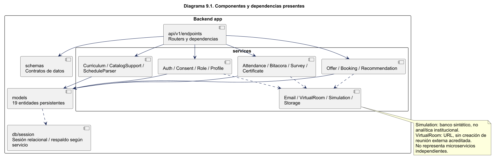

Fuente: Elaboración propia, DOC-H06. [Fuente PlantUML](docs/revision_srs/diagramas/doc-h06/sad/puml/diag_011_componentes.puml).

### 9.2. Puertos e Interfaces Implementadas

| Servicio | Responsabilidad observada | Límite |
| --- | --- | --- |
| auth_service | OTP y acceso federado; consentimiento | SMTP y Google externos requieren validación; OTP por correo o SSO no acreditan dos factores independientes. |
| recommendation_service | Ranking multifactorial explicable Top-k | Sin medición nueva de precisión ni rendimiento; contacto no acredita mensajería. |
| booking_service | Reserva provisional y control concurrente de cupo | La reserva no confirma la sesión ni registra asistencia. |
| profile_service | Perfil, preferencia de rol y disponibilidad | Parcial: sin expediente, certificación de nota 14 ni envío a comité; preferencia no concede privilegios. |
| offer_service | Publicación y consulta de ofertas | Parcial: ciclo >= VII o rol habilitado; nota 14 no comprobada, un tema, sin anexos separados ni garantía de reunión real. |
| attendance_service / bitacora_service | Pase efímero, asistencia y registro de bitácora | Cámara real pendiente; token aleatorio de 30 s, no TOTP RFC 6238; SHA-256 no equivale a firma certificada. |
| booking_service | Registro y consulta del banco de demanda | Parcial: duplicados, matrícula, autorización y exposición de correos requieren remediación o validación. |
| role_service | Promoción y revocación de Mentor | Parcial: sin acreditación de nota 14 ni administración general de todos los roles; buscador institucional limitado. |
| survey_service / bitacora_service | Encuesta individual y observación grupal en bitácora | Parcial: no existe evidencia de evaluación individual mentor a estudiante. |
| certificate_service | Constancia PDF DEMO y verificación por folio | La ruta de emisión existe; no acredita autorización, firma ni validez institucional. |
| schedule_parser_service / catalog_support_service | Importación y consulta de cronogramas | Parcial: generación de URL no provisiona una sala externa; no existe tabla espacios_fisicos. |
| bitacora_service | Consulta, visado y observación administrativa | Parcial: Tutor no identificado como rol operativo; visado administrativo no constituye firma certificada. |
| curriculum_service | Consulta y mantenimiento curricular | Discrepancia pendiente entre consulta I-IV y formulario 1-10; prioridad curricular no garantiza pesos dinámicos. |
| booking_service / offer_service | Evaluación idempotente y decisión del mentor | Planificador implementado en lifespan y condicionado a habilitación; operación periódica y correo externos no validados. |

`simulation_service.py` ofrece un banco sintético; no acredita por sí solo analítica ejecutiva, métricas de retención ni calidad del motor en usuarios reales. `virtual_room_service.py` resuelve/genera URLs sin crear una reunión externa. `email_service.py` distingue despacho y respaldo de demostración; una llamada aceptada no garantiza recepción por el usuario.

## 10. Vista de Datos y Persistencia

### 10.1. Diagrama Entidad-Relación Físico

El inventario vigente declara **19 tablas ORM**, no 15. No se ha consultado ni alterado una base de datos durante DOC-H06; el modelo físico documentado corresponde a código y migraciones, sin acreditar su despliegue. Los correos son identificadores en varias tablas: no hay tabla ORM `usuarios`, `espacios_fisicos`, `ofertas_mentoria`, `codigos_otp`, `perfiles_formativos`, `reservas_cupos` ni `asistencias_sesiones` en esta línea base. Los nombres vigentes son los del diccionario siguiente.

Se dibujan exclusivamente claves foráneas declaradas; los correos repetidos y `id_mentor` no se convierten en FK ficticias. `sesiones_mentoria` contiene la oferta y la sesión; `espacio_asignado` es texto. La disponibilidad y los cronogramas son entidades distintas.

La cabeza de migraciones es `20261123_008`: une `20261116_006` (límites de autenticación) con `20261121_007` (cronogramas), que desciende de `20261121_006` (alineación del cierre). Esta última conserva columnas históricas auxiliares y transforma bitácoras, encuestas y certificados; por ello el ORM no es un volcado completo de columnas residuales de una instalación migrada. Cuando hay certificados repetidos, la migración conserva revisiones mediante `revision_historica` y una unicidad de tres columnas; el modelo declara unicidad de mentor y período. Esta diferencia de compatibilidad requiere comprobación por instalación y no se oculta como igualdad exacta.

Los modelos incluyen desafíos y límites de autenticación, tokens activos de asistencia y cronogramas persistentes. Esto corrige la auditoría antigua que los describía exclusivamente en memoria o ausentes de migraciones. Existen rutas de respaldo en memoria en desarrollo/pruebas: no se consideran persistencia durable ni garantía multiworker. Las políticas RLS históricas se conservan en los documentos de referencia; no se certifican activas por la existencia de controles de autorización en FastAPI.

**Diagrama 10.1. Modelo físico declarado: 19 tablas**

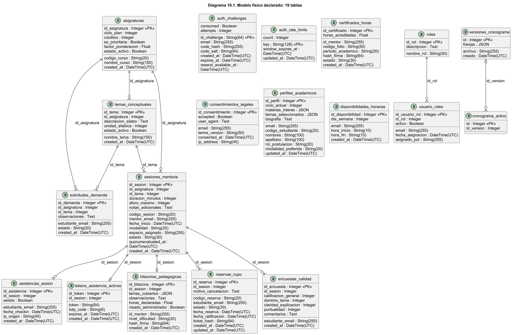

Fuente: Elaboración propia, DOC-H06. [Fuente PlantUML](docs/revision_srs/diagramas/doc-h06/sad/puml/diag_012_der_19tablas.puml).

### 10.2. Diccionario físico vigente

#### 1. Tabla `asignaturas`
Fuente: [Asignatura](aplicacion/backend/app/models/curriculum.py).

| Campo | Tipo declarado | Admite nulo | Restricción / valor inicial |
| --- | --- | --- | --- |
| id_asignatura | Integer | No | PK |
| codigo_curso | String(20) | No | UNIQUE |
| nombre_curso | String(150) | No |  |
| ciclo_plan | Integer | No |  |
| creditos | Integer | No |  |
| es_prioritaria | Boolean | No |  / default: True |
| factor_ponderacion | Float | No |  / default: 1.0 |
| estado_activo | Boolean | No |  / default: True |
| created_at | DateTime(timezone=True) | No |  / default: UTC al crear |

#### 2. Tabla `asistencias_sesion`
Fuente: [AsistenciaSesion](aplicacion/backend/app/models/attendance.py).

| Campo | Tipo declarado | Admite nulo | Restricción / valor inicial |
| --- | --- | --- | --- |
| id_asistencia | Integer | No | PK |
| id_sesion | Integer | No | FK sesiones_mentoria.id_sesion; ON DELETE CASCADE |
| estudiante_email | String(255) | No |  |
| asistio | Boolean | No |  / default: False |
| fecha_checkin | DateTime(timezone=True) | Sí |  |
| ip_origen | String(45) | Sí |  |
| created_at | DateTime(timezone=True) | No |  / default: UTC al crear |

Restricciones declaradas: `UniqueConstraint('id_sesion', 'estudiante_email')`.

#### 3. Tabla `auth_challenges`
Fuente: [AuthChallenge](aplicacion/backend/app/models/auth.py).

| Campo | Tipo declarado | Admite nulo | Restricción / valor inicial |
| --- | --- | --- | --- |
| id_challenge | String(64) | No | PK |
| email | String(255) | No |  |
| code_hash | String(255) | No |  |
| code_salt | String(64) | No |  |
| created_at | DateTime(timezone=True) | No |  / default: UTC al crear |
| expires_at | DateTime(timezone=True) | No |  |
| resend_available_at | DateTime(timezone=True) | No |  |
| consumed | Boolean | No |  / default: False |
| attempts | Integer | No |  / default: 0 |

#### 4. Tabla `auth_rate_limits`
Fuente: [AuthRateLimit](aplicacion/backend/app/models/auth.py).

| Campo | Tipo declarado | Admite nulo | Restricción / valor inicial |
| --- | --- | --- | --- |
| key | String(128) | No | PK |
| count | Integer | No |  / default: 1 |
| window_expires_at | DateTime(timezone=True) | No |  |
| updated_at | DateTime(timezone=True) | No |  / default: UTC al crear |

#### 5. Tabla `bitacoras_pedagogicas`
Fuente: [BitacoraPedagogica](aplicacion/backend/app/models/bitacora.py).

| Campo | Tipo declarado | Admite nulo | Restricción / valor inicial |
| --- | --- | --- | --- |
| id_bitacora | Integer | No | PK |
| id_sesion | Integer | No | FK sesiones_mentoria.id_sesion; ON DELETE CASCADE; UNIQUE |
| id_mentor | String(255) | No |  |
| temas_cubiertos | JSON | No |  / default: list |
| observaciones | Text | No |  |
| nivel_dificultad | String(20) | No | nivel_dificultad IN ('Bajo', 'Medio', 'Alto') / default: 'Medio' |
| hash_firma | String(64) | No |  |
| horas_declaradas | Float | No |  / default: 0.0 |
| visado_administrador | Boolean | No |  / default: False |
| created_at | DateTime(timezone=True) | No |  / default: UTC al crear |

Restricciones declaradas: `CheckConstraint("nivel_dificultad IN ('Bajo', 'Medio', 'Alto')")`.

#### 6. Tabla `certificados_horas`
Fuente: [CertificadoHoras](aplicacion/backend/app/models/certificate.py).

| Campo | Tipo declarado | Admite nulo | Restricción / valor inicial |
| --- | --- | --- | --- |
| id_certificado | Integer | No | PK |
| id_mentor | String(255) | No |  |
| codigo_folio | String(50) | No | UNIQUE |
| periodo_academico | String(20) | No |  / default: '2026-II' |
| horas_acreditadas | Float | No |  |
| hash_firma | String(64) | No |  |
| estado | String(30) | No |  / default: 'EMITIDO_DEMO' |
| created_at | DateTime(timezone=True) | No |  / default: UTC al crear |

Restricciones declaradas: `UniqueConstraint('id_mentor', 'periodo_academico')`; `CheckConstraint('horas_acreditadas >= 20.0')`.

#### 7. Tabla `consentimientos_legales`
Fuente: [ConsentimientoLegal](aplicacion/backend/app/models/consent.py).

| Campo | Tipo declarado | Admite nulo | Restricción / valor inicial |
| --- | --- | --- | --- |
| id_consentimiento | Integer | No | PK |
| email | String(255) | No |  |
| terms_version | String(50) | No |  / default: '2026-II-v1.0' |
| accepted | Boolean | No |  / default: True |
| consented_at | DateTime(timezone=True) | No |  / default: UTC al crear |
| ip_address | String(45) | Sí |  |
| user_agent | Text | Sí |  |

#### 8. Tabla `cronograma_activo`
Fuente: [CronogramaActivo](aplicacion/backend/app/models/schedule.py).

| Campo | Tipo declarado | Admite nulo | Restricción / valor inicial |
| --- | --- | --- | --- |
| id | Integer | No | PK |
| id_version | Integer | Sí | FK versiones_cronograma.id |

Restricciones declaradas: `CheckConstraint('id = 1')`.

#### 9. Tabla `disponibilidades_horarias`
Fuente: [DisponibilidadHoraria](aplicacion/backend/app/models/profile.py).

| Campo | Tipo declarado | Admite nulo | Restricción / valor inicial |
| --- | --- | --- | --- |
| id_disponibilidad | Integer | No | PK |
| email | String(255) | No |  |
| dia_semana | Integer | No | dia_semana >= 1 AND dia_semana <= 6 |
| hora_inicio | String(10) | No |  |
| hora_fin | String(10) | No |  |
| created_at | DateTime(timezone=True) | No |  / default: UTC al crear |

Restricciones declaradas: `CheckConstraint('dia_semana >= 1 AND dia_semana <= 6')`.

#### 10. Tabla `encuestas_calidad`
Fuente: [EncuestaCalidad](aplicacion/backend/app/models/survey.py).

| Campo | Tipo declarado | Admite nulo | Restricción / valor inicial |
| --- | --- | --- | --- |
| id_encuesta | Integer | No | PK |
| id_sesion | Integer | No | FK sesiones_mentoria.id_sesion; ON DELETE CASCADE |
| estudiante_email | String(255) | No |  |
| calificacion_general | Integer | No |  |
| dominio_tema | Integer | No |  |
| claridad_explicacion | Integer | No |  |
| puntualidad | Integer | No |  |
| comentarios | Text | Sí |  |
| created_at | DateTime(timezone=True) | No |  / default: UTC al crear |

Restricciones declaradas: `UniqueConstraint('id_sesion', 'estudiante_email')`; `CheckConstraint('calificacion_general >= 1 AND calificacion_general <= 5')`; `CheckConstraint('dominio_tema >= 1 AND dominio_tema <= 5')`; `CheckConstraint('claridad_explicacion >= 1 AND claridad_explicacion <= 5')`; `CheckConstraint('puntualidad >= 1 AND puntualidad <= 5')`.

#### 11. Tabla `perfiles_academicos`
Fuente: [PerfilAcademico](aplicacion/backend/app/models/profile.py).

| Campo | Tipo declarado | Admite nulo | Restricción / valor inicial |
| --- | --- | --- | --- |
| id_perfil | Integer | No | PK |
| email | String(255) | No | UNIQUE |
| codigo_estudiante | String(20) | Sí |  |
| nombres | String(100) | Sí |  |
| apellidos | String(100) | Sí |  |
| ciclo_actual | Integer | No | ciclo_actual >= 1 AND ciclo_actual <= 10 / default: 1 |
| rol_postulacion | String(20) | No |  / default: 'mentoreado' |
| materias_interes | JSON | No |  / default: list |
| temas_seleccionados | JSON | No |  / default: list |
| biografia | Text | Sí |  |
| modalidad_preferida | String(20) | No |  / default: 'presencial' |
| updated_at | DateTime(timezone=True) | No |  / default: UTC al crear |

Restricciones declaradas: `CheckConstraint('ciclo_actual >= 1 AND ciclo_actual <= 10')`.

#### 12. Tabla `reservas_cupo`
Fuente: [ReservaCupo](aplicacion/backend/app/models/booking.py).

| Campo | Tipo declarado | Admite nulo | Restricción / valor inicial |
| --- | --- | --- | --- |
| id_reserva | Integer | No | PK |
| codigo_reserva | String(20) | No | UNIQUE |
| id_sesion | Integer | No | FK sesiones_mentoria.id_sesion; ON DELETE CASCADE |
| estudiante_email | String(255) | No |  |
| estado | String(30) | No | estado IN ('PENDIENTE_CONFIRMACION', 'CONFIRMADA', 'CANCELADA_USUARIO', 'NO_CONFIRMADA', 'CANCELADA_NO_CONFIRMADA', 'CANCELADA_SISTEMA', 'CANCELADA_SISTEMA_QUORUM', 'ASISTIDA', 'INASISTENCIA') / default: 'PENDIENTE_CONFIRMACION' |
| fecha_reserva | DateTime(timezone=True) | No |  / default: UTC al crear |
| fecha_ratificacion | DateTime(timezone=True) | Sí |  |
| motivo_cancelacion | Text | Sí |  |
| ticket_hash | String(64) | Sí |  |
| created_at | DateTime(timezone=True) | No |  / default: UTC al crear |
| updated_at | DateTime(timezone=True) | No |  / default: UTC al crear |

Restricciones declaradas: `UniqueConstraint('id_sesion', 'estudiante_email')`; `CheckConstraint("estado IN ('PENDIENTE_CONFIRMACION', 'CONFIRMADA', 'CANCELADA_USUARIO', 'NO_CONFIRMADA', 'CANCELADA_NO_CONFIRMADA', 'CANCELADA_SISTEMA', 'CANCELADA_SISTEMA_QUORUM', 'ASISTIDA', 'INASISTENCIA')")`.

#### 13. Tabla `roles`
Fuente: [Rol](aplicacion/backend/app/models/roles.py).

| Campo | Tipo declarado | Admite nulo | Restricción / valor inicial |
| --- | --- | --- | --- |
| id_rol | Integer | No | PK |
| nombre_rol | String(50) | No | UNIQUE |
| descripcion | Text | Sí |  |

#### 14. Tabla `sesiones_mentoria`
Fuente: [SesionMentoria](aplicacion/backend/app/models/offer.py).

| Campo | Tipo declarado | Admite nulo | Restricción / valor inicial |
| --- | --- | --- | --- |
| id_sesion | Integer | No | PK |
| codigo_sesion | String(20) | No | UNIQUE |
| mentor_email | String(255) | No |  |
| id_asignatura | Integer | No | FK asignaturas.id_asignatura; ON DELETE RESTRICT |
| id_tema | Integer | No | FK temas_conceptuales.id_tema; ON DELETE RESTRICT |
| fecha_inicio | DateTime(timezone=True) | No |  |
| duracion_minutos | Integer | No | duracion_minutos IN (60, 90) / default: 60 |
| modalidad | String(20) | No | modalidad IN ('presencial', 'virtual') |
| aforo_maximo | Integer | No | aforo_maximo IN (10, 20) |
| espacio_asignado | String(255) | No |  |
| notas_adicionales | Text | Sí |  |
| estado | String(30) | No | estado IN ('PUBLICADA', 'PENDIENTE_CONFIRMACION', 'QUORUM_INSUFICIENTE', 'CONFIRMADA', 'EN_CURSO', 'CONCLUIDA', 'BITACORA_REGISTRADA', 'HORAS_VISADAS', 'OBSERVADA', 'CANCELADA_SISTEMA', 'CANCELADA_MENTOR', 'CANCELADA_QUORUM', 'FINALIZADA') / default: 'PUBLICADA' |
| quorumevaluated_at | DateTime(timezone=True) | Sí |  / default: None |
| created_at | DateTime(timezone=True) | No |  / default: UTC al crear |

Restricciones declaradas: `CheckConstraint('duracion_minutos IN (60, 90)')`; `CheckConstraint("modalidad IN ('presencial', 'virtual')")`; `CheckConstraint('aforo_maximo IN (10, 20)')`; `CheckConstraint("estado IN ('PUBLICADA', 'PENDIENTE_CONFIRMACION', 'QUORUM_INSUFICIENTE', 'CONFIRMADA', 'EN_CURSO', 'CONCLUIDA', 'BITACORA_REGISTRADA', 'HORAS_VISADAS', 'OBSERVADA', 'CANCELADA_SISTEMA', 'CANCELADA_MENTOR', 'CANCELADA_QUORUM', 'FINALIZADA')")`.

#### 15. Tabla `solicitudes_demanda`
Fuente: [SolicitudDemanda](aplicacion/backend/app/models/booking.py).

| Campo | Tipo declarado | Admite nulo | Restricción / valor inicial |
| --- | --- | --- | --- |
| id_demanda | Integer | No | PK |
| estudiante_email | String(255) | No |  |
| id_asignatura | Integer | No | FK asignaturas.id_asignatura; ON DELETE RESTRICT |
| id_tema | Integer | No | FK temas_conceptuales.id_tema; ON DELETE RESTRICT |
| observaciones | Text | Sí |  |
| estado | String(20) | No | estado IN ('PENDIENTE', 'ATENDIDA', 'CANCELADA') / default: 'PENDIENTE' |
| created_at | DateTime(timezone=True) | No |  / default: UTC al crear |

Restricciones declaradas: `CheckConstraint("estado IN ('PENDIENTE', 'ATENDIDA', 'CANCELADA')")`.

#### 16. Tabla `temas_conceptuales`
Fuente: [TemaConceptual](aplicacion/backend/app/models/curriculum.py).

| Campo | Tipo declarado | Admite nulo | Restricción / valor inicial |
| --- | --- | --- | --- |
| id_tema | Integer | No | PK |
| id_asignatura | Integer | No | FK asignaturas.id_asignatura; ON DELETE CASCADE |
| nombre_tema | String(150) | No |  |
| descripcion_silabo | Text | Sí |  |
| unidad_silabica | Integer | No |  / default: 1 |
| estado_activo | Boolean | No |  / default: True |
| created_at | DateTime(timezone=True) | No |  / default: UTC al crear |

#### 17. Tabla `tokens_asistencia_activos`
Fuente: [TokenAsistenciaActivo](aplicacion/backend/app/models/attendance.py).

| Campo | Tipo declarado | Admite nulo | Restricción / valor inicial |
| --- | --- | --- | --- |
| id_token | Integer | No | PK |
| id_sesion | Integer | No | FK sesiones_mentoria.id_sesion; ON DELETE CASCADE; UNIQUE |
| token | String(64) | No |  |
| totp_code | String(6) | No |  |
| expires_at | DateTime(timezone=True) | No |  |
| created_at | DateTime(timezone=True) | No |  / default: UTC al crear |

#### 18. Tabla `usuario_roles`
Fuente: [UsuarioRol](aplicacion/backend/app/models/roles.py).

| Campo | Tipo declarado | Admite nulo | Restricción / valor inicial |
| --- | --- | --- | --- |
| id_usuario_rol | Integer | No | PK |
| email | String(255) | No |  |
| id_rol | Integer | No | FK roles.id_rol; ON DELETE CASCADE |
| fecha_asignacion | DateTime(timezone=True) | No |  / default: UTC al crear |
| asignado_por | String(255) | Sí |  |
| activo | Boolean | No |  / default: True |

Restricciones declaradas: `UniqueConstraint('email', 'id_rol')`.

#### 19. Tabla `versiones_cronograma`
Fuente: [VersionCronograma](aplicacion/backend/app/models/schedule.py).

| Campo | Tipo declarado | Admite nulo | Restricción / valor inicial |
| --- | --- | --- | --- |
| id | Integer | No | PK |
| archivo | String(255) | No |  |
| franjas | JSON | No |  |
| creado | DateTime(timezone=True) | No |  / default: UTC al crear |

### 10.3. Políticas de Seguridad a Nivel de Fila (RLS)

Las políticas de aislamiento descritas en v3.x son un objetivo de seguridad y un antecedente de diseño. DOC-H06 no consulta catálogos de PostgreSQL ni afirma que estén desplegadas en las 19 tablas. La migración aplicada, el rol de conexión y el contexto de identidad deben verificarse en un entorno autorizado. No se incluye una matriz de supuestas políticas activas sin evidencia.

## 11. Máquinas de Estado y Transiciones del Dominio

### 11.1. Desafío OTP

Un desafío tiene `consumed`, `attempts`, vencimiento y fecha de reenvío; no una columna de estado enumerado. Puede utilizarse antes de vencer, consumirse por éxito o por cinco errores, invalidarse por nuevo desafío o por fallo de despacho. El límite de tasa compartido en PostgreSQL usa `auth_rate_limits`; la vía de memoria no acredita coordinación entre procesos. Cambiar el correo en pantalla no prueba por sí mismo que se revoque un desafío en el servidor.

### 11.2. Consentimiento

El registro de consentimiento guarda la versión y marcas de aceptación/revocación según su modelo y servicio. La aceptación habilita el recorrido correspondiente; no se deduce de ello una garantía de cumplimiento jurídico integral ni cobertura de todos los datos.

### 11.3. Roles y mérito

La promoción/revocación de Mentor es administrativa. El perfil contiene ciclo y preferencia de postulación; no es expediente ni validación institucional de notas. CUS-021 conserva evaluación motivada por comité como propuesta; una aprobación registrada prevista precede a la asignación efectiva mediante CUS-010.

### 11.4. Sesión de mentoría

Los estados permitidos por una restricción física no equivalen a transiciones efectivamente ejecutadas. `sesiones_mentoria` admite 13 valores y `reservas_cupo` nueve; se conservan las variantes históricas. El corte escribe `CANCELADA_NO_CONFIRMADA`, mientras la cancelación del mentor escribe `CANCELADA_SISTEMA_QUORUM` en reservas afectadas. No sustituir estos valores por nombres conceptuales ni inferir un paso de tiempo automático a EN_CURSO, CONCLUIDA o FINALIZADA sin invocación del servicio.

La asistencia se registra mediante reserva confirmada y pase vigente, en la ventana inicio −15 min a **fin +30 min**. El pase contiene token hash y código aleatorio con vencimiento de 30 segundos y respaldo en `tokens_asistencia_activos`; no implementa TOTP basado en secreto compartido. La prueba de cámara en dispositivo real continúa pendiente.

La bitácora carece de columna `estado`: contiene `visado_administrador`; el servicio actualiza también `sesiones_mentoria.estado` a BITACORA_REGISTRADA, HORAS_VISADAS u OBSERVADA. El plazo de registro es fin +48 h. La encuesta del asistente dispone de 24 h tras la sesión y no equivale a feedback individual inverso. Los certificados almacenan `EMITIDO_DEMO` o `EMITIDO` según el servicio, sin que el texto del estado pruebe validez institucional. Se mantiene RN-14 como requisito pendiente de autorización y validación externa.

**Diagrama 11.4. Sesión: estados admitidos y transiciones principales**

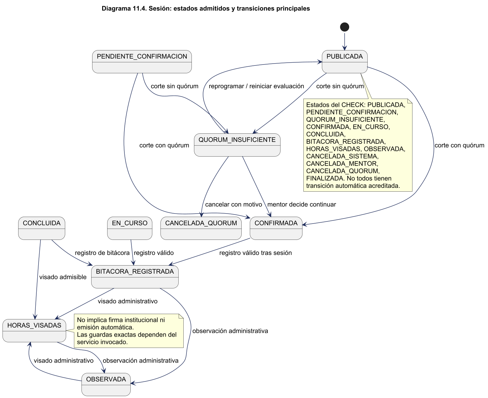

Fuente: Elaboración propia, DOC-H06. [Fuente PlantUML](docs/revision_srs/diagramas/doc-h06/sad/puml/diag_013_fsm_sesion.puml).

### 11.5. Reserva de cupo

**Diagrama 11.5. Reserva: estados admitidos y transiciones principales**

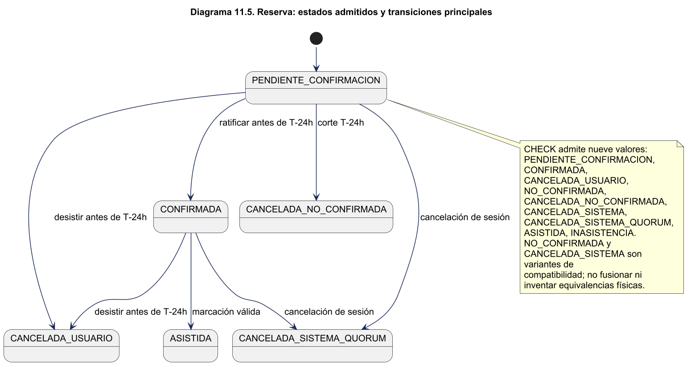

Fuente: Elaboración propia, DOC-H06. [Fuente PlantUML](docs/revision_srs/diagramas/doc-h06/sad/puml/diag_014_fsm_reserva.puml).

INASISTENCIA es un valor admitido y consultado; no se ha identificado una mutación automática que lo escriba en los servicios revisados. Tampoco se acredita un trámite de justificación CUS-018. La confirmación de una reserva, de una sesión y la asistencia son hechos diferentes.

### 11.6. Bitácora, encuesta y constancia

El [modelo de estados del SRS](SRS_V4.0_CONSOLIDADO.md#635-diagramas-de-máquinas-de-estados-finitas-fsm) describe estos objetos sin inventar una columna estado en bitácora. Una encuesta se registra una vez por asistente/sesión dentro de fin +24 h; el feedback grupal del mentor sigue una ruta distinta. CUS-014 conserva la brecha entre PDF DEMO y certificación institucional.

## 12. Mapeo de Transformación de Datos entre Capas y Catálogo de Errores

### 12.1. Transformación de Campos entre Capas Arquitectónicas

Los esquemas de `app/schemas` definen cargas y respuestas; el diccionario 10.2 conserva los nombres ORM reales. Los identificadores de sesión/reserva son enteros con códigos de presentación separados; varios titulares se identifican por correo y no por una supuesta FK a usuarios. Las fechas del servicio se normalizan a UTC; la visualización debe distinguir la zona local. No se aplica una regla universal camelCase/snake_case: autenticación incluye nombres de respuesta específicos, mientras otros contratos conservan nombres de dominio.

### 12.2. Catálogo de errores y límites

| Situación | Respuesta o efecto identificado | Precaución documental |
| --- | --- | --- |
| OTP sin entrega | EMAIL_DISPATCH_FAILED; invalida el desafío | Entrega simulada y fallida son distintas; no publicar códigos ni credenciales |
| Cinco errores de OTP | CHALLENGE_LOCKED | Bloqueo del desafío, distinto de cooldown/tasa de solicitudes |
| Reserva sin cupo o duplicada | Rechazo por reglas de reserva | No afirmar todas las rutas/códigos homogéneos sin inspección |
| Ratificación fuera de ventana | Rechazo cuando inicio <= ahora +24 h | La UI puede quedar desactualizada mientras permanece abierta |
| Bitácora fuera de 48 h | DEADLINE_EXCEEDED | No atribuir reapertura ni inmutabilidad absoluta |
| Encuesta anticipada/duplicada | SURVEY_WINDOW_NOT_OPEN / DUPLICATE_SURVEY_SUBMISSION | Encuesta del asistente, distinta del feedback inverso |

Los códigos detallados y sus estructuras de error dependen de cada endpoint/esquema. No se conserva la afirmación de un catálogo único que cubra el 100% de errores.

## 13. Gestión de Configuración y Variables de Entorno

Se documentan responsabilidades sin leer ni reproducir archivos `.env`, credenciales, certificados ni valores operativos. Los manifiestos y el código de los servicios son la evidencia de componentes, no de configuración desplegada.

| Área | Parámetros referenciados por código | Estado |
| --- | --- | --- |
| API y persistencia | Prefijo de API y destino de sesión relacional | Valores operativos no consultados; /api/v1 es el prefijo documental de referencia |
| Correo / Google | SMTP_ENABLED, identificación de proveedor Google | Habilitación y entrega externas pendientes de comprobación |
| Quórum | ENABLE_BACKGROUND_SCHEDULER, SCHEDULER_INTERVAL_MINUTES, QUORUM_MINIMUM_PERCENTAGE | Configuración de despliegue; no consola administrativa CUS-022 |
| Autenticación | Vigencia, reenvío, intentos y límites de tasa | Se describen valores de referencia; comprobar configuración efectiva en entorno autorizado |
| Constancias | Selección de marca DEMO en servicio | Estado guardado no acredita autorización institucional |

## 14. Registro de Decisiones Arquitectónicas (ADR) y Transaccionalidad

### 14.1. Decisiones ADR-001 al ADR-016

#### ADR-001: SPA y API REST

React 19 / TypeScript y FastAPI desacoplados por contratos.

**Estado / consecuencia:** Implementado; no se certifica despliegue.

#### ADR-002: Acceso sin contraseña

OTP por correo o Google como alternativas; 2FA independiente no acreditado.

**Estado / consecuencia:** Implementado; validación externa pendiente.

#### ADR-003: Persistencia relacional

SQLAlchemy con PostgreSQL y 19 tablas declaradas; RLS como requisito verificable por entorno.

**Estado / consecuencia:** Implementado; instancia no inspeccionada.

#### ADR-004: Evolución de esquema

Alembic hasta cabeza 20261123_008 y conservación de columnas históricas.

**Estado / consecuencia:** Migraciones presentes; no ejecutadas en DOC-H06.

#### ADR-005: Consentimiento

Registro y aceptación/revocación por versión de texto informado.

**Estado / consecuencia:** Parcial; sin dictamen jurídico.

#### ADR-006: Mérito del mentor

Conservar ciclo VII-X y nota >=14 como requisito institucional.

**Estado / consecuencia:** Parcial; perfil/rol no acreditan notas ni comité.

#### ADR-007: Disponibilidad semanal

Perfil y franjas estructuradas; sustitución mediante servicio.

**Estado / consecuencia:** Implementado; no prueba automática de agenda personal al publicar.

#### ADR-008: Autorización por capas

Dependencias de API y controles de titularidad; RLS requiere evidencia distinta.

**Estado / consecuencia:** Parcial; no afirmar defensa íntegra verificada.

#### ADR-009: Motor EdRecSys Jaccard multifactorial

El motor implementado en `recommendation_service.py` calcula un ranking multifactorial, sin similitud coseno ni filtrado colaborativo. La función `compute_candidate_score` aplica:

$$s = round\left(w_c (0.40 J + 0.35 H + 0.15 M + 0.10 A), 4\right)$$

- **J:** Jaccard entre conjuntos de temas; dos conjuntos vacíos producen 0. Dice se calcula para explicación, sin intervenir en la suma.
- **H:** en mentores, intersección de franjas exactas dividida por las franjas del mentoreado. Sin agenda del mentoreado vale 0.5. En ofertas usa la hora de inicio truncada a la hora y una o dos franjas completas según duración; no representa solapamiento continuo al minuto.
- **M:** 1 para igual modalidad, 0.9 cuando alguna es híbrida y 0.2 para presencial frente a virtual. Las ofertas admiten presencial o virtual; la preferencia puede ser híbrida.
- **A:** asignaturas comunes divididas por las asignaturas del mentoreado; sin intereses previos vale 0.
- **w_c:** máximo peso crítico aplicable: IDs 1/2/4 = 1.2, ID 3 = 1.3, ID 5 = 1.1; resto 1.0. En ofertas, si no hay cursos comunes se consideran los cursos de la oferta. La puntuación puede exceder 1; no es una probabilidad.

El candidato es elegible con ciclo >= 7 **o** autorización de rol. Esto no acredita la nota mínima 14 exigida por RN-03. El orden de mentores es puntuación, peso crítico, ciclo y franjas coincidentes descendentes, luego correo ascendente. El de ofertas es puntuación, peso y cupos disponibles descendentes, fecha y código ascendentes. La reputación y la menor carga docente no forman parte de estas claves. Los pesos críticos están definidos en código: editar `factor_ponderacion` en currículo no acredita que el motor los relea dinámicamente. CUS-015 conserva la configuración administrativa como propuesta.

La revisión es estática: no aporta resultados nuevos de precisión ni de latencia. Los datos sintéticos o modos de respaldo se distinguen del perfil persistido y de la utilización en entorno real.

**Estado / consecuencia:** Implementado; configuración administrativa y mediciones pendientes.

#### ADR-010: Reserva concurrente

Bloqueo pesimista y unicidad sesión/estudiante; respuesta provisional.

**Estado / consecuencia:** Implementado; repetir pruebas solo con motivo y entorno dedicado.

#### ADR-011: Corte de quórum

Bucle asyncio condicional en lifespan; evaluación idempotente al corte.

**Estado / consecuencia:** Parcial; no cron externo ni activación demostrada.

#### ADR-012: Pase de asistencia

Token hash y código aleatorio de 30 s con respaldo persistente.

**Estado / consecuencia:** Parcial; cámara pendiente; no TOTP RFC 6238.

#### ADR-013: Bitácora y huella

Registro/actualización dentro de 48 h; SHA-256 de campos seleccionados y visado administrativo.

**Estado / consecuencia:** Implementado; no firma certificada ni inmutabilidad absoluta.

#### ADR-014: Encuesta

Una encuesta por asistente/sesión en la ventana fin +24 h.

**Estado / consecuencia:** Parcial; feedback individual inverso pendiente.

#### ADR-015: Constancia PDF

ReportLab/QR, folio y registro; separar DEMO de validez institucional.

**Estado / consecuencia:** Parcial; autorización y firma institucional pendientes.

#### ADR-016: Auditoría y seguimiento

Visado/observación de bitácoras disponibles para administración.

**Estado / consecuencia:** Parcial; Tutor, seguridad integral y analítica de retención pendientes.

### 14.2. Transaccionalidad de Operaciones Críticas

| Operación | Frontera y efecto | Límite / validación pendiente |
| --- | --- | --- |
| Reserva | Comprobación de sesión/cupo y persistencia de reserva con bloqueo de fila | El camino de memoria usa cerrojos del proceso; no es transacción PostgreSQL |
| Corte | Actualiza pendientes, estado y marca quorumevaluated_at; commit antes de alerta | El fallo del correo no revierte una evaluación ya confirmada; sin prueba de entrega atómica |
| Asistencia | Comprueba token y reserva; registra asistencia y actualiza reserva a ASISTIDA | No muta por sí sola sesión a EN_CURSO; cámaras reales pendientes |
| Bitácora | Crea/actualiza registro, recalcula huella y cambia estado de sesión | No garantiza inmutabilidad; no se acredita transacción distribuida con certificados |
| Constancia | Cálculo de elegibilidad, folio, PDF y registro según servicio | PDF no demuestra firma externa ni atomicidad de entrega; compatibilidad de revisiones históricas por verificar |

## 15. Calidad y Métricas de Verificación Empírica

### 15.1. Procedencia de pruebas históricas

Las cifras de pruebas y rendimiento publicadas en versiones anteriores son antecedentes, sin certificación actual ni aprobación institucional. DOC-H06 no ejecuta suites de aplicación ni mediciones de carga, accesibilidad, disponibilidad o precisión.

| Antecedente | Procedencia | Interpretación permitida |
| --- | --- | --- |
| 627 pruebas (280 backend / 347 frontend) | SAD v3.0; reportes de sprints en docs/sprints | Cifra declarada históricamente; no total vigente ni ejecución de DOC-H06 |
| 682 pruebas (335 / 347), commit 3f6e31d | Nota de auditoría H01-R/H03 del SRS anterior | Corte histórico diferente; no sumar con otras corridas |
| 363 backend / 366 frontend; 16 diagnósticos | [Remediación QA_AUTH](docs/qa/REPORTE_REMEDIACION_QA_AUTH_01_FIX_AUTH_02.md) | Resultado reportado por ese informe; no certifica entrega externa ni todo el sistema actual |
| P@3 83.3%; P@5 80%; NDCG 0.82; 12.4 ms | Declaraciones SRS/SAD v3.x y docs/sprints/sprint-03.md | No reutilizar como resultado actual: faltan protocolo reproducible, muestra y correspondencia con el algoritmo vigente |
| QA transaccional / recorridos / seguridad | [QA-P2P-04R](docs/qa/QA-P2P-04R-CIERRE.md), [QA-P2P-04](docs/qa/QA-P2P-04-RESULTADOS.md) | Conservar alcance y limitaciones de cada corrida; autorización en aplicación no demuestra RLS |

### 15.2. Estado de atributos ISO/IEC 25010

| Código | Atributo | Objetivo y criterio de aceptación | Estado de evidencia |
| --- | --- | --- | --- |
| RNF01 | Seguridad de acceso | OTP 300 s; reenvío 60 s; desafío bloqueado al quinto error; sesión de referencia 8 h; dos factores independientes como brecha si se exige 2FA. | Implementación OTP/SSO identificada; validación externa pendiente |
| RNF02 | Privacidad y aislamiento | Proteger datos, consentimiento y acceso por titular/rol; aislamiento por fila y transporte seguro como requisitos. | No se certifica RLS, TLS ni ausencia de exposición por inspección de código |
| RNF03 | Rendimiento algorítmico | Objetivo de respuesta <=500 ms y evaluación reproducible de relevancia Top-k. | Jaccard implementado; valores de precisión/latencia previos son históricos sin validación actual |
| RNF04 | Rendimiento de interfaz | Objetivos FCP <1.2 s, recursos iniciales comprimidos <250 KB y transiciones <50 ms. | Especificado; sin medición nueva ni afirmación de lazy loading universal |
| RNF05 | Usabilidad y accesibilidad | Objetivos SUS >75; WCAG 2.1 AA, contraste 4.5:1 en texto y 3:1 en gráficos; navegación por teclado. | Especificado; las pruebas de componentes no certifican accesibilidad total |
| RNF06 | Disponibilidad | Objetivo >=99.5% en horario lectivo y continuidad durante el semestre. | Pendiente de observación; health responde a una comprobación puntual, sin demostrar SLA |
| RNF07 | Consistencia transaccional | No sobrepasar aforo ni duplicar reservas bajo concurrencia. | Bloqueos de filas y restricciones identificados; validar contra PostgreSQL dedicado |
| RNF08 | Compatibilidad | Resoluciones de referencia 360 a 1920 px y navegadores de escritorio/móvil. | Pendiente de matriz de dispositivos; no se certifica soporte total |
| RNF09 | Mantenibilidad | Pruebas focalizadas, tipado y separación de responsabilidades; objetivo de cobertura >85%. | Dependencias y pruebas presentes; cifras históricas no representan corrida vigente |
| RNF10 | Interoperabilidad | Errores visibles, contratos coherentes y recuperación ante proveedores externos; objetivo de timeout <=5 s. | Parcial: revisar ruta y proveedor; no se afirma tratamiento uniforme del 100% de fallos |

### 15.3. Rendimiento y transacciones

No se aporta una medición nueva de EdRecSys, precisión, carga, disponibilidad o concurrencia. El funcionamiento correcto de pruebas unitarias o datos sintéticos no acredita generalización a estudiantes reales ni despliegue multiworker. Las cifras históricas se conservan con su procedencia en 15.1 y no se usan como aceptación actual.

### 15.4. Dictamen documental y pendientes

El [cierre DOC-H06](docs/revision_srs/DOC-H06-CIERRE.md) registra el dictamen según las comprobaciones documentales, sin declarar aprobación institucional ni aptitud para producción. Las brechas funcionales y de validación quedan abiertas: mérito, comité, justificación, configuración, exportación, seguridad integral, analítica, cámara, integraciones y certificación institucional.

---

Fin del Documento de Arquitectura de Software — edición DOC-H06, pendiente de revisión y aprobación institucional.
