**FACULTAD DE INGENIERÍA**\
**ESCUELA PROFESIONAL DE INGENIERÍA DE SISTEMAS**

# “Sistema Web P2P con algoritmo de recomendación para la personalización de mentorías académicas en la EPIS-UPT”

**Curso:** Construcción de Software I\
**Docente:** Dr. RICARDO EDUARDO VALCARCEL ALVARADO\

**AUTOR:**\
ANTAYHUA MAMANI, Renzo Antonio (2022073504)\
MEDINA QUISPE, Joan Cristian (2022074255)\

**TACNA – PERÚ**\
**2026**

---

## CONTROL DE VERSIONES

A continuación, se presenta el registro histórico de versiones del presente documento rector de especificación de requerimientos:

### Cuadro 0.1: Registro de Control de Versiones del Informe SRS

| Versión | Hecha por | Revisada por | Aprobada por | Fecha | Motivo |
|:---:|:---:|:---:|:---:|:---:|:---|
| **1.0** | Joan Medina / Renzo Antayhua | Dr. Ricardo Valcárcel | Dirección EPIS | 11/09/2026 | Versión 1.0 preliminar de levantamiento y especificación inicial de requerimientos funcionales y no funcionales. |
| **2.0** | Joan Medina / Renzo Antayhua | Dr. Ricardo Valcárcel | Dirección EPIS | 26/09/2026 | Consolidación y congelamiento de la línea base analítica oficial (MOD-01 al MOD-08, RF01 al RF26, RN-01 al RN-14, RNF01 al RNF10, CUS-001 al CUS-024). Reorganización modular de narrativas por dependencia operativa y alineamiento de estados canónicos. |
| **2.1** | Joan Medina / Renzo Antayhua | Dr. Ricardo Valcárcel | Dirección EPIS | 19/10/2026 | Refinamiento y trazabilidad en Fase de Diseño (SRS v2.1): alineamiento con la arquitectura desacoplada y cierre de requerimientos del Sprint 1 (RF01, RF05, RNF01, RNF02, RNF09, CUS-001, CUS-021, RN-01) respaldados empíricamente en CI. |
| **2.2** | Joan Medina / Renzo Antayhua | Dr. Ricardo Valcárcel | Dirección EPIS | 23/10/2026 | Consolidación de Fase de Diseño y Construcción del Sprint 2 (SRS v2.2): formalización técnica de consentimiento digital Ley N° 29733 (RF02, RN-02, CUS-001), roles y mérito académico (RF03, RN-03, CUS-010), perfiles y matriz 6×11 (RF04, CUS-005) y catálogo silábico (RF05, CUS-021). |
| **3.0** | Joan Medina / Renzo Antayhua | Dr. Ricardo Valcárcel | Dirección EPIS | 14/11/2026 | Consolidación Integral de la Fase de Diseño y Cierre de Construcción (SRS v3.0): culminación de los 8 Sprints de desarrollo (MOD-01 al MOD-08, CUS-001 al CUS-024, RF01 al RF26, RN-01 al RN-14, RNF01 al RNF10). Formalización de interfaces externas (WCAG 2.1 AA / Tailwind), motor EdRecSys calibrado (P@3=83.3%, P@5=80.0%, latencia 12.4 ms), orquestación transaccional con cerrojos pesimistas a T-24h, bitácoras firmadas con SHA-256 y certificados PDF con QR institucional. |
| **3.1 (H02)** | Joan Cristian Medina Quispe / Renzo Antonio Antayhua Mamani | Pendiente de revisión (Dr. Ricardo Valcárcel) | Pendiente de aprobación (Dirección EPIS) | 14/11/2026 | Refinamiento funcional integral del SRS (H02): profundización exhaustiva de Secciones 1 a 5, especificación de fichas funcionales para los 26 RF sin filtración técnica, consolidación de RF20 como encuestas de calidad post-mentoría 24h, actualización de los 10 RNF (ISO 25010), 14 Reglas de Negocio, procesos As-Is y To-Be con regla D-2 y rutas relativas. |
| **3.1 (H03)** | Joan Cristian Medina Quispe / Renzo Antonio Antayhua Mamani | Pendiente de revisión (Dr. Ricardo Valcárcel) | Pendiente de aprobación (Dirección EPIS) | 14/11/2026 | Auditoría de calidad, criterios de aceptación y trazabilidad integral del SRS (H03): contrastación exhaustiva de 62 contratos REST de FastAPI en backend, homologación de endpoints en Cuadro 5.3 y en las 26 fichas técnicas, estandarización de criterios de aceptación Given-When-Then con clasificación de estado ([REQUISITO], [IMPLEMENTADO], [VERIFICADO], [PENDIENTE], [PROPUESTO]), conciliación metodológica de 500h de ingeniería (CAPEX) vs. 91h presenciales de sprint, y clasificación tipológica de todas las métricas del sistema. |
| **4.0 provisional (DOC-H05)** | Equipo del proyecto | Pendiente | Pendiente | 28/11/2026 | Integración de 24 narrativas y 48 figuras en 6.2.3. Homologación de identificadores y aprobación institucional pendientes. |
| **4.0 (DOC-H06)** | Asistencia documental a solicitud del equipo | Pendiente | Pendiente | 28/11/2026 | Homologación documental de cinco módulos y 24 CUS; actualización de requisitos, diseño y persistencia por evidencia estática. No constituye aprobación institucional ni validación operativa integral. |
| **4.0 (DOC-H06-R)** | Asistencia documental a solicitud del equipo | Pendiente | Pendiente | 28/11/2026 | Recuperación segura sobre ed6c1cc, conservación del paquete y contraste acotado de cambios OTP/correo. Cierre mediante commit local; sin push ni merge a main. |

Fuente: Elaboración propia.

El cuadro conserva las declaraciones de cada edición como antecedentes. Los nombres de revisores y aprobadores de versiones históricas se reproducen sin acreditar su aprobación; la edición DOC-H06 permanece pendiente de revisión y aprobación institucional.

# Sistema Web P2P con algoritmo de recomendación para la personalización de mentorías académicas en la EPIS-UPT

**Documento de Especificación de Requerimientos de Software**\
**Versión 4.0 — Revisión documental DOC-H06. Pendiente de aprobación institucional.**

---

## ÍNDICE GENERAL

1. Introducción\
   1.1. Propósito\
   1.2. Alcance del Sistema\
   1.3. Personal Involucrado\
   1.4. Definiciones, Acrónimos y Abreviaturas\
   1.5. Referencias Normativas y Técnicas\
   1.6. Organización del Documento\
2. Generalidades de la Empresa\
   2.1. Nombre de la Empresa y Naturaleza del Equipo Consultor\
   2.2. Visión\
   2.3. Misión\
   2.4. Organigrama y Responsabilidades Técnicas\
3. Visionamiento de la Empresa\
   3.1. Descripción del Problema Académico\
   3.2. Necesidades de los Interesados\
   3.3. Objetivos de Negocios y Objetivos de Diseño\
   3.4. Alcance y Exclusiones del Proyecto\
   3.5. Viabilidad Multidimensional del Sistema\
       3.5.1. Viabilidad Técnica\
       3.5.2. Viabilidad Económica\
       3.5.3. Viabilidad Operativa\
       3.5.4. Viabilidad Legal\
       3.5.5. Viabilidad Social y Ambiental\
   3.6. Información obtenida del Levantamiento de Información\
4. Análisis de Procesos\
   4.1. Diagrama del Proceso Actual (As-Is)\
   4.2. Diagrama del Proceso Propuesto (To-Be)\
5. Especificación de Requerimientos de Software\
   5.1. Identificación de Módulos y Capacidades Funcionales\
   5.2. Requerimientos No Funcionales (ISO/IEC 25010)\
   5.3. Matriz Consolidada de Requerimientos Funcionales (RF01 al RF26)\
       5.3.1. Fichas Detalladas de Especificación de Requerimientos Funcionales (RF01 al RF26)\
   5.4. Reglas de Negocio Institucionales (RN-01 al RN-14)\
   5.5. Matriz de Trazabilidad Bidireccional de Requerimientos\
   5.6. Requisitos de Interfaz Externa\
       5.6.1. Interfaces de Usuario (Design System y Accesibilidad WCAG 2.1 AA)\
       5.6.2. Interfaces de Software (APIs, Base de Datos y Dependencias)\
       5.6.3. Interfaces de Hardware\
       5.6.4. Interfaces de Comunicaciones y Seguridad de Red\
6. Fase de Desarrollo\
   6.1. Perfiles de Usuario y Modelo de Control de Acceso (RBAC)\
   6.2. Modelo Conceptual\
       6.2.1. Diagrama de Clases Conceptuales y Paquetes Arquitecturales\
       6.2.2. Diagramas de Casos de Uso (Consolidado y Modulares MOD-01 al MOD-05)\
       6.2.3. Escenarios de Casos de Uso (24 narrativas y 48 figuras del catálogo)\
   6.3. Modelo Lógico\
       6.3.1. Análisis de Objetos (Modelo ECB - CUS-001 al CUS-024)\
       6.3.2. Diagrama de Actividades con Flujo de Objetos Técnicos (CUS-001 al CUS-024)\
       6.3.3. Diagramas de Secuencia del Sistema (Fase de Diseño - CUS-001 al CUS-024)\
       6.3.4. Diagrama de Clases del Modelo Lógico (CUS-001 al CUS-024)\
       6.3.5. Diagramas de Máquinas de Estados Finitas (FSM)\
       6.3.6. Modelo Físico de Base de Datos Relacional y Diccionario DDL\
7. Conclusiones\
8. Bibliografía
9. Anexos del catálogo (A, B y C)

---

# Informe de Especificación de Requisitos de Software

# 1. Introducción

## 1.1. Propósito

El propósito fundamental de la presente **Especificación de Requerimientos de Software (SRS)** en su **Versión 3.1 (Fase de Diseño Técnico y Cierre de Construcción)** es definir con máxima precisión, rigurosidad académica y completitud funcional el comportamiento, las capacidades operativas, las reglas institucionales y los criterios de aceptación del *“Sistema Web P2P con algoritmo de recomendación para la personalización de mentorías académicas en la EPIS-UPT”*.

Siguiendo las directrices internacionales del estándar **ISO/IEC/IEEE 29148:2018**, este documento responde principalmente a la interrogante rectora de la ingeniería de requisitos: **¿Qué necesita la comunidad universitaria de la EPIS y qué debe hacer el sistema para satisfacer dicha necesidad?**

La especificación está dirigida a tres audiencias diferenciadas:
1. **Cliente y Autoridades Institucionales:** Dirección de la Escuela Profesional de Ingeniería de Sistemas (EPIS-UPT) y Coordinación de Tutoría, proporcionándoles un marco formal de auditoría sobre la gobernanza académica, el cumplimiento normativo de privacidad y la trazabilidad de convalidación de horas extracurriculares.
2. **Usuarios Finales del Ecosistema Universitario:** Estudiantes mentoreados de ciclos formativos (I al IV) y estudiantes mentores de ciclos superiores (VII al X), describiendo sus interfaces de interacción, sus derechos, sus obligaciones y los flujos de servicio sin ambigüedades.
3. **Docentes Evaluadores y Comités de Acreditación (ICACIT):** Como evidencia de diseño en ingeniería de software, acreditando la correspondencia entre los objetivos de aprendizaje de la cátedra de Construcción de Software I y la solución construida.

Conforme a la metodología disciplinada del proyecto, este SRS delimita exhaustivamente las capacidades externas y las condiciones operacionales del software, evitando deliberadamente la introducción innecesaria de nombres de clases de programación, esquemas de tablas relacionales internas, sentencias SQL o métodos privados, cuya especificación técnica y de implementación pertenece de manera exclusiva al **Documento de Arquitectura de Software (SAD)**.

## 1.2. Alcance del Sistema

El sistema facilita mentorías entre estudiantes de la EPIS-UPT mediante acceso institucional, perfil e intereses, oferta y demanda, recomendaciones, reservas y seguimiento académico. El catálogo vigente organiza 24 casos en cinco módulos; su estado se detalla en el capítulo 5 y en el Anexo A.

La revisión distingue funcionalidades identificadas en código, alcance parcial, requisitos especificados y propuestas. La presencia de un diagrama no acredita una pantalla o integración operativa. La evaluación por comité, justificación posterior de inasistencias, exportación ejecutiva, auditoría integral y parametrización administrativa permanecen como brechas. RF21 conserva el requisito de reputación e insignias; los avisos se tratan transversalmente.

El nombre histórico de CUS-001 conserva «2FA» para mantener la identidad del catálogo. El acceso implementado ofrece código por correo **o** Google Workspace: no se acredita una combinación de dos factores independientes. Asimismo, el pase de asistencia es efímero y aleatorio; el sello SHA-256 de la bitácora acredita integridad técnica; las constancias identificadas son DEMO. No se declara firma certificada ni aprobación institucional.

## 1.3. Personal Involucrado

A continuación, se detalla el personal docente, directivo, estudiantil y el equipo consultor involucrado en el diseño, desarrollo, validación y uso del sistema:

### Cuadro 1.1: Nómina del Personal Involucrado y Actores Institucionales

| Nombre / Actor | Rol Institucional / Académico | Entidad de Pertenencia | Responsabilidades Principales en el Proyecto |
| :--- | :--- | :--- | :--- |
| **Dr. Ricardo Eduardo Valcárcel Alvarado** | Docente Titular de Cátedra | EPIS - UPT (Cátedra Construcción de Software I) | Dirección académica y metodológica de la cátedra; definición de estándares de ingeniería de software; evaluación crítica de artefactos documentales; fiscalización de trazabilidad y aprobación de fases de ciclo de vida. |
| **Ing. Haydee Raquel Sisa Yataco** | Directora (e) de Escuela | EPIS - UPT (Dirección de Escuela) | Patrocinio institucional del proyecto; homologación de políticas de certificación; definición del umbral mínimo de 20 horas auditadas para la postulación a créditos extracurriculares de graduación. |
| **Ing. Liliana Mercedes Vega Bernal** | Coordinadora de Tutoría | EPIS - UPT (Comité de Tutoría) | Definición de asignaturas formativas filtro prioritarias; establecimiento de políticas de quórum (50%); fiscalización de bitácoras docentes; validación pedagógica del flujo As-Is y To-Be. |
| **Joan Cristian Medina Quispe** | Desarrollador / Consultor TI | Grupo 03 / C-SharkTeam (Estudiante EPIS-UPT) | Liderazgo del subsistema de Frontend, Arquitectura de Componentes Web SPA (React, TypeScript), diseño de interfaz visual accesible (WCAG 2.1 AA como objetivo), experiencia de usuario (UI/UX) y aseguramiento de calidad con pruebas automatizadas en cliente. |
| **Renzo Antonio Antayhua Mamani** | Desarrollador / Consultor TI | Grupo 03 / C-SharkTeam (Estudiante EPIS-UPT) | Liderazgo del subsistema de Backend, Servicios RESTful (FastAPI), calibración del motor de recomendación híbrido (*EdRecSys*), modelado relacional de datos (PostgreSQL/Supabase), seguridad criptográfica, cerrojos transaccionales pesimistas y pruebas de backend. |
| **Estudiantes Mentoreados** | Usuarios Finales (Primarios) | EPIS - UPT (Ciclos I al IV) | Destinatarios del servicio de acompañamiento académico; participación en encuestas y entrevistas; registro de necesidades y evaluación de sesiones de mentoría. |
| **Estudiantes Mentores** | Usuarios Finales (Primarios) | EPIS - UPT (Ciclos VII al X) | Facilitadores de las sesiones académicas; acreditación de mérito en cursos aprobados; ejecución pedagógica, marcación de asistencia y formulación de bitácoras. |

Fuente: Elaboración propia.

El análisis del Cuadro 1.1 delimita con precisión la distinción metodológica e institucional entre los roles del ecosistema:
1. **Universidad Patrocinadora:** La Universidad Privada de Tacna (UPT), a través de su Facultad de Ingeniería, proporciona el marco normativo universitario (Reglamento de Grados y Títulos, Estatuto Universitario y Ley N° 30220).
2. **Cliente Institucional / Unidad Beneficiaria:** La Escuela Profesional de Ingeniería de Sistemas (EPIS-UPT), representada por su Dirección y Coordinación de Tutoría, actúa como cliente que aprueba requisitos, parametriza reglas de convalidación y recibe los beneficios del software.
3. **Equipo Consultor y Desarrollador:** El Grupo 03 / C-SharkTeam, integrado por Joan Cristian Medina Quispe y Renzo Antonio Antayhua Mamani, asume la responsabilidad técnica integral de la ingeniería de requisitos, diseño arquitectónico, construcción de código y pruebas automatizadas.

## 1.4. Definiciones, Acrónimos y Abreviaturas

A continuación, se define el glosario terminológico oficial para la comprensión inequívoca de los términos empleados en el documento:

- **2FA:** Dos factores de autenticación independientes. El nombre de CUS-001 es histórico; OTP por correo o Google SSO, por separado, no acreditan 2FA.
- **Aforo Reglamentario:** Capacidad máxima permitida de participantes en una sesión de mentoría, fijada por política institucional en 10 estudiantes para modalidad presencial y 20 para modalidad virtual (RN-05).
- **Asignatura Filtro:** Materia del plan de estudios de los primeros cuatro ciclos de Ingeniería de Sistemas caracterizada por una alta tasa histórica de reprobación (ej. Cálculo I, Algoritmos y Estructuras de Datos, Programación Orientada a Objetos, Base de Datos).
- **Bitácora Pedagógica:** Instrumento documental digital formal donde el mentor registra los temas tratados, incidencias didácticas y el resumen cualitativo de la sesión en un plazo máximo de 48 horas, avalado con un sello hash SHA-256 (RN-12).
- **CSAT (Customer Satisfaction Score):** Métrica cuantitativa de satisfacción estudiantil recopilada mediante encuestas de calidad post-mentoría sobre cuatro dimensiones formativas (claridad, dominio, empatía y puntualidad).
- **CUS (Caso de Uso del Sistema):** Especificación secuencial y exhaustiva de la interacción entre un actor humano o técnico y el sistema para alcanzar un objetivo de negocio verificable.
- **EdRecSys:** Ranking multifactorial explicable basado en Jaccard, compatibilidad horaria, modalidad, afinidad curricular y peso de asignaturas críticas.
- **EPIS-UPT:** Escuela Profesional de Ingeniería de Sistemas de la Universidad Privada de Tacna.
- **FSM (Finite State Machine):** Modelo matemático de estados finitos que define las transiciones válidas y restricciones deterministas en el ciclo de vida de sesiones, reservas y bitácoras.
- **GIS (Google Identity Services):** SDK oficial de autenticación provisto por Google para la verificación federada de cuentas institucionales `@virtual.upt.pe` y `@upt.pe`.
- **JWT (JSON Web Token):** Estándar de transmisión segura de identidad (RFC 7519) firmado digitalmente mediante HMAC-SHA256, con vigencia de 8 horas para control de sesión en cliente.
- **OTP (One-Time Password):** Código numérico temporal de 6 dígitos con vigencia máxima de 5 minutos (300 segundos) y enfriamiento de reenvío de 60 segundos (RN-01).
- **P2P (Peer-to-Peer):** Arquitectura y modelo pedagógico horizontal entre pares, donde estudiantes avanzados instruyen y guían a compañeros de ciclos iniciales sin jerarquías docentes rígidas.
- **Precision@k:** Métrica de evaluación algorítmica que representa la fracción de sesiones recomendadas relevantes dentro de los primeros $k$ resultados desplegados al estudiante.
- **Quórum de Sesión:** Requisito de asistencia confirmada del 50% del aforo reglamentario evaluado a $T-24\text{ h}$ de la sesión (5 estudiantes en presencial, 10 en virtual) indispensable para su confirmación automática (RN-09).
- **RBAC (Role-Based Access Control):** Control de acceso basado en roles que restringe las operaciones del sistema según los roles institucionales asignados: Mentoreado, Mentor, Administrador y Coordinador.
- **RF (Requerimiento Funcional):** Capacidad o servicio específico que el sistema debe prestar al usuario en respuesta a estímulos de entrada.
- **RN (Regla de Negocio):** Directriz, política o restricción institucional inmutable de la EPIS-UPT que gobierna la lógica de negocio y las decisiones operativas del software.
- **RNF (Requerimiento No Funcional):** Atributo de calidad o restricción arquitectónica (rendimiento, seguridad, usabilidad, fiabilidad) evaluado bajo el estándar ISO/IEC 25010.
- **RLS:** Seguridad por fila en el motor relacional; su activación efectiva requiere comprobación por instalación, separada de la autorización en la aplicación.
- **SPA (Single Page Application):** Aplicación web de página única que carga un único documento HTML y actualiza la vista reactivamente mediante manipulación dinámica del DOM sin recargar la página.
- **SUS (System Usability Scale):** Cuestionario psicométrico estandarizado de diez preguntas para evaluar la facilidad de uso y ergonomía de la plataforma (umbral mínimo aceptable > 75 puntos).
- **Temario Silábico:** Desglose analítico de unidades de aprendizaje, temas y subtemas contenidos en el sílabo oficial de cada asignatura crítica de la EPIS.
- **TOTP / pase de asistencia:** La interfaz conserva el rótulo TOTP, pero el servicio genera un token y un código aleatorio con vigencia de 30 segundos. No se acredita el algoritmo de secreto compartido de RFC 6238.
- **UWE (UML-Based Web Engineering):** Metodología de ingeniería de software orientada a la especificación, diseño sistemático y construcción de aplicaciones web adaptativas.
- **WCAG 2.1 AA:** Pautas de Accesibilidad para el Contenido Web del W3C en su nivel de conformidad intermedio (AA), exigiendo contraste cromático mínimo de 4.5:1 y navegación completa por teclado.

## 1.5. Referencias Normativas y Técnicas

La fundamentación teórica, legal y metodológica del presente documento se sustenta en las siguientes normas técnicas y jurídicas:
1. **Ley N° 29733 (Ley de Protección de Datos Personales del Perú):** Regula el tratamiento legítimo, seguro y confidencial de la información académica y datos personales de los estudiantes universitarios.
2. **Decreto Supremo N° 003-2013-JUS:** Reglamento de la Ley N° 29733, referente a medidas de seguridad organizativas y técnicas en bancos de datos personales digitales.
3. **Ley Universitaria N° 30220 (Artículo 40):** Dispone la obligación de las universidades de brindar servicios de tutoría y consejería permanente a los estudiantes para asegurar su rendimiento y permanencia.
4. **Estándar ISO/IEC/IEEE 29148:2018:** *Systems and software engineering — Life cycle processes — Requirements engineering*, empleado como norma directriz para la estructura, redacción y verificación de requisitos de este informe.
5. **Estándar ISO/IEC 25010:2011:** *Systems and software Quality Requirements and Evaluation (SQuaRE) — System and software quality models*, utilizado para estructurar los atributos de calidad de la Sección 5.2.
6. **Estándar IEEE Std 830-1998:** *IEEE Recommended Practice for Software Requirements Specifications*, utilizado como marco de referencia formativo de la cátedra de Construcción de Software I.
7. **Pautas W3C WCAG 2.1 Nivel AA:** *Web Content Accessibility Guidelines*, aplicadas en la especificación ergonómica del subsistema de usuario.
8. **Modelo de Acreditación Internacional ICACIT (Criterio 5 - Estudiantes y Criterio 6 - Instalaciones y Soporte):** Marco de aseguramiento de calidad educativa universitaria para carreras de ingeniería.
9. **Reglamento General de Grados y Títulos de la Universidad Privada de Tacna:** Disposiciones para el cómputo y convalidación de horas extracurriculares en actividades de apoyo docente y mentoría.

## 1.6. Organización del Documento

El documento se organiza en nueve secciones.
- **Sección 1 (Introducción):** Formaliza el propósito, alcance, glosario, referencias y organización del informe.
- **Sección 2 (Generalidades de la Empresa):** Detalla la identidad de C-SharkTeam, su misión, visión, organigrama y responsabilidades técnicas.
- **Sección 3 (Visionamiento de la Empresa):** Examina la problemática de deserción y cursos filtro, los objetivos de negocio y diseño, el alcance funcional, las exclusiones operativas y la viabilidad técnica, económica, legal y social.
- **Sección 4 (Análisis de Procesos):** Modela el proceso informal actual (*As-Is*) y el proceso sistematizado propuesto (*To-Be*) mediante diagramas de actividades y análisis de deficiencias.
- **Sección 5 (Especificación de Requerimientos de Software).** Contiene los ocho módulos de la línea base (5.1), los 10 requisitos no funcionales (5.2), la matriz y fichas de los 26 requisitos funcionales (5.3), las 14 reglas de negocio (5.4), la trazabilidad y el reporte de madurez (5.5) y los requisitos de interfaz externa (5.6).
- **Sección 6 (Fase de Desarrollo).** Presenta el modelo RBAC (6.1), el modelo conceptual (6.2) y los modelos lógicos (6.3). El apartado 6.2.3 incorpora las 24 narrativas y las 48 figuras del catálogo provisional.
- **Secciones 7 y 8 (Conclusiones y Bibliografía):** Sintetizan los aportes metodológicos del documento y compilan las fuentes bibliográficas consultadas.
- **Sección 9 (Anexos del catálogo).** Conserva las discrepancias y pendientes, la correspondencia con la numeración anterior y las fuentes de consulta.

---

# 2. Generalidades de la Empresa

## 2.1. Nombre de la Empresa y Naturaleza del Equipo Consultor

**C-SharkTeam (Grupo 03)**

C-SharkTeam es una célula de consultoría e ingeniería de software conformada por estudiantes del octavo ciclo de la Escuela Profesional de Ingeniería de Sistemas de la Universidad Privada de Tacna en el marco de la cátedra de Construcción de Software I (semestre 2026-II).

Es fundamental establecer la diferenciación tripartita de responsabilidades que rige el proyecto:
- **La Universidad Patrocinadora (UPT):** Entidad universitaria autónoma que provee el marco estatutario, la infraestructura física y los lineamientos de acreditación educativa.
- **El Cliente Institucional (EPIS-UPT):** Unidad académica beneficiaria representada por su Directora de Escuela y su Comité de Tutoría, responsable de validar la pertinencia pedagógica, definir asignaturas críticas y otorgar valor oficial a las horas certificadas.
- **El Equipo Consultor y Desarrollador (C-SharkTeam):** Grupo técnico responsable de levantar información, especificar requerimientos, diseñar la arquitectura, construir la solución web y garantizar su calidad mediante pruebas automatizadas.

## 2.2. Visión

Consolidarse como un equipo referente en innovación tecnológica y desarrollo de software educativo en el sur del país, reconocido por su capacidad de concebir plataformas adaptativas de alta calidad que potencien el aprendizaje colaborativo entre pares, democraticen el acceso al reforzamiento académico y optimicen la toma de decisiones institucionales mediante analítica de datos e inteligencia artificial.

## 2.3. Misión

Diseñar, construir y desplegar soluciones de software seguras, robustas y accesibles que solucionen problemas reales de rezago y deserción en la educación superior, transformando la tutoría universitaria convencional en un ecosistema digital gobernado, eficiente y medible que conecte el talento de estudiantes mentores con las necesidades formativas de sus compañeros.

## 2.4. Organigrama y Responsabilidades Técnicas

La organización interna de C-SharkTeam se rige por un esquema de alta cohesión técnica y delimitación funcional de responsabilidades:

### Diagrama 2.1: Organigrama Funcional del Equipo Consultor C-SharkTeam

**Figura 1. Organigrama y responsabilidades del equipo**

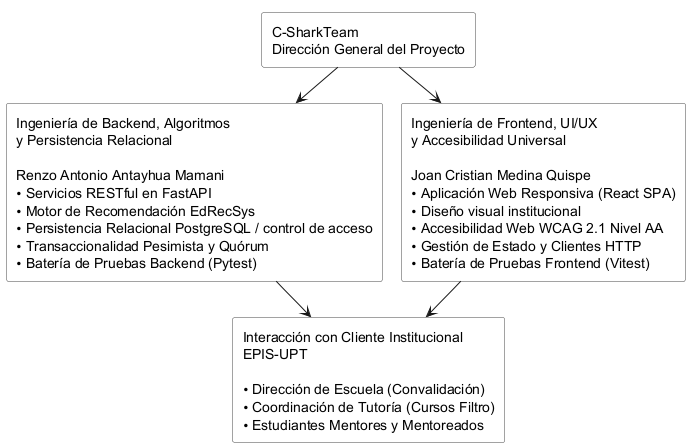

Fuente: Elaboración propia, DOC-H06. [Fuente PlantUML](docs/revision_srs/diagramas/doc-h06/srs/puml/diag_001_organigrama.puml).

### Cuadro 2.1: Estructura de Responsabilidades Técnicas del Equipo Consultor C-SharkTeam

| Integrante / Consultor | Área de Especialización | Funciones Principales | Entregables y Artefactos Bajo su Custodia |
| :--- | :--- | :--- | :--- |
| **Joan Cristian Medina Quispe** | Frontend, Arquitectura UI/UX y Accesibilidad | • Arquitectura de cliente web SPA bajo React 19, TypeScript y Vite. • Construcción de componentes interactivos y diseño visual institucional. • Implementación estricta de accesibilidad WCAG 2.1 AA (contraste $\ge 4.5:1$, foco visible y soporte ARIA). • Integración de clientes HTTP tipados y adaptadores de comunicación con el backend. • Construcción de vistas de escaneo QR, modales de consentimiento y tableros analíticos. • Autoría y ejecución de la suite de pruebas unitarias y de componentes en Vitest. | • Código fuente en `aplicacion/frontend/src/`. • Vistas de interfaz de usuario (23 componentes reactivos). • Pruebas automatizadas de cliente en `aplicacion/frontend/src/**/*.test.tsx`. |
| **Renzo Antonio Antayhua Mamani** | Backend, Algoritmos y Persistencia | • Arquitectura de servicio REST en Python con FastAPI. • Diseño y calibración del motor de recomendación híbrido *EdRecSys*. • Modelado relacional DDL físico en PostgreSQL con SQLAlchemy y Alembic. • Políticas de seguridad a nivel de fila (*Row Level Security - RLS*) y control RBAC. • Orquestación de concurrencia mediante cerrojos pesimistas (`SELECT ... FOR UPDATE`). • Planificador condicional en proceso de corte de quórum a $T-24\text{ h}$ y servicios de correo SMTP. • Autoría y ejecución de la suite de pruebas unitarias e integración en Pytest. | • Código fuente en `aplicacion/backend/app/`. • Modelos ORM, controladores REST y servicios de negocio. • Migraciones DDL en `aplicacion/backend/app/db/migrations/`. • Pruebas automatizadas de backend en `aplicacion/backend/tests/`. |

Fuente: Elaboración propia.

El análisis del Cuadro 2.1 demuestra una distribución equilibrada y rigurosa de las responsabilidades técnicas. La frontera clara entre la ingeniería de interfaz accesible y la ingeniería de servicios de persistencia y recomendación asegura que ambos dominios alcancen la profundidad exigida por la cátedra sin solapamientos improductivos ni vacíos de responsabilidad.

# 3. Visionamiento de la Empresa

C-SharkTeam concibe la plataforma no como una simple herramienta aislada de registro, sino como la columna vertebral tecnológica de un **Ecosistema Académico Colaborativo** para la EPIS-UPT, alineado con las demandas de modernización universitaria y acreditación internacional ICACIT.

## 3.1. Descripción del Problema Académico

En la Escuela Profesional de Ingeniería de Sistemas de la Universidad Privada de Tacna, los estudiantes que cursan los primeros cuatro ciclos del plan curricular enfrentan una severa transición formativa caracterizada por una alta complejidad conceptual en materias de ciencias básicas y fundamentos de ciencias de la computación:
- **Cálculo Diferencial e Integral (I y II ciclo):** Rigor analítico formal y modelado matemático continuo.
- **Algoritmos y Estructura de Datos (II y III ciclo):** Razonamiento lógico estructurado, complejidad asintótica y estructuras dinámicas en memoria.
- **Programación Orientada a Objetos (III ciclo):** Abstracción, polimorfismo, encapsulamiento y patrones de diseño.
- **Base de Datos (IV ciclo):** Normalización relacional, integridad referencial y álgebra relacional.

Estas materias actúan en la práctica como **"asignaturas filtro"**, concentrando tasas históricas de desaprobación que fluctúan entre el 25% y el 40% `[DATO_HISTORICO_OBSERVADO]`, provocando rezago en el avance de la malla curricular, desmotivación temprana y un riesgo sensible de deserción universitaria en los primeros semestres.

Paradójicamente, la escuela cuenta con una masa crítica de estudiantes destacados en los ciclos superiores (VII al X) que han superado con solvencia técnica estas materias y poseen vocación para guiar a sus compañeros. No obstante, no existe una plataforma institucional centralizada que articule de manera inteligente, ordenada y trazable la oferta y la demanda de asesoría académica entre pares (*Peer-to-Peer*).

Actualmente, este apoyo se canaliza a través de medios informales no regulados (grupos de WhatsApp, mensajería instantánea privada o encuentros fortuitos en pasillos), generando los siguientes problemas de fondo:
1. **Ausencia de Emparejamiento Adaptativo (Matching Inteligente):** La búsqueda de ayuda académica depende de contactos interpersonales o referencias empíricas. No existe un mecanismo que cruce las debilidades temáticas puntuales del mentoreado con las fortalezas curriculares específicas, horarios disponibles y reputación docente del mentor.
2. **Inexistencia de Gobernanza y Trazabilidad Institucional:** La Dirección de Escuela y el Comité de Tutoría carecen de visibilidad sobre qué asignaturas se refuerzan, qué temas silábicos demandan mayor apoyo, quiénes participan y cuál es la efectividad pedagógica real, impidiendo la formulación de políticas preventivas oportunas.
3. **Falta de Reconocimiento Estructurado y Desgaste de Mentores:** Los estudiantes avanzados no reciben incentivos institucionales por su labor docente (como acumulación auditable de horas para convalidación de créditos extracurriculares o insignias de reputación), lo que conduce a la sobrecarga académica personal y al abandono prematuro del rol de mentor.
4. **Descoordinación en el Uso de Espacios Físicos y Virtuales:** La búsqueda informal de aulas libres en el campus de Capanique ocasiona colisiones con clases regulares o dispersión a enlaces virtuales personales sin supervisión.
5. **Transgresión de la Privacidad de Datos Académicos:** La difusión informal de historiales de notas o listas de alumnos rezagados en grupos de mensajería vulnera las directrices de consentimiento y confidencialidad establecidas en la Ley N° 29733 de Protección de Datos Personales.

## 3.2. Necesidades de los Interesados

Del diagnóstico situacional se derivan necesidades críticas para los cuatro estamentos involucrados:

1. **Estudiantes Mentoreados (Ciclos I al IV):**
   - Requieren acceso inmediato a reforzamiento conceptual oportuno antes de las evaluaciones parciales y finales.
   - Demandan un ambiente pedagógico horizontal, con lenguaje cercano y sin el temor a ser juzgados.
   - Necesitan flexibilidad horaria que no interfiera con sus jornadas lectivas regulares.
   - Exigen confidencialidad sobre su condición de rendimiento académico.

2. **Estudiantes Mentores (Ciclos VII al X):**
   - Requieren un canal oficial para publicar su disponibilidad horaria sin comprometer sus responsabilidades formativas.
   - Necesitan un marco institucional que certifique fehacientemente las horas académicas dictadas para convalidar créditos extracurriculares requeridos para su graduación.
   - Demandan espacios físicos asignados (aulas o laboratorios) o salas virtuales institucionales seguras.
   - Desean visibilidad de su impacto formativo mediante insignias de reputación académica.

3. **Coordinación de Tutoría de la EPIS-UPT:**
   - Requiere supervisar en tiempo real el cumplimiento del Artículo 40 de la Ley Universitaria N° 30220.
   - Necesita auditar bitácoras docentes con el detalle de temas tratados y firmas de inalterabilidad.
   - Demanda indicadores de ausentismo y satisfacción estudiantil para fiscalizar la calidad de las mentorías.

4. **Dirección de Escuela EPIS-UPT:**
   - Exige métricas consolidadas de demanda insatisfecha y retención estudiantil para los comités de acreditación ICACIT.
   - Requiere un mecanismo digital inviolable para la parametrización de umbrales y la emisión de constancias oficiales foliadas con verificación pública.

## 3.3. Objetivos de Negocios y Objetivos de Diseño

A continuación, se definen los objetivos estratégicos y técnicos que gobiernan el proyecto:

### Objetivos de Negocio Institucionales
- **Mitigar la Tasa de Reprobación en Asignaturas Filtro:** Reducir las desaprobaciones en Cálculo, Algoritmos, Estructuras de Datos y Programación Orientada a Objetos mediante sesiones de mentoría focalizadas en los temas silábicos de mayor dificultad.
- **Descongestionar el Sistema Tradicional de Tutoría Docente:** Transferir las consultas conceptuales y prácticas recurrentes hacia la red de mentores pares, permitiendo que los docentes tutores concentren su labor en problemáticas pedagógicas o psicosociales complejas.
- **Elevar los Índices de Retención Estudiantil:** Disminuir el abandono universitario temprano en los cuatro primeros semestres académicos de Ingeniería de Sistemas.
- **Institucionalizar el Mérito Estudiantil:** Formalizar un sistema transparente y auditable de acumulación de horas de mentoría convalidables por créditos extracurriculares de grado académico.
- **Suministrar Analítica Predictiva para la Gestión de Escuela:** Proveer tableros analíticos en tiempo real sobre demanda académica insatisfecha para retroalimentar la planificación de horarios y el rediseño silábico.

### Objetivos de Diseño e Ingeniería de Requisitos
- **Inferencia Algorítmica con Alta Precisión:** Implementar un motor híbrido (*EdRecSys*) que procese coincidencia temática y compatibilidad de horario/modalidad con afinidad curricular ponderada, con objetivos de evaluación aún pendientes: $\text{Precision@3} \ge 80\%$, $\text{Precision@5} \ge 75\%$, ranking $\text{NDCG} \ge 0.80$ y tiempo de respuesta algorítmica $\le 500\text{ ms}$.
- **Accesibilidad Universal y Ergonomía Web:** Construir una interfaz web responsiva (React SPA) bajo directrices **WCAG 2.1 Nivel AA**, asegurando navegación por teclado, soporte para lectores de pantalla, contraste $\ge 4.5:1$ y una puntuación estandarizada superior a 75 puntos en la escala System Usability Scale (SUS).
- **Seguridad Rigurosa y Cumplimiento Normativo:** Proveer autenticación institucional dual (Email OTP / Google Workspace), control de acceso por roles (RBAC) con tokens JWT (HS256) de 8 horas, aislamiento granular de datos personales (RLS) y formalización vinculante del consentimiento bajo la Ley N° 29733.
- **Garantía Transaccional y Concurrencia Confiable:** Asegurar transacciones ACID con cerrojos pesimistas a nivel de fila (`SELECT ... FOR UPDATE`), garantizando estrictamente una tasa de sobrecupo de **0.0%** bajo condiciones de alta concurrencia en la reserva de vacantes.
- **Integridad Documental:** Registrar huellas técnicas de campos seleccionados de las bitácoras y folios/QR de consulta; la firma certificada y la validez institucional siguen pendientes.

## 3.4. Alcance y Exclusiones del Proyecto

### Inclusiones Funcionales

Se incluyen las capacidades de los cinco módulos de 5.1 con su estado observado. El acceso, oferta, recomendación y reserva cuentan con implementación identificada; postulación, ambientes, feedback, historial, constancias y seguimiento tienen límites explícitos. No se excluyen los requisitos institucionales aún pendientes.

### Exclusiones del Alcance

DOC-H06 modifica documentación y figuras. No cambia la aplicación, los datos, las credenciales ni la configuración operativa. No valida integraciones reales, métricas de producción ni aprobación institucional. Los requisitos futuros se conservan como brechas en lugar de eliminarlos.

## 3.5. Viabilidad Multidimensional del Sistema

### 3.5.1. Viabilidad Técnica

El repositorio declara React 19, TypeScript y Vite para presentación, Python >=3.13 y FastAPI para el servicio, y SQLAlchemy/Alembic con PostgreSQL como persistencia. Las versiones de manifiestos y restricciones se detallan en SAD 8.2; no se afirma una versión desplegada del servidor ni uso de Scikit-learn o Tailwind como dependencia instalada.

La viabilidad técnica no acredita calidad medida: los objetivos RNF y los resultados históricos se separan en 5.2 y 5.5. Las integraciones SMTP/Google, la operación desatendida y el aislamiento efectivo requieren evidencia específica del entorno autorizado.

### 3.5.2. Viabilidad Económica
El análisis financiero se modeló para un horizonte de evaluación a 5 años (2026–2030) con una tasa de costo de oportunidad de capital (COK) del 12.00%:

A continuación, se presentan los indicadores financieros del proyecto:

### Cuadro 3.1: Evaluación Financiera y Económica del Proyecto (Horizonte 2026–2030)

| Indicador Financiero | Valor Cuantificado | Clasificación Metodológica | Criterio de Aceptación | Interpretación Técnica y Financiera |
| :--- | :---: | :---: | :---: | :--- |
| **Inversión Inicial (CAPEX)** | **S/. 5,475.00** | `[SUPUESTO_ECONOMICO]` / `[CALCULO_MATEMATICO]` | Presupuesto Cátedra | Cubre 500 horas de ingeniería de software (Joan Cristian Medina y Renzo Antonio Antayhua a S/. 9.00/h), depreciación de equipos, conectividad, dominio web e imprevistos. |
| **Costo Operativo Anual (OPEX)** | **S/. 1,140.00** | `[SUPUESTO_ECONOMICO]` / `[CALCULO_MATEMATICO]` | Presupuesto Anual | Infraestructura cloud PaaS (Render / Supabase), renovación de dominio, soporte preventivo y materiales de difusión. |
| **Valor Actual Neto (VAN)** | **+S/. 10,801.64** | `[CALCULO_MATEMATICO]` | $\text{VAN} > 0$ | Estrictamente positivo, ratificando que el proyecto genera valor económico sustancial y excedentes por encima de la tasa de descuento exigida (12.00%). |
| **Tasa Interna de Retorno (TIR)** | **68.20%** | `[CALCULO_MATEMATICO]` | $\text{TIR} > \text{COK}$ (12%) | Supera con holgura el COK referencial (12.00%), confiriendo un margen de resiliencia financiera amplio ante variaciones de costos operativos. |
| **Relación Beneficio / Costo (B/C)** | **1.97** | `[CALCULO_MATEMATICO]` | $\text{B/C} > 1.0$ | Por cada sol invertido a lo largo del ciclo del proyecto, se generan S/. 1.97 en ahorros y beneficios valorizados para la facultad y los estudiantes. |
| **Periodo de Recuperación (Payback)**| **1 año y 9.7 meses** | `[CALCULO_MATEMATICO]` | $< 3\text{ años}$ | La inversión inicial se recupera plenamente antes de concluir el segundo año lectivo de puesta en producción. |

Fuente: Elaboración propia a partir del estudio económico del proyecto.

El Cuadro 3.1 conserva un escenario financiero proyectado. No constituye retorno observado ni acredita reducción real de rezago o desaprobación; sus supuestos deben validarse institucionalmente.

A continuación, se presenta en el Cuadro 3.2 la conciliación metodológica entre las horas presenciales de cátedra y las horas de ingeniería de software:

### Cuadro 3.2: Conciliación Metodológica de Horas de Desarrollo e Inversión Técnica

| Parámetro de Comparación | Horas Académicas Presenciales de Cátedra | Horas Integrales de Ingeniería de Software (CAPEX) | Justificación Metodológica y Alcance Técnico |
| :--- | :---: | :---: | :--- |
| **Total de Horas Computadas** | **91.0 horas** `[ESTIMACION_ACADEMICA]` / `[DATO_HISTORICO_OBSERVADO]` | **500.0 horas** `[SUPUESTO_ECONOMICO]` / `[CALCULO_MATEMATICO]` | Disparidad de alcance formal: las 91 horas corresponden al horario de laboratorio evaluado; las 500 horas al esfuerzo técnico global de ingeniería. |
| **Distribución por Desarrollador** | Joan Medina: **45.0 h** Renzo Antayhua: **46.0 h** | Joan Medina: **250.0 h** Renzo Antayhua: **250.0 h** | Asignación equitativa en ambos marcos, reflejando corresponsabilidad plena en frontend, backend, arquitectura y documentación. |
| **Fuente de Acreditación** | `PLAN_SPRINTS_Y_TAREAS.md`, Informes de Sprint 1 al 8 | Modelo de Costos de Ingeniería, Estudio Financiero CAPEX | Trazabilidad documental cruzada entre el cronograma curricular de cátedra y el presupuesto formal del proyecto. |
| **Actividades Comprendidas** | Sesiones lectivas de laboratorio, revisiones de sprint con el docente, demostraciones de incremento (*sprint review*) y retrospectivas en aula. | Análisis de requisitos (IEEE 29148), diseño arquitectónico UML (Visual Paradigm), codificación React/TypeScript y FastAPI, motor EdRecSys, 682 pruebas automatizadas, CI/CD, despliegue cloud y redacción técnica de SRS y SAD. | El desarrollo de software profesional exige un esfuerzo sustantivo extra-aula que multiplica por un factor de ~5.5 la capacidad lectiva presencial. |
| **Valorización Monetaria** | No monetizable directamente (créditos académicos universitarios). | **S/. 4,500.00** en mano de obra (500 h $\times$ S/. 9.00/h) + S/. 975.00 en equipamiento, dominio y contingencias = **S/. 5,475.00**. | Base cuantificada del flujo de caja de inversión inicial (CAPEX) utilizado para la estimación del VAN, TIR y periodo de recuperación. |

Fuente: Elaboración propia a partir de las actas de cátedra y el expediente financiero.

El análisis del Cuadro 3.2 clarifica la diferencia fundamental de alcance entre la capacidad neta de cátedra (91.0 horas lectivas de laboratorio distribuidas a lo largo de los 8 sprints del curso Construcción de Software I) y el esfuerzo profesional integral de ingeniería de software (500.0 horas efectivas de desarrollo, pruebas y documentación técnica que fundamentan la inversión inicial de S/. 5,475.00). Ambas cifras son mutuamente consistentes y representan dimensiones operativas complementarias del proyecto.

### 3.5.3. Viabilidad Operativa
- **Facilidad de Adopción:** La interfaz intuitiva y responsiva no exige instalaciones locales ni configuraciones especiales por parte del estudiante.
- **Alineamiento de Incentivos:** La certificación institucional y la gamificación son incentivos previstos; el PDF DEMO y los distintivos visibles no acreditan ese resultado ni una oferta continua.
- **Automatización de Procesos:** La reducción de la intermediación manual del Comité de Tutoría permite canalizar los esfuerzos directivos hacia la fiscalización y la toma de decisiones estratégicas.

### 3.5.4. Viabilidad Legal
- **Protección de datos personales:** El consentimiento y la autorización son controles identificados; su existencia no acredita cumplimiento jurídico integral, almacenamiento disociado ni auditoría inmutable de todos los eventos.
- **Alineamiento con la Ley N° 30220 (Ley Universitaria):** Materializa de forma moderna y descentralizada el mandato de tutoría permanente consignado en su Artículo 40.
- **Licenciamiento y Propiedad Intelectual:** Componentes basados en librerías de código abierto (MIT / Apache 2.0) y registro formal de derechos patrimoniales a favor de la Universidad Privada de Tacna.

### 3.5.5. Viabilidad Social y Ambiental
- **Impacto Social:** Fomenta la solidaridad académica, la cohesión comunitaria entre cohortes estudiantiles y la adquisición de habilidades de liderazgo y docencia en mentores.
- **Sostenibilidad Ambiental (*Política Paperless*):** Erradica el uso de papel en inscripciones, bitácoras docentes, listas de asistencia y constancias físicas, reduciendo la huella de carbono institucional.

## 3.6. Información obtenida del Levantamiento de Información

Durante la etapa de levantamiento de requisitos, el equipo consultor ejecutó entrevistas estructuradas y sesiones de trabajo con las autoridades de la EPIS-UPT, cuyos aportes determinaron la lógica operativa del software:

1. **Ing. Liliana Mercedes Vega Bernal (Coordinadora de Tutoría):**
   - Estableció la necesidad de clasificar como prioritarias las asignaturas con mayor reprobación en los cuatro primeros semestres.
   - Fijó la política de quórum mínimo obligatorio del 50% con corte estricto en $T-24\text{ h}$ para evitar desplazamientos inútiles y horas perdidas de los mentores.
   - Exigió el control de asistencia mediante mecanismos dinámicos y la obligatoriedad de bitácoras docentes detalladas con plazo máximo de 48 horas.
   - Dispuso que las encuestas de calidad docente (CSAT) permanezcan habilitadas durante 24 horas para garantizar retroalimentación objetiva.

2. **Mgtr. Ing. Enrique Lanchipa Valencia (Docente Asesor / Arquitecto de TI):**
   - Recomendó la adopción de una arquitectura desacoplada en tres capas con contratos JSON fuertemente tipados.
   - Sugirió incorporar algoritmos de balanceo de carga para evitar saturar a mentores destacados con múltiples solicitudes.
   - Instó a optimizar los tiempos de inferencia algorítmica por debajo de 500 ms mediante cálculo matricial en memoria.

3. **Dr. Luis Alfredo Fernández Vizcarra (Docente Asesor Metodológico):**
   - Estableció las directrices de verificación de usabilidad mediante el instrumento SUS (>75 puntos) y accesibilidad WCAG 2.1 AA.
   - Instruyó el apego estricto a las cláusulas de consentimiento previo y auditabilidad exigidas por la Ley N° 29733.

4. **Ing. Haydee Raquel Sisa Yataco (Directora [e] EPIS-UPT):**
   - El levantamiento histórico consignó un estándar propuesto de emisión de certificados digitales en formato PDF con folio correlativo único, hash SHA-256 y código QR de verificación pública.
   - Ratificó que la postulación formal a convalidación de créditos extracurriculares exige la acumulación de al menos 20 horas efectivas de mentoría auditadas con bitácoras visadas.

---

# 4. Análisis de Procesos

## 4.1. Diagrama del Proceso Actual (As-Is)

El proceso actual de asesoría académica entre pares en la EPIS-UPT opera de forma informal, dispersa y sin control institucional.

A continuación, se describen las etapas del flujo actual:
1. **Detección Informal de Necesidad:** El estudiante de I a IV ciclo identifica dificultades conceptuales en asignaturas formativas ante la inminencia de una práctica calificada o examen.
2. **Difusión en Canales No Oficiales:** Publica una solicitud de auxilio en grupos no institucionales de mensajería (WhatsApp, Telegram) o consulta a compañeros de ciclos superiores de forma casual.
3. **Respuesta Discrecional:** Si ningún estudiante avanzado responde, el alumno permanece sin apoyo pedagógico o acude tardíamente a la tutoría docente tradicional, afrontando un alto riesgo de reprobación.
4. **Coordinación Improvisada:** Si un compañero acepta colaborar, coordinan horario, temática y lugar a través de chats privados sin registro formal.
5. **Asignación Empírica de Ambiente:** El mentor informal busca aulas desocupadas en el pabellón de Ingeniería de Sistemas de forma manual o genera un enlace personal de videollamada sin supervisión.
6. **Ejecución no Estructurada:** Se desarrolla la asesoría sin seguir temarios silábicos definidos, sin control de tiempo y sin materiales didácticos estandarizados.
7. **Carencia de Trazabilidad y Cierre:** No se levanta lista de asistencia, no se registra bitácora pedagógica, no se recopila feedback de calidad y la Dirección de Escuela no dispone de ninguna evidencia para reconocer el mérito del mentor ni para intervenir oportunamente en la deserción.

A continuación, se presenta la representación visual del flujo actual:

### Diagrama 4.1: Diagrama de Actividades del Proceso Actual de Asesoría Informal (As-Is)

**Figura 2. Diagrama de Actividades del Proceso Actual de Asesoría Informal (As-Is)**

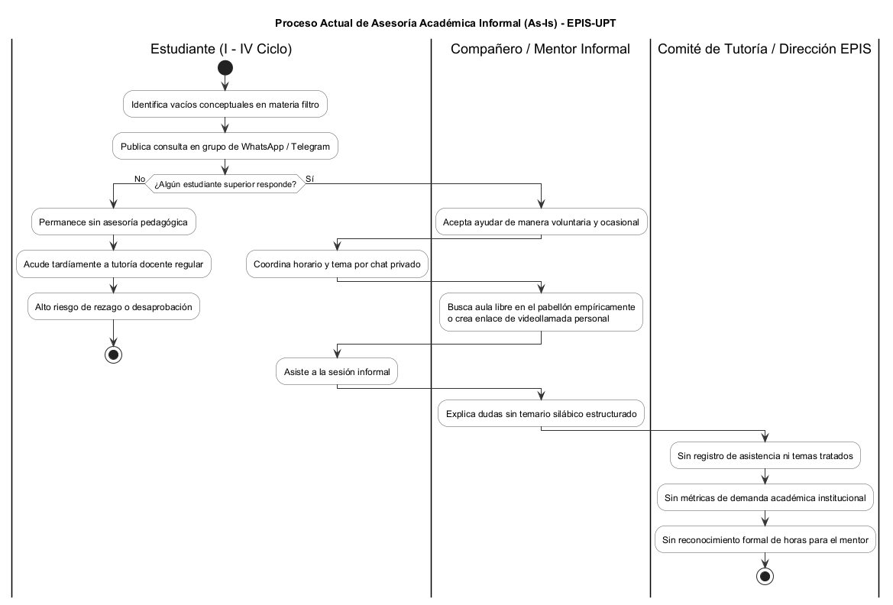

Código fuente PlantUML (respaldo editable)

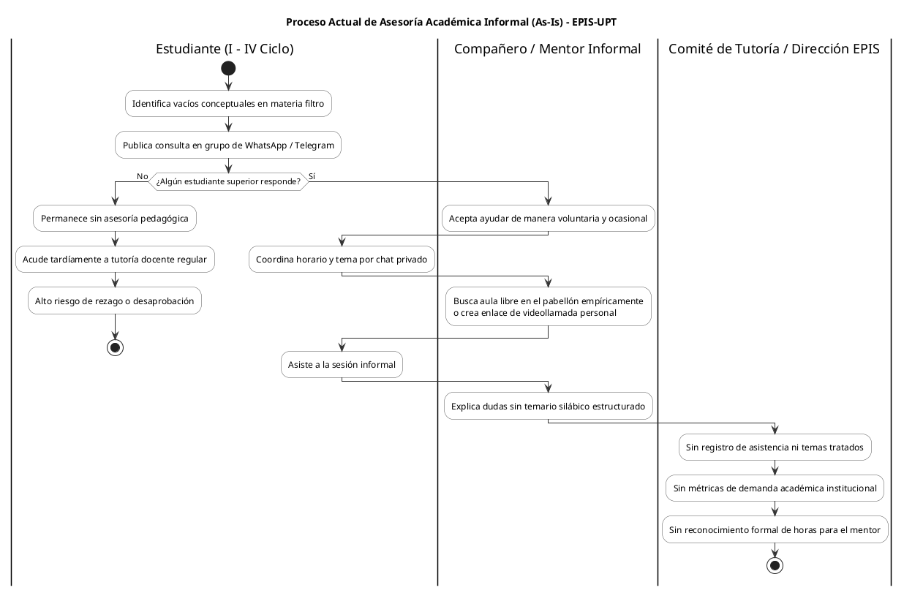

Fuente: Elaboración propia a partir del levantamiento de información en la EPIS-UPT.

El análisis del Diagrama 4.1 expone con claridad los cuellos de botella y riesgos operativos del esquema vigente. La dependencia absoluta de la buena voluntad individual, la carencia de métricas y la desarticulación institucional demuestran la urgencia de sistematizar el proceso a través de una plataforma gobernada.

## 4.2. Diagrama del Proceso Propuesto (To-Be)

### Diagrama 4.2: Proceso de mentoría con brechas explícitas

**Figura 3. Proceso propuesto y alcance actual**

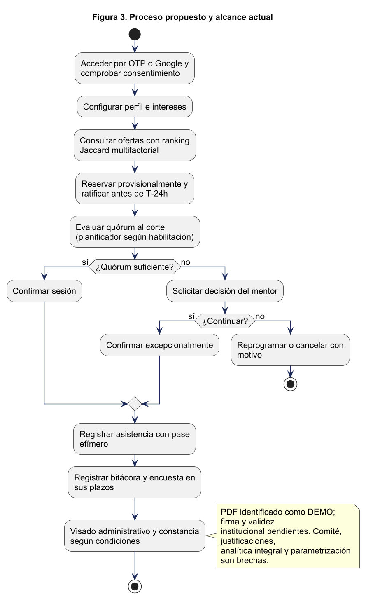

Fuente: Elaboración propia, DOC-H06. [Fuente PlantUML](docs/revision_srs/diagramas/doc-h06/srs/puml/diag_003_proceso_to_be.puml).

# 5. Especificación de Requerimientos de Software

## 5.1. Identificación de Módulos y Capacidades Funcionales

Se adoptan los cinco módulos del catálogo para esta edición documental. La adopción no implica aprobación institucional ni convierte propuestas en funcionalidades. Los ocho módulos anteriores se conservan como agrupación histórica, con la correspondencia siguiente.

| Módulo vigente | Denominación | Casos |
| --- | --- | --- |
| MOD-01 | Seguridad, Autenticación y Gobernanza | CUS-001, CUS-010 |
| MOD-02 | Ofertas de Mentoría y Gestión de Recursos | CUS-006, CUS-008, CUS-005, CUS-021 |
| MOD-03 | Recomendaciones, Reservas y Quórum | CUS-002, CUS-003, CUS-004, CUS-023, CUS-024 |
| MOD-04 | Ejecución y Seguimiento Académico | CUS-007, CUS-012, CUS-013, CUS-014, CUS-018, CUS-019 |
| MOD-05 | Administración y Analítica Institucional | CUS-009, CUS-011, CUS-015, CUS-016, CUS-017, CUS-020, CUS-022 |

| Módulo histórico (v3.x) | Destino documental v4.0 | Criterio de homologación |
| --- | --- | --- |
| MOD-01 | MOD-01 y MOD-02 | Acceso y roles; postulación y comité en MOD-02 |
| MOD-02 | MOD-02 y MOD-05 | Oferta en MOD-02; ambientes y cronogramas en MOD-05 |
| MOD-03 | MOD-02 y MOD-05 | Perfil/postulación y currículo |
| MOD-04 | MOD-02, MOD-03 y MOD-05 | Demanda, recomendación y parametrización |
| MOD-05 | MOD-03 y MOD-05 | Operación de reserva/corte y configuración propuesta |
| MOD-06 | MOD-04 | Asistencia, bitácora, feedback e historial |
| MOD-07 | MOD-04 | Constancias; RF21 transversal preservado |
| MOD-08 | MOD-04 y MOD-05 | Visado, analítica, seguridad y configuración; avisos transversales |

La grafía rectora de requisitos es **RF01–RF26**, **RN-01–RN-14** y **RNF01–RNF10**. Las variantes RF-001–RF-026 de las narrativas son alias numéricos del mismo requisito, no requisitos nuevos. RF21 y las notificaciones permanecen transversales, sin asignarles un CUS vigente que tenga otro objetivo. CUS-018 conserva una brecha de requisito específico por formalizar.

## 5.2. Requerimientos No Funcionales (ISO/IEC 25010)

### Cuadro 5.2: Requerimientos no funcionales y evidencia

| Código | Atributo | Objetivo y criterio de aceptación | Estado de evidencia |
| --- | --- | --- | --- |
| RNF01 | Seguridad de acceso | OTP 300 s; reenvío 60 s; desafío bloqueado al quinto error; sesión de referencia 8 h; dos factores independientes como brecha si se exige 2FA. | Implementación OTP/SSO identificada; validación externa pendiente |
| RNF02 | Privacidad y aislamiento | Proteger datos, consentimiento y acceso por titular/rol; aislamiento por fila y transporte seguro como requisitos. | No se certifica RLS, TLS ni ausencia de exposición por inspección de código |
| RNF03 | Rendimiento algorítmico | Objetivo de respuesta <=500 ms y evaluación reproducible de relevancia Top-k. | Jaccard implementado; valores de precisión/latencia previos son históricos sin validación actual |
| RNF04 | Rendimiento de interfaz | Objetivos FCP <1.2 s, recursos iniciales comprimidos <250 KB y transiciones <50 ms. | Especificado; sin medición nueva ni afirmación de lazy loading universal |
| RNF05 | Usabilidad y accesibilidad | Objetivos SUS >75; WCAG 2.1 AA, contraste 4.5:1 en texto y 3:1 en gráficos; navegación por teclado. | Especificado; las pruebas de componentes no certifican accesibilidad total |
| RNF06 | Disponibilidad | Objetivo >=99.5% en horario lectivo y continuidad durante el semestre. | Pendiente de observación; health responde a una comprobación puntual, sin demostrar SLA |
| RNF07 | Consistencia transaccional | No sobrepasar aforo ni duplicar reservas bajo concurrencia. | Bloqueos de filas y restricciones identificados; validar contra PostgreSQL dedicado |
| RNF08 | Compatibilidad | Resoluciones de referencia 360 a 1920 px y navegadores de escritorio/móvil. | Pendiente de matriz de dispositivos; no se certifica soporte total |
| RNF09 | Mantenibilidad | Pruebas focalizadas, tipado y separación de responsabilidades; objetivo de cobertura >85%. | Dependencias y pruebas presentes; cifras históricas no representan corrida vigente |
| RNF10 | Interoperabilidad | Errores visibles, contratos coherentes y recuperación ante proveedores externos; objetivo de timeout <=5 s. | Parcial: revisar ruta y proveedor; no se afirma tratamiento uniforme del 100% de fallos |

## 5.3. Matriz Consolidada de Requerimientos Funcionales (RF01 al RF26)

### Cuadro 5.3: Requerimientos, casos vigentes y estado

| Código | Módulo principal | Requerimiento conservado | CUS vigentes | Estado |
| --- | --- | --- | --- | --- |
| RF01 | MOD-01 | Acceso institucional por código de correo o Google | CUS-001 | Implementado; validación externa pendiente |
| RF02 | MOD-01 | Formalización de consentimiento legal digital (Ley 29733) | CUS-001, CUS-016 | Parcial: consentimiento; auditoría integral pendiente |
| RF03 | MOD-01 | Gestión y asignación administrativa de roles de usuario | CUS-010, CUS-005, CUS-021 | Parcial: asignación administrativa; mérito y comité pendientes |
| RF04 | MOD-02 | Configuración de perfil formativo y matriz horaria | CUS-005 | Parcial: perfil y disponibilidad; expediente pendiente |
| RF05 | MOD-05 | Catálogo curricular de asignaturas y temarios silábicos | CUS-020 | Implementado; discrepancia de ciclos pendiente |
| RF06 | MOD-03 | Inferencia algorítmica y recomendación personalizada Top-k | CUS-002, CUS-015 | Implementado; parametrización propuesta |
| RF07 | MOD-02 | Registro y banco de solicitudes por demanda académica | CUS-008 | Parcial: registro y banco; controles pendientes |
| RF08 | MOD-02 | Publicación y parametrización de ofertas de mentoría | CUS-006 | Parcial: publicación; mérito y anexos pendientes |
| RF09 | MOD-02 | Aprovisionamiento automatizado de espacios y salas virtuales | CUS-006, CUS-017 | Parcial: disponibilidad; provisión externa pendiente |
| RF10 | MOD-05 | Procesamiento de cronogramas oficiales de aulas | CUS-017 | Implementado; importación y consulta |
| RF11 | MOD-02 | Gestión de imprevistos, reprogramación y cancelación | CUS-006, CUS-023 | Implementado; notificaciones externas pendientes |
| RF12 | MOD-03 | Reserva concurrente de cupos con control de aforo | CUS-003 | Implementado; validación nueva de concurrencia no ejecutada |
| RF13 | MOD-03 | Ratificación anticipada obligatoria de asistencia | CUS-004, CUS-022 | Implementado; edición administrativa propuesta |
| RF14 | MOD-03 | Desistimiento voluntario y liberación inmediata de cupo | CUS-024, CUS-018, CUS-022 | Parcial: desistimiento; justificación y penalizaciones propuestas |
| RF15 | MOD-03 | Monitoreo desatendido y corte de quórum en $T-24\text{ h}$ | CUS-023, CUS-009, CUS-022 | Parcial: evaluación y planificador; operación real pendiente |
| RF16 | MOD-03 | Gestión resolutiva del mentor ante quórum insuficiente | CUS-023 | Implementado; decisión del mentor |
| RF17 | MOD-04 | Marcación de asistencia con pase QR dinámico | CUS-007, CUS-018 | Parcial: pase efímero; cámara real pendiente |
| RF18 | MOD-04 | Registro de bitácora docente en 48h con hash SHA-256 | CUS-007, CUS-012, CUS-019 | Implementado; sello de integridad y visado administrativo |
| RF19 | MOD-04 | Historial de sesiones, bitácoras y recursos compartidos | CUS-013 | Parcial: historial por rol |
| RF20 | MOD-04 | Captura de encuestas de calidad post-mentoría (ventana 24h) | CUS-012 | Parcial: encuesta; feedback individual inverso pendiente |
| RF21 | MOD-04 | Cálculo de reputación docente y catálogo de insignias | Transversal RF21; sin CUS autónomo en el catálogo | Especificado; reputación integral e insignias por validar |
| RF22 | MOD-04 | Parametrización y autorización de certificados de horas | CUS-014 | Parcial: umbral y emisión; autorización institucional pendiente |
| RF23 | MOD-04 | Emisión, descarga y verificación con código QR | CUS-014 | Parcial: PDF/folio DEMO; certificación institucional pendiente |
| RF24 | MOD-05 | Parametrización institucional de aforos y prioridades | CUS-015, CUS-020, CUS-022 | Parcial: prioridades curriculares; parametrización administrativa propuesta |
| RF25 | MOD-05 | Tablero analítico directivo y métricas de retención ICACIT | CUS-009, CUS-011 | Parcial: quórum; retención y exportación propuestas |
| RF26 | MOD-05 | Auditoría institucional de bitácoras y privacidad legal | CUS-016, CUS-019 | Parcial: visado administrativo; seguridad integral propuesta |

Los estados se basan en revisión estática y en los anexos A-C. **Implementado** indica código identificado, con validación suficiente aún pendiente salvo evidencia acotada citada; **parcial** señala alcance incompleto; **especificado/propuesto** conserva un requisito sin implementación identificada. **Verificado histórico** solo se usa con la procedencia y limitación del reporte correspondiente. No se adjudica verificación actual a los 26 RF por el recuento de pruebas.

### 5.3.1. Fichas Detalladas de Especificación de Requerimientos Funcionales (RF01 al RF26)

#### Ficha Técnica de Requerimiento Funcional: RF01 — Acceso institucional por código de correo o Google

- **Identificador:** RF01
- **Nombre Oficial:** Autenticación institucional multifactor (2FA) y control de acceso seguro
- **Módulo funcional vigente:** MOD-01: Seguridad, Autenticación y Gobernanza
- **Descripción Funcional:** El sistema debe autenticar la identidad de los estudiantes, mentores y autoridades universitarias de la EPIS-UPT garantizando que pertenezcan a la comunidad institucional. El usuario podrá acceder ingresando su correo electrónico institucional y verificando su identidad mediante un código temporal de un solo uso recibido en su buzón de correo, o alternativamente mediante el botón oficial de inicio de sesión con su cuenta institucional de Google Workspace.
- **Objetivo y Necesidad Académica:** Prevenir la suplantación de identidad y el acceso no autorizado de personas ajenas a la universidad, protegiendo los expedientes académicos y asegurando que las mentorías se desarrollen exclusivamente entre miembros legítimos de la EPIS.
- **Actores Participantes:** Estudiante Mentoreado, Estudiante Mentor, Administrador Institucional (Actores Primarios); Servicio de Correo Electrónico Institucional y Proveedor de Identidad Google Workspace (Actores Secundarios).
- **Condiciones de Entrada (Precondiciones):** El usuario debe contar con una cuenta de correo electrónico institucional activa terminada en `@virtual.upt.pe` o `@upt.pe`.
- **Comportamiento Esperado (requisito):**
  1. El usuario accede a la pantalla de bienvenida e ingresa su dirección de correo institucional o selecciona la opción de acceso con Google Workspace.
  2. Si elige código de correo, el sistema comprueba la validez del dominio institucional, genera un código numérico temporal de 6 dígitos y lo remite de inmediato al buzón universitario del solicitante.
  3. El sistema muestra una pantalla con seis casillas numéricas con temporizador regresivo visible de 5 minutos y botón de reenvío bloqueado durante 60 segundos.
  4. El usuario ingresa el código de 6 dígitos recibido.
  5. El sistema valida la coincidencia y vigencia del código, confirma la identidad del estudiante y habilita el ingreso al portal universitario correspondiente a sus roles asignados.
- **Resultado esperado (Postcondiciones del requisito):** El usuario ingresa exitosamente a su panel principal con sesión activa durante su jornada académica, registrándose la marca de auditoría de acceso exitoso.
- **Reglas de Negocio Vinculadas:** RN-01 (Dominio institucional exclusivo, código OTP con vigencia improrrogable de 5 minutos y enfriamiento de reenvío de 60 segundos).
- **Restricciones Funcionales:** Se rechaza de forma estricta cualquier dirección de correo comercial o ajena a los dominios universitarios oficiales de la UPT.
- **Casos de uso vigentes:** CUS-001.

- **Estado observado:** Implementado; validación externa pendiente.
- **Límites de la implementación:** SMTP y Google externos requieren validación; OTP por correo o SSO no acreditan dos factores independientes.
- **Criterio de aceptación `[REQUISITO]`:** DADO un código institucional vigente, CUANDO el usuario lo presenta dentro de 300 s, ENTONCES se permite el acceso; al quinto error se bloquea ese desafío sin confundirlo con el límite de solicitudes.
- **Criterio de brecha `[PENDIENTE]`:** DADO el alcance observado, CUANDO se evalúa RF01 para aceptación institucional, ENTONCES se debe comprobar cada límite indicado, con evidencia de la versión y entorno evaluados.
- **Trazabilidad de diseño:** Ver el catálogo de rutas declaradas, entidades y dependencias en SAD 6.3 y 10; la existencia de un contrato no demuestra cobertura integral del requisito.

---

#### Ficha Técnica de Requerimiento Funcional: RF02 — Formalización de consentimiento legal digital (Ley 29733)

- **Identificador:** RF02
- **Nombre Oficial:** Formalización y registro del consentimiento informado digital bajo la Ley N° 29733
- **Módulo funcional vigente:** MOD-01: Seguridad, Autenticación y Gobernanza
- **Descripción Funcional:** El sistema debe presentar a todo usuario que ingrese por primera vez a la plataforma una cláusula legal comprensible de consentimiento informado sobre el tratamiento de sus datos académicos y personales, exigiendo su aceptación explícita y vinculante para permitir la navegación en el sistema.
- **Objetivo y Necesidad Académica:** Garantizar el cumplimiento irrestricto de la legislación peruana de protección de datos personales (Ley N° 29733) y los reglamentos universitarios de la UPT, asegurando que las calificaciones y necesidades académicas se manejen con absoluta confidencialidad y reserva.
- **Actores Participantes:** Estudiante Mentoreado, Estudiante Mentor (Actores Primarios).
- **Condiciones de Entrada (Precondiciones):** El usuario debe haberse autenticado exitosamente por primera vez en la plataforma.
- **Comportamiento Esperado (requisito):**
  1. Tras validar la identidad del usuario, el sistema verifica si cuenta con registro previo de consentimiento informado vigente.
  2. Si no registra consentimiento, despliega inmediatamente un diálogo modal prioritario que bloquea cualquier otra interacción en la pantalla.
  3. El diálogo presenta en texto claro las finalidades del tratamiento: emparejamiento con mentores, emisión de constancias de asistencia, control de quórum y analítica agregada no nominal.
  4. El usuario revisa los términos y pulsa el botón de aceptación explícita.
  5. El sistema formaliza la aceptación registrando la decisión con sello inmutable de fecha y hora, cierra el modal y desbloquea el portal de servicios.
  6. Si el usuario rechaza los términos, el sistema cancela la sesión de forma segura y retorna a la pantalla de acceso sin registrar datos personales.
- **Resultado esperado (Postcondiciones del requisito):** El estudiante queda formalmente habilitado para utilizar los servicios de mentoría con constancia legal digital de su aceptación.
- **Reglas de Negocio Vinculadas:** RN-02 (Consentimiento digital previo e informado obligatorio bajo Ley N° 29733).
- **Restricciones Funcionales:** Ninguna funcionalidad de catálogo, reserva o publicación puede ejecutarse sin la previa aceptación del consentimiento.
- **Casos de uso vigentes:** CUS-001, CUS-016.

- **Estado observado:** Parcial: consentimiento; auditoría integral pendiente.
- **Límites de la implementación:** SMTP y Google externos requieren validación; OTP por correo o SSO no acreditan dos factores independientes. Propuesto: consentimiento y logs parciales no sustituyen auditoría integral.
- **Criterio de aceptación `[REQUISITO]`:** DADO un usuario sin consentimiento vigente, CUANDO acepta el texto informado, ENTONCES se registra su decisión y se habilita el recorrido; si rechaza, puede salir.
- **Criterio de brecha `[PENDIENTE]`:** DADO el alcance observado, CUANDO se evalúa RF02 para aceptación institucional, ENTONCES se debe comprobar cada límite indicado, con evidencia de la versión y entorno evaluados.
- **Trazabilidad de diseño:** Ver el catálogo de rutas declaradas, entidades y dependencias en SAD 6.3 y 10; la existencia de un contrato no demuestra cobertura integral del requisito.

---

#### Ficha Técnica de Requerimiento Funcional: RF03 — Gestión y asignación administrativa de roles de usuario

- **Identificador:** RF03
- **Nombre Oficial:** Gestión, fiscalización y asignación administrativa de roles de usuario
- **Módulo funcional vigente:** MOD-01: Seguridad, Autenticación y Gobernanza
- **Descripción Funcional:** El sistema debe permitir a las autoridades de la Dirección de Escuela y Coordinación de Tutoría consultar la nómina de estudiantes universitarios y administrar sus roles operativos (Mentoreado, Mentor, Administrador, Coordinador), verificando de forma estricta los requisitos de mérito académico exigidos para autorizar a un estudiante a desempeñarse como mentor de sus compañeros.
- **Objetivo y Necesidad Académica:** Garantizar la idoneidad académica y solvencia pedagógica de los mentores, protegiendo la calidad de la enseñanza que reciben los alumnos de ciclos iniciales y asegurando que los mentores sean alumnos destacados.
- **Actores Participantes:** Administrador Institucional (Actor Primario); Estudiante Mentor (Beneficiario del Rol).
- **Condiciones de Entrada (Precondiciones):** El administrador debe contar con una sesión activa con privilegios de gestión institucional en la plataforma.
- **Comportamiento Esperado (requisito):**
  1. El administrador accede al panel de administración de usuarios y visualiza la relación de estudiantes registrados.
  2. Selecciona a un estudiante postulante al rol de mentor y revisa su historial académico formal.
  3. El sistema valida automáticamente que el estudiante se encuentre matriculado en el ciclo VII o superior y que posea promedio ponderado aprobatorio.
  4. Si cumple los requisitos, el administrador confirma la asignación del rol de mentor.
  5. El sistema actualiza de inmediato los privilegios de la cuenta, habilitando la publicación de sesiones de mentoría en el portal.
  6. Si no cumple los requisitos, el sistema bloquea la asignación e indica detalladamente la condición académica insatisfecha.
- **Resultado esperado (Postcondiciones del requisito):** El estudiante adquiere formalmente las atribuciones de mentor en la plataforma, quedando registrado el cambio en la bitácora administrativa.
- **Reglas de Negocio Vinculadas:** RN-03 (Elegibilidad y mérito académico de mentores: ciclo VII o superior, nota aprobatoria sobresaliente en la materia a dictar).
- **Restricciones Funcionales:** Ningún estudiante puede autoasignarse el rol de mentor sin la debida verificación y autorización administrativa.
- **Casos de uso vigentes:** CUS-010, CUS-005, CUS-021.

- **Estado observado:** Parcial: asignación administrativa; mérito y comité pendientes.
- **Límites de la implementación:** Parcial: sin acreditación de nota 14 ni administración general de todos los roles; buscador institucional limitado. Parcial: sin expediente, certificación de nota 14 ni envío a comité; preferencia no concede privilegios. Propuesto: sin bandeja, expediente, votación ni resolución; asignación efectiva corresponde a CUS-010.
- **Criterio de aceptación `[REQUISITO]`:** DADO un administrador autorizado, CUANDO promueve o revoca Mentor, ENTONCES se informa el resultado y el rol efectivo; la nota mínima y la evaluación por comité se comprueban como brechas.
- **Criterio de brecha `[PENDIENTE]`:** DADO el alcance observado, CUANDO se evalúa RF03 para aceptación institucional, ENTONCES se debe comprobar cada límite indicado, con evidencia de la versión y entorno evaluados.
- **Trazabilidad de diseño:** Ver el catálogo de rutas declaradas, entidades y dependencias en SAD 6.3 y 10; la existencia de un contrato no demuestra cobertura integral del requisito.

---

#### Ficha Técnica de Requerimiento Funcional: RF04 — Configuración de perfil formativo y matriz horaria

- **Identificador:** RF04
- **Nombre Oficial:** Parametrización del perfil formativo y matriz semanal de disponibilidad horaria
- **Módulo funcional vigente:** MOD-02: Ofertas de Mentoría y Gestión de Recursos
- **Descripción Funcional:** El sistema debe proveer a cada estudiante una interfaz interactiva donde configure su perfil académico (ciclo cursado, materias de interés, fortalezas curriculares y modalidad de estudio preferida) y defina su disponibilidad horaria semanal mediante una matriz visual de bloques de tiempo.
- **Objetivo y Necesidad Académica:** Alimentar con datos precisos y actualizados al algoritmo de recomendación, evitando colisiones con los horarios oficiales de clase de los estudiantes y garantizando coincidencias factibles.
- **Actores Participantes:** Estudiante Mentoreado, Estudiante Mentor (Actores Primarios).
- **Condiciones de Entrada (Precondiciones):** Usuario con cuenta institucional activa y sesión iniciada en la plataforma.
- **Comportamiento Esperado (requisito):**
  1. El estudiante ingresa a la sección de configuración de perfil.
  2. Selecciona su ciclo de estudios actual y marca las asignaturas filtro en las que requiere apoyo o en las que se ofrece a brindar asesoría.
  3. Visualiza la matriz semanal interactiva de 6 días (lunes a sábado) dividida en franjas horarias de 60 minutos entre las 08:00 y las 20:00 horas (grilla estándar 6×11).
  4. Marca con un clic los bloques horarios en los que dispone de tiempo libre.
  5. Pulsa el botón de confirmación para guardar sus preferencias.
  6. El sistema valida que los datos no presenten incoherencias y actualiza el perfil académico y la matriz horaria.
- **Resultado esperado (Postcondiciones del requisito):** El perfil formativo queda almacenado y disponible para los procesos automáticos de recomendación y emparejamiento.
- **Reglas de Negocio Vinculadas:** RN-04 (Antelación de programación y compatibilidad horaria), RN-03 (Mérito académico).
- **Restricciones Funcionales:** Ningún mentor podrá ofrecer sesiones en franjas no declaradas como disponibles en su matriz horaria activa.
- **Casos de uso vigentes:** CUS-005.

- **Estado observado:** Parcial: perfil y disponibilidad; expediente pendiente.
- **Límites de la implementación:** Parcial: sin expediente, certificación de nota 14 ni envío a comité; preferencia no concede privilegios.
- **Criterio de aceptación `[REQUISITO]`:** DADO un usuario autenticado, CUANDO guarda su perfil y disponibilidad, ENTONCES se conservan los datos válidos; elegir preferencia Mentor no concede permisos.
- **Criterio de brecha `[PENDIENTE]`:** DADO el alcance observado, CUANDO se evalúa RF04 para aceptación institucional, ENTONCES se debe comprobar cada límite indicado, con evidencia de la versión y entorno evaluados.
- **Trazabilidad de diseño:** Ver el catálogo de rutas declaradas, entidades y dependencias en SAD 6.3 y 10; la existencia de un contrato no demuestra cobertura integral del requisito.

---

#### Ficha Técnica de Requerimiento Funcional: RF05 — Catálogo curricular de asignaturas y temarios silábicos

- **Identificador:** RF05
- **Nombre Oficial:** Exploración y gestión del catálogo curricular de asignaturas filtro y temarios silábicos
- **Módulo funcional vigente:** MOD-05: Administración y Analítica Institucional
- **Descripción Funcional:** El sistema debe suministrar a estudiantes y mentores un catálogo oficial interactivo con las asignaturas formativas críticas del plan de estudios de Ingeniería de Sistemas (ciclos I al IV), desglosadas jerárquicamente por unidades de aprendizaje y temas conceptuales conforme a los sílabos oficiales aprobados por la facultad. Asimismo, debe proveer a la administración de interfaces para mantener actualizado dicho catálogo.
- **Objetivo y Necesidad Académica:** Asegurar que las sesiones de mentoría se enfoquen con precisión en contenidos temáticos oficiales del currículo universitario, erradicando asesorías vagas o desalineadas de las evaluaciones de cátedra.
- **Actores Participantes:** Estudiante Mentoreado, Estudiante Mentor (Actores Primarios de Consulta); Administrador Institucional (Actor Primario de Mantenimiento).
- **Condiciones de Entrada (Precondiciones):** Usuario con sesión activa en el sistema.
- **Comportamiento Esperado (requisito):**
  1. El estudiante ingresa al catálogo curricular interactivo y utiliza el buscador en tiempo real para localizar una materia o concepto específico.
  2. El sistema despliega las asignaturas formativas con indicación de su ciclo lectivo, su condición de asignatura filtro y su número de créditos.
  3. Al seleccionar una materia, el sistema expande el árbol de temas silábicos organizados por unidad y semana de dictado regular.
  4. El estudiante puede seleccionar cualquier tema específico para visualizar las ofertas de mentoría disponibles o canalizar una solicitud de demanda pedagógica.
  5. Para administradores, el sistema provee formularios para agregar, editar o desactivar asignaturas y temas según actualizaciones del plan curricular.
- **Resultado esperado (Postcondiciones del requisito):** Los usuarios seleccionan temas estandarizados oficiales para todas sus publicaciones y solicitudes de mentoría.
- **Reglas de Negocio Vinculadas:** RN-11 (Asignaturas filtro prioritarias y catalogación oficial).
- **Restricciones Funcionales:** Ningún tema fuera del sílabo oficial puede ser registrado sin autorización previa de la Coordinación Académica.
- **Casos de uso vigentes:** CUS-020.

- **Estado observado:** Implementado; discrepancia de ciclos pendiente.
- **Límites de la implementación:** Discrepancia pendiente entre consulta I-IV y formulario 1-10; prioridad curricular no garantiza pesos dinámicos.
- **Criterio de aceptación `[REQUISITO]`:** DADO un usuario autorizado para consultar o mantener el catálogo, CUANDO selecciona una asignatura, ENTONCES se muestran sus temas y vigencia, identificando la discrepancia de ciclos pendiente.
- **Criterio de brecha `[PENDIENTE]`:** DADO el alcance observado, CUANDO se evalúa RF05 para aceptación institucional, ENTONCES se debe comprobar cada límite indicado, con evidencia de la versión y entorno evaluados.
- **Trazabilidad de diseño:** Ver el catálogo de rutas declaradas, entidades y dependencias en SAD 6.3 y 10; la existencia de un contrato no demuestra cobertura integral del requisito.

---

#### Ficha Técnica de Requerimiento Funcional: RF06 — Inferencia algorítmica y recomendación personalizada Top-k

- **Identificador:** RF06
- **Nombre Oficial:** Recomendación explicable de mentorías Top-k.
- **Módulo funcional vigente:** MOD-03: Recomendaciones, Reservas y Quórum.
- **Descripción Funcional:** El estudiante consulta mentorías ordenadas según sus temas e intereses, compatibilidad de horario y modalidad, y prioridad de asignaturas críticas.
- **Objetivo y Necesidad Académica:** Facilitar la elección de una mentoría pertinente, con información comprensible sobre su posición en la lista.
- **Actores Participantes:** Estudiante mentoreado.
- **Condiciones de Entrada (Precondiciones):** El usuario ingresa a la consulta de mentorías y dispone de los intereses y preferencias que haya registrado. La falta de agenda no impide por sí sola la consulta.
- **Comportamiento Esperado (requisito):**
  1. El estudiante abre el catálogo y selecciona los filtros y el límite visible de resultados (3, 4 o 5).
  2. El sistema obtiene las ofertas o mentores candidatos y calcula coincidencia temática, compatibilidad horaria, modalidad y afinidad curricular, con prioridad de asignaturas críticas.
  3. Ordena los resultados de manera determinista y presenta la información y explicación disponibles.
  4. El estudiante revisa el detalle, puede modificar filtros y solicitar una reserva cuando exista cupo; si no encuentra una oferta adecuada, accede al recorrido de demanda cuando esté disponible.
- **Resultado esperado (Postcondiciones del requisito):** El estudiante dispone de una lista explicable para decidir. La consulta no reserva cupo ni garantiza la confirmación posterior de la sesión.
- **Reglas de Negocio Vinculadas:** RN-04, RN-05 y RN-11.
- **Restricciones Funcionales:** La recomendación actual no usa reputación ni balance de carga; RF21 conserva esos objetivos por separado. El contacto visible no acredita mensajería interna. Las métricas de precisión y latencia requieren evaluación propia.
- **Casos de uso vigentes:** CUS-002 y CUS-015, este último para parametrización propuesta.

- **Estado observado:** Implementado; parametrización propuesta.
- **Límites de la implementación:** Sin medición nueva de precisión ni rendimiento; contacto no acredita mensajería. Propuesto: pesos en código no equivalen a interfaz administrativa configurable.
- **Criterio de aceptación `[REQUISITO]`:** DADO intereses, temas, modalidad y disponibilidad del estudiante, CUANDO solicita Top-k, ENTONCES recibe el ranking explicable descrito en ADR-009 sin atribuir reputación ni similitud coseno al cálculo actual.
- **Criterio de brecha `[PENDIENTE]`:** DADO el alcance observado, CUANDO se evalúa RF06 para aceptación institucional, ENTONCES se debe comprobar cada límite indicado, con evidencia de la versión y entorno evaluados.
- **Trazabilidad de diseño:** Ver el catálogo de rutas declaradas, entidades y dependencias en SAD 6.3 y 10; la existencia de un contrato no demuestra cobertura integral del requisito.

---

#### Ficha Técnica de Requerimiento Funcional: RF07 — Registro y banco de solicitudes por demanda académica

- **Identificador:** RF07
- **Nombre Oficial:** Registro y banco colaborativo de solicitudes por demanda insatisfecha
- **Módulo funcional vigente:** MOD-02: Ofertas de Mentoría y Gestión de Recursos
- **Descripción Funcional:** El sistema debe permitir a los estudiantes mentoreados registrar solicitudes temáticas específicas de mentoría cuando no encuentren ofertas disponibles en el catálogo, consolidando un "banco de demanda académica" visible para todos los mentores calificados a fin de que formulen sesiones orientadas a necesidades reales de sus compañeros.
- **Objetivo y Necesidad Académica:** Evitar que los alumnos con dudas específicas se queden sin orientación por falta de oferta previa, equilibrando la oferta formativa a partir de las necesidades directas de los alumnos.
- **Actores Participantes:** Estudiante Mentoreado (Solicitante); Estudiante Mentor (Atendedor de la Demanda).
- **Condiciones de Entrada (Precondiciones):** Estudiante autenticado que exploró el catálogo de ofertas sin hallar el tema silábico requerido.
- **Comportamiento Esperado (requisito):**
  1. El estudiante abre el formulario de registro de solicitud por demanda.
  2. Selecciona la asignatura crítica, el tema silábico puntual y redacta una breve descripción del problema o ejercicio que necesita resolver.
  3. Indica su disponibilidad horaria tentativa para recibir la sesión.
  4. Envía la solicitud y el sistema genera un folio de demanda con estado "Abierta".
  5. El requerimiento se publica de inmediato en el banco colaborativo visible para mentores que dominan dicha materia.
  6. Los mentores interesados pueden postularse para dictar la sesión requerida o crear una oferta orientada a dicho tema.
- **Resultado esperado (Postcondiciones del requisito):** La solicitud queda registrada en el banco institucional y se notifica a los mentores de la materia.
- **Reglas de Negocio Vinculadas:** RN-04 (Antelación de programación), RN-11 (Alineamiento con temarios oficiales).
- **Restricciones Funcionales:** No se admiten solicitudes de materias en las que el estudiante no se encuentre matriculado o que no figuren en el catálogo oficial.
- **Casos de uso vigentes:** CUS-008.

- **Estado observado:** Parcial: registro y banco; controles pendientes.
- **Límites de la implementación:** Parcial: duplicados, matrícula, autorización y exposición de correos requieren remediación o validación.
- **Criterio de aceptación `[REQUISITO]`:** DADO una necesidad de mentoría no cubierta, CUANDO se registra la demanda, ENTONCES se informa su recepción; el banco conserva las brechas de permisos, duplicados y exposición señaladas en el Anexo A.
- **Criterio de brecha `[PENDIENTE]`:** DADO el alcance observado, CUANDO se evalúa RF07 para aceptación institucional, ENTONCES se debe comprobar cada límite indicado, con evidencia de la versión y entorno evaluados.
- **Trazabilidad de diseño:** Ver el catálogo de rutas declaradas, entidades y dependencias en SAD 6.3 y 10; la existencia de un contrato no demuestra cobertura integral del requisito.

---

#### Ficha Técnica de Requerimiento Funcional: RF08 — Publicación y parametrización de ofertas de mentoría

- **Identificador:** RF08
- **Nombre Oficial:** Publicación, programación y parametrización de ofertas de mentoría académica
- **Módulo funcional vigente:** MOD-02: Ofertas de Mentoría y Gestión de Recursos
- **Descripción Funcional:** El sistema debe proporcionar a los mentores autorizados un asistente interactivo para crear y publicar sesiones de mentoría, especificando la asignatura, los temas silábicos a abordar, la fecha y hora de realización, la modalidad (presencial o virtual), el aforo máximo de participantes y los enlaces o referencias a recursos didácticos preliminares.
- **Objetivo y Necesidad Académica:** Fomentar una programación académica ordenada y predecible, permitiendo a los mentoreados planificar su asistencia con la debida anticipación y garantizando condiciones adecuadas de aforo.
- **Actores Participantes:** Estudiante Mentor (Actor Primario); Estudiantes Mentoreados (Destinatarios).
- **Condiciones de Entrada (Precondiciones):** El usuario debe poseer rol activo de mentor institucional verificado y disponibilidad horaria coincidente.
- **Comportamiento Esperado (requisito):**
  1. El mentor accede al formulario de publicación de nueva oferta de mentoría.
  2. Selecciona la asignatura crítica en la que está habilitado y marca uno o más temas silábicos del catálogo oficial.
  3. Define la fecha y hora de la sesión, verificando que exista un margen de antelación mayor a 24 horas respecto a la hora actual.
  4. Selecciona la modalidad de impartición: presencial (con aforo de 10 estudiantes) o virtual (con aforo de 20 estudiantes).
  5. Si lo considera pertinente, adjunta enlaces a diapositivas o guías de ejercicios que los participantes deban revisar previamente.
  6. Envía la oferta; el sistema valida los parámetros, reserva los recursos institucionales y publica la sesión en el catálogo activo.
- **Resultado esperado (Postcondiciones del requisito):** La sesión queda publicada con estado "Publicada", disponible para reservas en el feed de ofertas.
- **Reglas de Negocio Vinculadas:** RN-04 (Antelación obligatoria mayor a 24 horas), RN-05 (Aforos estándar: 10 presencial / 20 virtual).
- **Restricciones Funcionales:** Ninguna sesión puede publicarse con menos de 24 horas de antelación ni exceder los aforos normados.
- **Casos de uso vigentes:** CUS-006.

- **Estado observado:** Parcial: publicación; mérito y anexos pendientes.
- **Límites de la implementación:** Parcial: ciclo >= VII o rol habilitado; nota 14 no comprobada, un tema, sin anexos separados ni garantía de reunión real.
- **Criterio de aceptación `[REQUISITO]`:** DADO una oferta con antelación superior a 24 h, tema y modalidad válidos, CUANDO el mentor autorizado publica, ENTONCES se registra la oferta o se informa el motivo de rechazo; el límite exacto de 24 h se rechaza.
- **Criterio de brecha `[PENDIENTE]`:** DADO el alcance observado, CUANDO se evalúa RF08 para aceptación institucional, ENTONCES se debe comprobar cada límite indicado, con evidencia de la versión y entorno evaluados.
- **Trazabilidad de diseño:** Ver el catálogo de rutas declaradas, entidades y dependencias en SAD 6.3 y 10; la existencia de un contrato no demuestra cobertura integral del requisito.

---

#### Ficha Técnica de Requerimiento Funcional: RF09 — Aprovisionamiento automatizado de espacios y salas virtuales

- **Identificador:** RF09
- **Nombre Oficial:** Aprovisionamiento inteligente de infraestructura física y enlaces virtuales
- **Módulo funcional vigente:** MOD-02: Ofertas de Mentoría y Gestión de Recursos
- **Descripción Funcional:** El sistema debe asignar automáticamente el recinto educativo para cada sesión de mentoría en función de la modalidad elegida. Para sesiones presenciales, debe verificar la disponibilidad de aulas y laboratorios libres en el campus de Capanique a partir del cronograma oficial procesado, previniendo solapamientos. Para sesiones virtuales, debe generar y vincular automáticamente una sala institucional segura de videoconferencia.
- **Objetivo y Necesidad Académica:** Eliminar la fricción organizativa de buscar ambientes libres a última hora, erradicando interrupciones durante las sesiones y garantizando condiciones acústicas y técnicas adecuadas.
- **Actores Participantes:** Estudiante Mentor (Beneficiario del Aprovisionamiento); Sistema (Gestor de Espacios).
- **Condiciones de Entrada (Precondiciones):** Mentor publicando una oferta con fecha, hora y modalidad definidas.
- **Comportamiento Esperado (requisito):**
  1. Si la modalidad es presencial, el sistema consulta el registro de franjas horarias libres de aulas y laboratorios de la facultad.
  2. Filtra los recintos que no tienen clases regulares asignadas ni otras mentorías en la franja seleccionada.
  3. Asigna el aula más apropiada según el aforo de la sesión y reserva el espacio en el calendario de infraestructura física.
  4. Si la modalidad es virtual, el sistema interactúa con el generador institucional de enlaces seguros y reserva una sala virtual única.
  5. Vincula el recinto físico o enlace virtual al registro de la sesión y lo exhibe en los detalles de la oferta para los estudiantes inscritos.
- **Resultado esperado (Postcondiciones del requisito):** La sesión cuenta con un recinto físico o virtual reservado de forma no conflictiva.
- **Reglas de Negocio Vinculadas:** RN-06 (Disponibilidad de aulas físicas), RN-07 (Enlaces virtuales institucionales seguros).
- **Restricciones Funcionales:** Ninguna sesión presencial podrá registrarse en aulas no catalogadas o que tengan clases oficiales programadas.
- **Casos de uso vigentes:** CUS-006, CUS-017.

- **Estado observado:** Parcial: disponibilidad; provisión externa pendiente.
- **Límites de la implementación:** Parcial: ciclo >= VII o rol habilitado; nota 14 no comprobada, un tema, sin anexos separados ni garantía de reunión real. Parcial: generación de URL no provisiona una sala externa; no existe tabla espacios_fisicos.
- **Criterio de aceptación `[REQUISITO]`:** DADO una oferta presencial o virtual, CUANDO se elige el ambiente, ENTONCES se comprueba disponibilidad física o se resuelve la URL; una URL generada no acredita creación de reunión externa.
- **Criterio de brecha `[PENDIENTE]`:** DADO el alcance observado, CUANDO se evalúa RF09 para aceptación institucional, ENTONCES se debe comprobar cada límite indicado, con evidencia de la versión y entorno evaluados.
- **Trazabilidad de diseño:** Ver el catálogo de rutas declaradas, entidades y dependencias en SAD 6.3 y 10; la existencia de un contrato no demuestra cobertura integral del requisito.

---

#### Ficha Técnica de Requerimiento Funcional: RF10 — Procesamiento de cronogramas oficiales de aulas

- **Identificador:** RF10
- **Nombre Oficial:** Carga, procesamiento y análisis de cronogramas oficiales de distribución horaria de aulas
- **Módulo funcional vigente:** MOD-05: Administración y Analítica Institucional
- **Descripción Funcional:** El sistema debe proveer al administrador de infraestructura la funcionalidad de cargar archivos estructurados en formato Excel (.xlsx) o PDF (.pdf) conteniendo el cronograma oficial de ocupación de aulas y laboratorios de la EPIS-UPT, procesando su contenido para extraer automáticamente las franjas horarias y recintos físicos vacantes para mentorías.
- **Objetivo y Necesidad Académica:** Automatizar la detección de aulas libres sin requerir coordinación manual continua con conserjería ni transcripción manual de horarios, garantizando información verídica y actualizada de ambientes.
- **Actores Participantes:** Administrador Institucional (Actor Primario); Componente Parser de Horarios (Actor Secundario).
- **Condiciones de Entrada (Precondiciones):** Archivo oficial de cronograma emitido por la Dirección de Escuela disponible en formato digital.
- **Comportamiento Esperado (requisito):**
  1. El administrador accede al módulo de gestión de infraestructura física y selecciona la opción de carga de cronograma.
  2. Sube el archivo estructurado (.xlsx o .pdf) correspondiente al semestre académico en curso.
  3. El sistema ejecuta el parser interno que recorre las matrices de aulas, días lectivos y horas de clase regular.
  4. Identifica las celdas vacías y calcula las franjas libres aprovechables para mentorías (bloques de 60 o 120 minutos).
  5. Presenta un resumen de recintos y franjas extraídas, solicitando la confirmación de la importación.
  6. Al confirmar, el sistema actualiza la base de datos de espacios libres disponibles para asignación automática.
- **Resultado esperado (Postcondiciones del requisito):** El catálogo de ambientes libres se actualiza con base en la documentación oficial de la facultad.
- **Reglas de Negocio Vinculadas:** RN-06 (Disponibilidad de aulas físicas y respeto al horario de clases oficiales).
- **Restricciones Funcionales:** El formato del archivo debe coincidir con la plantilla oficial de la facultad; de lo contrario, el sistema rechaza el archivo indicando los errores de estructura.
- **Casos de uso vigentes:** CUS-017.

- **Estado observado:** Implementado; importación y consulta.
- **Límites de la implementación:** Parcial: generación de URL no provisiona una sala externa; no existe tabla espacios_fisicos.
- **Criterio de aceptación `[REQUISITO]`:** DADO un cronograma con formato admitido, CUANDO el administrador lo importa, ENTONCES se conserva una versión y se permite consultar disponibilidad; un archivo inválido informa error.
- **Criterio de brecha `[PENDIENTE]`:** DADO el alcance observado, CUANDO se evalúa RF10 para aceptación institucional, ENTONCES se debe comprobar cada límite indicado, con evidencia de la versión y entorno evaluados.
- **Trazabilidad de diseño:** Ver el catálogo de rutas declaradas, entidades y dependencias en SAD 6.3 y 10; la existencia de un contrato no demuestra cobertura integral del requisito.

---

#### Ficha Técnica de Requerimiento Funcional: RF11 — Gestión de imprevistos, reprogramación y cancelación

- **Identificador:** RF11
- **Nombre Oficial:** Gestión de contingencias, reprogramación consensuada y cancelación justificada de sesiones
- **Módulo funcional vigente:** MOD-02: Ofertas de Mentoría y Gestión de Recursos
- **Descripción Funcional:** El sistema debe proveer al mentor mecanismos formales para gestionar situaciones imprevistas de fuerza mayor sobre sesiones publicadas o confirmadas, permitiéndole reprogramar la fecha y hora con más de 24 horas de antelación o cancelar la sesión ingresando una justificación académica obligatoria, notificando de inmediato a todos los estudiantes inscritos.
- **Objetivo y Necesidad Académica:** Proteger a los mentoreados de ausencias imprevistas del mentor sin previo aviso, promoviendo la responsabilidad y el respeto por el tiempo de los compañeros.
- **Actores Participantes:** Estudiante Mentor (Actor Primario); Estudiantes Inscritos (Actores Notificados).
- **Condiciones de Entrada (Precondiciones):** Sesión de mentoría en estado "Publicada" o "Confirmada" con antelación superior a 24 horas respecto a su inicio.
- **Comportamiento Esperado (requisito):**
  1. El mentor accede al detalle de su sesión programada y selecciona la opción de contingencia (Reprogramar o Cancelar).
  2. Si elige reprogramar, selecciona una nueva fecha y hora respetando el margen mínimo de 24 horas y redacta el motivo del cambio.
  3. El sistema comprueba que el nuevo horario no tenga conflictos de aula ni de disponibilidad del mentor.
  4. Si elige cancelar, ingresa obligatoriamente el justificante del imprevisto académico o personal.
  5. El sistema actualiza el estado de la sesión, libera el aula física o sala virtual asignada y despacha notificaciones por correo a los estudiantes inscritos.
- **Resultado esperado (Postcondiciones del requisito):** La sesión se actualiza o cancela formalmente y los alumnos reciben la comunicación oportuna.
- **Reglas de Negocio Vinculadas:** RN-10 (Plazos de reprogramación y justificación formal de contingencias).
- **Restricciones Funcionales:** Ninguna reprogramación puede realizarse dentro de las 24 horas previas al inicio de la sesión.
- **Casos de uso vigentes:** CUS-006, CUS-023.

- **Estado observado:** Implementado; notificaciones externas pendientes.
- **Límites de la implementación:** Parcial: ciclo >= VII o rol habilitado; nota 14 no comprobada, un tema, sin anexos separados ni garantía de reunión real. Planificador implementado en lifespan y condicionado a habilitación; operación periódica y correo externos no validados.
- **Criterio de aceptación `[REQUISITO]`:** DADO una sesión en contingencia, CUANDO el mentor decide reprogramar o cancelar, ENTONCES se comprueban las condiciones y se actualiza la sesión; la entrega de avisos externos se valida por separado.
- **Criterio de brecha `[PENDIENTE]`:** DADO el alcance observado, CUANDO se evalúa RF11 para aceptación institucional, ENTONCES se debe comprobar cada límite indicado, con evidencia de la versión y entorno evaluados.
- **Trazabilidad de diseño:** Ver el catálogo de rutas declaradas, entidades y dependencias en SAD 6.3 y 10; la existencia de un contrato no demuestra cobertura integral del requisito.

---

#### Ficha Técnica de Requerimiento Funcional: RF12 — Reserva concurrente de cupos con control de aforo

- **Identificador:** RF12
- **Nombre Oficial:** Inscripción transaccional concurrente y reserva de cupo con cerrojo pesimista
- **Módulo funcional vigente:** MOD-03: Recomendaciones, Reservas y Quórum
- **Descripción Funcional:** El sistema debe permitir a los estudiantes mentoreados inscribirse en sesiones de mentoría activas, gestionando las solicitudes simultáneas mediante transacciones atómicas seguras en base de datos (`SELECT ... FOR UPDATE`) que aseguren de forma estricta que jamás se exceda el aforo máximo permitido (0.0% de sobrecupo).
- **Objetivo y Necesidad Académica:** Evitar la sobreocupación de aulas o salas virtuales, garantizando que cada estudiante que obtenga un cupo cuente con las condiciones materiales y pedagógicas para recibir atención de calidad.
- **Actores Participantes:** Estudiante Mentoreado (Actor Primario).
- **Condiciones de Entrada (Precondiciones):** Estudiante autenticado, con consentimiento informado vigente y sesión con cupos vacantes disponibles.
- **Comportamiento Esperado (requisito):**
  1. El estudiante selecciona una sesión de mentoría en el catálogo y pulsa el botón de reserva de vacante.
  2. El sistema inicia una transacción de base de datos con bloqueo a nivel de fila sobre el registro de la sesión.
  3. Verifica que la cantidad de reservas activas sea estrictamente menor al aforo reglamentario (10 presencial / 20 virtual).
  4. Si hay cupo disponible, crea la reserva con estado "Pendiente de Confirmación" y descuenta la vacante.
  5. Cierra la transacción de forma segura y confirma la reserva en la pantalla del usuario.
  6. Si la sesión se agotó exactamente en ese instante por otra solicitud concurrente, notifica al usuario que no quedan vacantes y lo invita a inscribirse en lista de espera o formular una solicitud por demanda.
- **Resultado esperado (Postcondiciones del requisito):** El estudiante obtiene un cupo garantizado sin riesgo de sobrecupo en el sistema.
- **Reglas de Negocio Vinculadas:** RN-05 (Aforos estándar y prevención estricta de sobrecupo).
- **Restricciones Funcionales:** Ninguna transacción puede concretarse si el aforo ha alcanzado su límite reglamentario.
- **Casos de uso vigentes:** CUS-003.

- **Estado observado:** Implementado; validación nueva de concurrencia no ejecutada.
- **Límites de la implementación:** La reserva no confirma la sesión ni registra asistencia.
- **Criterio de aceptación `[REQUISITO]`:** DADO una sesión con cupo y sin reserva duplicada del solicitante, CUANDO confirma la reserva, ENTONCES se registra PENDIENTE_CONFIRMACION; solicitudes concurrentes no deben exceder el aforo.
- **Criterio de brecha `[PENDIENTE]`:** DADO el alcance observado, CUANDO se evalúa RF12 para aceptación institucional, ENTONCES se debe comprobar cada límite indicado, con evidencia de la versión y entorno evaluados.
- **Trazabilidad de diseño:** Ver el catálogo de rutas declaradas, entidades y dependencias en SAD 6.3 y 10; la existencia de un contrato no demuestra cobertura integral del requisito.

---

#### Ficha Técnica de Requerimiento Funcional: RF13 — Ratificación anticipada obligatoria de asistencia

- **Identificador:** RF13
- **Nombre Oficial:** Confirmación y ratificación obligatoria de asistencia previa a la sesión
- **Módulo funcional vigente:** MOD-03: Recomendaciones, Reservas y Quórum
- **Descripción Funcional:** El sistema debe requerir que todo estudiante que cuente con una reserva provisional ratifique explícitamente su asistencia dentro de la ventana de confirmación establecida previa a la sesión (hasta el límite de $T-24	ext{ h}$), formalizando su intención real de acudir. Si no ratifica su asistencia en el plazo indicado, el sistema liberará automáticamente su vacante.
- **Objetivo y Necesidad Académica:** Reducir el ausentismo ficticio en las sesiones de mentoría, asegurando que los cupos sean aprovechados por estudiantes realmente comprometidos en asistir y optimizando el tiempo del mentor.
- **Actores Participantes:** Estudiante Mentoreado con reserva provisional (Actor Primario).
- **Condiciones de Entrada (Precondiciones):** Estudiante con reserva activa en estado "Pendiente de Confirmación".
- **Comportamiento Esperado (requisito):**
  1. El sistema envía un recordatorio automático al correo del estudiante informándole que debe confirmar su asistencia.
  2. El estudiante accede a su panel de reservas y pulsa el botón "Ratificar Asistencia".
  3. El sistema valida que la operación se realice antes de la hora de corte de quórum ($T-24	ext{ h}$).
  4. Conmuta el estado de la reserva a "Confirmada", asegurando el cupo definitivo para el estudiante.
  5. Informa al usuario que su vacante ha sido ratificada y le entrega los detalles definitivos de acceso al aula o sala virtual.
- **Resultado esperado (Postcondiciones del requisito):** La reserva cambia a estado "Confirmada", computándose para el quórum formal.
- **Reglas de Negocio Vinculadas:** RN-08 (Ratificación obligatoria de asistencia), RN-09 (Cómputo de quórum).
- **Restricciones Funcionales:** Ninguna confirmación puede registrarse después del corte perentorio de $T-24	ext{ h}$.
- **Casos de uso vigentes:** CUS-004, CUS-022.

- **Estado observado:** Implementado; edición administrativa propuesta.
- **Límites de la implementación:** El servicio rechaza cuando faltan 24 horas o menos; no equivale a asistencia efectiva. Propuesto: configuración de despliegue no equivale a edición administrativa; sanciones pendientes.
- **Criterio de aceptación `[REQUISITO]`:** DADO una reserva propia pendiente, CUANDO el estudiante ratifica antes de T-24h, ENTONCES se registra CONFIRMADA; al llegar al corte se rechaza la ratificación extemporánea.
- **Criterio de brecha `[PENDIENTE]`:** DADO el alcance observado, CUANDO se evalúa RF13 para aceptación institucional, ENTONCES se debe comprobar cada límite indicado, con evidencia de la versión y entorno evaluados.
- **Trazabilidad de diseño:** Ver el catálogo de rutas declaradas, entidades y dependencias en SAD 6.3 y 10; la existencia de un contrato no demuestra cobertura integral del requisito.

---

#### Ficha Técnica de Requerimiento Funcional: RF14 — Desistimiento voluntario y liberación inmediata de cupo

- **Identificador:** RF14
- **Nombre Oficial:** Cancelación voluntaria de reserva y restitución inmediata de vacante
- **Módulo funcional vigente:** MOD-03: Recomendaciones, Reservas y Quórum
- **Descripción Funcional:** El sistema debe permitir a cualquier estudiante inscrito cancelar voluntariamente su reserva con anticipación superior a 24 horas respecto al inicio de la sesión, liberando instantáneamente la vacante para que otro compañero pueda inscribirse de inmediato, sin aplicar penalizaciones académicas al usuario que desiste oportunamente.
- **Objetivo y Necesidad Académica:** Fomentar una cultura de respeto mutuo y solidaridad, permitiendo que las vacantes no utilizadas se reasignen a compañeros que las necesitan con urgencia.
- **Actores Participantes:** Estudiante Mentoreado con reserva vigente (Actor Primario).
- **Condiciones de Entrada (Precondiciones):** Estudiante con reserva en estado "Pendiente" o "Confirmada" con antelación mayor a 24 horas.
- **Comportamiento Esperado (requisito):**
  1. El estudiante visualiza su panel de reservas activas y pulsa "Cancelar Reserva".
  2. El sistema despliega un mensaje pidiendo confirmar la acción y recordando que la vacante se liberará para otro estudiante.
  3. El usuario confirma el desistimiento voluntario.
  4. El sistema cancela la reserva, actualiza el aforo disponible de la sesión en base de datos e informa a los estudiantes en lista de espera si existieran.
  5. Emite confirmación de cancelación exitosa sin registrar sanciones para el estudiante.
- **Resultado esperado (Postcondiciones del requisito):** La vacante queda liberada de forma inmediata y reflejada en el catálogo de ofertas.
- **Reglas de Negocio Vinculadas:** RN-10 (Desistimiento oportuno sin sanción antes de $T-24	ext{ h}$).
- **Restricciones Funcionales:** Si el estudiante cancela con menos de 24 horas de antelación o no asiste a la sesión confirmada, el sistema registrará una falta injustificada en su historial.
- **Casos de uso vigentes:** CUS-024, CUS-018, CUS-022.

- **Estado observado:** Parcial: desistimiento; justificación y penalizaciones propuestas.
- **Límites de la implementación:** Antes de T-24h; motivo opcional, distinto de justificación posterior de inasistencia. Propuesto: falta RF específico, plazo, evidencia, responsable y resolución; no es cancelación previa. Propuesto: configuración de despliegue no equivale a edición administrativa; sanciones pendientes.
- **Criterio de aceptación `[REQUISITO]`:** DADO una reserva propia dentro de plazo, CUANDO el estudiante desiste, ENTONCES se registra CANCELADA_USUARIO y se libera cupo con motivo opcional; no se crea una justificación posterior.
- **Criterio de brecha `[PENDIENTE]`:** DADO el alcance observado, CUANDO se evalúa RF14 para aceptación institucional, ENTONCES se debe comprobar cada límite indicado, con evidencia de la versión y entorno evaluados.
- **Trazabilidad de diseño:** Ver el catálogo de rutas declaradas, entidades y dependencias en SAD 6.3 y 10; la existencia de un contrato no demuestra cobertura integral del requisito.

---

#### Ficha Técnica de Requerimiento Funcional: RF15 — Monitoreo desatendido y corte de quórum en $T-24\text{ h}$

- **Identificador:** RF15
- **Nombre Oficial:** Evaluación desatendida del quórum reglamentario en la ventana de corte $T-24	ext{ h}$
- **Módulo funcional vigente:** MOD-03: Recomendaciones, Reservas y Quórum
- **Descripción Funcional:** El sistema debe ejecutar de forma desatendida y automática (mediante un demonio cron programado) una verificación sobre todas las sesiones de mentoría que alcancen exactamente la marca de 24 horas previas a su inicio ($T-24	ext{ h}$), evaluando si el número de reservas confirmadas alcanza el quórum mínimo obligatorio del 50% del aforo (al menos 3 estudiantes en presencial o 5 en virtual). Si alcanza el quórum, confirma la sesión definitivamente; de lo contrario, la declara en quórum insuficiente.
- **Objetivo y Necesidad Académica:** Proteger el tiempo de los mentores y evitar el desplazamiento innecesario de docentes o estudiantes al campus si la sesión no cuenta con una cantidad mínima de participantes.
- **Actores Participantes:** Componente Demonio Cron / Scheduler de Quórum (Actor Primario); Mentor y Estudiantes Inscritos (Actores Notificados).
- **Condiciones de Entrada (Precondiciones):** Sesión de mentoría en estado "Publicada" que alcanza la marca temporal de $T-24	ext{ h}$.
- **Comportamiento Esperado (requisito):**
  1. El demonio de evaluación se activa periódicamente y selecciona las sesiones activas en el umbral exacto de $T-24	ext{ h}$.
  2. Invalida automáticamente las reservas que permanecieron en estado "Pendiente de Confirmación" sin ratificar.
  3. Cuenta el número de reservas confirmadas restantes.
  4. Si las confirmaciones son $\ge 50\%$ del aforo reglamentario (3 en presencial / 5 en virtual), transiciona la sesión a "Confirmada" y remite notificaciones de ratificación.
  5. Si las confirmaciones son $< 50\%$, transiciona la sesión a "Quórum Insuficiente" y notifica de inmediato al mentor para su resolución.
- **Resultado esperado (Postcondiciones del requisito):** La sesión queda formalmente clasificada como "Confirmada" o "Quórum Insuficiente".
- **Reglas de Negocio Vinculadas:** RN-08 (Corte de quórum en $T-24	ext{ h}$), RN-09 (Umbral mínimo del 50% de aforo).
- **Restricciones Funcionales:** Ninguna sesión puede mantenerse con reservas pendientes sin definir tras el corte de $T-24	ext{ h}$.
- **Casos de uso vigentes:** CUS-023, CUS-009, CUS-022.

- **Estado observado:** Parcial: evaluación y planificador; operación real pendiente.
- **Límites de la implementación:** Planificador implementado en lifespan y condicionado a habilitación; operación periódica y correo externos no validados. Parcial: no acredita analítica integral de retención ni indicadores institucionales. Propuesto: configuración de despliegue no equivale a edición administrativa; sanciones pendientes.
- **Criterio de aceptación `[REQUISITO]`:** DADO una sesión no evaluada dentro de la ventana de corte, CUANDO se evalúa el quórum, ENTONCES se invalidan pendientes y se confirma la sesión o se informa quórum insuficiente sin repetir mutaciones ya efectuadas.
- **Criterio de brecha `[PENDIENTE]`:** DADO el alcance observado, CUANDO se evalúa RF15 para aceptación institucional, ENTONCES se debe comprobar cada límite indicado, con evidencia de la versión y entorno evaluados.
- **Trazabilidad de diseño:** Ver el catálogo de rutas declaradas, entidades y dependencias en SAD 6.3 y 10; la existencia de un contrato no demuestra cobertura integral del requisito.

---

#### Ficha Técnica de Requerimiento Funcional: RF16 — Gestión resolutiva del mentor ante quórum insuficiente

- **Identificador:** RF16
- **Nombre Oficial:** Gestión resolutiva y toma de decisión del mentor ante contingencia de quórum insuficiente
- **Módulo funcional vigente:** MOD-03: Recomendaciones, Reservas y Quórum
- **Descripción Funcional:** El sistema debe suministrar al estudiante mentor una ventana interactiva de resolución urgente (máximo 12 horas) cuando su sesión sea declarada en "Quórum Insuficiente" a $T-24	ext{ h}$, facultándolo para decidir soberanamente entre tres opciones: (1) impartir la sesión con los alumnos confirmados asumiendo el dictado con aforo reducido, (2) reprogramar la fecha de la sesión con más de 24 horas de anticipación, o (3) cancelar definitivamente la sesión sin sanción formativa.
- **Objetivo y Necesidad Académica:** Respetar la autonomía pedagógica del mentor permitiéndole atender a compañeros motivados aun con poca audiencia si así lo decide, o reprogramar ordenadamente sin perjudicar su expediente.
- **Actores Participantes:** Estudiante Mentor (Actor Decisor); Estudiantes Confirmados (Beneficiarios de la Decisión).
- **Condiciones de Entrada (Precondiciones):** Sesión en estado "Quórum Insuficiente" dentro del plazo resolutivo de 12 horas.
- **Comportamiento Esperado (requisito):**
  1. El mentor recibe alerta urgente y accede a su panel de control de mentorías.
  2. Visualiza el diálogo modal resolutivo con los datos de alumnos confirmados y las tres alternativas normativas.
  3. Si elige "Impartir con aforo reducido", el sistema confirma la sesión y notifica a los alumnos inscritos que la clase se dictará con normalidad.
  4. Si elige "Reprogramar", selecciona nueva fecha (con antelación $> 24	ext{ h}$) y el sistema traslada las reservas notificando el cambio.
  5. Si elige "Cancelar", ingresa la justificación y el sistema anula la sesión liberando los recursos sin penalización.
  6. Si transcurren las 12 horas sin respuesta del mentor, el sistema cancela automáticamente la sesión por vencimiento de plazo.
- **Resultado esperado (Postcondiciones del requisito):** La sesión asume su estado final ("Confirmada", "Reprogramada" o "Cancelada") con notificación a los interesados.
- **Reglas de Negocio Vinculadas:** RN-09 (Opciones resolutivas ante quórum insuficiente), RN-10 (Justificación de contingencias).
- **Restricciones Funcionales:** La ventana resolutiva vence indefectiblemente a las 12 horas previas a la sesión.
- **Casos de uso vigentes:** CUS-023.

- **Estado observado:** Implementado; decisión del mentor.
- **Límites de la implementación:** Planificador implementado en lifespan y condicionado a habilitación; operación periódica y correo externos no validados.
- **Criterio de aceptación `[REQUISITO]`:** DADO una sesión con quórum insuficiente, CUANDO el mentor decide continuar, reprogramar o cancelar con motivo, ENTONCES se aplica la decisión válida y se muestra el estado resultante.
- **Criterio de brecha `[PENDIENTE]`:** DADO el alcance observado, CUANDO se evalúa RF16 para aceptación institucional, ENTONCES se debe comprobar cada límite indicado, con evidencia de la versión y entorno evaluados.
- **Trazabilidad de diseño:** Ver el catálogo de rutas declaradas, entidades y dependencias en SAD 6.3 y 10; la existencia de un contrato no demuestra cobertura integral del requisito.

---

#### Ficha Técnica de Requerimiento Funcional: RF17 — Marcación de asistencia con pase QR dinámico

- **Identificador:** RF17
- **Nombre Oficial:** Control de asistencia en tiempo real mediante código QR dinámico criptográfico (pase efímero)
- **Módulo funcional vigente:** MOD-04: Ejecución y Seguimiento Académico
- **Descripción Funcional:** El sistema debe proveer al mentor titular la capacidad de proyectar en pantalla un código QR dinámico que rota automáticamente cada 30 segundos (basado en algoritmos de contraseñas de un solo uso basadas en el tiempo - pase efímero) y exhibe un código numérico de 6 dígitos de respaldo, permitiendo que los mentoreados presentes en el aula o sala virtual registren su asistencia mediante el escaneo del código desde sus dispositivos o digitando el PIN activo.
- **Objetivo y Necesidad Académica:** Erradicar la suplantación de asistencia y el registro fraudulento a distancia (fotos compartidas por mensajería), asegurando que solo los estudiantes físicamente presentes o conectados en vivo certifiquen su participación.
- **Actores Participantes:** Estudiante Mentor (Generador y Proyector del QR); Estudiante Mentoreado (Registrador de Asistencia).
- **Condiciones de Entrada (Precondiciones):** Sesión confirmada en ejecución dentro de la ventana de marcación permitida (desde 15 minutos antes hasta 30 minutos después de la hora de inicio).
- **Comportamiento Esperado (requisito):**
  1. El mentor inicia la proyección del pase de asistencia desde su panel de control.
  2. El sistema genera el código QR dinámico y el PIN numérico de respaldo, iniciando la rotación cada 30 segundos.
  3. Los estudiantes mentoreados abren la cámara o escáner desde la aplicación web o digitan el PIN en pantalla.
  4. El sistema valida criptográficamente la coincidencia del token y verifica que el alumno cuente con reserva confirmada.
  5. Registra de inmediato la asistencia con fecha, hora e IP de origen, actualizando el listado en tiempo real en la pantalla del mentor.
  6. Si un estudiante no dispone de cámara, el mentor puede marcarlo manualmente en la lista de respaldo con motivo justificado.
- **Resultado esperado (Postcondiciones del requisito):** El registro de asistencia queda almacenado de forma inmutable en el expediente de la sesión.
- **Reglas de Negocio Vinculadas:** RN-05 (Control de asistencia presencial), RN-12 (Obligatoriedad de asistencia para responder encuestas).
- **Restricciones Funcionales:** Ningún escaneo será admitido fuera de la ventana horaria de tolerancia ([-15 min, +30 min]).
- **Casos de uso vigentes:** CUS-007, CUS-018.

- **Estado observado:** Parcial: pase efímero; cámara real pendiente.
- **Límites de la implementación:** Cámara real pendiente; token aleatorio de 30 s, no TOTP RFC 6238; SHA-256 no equivale a firma certificada. Propuesto: falta RF específico, plazo, evidencia, responsable y resolución; no es cancelación previa.
- **Criterio de aceptación `[REQUISITO]`:** DADO una reserva confirmada y un pase vigente, CUANDO el estudiante marca dentro de inicio −15 min a fin +30 min, ENTONCES se registra asistencia; un pase vencido se rechaza.
- **Criterio de brecha `[PENDIENTE]`:** DADO el alcance observado, CUANDO se evalúa RF17 para aceptación institucional, ENTONCES se debe comprobar cada límite indicado, con evidencia de la versión y entorno evaluados.
- **Trazabilidad de diseño:** Ver el catálogo de rutas declaradas, entidades y dependencias en SAD 6.3 y 10; la existencia de un contrato no demuestra cobertura integral del requisito.

---

#### Ficha Técnica de Requerimiento Funcional: RF18 — Registro de bitácora docente en 48h con hash SHA-256

- **Identificador:** RF18
- **Nombre Oficial:** Suscripción y registro obligatorio de bitácora pedagógica con sello de integridad SHA-256
- **Módulo funcional vigente:** MOD-04: Ejecución y Seguimiento Académico
- **Descripción Funcional:** El sistema debe requerir que el mentor registre obligatoriamente una bitácora pedagógica detallada dentro de las 48 horas posteriores a la culminación de la sesión, especificando los temas silábicos efectivamente explicados, los ejercicios desarrollados, las observaciones sobre el desempeño del grupo y las incidencias ocurridas, sellando el reporte con una huella criptográfica SHA-256 inalterable.
- **Objetivo y Necesidad Académica:** Proveer respaldo documental y pedagógico a la labor del mentor, permitiendo al Comité de Tutoría fiscalizar el contenido dictado y sirviendo de base auditada para la posterior convalidación de horas de mentoría.
- **Actores Participantes:** Estudiante Mentor (Actor Redactor); Coordinación de Tutoría (Entidad Fiscalizadora).
- **Condiciones de Entrada (Precondiciones):** Sesión de mentoría culminada y con registro de asistencia cerrado.
- **Comportamiento Esperado (requisito):**
  1. El mentor accede al formulario de redacción de bitácora de la sesión finalizada.
  2. Verifica la lista consolidada de estudiantes que registraron asistencia.
  3. Redacta el resumen temático desarrollado, ejercicios resueltos y observaciones pedagógicas (mínimo 50 caracteres).
  4. Adjunta enlaces a materiales o repositorios de código trabajados durante la clase.
  5. Pulsa el botón de firma digital del reporte.
  6. El sistema compila el documento en un objeto inmutable, calcula el hash SHA-256 de los datos, almacena la bitácora y marca la sesión como "Bitácora Registrada".
- **Resultado esperado (Postcondiciones del requisito):** La bitácora queda archivada con firma digital inalterable, habilitando el cómputo de horas formativas.
- **Reglas de Negocio Vinculadas:** RN-12 (Plazo improrrogable de 48 horas para registro de bitácora), RN-14 (Horas auditadas para certificación).
- **Restricciones Funcionales:** Si la bitácora no se registra dentro de las 48 horas, el servicio rechaza el registro; una reapertura o justificación posterior sigue como requisito pendiente, sin atribuir un estado físico nuevo a la sesión.
- **Casos de uso vigentes:** CUS-007, CUS-012, CUS-019.

- **Estado observado:** Implementado; sello de integridad y visado administrativo.
- **Límites de la implementación:** Cámara real pendiente; token aleatorio de 30 s, no TOTP RFC 6238; SHA-256 no equivale a firma certificada. Parcial: no existe evidencia de evaluación individual mentor a estudiante. Parcial: Tutor no identificado como rol operativo; visado administrativo no constituye firma certificada.
- **Criterio de aceptación `[REQUISITO]`:** DADO un mentor titular o administrador autorizado, CUANDO registra una bitácora válida antes de fin +48 h, ENTONCES se conserva su contenido y huella; fuera del plazo se rechaza sin inventar un estado Extemporánea.
- **Criterio de brecha `[PENDIENTE]`:** DADO el alcance observado, CUANDO se evalúa RF18 para aceptación institucional, ENTONCES se debe comprobar cada límite indicado, con evidencia de la versión y entorno evaluados.
- **Trazabilidad de diseño:** Ver el catálogo de rutas declaradas, entidades y dependencias en SAD 6.3 y 10; la existencia de un contrato no demuestra cobertura integral del requisito.

---

#### Ficha Técnica de Requerimiento Funcional: RF19 — Historial de sesiones, bitácoras y recursos compartidos

- **Identificador:** RF19
- **Nombre Oficial:** Repositorio cronológico de sesiones, bitácoras y biblioteca de recursos didácticos
- **Módulo funcional vigente:** MOD-04: Ejecución y Seguimiento Académico
- **Descripción Funcional:** El sistema debe suministrar a mentores y mentoreados un historial cronológico interactivo donde consulten las sesiones pasadas en las que participaron, las bitácoras docentes suscritas, los temas revisados y los enlaces a materiales didácticos compartidos (diapositivas, grabaciones, repositorios de GitHub o ejercicios prácticos), sirviendo de biblioteca digital de consulta permanente para la comunidad estudiantil.
- **Objetivo y Necesidad Académica:** Fomentar el autoaprendizaje continuo y la reutilización de materiales de calidad generados durante las mentorías, permitiendo a los alumnos repasar conceptos antes de sus evaluaciones oficiales.
- **Actores Participantes:** Estudiante Mentoreado, Estudiante Mentor (Actores de Consulta).
- **Condiciones de Entrada (Precondiciones):** Usuario autenticado en la plataforma.
- **Comportamiento Esperado (requisito):**
  1. El usuario accede a la sección de "Historial de Mentorías".
  2. El sistema despliega la relación cronológica de sesiones en las que participó como asistente o mentor.
  3. El usuario puede filtrar por ciclo académico, asignatura formativa o palabra clave de tema.
  4. Al pulsar sobre una sesión, visualiza los detalles: fecha, mentor, temas silábicos cubiertos y la bitácora suscrita.
  5. Puede acceder a los enlaces de recursos didácticos adjuntos y descargarlos para su estudio personal.
- **Resultado esperado (Postcondiciones del requisito):** El estudiante accede de forma transparente a los materiales educativos oficiales.
- **Reglas de Negocio Vinculadas:** RN-11 (Alineamiento curricular), RN-02 (Privacidad de datos personales).
- **Restricciones Funcionales:** Ningún usuario ajeno a la comunidad universitaria podrá acceder a los materiales compartidos.
- **Casos de uso vigentes:** CUS-013.

- **Estado observado:** Parcial: historial por rol.
- **Límites de la implementación:** Parcial: historial unificado, recursos y consulta de bitácoras por mentoreado pendientes.
- **Criterio de aceptación `[REQUISITO]`:** DADO un usuario autenticado, CUANDO consulta su historial, ENTONCES visualiza las reservas o sesiones de su rol; el historial unificado y los recursos se mantienen como alcance pendiente.
- **Criterio de brecha `[PENDIENTE]`:** DADO el alcance observado, CUANDO se evalúa RF19 para aceptación institucional, ENTONCES se debe comprobar cada límite indicado, con evidencia de la versión y entorno evaluados.
- **Trazabilidad de diseño:** Ver el catálogo de rutas declaradas, entidades y dependencias en SAD 6.3 y 10; la existencia de un contrato no demuestra cobertura integral del requisito.

---

#### Ficha Técnica de Requerimiento Funcional: RF20 — Captura de encuestas de calidad post-mentoría (ventana 24h)

- **Identificador:** RF20
- **Nombre Oficial:** Captura, procesamiento y control de encuestas de calidad pedagógica post-mentoría
- **Módulo funcional vigente:** MOD-04: Ejecución y Seguimiento Académico
- **Descripción Funcional:** El sistema debe habilitar una encuesta de satisfacción y calidad pedagógica (instrumento CSAT adaptado a 4 dimensiones: dominio temático, claridad pedagógica, puntualidad y utilidad práctica) dirigida exclusivamente a los estudiantes mentoreados que hayan registrado asistencia efectiva en la sesión, restringiendo su envío dentro de una ventana perentoria de 24 horas posteriores a la finalización de la mentoría.
- **Objetivo y Necesidad Académica:** Recopilar retroalimentación objetiva, constructiva y fresca sobre el desempeño de los mentores para alimentar el motor de recomendación, identificar necesidades de capacitación y sustentar reconocimientos institucionales.
- **Actores Participantes:** Estudiante Mentoreado con asistencia comprobada (Actor Evaluador); Estudiante Mentor (Sujeto Evaluado).
- **Condiciones de Entrada (Precondiciones):** Estudiante con asistencia formalmente validada mediante QR dinámico y sesión culminada dentro de las últimas 24 horas.
- **Comportamiento Esperado (requisito):**
  1. Al culminar la sesión y cerrarse la lista de asistencia, el sistema activa la encuesta para los estudiantes que asistieron efectivamente.
  2. El estudiante accede a la plataforma y visualiza una notificación destacando la disponibilidad de la encuesta de la sesión recién terminada.
  3. Abre el formulario y califica las 4 dimensiones pedagógicas en escala Likert de 1 a 5 estrellas.
  4. Opcionalmente, ingresa un comentario cualitativo con sugerencias de mejora (mínimo 20 caracteres si decide completarlo).
  5. Envía la encuesta; el sistema valida que no haya transcurrido más de 24 horas desde el fin de la sesión y que el alumno no haya respondido previamente.
  6. Registra la evaluación asociada a la participación del asistente. La anonimización y el recálculo integral de reputación se conservan como requisitos pendientes; el registro actual incluye la identidad del estudiante.
- **Resultado esperado (Postcondiciones del requisito):** La evaluación queda registrada; su empleo en un índice integral de reputación requiere la cobertura pendiente de RF21.
- **Reglas de Negocio Vinculadas:** RN-13 (Plazo de 24 horas para respuesta de encuestas de calidad), RN-12 (Acceso condicionado a asistencia efectiva).
- **Restricciones Funcionales:** Ningún estudiante sin asistencia confirmada podrá visualizar o enviar la encuesta; una vez transcurridas las 24 horas, el sistema bloquea definitivamente el formulario.
- **Casos de uso vigentes:** CUS-012.

- **Estado observado:** Parcial: encuesta; feedback individual inverso pendiente.
- **Límites de la implementación:** Parcial: no existe evidencia de evaluación individual mentor a estudiante.
- **Criterio de aceptación `[REQUISITO]`:** DADO un asistente sin encuesta previa para la sesión, CUANDO evalúa entre el fin y fin +24 h, ENTONCES se registra una encuesta; no se permite duplicarla ni confundirla con feedback individual inverso.
- **Criterio de brecha `[PENDIENTE]`:** DADO el alcance observado, CUANDO se evalúa RF20 para aceptación institucional, ENTONCES se debe comprobar cada límite indicado, con evidencia de la versión y entorno evaluados.
- **Trazabilidad de diseño:** Ver el catálogo de rutas declaradas, entidades y dependencias en SAD 6.3 y 10; la existencia de un contrato no demuestra cobertura integral del requisito.

---

#### Ficha Técnica de Requerimiento Funcional: RF21 — Cálculo de reputación docente y catálogo de insignias

- **Identificador:** RF21
- **Nombre Oficial:** Ponderación algorítmica de reputación docente y asignación de insignias por mérito
- **Módulo funcional vigente:** MOD-04: Ejecución y Seguimiento Académico
- **Descripción Funcional:** El sistema debe procesar dinámicamente las calificaciones obtenidas en las encuestas de satisfacción, el volumen de sesiones dictadas y la puntualidad del mentor para calcular su índice de reputación docente y desbloquear automáticamente insignias de honor ("Mentor Destacado", "Especialista en Algoritmos", "Puntualidad Impecable") visibles en su perfil público.
- **Objetivo y Necesidad Académica:** Estimular la excelencia pedagógica y el compromiso de los mentores a través de mecanismos de gamificación positiva, proveyendo a los mentoreados señales claras de confianza para elegir a sus guías.
- **Actores Participantes:** Estudiante Mentor (Receptor del Reconocimiento); Sistema (Evaluador Algorítmico).
- **Condiciones de Entrada (Precondiciones):** Mentor con sesiones dictadas y encuestas de calidad respondidas por sus alumnos.
- **Comportamiento Esperado (requisito):**
  1. Cada vez que se registra una nueva encuesta de satisfacción, el sistema recalcula la puntuación global del mentor mediante media ponderada.
  2. Evalúa los umbrales de gamificación definidos por la facultad (por ejemplo: más de 10 sesiones con calificación promedio $\ge 4.5/5.0$).
  3. Si el mentor alcanza un hito de calidad, el sistema desbloquea la insignia correspondiente y la incorpora a su perfil académico.
  4. Notifica al mentor el logro alcanzado mediante una alerta en la plataforma.
  5. La reputación e insignias se reflejan de inmediato en las tarjetas de recomendación del catálogo de ofertas.
- **Resultado esperado (Postcondiciones del requisito):** El perfil del mentor exhibe su puntaje actualizado y las insignias institucionales acreditadas.
- **Reglas de Negocio Vinculadas:** RN-13 (Encuestas de calidad), RN-03 (Mérito académico).
- **Restricciones Funcionales:** Ninguna insignia puede asignarse manualmente sin cumplir con las métricas objetivas procesadas por el sistema.
- **Casos de uso vigentes:** Transversal RF21; sin CUS autónomo en el catálogo.

- **Estado observado:** Especificado; reputación integral e insignias por validar.
- **Límites de la implementación:** No se acredita reputación institucional integral, ni su uso en el ranking actual. Se conserva RF21 como requisito transversal.
- **Criterio de aceptación `[REQUISITO]`:** DADO el requisito de reputación e insignias conservado, CUANDO se evalúa su aceptación, ENTONCES deben comprobarse reglas, cálculo, distintivos y evidencia sin atribuir su uso al ranking actual.
- **Criterio de brecha `[PENDIENTE]`:** DADO el alcance observado, CUANDO se evalúa RF21 para aceptación institucional, ENTONCES se debe comprobar cada límite indicado, con evidencia de la versión y entorno evaluados.
- **Trazabilidad de diseño:** Ver el catálogo de rutas declaradas, entidades y dependencias en SAD 6.3 y 10; la existencia de un contrato no demuestra cobertura integral del requisito.

---

#### Ficha Técnica de Requerimiento Funcional: RF22 — Parametrización y autorización de certificados de horas

- **Identificador:** RF22
- **Nombre Oficial:** Parametrización y autorización institucional de constancias de horas de mentoría
- **Módulo funcional vigente:** MOD-04: Ejecución y Seguimiento Académico
- **Descripción Funcional:** El sistema debe permitir a la Dirección de Escuela y Coordinación de Tutoría verificar el cumplimiento de las metas de horas formativas dictadas por cada mentor (alcanzando el umbral mínimo reglamentario de 20.0 horas académicas auditadas con bitácoras visadas), autorizando formalmente la expedición de sus constancias oficiales para la convalidación de créditos extracurriculares.
- **Objetivo y Necesidad Académica:** Proporcionar valor curricular real al esfuerzo del mentor, permitiéndole convalidar su labor de asesoría por créditos universitarios conforme a la Ley Universitaria N° 30220 y el plan curricular de la EPIS.
- **Actores Participantes:** Administrador / Coordinador de Tutoría (Actor Autorizador); Estudiante Mentor (Beneficiario).
- **Condiciones de Entrada (Precondiciones):** Mentor con acumulación $\ge 20.0	ext{ horas}$ académicas visadas con bitácoras aprobadas por la facultad.
- **Comportamiento Esperado (requisito):**
  1. La autoridad accede al módulo de acreditación y certificación de horas formativas.
  2. El sistema presenta la nómina de mentores que han alcanzado o superado el umbral reglamentario de 20 horas en el semestre.
  3. El administrador revisa el consolidado de sesiones, asistencia de alumnos y bitácoras pedagógicas suscritas.
  4. Si todos los registros se encuentran conformes y visados, pulsa "Autorizar Emisión de Certificado".
  5. El sistema formaliza la aprobación, asigna el código correlativo de folio oficial institucional y habilita la descarga del documento.
- **Resultado esperado (Postcondiciones del requisito):** El certificado queda autorizado en la base de datos con folio correlativo único.
- **Reglas de Negocio Vinculadas:** RN-14 (Acreditación de horas de mentoría y requisitos de certificación: $\ge 20	ext{ h}$ y 100% bitácoras visadas).
- **Restricciones Funcionales:** Ningún certificado podrá ser autorizado si el mentor mantiene bitácoras pendientes de entrega o sesiones en estado observado.
- **Casos de uso vigentes:** CUS-014.

- **Estado observado:** Parcial: umbral y emisión; autorización institucional pendiente.
- **Límites de la implementación:** La ruta de emisión existe; no acredita autorización, firma ni validez institucional.
- **Criterio de aceptación `[REQUISITO]`:** DADO un mentor con horas del período, CUANDO solicita autorización de constancia, ENTONCES se comprueba el umbral de 20 h y el visado requerido; la autorización institucional sigue pendiente.
- **Criterio de brecha `[PENDIENTE]`:** DADO el alcance observado, CUANDO se evalúa RF22 para aceptación institucional, ENTONCES se debe comprobar cada límite indicado, con evidencia de la versión y entorno evaluados.
- **Trazabilidad de diseño:** Ver el catálogo de rutas declaradas, entidades y dependencias en SAD 6.3 y 10; la existencia de un contrato no demuestra cobertura integral del requisito.

---

#### Ficha Técnica de Requerimiento Funcional: RF23 — Emisión, descarga y verificación con código QR

- **Identificador:** RF23
- **Nombre Oficial:** Generación documental PDF, descarga con marca de agua y portal público de verificación QR
- **Módulo funcional vigente:** MOD-04: Ejecución y Seguimiento Académico
- **Descripción Funcional:** El sistema debe compilar dinámicamente el certificado oficial de mentoría en formato PDF institucional de alta resolución (utilizando ReportLab), incorporando una marca de agua diagonal de seguridad ("DEMO - FINES ACADÉMICOS"), sello criptográfico SHA-256 e incrustando un código QR que enlaza a un portal web público de verificación donde cualquier tercero o evaluador puede comprobar la autenticidad e inalterabilidad del documento ingresando el folio institucional o escaneando el código.
- **Objetivo y Necesidad Académica:** Proporcionar plena validez institucional al documento, erradicando fraudes o adulteraciones de constancias y permitiendo a comisiones evaluadoras verificar la autenticidad de forma inmediata.
- **Actores Participantes:** Estudiante Mentor (Descargador del PDF); Evaluador Externo o Tercero Interesado (Verificador de Autenticidad).
- **Condiciones de Entrada (Precondiciones):** Certificado formalmente autorizado por la Dirección de Escuela.
- **Comportamiento Esperado (requisito):**
  1. El mentor pulsa el botón "Descargar Certificado Oficial" en su panel.
  2. El sistema compila el archivo PDF incluyendo membrete oficial, nombre completo del mentor, código universitario, cantidad exacta de horas visadas, periodo lectivo, huella hash SHA-256 y código QR navegable.
  3. Entrega el archivo PDF listo para su impresión o archivo digital.
  4. Cuando un evaluador escanea el código QR impreso en el certificado o ingresa el folio en el portal público de la facultad, el sistema consulta el registro institucional.
  5. Despliega la constancia oficial de validez con los datos verídicos registrados en base de datos.
- **Resultado esperado (Postcondiciones del requisito):** Documento PDF generado y verificable en línea por cualquier autoridad universitaria.
- **Reglas de Negocio Vinculadas:** RN-14 (Acreditación institucional de horas y verificación pública).
- **Restricciones Funcionales:** Ningún certificado descargable carecerá de su código QR institucional y su respectiva huella digital SHA-256.
- **Casos de uso vigentes:** CUS-014.

- **Estado observado:** Parcial: PDF/folio DEMO; certificación institucional pendiente.
- **Límites de la implementación:** La ruta de emisión existe; no acredita autorización, firma ni validez institucional.
- **Criterio de aceptación `[REQUISITO]`:** DADO una emisión elegible, CUANDO se genera y consulta el PDF por folio, ENTONCES se identifica el estado DEMO cuando corresponda; el QR no convierte el documento en una certificación institucional.
- **Criterio de brecha `[PENDIENTE]`:** DADO el alcance observado, CUANDO se evalúa RF23 para aceptación institucional, ENTONCES se debe comprobar cada límite indicado, con evidencia de la versión y entorno evaluados.
- **Trazabilidad de diseño:** Ver el catálogo de rutas declaradas, entidades y dependencias en SAD 6.3 y 10; la existencia de un contrato no demuestra cobertura integral del requisito.

---

#### Ficha Técnica de Requerimiento Funcional: RF24 — Parametrización institucional de aforos y prioridades

- **Identificador:** RF24
- **Nombre Oficial:** Consola de configuración institucional de aforos, umbrales y asignaturas prioritarias
- **Módulo funcional vigente:** MOD-05: Administración y Analítica Institucional
- **Descripción Funcional:** El sistema debe proporcionar a la Dirección de Escuela un panel de administración centralizado para ajustar los parámetros institucionales de la plataforma, incluyendo: modificación de los aforos máximos estándar (presencial y virtual), ajuste de porcentajes de quórum de confirmación ($50\%$), definición del umbral mínimo de horas para certificación ($20.0	ext{ h}$) y asignación de la condición de "asignatura filtro prioritaria" a cursos con alta tasa de repitencia.
- **Objetivo y Necesidad Académica:** Otorgar flexibilidad operativa a las autoridades académicas para calibrar la plataforma conforme a las decisiones de Consejo de Facultad o variaciones en la disponibilidad física de infraestructura.
- **Actores Participantes:** Administrador Institucional / Director de Escuela (Actor Primario).
- **Condiciones de Entrada (Precondiciones):** Sesión activa con privilegios de Administrador General.
- **Comportamiento Esperado (requisito):**
  1. El administrador ingresa a la sección de configuración de parámetros institucionales.
  2. Modifica los valores deseados (por ejemplo: eleva el aforo presencial de 10 a 12 participantes o incorpora una nueva materia filtro).
  3. El sistema valida que los valores se mantengan dentro de rangos razonables de seguridad pedagógica.
  4. Guarda las nuevas directrices en el repositorio centralizado de configuraciones.
  5. Los nuevos parámetros se propagan de inmediato a los módulos de ofertas, quórum y reservas sin requerir reinicio del servidor.
- **Resultado esperado (Postcondiciones del requisito):** Los parámetros de la plataforma se actualizan en tiempo de ejecución.
- **Reglas de Negocio Vinculadas:** RN-05 (Aforos estándar), RN-09 (Quórum reglamentario), RN-11 (Asignaturas filtro prioritarias).
- **Restricciones Funcionales:** Ningún valor podrá ajustarse a cifras que comprometan la seguridad de los recintos o vulneren las directivas curriculares de la facultad.
- **Casos de uso vigentes:** CUS-015, CUS-020, CUS-022.

- **Estado observado:** Parcial: prioridades curriculares; parametrización administrativa propuesta.
- **Límites de la implementación:** Propuesto: pesos en código no equivalen a interfaz administrativa configurable. Discrepancia pendiente entre consulta I-IV y formulario 1-10; prioridad curricular no garantiza pesos dinámicos. Propuesto: configuración de despliegue no equivale a edición administrativa; sanciones pendientes.
- **Criterio de aceptación `[REQUISITO]`:** DADO un parámetro de recomendación, currículo o corte, CUANDO se solicita modificarlo, ENTONCES se distingue mantenimiento curricular operativo de editores administrativos propuestos.
- **Criterio de brecha `[PENDIENTE]`:** DADO el alcance observado, CUANDO se evalúa RF24 para aceptación institucional, ENTONCES se debe comprobar cada límite indicado, con evidencia de la versión y entorno evaluados.
- **Trazabilidad de diseño:** Ver el catálogo de rutas declaradas, entidades y dependencias en SAD 6.3 y 10; la existencia de un contrato no demuestra cobertura integral del requisito.

---

#### Ficha Técnica de Requerimiento Funcional: RF25 — Tablero analítico directivo y métricas de retención ICACIT

- **Identificador:** RF25
- **Nombre Oficial:** Tablero de mando analítico, indicadores de demanda insatisfecha y reportes ICACIT
- **Módulo funcional vigente:** MOD-05: Administración y Analítica Institucional
- **Descripción Funcional:** El sistema debe consolidar métricas operacionales agregadas en un panel gráfico de control directivo para las autoridades universitarias, presentando en tiempo real: volumen de mentorías ejecutadas, horas pedagógicas impartidas, asignaturas y temas con mayor demanda insatisfecha, tasas de asistencia efectiva, evolución del promedio de satisfacción de mentores y estimación del impacto en la reducción del rezago estudiantil conforme a los criterios de acreditación ICACIT.
- **Objetivo y Necesidad Académica:** Suministrar evidencia cuantitativa rigurosa para la toma de decisiones institucionales y para las auditorías de calidad educativa exigidas por comités de acreditación nacional e internacional.
- **Actores Participantes:** Director de Escuela, Coordinador de Tutoría, Comité de Calidad y Acreditación (Actores Consultores).
- **Condiciones de Entrada (Precondiciones):** Sesión activa con permisos de visualización analítica institucional.
- **Comportamiento Esperado (requisito):**
  1. La autoridad académica ingresa al módulo de analítica directiva.
  2. Selecciona el periodo lectivo a evaluar y los filtros por ciclo o materia crítica.
  3. El sistema procesa los datos y renderiza gráficos interactivos de barras, líneas temporales e indicadores clave de rendimiento (KPIs).
  4. Presenta el mapa térmico de temas silábicos con mayor dificultad reportada por los estudiantes.
  5. Permite exportar los informes en formato PDF y hojas de cálculo para su presentación ante comités académicos de facultad.
- **Resultado esperado (Postcondiciones del requisito):** Los reportes analíticos se generan en pantalla y quedan listos para su exportación.
- **Reglas de Negocio Vinculadas:** RN-02 (Anonimización de datos en analítica agregada), RN-11 (Métricas de asignaturas filtro).
- **Restricciones Funcionales:** Ningún reporte directivo expondrá calificaciones individuales nominales que transgredan la Ley N° 29733.
- **Casos de uso vigentes:** CUS-009, CUS-011.

- **Estado observado:** Parcial: quórum; retención y exportación propuestas.
- **Límites de la implementación:** Parcial: no acredita analítica integral de retención ni indicadores institucionales. Propuesto: no se identificó exportación ejecutiva consolidada.
- **Criterio de aceptación `[REQUISITO]`:** DADO un administrador que consulta indicadores, CUANDO se muestran datos de quórum, ENTONCES se identifica su fuente y alcance; retención y exportación ejecutiva conservan su estado pendiente.
- **Criterio de brecha `[PENDIENTE]`:** DADO el alcance observado, CUANDO se evalúa RF25 para aceptación institucional, ENTONCES se debe comprobar cada límite indicado, con evidencia de la versión y entorno evaluados.
- **Trazabilidad de diseño:** Ver el catálogo de rutas declaradas, entidades y dependencias en SAD 6.3 y 10; la existencia de un contrato no demuestra cobertura integral del requisito.

---

#### Ficha Técnica de Requerimiento Funcional: RF26 — Auditoría institucional de bitácoras y privacidad legal

- **Identificador:** RF26
- **Nombre Oficial:** Bandeja de fiscalización, visado de bitácoras y auditoría de cumplimiento de privacidad legal
- **Módulo funcional vigente:** MOD-05: Administración y Analítica Institucional
- **Descripción Funcional:** El sistema debe proporcionar una bandeja administrativa especializada para que la Coordinación de Tutoría y el Oficial de Privacidad auditen el cumplimiento de la Ley N° 29733 de Protección de Datos Personales (inspeccionando trazas inmutables de consentimiento, accesos y revocaciones) y fiscalicen exhaustivamente las bitácoras pedagógicas suscritas por mentores, permitiendo visar las horas dictadas o formular observaciones técnicas debidamente motivadas.
- **Objetivo y Necesidad Académica:** Dotar a la facultad de un control riguroso sobre las horas formativas convalidadas a los estudiantes, garantizando que ninguna constancia se emita sin revisión docente previa y asegurando el estricto resguardo legal de la información estudiantil.
- **Actores Participantes:** Coordinador de Tutoría, Auditor Institucional (Actores Fiscalizadores); Estudiante Mentor (Sujeto Fiscalizado).
- **Condiciones de Entrada (Precondiciones):** Sesión con bitácora registrada en espera de visado administrativo.
- **Comportamiento Esperado (requisito):**
  1. El fiscalizador institucional ingresa a la bandeja de auditoría docente.
  2. Filtra las sesiones que tienen bitácora suscrita pendiente de visado.
  3. Abre el expediente de la sesión y verifica: quórum, lista de alumnos asistentes, observaciones pedagógicas y firma SHA-256.
  4. Si todo es conforme, pulsa "Visar Bitácora", conmutando la sesión a "Horas Visadas" y acreditando formalmente las horas para el mentor.
  5. Si detecta anomalías (ej. observaciones vagas o incongruencias), pulsa "Observar Bitácora" e ingresa la justificación motivada.
  6. La sesión transiciona a "Observada", se notifica al mentor para su subsanación y las horas quedan temporalmente congeladas.
  7. Asimismo, el módulo permite auditar el registro inmutable de consentimientos de privacidad de todos los usuarios registrados.
- **Resultado esperado (Postcondiciones del requisito):** La bitácora queda visada o sujeta a subsanación, actualizándose la cuenta de horas del mentor.
- **Reglas de Negocio Vinculadas:** RN-14 (Fiscalización obligatoria de bitácoras para acreditación de horas), RN-02 (Auditoría de consentimiento Ley N° 29733).
- **Restricciones Funcionales:** Ninguna hora de mentoría podrá ser computada para certificación si la bitácora correspondiente no cuenta con el visado formal de la autoridad.
- **Casos de uso vigentes:** CUS-016, CUS-019.

- **Estado observado:** Parcial: visado administrativo; seguridad integral propuesta.
- **Límites de la implementación:** Propuesto: consentimiento y logs parciales no sustituyen auditoría integral. Parcial: Tutor no identificado como rol operativo; visado administrativo no constituye firma certificada.
- **Criterio de aceptación `[REQUISITO]`:** DADO un administrador que revisa bitácoras, CUANDO visa u observa un registro, ENTONCES se conserva el resultado correspondiente; no se presenta esa revisión como bandeja integral de seguridad.
- **Criterio de brecha `[PENDIENTE]`:** DADO el alcance observado, CUANDO se evalúa RF26 para aceptación institucional, ENTONCES se debe comprobar cada límite indicado, con evidencia de la versión y entorno evaluados.
- **Trazabilidad de diseño:** Ver el catálogo de rutas declaradas, entidades y dependencias en SAD 6.3 y 10; la existencia de un contrato no demuestra cobertura integral del requisito.

---

## 5.4. Reglas de Negocio Institucionales (RN-01 al RN-14)

### Cuadro 5.4: Reglas, política y brechas

| Regla | Denominación | Política / requisito | Estado observado | Módulo / CUS vigentes |
| --- | --- | --- | --- | --- |
| RN-01 | Acceso institucional | Dominios @virtual.upt.pe y @upt.pe; OTP de 6 dígitos, 300 s, reenvío 60 s. Cinco errores bloquean el desafío; tasa de solicitudes es un control distinto. | Implementado; entrega externa y SSO pendientes de validación | MOD-01 / CUS-001 |
| RN-02 | Consentimiento informado | Aceptación explícita antes de usar las funciones protegidas; rechazo permite salir. | Parcial: registro y pantalla; cobertura de todos los accesos por verificar | MOD-01 / CUS-001, CUS-016 |
| RN-03 | Mérito del mentor | Requisito institucional: ciclo VII-X y nota >=14 en la materia. Preferencia en perfil y rol concedido son distintos. | Brecha: el código acepta ciclo >=VII o rol habilitado sin acreditar nota ni comité | MOD-02 / CUS-005, CUS-006, CUS-010, CUS-021 |
| RN-04 | Antelación de oferta | Publicar y reprogramar con más de 24 h; se recomienda 48 h. El límite exacto de 24 h se rechaza. | Implementado en servicio; se corrige el anterior >=24 h | MOD-02 / CUS-006 |
| RN-05 | Aforo | 10 presencial y 20 virtual; no reservar sobre cupo disponible. | Control en servicios y restricciones de valores; comprobar concurrencia por entorno | MOD-03 / CUS-003, CUS-006 |
| RN-06 | Espacios físicos | Seleccionar ambientes disponibles según cronograma y sin solapamiento de sesiones. | Parcial: cronogramas y control; no tabla propia de ambientes | MOD-05 / CUS-006, CUS-017 |
| RN-07 | Ambiente virtual | Requisito: disponer de sala válida para desarrollar la mentoría. | Parcial: URL proporcionada o generada; no acredita aprovisionamiento externo | MOD-05 / CUS-006, CUS-017 |
| RN-08 | Ratificación y corte | Ratificar antes de T-24h. El corte invalida pendientes con CANCELADA_NO_CONFIRMADA. | Implementado; edición administrativa de ventana propuesta | MOD-03 / CUS-004, CUS-023, CUS-022 |
| RN-09 | Quórum | Referencia institucional 50% del aforo: 5 presencial / 10 virtual; evaluar al corte. | Servicio usa configuración de despliegue; activación periódica y valores efectivos no inspeccionados | MOD-03 / CUS-023, CUS-009, CUS-022 |
| RN-10 | Cancelación y liberación | Desistimiento previo a T-24h; motivo opcional. La cancelación de sesión por mentor exige motivo y libera cupos. | Operación implementada; entrega externa de avisos y penalizaciones pendientes | MOD-03 / CUS-024, CUS-023, CUS-022 |
| RN-11 | Recomendación y desempate | Jaccard, horario, modalidad y afinidad curricular ponderados por asignatura crítica; claves según 6.3 / SAD ADR-009. | Implementado; reputación/carga histórica se conserva como objetivo de RF21 | MOD-03 / CUS-002, CUS-015, CUS-020 |
| RN-12 | Asistencia y bitácora | Pase vigente y reserva confirmada; registro de bitácora hasta fin +48 h. Hash de integridad técnica. | Parcial: pase aleatorio 30 s; cámara real y reapertura por validar | MOD-04 / CUS-007, CUS-019 |
| RN-13 | Encuesta | Encuesta del asistente dentro de las 24 h posteriores a la sesión; feedback grupal del mentor distinto. | Parcial: sin evaluación individual mentor a estudiante acreditada | MOD-04 / CUS-012 |
| RN-14 | Constancia de horas | Requisito institucional: >=20 h del semestre y bitácoras visadas; autorización y firma válidas para certificar. | Parcial: emisión/folio DEMO; validez institucional pendiente | MOD-04 / CUS-014, CUS-019 |

## 5.5. Matriz de Trazabilidad Bidireccional de Requerimientos

### Cuadro 5.5: Trazabilidad vigente RF–RN–CUS–RNF

| RF | Módulo principal | Reglas conservadas | CUS vigentes | RNF vinculados | Estado |
| --- | --- | --- | --- | --- | --- |
| RF01 | MOD-01 | RN-01 | CUS-001 | RNF01, RNF02 | Implementado; validación externa pendiente |
| RF02 | MOD-01 | RN-02 | CUS-001, CUS-016 | RNF02 | Parcial: consentimiento; auditoría integral pendiente |
| RF03 | MOD-01 | RN-03 | CUS-010, CUS-005, CUS-021 | RNF02, RNF09 | Parcial: asignación administrativa; mérito y comité pendientes |
| RF04 | MOD-02 | RN-03, RN-04 | CUS-005 | RNF04, RNF08 | Parcial: perfil y disponibilidad; expediente pendiente |
| RF05 | MOD-05 | RN-11 | CUS-020 | RNF09 | Implementado; discrepancia de ciclos pendiente |
| RF06 | MOD-03 | RN-04, RN-11 | CUS-002, CUS-015 | RNF03 | Implementado; parametrización propuesta |
| RF07 | MOD-02 | RN-04 | CUS-008 | RNF04, RNF09 | Parcial: registro y banco; controles pendientes |
| RF08 | MOD-02 | RN-04, RN-05 | CUS-006 | RNF04, RNF09 | Parcial: publicación; mérito y anexos pendientes |
| RF09 | MOD-02 | RN-06, RN-07 | CUS-006, CUS-017 | RNF09, RNF10 | Parcial: disponibilidad; provisión externa pendiente |
| RF10 | MOD-05 | RN-06 | CUS-017 | RNF09, RNF10 | Implementado; importación y consulta |
| RF11 | MOD-02 | RN-10 | CUS-006, CUS-023 | RNF09, RNF10 | Implementado; notificaciones externas pendientes |
| RF12 | MOD-03 | RN-05 | CUS-003 | RNF07 | Implementado; validación nueva de concurrencia no ejecutada |
| RF13 | MOD-03 | RN-08 | CUS-004, CUS-022 | RNF07, RNF09 | Implementado; edición administrativa propuesta |
| RF14 | MOD-03 | RN-08, RN-10 | CUS-024, CUS-018, CUS-022 | RNF07 | Parcial: desistimiento; justificación y penalizaciones propuestas |
| RF15 | MOD-03 | RN-08, RN-09 | CUS-023, CUS-009, CUS-022 | RNF06, RNF09 | Parcial: evaluación y planificador; operación real pendiente |
| RF16 | MOD-03 | RN-09, RN-10 | CUS-023 | RNF09, RNF10 | Implementado; decisión del mentor |
| RF17 | MOD-04 | RN-05, RN-12 | CUS-007, CUS-018 | RNF02, RNF09 | Parcial: pase efímero; cámara real pendiente |
| RF18 | MOD-04 | RN-12 | CUS-007, CUS-012, CUS-019 | RNF02, RNF09 | Implementado; sello de integridad y visado administrativo |
| RF19 | MOD-04 | — | CUS-013 | RNF02, RNF04 | Parcial: historial por rol |
| RF20 | MOD-04 | RN-13 | CUS-012 | RNF05, RNF07 | Parcial: encuesta; feedback individual inverso pendiente |
| RF21 | MOD-04 | RN-13 | Transversal RF21; sin CUS autónomo en el catálogo | RNF05, RNF09 | Especificado; reputación integral e insignias por validar |
| RF22 | MOD-04 | RN-14 | CUS-014 | RNF09 | Parcial: umbral y emisión; autorización institucional pendiente |
| RF23 | MOD-04 | RN-14 | CUS-014 | RNF02, RNF09 | Parcial: PDF/folio DEMO; certificación institucional pendiente |
| RF24 | MOD-05 | RN-05, RN-09, RN-11 | CUS-015, CUS-020, CUS-022 | RNF03, RNF05 | Parcial: prioridades curriculares; parametrización administrativa propuesta |
| RF25 | MOD-05 | RN-02 | CUS-009, CUS-011 | RNF02, RNF04 | Parcial: quórum; retención y exportación propuestas |
| RF26 | MOD-05 | RN-02, RN-14 | CUS-016, CUS-019 | RNF02, RNF09 | Parcial: visado administrativo; seguridad integral propuesta |

CUS-018 y CUS-021 requieren formalizar la cobertura de requisitos institucionales, sin inventar RF nuevos. CUS-018 se relaciona funcionalmente con RF14/RF17 y no se declara cubierto por ellos. RF24 se vincula a CUS-015/CUS-020/CUS-022 según el parámetro; el monitoreo no acredita un editor de configuración.

### Cuadro 5.6: Estado de madurez y procedencia de resultados

Las cifras de pruebas y rendimiento publicadas en versiones anteriores son antecedentes, sin certificación actual ni aprobación institucional. DOC-H06 no ejecuta suites de aplicación ni mediciones de carga, accesibilidad, disponibilidad o precisión.

| Antecedente | Procedencia | Interpretación permitida |
| --- | --- | --- |
| 627 pruebas (280 backend / 347 frontend) | SAD v3.0; reportes de sprints en docs/sprints | Cifra declarada históricamente; no total vigente ni ejecución de DOC-H06 |
| 682 pruebas (335 / 347), commit 3f6e31d | Nota de auditoría H01-R/H03 del SRS anterior | Corte histórico diferente; no sumar con otras corridas |
| 363 backend / 366 frontend; 16 diagnósticos | [Remediación QA_AUTH](docs/qa/REPORTE_REMEDIACION_QA_AUTH_01_FIX_AUTH_02.md) | Resultado reportado por ese informe; no certifica entrega externa ni todo el sistema actual |
| P@3 83.3%; P@5 80%; NDCG 0.82; 12.4 ms | Declaraciones SRS/SAD v3.x y docs/sprints/sprint-03.md | No reutilizar como resultado actual: faltan protocolo reproducible, muestra y correspondencia con el algoritmo vigente |
| QA transaccional / recorridos / seguridad | [QA-P2P-04R](docs/qa/QA-P2P-04R-CIERRE.md), [QA-P2P-04](docs/qa/QA-P2P-04-RESULTADOS.md) | Conservar alcance y limitaciones de cada corrida; autorización en aplicación no demuestra RLS |

## 5.6. Requisitos de Interfaz Externa

### 5.6.1. Interfaces de Usuario (Design System y Accesibilidad WCAG 2.1 AA)

Las 24 narrativas y sus 48 figuras describen la interacción en términos funcionales. Las propuestas se identifican expresamente; el diseño institucional y la accesibilidad son objetivos sujetos a evaluación, sin declaración universal de conformidad.

### 5.6.2. Interfaces de Software (APIs, Base de Datos y Dependencias)

El SAD documenta tecnologías declaradas, contratos, componentes y entidades. El SRS conserva la conducta esperada sin convertir proveedores externos ni mecanismos de respaldo en capacidades verificadas.

### 5.6.3. Interfaces de Hardware

Se prevé uso en equipo de escritorio o móvil con navegador. El escaneo de cámara requiere permiso y verificación en dispositivo; no se certificó durante DOC-H06.

### 5.6.4. Interfaces de Comunicaciones y Seguridad de Red

Se exige transporte seguro y manejo visible de fallos de entrega. La validación de dominio no acredita vigencia administrativa de la cuenta, ni entrega SMTP real, ni dos factores independientes.

# 6. Fase de Desarrollo

El ciclo de vida del desarrollo de software del proyecto se fundamenta en la metodología **UWE (UML-Based Web Engineering)** adaptada a plataformas adaptativas y colaborativas. La construcción del sistema se ejecutó en ocho sprints distribuidos a lo largo del semestre académico 2026-II, articulando la ingeniería de requisitos, el diseño conceptual y arquitectónico, la implementación con pruebas automatizadas continuas y la evaluación de calidad.

### Diagrama 6.1: Fases del Ciclo de Vida del Desarrollo de Software (Metodología UWE - Semestre 2026-II)

**Figura 4. Ciclo de vida y metodología UWE**

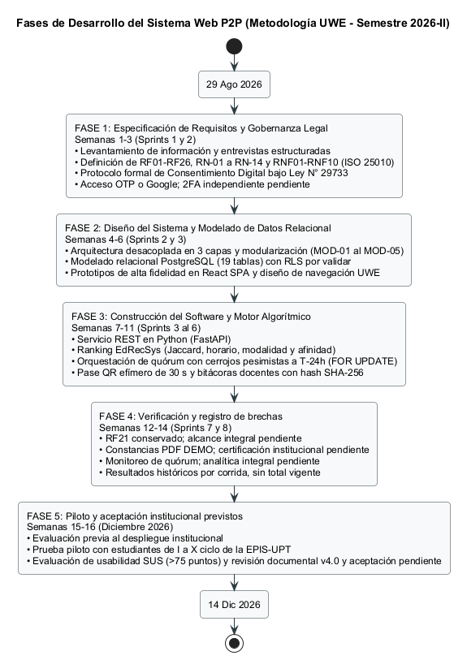

Fuente: Elaboración propia, DOC-H06. [Fuente PlantUML](docs/revision_srs/diagramas/doc-h06/srs/puml/diag_004_ciclo_vida.puml).

Las fases representan la organización metodológica del proyecto, sin acreditar completitud operativa o institucional de las capacidades indicadas.

## 6.1. Perfiles de Usuario y Modelo de Control de Acceso (RBAC)

Mentoreado, Mentor y Administrador son roles operativos identificados. La preferencia de postulación del perfil no concede permisos; la promoción a Mentor es una operación administrativa. Comité y Tutor son actores previstos, sin atribuirles roles o pantallas existentes. El requisito de mérito (ciclo VII-X y nota >=14) se mantiene con su brecha de verificación.

Las restricciones concretas por ruta se documentan en SAD 6.3. No se deduce autorización general de todos los endpoints por la existencia de un token de acceso ni se equipara control en la aplicación con políticas RLS.

## 6.2. Modelo Conceptual

Las entidades conceptuales se relacionan con las tablas vigentes del apartado 6.3.6. Un expediente de comité o una justificación son objetos previstos y no se incorporan al modelo físico sin implementación.

### Diagrama 6.2: Clases conceptuales del dominio

**Figura 5. Modelo conceptual del dominio**

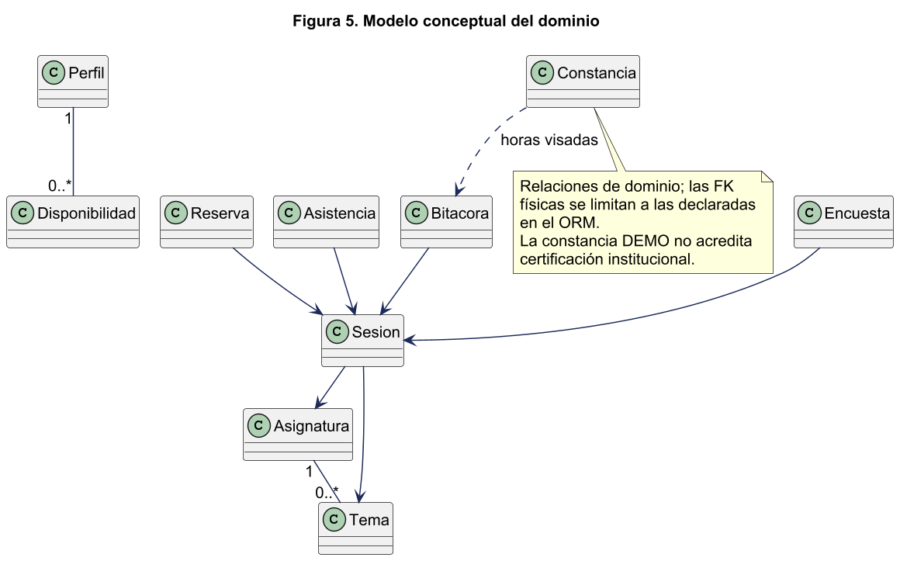

Fuente: Elaboración propia, DOC-H06. [Fuente PlantUML](docs/revision_srs/diagramas/doc-h06/srs/puml/diag_005_conceptual.puml).

## 6.2.1. Diagrama de Clases Conceptuales y Paquetes Arquitecturales

### Diagrama 6.3: Cinco agrupaciones funcionales

**Figura 6. Agrupación funcional de cinco módulos**

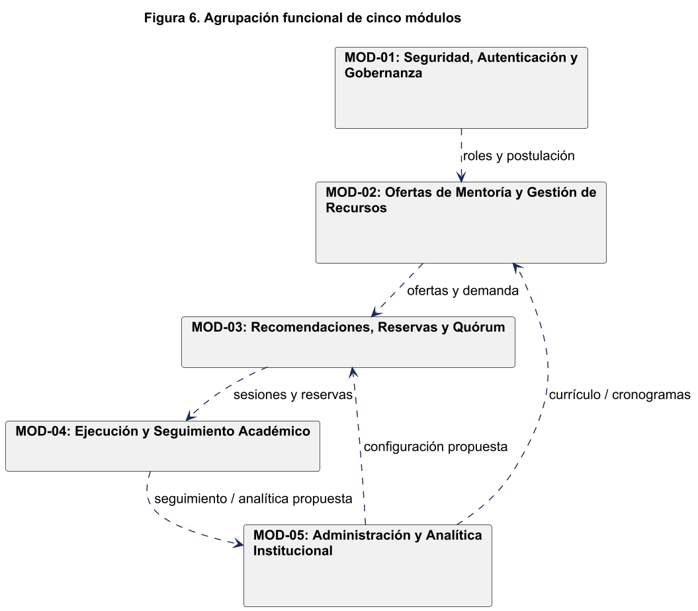

Fuente: Elaboración propia, DOC-H06. [Fuente PlantUML](docs/revision_srs/diagramas/doc-h06/srs/puml/diag_006_paquetes.puml).

## 6.2.2. Diagramas de Casos de Uso

### Diagrama 6.4: Catálogo vigente de 24 casos de uso

**Figura 7. Catálogo vigente: 24 casos y cinco módulos**

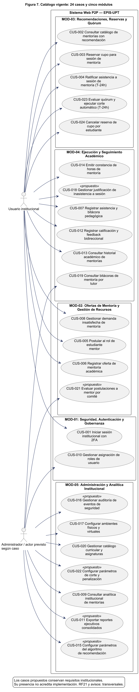

Fuente: Elaboración propia, DOC-H06. [Fuente PlantUML](docs/revision_srs/diagramas/doc-h06/srs/puml/diag_007_catalogo.puml).

### Diagrama 6.5: MOD-01 — Seguridad, Autenticación y Gobernanza

**Figura 8. MOD-01: Seguridad, Autenticación y Gobernanza**

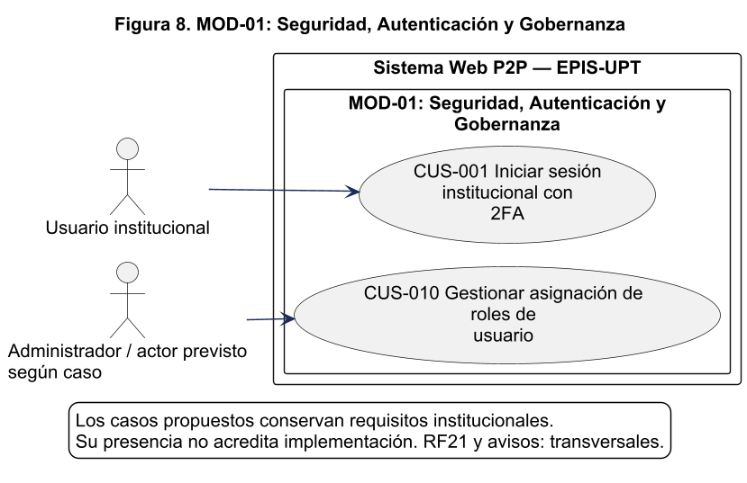

Fuente: Elaboración propia, DOC-H06. [Fuente PlantUML](docs/revision_srs/diagramas/doc-h06/srs/puml/diag_008_MOD-01.puml).

### Diagrama 6.6: MOD-02 — Ofertas de Mentoría y Gestión de Recursos

**Figura 9. MOD-02: Ofertas de Mentoría y Gestión de Recursos**

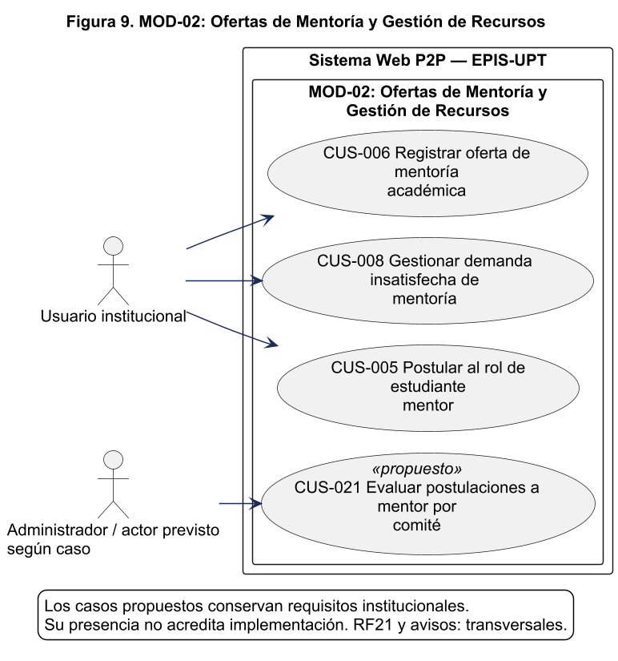

Fuente: Elaboración propia, DOC-H06. [Fuente PlantUML](docs/revision_srs/diagramas/doc-h06/srs/puml/diag_009_MOD-02.puml).

### Diagrama 6.7: MOD-03 — Recomendaciones, Reservas y Quórum

**Figura 10. MOD-03: Recomendaciones, Reservas y Quórum**

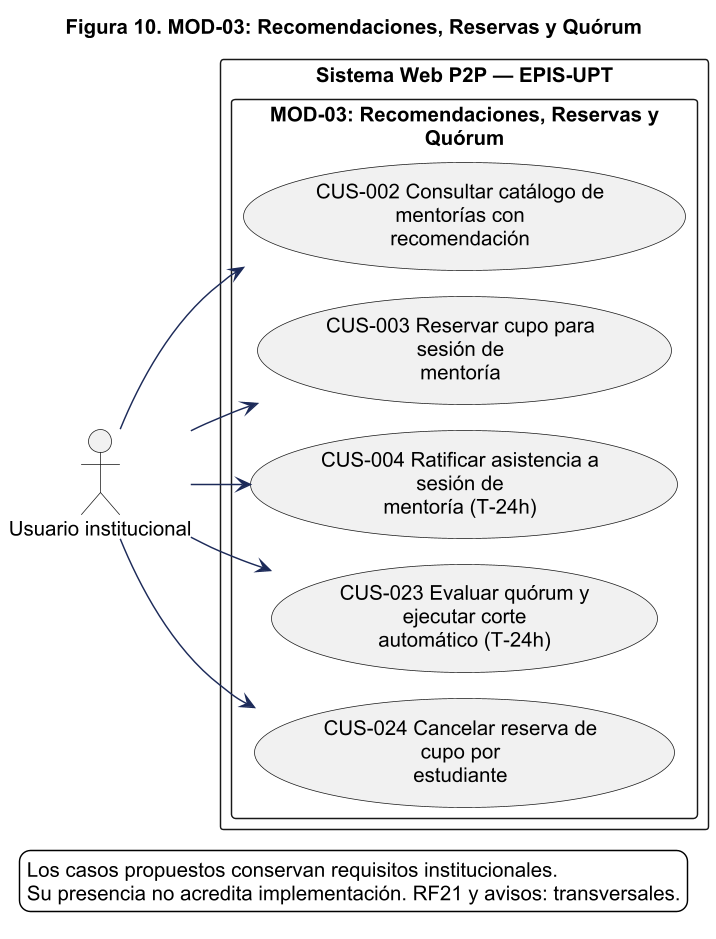

Fuente: Elaboración propia, DOC-H06. [Fuente PlantUML](docs/revision_srs/diagramas/doc-h06/srs/puml/diag_010_MOD-03.puml).

### Diagrama 6.8: MOD-04 — Ejecución y Seguimiento Académico

**Figura 11. MOD-04: Ejecución y Seguimiento Académico**

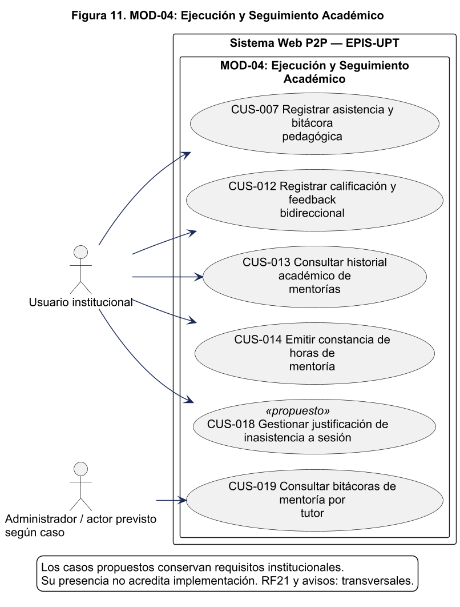

Fuente: Elaboración propia, DOC-H06. [Fuente PlantUML](docs/revision_srs/diagramas/doc-h06/srs/puml/diag_011_MOD-04.puml).

### Diagrama 6.9: MOD-05 — Administración y Analítica Institucional

**Figura 12. MOD-05: Administración y Analítica Institucional**

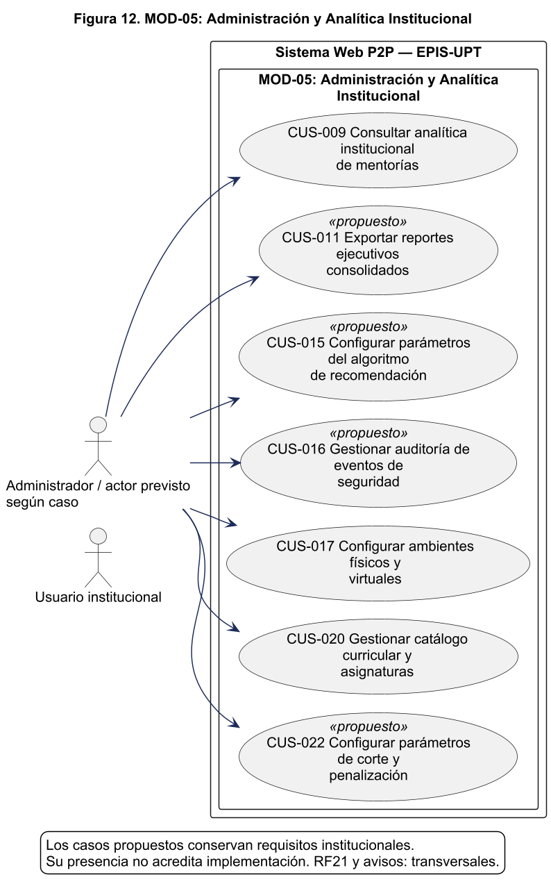

Fuente: Elaboración propia, DOC-H06. [Fuente PlantUML](docs/revision_srs/diagramas/doc-h06/srs/puml/diag_012_MOD-05.puml).

### Diagrama 6.10: Roles operativos y actores previstos

**Figura 13. Roles operativos y actores previstos**

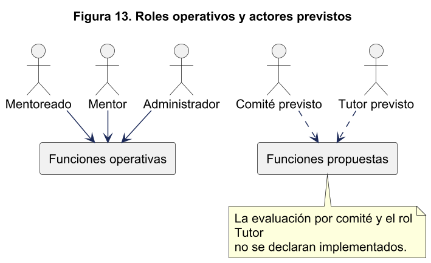

Fuente: Elaboración propia, DOC-H06. [Fuente PlantUML](docs/revision_srs/diagramas/doc-h06/srs/puml/diag_013_roles.puml).

### Diagrama 6.11: Notificaciones transversales

**Figura 14. Notificaciones transversales y límite externo**

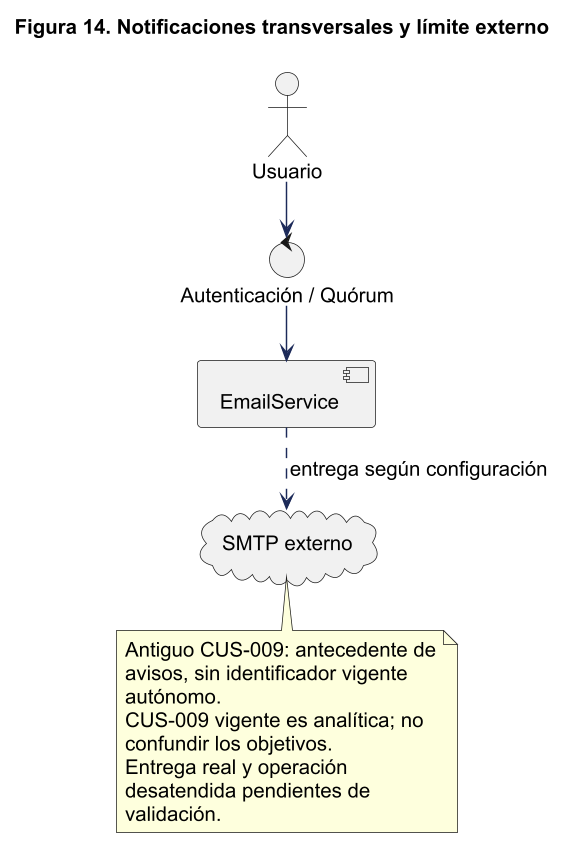

Fuente: Elaboración propia, DOC-H06. [Fuente PlantUML](docs/revision_srs/diagramas/doc-h06/srs/puml/diag_014_notificaciones.puml).

### Diagrama 6.12: RF21 y certificación

**Figura 15. Incentivos y constancias: alcance conservado**

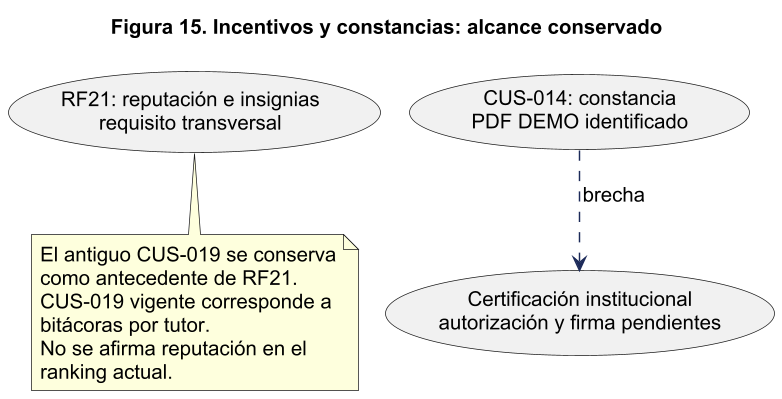

Fuente: Elaboración propia, DOC-H06. [Fuente PlantUML](docs/revision_srs/diagramas/doc-h06/srs/puml/diag_015_incentivos.puml).

## 6.2.3. Escenarios de Casos de Uso (Fase de Diseño)

Este apartado conserva íntegramente las 24 narrativas y 48 figuras del [catálogo vigente](NARRATIVAS_CASOS_DE_USO.md). DOC-H06 adopta sus cinco módulos e identificadores para requisitos y diseño. El Anexo B conserva la numeración anterior; las propuestas y validaciones pendientes mantienen su estado. La adopción documental no constituye aprobación institucional.

Las figuras de este apartado se numeran de **6.2.3-1 a 6.2.3-48**. El número final corresponde a la figura del catálogo. Cada imagen conserva su tamaño original y enlaza su fuente PlantUML. Si el visor ajusta la anchura, se pueden abrir los PNG originales de [CUS-006, actividades](docs/narrativas/diagramas/img/CUS-006_actividades.png) y [CUS-008, actividades](docs/narrativas/diagramas/img/CUS-008_actividades.png) para leer los carriles y los textos al 100 %.

### Índice y estado documental de las narrativas

Los estados siguientes proceden del catálogo y de la revisión documental registrada en el [control de avance](docs/narrativas/CONTROL_AVANCE.md). Las aprobaciones de narrativas consignadas en versiones previas tienen el alcance indicado allí. La aprobación institucional del SRS v4.0 sigue pendiente. Las propuestas y las validaciones de ejecución pendientes se detallan en el Anexo A.

| Módulo | Identificador | Caso de uso | Estado documental |
|---|---|---|---|
| MOD-01 | CUS-001 | Iniciar sesión institucional con 2FA | Aprobado; texto original |
| MOD-01 | CUS-010 | Gestionar asignación de roles de usuario | Aprobado en conversación; consolidado |
| MOD-02 | CUS-006 | Registrar oferta de mentoría académica | Aprobado en conversación; consolidado |
| MOD-02 | CUS-008 | Gestionar demanda insatisfecha de mentoría | Propuesta previamente presentada; pendiente de aprobación explícita |
| MOD-02 | CUS-005 | Postular al rol de estudiante mentor | Implementación parcial: postulación en perfil |
| MOD-02 | CUS-021 | Evaluar postulaciones a mentor por comité | Pendiente: sin flujo de comité identificado |
| MOD-03 | CUS-002 | Consultar catálogo de mentorías con recomendación | Implementación identificada; revisión estática |
| MOD-03 | CUS-003 | Reservar cupo para sesión de mentoría | Implementación identificada; revisión estática |
| MOD-03 | CUS-004 | Ratificar asistencia a sesión de mentoría (T-24h) | Implementación identificada; revisión estática |
| MOD-03 | CUS-023 | Evaluar quórum y ejecutar corte automático (T-24h) | Evaluación identificada; ejecución periódica en entorno real no certificada |
| MOD-03 | CUS-024 | Cancelar reserva de cupo por estudiante | Implementación identificada; revisión estática |
| MOD-04 | CUS-007 | Registrar asistencia y bitácora pedagógica | Implementación identificada; revisión estática |
| MOD-04 | CUS-012 | Registrar calificación y feedback bidireccional | Implementación parcial: encuesta del asistente y bitácora del mentor |
| MOD-04 | CUS-013 | Consultar historial académico de mentorías | Implementación parcial: historial de reservas y sesiones |
| MOD-04 | CUS-014 | Emitir constancia de horas de mentoría | Implementación identificada; constancia DEMO y validación real pendiente |
| MOD-04 | CUS-018 | Gestionar justificación de inasistencia a sesión | Pendiente: no se identificó trámite específico |
| MOD-04 | CUS-019 | Consultar bitácoras de mentoría por tutor | Implementación parcial: auditoría por Administrador; tutor no identificado |
| MOD-05 | CUS-009 | Consultar analítica institucional de mentorías | Implementación parcial: monitoreo de quórum; analítica integral pendiente |
| MOD-05 | CUS-011 | Exportar reportes ejecutivos consolidados | Pendiente: no se identificó exportación ejecutiva |
| MOD-05 | CUS-015 | Configurar parámetros del algoritmo de recomendación | Pendiente: interfaz de parametrización no identificada |
| MOD-05 | CUS-016 | Gestionar auditoría de eventos de seguridad | Pendiente: bandeja integral de seguridad no identificada |
| MOD-05 | CUS-017 | Configurar ambientes físicos y virtuales | Implementación parcial: importación y consulta de cronogramas; configuración virtual pendiente |
| MOD-05 | CUS-020 | Gestionar catálogo curricular y asignaturas | Implementación identificada; revisión estática |
| MOD-05 | CUS-022 | Configurar parámetros de corte y penalización | Pendiente: edición administrativa no identificada |

### MOD-01: Seguridad, Autenticación y Gobernanza

#### CUS-001 — Iniciar sesión institucional con 2FA

##### 7.1. Ficha descriptiva

| Atributo | Detalle |
|---|---|
| **Id Caso de Uso** | **UC-001** (CUS-001) |
| **Nombre** | Iniciar sesión institucional con 2FA |
| **Tipo** | Obligatorio |
| **Requisito ID (RF)** | RF-001, RF-002; RN-01, RN-02 |
| **Versión** | 2.3 (H01-CUS001) |
| **Autor** | Antayhua Mamani, Renzo Antonio / Medina Quispe, Joan Cristian |
| **Actores** | Estudiante mentoreado, estudiante mentor, administrador institucional; servicio de correo institucional y, cuando está disponible, servicio de identidad de Google |
| **Interacción** | Acceso web mediante un código temporal enviado al correo institucional o mediante el botón oficial de Google habilitado por la configuración del entorno. |
| **Descripción** | Permite verificar una cuenta `@virtual.upt.pe` o `@upt.pe`, consultar el consentimiento informado bajo la Ley N.° 29733 y abrir el panel inicial correspondiente al rol. El acceso por correo utiliza un código de seis dígitos con vigencia de cinco minutos; la credencial de sesión emitida tiene una vigencia máxima de ocho horas. |
| **Referencias** | SWEBOK v3.0, ISO/IEC/IEEE 29148:2018, Ley N.° 29733 |
| **Precondiciones** | El usuario dispone de una cuenta institucional y acceso al buzón correspondiente. Para usar Google, el entorno debe tener habilitado el servicio de identidad y una cuenta institucional válida. |
| **Postcondiciones** | La identidad queda verificada y, si existe consentimiento vigente, el sistema abre el panel del rol asignado. Si el consentimiento se rechaza o el usuario cierra la sesión, el sistema retorna al acceso sin mantener una sesión activa. |

##### 7.2. Flujo normal de eventos

| **Acción del Actor** | **Respuesta del Sistema** |
|---|---|
| **Fase 1: Solicitud del código de verificación** | |
| **1.** El usuario accede al Sistema Web P2P y selecciona «Iniciar sesión». | |
| | **2.** El sistema muestra la tarjeta «Iniciar Sesión Institucional». Cuando el acceso con Google está configurado y disponible, presenta primero el botón oficial de Google y el separador «O con código OTP por correo». También muestra la etiqueta «Correo Electrónico Institucional UPT», el campo con la sugerencia «ej: ra2022073504@virtual.upt.pe», la indicación de los dominios admitidos y el botón «Continuar con Código OTP →», inicialmente inactivo mientras el campo está vacío. Si el usuario elige Google, continúa en A001. |
| **3.** El usuario ingresa una dirección institucional y presiona «Continuar con Código OTP →». | |
| | **4.** El sistema valida el formato y el dominio. Si la dirección no es institucional, continúa en E001. Si no puede emitir o enviar el código, continúa en E002; si aplica una restricción temporal de solicitudes, continúa en E006. Cuando la solicitud es aceptada, envía un código numérico de seis dígitos con vigencia de cinco minutos y muestra la pantalla de verificación. Esta pantalla identifica el «Destino de verificación», ofrece «Cambiar correo», presenta el campo «Código de 6 dígitos», el contador «⏳ Expira en: 05:00», el botón «Verificar y Acceder», el contador «Reenviar código en 60s» y la opción «Cancelar». |
| **Fase 2: Verificación del código temporal** | |
| **5.** El usuario escribe los seis dígitos recibidos y presiona «Verificar y Acceder». | |
| | **6.** El sistema comprueba el código y su vigencia. Si no coincide, continúa en E003; si expiró, continúa en E004; si el desafío alcanzó cinco intentos fallidos, continúa en E005. Si el código es correcto, verifica si existe un consentimiento informado vigente. Cuando ya existe, continúa en A003. |
| **Fase 3: Consentimiento informado** | |
| | **7.** Si no existe consentimiento vigente, el sistema muestra la ventana «Consentimiento Informado Digital», la referencia «Protección de Datos Personales · Ley N° 29733», el estado «⚠️ PENDIENTE DE FIRMA», la política de tratamiento de datos, una casilla de aceptación expresa y los botones «🚫 Rechazar y Salir» y «✓ Aceptar y Continuar». El botón de aceptación permanece inactivo hasta marcar la casilla. |
| **8.** El usuario marca la casilla y presiona «✓ Aceptar y Continuar». Si decide no aceptar, continúa en E007. | |
| | **9.** El sistema registra la aceptación con su versión y fecha. Si no puede completar la operación, continúa en E008. |
| **Fase 4: Acceso al panel del rol** | |
| | **10.** El sistema abre el panel inicial del rol: «Explorar mentorías» para mentoreado, «Mis sesiones» para mentor o «Administración» para administrador. En el encabezado muestra «Sesión: [correo]», el rol activo, «⚖️ Consentimiento OK» y «Cerrar Sesión». La credencial emitida tiene una vigencia máxima de ocho horas. |

##### 7.3. Flujos alternativos

###### A001: Acceso mediante Google institucional
* **Paso origen:** Paso 2 del Flujo Normal.
* **Condición de activación:** El botón oficial de Google está disponible y el usuario lo selecciona.

| **Acción del Actor** | **Respuesta del Sistema** |
|---|---|
| **A001-1.** El usuario selecciona el botón oficial de Google y elige una cuenta. | |
| | **A001-2.** Google solicita o confirma la identidad. El Sistema Web P2P acepta únicamente cuentas verificadas de los dominios institucionales y, si la validación concluye correctamente, continúa en el Paso 7 o en A003 según el estado del consentimiento. Si la cuenta no es institucional, continúa en E001. **La operación completa con una cuenta real institucional permanece pendiente de validación manual en el entorno autorizado.** |

###### A002: Reenvío del código de verificación
* **Paso origen:** Paso 4 del Flujo Normal.
* **Condición de activación:** El usuario no recibió el código y terminó el periodo de espera, o el código ya expiró.

| **Acción del Actor** | **Respuesta del Sistema** |
|---|---|
| | **A002-1.** El sistema habilita «🔄 Reenviar nuevo código» cuando termina la espera de 60 segundos o cuando el código expira. |
| **A002-2.** El usuario presiona «🔄 Reenviar nuevo código». | |
| | **A002-3.** El sistema invalida el código anterior, genera y envía uno nuevo, reinicia la vigencia a cinco minutos y restablece la espera de reenvío. Si la solicitud excede los límites permitidos, continúa en E006. |

###### A003: Acceso con consentimiento vigente
* **Paso origen:** Paso 6 del Flujo Normal o A001.
* **Condición de activación:** La identidad fue verificada y existe un consentimiento vigente.

| **Acción del Actor** | **Respuesta del Sistema** |
|---|---|
| | **A003-1.** El sistema omite la ventana de consentimiento y continúa en el Paso 10 del Flujo Normal. |

###### A004: Cambiar correo o cancelar el desafío visible
* **Paso origen:** Paso 4 del Flujo Normal.
* **Condición de activación:** El usuario desea corregir la dirección o abandonar la verificación actual.

| **Acción del Actor** | **Respuesta del Sistema** |
|---|---|
| **A004-1.** El usuario presiona «Cambiar correo» o «Cancelar». | |
| | **A004-2.** El sistema descarta el formulario de verificación visible, limpia el código escrito y vuelve a la pantalla de ingreso de correo. |

###### A005: Cierre voluntario de sesión
* **Paso origen:** Paso 10 del Flujo Normal.
* **Condición de activación:** El usuario decide finalizar su acceso.

| **Acción del Actor** | **Respuesta del Sistema** |
|---|---|
| **A005-1.** El usuario presiona «Cerrar Sesión». | |
| | **A005-2.** El sistema elimina la sesión activa del navegador, restablece el rol visible y retorna a «Iniciar Sesión Institucional». |

##### 7.4. Flujos de excepción

###### E001: Correo no institucional o no válido
* **Paso origen:** Paso 4 del Flujo Normal o A001.
* **Condición de activación:** La dirección tiene un formato no válido o no pertenece a `@virtual.upt.pe` ni `@upt.pe`.

| **Acción del Actor** | **Respuesta del Sistema** |
|---|---|
| | **E001-1.** El sistema no solicita el envío del código y muestra el motivo. Para un dominio ajeno presenta: «Acceso restringido: Solo se permiten correos institucionales con dominio @virtual.upt.pe o @upt.pe.». |
| **E001-2.** El usuario corrige la dirección y vuelve a presionar «Continuar con Código OTP →». | |
| | **E001-3.** El sistema retoma el Paso 4 del Flujo Normal. |

###### E002: No se puede emitir o enviar el código
* **Paso origen:** Paso 4 del Flujo Normal o A002.
* **Condición de activación:** El servicio no puede registrar el desafío o entregar el correo institucional.

| **Acción del Actor** | **Respuesta del Sistema** |
|---|---|
| | **E002-1.** El sistema informa que no fue posible generar o enviar el código. No presenta la solicitud como completada y permite reintentar cuando el servicio esté disponible. |

###### E003: Código incorrecto
* **Paso origen:** Paso 6 del Flujo Normal.
* **Condición de activación:** El código ingresado no coincide con el código activo.

| **Acción del Actor** | **Respuesta del Sistema** |
|---|---|
| | **E003-1.** El sistema muestra que el código es incorrecto e indica cuántos intentos quedan antes de bloquear ese desafío. |
| **E003-2.** El usuario corrige el código y vuelve a presionar «Verificar y Acceder». | |
| | **E003-3.** El sistema retoma el Paso 6 del Flujo Normal. |

###### E004: Código vencido
* **Paso origen:** Paso 6 del Flujo Normal.
* **Condición de activación:** Transcurrieron cinco minutos desde la emisión del código.

| **Acción del Actor** | **Respuesta del Sistema** |
|---|---|
| | **E004-1.** El contador llega a «⏳ Expira en: 00:00», el campo y «Verificar y Acceder» quedan inactivos, y el sistema informa: «El código OTP ha expirado (5 minutos). Por favor solicita un nuevo código.». Se habilita el reenvío. |
| **E004-2.** El usuario solicita un nuevo código. | |
| | **E004-3.** El sistema continúa en A002. |

###### E005: Máximo de intentos de verificación alcanzado
* **Paso origen:** Paso 6 del Flujo Normal.
* **Condición de activación:** El usuario registra cinco códigos incorrectos para el mismo desafío.

| **Acción del Actor** | **Respuesta del Sistema** |
|---|---|
| | **E005-1.** El sistema bloquea de forma definitiva ese desafío e informa que se alcanzó el máximo de cinco intentos. Para continuar, el usuario debe volver al ingreso de correo y solicitar un código nuevo. |

###### E006: Espera obligatoria o límite de solicitudes
* **Paso origen:** Paso 4 del Flujo Normal o A002.
* **Condición de activación:** Se intenta solicitar o reenviar un código durante la espera, o se supera el límite de solicitudes permitido en la ventana de seguridad.

| **Acción del Actor** | **Respuesta del Sistema** |
|---|---|
| | **E006-1.** El sistema rechaza temporalmente la solicitud e indica el tiempo de espera o que se realizaron demasiadas solicitudes. |
| **E006-2.** El usuario espera el periodo indicado y vuelve a solicitar el código. | |
| | **E006-3.** El sistema retoma el Paso 4 o A002, según corresponda. |

###### E007: Rechazo del consentimiento informado
* **Paso origen:** Paso 8 del Flujo Normal.
* **Condición de activación:** El usuario presiona «🚫 Rechazar y Salir».

| **Acción del Actor** | **Respuesta del Sistema** |
|---|---|
| **E007-1.** El usuario rechaza el tratamiento de datos. | |
| | **E007-2.** El sistema registra el rechazo cuando corresponde, cierra la sesión y retorna al acceso. No habilita las funciones protegidas. |

###### E008: Fallo de comunicación o servicio no disponible
* **Paso origen:** Cualquier operación remota del flujo.
* **Condición de activación:** La red, la base de datos o un servicio requerido no responde.

| **Acción del Actor** | **Respuesta del Sistema** |
|---|---|
| | **E008-1.** El sistema muestra el error disponible sin presentar la operación como completada. |
| **E008-2.** El usuario comprueba su conexión y reintenta la acción. | |
| | **E008-3.** Si el servicio se restablece, el sistema retoma el paso correspondiente. |

##### 7.5. Diagrama de flujo de actividades

**Figura 6.2.3-1. Diagrama de actividades — CUS-001: Iniciar sesión institucional con 2FA.**

Fuente PlantUML: [CUS-001_actividades.puml](docs/narrativas/diagramas/plantuml/CUS-001_actividades.puml).

Fuente: Elaboración propia.

##### 7.6. Diagrama de caso de uso

**Figura 6.2.3-2. Diagrama de caso de uso — CUS-001: Iniciar sesión institucional con 2FA.**

Fuente PlantUML: [CUS-001_caso_de_uso.puml](docs/narrativas/diagramas/plantuml/CUS-001_caso_de_uso.puml).

Fuente: Elaboración propia.

#### CUS-010 — Gestionar asignación de roles de usuario

##### 7.1. Ficha descriptiva

| Atributo | Detalle |
|---|---|
| **Id Caso de Uso** | **UC-010** (CUS-010) |
| **Nombre** | Gestionar asignación de roles de usuario |
| **Tipo** | Obligatorio |
| **Requisito ID (RF)** | RF-003; RN-03 |
| **Versión** | 2.3 (DOC-H02 — consolidación) |
| **Autor** | Antayhua Mamani, Renzo Antonio / Medina Quispe, Joan Cristian |
| **Actores** | Administrador institucional |
| **Interacción** | Interacción web institucional; comportamiento descrito conforme a la evidencia identificada. |
| **Descripción** | Permite consultar los roles asociados a un correo institucional, promover al estudiante a Mentor o revocar esa condición. |
| **Referencias** | SWEBOK v3.0, ISO/IEC/IEEE 29148:2018, SRS y reglas de negocio EPIS-UPT. |
| **Precondiciones** | Sesión administrativa vigente; correo del estudiante conocido. Para promover, información de ciclo disponible. |
| **Postcondiciones** | Se muestran los roles consultados; si la operación es exitosa, se incorpora o retira Mentor y se conserva Mentoreado. |

**Estado de evidencia:** Aprobado en conversación; consolidado.

##### 7.2. Flujo normal de eventos

| **Acción del Actor** | **Respuesta del Sistema** |
|---|---|
| **Fase 1: Acceso y consulta** |  |
| **1.** Selecciona «Administración». |  |
|  | **2.** Muestra «Panel de Administración y Supervisión EPIS», correo del administrador y pestañas «Gestión de Roles», «Monitoreo de Quórum», «Auditoría de Bitácoras», «Catálogo Curricular (RF05)», «Cronograma de Aulas (RF10)» y «Salud del Sistema». Si no hay autorización, E001. |
| **3.** Selecciona «Gestión de Roles». |  |
|  | **4.** Resalta la pestaña en dorado y muestra «Asignación y Validación de Mérito de Mentores», requisito de ciclo VII o superior, campo de correo y botón «🔍 Buscar Estudiante». |
| **5.** Ingresa el correo y presiona «🔍 Buscar Estudiante» o Enter. |  |
|  | **6.** Comprueba el correo; muestra «Consultando...» durante la operación. Si no lo admite, E002; si falla, E004. |
| **7.** Revisa el expediente. |  |
|  | **8.** Presenta «Expediente Institucional», correo y distintivos de roles (MENTOREADO, MENTOR, ADMINISTRADOR, según corresponda). Si figura Mentor ofrece «🚫 Revocar Rol de Mentor» (A001); si no, «⭐ Promover a Mentor (Verificar Mérito Académico)». Puede consultar sin modificar (A002). |
| **Fase 2: Promoción y confirmación** |  |
| **9.** Presiona «⭐ Promover a Mentor (Verificar Mérito Académico)». |  |
|  | **10.** Comprueba autorización y ciclo; inhabilita temporalmente las acciones. Si el ciclo es inferior a VII, E003. |
| **11.** Espera la respuesta. |  |
|  | **12.** Si concluye correctamente, muestra «Rol de Mentor asignado exitosamente tras verificar mérito académico (RN-03).», incorpora el distintivo MENTOR y ofrece revocarlo. Si falla, E004. |
| **13.** Verifica los roles y decide finalizar o consultar otro correo. |  |
|  | **14.** Mantiene el expediente y permite una nueva búsqueda (A003). |

##### 7.3. Flujos alternativos

###### A001: Revocación del rol Mentor

* **Paso origen:** 8.
* **Condición de activación:** Expediente con Mentor.

| **Acción del Actor** | **Respuesta del Sistema** |
|---|---|
| **A001-1.** Presiona «🚫 Revocar Rol de Mentor». |  |
|  | **A001-2.** Comprueba autorización, procesa el retiro y muestra «Rol de Mentor revocado exitosamente.»; actualiza los distintivos y ofrece nuevamente la promoción. Si falla, E004. |
| **A001-3.** Verifica el expediente actualizado. |  |

###### A002: Consulta sin modificación

* **Paso origen:** 8.
* **Condición de activación:** Expediente disponible.

| **Acción del Actor** | **Respuesta del Sistema** |
|---|---|
| **A002-1.** Revisa los distintivos sin presionar las acciones de cambio. |  |
|  | **A002-2.** Mantiene los roles sin cambios. |
| **A002-3.** Finaliza o busca otro correo. |  |

###### A003: Consulta de otro estudiante

* **Paso origen:** 14.
* **Condición de activación:** Consulta terminada.

| **Acción del Actor** | **Respuesta del Sistema** |
|---|---|
| **A003-1.** Sustituye el correo y busca nuevamente. |  |
|  | **A003-2.** Retira el aviso anterior al iniciar una consulta válida y sustituye el expediente al recibir la respuesta. |
| **A003-3.** Retorna a la revisión del expediente. |  |

##### 7.4. Flujos de excepción

###### E001: Acceso no autorizado

* **Paso origen:** 2.
* **Condición de activación:** Sesión ausente o sin privilegios.

| **Acción del Actor** | **Respuesta del Sistema** |
|---|---|
|  | **E001-1.** Restringe la interfaz y rechaza cambios no autorizados. |
| **E001-2.** Inicia sesión con una cuenta autorizada. |  |

###### E002: Correo no admitido

* **Paso origen:** 6.
* **Condición de activación:** Campo vacío o comprobación inicial fallida.

| **Acción del Actor** | **Respuesta del Sistema** |
|---|---|
|  | **E002-1.** Muestra «Ingrese un correo institucional válido con dominio @upt.pe.» sin realizar nueva consulta. |
| **E002-2.** Corrige el correo y repite la búsqueda. |  |

###### E003: Ciclo inferior a VII

* **Paso origen:** 10.
* **Condición de activación:** Promoción no elegible.

| **Acción del Actor** | **Respuesta del Sistema** |
|---|---|
|  | **E003-1.** Rechaza la promoción y conserva los roles consultados. |
| **E003-2.** Revisa el resultado o consulta otro estudiante. |  |

###### E004: Fallo de consulta o modificación

* **Paso origen:** 6, 12.
* **Condición de activación:** Problema de comunicación o registro.

| **Acción del Actor** | **Respuesta del Sistema** |
|---|---|
|  | **E004-1.** Muestra alerta roja; si falla la búsqueda, retira los roles anteriores; si falla el cambio, conserva la información presentada. |
| **E004-2.** Consulta de nuevo antes de repetir la operación. |  |

##### 7.5. Diagrama de flujo de actividades

**Figura 6.2.3-3. Diagrama de actividades — CUS-010: Gestionar asignación de roles de usuario.**

Fuente PlantUML: [CUS-010_actividades.puml](docs/narrativas/diagramas/plantuml/CUS-010_actividades.puml).

Fuente: Elaboración propia.

##### 7.6. Diagrama de caso de uso

**Figura 6.2.3-4. Diagrama de caso de uso — CUS-010: Gestionar asignación de roles de usuario.**

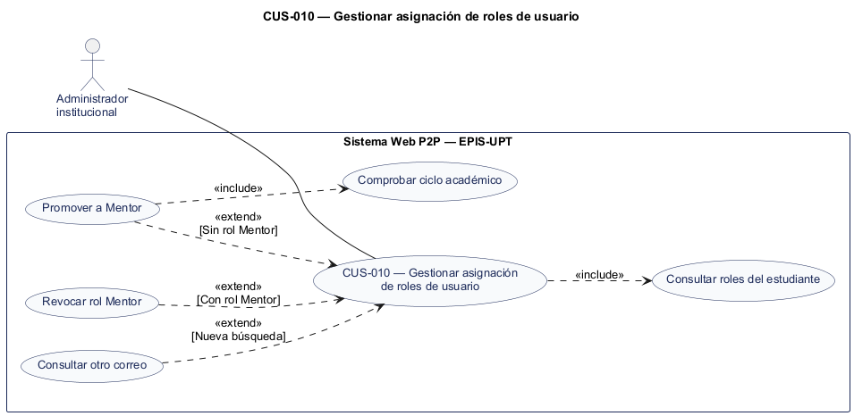

Fuente PlantUML: [CUS-010_caso_de_uso.puml](docs/narrativas/diagramas/plantuml/CUS-010_caso_de_uso.puml).

Fuente: Elaboración propia.

---

### MOD-02: Ofertas de Mentoría y Gestión de Recursos

#### CUS-006 — Registrar oferta de mentoría académica

##### 7.1. Ficha descriptiva

| Atributo | Detalle |
|---|---|
| **Id Caso de Uso** | **UC-006** (CUS-006) |
| **Nombre** | Registrar oferta de mentoría académica |
| **Tipo** | Obligatorio |
| **Requisito ID (RF)** | RF-008, RF-009; RN-01, RN-03 a RN-07; relacionado con RF-007 |
| **Versión** | 2.3 (DOC-H02 — consolidación) |
| **Autor** | Antayhua Mamani, Renzo Antonio / Medina Quispe, Joan Cristian |
| **Actores** | Estudiante Mentor |
| **Interacción** | Interacción web institucional; comportamiento descrito conforme a la evidencia identificada. |
| **Descripción** | Permite programar y publicar una sesión con asignatura, tema, modalidad, fecha, duración e infraestructura; opcionalmente vinculada a una solicitud por demanda. |
| **Referencias** | SWEBOK v3.0, ISO/IEC/IEEE 29148:2018, SRS y reglas de negocio EPIS-UPT. |
| **Precondiciones** | Sesión de Mentor vigente, consentimiento aceptado, catálogo disponible y, si es presencial, cronograma con un ambiente libre durante toda la sesión. |
| **Postcondiciones** | Oferta con código único y estado PUBLICADA; si es dirigida y se registra correctamente, la solicitud vinculada pasa a ATENDIDA. |

**Estado de evidencia:** Aprobado en conversación; consolidado.

##### 7.2. Flujo normal de eventos

| **Acción del Actor** | **Respuesta del Sistema** |
|---|---|
| **Fase 1: Acceso al formulario** |  |
| **1.** Selecciona «Publicar mentoría» o «Publicar Nueva Oferta» en «Mis sesiones». |  |
|  | **2.** Muestra «Publicar Nueva Oferta de Mentoría», distintivo «Rol: Mentor Académico», nombre y correo, antelación mínima superior a 24 h y recomendada de 48 h o más. Si no está autorizado, E001. |
| **3.** Revisa el formulario. |  |
|  | **4.** Presenta ocho campos numerados. Inicialmente establece modalidad presencial, 60 minutos, aforo 10 y fecha sugerida con antelación recomendada. Si procede del banco de demanda, A002. |
| **Fase 2: Selección curricular** |  |
| **5.** Despliega «1. Asignatura Formativa Crítica (Catálogo EPIS) *». |  |
|  | **6.** Muestra código, nombre y ciclo de las asignaturas disponibles; si no hay catálogo, E002. |
| **7.** Selecciona asignatura y «2. Unidad Temática / Tema Conceptual del Sílabo *». |  |
|  | **8.** Actualiza las unidades y temas al cambiar de curso; conserva un tema seleccionado. Si no hay temas, E002. |
| **Fase 3: Modalidad, fecha y duración** |  |
| **9.** Selecciona «Presencial» en «3. Modalidad Pedagógica *». |  |
|  | **10.** Resalta la modalidad; «4. Aforo Reglamentario Inmutable» muestra 10 estudiantes, no editable. Si elige virtual, A001. |
| **11.** Define «5. Fecha y Hora de Inicio *». |  |
|  | **12.** Calcula antelación: aviso azul «Antelación válida» cuando supera 24 h y es menor de 48 h; verde «Antelación óptima» desde 48 h. Si fecha pasada o antelación menor o igual a 24 h, E003. |
| **13.** Selecciona «6. Duración de la Sesión *»: 60 o 90 minutos. |  |
|  | **14.** Muestra «Término estimado» y vuelve a consultar aulas libres para la duración completa. |
| **Fase 4: Infraestructura** |  |
| **15.** Revisa «7. Asignación de Infraestructura (Aula / Laboratorio) *». |  |
|  | **16.** Lista los ambientes libres durante toda la sesión, excluyendo coincidencias con mentorías activas; sugiere el primero disponible. Si no hay aula, E004. |
| **17.** Selecciona un ambiente. |  |
|  | **18.** Conserva el aula elegida. Si cambia fecha, duración o modalidad, actualiza la disponibilidad (A004). |
| **Fase 5: Revisión y publicación** |  |
| **19.** Completa «8. Observaciones Pedagógicas y Requisitos Previos (Opcional)». |  |
|  | **20.** Conserva las indicaciones de materiales, ejercicios o preparación previa; comprueba los campos obligatorios y mantiene el botón inactivo si faltan datos (E005). |
| **21.** Revisa los datos y presiona «🚀 Publicar Oferta de Mentoría». |  |
|  | **22.** Muestra «Publicando Oferta...»; comprueba identidad, elegibilidad, antelación, aforo y disponibilidad del espacio. Si hay conflicto de aula, E006; si no se admite la solicitud dirigida, E007. |
| **23.** Espera el resultado. |  |
|  | **24.** Registra la oferta con código único y estado PUBLICADA; si existe demanda vinculada, la registra como ATENDIDA. Si ocurre un fallo, E008. |
| **Fase 6: Confirmación** |  |
| **25.** Consulta el resultado. |  |
|  | **26.** El formulario dispone de tarjeta verde «¡Oferta de mentoría publicada exitosamente!» con código, estado, asignatura, tema, modalidad, aforo, inicio, duración e infraestructura. En la aplicación integrada se redirige a «Mis sesiones», por lo que la tarjeta puede dejar de verse. |
| **27.** Verifica la nueva oferta en «Mis sesiones». |  |
|  | **28.** La sesión queda disponible para consulta, recomendación y reserva conforme a sus reglas; permite iniciar otra oferta (A005). |

##### 7.3. Flujos alternativos

###### A001: Modalidad virtual

* **Paso origen:** 10.
* **Condición de activación:** Selección de modalidad.

| **Acción del Actor** | **Respuesta del Sistema** |
|---|---|
| **A001-1.** Presiona «Virtual»; define fecha y duración y conserva o reemplaza el enlace, o pulsa «Generar automáticamente por el sistema». |  |
|  | **A001-2.** Fija 20 estudiantes; reemplaza el selector de aula por el enlace virtual. Acepta una dirección propia o genera una de respaldo si falta o no reconoce la entrada como dirección web; no acredita creación real de reunión. |
| **A001-3.** Continúa con observaciones y publicación. |  |

###### A002: Mentoría dirigida por demanda

* **Paso origen:** 4.
* **Condición de activación:** Acceso desde banco RF07.

| **Acción del Actor** | **Respuesta del Sistema** |
|---|---|
| **A002-1.** Selecciona «Proponer Mentoría Dirigida» y revisa la solicitud. |  |
|  | **A002-2.** Muestra panel ámbar con correo, asignatura, tema y observaciones; precompleta y bloquea curso y tema, añade referencia en observaciones. Si no coincide el contenido, E005. |
| **A002-3.** Configura fecha, modalidad e infraestructura y publica. |  |

###### A003: Desvincular solicitud

* **Paso origen:** Flujo normal, en la operación indicada por la condición.
* **Condición de activación:** Formulario dirigido.

| **Acción del Actor** | **Respuesta del Sistema** |
|---|---|
| **A003-1.** Presiona «✕ Desvincular Solicitud». |  |
|  | **A003-2.** Retira el vínculo y habilita curso y tema; la solicitud no se marca atendida. |
| **A003-3.** Revisa datos y continúa como oferta general. |  |

###### A004: Modificar programación

* **Paso origen:** 18.
* **Condición de activación:** Antes de publicar.

| **Acción del Actor** | **Respuesta del Sistema** |
|---|---|
| **A004-1.** Cambia modalidad, fecha o duración. |  |
|  | **A004-2.** Recalcula antelación, hora estimada, aforo y espacios; si virtual muestra campo de enlace. |
| **A004-3.** Revisa infraestructura y vuelve a la revisión. |  |

###### A005: Publicar otra oferta

* **Paso origen:** 28.
* **Condición de activación:** Publicación terminada.

| **Acción del Actor** | **Respuesta del Sistema** |
|---|---|
| **A005-1.** Accede a «Publicar mentoría» o «Publicar Nueva Oferta»; si permanece en confirmación, pulsa «+ Publicar Otra Oferta». |  |
|  | **A005-2.** Dispone el formulario; el botón de la tarjeta limpia avisos y observaciones y restablece fecha sugerida. |
| **A005-3.** Configura la nueva sesión. |  |

##### 7.4. Flujos de excepción

###### E001: Sin autorización o elegibilidad

* **Paso origen:** 2.
* **Condición de activación:** Acceso o envío.

| **Acción del Actor** | **Respuesta del Sistema** |
|---|---|
|  | **E001-1.** Restringe acceso o rechaza el registro; no confirma la oferta. |
| **E001-2.** Retorna a funciones permitidas o regulariza su perfil. |  |

###### E002: Catálogo no disponible

* **Paso origen:** 6, 8.
* **Condición de activación:** Carga de asignaturas o temas.

| **Acción del Actor** | **Respuesta del Sistema** |
|---|---|
|  | **E002-1.** Muestra alerta y «Reintentar» si falla el catálogo general; si faltan temas, selector vacío y publicación bloqueada. |
| **E002-2.** Reintenta o selecciona otra asignatura. |  |

###### E003: Fecha inválida o antelación insuficiente

* **Paso origen:** 12.
* **Condición de activación:** Fecha pasada o 24 h o menos.

| **Acción del Actor** | **Respuesta del Sistema** |
|---|---|
|  | **E003-1.** Muestra «Ingrese una fecha válida en el futuro» o «Antelación insuficiente»; bloquea publicación. |
| **E003-2.** Corrige la fecha y revisa el indicador. |  |

###### E004: Sin ambientes físicos

* **Paso origen:** 16.
* **Condición de activación:** Franja no cubierta o consulta fallida.

| **Acción del Actor** | **Respuesta del Sistema** |
|---|---|
|  | **E004-1.** Muestra «Sin aulas disponibles para esta franja» o «No se pudo consultar la disponibilidad de aulas». |
| **E004-2.** Cambia fecha, duración o modalidad. |  |

###### E005: Campos incompletos o demanda inconsistente

* **Paso origen:** 20.
* **Condición de activación:** Formulario inválido.

| **Acción del Actor** | **Respuesta del Sistema** |
|---|---|
|  | **E005-1.** Muestra «Corrija los campos señalados antes de publicar» o aviso del tema solicitado no disponible. |
| **E005-2.** Completa los datos o desvincula la solicitud. |  |

###### E006: Aula dejó de estar disponible

* **Paso origen:** 22.
* **Condición de activación:** Revalidación al publicar.

| **Acción del Actor** | **Respuesta del Sistema** |
|---|---|
|  | **E006-1.** Rechaza con «El aula no está disponible durante toda la sesión en el cronograma vigente.» y consulta nuevamente ambientes. |
| **E006-2.** Selecciona otra aula o modifica horario. |  |

###### E007: Demanda ya no pendiente

* **Paso origen:** 22.
* **Condición de activación:** Oferta dirigida.

| **Acción del Actor** | **Respuesta del Sistema** |
|---|---|
|  | **E007-1.** Rechaza con «La solicitud ya no está pendiente o no corresponde a la asignatura y al tema seleccionados.» |
| **E007-2.** Actualiza banco o desvincula. |  |

###### E008: Fallo de registro o comunicación

* **Paso origen:** 24.
* **Condición de activación:** Envío sin confirmación.

| **Acción del Actor** | **Respuesta del Sistema** |
|---|---|
|  | **E008-1.** Muestra «Error al publicar:» con el motivo; restablece controles y vuelve a consultar aulas si corresponde. |
| **E008-2.** Comprueba Mis sesiones antes de reintentar para evitar duplicados. |  |

##### 7.5. Diagrama de flujo de actividades

**Figura 6.2.3-5. Diagrama de actividades — CUS-006: Registrar oferta de mentoría académica.**

Fuente PlantUML: [CUS-006_actividades.puml](docs/narrativas/diagramas/plantuml/CUS-006_actividades.puml).

Fuente: Elaboración propia.

##### 7.6. Diagrama de caso de uso

**Figura 6.2.3-6. Diagrama de caso de uso — CUS-006: Registrar oferta de mentoría académica.**

Fuente PlantUML: [CUS-006_caso_de_uso.puml](docs/narrativas/diagramas/plantuml/CUS-006_caso_de_uso.puml).

Fuente: Elaboración propia.

---

#### CUS-008 — Gestionar demanda insatisfecha de mentoría

##### 7.1. Ficha descriptiva

| Atributo | Detalle |
|---|---|
| **Id Caso de Uso** | **UC-008** (CUS-008) |
| **Nombre** | Gestionar demanda insatisfecha de mentoría |
| **Tipo** | Opcional |
| **Requisito ID (RF)** | RF-007; relacionado con RF-006, RF-008 y RN-04 |
| **Versión** | 2.3 (DOC-H02 — consolidación) |
| **Autor** | Antayhua Mamani, Renzo Antonio / Medina Quispe, Joan Cristian |
| **Actores** | Estudiante Mentoreado; Estudiante Mentor |
| **Interacción** | Interacción web institucional; comportamiento descrito conforme a la evidencia identificada. |
| **Descripción** | Registra necesidades académicas no cubiertas y permite a mentores consultar y formular ofertas dirigidas. |
| **Referencias** | SWEBOK v3.0, ISO/IEC/IEEE 29148:2018, SRS y reglas de negocio EPIS-UPT. |
| **Precondiciones** | Sesiones institucionales de los actores en sus respectivas interacciones; catálogo disponible para registrar. |
| **Postcondiciones** | Solicitud PENDIENTE con folio; pasa a ATENDIDA únicamente al completarse una publicación vinculada. No reserva cupo. |

**Estado de evidencia:** Propuesta previamente presentada; pendiente de aprobación explícita.

##### 7.2. Flujo normal de eventos

| **Acción del Actor** | **Respuesta del Sistema** |
|---|---|
| **Fase 1: Identificación de la necesidad** |  |
| **1.** Accede a «Explorar mentorías» y consulta la cartelera. |  |
|  | **2.** Si no hay resultados para el filtro, muestra «No se encontraron recomendaciones en este momento» y «¿Necesitas asesoría en un tema específico?» con «Registrar Solicitud por Demanda». Si se detecta aforo agotado en el cuadro de reserva, A001. |
| **3.** Presiona «Registrar Solicitud por Demanda». |  |
|  | **4.** Abre ventana «Registrar Solicitud de Mentoría por Demanda» con encabezado azul marino, cierre ×, campos de asignatura, tema, observaciones y botones «Cancelar» y «Enviar Solicitud». |
| **Fase 2: Selección y registro** |  |
| **5.** Espera el catálogo y despliega «Asignatura Curricular *». |  |
|  | **6.** Muestra «Cargando catálogo curricular...» durante la consulta; presenta código, nombre y ciclo. Si falla, E002. |
| **7.** Selecciona la asignatura y el «Tema o Unidad Específica *». |  |
|  | **8.** Actualiza temas por unidad y nombre, con una opción inicial. Si no hay temas, E003. |
| **9.** Completa si desea «Observaciones o Justificación de Necesidad Formativa». |  |
|  | **10.** Conserva el texto opcional; el servicio admite hasta 500 caracteres. Puede cancelar antes de enviar (A002). |
| **11.** Revisa los campos y pulsa «Enviar Solicitud». |  |
|  | **12.** Comprueba selección de curso y tema; muestra «Registrando...» e inhabilita edición, envío y Cancelar. Comprueba identidad, existencia curricular y longitud. Si falta información, E004; si no existe curso/tema, E005; si excede longitud, E006. |
| **13.** Espera confirmación. |  |
|  | **14.** Registra folio y estado PENDIENTE. Si falla, E007. |
| **Fase 3: Confirmación del solicitante** |  |
| **15.** Revisa el panel de resultado. |  |
|  | **16.** Muestra «¡Solicitud Registrada con Éxito!», folio #DEM-[número], estado, correo y fecha de registro. Informa que los mentores podrán revisarla. |
| **17.** Presiona «Entendido». |  |
|  | **18.** Cierra la ventana y retorna a la cartelera; la solicitud sigue pendiente, sin garantizar atención ni reserva. |
| **Fase 4: Consulta independiente del mentor** |  |
| **19.** En otro momento, el mentor abre «Mis sesiones» y «Banco de Solicitudes por Demanda (RF07)». |  |
|  | **20.** Muestra «Banco de Solicitudes Temáticas por Demanda (RF07)»; consulta pendientes y muestra filtro «Todas las Asignaturas» con total y «Actualizar». Si falla, E008; si no hay resultados, A004. |
| **21.** Filtra por asignatura o revisa todas las solicitudes. |  |
|  | **22.** Presenta tarjetas con asignatura, fecha, tema, correo, observaciones si existen, estado PENDIENTE y «Proponer Mentoría Dirigida» (A003). |
| **Fase 5: Atención de la solicitud** |  |
| **23.** Presiona «Proponer Mentoría Dirigida» sobre una tarjeta. |  |
|  | **24.** Abre el formulario de CUS-006, vincula la solicitud y precompleta curso, tema y observaciones. |
| **25.** Configura y publica conforme al CUS-006. |  |
|  | **26.** Verifica que la solicitud siga pendiente y corresponda al curso/tema; si dejó de estar disponible, E009. Si se desvincula o abandona, A005. |
| **27.** Verifica el resultado y vuelve al banco. |  |
|  | **28.** Al publicarse correctamente, registra oferta PUBLICADA y solicitud ATENDIDA; al actualizar, la solicitud desaparece del banco de pendientes. |

##### 7.3. Flujos alternativos

###### A001: Aforo agotado

* **Paso origen:** 2.
* **Condición de activación:** Cuadro de reserva con falta de vacantes.

| **Acción del Actor** | **Respuesta del Sistema** |
|---|---|
| **A001-1.** Pulsa «Registrar Solicitud por Demanda». |  |
|  | **A001-2.** Cierra el cuadro de reserva y abre la solicitud; no se garantiza la preselección del curso y tema. |
| **A001-3.** Selecciona los datos requeridos. |  |

###### A002: Cancelar registro

* **Paso origen:** 10.
* **Condición de activación:** Antes de enviar.

| **Acción del Actor** | **Respuesta del Sistema** |
|---|---|
| **A002-1.** Presiona «Cancelar», × o Escape. |  |
|  | **A002-2.** Cierra sin registrar; al reabrir limpia observaciones y consulta el catálogo. |
| **A002-3.** Retorna a la cartelera. |  |

###### A003: Filtrar o actualizar

* **Paso origen:** 22.
* **Condición de activación:** Banco disponible.

| **Acción del Actor** | **Respuesta del Sistema** |
|---|---|
| **A003-1.** Selecciona asignatura, «Todas las Asignaturas» o «Actualizar». |  |
|  | **A003-2.** Filtra las tarjetas; al actualizar muestra «Cargando...» y renueva resultados. |
| **A003-3.** Consulta sin cambiar estados o selecciona una solicitud. |  |

###### A004: Banco vacío

* **Paso origen:** 20.
* **Condición de activación:** Sin pendientes o sin coincidencias.

| **Acción del Actor** | **Respuesta del Sistema** |
|---|---|
| **A004-1.** Revisa el panel, cambia filtro o pulsa «Actualizar». |  |
|  | **A004-2.** Muestra «No hay solicitudes pendientes en el banco de demanda» y explicación; actualiza si se solicita. |
| **A004-3.** Retorna a Mis sesiones o revisa otros resultados. |  |

###### A005: Abandonar o desvincular

* **Paso origen:** 26.
* **Condición de activación:** Oferta dirigida no publicada.

| **Acción del Actor** | **Respuesta del Sistema** |
|---|---|
| **A005-1.** Pulsa «Desvincular Solicitud» o abandona la publicación. |  |
|  | **A005-2.** No marca la demanda atendida; permite publicar una oferta general. |
| **A005-3.** Retorna al banco o sigue CUS-006. |  |

##### 7.4. Flujos de excepción

###### E001: Acceso no autorizado

* **Paso origen:** Flujo normal, en la operación indicada por la condición.
* **Condición de activación:** Sesión inválida o vista restringida.

| **Acción del Actor** | **Respuesta del Sistema** |
|---|---|
|  | **E001-1.** Restringe la interfaz; si el registro no está autorizado, rechaza la solicitud. |
| **E001-2.** Inicia sesión con el rol correspondiente. |  |

###### E002: Catálogo no disponible

* **Paso origen:** 6.
* **Condición de activación:** Error al consultar asignaturas.

| **Acción del Actor** | **Respuesta del Sistema** |
|---|---|
|  | **E002-1.** Muestra alerta con error recibido o «Error al consultar el catálogo curricular». |
| **E002-2.** Cierra y vuelve a abrir el formulario. |  |

###### E003: Sin temas

* **Paso origen:** 8.
* **Condición de activación:** No se obtienen temas.

| **Acción del Actor** | **Respuesta del Sistema** |
|---|---|
|  | **E003-1.** Muestra «No hay temas registrados para esta materia» y deshabilita selector/envío. |
| **E003-2.** Elige otro curso o cancela. |  |

###### E004: Datos incompletos

* **Paso origen:** 12.
* **Condición de activación:** Falta curso o tema.

| **Acción del Actor** | **Respuesta del Sistema** |
|---|---|
|  | **E004-1.** Bloquea envío; si se intenta procesar, informa que seleccione una asignatura y tema válidos. |
| **E004-2.** Completa la selección. |  |

###### E005: Curso o tema inexistente

* **Paso origen:** 12.
* **Condición de activación:** Datos retirados del catálogo.

| **Acción del Actor** | **Respuesta del Sistema** |
|---|---|
|  | **E005-1.** Rechaza con el error correspondiente. |
| **E005-2.** Vuelve a consultar el catálogo. |  |

###### E006: Observaciones demasiado extensas

* **Paso origen:** 12.
* **Condición de activación:** Más de 500 caracteres.

| **Acción del Actor** | **Respuesta del Sistema** |
|---|---|
|  | **E006-1.** Rechaza la solicitud y comunica el error disponible. |
| **E006-2.** Reduce el texto y revisa. |  |

###### E007: Fallo de registro

* **Paso origen:** 14.
* **Condición de activación:** Comunicación o almacenamiento.

| **Acción del Actor** | **Respuesta del Sistema** |
|---|---|
|  | **E007-1.** Muestra alerta; conserva datos y restablece controles, sin confirmación. |
| **E007-2.** Comprueba conexión antes de reintentar; puede haberse registrado aunque no se recibiera respuesta. |  |

###### E008: Fallo del banco

* **Paso origen:** 20.
* **Condición de activación:** Consulta comunica error.

| **Acción del Actor** | **Respuesta del Sistema** |
|---|---|
|  | **E008-1.** Muestra «No fue posible cargar las solicitudes de asesoría por demanda». |
| **E008-2.** Pulsa «Actualizar». |  |

###### E009: Demanda no disponible

* **Paso origen:** 26.
* **Condición de activación:** Solicitud atendida o datos distintos.

| **Acción del Actor** | **Respuesta del Sistema** |
|---|---|
|  | **E009-1.** Rechaza publicación vinculada con aviso de solicitud no pendiente o no correspondiente. |
| **E009-2.** Actualiza banco o desvincula. |  |

##### 7.5. Diagrama de flujo de actividades

**Figura 6.2.3-7. Diagrama de actividades — CUS-008: Gestionar demanda insatisfecha de mentoría.**

Fuente PlantUML: [CUS-008_actividades.puml](docs/narrativas/diagramas/plantuml/CUS-008_actividades.puml).

Fuente: Elaboración propia.

##### 7.6. Diagrama de caso de uso

**Figura 6.2.3-8. Diagrama de caso de uso — CUS-008: Gestionar demanda insatisfecha de mentoría.**

Fuente PlantUML: [CUS-008_caso_de_uso.puml](docs/narrativas/diagramas/plantuml/CUS-008_caso_de_uso.puml).

Fuente: Elaboración propia.

---

#### CUS-005 — Postular al rol de estudiante mentor

##### 7.1. Ficha descriptiva

| Atributo | Detalle |
|---|---|
| **Id Caso de Uso** | **UC-005** (CUS-005) |
| **Nombre** | Postular al rol de estudiante mentor |
| **Tipo** | Opcional |
| **Requisito ID (RF)** | RF-004, RF-003; RN-03 |
| **Versión** | 2.3 (DOC-H02 — consolidación) |
| **Autor** | Antayhua Mamani, Renzo Antonio / Medina Quispe, Joan Cristian |
| **Actores** | Estudiante Mentoreado |
| **Interacción** | Interacción web institucional; comportamiento descrito conforme a la evidencia identificada. |
| **Descripción** | Permite manifestar interés en enseñar y registrar fortalezas académicas y disponibilidad semanal. La postulación no equivale a la asignación del rol. |
| **Referencias** | SWEBOK v3.0, ISO/IEC/IEEE 29148:2018, SRS y reglas de negocio EPIS-UPT. |
| **Precondiciones** | Sesión institucional y consentimiento; perfil y catálogo consultables. |
| **Postcondiciones** | Preferencia de participación y datos formativos guardados si el envío se completa. La asignación efectiva se gestiona en CUS-010; no se acredita expediente de comité. |

**Estado de evidencia:** Implementación parcial: postulación en perfil.

##### 7.2. Flujo normal de eventos

| **Acción del Actor** | **Respuesta del Sistema** |
|---|---|
| **Fase 1: Acceso al perfil** |  |
| **1.** Selecciona «Mi perfil». |  |
|  | **2.** Muestra «1. Perfil Formativo Académico» y «2. Matriz Semanal de Disponibilidad» con contador de horas. Presenta el correo y los datos del perfil. Si no puede cargarlos, E001. |
| **3.** Selecciona «Perfil Formativo Académico». |  |
|  | **4.** Presenta «Configuración del Perfil Académico», selector «Ciclo Académico Actual (EPIS)» de I a X, rol de participación, modalidad preferida, asignaturas y semblanza. |
| **Fase 2: Postulación** |  |
| **5.** Selecciona su ciclo y «🌟 Postulante a Mentor (Enseñar)». |  |
|  | **6.** Actualiza la intención de participación y las etiquetas de fortalezas; si el ciclo es inferior a VII muestra advertencia de mérito (E002). No cambia por sí solo el rol de acceso. |
| **7.** Selecciona la modalidad preferida y las asignaturas que domina. |  |
|  | **8.** Resalta las materias elegidas con código y ciclo; mantiene la selección. |
| **9.** Completa «Semblanza y Temas de Enfoque Específico». |  |
|  | **10.** Conserva la descripción de fortalezas, dudas o temas de interés. |
| **Fase 3: Disponibilidad y guardado** |  |
| **11.** Abre «Matriz Semanal de Disponibilidad». |  |
|  | **12.** Presenta una cuadrícula de franjas semanales y contador de horas; permite seleccionar franjas individuales o usar «Mañanas», «Tardes» y «Limpiar» (A001). |
| **13.** Selecciona las franjas que puede dedicar a mentorías y pulsa «Guardar Perfil y Disponibilidad». |  |
|  | **14.** Muestra «Guardando datos...», valida el perfil, registra sus datos y agenda mediante operaciones diferenciadas. Si falla, E003. |
| **15.** Revisa el resultado y el rol activo del encabezado. |  |
|  | **16.** Mantiene el perfil actualizado según la respuesta obtenida. La condición de Mentor requiere habilitación administrativa; no muestra resolución de comité en este flujo. |

##### 7.3. Flujos alternativos

###### A001: Selección rápida de disponibilidad

* **Paso origen:** 12.
* **Condición de activación:** Agenda abierta.

| **Acción del Actor** | **Respuesta del Sistema** |
|---|---|
| **A001-1.** Pulsa «Mañanas (08:00-12:00)», «Tardes (14:00-18:00)» o «Limpiar». |  |
|  | **A001-2.** Actualiza las franjas y horas indicadas. |
| **A001-3.** Revisa y guarda. |  |

###### A002: Mantener perfil Mentoreado

* **Paso origen:** Flujo normal, en la operación indicada por la condición.
* **Condición de activación:** Antes de guardar.

| **Acción del Actor** | **Respuesta del Sistema** |
|---|---|
| **A002-1.** Selecciona «Mentoreado (Solicitar Asesoría)». |  |
|  | **A002-2.** Cambia la selección y presenta asignaturas como necesidades de apoyo. |
| **A002-3.** Guarda los datos sin postular como mentor. |  |

##### 7.4. Flujos de excepción

###### E001: Perfil o catálogo no disponible

* **Paso origen:** 2.
* **Condición de activación:** Carga inicial fallida.

| **Acción del Actor** | **Respuesta del Sistema** |
|---|---|
|  | **E001-1.** Informa el problema disponible; no acredita guardado. |
| **E001-2.** Reintenta la consulta. |  |

###### E002: Ciclo inferior a VII

* **Paso origen:** 6.
* **Condición de activación:** Selección de Postulante a Mentor.

| **Acción del Actor** | **Respuesta del Sistema** |
|---|---|
|  | **E002-1.** Muestra advertencia de requisito de mérito y rechaza guardar la postulación no elegible. |
| **E002-2.** Corrige el ciclo real o elige Mentoreado. |  |

###### E003: Fallo de guardado

* **Paso origen:** 14.
* **Condición de activación:** No se completa perfil o agenda.

| **Acción del Actor** | **Respuesta del Sistema** |
|---|---|
|  | **E003-1.** Comunica el error; no debe interpretarse como confirmación de ambos registros. |
| **E003-2.** Consulta los datos persistidos antes de repetir. |  |

##### 7.5. Diagrama de flujo de actividades

**Figura 6.2.3-9. Diagrama de actividades — CUS-005: Postular al rol de estudiante mentor.**

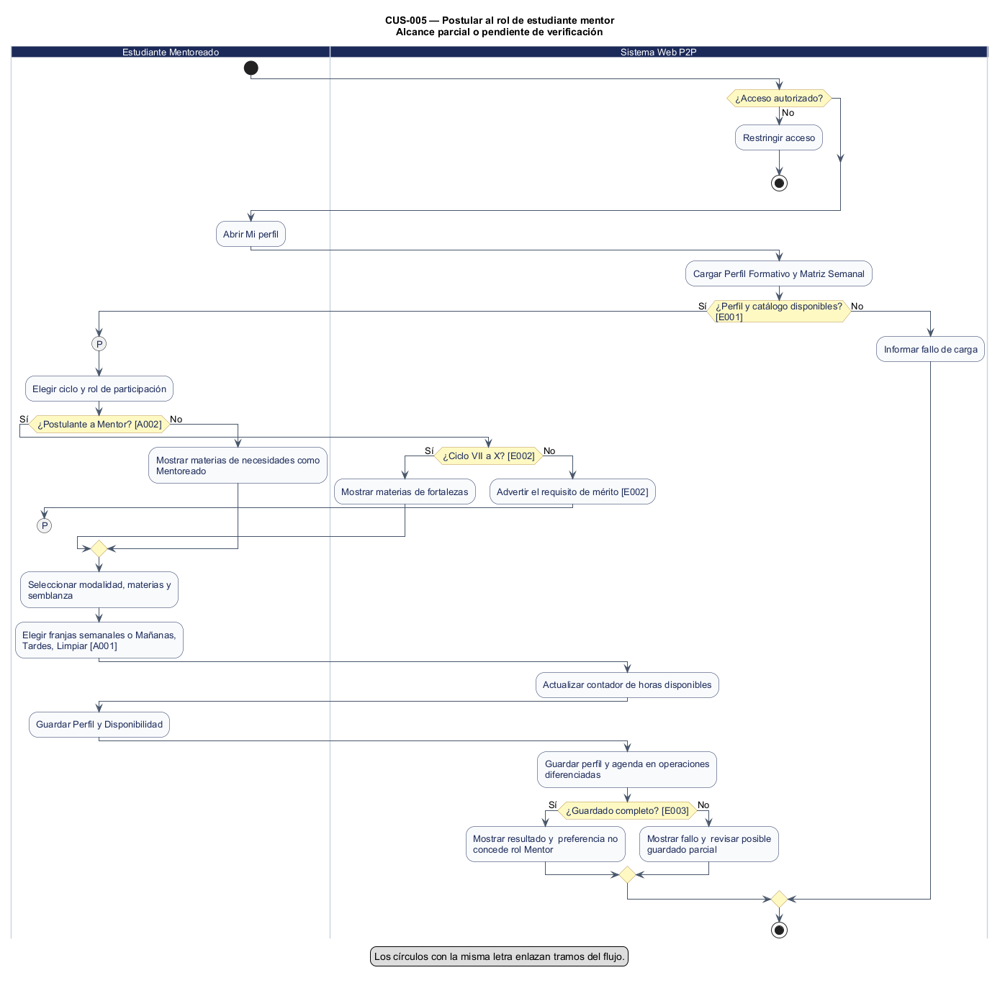

Fuente PlantUML: [CUS-005_actividades.puml](docs/narrativas/diagramas/plantuml/CUS-005_actividades.puml).

Fuente: Elaboración propia.

##### 7.6. Diagrama de caso de uso

**Figura 6.2.3-10. Diagrama de caso de uso — CUS-005: Postular al rol de estudiante mentor.**

Fuente PlantUML: [CUS-005_caso_de_uso.puml](docs/narrativas/diagramas/plantuml/CUS-005_caso_de_uso.puml).

Fuente: Elaboración propia.

---

#### CUS-021 — Evaluar postulaciones a mentor por comité

##### 7.1. Ficha descriptiva

| Atributo | Detalle |
|---|---|
| **Id Caso de Uso** | **UC-021** (CUS-021) |
| **Nombre** | Evaluar postulaciones a mentor por comité |
| **Tipo** | Obligatorio según proceso propuesto |
| **Requisito ID (RF)** | RF-003; RN-03 |
| **Versión** | 2.3 (DOC-H02 — consolidación) |
| **Autor** | Antayhua Mamani, Renzo Antonio / Medina Quispe, Joan Cristian |
| **Actores** | Comité evaluador (actor previsto); Administrador institucional |
| **Interacción** | Interacción web institucional; flujo propuesto pendiente de implementación. |
| **Descripción** | Propone que la evaluación de las postulaciones compruebe el mérito académico antes de habilitar al estudiante como mentor. |
| **Referencias** | SWEBOK v3.0, ISO/IEC/IEEE 29148:2018, SRS y reglas de negocio EPIS-UPT. |
| **Precondiciones** | Propuesta: comité autorizado, postulación registrada, información académica verificable y criterios institucionales aprobados. |
| **Postcondiciones** | Propuesta: decisión motivada y trazable; si se aprueba, habilitación mediante CUS-010 por actor autorizado. |

**Estado de evidencia:** Pendiente: sin flujo de comité identificado.

##### 7.2. Flujo normal de eventos

| **Acción del Actor** | **Respuesta del Sistema** |
|---|---|
| **Fase 1: Recepción de la postulación (propuesto)** |  |
| **1.** El evaluador accede a la bandeja de postulaciones pendientes. |  |
|  | **2.** Deberá presentar las solicitudes disponibles con identidad, fecha, ciclo y asignaturas declaradas; no existe una bandeja de comité acreditada. |
| **3.** Selecciona una postulación. |  |
|  | **4.** Deberá mostrar el expediente y los antecedentes necesarios para la evaluación. |
| **Fase 2: Evaluación (propuesto)** |  |
| **5.** Comprueba el ciclo VII a X y el mérito en las asignaturas a enseñar. |  |
|  | **6.** Deberá permitir registrar el resultado de cada criterio, incluyendo la nota mínima de 14 indicada en RN-03. Si falta evidencia, A001. |
| **7.** Registra la decisión y justificación. |  |
|  | **8.** Deberá comprobar que la evaluación esté completa; permite aprobar o rechazar conforme al reglamento (A002). |
| **Fase 3: Resolución (propuesto)** |  |
| **9.** Confirma la evaluación aprobatoria. |  |
|  | **10.** Deberá conservar la decisión, evaluador y fecha; la asignación se realizará mediante la operación autorizada del CUS-010, no automáticamente por expresar interés. |
| **11.** Consulta el resultado. |  |
|  | **12.** Deberá mostrar el estado final de la postulación y evitar decisiones simultáneas incompatibles. |

##### 7.3. Flujos alternativos

###### A001: Solicitar subsanación

* **Paso origen:** 6.
* **Condición de activación:** Evidencia insuficiente.

| **Acción del Actor** | **Respuesta del Sistema** |
|---|---|
| **A001-1.** Registra qué información requiere aclaración. |  |
|  | **A001-2.** Deberá conservar la evaluación pendiente y la observación. |
| **A001-3.** Retoma cuando exista evidencia. |  |

###### A002: Rechazar postulación

* **Paso origen:** 8.
* **Condición de activación:** Incumplimiento de mérito.

| **Acción del Actor** | **Respuesta del Sistema** |
|---|---|
| **A002-1.** Registra motivo y confirma rechazo. |  |
|  | **A002-2.** Deberá conservar decisión sin otorgar rol Mentor. |
| **A002-3.** Finaliza la evaluación. |  |

##### 7.4. Flujos de excepción

###### E001: Evaluador sin autorización

* **Paso origen:** Flujo normal, en la operación indicada por la condición.
* **Condición de activación:** No dispone de atribuciones.

| **Acción del Actor** | **Respuesta del Sistema** |
|---|---|
|  | **E001-1.** Deberá impedir consultar o resolver expedientes. |
| **E001-2.** Solicita acceso por canal institucional. |  |

###### E002: Expediente o decisión inválida

* **Paso origen:** Flujo normal, en la operación indicada por la condición.
* **Condición de activación:** Información incompleta o evaluación ya resuelta.

| **Acción del Actor** | **Respuesta del Sistema** |
|---|---|
|  | **E002-1.** Deberá impedir cierre y mostrar motivo. |
| **E002-2.** Revisa información o consulta estado actualizado. |  |

###### E003: Fallo de registro

* **Paso origen:** Flujo normal, en la operación indicada por la condición.
* **Condición de activación:** No se puede conservar resolución.

| **Acción del Actor** | **Respuesta del Sistema** |
|---|---|
|  | **E003-1.** Deberá informar el fallo sin declarar decisión confirmada. |
| **E003-2.** Comprueba el estado antes de repetir. |  |

##### 7.5. Diagrama de flujo de actividades

**Figura 6.2.3-11. Diagrama de actividades — CUS-021: Evaluar postulaciones a mentor por comité.**

Fuente PlantUML: [CUS-021_actividades.puml](docs/narrativas/diagramas/plantuml/CUS-021_actividades.puml).

Fuente: Elaboración propia.

##### 7.6. Diagrama de caso de uso

**Figura 6.2.3-12. Diagrama de caso de uso — CUS-021: Evaluar postulaciones a mentor por comité.**

Fuente PlantUML: [CUS-021_caso_de_uso.puml](docs/narrativas/diagramas/plantuml/CUS-021_caso_de_uso.puml).

Fuente: Elaboración propia.

---

### MOD-03: Recomendaciones, Reservas y Quórum

#### CUS-002 — Consultar catálogo de mentorías con recomendación

##### 7.1. Ficha descriptiva

| Atributo | Detalle |
|---|---|
| **Id Caso de Uso** | **UC-002** (CUS-002) |
| **Nombre** | Consultar catálogo de mentorías con recomendación |
| **Tipo** | Obligatorio |
| **Requisito ID (RF)** | RF-006; RN-04, RN-05, RN-11; relacionado con RF-007, RF-012 |
| **Versión** | 2.3 (DOC-H02 — consolidación) |
| **Autor** | Antayhua Mamani, Renzo Antonio / Medina Quispe, Joan Cristian |
| **Actores** | Estudiante Mentoreado |
| **Interacción** | Interacción web institucional; comportamiento descrito conforme a la evidencia identificada. |
| **Descripción** | Presenta una cartelera personalizada de sesiones y mentores según afinidad curricular, disponibilidad y criterios de recomendación, para orientar la selección y reserva. |
| **Referencias** | SWEBOK v3.0, ISO/IEC/IEEE 29148:2018, SRS y reglas de negocio EPIS-UPT. |
| **Precondiciones** | Sesión Mentoreado y consentimiento; perfil y servicios de recomendación disponibles. |
| **Postcondiciones** | El usuario visualiza resultados y puede iniciar reserva o demanda; la consulta por sí sola no modifica cupos. |

**Estado de evidencia:** Implementación identificada; revisión estática.

##### 7.2. Flujo normal de eventos

| **Acción del Actor** | **Respuesta del Sistema** |
|---|---|
| **Fase 1: Acceso a la cartelera** |  |
| **1.** Selecciona «Explorar mentorías». |  |
|  | **2.** Muestra «Cartelera de Mentorías Recomendadas», explicación de afinidad curricular, horario semanal y materias prioritarias, botón «Actualizar», y pestañas «Sesiones Recomendadas» y «Mentores Académicos» con contadores cuando hay resultados. Si no hay autorización, E001. |
| **3.** Espera la carga inicial. |  |
|  | **4.** Presenta «Calculando afinidad con sesiones disponibles...» y obtiene las recomendaciones. Si el servicio falla, E002. |
| **Fase 2: Configuración de resultados** |  |
| **5.** En «Sesiones Recomendadas», despliega «Asignatura». |  |
|  | **6.** Lista «Todas las materias formativas» y cursos disponibles con código; actualiza las recomendaciones con la selección. |
| **7.** Selecciona «Candidatos Top-k»: Top 3, Top 4 o Top 5 (Estándar SRS). |  |
|  | **8.** Solicita y muestra el conjunto ordenado de candidatos de acuerdo con el límite y filtros elegidos. Si no hay resultados, A001. |
| **Fase 3: Exploración de ofertas** |  |
| **9.** Revisa las tarjetas de sesiones. |  |
|  | **10.** Presenta datos de asignatura y tema, afinidad global, horario, modalidad, mentor responsable y cupos disponibles; distingue aforo completo y muestra «Reservar Cupo» o «Aforo Agotado» según corresponda. |
| **11.** Consulta la explicación de afinidad disponible en una tarjeta. |  |
|  | **12.** Presenta el desglose de criterios de recomendación; la afinidad ayuda a comparar, no garantiza reserva ni éxito académico. |
| **13.** Selecciona una oferta con vacantes y pulsa «Reservar Cupo». |  |
|  | **14.** Abre el cuadro de reserva del CUS-003 con la oferta seleccionada. No asigna cupo hasta confirmar la operación. |
| **15.** Alternativamente explora mentores. |  |
|  | **16.** Puede cambiar a «Mentores Académicos» (A002) o actualizar resultados (A003). |

##### 7.3. Flujos alternativos

###### A001: Sin recomendaciones

* **Paso origen:** 8.
* **Condición de activación:** No existen resultados para el filtro.

| **Acción del Actor** | **Respuesta del Sistema** |
|---|---|
| **A001-1.** Revisa el mensaje o pulsa «Registrar Solicitud por Demanda». |  |
|  | **A001-2.** Muestra «No se encontraron recomendaciones en este momento» y orientación de banco de demanda; abre CUS-008 si se selecciona. |
| **A001-3.** Cambia el filtro o registra necesidad. |  |

###### A002: Explorar mentores

* **Paso origen:** 16.
* **Condición de activación:** Cartelera disponible.

| **Acción del Actor** | **Respuesta del Sistema** |
|---|---|
| **A002-1.** Selecciona «Mentores Académicos». |  |
|  | **A002-2.** Muestra tarjetas de mentores con afinidad de perfil, asignaturas de asesoría y control «Contactar / Solicitar Asesoría». |
| **A002-3.** Revisa los resultados o regresa a sesiones. No se acredita mensajería directa. |  |

###### A003: Actualizar resultados

* **Paso origen:** 16.
* **Condición de activación:** Cartelera abierta.

| **Acción del Actor** | **Respuesta del Sistema** |
|---|---|
| **A003-1.** Pulsa «Actualizar» o cambia el número de candidatos. |  |
|  | **A003-2.** Vuelve a consultar y actualiza los resultados y contadores disponibles. |
| **A003-3.** Revisa las nuevas tarjetas. |  |

##### 7.4. Flujos de excepción

###### E001: Acceso restringido

* **Paso origen:** 2.
* **Condición de activación:** Sesión inválida o rol no permitido.

| **Acción del Actor** | **Respuesta del Sistema** |
|---|---|
|  | **E001-1.** Restringe la vista privada. |
| **E001-2.** Inicia sesión o cambia a un rol habilitado. |  |

###### E002: Error de recomendaciones

* **Paso origen:** 4.
* **Condición de activación:** Servicio no responde.

| **Acción del Actor** | **Respuesta del Sistema** |
|---|---|
|  | **E002-1.** Muestra «Error de servicio» y «Reintentar». |
| **E002-2.** Presiona «Reintentar» y revisa los resultados. |  |

###### E003: Oferta sin cupos

* **Paso origen:** Flujo normal, en la operación indicada por la condición.
* **Condición de activación:** Aforo completo o cambio de disponibilidad.

| **Acción del Actor** | **Respuesta del Sistema** |
|---|---|
|  | **E003-1.** Muestra «Aforo Agotado» y deshabilita la reserva desde la tarjeta; la operación de reserva revalida disponibilidad. |
| **E003-2.** Consulta otra oferta o utiliza la alternativa de demanda cuando esté disponible. |  |

##### 7.5. Diagrama de flujo de actividades

**Figura 6.2.3-13. Diagrama de actividades — CUS-002: Consultar catálogo de mentorías con recomendación.**

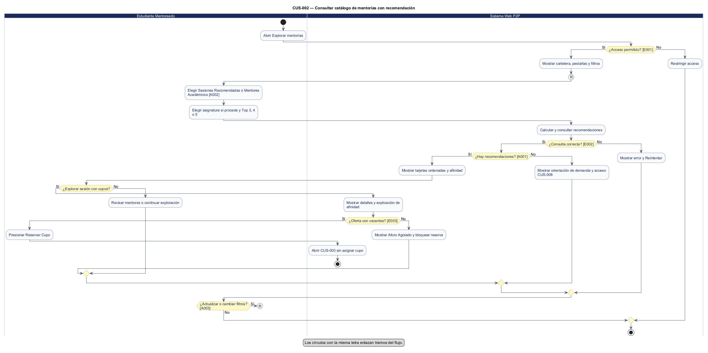

Fuente PlantUML: [CUS-002_actividades.puml](docs/narrativas/diagramas/plantuml/CUS-002_actividades.puml).

Fuente: Elaboración propia.

##### 7.6. Diagrama de caso de uso

**Figura 6.2.3-14. Diagrama de caso de uso — CUS-002: Consultar catálogo de mentorías con recomendación.**

Fuente PlantUML: [CUS-002_caso_de_uso.puml](docs/narrativas/diagramas/plantuml/CUS-002_caso_de_uso.puml).

Fuente: Elaboración propia.

---

#### CUS-003 — Reservar cupo para sesión de mentoría

##### 7.1. Ficha descriptiva

| Atributo | Detalle |
|---|---|
| **Id Caso de Uso** | **UC-003** (CUS-003) |
| **Nombre** | Reservar cupo para sesión de mentoría |
| **Tipo** | Obligatorio |
| **Requisito ID (RF)** | RF-012; RN-04, RN-05, RN-08 |
| **Versión** | 2.3 (DOC-H02 — consolidación) |
| **Autor** | Antayhua Mamani, Renzo Antonio / Medina Quispe, Joan Cristian |
| **Actores** | Estudiante Mentoreado |
| **Interacción** | Interacción web institucional; comportamiento descrito conforme a la evidencia identificada. |
| **Descripción** | Permite reservar provisionalmente una plaza de una sesión publicada, verificando aforo y condiciones de inscripción. |
| **Referencias** | SWEBOK v3.0, ISO/IEC/IEEE 29148:2018, SRS y reglas de negocio EPIS-UPT. |
| **Precondiciones** | Sesión institucional Mentoreado; oferta publicada, disponible y dentro de ventana de reserva; no ser mentor titular. |
| **Postcondiciones** | Reserva PENDIENTE_CONFIRMACION con identificador, fecha y cupo ocupado; requiere ratificación CUS-004. |

**Estado de evidencia:** Implementación identificada; revisión estática.

##### 7.2. Flujo normal de eventos

| **Acción del Actor** | **Respuesta del Sistema** |
|---|---|
| **Fase 1: Selección de oferta** |  |
| **1.** Desde «Explorar mentorías», selecciona una sesión con vacantes mediante «Reservar Cupo». |  |
|  | **2.** Abre ventana «Reserva de Cupo de Mentoría» / «Confirmar Reserva de Cupo» con información de la sesión seleccionada. Si no hay oferta válida, E001. |
| **Fase 2: Revisión de la sesión** |  |
| **3.** Revisa asignatura, tema, mentor, fecha, modalidad, infraestructura y disponibilidad mostrada. |  |
|  | **4.** Presenta información institucional: reserva PENDIENTE_CONFIRMACION y obligación de ratificar antes de las 24 h previas al inicio. Si se detecta autoreserva, E002; sin vacantes, E003; fuera de plazo, E004. |
| **5.** Decide continuar o cancelar (A001). |  |
|  | **6.** Mantiene habilitado «Confirmar Reserva de Cupo» únicamente cuando las condiciones del formulario lo permiten. |
| **Fase 3: Registro** |  |
| **7.** Presiona «Confirmar Reserva de Cupo». |  |
|  | **8.** Muestra «Procesando reserva...»; comprueba identidad, sesión, ventana, duplicidad y disponibilidad. Si ya posee una reserva incompatible, E005; si otra persona ocupó la última plaza, E003. |
| **9.** Espera el resultado. |  |
|  | **10.** Registra el cupo provisional y actualiza la disponibilidad. Si hay fallo, E006. |
| **Fase 4: Confirmación** |  |
| **11.** Revisa «¡Cupo Reservado Exitosamente!». |  |
|  | **12.** Presenta la confirmación de reserva provisional, sus datos y el compromiso de ratificación. Ofrece «Entendido, Cerrar» y «Ver Mis Reservas». |
| **13.** Presiona «Ver Mis Reservas» o cierra el diálogo. |  |
|  | **14.** Abre «Mis reservas» o retorna a la cartelera; la reserva queda pendiente de confirmación (CUS-004). |

##### 7.3. Flujos alternativos

###### A001: Cancelar antes de confirmar

* **Paso origen:** 6.
* **Condición de activación:** Cuadro abierto sin envío.

| **Acción del Actor** | **Respuesta del Sistema** |
|---|---|
| **A001-1.** Presiona «Cancelar» o cierra el cuadro antes de enviar. |  |
|  | **A001-2.** Cierra sin registrar reserva. |
| **A001-3.** Retorna a la cartelera. |  |

###### A002: Registrar demanda por aforo

* **Paso origen:** Flujo normal, en la operación indicada por la condición.
* **Condición de activación:** Cuadro de reserva detecta aforo agotado.

| **Acción del Actor** | **Respuesta del Sistema** |
|---|---|
| **A002-1.** Presiona «Registrar Solicitud por Demanda» si se ofrece. |  |
|  | **A002-2.** Cierra el cuadro y abre el formulario CUS-008. |
| **A002-3.** Selecciona curso y tema. |  |

###### A003: Consultar reserva después del éxito

* **Paso origen:** Flujo normal, en la operación indicada por la condición.
* **Condición de activación:** Confirmación visible.

| **Acción del Actor** | **Respuesta del Sistema** |
|---|---|
| **A003-1.** Presiona «Ver Mis Reservas». |  |
|  | **A003-2.** Abre la bandeja personal con el registro disponible. |
| **A003-3.** Revisa estado y fecha límite de ratificación. |  |

##### 7.4. Flujos de excepción

###### E001: Oferta no seleccionada o sesión inválida

* **Paso origen:** 2.
* **Condición de activación:** Sin oferta o sesión no apta.

| **Acción del Actor** | **Respuesta del Sistema** |
|---|---|
|  | **E001-1.** Muestra «Ninguna Sesión Seleccionada» o rechazo correspondiente. |
| **E001-2.** Cierra y elige otra oferta. |  |

###### E002: Autoreserva

* **Paso origen:** 4.
* **Condición de activación:** Usuario es mentor titular.

| **Acción del Actor** | **Respuesta del Sistema** |
|---|---|
|  | **E002-1.** Muestra «Restricción de Autoreserva» y no permite inscribirse. |
| **E002-2.** Selecciona otra sesión como mentoreado. |  |

###### E003: Aforo agotado

* **Paso origen:** 4, 8.
* **Condición de activación:** No quedan vacantes al consultar o registrar.

| **Acción del Actor** | **Respuesta del Sistema** |
|---|---|
|  | **E003-1.** Bloquea o rechaza la reserva y muestra motivo; puede orientar a demanda si está disponible. |
| **E003-2.** Elige otra sesión o registra demanda. |  |

###### E004: Ventana cerrada

* **Paso origen:** 4.
* **Condición de activación:** No cumple antelación requerida.

| **Acción del Actor** | **Respuesta del Sistema** |
|---|---|
|  | **E004-1.** Rechaza la inscripción o deshabilita el envío. |
| **E004-2.** Consulta una oferta vigente. |  |

###### E005: Reserva duplicada

* **Paso origen:** 8.
* **Condición de activación:** Ya existe inscripción incompatible.

| **Acción del Actor** | **Respuesta del Sistema** |
|---|---|
|  | **E005-1.** Rechaza el nuevo registro y comunica el motivo. |
| **E005-2.** Consulta Mis reservas. |  |

###### E006: Fallo de registro

* **Paso origen:** 10.
* **Condición de activación:** Error de comunicación o persistencia.

| **Acción del Actor** | **Respuesta del Sistema** |
|---|---|
|  | **E006-1.** Muestra error sin confirmación; restablece controles. |
| **E006-2.** Comprueba Mis reservas antes de reintentar. |  |

##### 7.5. Diagrama de flujo de actividades

**Figura 6.2.3-15. Diagrama de actividades — CUS-003: Reservar cupo para sesión de mentoría.**

Fuente PlantUML: [CUS-003_actividades.puml](docs/narrativas/diagramas/plantuml/CUS-003_actividades.puml).

Fuente: Elaboración propia.

##### 7.6. Diagrama de caso de uso

**Figura 6.2.3-16. Diagrama de caso de uso — CUS-003: Reservar cupo para sesión de mentoría.**

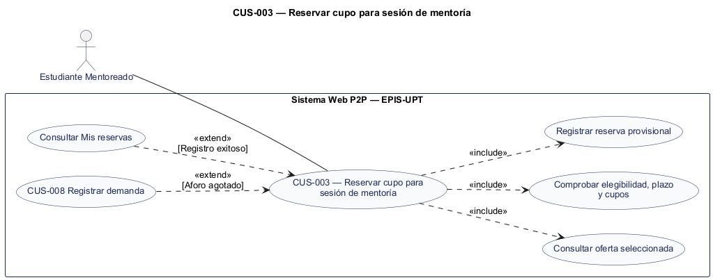

Fuente PlantUML: [CUS-003_caso_de_uso.puml](docs/narrativas/diagramas/plantuml/CUS-003_caso_de_uso.puml).

Fuente: Elaboración propia.

---

#### CUS-004 — Ratificar asistencia a sesión de mentoría (T-24h)

##### 7.1. Ficha descriptiva

| Atributo | Detalle |
|---|---|
| **Id Caso de Uso** | **UC-004** (CUS-004) |
| **Nombre** | Ratificar asistencia a sesión de mentoría (T-24h) |
| **Tipo** | Obligatorio |
| **Requisito ID (RF)** | RF-013; RN-08, RN-09 |
| **Versión** | 2.3 (DOC-H02 — consolidación) |
| **Autor** | Antayhua Mamani, Renzo Antonio / Medina Quispe, Joan Cristian |
| **Actores** | Estudiante Mentoreado |
| **Interacción** | Interacción web institucional; comportamiento descrito conforme a la evidencia identificada. |
| **Descripción** | Permite ratificar una reserva provisional antes del corte de 24 horas para que compute en el quórum de la sesión. |
| **Referencias** | SWEBOK v3.0, ISO/IEC/IEEE 29148:2018, SRS y reglas de negocio EPIS-UPT. |
| **Precondiciones** | Sesión institucional, reserva propia PENDIENTE_CONFIRMACION y más de 24 horas hasta el inicio. |
| **Postcondiciones** | Reserva CONFIRMADA con fecha de ratificación; queda contabilizada para quórum sin garantizar por sí sola realización de sesión. |

**Estado de evidencia:** Implementación identificada; revisión estática.

##### 7.2. Flujo normal de eventos

| **Acción del Actor** | **Respuesta del Sistema** |
|---|---|
| **Fase 1: Acceso a reservas** |  |
| **1.** Selecciona «Mis reservas». |  |
|  | **2.** Muestra «Mis Reservas de Mentoría», botón «Actualizar», «+ Buscar Mentorías» y filtros de estados. Si no hay sesión válida, E001; si no carga, E004. |
| **3.** Selecciona el filtro de pendientes y revisa una reserva. |  |
|  | **4.** Presenta código, asignatura, fecha, modalidad, espacio, mentor, estado y corte definitivo. Ofrece «Confirmar Asistencia» mientras la ventana esté abierta; si cerró, E002. |
| **Fase 2: Ratificación** |  |
| **5.** Pulsa «✓ Confirmar Asistencia». |  |
|  | **6.** Abre «Ratificar Asistencia a Mentoría», identifica sesión y horario, explica compromiso de asistencia y quórum; ofrece «Cancelar» y «Confirmar Asistencia». |
| **7.** Lee el compromiso y confirma. |  |
|  | **8.** Muestra «Ratificando asistencia...», comprueba titularidad, estado y plazo. Si estado cambió, E003. |
| **Fase 3: Confirmación** |  |
| **9.** Espera el resultado. |  |
|  | **10.** Actualiza la reserva a CONFIRMADA y registra la fecha de ratificación; si falla, E004. |
| **11.** Revisa la tarjeta. |  |
|  | **12.** Muestra «Ratificación registrada el:» con fecha y nuevo estado; informa que la realización depende del quórum al corte. Puede desistir dentro del plazo mediante CUS-024. |

##### 7.3. Flujos alternativos

###### A001: Cancelar diálogo

* **Paso origen:** Flujo normal, en la operación indicada por la condición.
* **Condición de activación:** Antes de confirmar.

| **Acción del Actor** | **Respuesta del Sistema** |
|---|---|
| **A001-1.** Pulsa «Cancelar» o cierre. |  |
|  | **A001-2.** Cierra sin ratificar. |
| **A001-3.** Mantiene reserva provisional. |  |

###### A002: Consultar una reserva ya ratificada

* **Paso origen:** Flujo normal, en la operación indicada por la condición.
* **Condición de activación:** Reserva CONFIRMADA.

| **Acción del Actor** | **Respuesta del Sistema** |
|---|---|
| **A002-1.** Selecciona filtro de confirmadas. |  |
|  | **A002-2.** Muestra fecha y estado sin solicitar otra ratificación. |
| **A002-3.** Consulta el resultado. |  |

##### 7.4. Flujos de excepción

###### E001: Sesión o titularidad inválida

* **Paso origen:** 2.
* **Condición de activación:** No autorizado.

| **Acción del Actor** | **Respuesta del Sistema** |
|---|---|
|  | **E001-1.** Restringe vista o rechaza operación. |
| **E001-2.** Inicia sesión con la cuenta titular. |  |

###### E002: Corte alcanzado

* **Paso origen:** 4.
* **Condición de activación:** Faltan 24 h o menos.

| **Acción del Actor** | **Respuesta del Sistema** |
|---|---|
|  | **E002-1.** Muestra «Plazo Vencido (Cierre 24h)» y no permite ratificar. |
| **E002-2.** Consulta estado tras el corte. |  |

###### E003: Estado incompatible

* **Paso origen:** 8.
* **Condición de activación:** Reserva cancelada o modificada.

| **Acción del Actor** | **Respuesta del Sistema** |
|---|---|
|  | **E003-1.** Rechaza la acción y conserva el estado real. |
| **E003-2.** Actualiza Mis reservas. |  |

###### E004: Fallo de consulta o ratificación

* **Paso origen:** 2, 10.
* **Condición de activación:** Problema de servicio.

| **Acción del Actor** | **Respuesta del Sistema** |
|---|---|
|  | **E004-1.** Muestra error y permite reintentar si corresponde. |
| **E004-2.** Actualiza la reserva antes de repetir. |  |

##### 7.5. Diagrama de flujo de actividades

**Figura 6.2.3-17. Diagrama de actividades — CUS-004: Ratificar asistencia a sesión de mentoría (T-24h).**

Fuente PlantUML: [CUS-004_actividades.puml](docs/narrativas/diagramas/plantuml/CUS-004_actividades.puml).

Fuente: Elaboración propia.

##### 7.6. Diagrama de caso de uso

**Figura 6.2.3-18. Diagrama de caso de uso — CUS-004: Ratificar asistencia a sesión de mentoría (T-24h).**

Fuente PlantUML: [CUS-004_caso_de_uso.puml](docs/narrativas/diagramas/plantuml/CUS-004_caso_de_uso.puml).

Fuente: Elaboración propia.

---

#### CUS-023 — Evaluar quórum y ejecutar corte automático (T-24h)

##### 7.1. Ficha descriptiva

| Atributo | Detalle |
|---|---|
| **Id Caso de Uso** | **UC-023** (CUS-023) |
| **Nombre** | Evaluar quórum y ejecutar corte automático (T-24h) |
| **Tipo** | Obligatorio |
| **Requisito ID (RF)** | RF-015, RF-016; RN-08, RN-09, RN-10 |
| **Versión** | 2.3 (DOC-H02 — consolidación) |
| **Autor** | Antayhua Mamani, Renzo Antonio / Medina Quispe, Joan Cristian |
| **Actores** | Sistema (proceso automático); Administrador institucional (supervisión); Estudiante Mentor (resolución posterior) |
| **Interacción** | Interacción web institucional; comportamiento descrito conforme a la evidencia identificada. |
| **Descripción** | Determina al corte de 24 horas si una sesión alcanza el mínimo de reservas ratificadas, invalida reservas no confirmadas y deriva contingencias al mentor. |
| **Referencias** | SWEBOK v3.0, ISO/IEC/IEEE 29148:2018, SRS y reglas de negocio EPIS-UPT. |
| **Precondiciones** | Sesión en estado evaluable; fecha de inicio y reservas disponibles; porcentaje mínimo configurado (referencia 50 %). |
| **Postcondiciones** | Sesión CONFIRMADA o QUORUM_INSUFICIENTE según evaluación; reservas sin ratificación canceladas según reglas; evaluación registrada sin repetir efectos. |

**Estado de evidencia:** Evaluación identificada; ejecución periódica en entorno real no certificada.

##### 7.2. Flujo normal de eventos

| **Acción del Actor** | **Respuesta del Sistema** |
|---|---|
| **Fase 1: Inicio del corte** |  |
| **1.** El proceso programado alcanza la ventana de evaluación a 24 horas del inicio (sin acción manual del estudiante). |  |
|  | **2.** Identifica sesiones evaluables cuyo corte se ha alcanzado; excluye sesiones que no corresponden o ya fueron evaluadas (A001). |
| **3.** El sistema ejecuta la evaluación. |  |
|  | **4.** Cuenta reservas ratificadas y aforo; calcula el mínimo a partir del porcentaje configurado. Referencia: 5 de 10 presencial y 10 de 20 virtual con 50 %. |
| **Fase 2: Resultado del quórum** |  |
| **5.** No se requiere intervención del estudiante. |  |
|  | **6.** Si se alcanza el mínimo, confirma la sesión y cancela las reservas provisionales no ratificadas con el estado correspondiente. Si no se alcanza, A002. |
| **7.** El proceso completa la evaluación. |  |
|  | **8.** Conserva el resultado y evita volver a aplicar los cambios si se ejecuta nuevamente; si falla, E002. |
| **Fase 3: Supervisión** |  |
| **9.** El administrador abre «Administración» > «Monitoreo de Quórum». |  |
|  | **10.** Muestra «Supervisión de Quórum y Sesiones EPIS», tarjetas con inscritos, ratificados, mínimo y porcentaje configurado; permite «Actualizar». |
| **11.** El mentor revisa «Mis sesiones» y el estado de sus ofertas. |  |
|  | **12.** Presenta el estado de inscripción/quórum; ante insuficiencia ofrece la gestión de contingencia descrita en A002. Los estudiantes pueden revisar sus reservas en «Mis reservas». |

##### 7.3. Flujos alternativos

###### A001: Sesión ya evaluada

* **Paso origen:** 2.
* **Condición de activación:** Existe resultado de corte.

| **Acción del Actor** | **Respuesta del Sistema** |
|---|---|
| **A001-1.** El proceso vuelve a solicitar evaluación. |  |
|  | **A001-2.** Conserva el resultado sin repetir cambios de estado. |
| **A001-3.** Continúa con otras sesiones. |  |

###### A002: Quórum insuficiente

* **Paso origen:** 6, 12.
* **Condición de activación:** Ratificados por debajo del mínimo.

| **Acción del Actor** | **Respuesta del Sistema** |
|---|---|
| **A002-1.** El mentor consulta la sesión en Mis sesiones. |  |
|  | **A002-2.** Establece QUORUM_INSUFICIENTE y ofrece decisión: «Dictar de Todas Formas», «Reprogramar Sesión» o «Cancelar Sesión Definitivamente». |
| **A002-3.** El mentor selecciona una decisión según las reglas y confirma; el sistema procesa continuidad, nueva fecha válida o cancelación con motivo y liberación de inscritos. Si reprograma, exige nueva antelación superior a 24 h y aula disponible si presencial. |  |

###### A003: Supervisar sin modificar

* **Paso origen:** Flujo normal, en la operación indicada por la condición.
* **Condición de activación:** Administrador consulta panel.

| **Acción del Actor** | **Respuesta del Sistema** |
|---|---|
| **A003-1.** Pulsa «Actualizar». |  |
|  | **A003-2.** Renueva indicadores y estados sin que esa consulta implique forzar una evaluación. |
| **A003-3.** Revisa resultados. |  |

##### 7.4. Flujos de excepción

###### E001: Evaluación no procedente

* **Paso origen:** Flujo normal, en la operación indicada por la condición.
* **Condición de activación:** Antes del corte o estado no evaluable.

| **Acción del Actor** | **Respuesta del Sistema** |
|---|---|
|  | **E001-1.** No debe cambiar una sesión fuera de las condiciones admitidas. |
| **E001-2.** Consulta más tarde el estado correspondiente. |  |

###### E002: Fallo de evaluación

* **Paso origen:** 8.
* **Condición de activación:** Error durante procesamiento.

| **Acción del Actor** | **Respuesta del Sistema** |
|---|---|
|  | **E002-1.** No acredita un resultado exitoso; el proceso debe conservar coherencia y permitir recuperación. |
| **E002-2.** Verifica estado y registros antes de reejecutar. |  |

###### E003: Contingencia inválida

* **Paso origen:** Flujo normal, en la operación indicada por la condición.
* **Condición de activación:** Nueva fecha insuficiente, aula ocupada, falta motivo o decisión no autorizada.

| **Acción del Actor** | **Respuesta del Sistema** |
|---|---|
|  | **E003-1.** Rechaza la decisión y comunica el motivo. |
| **E003-2.** Corrige la opción y revisa la sesión. |  |

##### 7.5. Diagrama de flujo de actividades

**Figura 6.2.3-19. Diagrama de actividades — CUS-023: Evaluar quórum y ejecutar corte automático (T-24h).**

Fuente PlantUML: [CUS-023_actividades.puml](docs/narrativas/diagramas/plantuml/CUS-023_actividades.puml).

Fuente: Elaboración propia.

##### 7.6. Diagrama de caso de uso

**Figura 6.2.3-20. Diagrama de caso de uso — CUS-023: Evaluar quórum y ejecutar corte automático (T-24h).**

Fuente PlantUML: [CUS-023_caso_de_uso.puml](docs/narrativas/diagramas/plantuml/CUS-023_caso_de_uso.puml).

Fuente: Elaboración propia.

---

#### CUS-024 — Cancelar reserva de cupo por estudiante

##### 7.1. Ficha descriptiva

| Atributo | Detalle |
|---|---|
| **Id Caso de Uso** | **UC-024** (CUS-024) |
| **Nombre** | Cancelar reserva de cupo por estudiante |
| **Tipo** | Opcional |
| **Requisito ID (RF)** | RF-014; RN-08, RN-10 |
| **Versión** | 2.3 (DOC-H02 — consolidación) |
| **Autor** | Antayhua Mamani, Renzo Antonio / Medina Quispe, Joan Cristian |
| **Actores** | Estudiante Mentoreado |
| **Interacción** | Interacción web institucional; comportamiento descrito conforme a la evidencia identificada. |
| **Descripción** | Permite desistir voluntariamente de una reserva propia antes del corte, liberando la plaza para otro estudiante. |
| **Referencias** | SWEBOK v3.0, ISO/IEC/IEEE 29148:2018, SRS y reglas de negocio EPIS-UPT. |
| **Precondiciones** | Sesión institucional; reserva activa propia y más de 24 horas de antelación. |
| **Postcondiciones** | Reserva CANCELADA_USUARIO y plaza liberada; sin penalización conforme a la política de desistimiento oportuno. |

**Estado de evidencia:** Implementación identificada; revisión estática.

##### 7.2. Flujo normal de eventos

| **Acción del Actor** | **Respuesta del Sistema** |
|---|---|
| **Fase 1: Identificación de reserva** |  |
| **1.** Abre «Mis reservas» y consulta reservas activas. |  |
|  | **2.** Presenta tarjetas con código, estado, datos de la sesión y fecha de corte; habilita «Cancelar Reserva / Desistir» si procede. |
| **3.** Selecciona la reserva a cancelar. |  |
|  | **4.** Si está cerrada la ventana, E001; si ya no es activa, E002. |
| **Fase 2: Confirmación del desistimiento** |  |
| **5.** Presiona «Cancelar Reserva / Desistir». |  |
|  | **6.** Abre «Desistimiento Voluntario de Cupo» con sesión, horario, política de cancelación sin penalización antes del corte y aviso de acción irreversible. Muestra campo «Motivo de desistimiento (opcional)», «Volver» y «Confirmar Desistimiento». |
| **7.** Ingresa un motivo si desea y confirma. |  |
|  | **8.** Muestra «Procesando desistimiento...», comprueba titularidad, estado y plazo. Si no puede completar, E003. |
| **Fase 3: Resultado** |  |
| **9.** Espera confirmación. |  |
|  | **10.** Registra CANCELADA_USUARIO y libera el cupo; presenta resultado y actualiza la bandeja. |
| **11.** Consulta el histórico. |  |
|  | **12.** Muestra la reserva cancelada; para volver a inscribirse debe realizar una nueva reserva si aún existe disponibilidad. |

##### 7.3. Flujos alternativos

###### A001: Volver sin cancelar

* **Paso origen:** Flujo normal, en la operación indicada por la condición.
* **Condición de activación:** Diálogo abierto.

| **Acción del Actor** | **Respuesta del Sistema** |
|---|---|
| **A001-1.** Pulsa «Volver» o cierre antes de enviar. |  |
|  | **A001-2.** Cierra sin modificar el estado. |
| **A001-3.** Retorna a Mis reservas. |  |

###### A002: Motivo omitido

* **Paso origen:** Flujo normal, en la operación indicada por la condición.
* **Condición de activación:** Campo opcional.

| **Acción del Actor** | **Respuesta del Sistema** |
|---|---|
| **A002-1.** Confirma sin escribir motivo. |  |
|  | **A002-2.** Admite la cancelación con la información de desistimiento disponible. |
| **A002-3.** Consulta resultado. |  |

##### 7.4. Flujos de excepción

###### E001: Corte vencido

* **Paso origen:** 4.
* **Condición de activación:** 24 h o menos.

| **Acción del Actor** | **Respuesta del Sistema** |
|---|---|
|  | **E001-1.** Muestra «Desistimiento Cerrado (Cierre 24h)» o rechazo equivalente. |
| **E001-2.** Consulta la política institucional; no fuerza la cancelación. |  |

###### E002: Reserva no activa o no propia

* **Paso origen:** 4.
* **Condición de activación:** Estado o titularidad incompatible.

| **Acción del Actor** | **Respuesta del Sistema** |
|---|---|
|  | **E002-1.** Rechaza la acción o muestra «Reserva no activa». |
| **E002-2.** Actualiza Mis reservas. |  |

###### E003: Fallo de comunicación

* **Paso origen:** 8.
* **Condición de activación:** No se obtiene confirmación.

| **Acción del Actor** | **Respuesta del Sistema** |
|---|---|
|  | **E003-1.** Muestra error y restablece los controles. |
| **E003-2.** Actualiza antes de repetir para verificar si ya se canceló. |  |

##### 7.5. Diagrama de flujo de actividades

**Figura 6.2.3-21. Diagrama de actividades — CUS-024: Cancelar reserva de cupo por estudiante.**

Fuente PlantUML: [CUS-024_actividades.puml](docs/narrativas/diagramas/plantuml/CUS-024_actividades.puml).

Fuente: Elaboración propia.

##### 7.6. Diagrama de caso de uso

**Figura 6.2.3-22. Diagrama de caso de uso — CUS-024: Cancelar reserva de cupo por estudiante.**

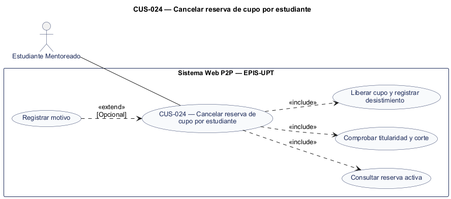

Fuente PlantUML: [CUS-024_caso_de_uso.puml](docs/narrativas/diagramas/plantuml/CUS-024_caso_de_uso.puml).

Fuente: Elaboración propia.

---

### MOD-04: Ejecución y Seguimiento Académico

#### CUS-007 — Registrar asistencia y bitácora pedagógica

##### 7.1. Ficha descriptiva

| Atributo | Detalle |
|---|---|
| **Id Caso de Uso** | **UC-007** (CUS-007) |
| **Nombre** | Registrar asistencia y bitácora pedagógica |
| **Tipo** | Obligatorio |
| **Requisito ID (RF)** | RF-017, RF-018; RN-12 |
| **Versión** | 2.3 (DOC-H02 — consolidación) |
| **Autor** | Antayhua Mamani, Renzo Antonio / Medina Quispe, Joan Cristian |
| **Actores** | Estudiante Mentor; Estudiante Mentoreado |
| **Interacción** | Interacción web institucional; comportamiento descrito conforme a la evidencia identificada. |
| **Descripción** | Permite registrar asistencia a una mentoría mediante código temporal y documentar los contenidos impartidos y resultados de la sesión. |
| **Referencias** | SWEBOK v3.0, ISO/IEC/IEEE 29148:2018, SRS y reglas de negocio EPIS-UPT. |
| **Precondiciones** | Sesión autorizada, estudiantes inscritos y confirmados para asistencia; mentor titular; bitácora dentro de ventana de 48 horas posterior a la sesión. |
| **Postcondiciones** | Asistencia de estudiantes registrada; bitácora sellada con horas declaradas en espera del visado institucional. |

**Estado de evidencia:** Implementación identificada; revisión estática.

##### 7.2. Flujo normal de eventos

| **Acción del Actor** | **Respuesta del Sistema** |
|---|---|
| **Fase 1: Inicio del control de asistencia** |  |
| **1.** El mentor accede a «Mis sesiones», identifica la sesión y selecciona «📱 Asistencia». |  |
|  | **2.** Muestra «Control de Asistencia Digital · Modo Mentor», título de la sesión, panel «Proyección de Código QR Dinámico», código numérico de respaldo de seis dígitos y ciclo de validez. Si falla la consulta, E001. |
| **3.** Proyecta el código para los participantes. |  |
|  | **4.** Actualiza periódicamente el código temporal y muestra nómina de inscritos con estados «Presente», «Por registrar» o «Ausente»; permite «Actualizar». |
| **Fase 2: Registro del estudiante** |  |
| **5.** El mentoreado abre «Mis reservas» y pulsa «Registrar Asistencia (TOTP / QR)» cuando esté disponible. |  |
|  | **6.** Abre «Check-in de Asistencia en Vivo (RF17)» e identifica la sesión. Muestra campo «Código TOTP (6 dígitos) o contenido del QR» y controles de envío y cancelación. |
| **7.** Ingresa el código proyectado y envía el registro. |  |
|  | **8.** Comprueba identidad, reserva, ventana de asistencia y código vigente; si no es válido, E002; si no es elegible, E003. |
| **9.** Espera el resultado y consulta su reserva. |  |
|  | **10.** Registra asistencia si la validación concluye correctamente; actualiza el estado correspondiente. El mentor puede actualizar su nómina para verificar el resultado. |
| **Fase 3: Registro pedagógico posterior** |  |
| **11.** El mentor, una vez finalizada la sesión, selecciona «📝 Bitácora» en su sesión. |  |
|  | **12.** Muestra «Bitácora Pedagógica de Mentoría», identificación de sesión y formulario de registro pedagógico. Si se superaron 48 horas, E004. |
| **13.** Selecciona «1. Temas Silábicos Desarrollados en la Sesión» mediante las opciones disponibles. |  |
|  | **14.** Permite marcar los temas cubiertos y agregar un tema específico mediante «Agregar» (A002). |
| **15.** Selecciona «2. Nivel de Dificultad Percibido del Grupo»: Bajo, Medio o Alto. |  |
|  | **16.** Conserva la valoración de dificultad. |
| **17.** Completa «3. Observaciones Pedagógicas y Conclusiones». |  |
|  | **18.** Muestra contador de caracteres, exige al menos 50 caracteres de observación y conserva la descripción de ejercicios, dificultades y recomendaciones. |
| **19.** Marca «Declaración Jurada de Veracidad Académica» y pulsa «Firmar y Registrar Bitácora». |  |
|  | **20.** Comprueba campos, titularidad y plazo; muestra «Sellando Criptográficamente...» durante el registro. Si faltan datos, E005; si falla, E006. |
| **21.** Revisa el resultado. |  |
|  | **22.** Presenta «Bitácora Pedagógica Registrada y Sellada con Éxito», código, temas cubiertos, horas declaradas y firma de integridad; indica que las horas quedan a la espera del visado de Dirección. No acredita horas definitivamente sin CUS-019. |

##### 7.3. Flujos alternativos

###### A001: Código numérico en lugar de QR

* **Paso origen:** Flujo normal, en la operación indicada por la condición.
* **Condición de activación:** Participante no puede escanear.

| **Acción del Actor** | **Respuesta del Sistema** |
|---|---|
| **A001-1.** Ingresa los seis dígitos proyectados o el contenido del QR en el campo habilitado. |  |
|  | **A001-2.** Valida el registro con las mismas condiciones de asistencia. |
| **A001-3.** Consulta el resultado; la disponibilidad efectiva de escaneo con cámara requiere prueba. |  |

###### A002: Tema adicional

* **Paso origen:** 14.
* **Condición de activación:** Bitácora abierta.

| **Acción del Actor** | **Respuesta del Sistema** |
|---|---|
| **A002-1.** Escribe un tema específico y pulsa «Agregar». |  |
|  | **A002-2.** Incorpora el tema al conjunto de contenidos registrados. |
| **A002-3.** Continúa con dificultad y observaciones. |  |

###### A003: Consultar nómina

* **Paso origen:** Flujo normal, en la operación indicada por la condición.
* **Condición de activación:** Mentor en control de asistencia.

| **Acción del Actor** | **Respuesta del Sistema** |
|---|---|
| **A003-1.** Presiona «Actualizar». |  |
|  | **A003-2.** Recupera estados de inscritos. |
| **A003-3.** Revisa sin registrar asistencia en nombre del estudiante. |  |

##### 7.4. Flujos de excepción

###### E001: Control no disponible

* **Paso origen:** 2.
* **Condición de activación:** Sesión inválida, sin autorización o fallo de consulta.

| **Acción del Actor** | **Respuesta del Sistema** |
|---|---|
|  | **E001-1.** No presenta un código o nómina como válidos si no puede obtenerlos; informa error disponible. |
| **E001-2.** Verifica sesión y reintenta. |  |

###### E002: Código inválido o vencido

* **Paso origen:** 8.
* **Condición de activación:** Código no coincide o pierde vigencia.

| **Acción del Actor** | **Respuesta del Sistema** |
|---|---|
|  | **E002-1.** Rechaza registro de asistencia. |
| **E002-2.** Solicita el código actual al mentor y vuelve a introducirlo. |  |

###### E003: Estudiante no elegible

* **Paso origen:** 8.
* **Condición de activación:** Sin reserva confirmada, fuera de ventana o identidad incorrecta.

| **Acción del Actor** | **Respuesta del Sistema** |
|---|---|
|  | **E003-1.** Rechaza asistencia y comunica motivo. |
| **E003-2.** Consulta su reserva y condiciones. |  |

###### E004: Plazo de bitácora vencido

* **Paso origen:** 12.
* **Condición de activación:** Más de 48 h desde fin.

| **Acción del Actor** | **Respuesta del Sistema** |
|---|---|
|  | **E004-1.** Muestra «Formulario Bloqueado: Plazo Ordinario de 48 Horas Expirado». |
| **E004-2.** Consulta a Dirección; no se acredita reapertura en la aplicación. |  |

###### E005: Bitácora incompleta

* **Paso origen:** 20.
* **Condición de activación:** Faltan temas, declaración u observaciones suficientes.

| **Acción del Actor** | **Respuesta del Sistema** |
|---|---|
|  | **E005-1.** Mantiene envío bloqueado o rechaza el registro. |
| **E005-2.** Completa los campos y confirma. |  |

###### E006: Fallo de registro

* **Paso origen:** 20.
* **Condición de activación:** Error al sellar o guardar.

| **Acción del Actor** | **Respuesta del Sistema** |
|---|---|
|  | **E006-1.** Muestra error sin acreditar horas ni asistencia nueva. |
| **E006-2.** Verifica el estado antes de reintentar. |  |

##### 7.5. Diagrama de flujo de actividades

**Figura 6.2.3-23. Diagrama de actividades — CUS-007: Registrar asistencia y bitácora pedagógica.**

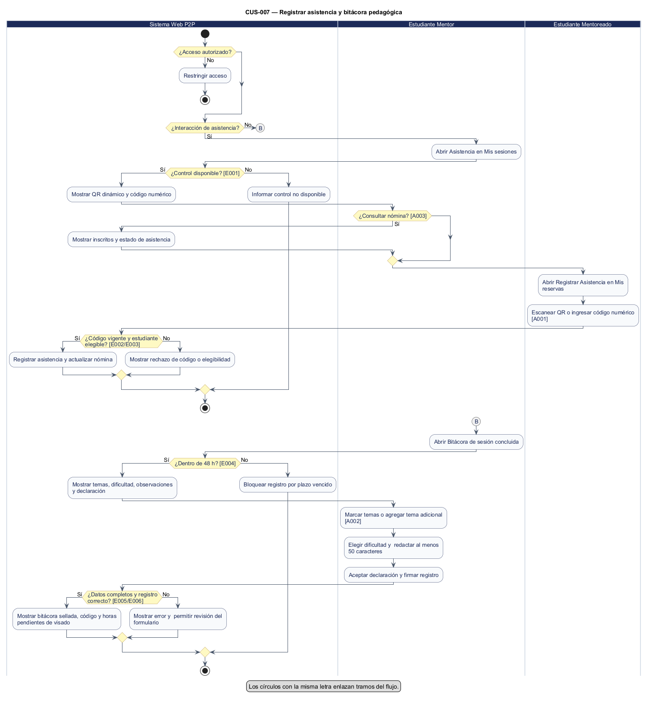

Fuente PlantUML: [CUS-007_actividades.puml](docs/narrativas/diagramas/plantuml/CUS-007_actividades.puml).

Fuente: Elaboración propia.

##### 7.6. Diagrama de caso de uso

**Figura 6.2.3-24. Diagrama de caso de uso — CUS-007: Registrar asistencia y bitácora pedagógica.**

Fuente PlantUML: [CUS-007_caso_de_uso.puml](docs/narrativas/diagramas/plantuml/CUS-007_caso_de_uso.puml).

Fuente: Elaboración propia.

---

#### CUS-012 — Registrar calificación y feedback bidireccional

##### 7.1. Ficha descriptiva

| Atributo | Detalle |
|---|---|
| **Id Caso de Uso** | **UC-012** (CUS-012) |
| **Nombre** | Registrar calificación y feedback bidireccional |
| **Tipo** | Opcional |
| **Requisito ID (RF)** | RF-020, RF-018; RN-12, RN-13 |
| **Versión** | 2.3 (DOC-H02 — consolidación) |
| **Autor** | Antayhua Mamani, Renzo Antonio / Medina Quispe, Joan Cristian |
| **Actores** | Estudiante Mentoreado; Estudiante Mentor (retroalimentación cualitativa parcial) |
| **Interacción** | Interacción web institucional; comportamiento descrito conforme a la evidencia identificada. |
| **Descripción** | Permite al asistente evaluar la calidad de una sesión y al mentor consignar observaciones pedagógicas mediante la bitácora. La evaluación recíproca individual no está acreditada. |
| **Referencias** | SWEBOK v3.0, ISO/IEC/IEEE 29148:2018, SRS y reglas de negocio EPIS-UPT. |
| **Precondiciones** | Sesión concluida, asistencia registrada y ventana de encuesta vigente (24 h); mentor titular para bitácora. |
| **Postcondiciones** | Encuesta registrada correctamente y, por separado, observaciones del mentor mediante CUS-007. |

**Estado de evidencia:** Implementación parcial: encuesta del asistente y bitácora del mentor.

##### 7.2. Flujo normal de eventos

| **Acción del Actor** | **Respuesta del Sistema** |
|---|---|
| **Fase 1: Acceso a evaluación** |  |
| **1.** El estudiante abre «Mis reservas» y localiza una mentoría asistida. |  |
|  | **2.** Muestra datos de la sesión y «⭐ Evaluar Mentoría» si corresponde. Si el plazo cerró, E001; si no es elegible, E002. |
| **3.** Pulsa «Evaluar Mentoría». |  |
|  | **4.** Abre «Encuesta de Calidad Docente» con sesión y mentor, cuatro dimensiones y opción de retroalimentación. |
| **Fase 2: Calificación** |  |
| **5.** Selecciona entre una y cinco estrellas para «Puntualidad e Inicio de Sesión», «Dominio Conceptual y Temático», «Claridad Expositiva y Metodología Didáctica» y «Calificación General del Servicio de Mentoría». |  |
|  | **6.** Resalta las estrellas elegidas para cada criterio y conserva los valores; permite corregir antes del envío. |
| **7.** Escribe en «Retroalimentación y observaciones constructivas». |  |
|  | **8.** Comprueba que el texto tenga al menos 20 caracteres y que las cuatro dimensiones estén calificadas; mantiene el envío inactivo si faltan datos (E003). |
| **Fase 3: Registro de evaluación** |  |
| **9.** Revisa y envía la encuesta. |  |
|  | **10.** Comprueba elegibilidad, plazo y registro previo; si ya evaluó, E004; si falla, E005. |
| **11.** Consulta la confirmación. |  |
|  | **12.** Muestra «¡Gracias por tu Evaluación!» y permite «Cerrar Ventana»; conserva el resultado recibido. |
| **Fase 4: Retroalimentación del mentor (independiente)** |  |
| **13.** El mentor abre «Bitácora» en su sesión y registra dificultad del grupo, observaciones y recomendaciones, conforme a CUS-007. |  |
|  | **14.** Conserva la retroalimentación pedagógica de la sesión. No presenta un formulario de calificación individual de cada mentoreado. |

##### 7.3. Flujos alternativos

###### A001: Cancelar evaluación

* **Paso origen:** Flujo normal, en la operación indicada por la condición.
* **Condición de activación:** Antes del envío.

| **Acción del Actor** | **Respuesta del Sistema** |
|---|---|
| **A001-1.** Pulsa «Cancelar» o cierra la ventana. |  |
|  | **A001-2.** Cierra sin registrar encuesta. |
| **A001-3.** Puede volver mientras sea elegible. |  |

###### A002: Modificar calificación antes del envío

* **Paso origen:** Flujo normal, en la operación indicada por la condición.
* **Condición de activación:** Encuesta abierta.

| **Acción del Actor** | **Respuesta del Sistema** |
|---|---|
| **A002-1.** Selecciona otras estrellas o edita comentarios. |  |
|  | **A002-2.** Actualiza valores pendientes. |
| **A002-3.** Revisa y envía cuando complete los campos. |  |

##### 7.4. Flujos de excepción

###### E001: Ventana vencida

* **Paso origen:** 2.
* **Condición de activación:** Más de 24 h tras cierre.

| **Acción del Actor** | **Respuesta del Sistema** |
|---|---|
|  | **E001-1.** Muestra «Encuesta Cerrada (Plazo de 24h Vencido)» e impide enviar. |
| **E001-2.** Consulta historial. |  |

###### E002: Sin asistencia elegible

* **Paso origen:** 2.
* **Condición de activación:** No figura asistencia o sesión no concluida.

| **Acción del Actor** | **Respuesta del Sistema** |
|---|---|
|  | **E002-1.** No habilita o rechaza la encuesta. |
| **E002-2.** Verifica reserva y asistencia. |  |

###### E003: Encuesta incompleta

* **Paso origen:** 8.
* **Condición de activación:** Faltan estrellas o comentario mínimo.

| **Acción del Actor** | **Respuesta del Sistema** |
|---|---|
|  | **E003-1.** Bloquea envío. |
| **E003-2.** Completa las cuatro dimensiones y al menos 20 caracteres. |  |

###### E004: Evaluación previa

* **Paso origen:** 10.
* **Condición de activación:** Encuesta ya registrada.

| **Acción del Actor** | **Respuesta del Sistema** |
|---|---|
|  | **E004-1.** No registra una segunda evaluación si no está permitida; comunica el resultado disponible. |
| **E004-2.** Cierra y revisa la sesión. |  |

###### E005: Fallo de envío

* **Paso origen:** 10.
* **Condición de activación:** Error de servicio.

| **Acción del Actor** | **Respuesta del Sistema** |
|---|---|
|  | **E005-1.** Muestra error y restablece controles sin confirmar. |
| **E005-2.** Comprueba si ya se registró antes de repetir. |  |

##### 7.5. Diagrama de flujo de actividades

**Figura 6.2.3-25. Diagrama de actividades — CUS-012: Registrar calificación y feedback bidireccional.**

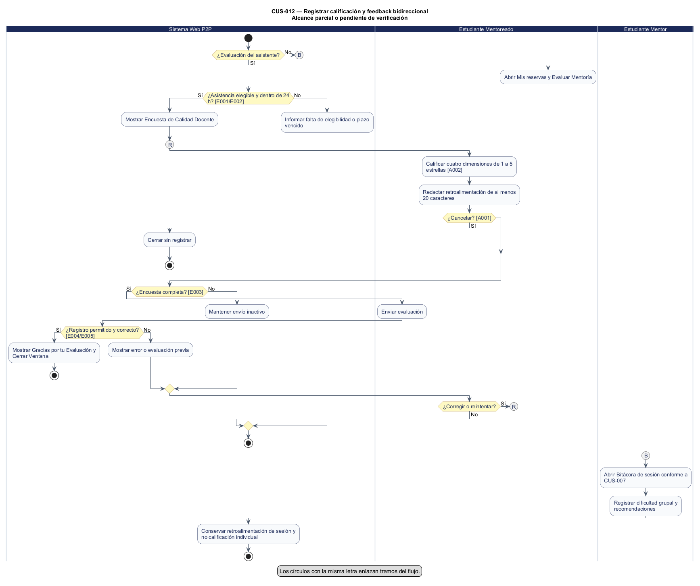

Fuente PlantUML: [CUS-012_actividades.puml](docs/narrativas/diagramas/plantuml/CUS-012_actividades.puml).

Fuente: Elaboración propia.

##### 7.6. Diagrama de caso de uso

**Figura 6.2.3-26. Diagrama de caso de uso — CUS-012: Registrar calificación y feedback bidireccional.**

Fuente PlantUML: [CUS-012_caso_de_uso.puml](docs/narrativas/diagramas/plantuml/CUS-012_caso_de_uso.puml).

Fuente: Elaboración propia.

---

#### CUS-013 — Consultar historial académico de mentorías

##### 7.1. Ficha descriptiva

| Atributo | Detalle |
|---|---|
| **Id Caso de Uso** | **UC-013** (CUS-013) |
| **Nombre** | Consultar historial académico de mentorías |
| **Tipo** | Opcional |
| **Requisito ID (RF)** | RF-019; relacionado con RF-012, RF-018, RF-020 |
| **Versión** | 2.3 (DOC-H02 — consolidación) |
| **Autor** | Antayhua Mamani, Renzo Antonio / Medina Quispe, Joan Cristian |
| **Actores** | Estudiante Mentoreado; Estudiante Mentor |
| **Interacción** | Interacción web institucional; comportamiento descrito conforme a la evidencia identificada. |
| **Descripción** | Permite revisar los registros de participación en mentorías y sus estados, diferenciando reservas personales y sesiones impartidas. |
| **Referencias** | SWEBOK v3.0, ISO/IEC/IEEE 29148:2018, SRS y reglas de negocio EPIS-UPT. |
| **Precondiciones** | Sesión institucional con rol correspondiente; registros consultables. |
| **Postcondiciones** | Se presenta la información histórica disponible sin modificar los registros. |

**Estado de evidencia:** Implementación parcial: historial de reservas y sesiones.

##### 7.2. Flujo normal de eventos

| **Acción del Actor** | **Respuesta del Sistema** |
|---|---|
| **Fase 1: Historial de reservas** |  |
| **1.** El mentoreado abre «Mis reservas». |  |
|  | **2.** Muestra «Mis Reservas de Mentoría», contadores y filtros de estado, controles «Actualizar» y «+ Buscar Mentorías». |
| **3.** Selecciona el filtro de histórico. |  |
|  | **4.** Presenta reservas canceladas, no confirmadas, asistidas o con inasistencia según sus estados disponibles. Si no hay registros, A001. |
| **5.** Revisa una tarjeta. |  |
|  | **6.** Presenta asignatura, código, tema, estado, fecha y hora, modalidad, espacio, mentor responsable y fecha de reserva; ofrece únicamente las acciones que procedan para esa reserva. |
| **7.** Consulta otro filtro o actualiza. |  |
|  | **8.** Renueva los registros disponibles; no cambia el estado por consultar. Si falla, E001. |
| **Fase 2: Historial de sesiones del mentor (interacción independiente)** |  |
| **9.** El mentor selecciona «Mis sesiones». |  |
|  | **10.** Muestra «Mis Mentorías Académicas Programadas» con sus sesiones, estados y seguimiento de inscritos; si no hay sesiones, A001. |
| **11.** Revisa una sesión y sus opciones. |  |
|  | **12.** Presenta información de programación, aforo y acciones de asistencia o bitácora cuando correspondan; la constancia de horas se consulta en «Mis constancias» (CUS-014). |

##### 7.3. Flujos alternativos

###### A001: Sin historial

* **Paso origen:** 4, 10.
* **Condición de activación:** No existen registros para el filtro.

| **Acción del Actor** | **Respuesta del Sistema** |
|---|---|
| **A001-1.** Cambia filtro o utiliza «Explorar Clases Recomendadas» (mentoreado). |  |
|  | **A001-2.** Muestra «No se encontraron reservas» o mensaje de ausencia de sesiones; ofrece navegación aplicable. |
| **A001-3.** Consulta otro resultado. |  |

###### A002: Actualizar información

* **Paso origen:** Flujo normal, en la operación indicada por la condición.
* **Condición de activación:** Vista abierta.

| **Acción del Actor** | **Respuesta del Sistema** |
|---|---|
| **A002-1.** Pulsa «Actualizar» donde esté disponible o reingresa a la vista. |  |
|  | **A002-2.** Vuelve a consultar los registros personales. |
| **A002-3.** Revisa cambios. |  |

##### 7.4. Flujos de excepción

###### E001: Fallo de consulta

* **Paso origen:** 8.
* **Condición de activación:** Servicio no disponible.

| **Acción del Actor** | **Respuesta del Sistema** |
|---|---|
|  | **E001-1.** Informa que no fue posible cargar reservas o sesiones; ofrece «Reintentar Consulta» en reservas. |
| **E001-2.** Restablece conexión y reintenta. |  |

###### E002: Acceso no autorizado

* **Paso origen:** Flujo normal, en la operación indicada por la condición.
* **Condición de activación:** Sesión inválida o rol no permitido.

| **Acción del Actor** | **Respuesta del Sistema** |
|---|---|
|  | **E002-1.** Restringe la vista personal. |
| **E002-2.** Inicia sesión con cuenta autorizada. |  |

##### 7.5. Diagrama de flujo de actividades

**Figura 6.2.3-27. Diagrama de actividades — CUS-013: Consultar historial académico de mentorías.**

Fuente PlantUML: [CUS-013_actividades.puml](docs/narrativas/diagramas/plantuml/CUS-013_actividades.puml).

Fuente: Elaboración propia.

##### 7.6. Diagrama de caso de uso

**Figura 6.2.3-28. Diagrama de caso de uso — CUS-013: Consultar historial académico de mentorías.**

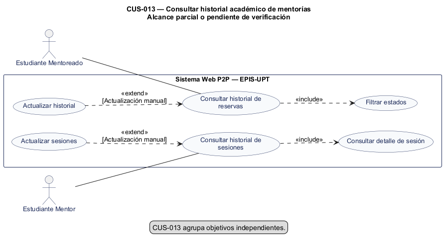

Fuente PlantUML: [CUS-013_caso_de_uso.puml](docs/narrativas/diagramas/plantuml/CUS-013_caso_de_uso.puml).

Fuente: Elaboración propia.

---

#### CUS-014 — Emitir constancia de horas de mentoría

##### 7.1. Ficha descriptiva

| Atributo | Detalle |
|---|---|
| **Id Caso de Uso** | **UC-014** (CUS-014) |
| **Nombre** | Emitir constancia de horas de mentoría |
| **Tipo** | Opcional |
| **Requisito ID (RF)** | RF-022, RF-023; RN-14 |
| **Versión** | 2.3 (DOC-H02 — consolidación) |
| **Autor** | Antayhua Mamani, Renzo Antonio / Medina Quispe, Joan Cristian |
| **Actores** | Estudiante Mentor; Administrador institucional (visado previo) |
| **Interacción** | Interacción web institucional; comportamiento descrito conforme a la evidencia identificada. |
| **Descripción** | Permite consultar horas acreditadas, comprobar el umbral de certificación, emitir una constancia digital y descargarla o verificarla por folio. |
| **Referencias** | SWEBOK v3.0, ISO/IEC/IEEE 29148:2018, SRS y reglas de negocio EPIS-UPT. |
| **Precondiciones** | Mentor autenticado; horas declaradas en bitácoras y visadas por Dirección; umbral de referencia de 20 h acreditadas en el periodo. |
| **Postcondiciones** | Constancia emitida con folio, horas acreditadas y código de verificación; documento PDF disponible si se genera correctamente. |

**Estado de evidencia:** Implementación identificada; constancia DEMO y validación real pendiente.

##### 7.2. Flujo normal de eventos

| **Acción del Actor** | **Respuesta del Sistema** |
|---|---|
| **Fase 1: Consulta de horas** |  |
| **1.** Selecciona «Mis constancias». |  |
|  | **2.** Muestra «Acreditación y Constancias Oficiales de Mentoría», periodo académico y progreso hacia el umbral de acreditación. Si falla la consulta, E001. |
| **3.** Revisa «Horas Acreditadas (Visadas por Dirección)» y «Horas en Revisión Provisional». |  |
|  | **4.** Presenta valores separados, barra de avance, porcentaje y condición «ELEGIBLE PARA CERTIFICACIÓN» o cantidad de horas faltantes. Si no alcanza el umbral, A001. |
| **Fase 2: Emisión** |  |
| **5.** Cuando es elegible, pulsa «Emitir Constancia Oficial». |  |
|  | **6.** Muestra «Generando PDF Oficial y QR...», comprueba identidad, periodo y horas acreditadas. Si no cumple, E002; si ya existe constancia, A002. |
| **7.** Espera la respuesta. |  |
|  | **8.** Presenta confirmación de emisión con folio asignado y datos de acreditación; muestra controles de descarga y verificación. Si falla, E003. |
| **Fase 3: Descarga y autenticidad** |  |
| **9.** Pulsa «Descargar Constancia en PDF». |  |
|  | **10.** Entrega el documento generado si está disponible y muestra el estado de descarga. Si falla, E003. |
| **11.** Pulsa «Verificar QR». |  |
|  | **12.** Abre «Verificación de Autenticidad Institucional» y consulta folio; presenta el resultado, mentor titular y horas acreditadas cuando es válido. |
| **13.** Cierra la ventana de verificación. |  |
|  | **14.** Retorna a la constancia sin modificar las horas ni emitir otro documento. |

##### 7.3. Flujos alternativos

###### A001: Horas insuficientes

* **Paso origen:** 4.
* **Condición de activación:** Menos del umbral de horas visadas.

| **Acción del Actor** | **Respuesta del Sistema** |
|---|---|
| **A001-1.** Consulta las horas faltantes. |  |
|  | **A001-2.** Muestra aviso pedagógico RN-14 y bloquea emisión; orienta al registro y visado de bitácoras. |
| **A001-3.** Regresa a Mis sesiones o consulta más adelante. |  |

###### A002: Constancia ya emitida

* **Paso origen:** 6.
* **Condición de activación:** Existe documento para el periodo.

| **Acción del Actor** | **Respuesta del Sistema** |
|---|---|
| **A002-1.** Consulta la constancia mostrada. |  |
|  | **A002-2.** Ofrece descargar PDF y verificar QR sin necesidad de emitir otra. |
| **A002-3.** Descarga o verifica. |  |

###### A003: Revisar horas pendientes

* **Paso origen:** Flujo normal, en la operación indicada por la condición.
* **Condición de activación:** Existen bitácoras sin visado.

| **Acción del Actor** | **Respuesta del Sistema** |
|---|---|
| **A003-1.** Consulta el desglose de horas. |  |
|  | **A003-2.** Distingue las provisionales de las acreditadas. |
| **A003-3.** Consulta con Dirección según CUS-019. |  |

##### 7.4. Flujos de excepción

###### E001: Resumen no disponible

* **Paso origen:** 2.
* **Condición de activación:** Error al consultar horas.

| **Acción del Actor** | **Respuesta del Sistema** |
|---|---|
|  | **E001-1.** Informa el problema sin asegurar elegibilidad. |
| **E001-2.** Reintenta la consulta. |  |

###### E002: No elegible o no autorizado

* **Paso origen:** 6.
* **Condición de activación:** Horas insuficientes, periodo o identidad incompatible.

| **Acción del Actor** | **Respuesta del Sistema** |
|---|---|
|  | **E002-1.** Rechaza emisión o mantiene acción bloqueada. |
| **E002-2.** Regulariza las horas o sesión. |  |

###### E003: Fallo de emisión/descarga/verificación

* **Paso origen:** 8, 10.
* **Condición de activación:** Servicio o archivo no disponible, folio no reconocido.

| **Acción del Actor** | **Respuesta del Sistema** |
|---|---|
|  | **E003-1.** Muestra error o resultado no válido según operación. |
| **E003-2.** Comprueba si existe constancia antes de volver a emitir. |  |

##### 7.5. Diagrama de flujo de actividades

**Figura 6.2.3-29. Diagrama de actividades — CUS-014: Emitir constancia de horas de mentoría.**

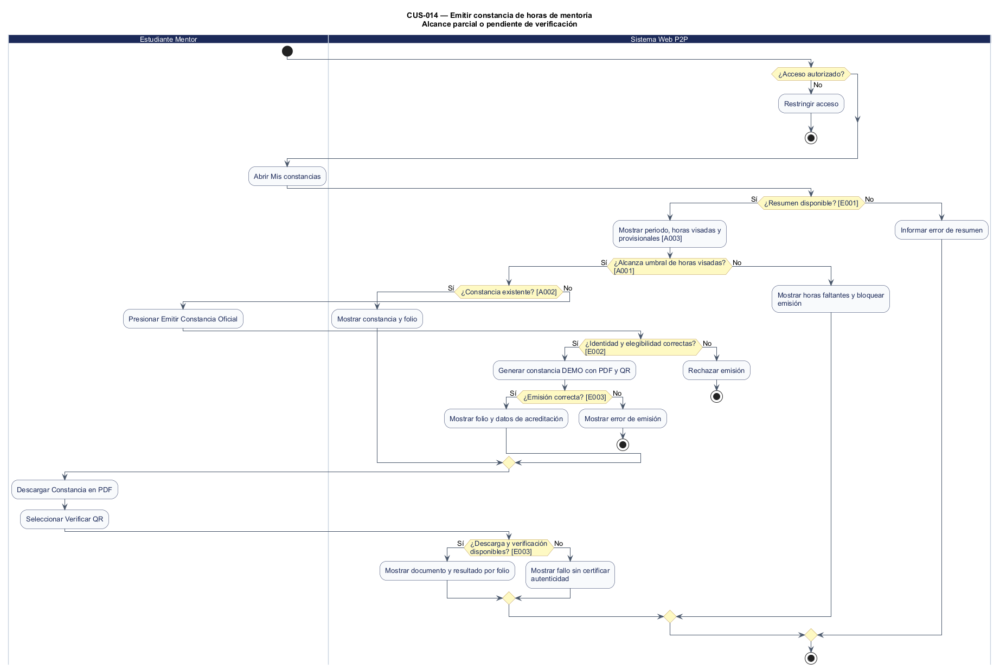

Fuente PlantUML: [CUS-014_actividades.puml](docs/narrativas/diagramas/plantuml/CUS-014_actividades.puml).

Fuente: Elaboración propia.

##### 7.6. Diagrama de caso de uso

**Figura 6.2.3-30. Diagrama de caso de uso — CUS-014: Emitir constancia de horas de mentoría.**

Fuente PlantUML: [CUS-014_caso_de_uso.puml](docs/narrativas/diagramas/plantuml/CUS-014_caso_de_uso.puml).

Fuente: Elaboración propia.

---

#### CUS-018 — Gestionar justificación de inasistencia a sesión

##### 7.1. Ficha descriptiva

| Atributo | Detalle |
|---|---|
| **Id Caso de Uso** | **UC-018** (CUS-018) |
| **Nombre** | Gestionar justificación de inasistencia a sesión |
| **Tipo** | Opcional |
| **Requisito ID (RF)** | RF-014, RF-017 (relación funcional); requisito específico por formalizar |
| **Versión** | 2.3 (DOC-H02 — consolidación) |
| **Autor** | Antayhua Mamani, Renzo Antonio / Medina Quispe, Joan Cristian |
| **Actores** | Estudiante Mentoreado; Administrador o responsable académico (actor previsto) |
| **Interacción** | Interacción web institucional; flujo propuesto pendiente de implementación. |
| **Descripción** | Propone gestionar una justificación de ausencia posterior a una sesión, diferenciándola de la cancelación voluntaria antes del corte. |
| **Referencias** | SWEBOK v3.0, ISO/IEC/IEEE 29148:2018, SRS y reglas de negocio EPIS-UPT. |
| **Precondiciones** | Propuesta: reserva con estado INASISTENCIA, solicitante titular, plazo y responsable institucional definidos. |
| **Postcondiciones** | Propuesta: justificación registrada y resolución trazable; efecto académico conforme a política aprobada. |

**Estado de evidencia:** Pendiente: no se identificó trámite específico.

##### 7.2. Flujo normal de eventos

| **Acción del Actor** | **Respuesta del Sistema** |
|---|---|
| **Fase 1: Identificación de inasistencia (parcialmente disponible)** |  |
| **1.** El mentoreado abre «Mis reservas» y consulta el histórico. |  |
|  | **2.** Presenta las reservas y sus estados, incluida INASISTENCIA cuando corresponda. No hay opción de justificar acreditada. |
| **Fase 2: Registro de justificación (propuesto)** |  |
| **3.** Selecciona la reserva ausente y solicita registrar una justificación. |  |
|  | **4.** Deberá mostrar sesión y estado, motivo obligatorio y condiciones institucionales aplicables. Los documentos adjuntos y plazo requieren definición. |
| **5.** Describe la circunstancia y envía. |  |
|  | **6.** Deberá comprobar titularidad, elegibilidad y completitud; registrar la solicitud sin alterar automáticamente la asistencia. |
| **Fase 3: Revisión institucional (propuesto)** |  |
| **7.** El responsable autorizado consulta la justificación y analiza el motivo. |  |
|  | **8.** Deberá mostrar antecedentes y permitir una decisión motivada (A001/A002). |
| **9.** Registra la decisión. |  |
|  | **10.** Deberá conservar estado, fecha y responsable; aplicar únicamente los efectos académicos establecidos por el reglamento. |
| **11.** El solicitante consulta su resultado. |  |
|  | **12.** Deberá presentar la resolución sin confundir justificación con asistencia efectiva. |

##### 7.3. Flujos alternativos

###### A001: Solicitar información adicional

* **Paso origen:** 8.
* **Condición de activación:** Motivo insuficiente.

| **Acción del Actor** | **Respuesta del Sistema** |
|---|---|
| **A001-1.** El responsable solicita aclaración. |  |
|  | **A001-2.** Deberá conservar solicitud pendiente y observación. |
| **A001-3.** El estudiante subsana si la política lo permite. |  |

###### A002: Rechazar justificación

* **Paso origen:** 8.
* **Condición de activación:** No cumple los criterios.

| **Acción del Actor** | **Respuesta del Sistema** |
|---|---|
| **A002-1.** El responsable registra el motivo. |  |
|  | **A002-2.** Deberá conservar rechazo y estado de asistencia original. |
| **A002-3.** Finaliza el trámite. |  |

##### 7.4. Flujos de excepción

###### E001: Reserva no elegible

* **Paso origen:** Flujo normal, en la operación indicada por la condición.
* **Condición de activación:** No es inasistencia propia o está fuera de plazo definido.

| **Acción del Actor** | **Respuesta del Sistema** |
|---|---|
|  | **E001-1.** Deberá bloquear registro y explicar condición. |
| **E001-2.** Consulta estado o canal institucional. |  |

###### E002: Justificación incompleta o duplicada

* **Paso origen:** Flujo normal, en la operación indicada por la condición.
* **Condición de activación:** Falta motivo o existe trámite incompatible.

| **Acción del Actor** | **Respuesta del Sistema** |
|---|---|
|  | **E002-1.** Deberá impedir duplicidad y pedir corrección. |
| **E002-2.** Revisa los datos. |  |

###### E003: Fallo de registro

* **Paso origen:** Flujo normal, en la operación indicada por la condición.
* **Condición de activación:** No se puede conservar solicitud o resolución.

| **Acción del Actor** | **Respuesta del Sistema** |
|---|---|
|  | **E003-1.** Deberá informar error sin declarar éxito. |
| **E003-2.** Verifica estado antes de reintentar. |  |

##### 7.5. Diagrama de flujo de actividades

**Figura 6.2.3-31. Diagrama de actividades — CUS-018: Gestionar justificación de inasistencia a sesión.**

Fuente PlantUML: [CUS-018_actividades.puml](docs/narrativas/diagramas/plantuml/CUS-018_actividades.puml).

Fuente: Elaboración propia.

##### 7.6. Diagrama de caso de uso

**Figura 6.2.3-32. Diagrama de caso de uso — CUS-018: Gestionar justificación de inasistencia a sesión.**

Fuente PlantUML: [CUS-018_caso_de_uso.puml](docs/narrativas/diagramas/plantuml/CUS-018_caso_de_uso.puml).

Fuente: Elaboración propia.

---

#### CUS-019 — Consultar bitácoras de mentoría por tutor

##### 7.1. Ficha descriptiva

| Atributo | Detalle |
|---|---|
| **Id Caso de Uso** | **UC-019** (CUS-019) |
| **Nombre** | Consultar bitácoras de mentoría por tutor |
| **Tipo** | Opcional |
| **Requisito ID (RF)** | RF-018, RF-026; RN-12, RN-14 |
| **Versión** | 2.3 (DOC-H02 — consolidación) |
| **Autor** | Antayhua Mamani, Renzo Antonio / Medina Quispe, Joan Cristian |
| **Actores** | Tutor académico (actor previsto); Administrador institucional (función existente) |
| **Interacción** | Interacción web institucional; comportamiento descrito conforme a la evidencia identificada. |
| **Descripción** | Permite revisar el contenido y estado de las bitácoras. Actualmente la interfaz administrativa ofrece consulta, visado y observación; la función específica de tutor requiere definición. |
| **Referencias** | SWEBOK v3.0, ISO/IEC/IEEE 29148:2018, SRS y reglas de negocio EPIS-UPT. |
| **Precondiciones** | Sesión administrativa vigente para la función existente; bitácoras registradas. Para tutor, permisos y alcance por definir. |
| **Postcondiciones** | Se consultan las bitácoras; si el administrador visa u observa, se actualiza el estado según la operación. El acceso de tutor no está acreditado. |

**Estado de evidencia:** Implementación parcial: auditoría por Administrador; tutor no identificado.

##### 7.2. Flujo normal de eventos

| **Acción del Actor** | **Respuesta del Sistema** |
|---|---|
| **Fase 1: Consulta administrativa (disponible)** |  |
| **1.** El administrador selecciona «Administración» > «Auditoría de Bitácoras». |  |
|  | **2.** Muestra «Bandeja de Auditoría de Bitácoras y Visado Institucional de Horas» y explica que solo las visadas se acreditan. |
| **3.** Selecciona «Todas las Bitácoras», «Pendientes de Visado», «Horas Visadas y Acreditadas» u «Observadas para Corrección». |  |
|  | **4.** Filtra la tabla; presenta identificador, mentor titular, horas declaradas, estado y acciones disponibles. Si no hay datos, A001. |
| **5.** Abre el detalle de una bitácora. |  |
|  | **6.** Presenta «Detalle de Bitácora Pedagógica», mentor, temas cubiertos y observaciones docentes. Permite cerrar el detalle sin modificarlo. |
| **Fase 2: Revisión y visado administrativo (relacionado)** |  |
| **7.** Si cuenta con competencia administrativa y considera conforme el registro, pulsa «Aprobar y Visar Horas». |  |
|  | **8.** Procesa el visado; actualiza estado y horas acreditadas. Si detecta discrepancia, A002; si falla, E001. |
| **9.** Consulta el resultado mediante el filtro correspondiente. |  |
|  | **10.** Muestra la bitácora actualizada conforme a la respuesta del servicio. |
| **Fase 3: Consulta por tutor (propuesta)** |  |
| **11.** Un tutor autorizado consulta las bitácoras de sus estudiantes o sesiones asignadas. |  |
|  | **12.** Deberá mostrar únicamente las bitácoras de su ámbito y permitir consulta de detalle; no se presupone permiso de visado para el tutor. |

##### 7.3. Flujos alternativos

###### A001: Sin bitácoras

* **Paso origen:** 4.
* **Condición de activación:** Filtro sin resultados.

| **Acción del Actor** | **Respuesta del Sistema** |
|---|---|
| **A001-1.** Cambia filtro. |  |
|  | **A001-2.** Muestra «No se registraron bitácoras bajo el filtro seleccionado». |
| **A001-3.** Consulta otro conjunto. |  |

###### A002: Observar bitácora

* **Paso origen:** 8.
* **Condición de activación:** Administrador detecta discrepancia.

| **Acción del Actor** | **Respuesta del Sistema** |
|---|---|
| **A002-1.** Pulsa «Observar Bitácora», escribe motivo fundamentado y confirma. |  |
|  | **A002-2.** Muestra ventana de observación; si el registro se completa, actualiza estado a observado. |
| **A002-3.** Revisa bandeja de observadas. |  |

###### A003: Consulta sin visado

* **Paso origen:** Flujo normal, en la operación indicada por la condición.
* **Condición de activación:** Solo requiere lectura.

| **Acción del Actor** | **Respuesta del Sistema** |
|---|---|
| **A003-1.** Abre y cierra el detalle. |  |
|  | **A003-2.** No altera estado ni horas. |
| **A003-3.** Retorna a tabla. |  |

##### 7.4. Flujos de excepción

###### E001: Fallo de consulta o visado

* **Paso origen:** 8.
* **Condición de activación:** Servicio no disponible.

| **Acción del Actor** | **Respuesta del Sistema** |
|---|---|
|  | **E001-1.** Muestra mensaje de error sin acreditar horas nuevas. |
| **E001-2.** Revisa estado y reintenta si corresponde. |  |

###### E002: Acceso o alcance no permitido

* **Paso origen:** Flujo normal, en la operación indicada por la condición.
* **Condición de activación:** Rol no autorizado.

| **Acción del Actor** | **Respuesta del Sistema** |
|---|---|
|  | **E002-1.** Restringe funciones administrativas; para tutor deberá verificarse su ámbito. |
| **E002-2.** Solicita autorización institucional. |  |

###### E003: Observación sin motivo

* **Paso origen:** Flujo normal, en la operación indicada por la condición.
* **Condición de activación:** Motivo requerido no consignado.

| **Acción del Actor** | **Respuesta del Sistema** |
|---|---|
|  | **E003-1.** No debe confirmar observación incompleta. |
| **E003-2.** Completa el motivo. |  |

##### 7.5. Diagrama de flujo de actividades

**Figura 6.2.3-33. Diagrama de actividades — CUS-019: Consultar bitácoras de mentoría por tutor.**

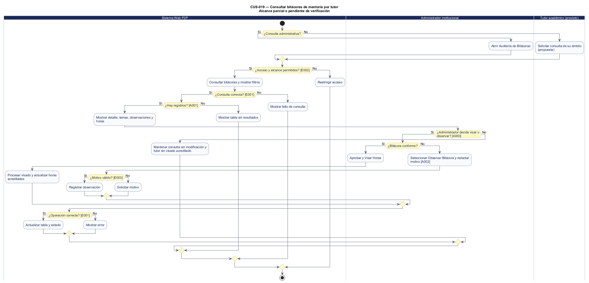

Fuente PlantUML: [CUS-019_actividades.puml](docs/narrativas/diagramas/plantuml/CUS-019_actividades.puml).

Fuente: Elaboración propia.

##### 7.6. Diagrama de caso de uso

**Figura 6.2.3-34. Diagrama de caso de uso — CUS-019: Consultar bitácoras de mentoría por tutor.**

Fuente PlantUML: [CUS-019_caso_de_uso.puml](docs/narrativas/diagramas/plantuml/CUS-019_caso_de_uso.puml).

Fuente: Elaboración propia.

---

### MOD-05: Administración y Analítica Institucional

#### CUS-009 — Consultar analítica institucional de mentorías

##### 7.1. Ficha descriptiva

| Atributo | Detalle |
|---|---|
| **Id Caso de Uso** | **UC-009** (CUS-009) |
| **Nombre** | Consultar analítica institucional de mentorías |
| **Tipo** | Opcional |
| **Requisito ID (RF)** | RF-025; relacionado con RF-015, RF-026, RN-09 |
| **Versión** | 2.3 (DOC-H02 — consolidación) |
| **Autor** | Antayhua Mamani, Renzo Antonio / Medina Quispe, Joan Cristian |
| **Actores** | Administrador institucional |
| **Interacción** | Interacción web institucional; comportamiento descrito conforme a la evidencia identificada. |
| **Descripción** | Permite supervisar información operativa de mentorías y propone consolidar indicadores institucionales de participación, retención y calidad. |
| **Referencias** | SWEBOK v3.0, ISO/IEC/IEEE 29148:2018, SRS y reglas de negocio EPIS-UPT. |
| **Precondiciones** | Sesión administrativa vigente; datos de sesiones y reservas disponibles. Para analítica integral, métricas y periodo definidos. |
| **Postcondiciones** | Se presentan indicadores consultados; no se modifican sesiones por consultar. Indicadores integrales quedan sujetos a implementación. |

**Estado de evidencia:** Implementación parcial: monitoreo de quórum; analítica integral pendiente.

##### 7.2. Flujo normal de eventos

| **Acción del Actor** | **Respuesta del Sistema** |
|---|---|
| **Fase 1: Acceso al monitoreo existente** |  |
| **1.** Selecciona «Administración» y «Monitoreo de Quórum». |  |
|  | **2.** Muestra «Supervisión de Quórum y Sesiones EPIS», explicación de cálculo por reservas ratificadas y porcentaje de aforo, y botón «Actualizar». |
| **3.** Espera la consulta de sesiones. |  |
|  | **4.** Muestra «Cargando sesiones y estados de quórum...» y, si existen ofertas, tarjetas con datos de sesión, estado, inscritos, ratificados, mínimo y porcentaje reglamentario. |
| **5.** Compara los indicadores entre sesiones. |  |
|  | **6.** Presenta el avance de cada sesión frente a su mínimo; no modifica reservas ni ejecuta corte por la sola consulta. |
| **7.** Presiona «Actualizar». |  |
|  | **8.** Renueva los datos. Si no hay sesiones, A001; si hay error, E001. |
| **Fase 2: Analítica consolidada (propuesta)** |  |
| **9.** Selecciona periodo e indicadores institucionales de interés. |  |
|  | **10.** Deberá presentar métricas agregadas de oferta, demanda, participación y calidad, con definiciones y fuente verificables. No hay panel integral acreditado. |
| **11.** Revisa resultados y solicita el reporte cuando corresponda. |  |
|  | **12.** Deberá presentar valores contextualizados por periodo, sin confundir simulación algorítmica con datos operativos reales; exportación corresponde a CUS-011. |

##### 7.3. Flujos alternativos

###### A001: Sin sesiones

* **Paso origen:** 8.
* **Condición de activación:** No hay ofertas disponibles.

| **Acción del Actor** | **Respuesta del Sistema** |
|---|---|
| **A001-1.** Consulta otro momento o actualiza. |  |
|  | **A001-2.** Muestra «No se registraron ofertas de mentoría activas en la plataforma». |
| **A001-3.** Retorna al panel. |  |

###### A002: Consulta específica

* **Paso origen:** Flujo normal, en la operación indicada por la condición.
* **Condición de activación:** Interés en una sesión.

| **Acción del Actor** | **Respuesta del Sistema** |
|---|---|
| **A002-1.** Revisa su tarjeta de quórum. |  |
|  | **A002-2.** Muestra inscritos, ratificados y mínimo. |
| **A002-3.** Compara con otras sesiones. |  |

##### 7.4. Flujos de excepción

###### E001: Fallo de consulta

* **Paso origen:** 8.
* **Condición de activación:** No se obtienen indicadores.

| **Acción del Actor** | **Respuesta del Sistema** |
|---|---|
|  | **E001-1.** Informa error disponible; no debe representar ausencia de datos como cero. |
| **E001-2.** Actualiza y revisa la conexión. |  |

###### E002: Acceso no autorizado

* **Paso origen:** Flujo normal, en la operación indicada por la condición.
* **Condición de activación:** Sesión sin privilegios.

| **Acción del Actor** | **Respuesta del Sistema** |
|---|---|
|  | **E002-1.** Restringe panel. |
| **E002-2.** Inicia sesión como administrador. |  |

###### E003: Indicador no definido

* **Paso origen:** Flujo normal, en la operación indicada por la condición.
* **Condición de activación:** Métrica o periodo sin datos suficientes (propuesta).

| **Acción del Actor** | **Respuesta del Sistema** |
|---|---|
|  | **E003-1.** Deberá informar que el indicador no está disponible. |
| **E003-2.** Ajusta el periodo o solicita definición. |  |

##### 7.5. Diagrama de flujo de actividades

**Figura 6.2.3-35. Diagrama de actividades — CUS-009: Consultar analítica institucional de mentorías.**

Fuente PlantUML: [CUS-009_actividades.puml](docs/narrativas/diagramas/plantuml/CUS-009_actividades.puml).

Fuente: Elaboración propia.

##### 7.6. Diagrama de caso de uso

**Figura 6.2.3-36. Diagrama de caso de uso — CUS-009: Consultar analítica institucional de mentorías.**

Fuente PlantUML: [CUS-009_caso_de_uso.puml](docs/narrativas/diagramas/plantuml/CUS-009_caso_de_uso.puml).

Fuente: Elaboración propia.

---

#### CUS-011 — Exportar reportes ejecutivos consolidados

##### 7.1. Ficha descriptiva

| Atributo | Detalle |
|---|---|
| **Id Caso de Uso** | **UC-011** (CUS-011) |
| **Nombre** | Exportar reportes ejecutivos consolidados |
| **Tipo** | Opcional |
| **Requisito ID (RF)** | RF-025; relacionado con RF-026 |
| **Versión** | 2.3 (DOC-H02 — consolidación) |
| **Autor** | Antayhua Mamani, Renzo Antonio / Medina Quispe, Joan Cristian |
| **Actores** | Administrador institucional |
| **Interacción** | Interacción web institucional; flujo propuesto pendiente de implementación. |
| **Descripción** | Propone generar un archivo de reporte institucional consolidado a partir de indicadores y filtros aprobados. |
| **Referencias** | SWEBOK v3.0, ISO/IEC/IEEE 29148:2018, SRS y reglas de negocio EPIS-UPT. |
| **Precondiciones** | Propuesta: actor autorizado, datos de analítica disponibles, periodo y formato definidos. |
| **Postcondiciones** | Propuesta: reporte descargable con fecha, periodo, alcance y métricas verificables; no altera datos operativos. |

**Estado de evidencia:** Pendiente: no se identificó exportación ejecutiva.

##### 7.2. Flujo normal de eventos

| **Acción del Actor** | **Respuesta del Sistema** |
|---|---|
| **Fase 1: Preparación del reporte (propuesto)** |  |
| **1.** El administrador accede a la analítica institucional y selecciona un periodo. |  |
|  | **2.** Deberá presentar los filtros e indicadores autorizados y sus definiciones. La interfaz actual solo acredita monitoreo de quórum y auditoría de bitácoras. |
| **3.** Selecciona las métricas que requiere consolidar. |  |
|  | **4.** Deberá mostrar alcance de datos y una vista previa con totales y unidades. |
| **Fase 2: Generación (propuesto)** |  |
| **5.** Elige el formato de salida que haya sido aprobado y solicita la generación. |  |
|  | **6.** Deberá validar permisos, periodo, disponibilidad e integridad de datos; no exportar datos personales innecesarios. |
| **7.** Revisa la vista previa. |  |
|  | **8.** Deberá indicar periodo, fecha de generación y criterios utilizados. Si no hay datos, A001. |
| **9.** Confirma la descarga. |  |
|  | **10.** Deberá generar el archivo en el formato definido y permitir descargarlo; si falla, E002. |
| **11.** Verifica el reporte. |  |
|  | **12.** Deberá conservar los indicadores consultados y permitir una nueva generación con filtros distintos. |

##### 7.3. Flujos alternativos

###### A001: Cambiar filtros

* **Paso origen:** 8.
* **Condición de activación:** Antes de generar.

| **Acción del Actor** | **Respuesta del Sistema** |
|---|---|
| **A001-1.** Modifica periodo o indicadores. |  |
|  | **A001-2.** Deberá actualizar vista previa. |
| **A001-3.** Revisa y genera. |  |

###### A002: Sin información

* **Paso origen:** Flujo normal, en la operación indicada por la condición.
* **Condición de activación:** Periodo sin registros.

| **Acción del Actor** | **Respuesta del Sistema** |
|---|---|
| **A002-1.** Selecciona otro periodo. |  |
|  | **A002-2.** Deberá informar ausencia de datos sin inventar totales. |
| **A002-3.** Revisa el nuevo resultado. |  |

##### 7.4. Flujos de excepción

###### E001: Acceso restringido

* **Paso origen:** Flujo normal, en la operación indicada por la condición.
* **Condición de activación:** Usuario sin permiso.

| **Acción del Actor** | **Respuesta del Sistema** |
|---|---|
|  | **E001-1.** Deberá impedir generación y descarga. |
| **E001-2.** Solicita acceso autorizado. |  |

###### E002: Fallo de generación

* **Paso origen:** 10.
* **Condición de activación:** Datos o archivo no disponible.

| **Acción del Actor** | **Respuesta del Sistema** |
|---|---|
|  | **E002-1.** Deberá comunicar fallo sin afirmar descarga completada. |
| **E002-2.** Corrige filtros o reintenta. |  |

###### E003: Formato no definido

* **Paso origen:** Flujo normal, en la operación indicada por la condición.
* **Condición de activación:** Formato o conjunto de datos no aprobado.

| **Acción del Actor** | **Respuesta del Sistema** |
|---|---|
|  | **E003-1.** Deberá bloquear exportación no soportada. |
| **E003-2.** Selecciona formato autorizado. |  |

##### 7.5. Diagrama de flujo de actividades

**Figura 6.2.3-37. Diagrama de actividades — CUS-011: Exportar reportes ejecutivos consolidados.**

Fuente PlantUML: [CUS-011_actividades.puml](docs/narrativas/diagramas/plantuml/CUS-011_actividades.puml).

Fuente: Elaboración propia.

##### 7.6. Diagrama de caso de uso

**Figura 6.2.3-38. Diagrama de caso de uso — CUS-011: Exportar reportes ejecutivos consolidados.**

Fuente PlantUML: [CUS-011_caso_de_uso.puml](docs/narrativas/diagramas/plantuml/CUS-011_caso_de_uso.puml).

Fuente: Elaboración propia.

---

#### CUS-015 — Configurar parámetros del algoritmo de recomendación

##### 7.1. Ficha descriptiva

| Atributo | Detalle |
|---|---|
| **Id Caso de Uso** | **UC-015** (CUS-015) |
| **Nombre** | Configurar parámetros del algoritmo de recomendación |
| **Tipo** | Opcional |
| **Requisito ID (RF)** | RF-006, RF-024; RN-11 |
| **Versión** | 2.3 (DOC-H02 — consolidación) |
| **Autor** | Antayhua Mamani, Renzo Antonio / Medina Quispe, Joan Cristian |
| **Actores** | Administrador institucional |
| **Interacción** | Interacción web institucional; flujo propuesto pendiente de implementación. |
| **Descripción** | Propone permitir al administrador consultar y ajustar criterios autorizados que intervienen en el orden de recomendaciones, sin modificar directamente la programación de mentorías. |
| **Referencias** | SWEBOK v3.0, ISO/IEC/IEEE 29148:2018, SRS y reglas de negocio EPIS-UPT. |
| **Precondiciones** | Propuesta: sesión administrativa, parámetros configurables y rangos aprobados, criterios de evaluación definidos. |
| **Postcondiciones** | Propuesta: configuración versionada, validada y aplicable a recomendaciones futuras; no afecta reservas existentes. |

**Estado de evidencia:** Pendiente: interfaz de parametrización no identificada.

##### 7.2. Flujo normal de eventos

| **Acción del Actor** | **Respuesta del Sistema** |
|---|---|
| **Fase 1: Consulta de configuración (propuesto)** |  |
| **1.** Accede a la configuración de recomendaciones. |  |
|  | **2.** Deberá presentar valores vigentes y explicación de los factores: afinidad curricular, reputación, carga y prioridad de materia, según RN-11. No existe panel de edición identificado. |
| **3.** Revisa el alcance de cada parámetro. |  |
|  | **4.** Deberá distinguir parámetros ajustables de reglas institucionales fijas y del número de candidatos seleccionable por el mentoreado (CUS-002). |
| **Fase 2: Edición (propuesto)** |  |
| **5.** Modifica los parámetros permitidos. |  |
|  | **6.** Deberá verificar tipo, rango y coherencia de los valores conforme a las reglas aprobadas. |
| **7.** Solicita una comprobación previa. |  |
|  | **8.** Deberá presentar el resultado de validación y, si se autoriza, una comparación controlada con datos de prueba, sin afectar ofertas reales. |
| **Fase 3: Aplicación (propuesto)** |  |
| **9.** Confirma la nueva configuración. |  |
|  | **10.** Deberá registrar valores anteriores y nuevos, responsable y fecha; aplicar la configuración solo si la validación concluye correctamente. |
| **11.** Consulta la configuración vigente. |  |
|  | **12.** Deberá mostrar los valores aplicados y permitir revisar cambios posteriores. |

##### 7.3. Flujos alternativos

###### A001: Cancelar edición

* **Paso origen:** Flujo normal, en la operación indicada por la condición.
* **Condición de activación:** Cambios sin confirmar.

| **Acción del Actor** | **Respuesta del Sistema** |
|---|---|
| **A001-1.** Abandona la edición. |  |
|  | **A001-2.** Deberá conservar configuración anterior. |
| **A001-3.** Retorna a consulta. |  |

###### A002: Restaurar valores aprobados

* **Paso origen:** Flujo normal, en la operación indicada por la condición.
* **Condición de activación:** Existe configuración previa autorizada.

| **Acción del Actor** | **Respuesta del Sistema** |
|---|---|
| **A002-1.** Solicita restauración y confirma. |  |
|  | **A002-2.** Deberá validar y registrar una nueva versión con los valores restaurados. |
| **A002-3.** Consulta valores vigentes. |  |

##### 7.4. Flujos de excepción

###### E001: Valores fuera de rango

* **Paso origen:** Flujo normal, en la operación indicada por la condición.
* **Condición de activación:** Parámetros inválidos.

| **Acción del Actor** | **Respuesta del Sistema** |
|---|---|
|  | **E001-1.** Deberá impedir guardar y señalar la restricción. |
| **E001-2.** Corrige valores. |  |

###### E002: Permisos insuficientes

* **Paso origen:** Flujo normal, en la operación indicada por la condición.
* **Condición de activación:** Usuario no autorizado.

| **Acción del Actor** | **Respuesta del Sistema** |
|---|---|
|  | **E002-1.** Deberá restringir consulta sensible y cambios. |
| **E002-2.** Solicita acceso. |  |

###### E003: Fallo de aplicación

* **Paso origen:** Flujo normal, en la operación indicada por la condición.
* **Condición de activación:** No se puede validar o guardar.

| **Acción del Actor** | **Respuesta del Sistema** |
|---|---|
|  | **E003-1.** Deberá conservar configuración vigente y comunicar fallo. |
| **E003-2.** Verifica estado antes de repetir. |  |

##### 7.5. Diagrama de flujo de actividades

**Figura 6.2.3-39. Diagrama de actividades — CUS-015: Configurar parámetros del algoritmo de recomendación.**

Fuente PlantUML: [CUS-015_actividades.puml](docs/narrativas/diagramas/plantuml/CUS-015_actividades.puml).

Fuente: Elaboración propia.

##### 7.6. Diagrama de caso de uso

**Figura 6.2.3-40. Diagrama de caso de uso — CUS-015: Configurar parámetros del algoritmo de recomendación.**

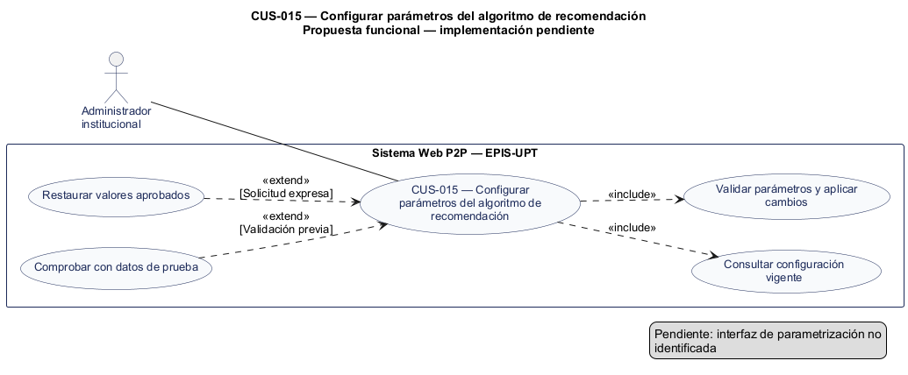

Fuente PlantUML: [CUS-015_caso_de_uso.puml](docs/narrativas/diagramas/plantuml/CUS-015_caso_de_uso.puml).

Fuente: Elaboración propia.

---

#### CUS-016 — Gestionar auditoría de eventos de seguridad

##### 7.1. Ficha descriptiva

| Atributo | Detalle |
|---|---|
| **Id Caso de Uso** | **UC-016** (CUS-016) |
| **Nombre** | Gestionar auditoría de eventos de seguridad |
| **Tipo** | Obligatorio según alcance previsto |
| **Requisito ID (RF)** | RF-002, RF-026; RN-01, RN-02 |
| **Versión** | 2.3 (DOC-H02 — consolidación) |
| **Autor** | Antayhua Mamani, Renzo Antonio / Medina Quispe, Joan Cristian |
| **Actores** | Administrador institucional; responsable de seguridad (actor previsto) |
| **Interacción** | Interacción web institucional; flujo propuesto pendiente de implementación. |
| **Descripción** | Propone consultar eventos de autenticación, consentimiento y cambios de privilegios para supervisar el acceso y tratamiento de información institucional. |
| **Referencias** | SWEBOK v3.0, ISO/IEC/IEEE 29148:2018, SRS y reglas de negocio EPIS-UPT. |
| **Precondiciones** | Propuesta: responsable autorizado, registros de eventos disponibles y política de acceso, retención y privacidad definida. |
| **Postcondiciones** | Propuesta: consulta de eventos trazables sin modificar su contenido; incidentes derivados por el canal institucional. |

**Estado de evidencia:** Pendiente: bandeja integral de seguridad no identificada.

##### 7.2. Flujo normal de eventos

| **Acción del Actor** | **Respuesta del Sistema** |
|---|---|
| **Fase 1: Acceso a registros (propuesto)** |  |
| **1.** El responsable autorizado selecciona la función de auditoría de seguridad. |  |
|  | **2.** Deberá presentar filtros de periodo, tipo de evento y resultado, con acceso limitado a los datos necesarios. No se identificó una bandeja integral en la interfaz actual. |
| **3.** Selecciona un periodo y una categoría, por ejemplo acceso, consentimiento o cambio de rol. |  |
|  | **4.** Deberá recuperar los eventos correspondientes y mostrar fecha, categoría y resultado, evitando exponer códigos de acceso o secretos. |
| **Fase 2: Revisión (propuesto)** |  |
| **5.** Selecciona un evento para consultar su detalle. |  |
|  | **6.** Deberá mostrar información permitida para verificar origen y contexto; no debe permitir modificar o borrar el registro desde esta consulta. |
| **7.** Identifica una anomalía o consulta otro conjunto. |  |
|  | **8.** Deberá permitir filtrar nuevamente y conservar la evidencia de origen; la gestión de incidentes externos deberá definirse por separado. |
| **Fase 3: Finalización (propuesto)** |  |
| **9.** Cierra la consulta. |  |
|  | **10.** Deberá mantener la integridad de los registros y limitar la exposición de datos personales. |

##### 7.3. Flujos alternativos

###### A001: Consulta de consentimiento

* **Paso origen:** Flujo normal, en la operación indicada por la condición.
* **Condición de activación:** Evento relacionado con aceptación o rechazo.

| **Acción del Actor** | **Respuesta del Sistema** |
|---|---|
| **A001-1.** Selecciona el evento de consentimiento. |  |
|  | **A001-2.** Deberá presentar estado, versión y fecha disponibles, conforme al permiso. |
| **A001-3.** Retorna al listado. |  |

###### A002: Sin resultados

* **Paso origen:** Flujo normal, en la operación indicada por la condición.
* **Condición de activación:** Filtro sin eventos.

| **Acción del Actor** | **Respuesta del Sistema** |
|---|---|
| **A002-1.** Cambia filtros. |  |
|  | **A002-2.** Deberá indicar ausencia de resultados, no ausencia probada de incidentes. |
| **A002-3.** Consulta otro periodo. |  |

##### 7.4. Flujos de excepción

###### E001: Acceso no autorizado

* **Paso origen:** Flujo normal, en la operación indicada por la condición.
* **Condición de activación:** Rol o ámbito insuficiente.

| **Acción del Actor** | **Respuesta del Sistema** |
|---|---|
|  | **E001-1.** Deberá bloquear consulta y comunicar restricción. |
| **E001-2.** Solicita permisos institucionales. |  |

###### E002: Registros no disponibles

* **Paso origen:** Flujo normal, en la operación indicada por la condición.
* **Condición de activación:** Fallo o información incompleta.

| **Acción del Actor** | **Respuesta del Sistema** |
|---|---|
|  | **E002-1.** Deberá informar que no puede recuperar evidencia. |
| **E002-2.** Reintenta o deriva al responsable. |  |

###### E003: Filtro inválido

* **Paso origen:** Flujo normal, en la operación indicada por la condición.
* **Condición de activación:** Periodo o criterio inválido.

| **Acción del Actor** | **Respuesta del Sistema** |
|---|---|
|  | **E003-1.** Deberá solicitar corrección sin exponer datos. |
| **E003-2.** Ajusta filtros. |  |

##### 7.5. Diagrama de flujo de actividades

**Figura 6.2.3-41. Diagrama de actividades — CUS-016: Gestionar auditoría de eventos de seguridad.**

Fuente PlantUML: [CUS-016_actividades.puml](docs/narrativas/diagramas/plantuml/CUS-016_actividades.puml).

Fuente: Elaboración propia.

##### 7.6. Diagrama de caso de uso

**Figura 6.2.3-42. Diagrama de caso de uso — CUS-016: Gestionar auditoría de eventos de seguridad.**

Fuente PlantUML: [CUS-016_caso_de_uso.puml](docs/narrativas/diagramas/plantuml/CUS-016_caso_de_uso.puml).

Fuente: Elaboración propia.

---

#### CUS-017 — Configurar ambientes físicos y virtuales

##### 7.1. Ficha descriptiva

| Atributo | Detalle |
|---|---|
| **Id Caso de Uso** | **UC-017** (CUS-017) |
| **Nombre** | Configurar ambientes físicos y virtuales |
| **Tipo** | Obligatorio |
| **Requisito ID (RF)** | RF-009, RF-010; RN-06, RN-07 |
| **Versión** | 2.3 (DOC-H02 — consolidación) |
| **Autor** | Antayhua Mamani, Renzo Antonio / Medina Quispe, Joan Cristian |
| **Actores** | Administrador institucional; Estudiante Mentor (selección de infraestructura en CUS-006) |
| **Interacción** | Interacción web institucional; comportamiento descrito conforme a la evidencia identificada. |
| **Descripción** | Permite actualizar el banco de disponibilidad física a partir de cronogramas oficiales y consultar las franjas libres para programar mentorías; la asignación virtual se realiza en CUS-006. |
| **Referencias** | SWEBOK v3.0, ISO/IEC/IEEE 29148:2018, SRS y reglas de negocio EPIS-UPT. |
| **Precondiciones** | Sesión administrativa; archivo oficial de horarios compatible, con franjas y recintos identificables. |
| **Postcondiciones** | Cronograma procesado y franjas disponibles actualizadas si la importación termina correctamente; reservas vigentes preservadas según resultado del servicio. |

**Estado de evidencia:** Implementación parcial: importación y consulta de cronogramas; configuración virtual pendiente.

##### 7.2. Flujo normal de eventos

| **Acción del Actor** | **Respuesta del Sistema** |
|---|---|
| **Fase 1: Acceso a cronogramas** |  |
| **1.** El administrador abre «Administración» > «Cronograma de Aulas (RF10)». |  |
|  | **2.** Muestra sección de carga y análisis de horarios oficiales, área «Cargar Archivo Oficial de Distribución Horaria» y consulta de franjas. |
| **Fase 2: Carga de archivo** |  |
| **3.** Arrastra el documento oficial al área indicada o hace clic para explorar. |  |
|  | **4.** Admite formatos .xlsx, .xls y .pdf con máximo indicado de 15 MB; muestra nombre y tamaño del archivo seleccionado. Si no es admitido, E001. |
| **5.** Revisa archivo y pulsa «Procesar Cronograma con Parser». |  |
|  | **6.** Muestra «Procesando Cronograma con Parser...»; analiza el documento y actualiza las franjas de infraestructura. Si falla el procesamiento, E002. |
| **Fase 3: Consulta del resultado** |  |
| **7.** Espera la confirmación. |  |
|  | **8.** Muestra «¡Cronograma oficial procesado exitosamente por el Parser de Horarios!» y resumen de resultado, incluyendo disponibilidad identificada y reservas activas preservadas cuando se informa. |
| **9.** Consulta la tabla de franjas libres. |  |
|  | **10.** Muestra aulas, días, hora de inicio, hora de fin y referencias de origen cuando existen (fila Excel o página PDF). |
| **11.** Busca por aula o día, o selecciona filtros «Todas las Aulas» y «Todos los Días». |  |
|  | **12.** Actualiza la vista de franjas; permite volver a consultar. Si no hay coincidencias, A002. |
| **Fase 4: Asignación posterior** |  |
| **13.** El mentor programa una sesión presencial en CUS-006. |  |
|  | **14.** Consulta aulas disponibles para toda la duración y revalida al publicar. Para virtual, el formulario permite introducir o generar dirección de reunión; no hay panel administrativo de proveedores virtuales acreditado. |

##### 7.3. Flujos alternativos

###### A001: Cancelar archivo

* **Paso origen:** Flujo normal, en la operación indicada por la condición.
* **Condición de activación:** Antes de procesar.

| **Acción del Actor** | **Respuesta del Sistema** |
|---|---|
| **A001-1.** Pulsa «Cancelar». |  |
|  | **A001-2.** Retira la selección del archivo sin procesarlo. |
| **A001-3.** Selecciona otro documento si corresponde. |  |

###### A002: Filtrar franjas

* **Paso origen:** 12.
* **Condición de activación:** Consulta de disponibilidad.

| **Acción del Actor** | **Respuesta del Sistema** |
|---|---|
| **A002-1.** Busca por recinto o día o ajusta filtros. |  |
|  | **A002-2.** Muestra únicamente coincidencias; la consulta no reserva el aula. |
| **A002-3.** Retira filtros o actualiza. |  |

###### A003: Consultar infraestructura virtual

* **Paso origen:** Flujo normal, en la operación indicada por la condición.
* **Condición de activación:** Publicación en modalidad virtual.

| **Acción del Actor** | **Respuesta del Sistema** |
|---|---|
| **A003-1.** Selecciona Virtual en CUS-006. |  |
|  | **A003-2.** Presenta el campo de enlace; no constituye configuración institucional de salas. |
| **A003-3.** Continúa el caso de publicación. |  |

##### 7.4. Flujos de excepción

###### E001: Archivo no admitido

* **Paso origen:** 4.
* **Condición de activación:** Formato o tamaño fuera del límite.

| **Acción del Actor** | **Respuesta del Sistema** |
|---|---|
|  | **E001-1.** Rechaza selección/procesamiento y comunica restricción. |
| **E001-2.** Selecciona un archivo compatible. |  |

###### E002: Procesamiento fallido

* **Paso origen:** 6.
* **Condición de activación:** Documento inválido, estructura no reconocida o fallo del servicio.

| **Acción del Actor** | **Respuesta del Sistema** |
|---|---|
|  | **E002-1.** Muestra error; no confirma actualización exitosa. |
| **E002-2.** Corrige documento y verifica cronograma vigente antes de reintentar. |  |

###### E003: Consulta fallida

* **Paso origen:** Flujo normal, en la operación indicada por la condición.
* **Condición de activación:** No se pueden recuperar franjas.

| **Acción del Actor** | **Respuesta del Sistema** |
|---|---|
|  | **E003-1.** Informa problema disponible. |
| **E003-2.** Actualiza o reintenta cuando se restablezca. |  |

###### E004: Sin autorización

* **Paso origen:** Flujo normal, en la operación indicada por la condición.
* **Condición de activación:** Acceso no administrativo.

| **Acción del Actor** | **Respuesta del Sistema** |
|---|---|
|  | **E004-1.** Restringe la gestión de cronogramas. |
| **E004-2.** Inicia sesión como administrador. |  |

##### 7.5. Diagrama de flujo de actividades

**Figura 6.2.3-43. Diagrama de actividades — CUS-017: Configurar ambientes físicos y virtuales.**

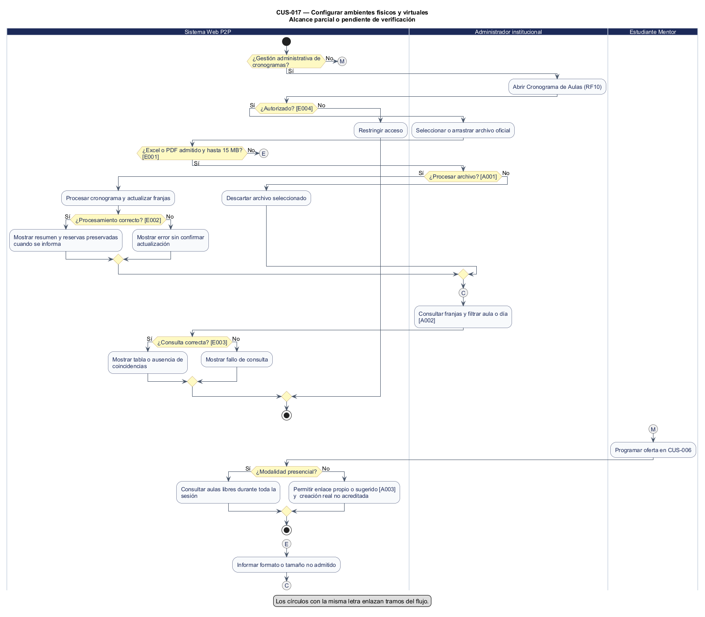

Fuente PlantUML: [CUS-017_actividades.puml](docs/narrativas/diagramas/plantuml/CUS-017_actividades.puml).

Fuente: Elaboración propia.

##### 7.6. Diagrama de caso de uso

**Figura 6.2.3-44. Diagrama de caso de uso — CUS-017: Configurar ambientes físicos y virtuales.**

Fuente PlantUML: [CUS-017_caso_de_uso.puml](docs/narrativas/diagramas/plantuml/CUS-017_caso_de_uso.puml).

Fuente: Elaboración propia.

---

#### CUS-020 — Gestionar catálogo curricular y asignaturas

##### 7.1. Ficha descriptiva

| Atributo | Detalle |
|---|---|
| **Id Caso de Uso** | **UC-020** (CUS-020) |
| **Nombre** | Gestionar catálogo curricular y asignaturas |
| **Tipo** | Obligatorio |
| **Requisito ID (RF)** | RF-005; relacionado con RF-006, RF-007, RF-008 y RN-11 |
| **Versión** | 2.3 (DOC-H02 — consolidación) |
| **Autor** | Antayhua Mamani, Renzo Antonio / Medina Quispe, Joan Cristian |
| **Actores** | Administrador institucional; visitantes, mentores y mentoreados (consulta pública relacionada) |
| **Interacción** | Interacción web institucional; comportamiento descrito conforme a la evidencia identificada. |
| **Descripción** | Permite gestionar asignaturas y temas del catálogo curricular para que los procesos de perfil, demanda, oferta y recomendación utilicen contenidos institucionales. |
| **Referencias** | SWEBOK v3.0, ISO/IEC/IEEE 29148:2018, SRS y reglas de negocio EPIS-UPT. |
| **Precondiciones** | Para modificaciones, sesión administrativa y consentimiento; catálogo disponible. La consulta de Cursos puede ser pública. |
| **Postcondiciones** | Asignaturas y temas registrados, editados o desactivados según la operación exitosa; la consulta no modifica datos. |

**Estado de evidencia:** Implementación identificada; revisión estática.

##### 7.2. Flujo normal de eventos

| **Acción del Actor** | **Respuesta del Sistema** |
|---|---|
| **Fase 1: Acceso y consulta** |  |
| **1.** El administrador abre «Administración» > «Catálogo Curricular (RF05)». |  |
|  | **2.** Presenta buscador por curso, código o tema, selector «Ciclo Formativo», «Actualizar», listado «Asignaturas del Plan Curricular» con contador y sección «Temario Silábico Oficial». |
| **3.** Busca una asignatura o selecciona ciclo I a IV o todos. |  |
|  | **4.** Filtra resultados y muestra código, ciclo y otros datos disponibles; al elegir una asignatura, presenta detalle y unidades conceptuales. Si no hay coincidencias, A001. |
| **Fase 2: Registrar asignatura** |  |
| **5.** Pulsa «Nueva Asignatura Crítica». |  |
|  | **6.** Abre «Registrar Asignatura Crítica (RF05)» con código, nombre oficial, ciclo (1 a 10), créditos, factor de ponderación y condición prioritaria, según los controles disponibles; ofrece «Cancelar» y «Registrar Asignatura». |
| **7.** Completa datos y presiona «Registrar Asignatura». |  |
|  | **8.** Muestra «Guardando...», comprueba los datos y registra la asignatura. Si hay error, E001; para modificar una existente, A002. |
| **9.** Revisa la nueva asignatura y selecciona su temario. |  |
|  | **10.** Actualiza el listado y presenta el detalle de la asignatura. |
| **Fase 3: Registrar tema silábico** |  |
| **11.** Pulsa «Nuevo Tema». |  |
|  | **12.** Abre «Incorporar Tema al Sílabo (RF05)» con título del concepto, unidad silábica y descripción. Ofrece «Cancelar» y «Incorporar Tema». |
| **13.** Completa los datos del tema y confirma. |  |
|  | **14.** Valida y registra el tema asociado a la asignatura; actualiza la lista de unidades y temas. |
| **Fase 4: Verificación del catálogo** |  |
| **15.** Revisa la información registrada. |  |
|  | **16.** Muestra el temario actualizado. Las acciones «Editar Asignatura», «Desactivar Asignatura», «Editar Tema» y «Desactivar Tema» permiten la gestión posterior (A002/A003). |

##### 7.3. Flujos alternativos

###### A001: Buscar o consultar sin modificación

* **Paso origen:** 4.
* **Condición de activación:** Catálogo abierto.

| **Acción del Actor** | **Respuesta del Sistema** |
|---|---|
| **A001-1.** Escribe un término, cambia ciclo o pulsa «Actualizar». |  |
|  | **A001-2.** Filtra o recarga el catálogo; si no hay temas, muestra aviso correspondiente. |
| **A001-3.** Selecciona otra asignatura o cierra. |  |

###### A002: Editar asignatura o tema

* **Paso origen:** 8, 16.
* **Condición de activación:** Registro existente.

| **Acción del Actor** | **Respuesta del Sistema** |
|---|---|
| **A002-1.** Pulsa «Editar Asignatura» o «Editar Tema», modifica campos y presiona «Guardar Cambios». |  |
|  | **A002-2.** Presenta formulario precompletado, valida y actualiza el registro si concluye correctamente. |
| **A002-3.** Revisa el resultado. |  |

###### A003: Desactivar registro

* **Paso origen:** 16.
* **Condición de activación:** Asignatura o tema seleccionado.

| **Acción del Actor** | **Respuesta del Sistema** |
|---|---|
| **A003-1.** Pulsa «Desactivar Asignatura» o «Desactivar Tema» y confirma cuando se solicita. |  |
|  | **A003-2.** Procesa la desactivación conforme a las restricciones del servicio y actualiza listado; no se presume eliminación física de relaciones históricas. |
| **A003-3.** Verifica estado. |  |

###### A004: Cancelar edición

* **Paso origen:** Flujo normal, en la operación indicada por la condición.
* **Condición de activación:** Formulario abierto antes del envío.

| **Acción del Actor** | **Respuesta del Sistema** |
|---|---|
| **A004-1.** Pulsa «Cancelar». |  |
|  | **A004-2.** Cierra sin guardar la modificación pendiente. |
| **A004-3.** Retorna al catálogo. |  |

##### 7.4. Flujos de excepción

###### E001: Datos inválidos o duplicados

* **Paso origen:** 8.
* **Condición de activación:** No cumplen requisitos del registro.

| **Acción del Actor** | **Respuesta del Sistema** |
|---|---|
|  | **E001-1.** Rechaza la operación y muestra el error disponible. |
| **E001-2.** Corrige código, nombre, ciclo, unidad u otro campo afectado. |  |

###### E002: Acceso sin privilegios

* **Paso origen:** Flujo normal, en la operación indicada por la condición.
* **Condición de activación:** Usuario de consulta intenta modificar.

| **Acción del Actor** | **Respuesta del Sistema** |
|---|---|
|  | **E002-1.** No presenta controles administrativos o rechaza la modificación. |
| **E002-2.** Consulta como visitante o inicia sesión autorizada. |  |

###### E003: Fallo de consulta o guardado

* **Paso origen:** Flujo normal, en la operación indicada por la condición.
* **Condición de activación:** Catálogo no disponible o persistencia fallida.

| **Acción del Actor** | **Respuesta del Sistema** |
|---|---|
|  | **E003-1.** Muestra el error disponible sin confirmar cambios. |
| **E003-2.** Actualiza y verifica datos antes de reintentar. |  |

###### E004: Registro no modificable

* **Paso origen:** Flujo normal, en la operación indicada por la condición.
* **Condición de activación:** Inexistente o restricción de relaciones.

| **Acción del Actor** | **Respuesta del Sistema** |
|---|---|
|  | **E004-1.** Rechaza la operación según respuesta del servicio. |
| **E004-2.** Revisa registro vigente y relaciones. |  |

##### 7.5. Diagrama de flujo de actividades

**Figura 6.2.3-45. Diagrama de actividades — CUS-020: Gestionar catálogo curricular y asignaturas.**

Fuente PlantUML: [CUS-020_actividades.puml](docs/narrativas/diagramas/plantuml/CUS-020_actividades.puml).

Fuente: Elaboración propia.

##### 7.6. Diagrama de caso de uso

**Figura 6.2.3-46. Diagrama de caso de uso — CUS-020: Gestionar catálogo curricular y asignaturas.**

Fuente PlantUML: [CUS-020_caso_de_uso.puml](docs/narrativas/diagramas/plantuml/CUS-020_caso_de_uso.puml).

Fuente: Elaboración propia.

---

#### CUS-022 — Configurar parámetros de corte y penalización

##### 7.1. Ficha descriptiva

| Atributo | Detalle |
|---|---|
| **Id Caso de Uso** | **UC-022** (CUS-022) |
| **Nombre** | Configurar parámetros de corte y penalización |
| **Tipo** | Opcional |
| **Requisito ID (RF)** | RF-013, RF-014, RF-015, RF-024; RN-08, RN-09, RN-10 |
| **Versión** | 2.3 (DOC-H02 — consolidación) |
| **Autor** | Antayhua Mamani, Renzo Antonio / Medina Quispe, Joan Cristian |
| **Actores** | Administrador institucional |
| **Interacción** | Interacción web institucional; flujo propuesto pendiente de implementación. |
| **Descripción** | Propone que el administrador consulte y gestione los parámetros institucionales que rigen corte, quórum y consecuencias académicas, preservando la coherencia de reservas ya registradas. |
| **Referencias** | SWEBOK v3.0, ISO/IEC/IEEE 29148:2018, SRS y reglas de negocio EPIS-UPT. |
| **Precondiciones** | Propuesta: actor autorizado, reglamento aprobado y parámetros/efectos formalmente definidos. |
| **Postcondiciones** | Propuesta: configuración registrada y vigente para el ámbito definido; no modifica retroactivamente estados sin política explícita. |

**Estado de evidencia:** Pendiente: edición administrativa no identificada.

##### 7.2. Flujo normal de eventos

| **Acción del Actor** | **Respuesta del Sistema** |
|---|---|
| **Fase 1: Consulta de parámetros (propuesto)** |  |
| **1.** El administrador accede a la configuración de corte y penalización. |  |
|  | **2.** Deberá presentar parámetros vigentes y su explicación. La referencia actual es corte T-24 h y quórum del 50 %; el monitoreo existente muestra mínimo y porcentaje por sesión. |
| **3.** Revisa las condiciones de ratificación, desistimiento y quórum. |  |
|  | **4.** Deberá distinguir restricciones obligatorias de los valores realmente editables. No existe interfaz de configuración acreditada. |
| **Fase 2: Edición y validación (propuesto)** |  |
| **5.** Selecciona los parámetros autorizados que necesita ajustar. |  |
|  | **6.** Deberá comprobar valores, rangos y compatibilidad con las reglas de negocio. La política de penalización debe estar previamente definida. |
| **7.** Revisa el alcance temporal del cambio. |  |
|  | **8.** Deberá indicar desde cuándo aplica y si afecta nuevas ofertas, evitando cambios retroactivos no autorizados. |
| **9.** Confirma la actualización. |  |
|  | **10.** Deberá registrar responsable, fecha y valores; aplicar cambios solo si son válidos y conforme a la política aprobada. |
| **11.** Consulta el resultado. |  |
|  | **12.** Deberá mostrar configuración vigente. El corte operativo se ejecuta mediante CUS-023, no mediante la sola consulta. |

##### 7.3. Flujos alternativos

###### A001: Cancelar modificación

* **Paso origen:** Flujo normal, en la operación indicada por la condición.
* **Condición de activación:** Antes de confirmar.

| **Acción del Actor** | **Respuesta del Sistema** |
|---|---|
| **A001-1.** Abandona los cambios. |  |
|  | **A001-2.** Deberá conservar parámetros vigentes. |
| **A001-3.** Retorna al monitoreo. |  |

###### A002: Consultar sin modificar

* **Paso origen:** Flujo normal, en la operación indicada por la condición.
* **Condición de activación:** Solo requiere comprobar corte y porcentaje.

| **Acción del Actor** | **Respuesta del Sistema** |
|---|---|
| **A002-1.** Revisa los parámetros. |  |
|  | **A002-2.** Deberá presentar información sin cambiar valores. En el sistema actual puede consultar el quórum en Administración. |
| **A002-3.** Cierra la consulta. |  |

##### 7.4. Flujos de excepción

###### E001: Valores incompatibles

* **Paso origen:** Flujo normal, en la operación indicada por la condición.
* **Condición de activación:** Rango o regla institucional no permitida.

| **Acción del Actor** | **Respuesta del Sistema** |
|---|---|
|  | **E001-1.** Deberá bloquear actualización y mostrar motivo. |
| **E001-2.** Corrige datos. |  |

###### E002: Sin permiso

* **Paso origen:** Flujo normal, en la operación indicada por la condición.
* **Condición de activación:** Actor no autorizado.

| **Acción del Actor** | **Respuesta del Sistema** |
|---|---|
|  | **E002-1.** Deberá rechazar la modificación. |
| **E002-2.** Solicita acceso institucional. |  |

###### E003: Fallo al aplicar

* **Paso origen:** Flujo normal, en la operación indicada por la condición.
* **Condición de activación:** No se puede registrar la configuración.

| **Acción del Actor** | **Respuesta del Sistema** |
|---|---|
|  | **E003-1.** Deberá conservar valores vigentes y no declarar éxito. |
| **E003-2.** Comprueba antes de reintentar. |  |

##### 7.5. Diagrama de flujo de actividades

**Figura 6.2.3-47. Diagrama de actividades — CUS-022: Configurar parámetros de corte y penalización.**

Fuente PlantUML: [CUS-022_actividades.puml](docs/narrativas/diagramas/plantuml/CUS-022_actividades.puml).

Fuente: Elaboración propia.

##### 7.6. Diagrama de caso de uso

**Figura 6.2.3-48. Diagrama de caso de uso — CUS-022: Configurar parámetros de corte y penalización.**

Fuente PlantUML: [CUS-022_caso_de_uso.puml](docs/narrativas/diagramas/plantuml/CUS-022_caso_de_uso.puml).

Fuente: Elaboración propia.

---

---

# 6.3. Modelo Lógico

Las vistas siguientes adoptan los 24 identificadores del catálogo vigente. Las clases representan entidades declaradas y las secuencias identifican responsabilidades; una vista propuesta no atribuye un endpoint inexistente. Los modelos previos se conservan en [la edición histórica de diseño](docs/diseño/FD03-EPIS-Informe%20SRS%20de%20Proyecto.md).

## 6.3.1. Análisis de Objetos (Modelo ECB)

### Diagrama 6.13: Vista general

**Figura 16. Análisis de Objetos (Modelo ECB): vista general**

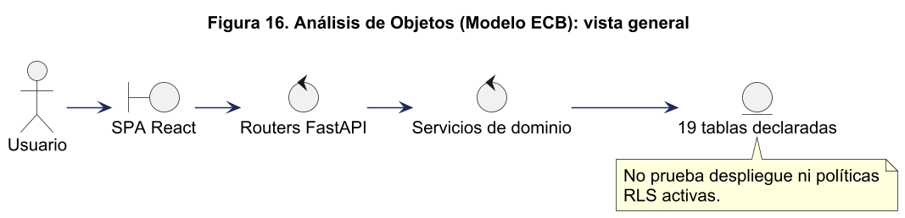

Fuente: Elaboración propia, DOC-H06. [Fuente PlantUML](docs/revision_srs/diagramas/doc-h06/srs/puml/diag_016_general.puml).

### 6.3.1.1. CUS-001 — Iniciar sesión institucional con 2FA

**Figura 17. Diagrama 6.13.1: ECB — CUS-001: Iniciar sesión institucional con 2FA**

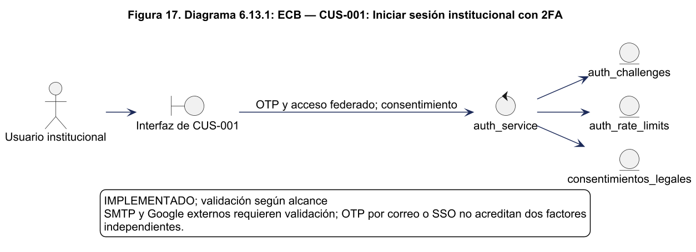

Fuente: Elaboración propia, DOC-H06. [Fuente PlantUML](docs/revision_srs/diagramas/doc-h06/srs/puml/CUS-001_ecb.puml).

### 6.3.1.2. CUS-010 — Gestionar asignación de roles de usuario

**Figura 18. Diagrama 6.13.2: ECB — CUS-010: Gestionar asignación de roles de usuario**

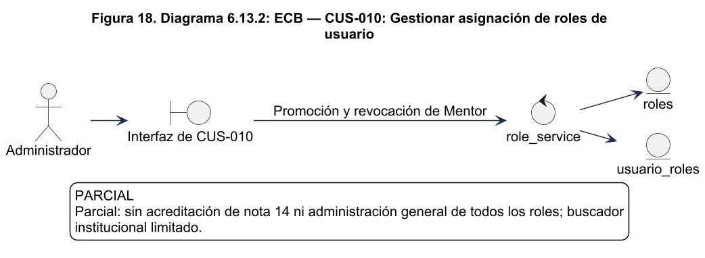

Fuente: Elaboración propia, DOC-H06. [Fuente PlantUML](docs/revision_srs/diagramas/doc-h06/srs/puml/CUS-010_ecb.puml).

### 6.3.1.3. CUS-006 — Registrar oferta de mentoría académica

**Figura 19. Diagrama 6.13.3: ECB — CUS-006: Registrar oferta de mentoría académica**

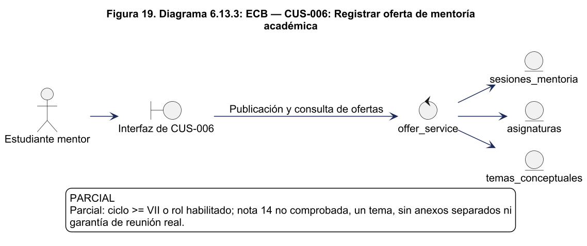

Fuente: Elaboración propia, DOC-H06. [Fuente PlantUML](docs/revision_srs/diagramas/doc-h06/srs/puml/CUS-006_ecb.puml).

### 6.3.1.4. CUS-008 — Gestionar demanda insatisfecha de mentoría

**Figura 20. Diagrama 6.13.4: ECB — CUS-008: Gestionar demanda insatisfecha de mentoría**

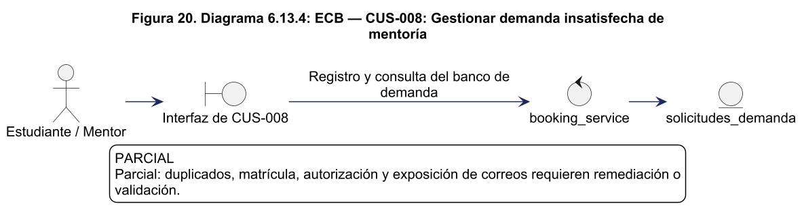

Fuente: Elaboración propia, DOC-H06. [Fuente PlantUML](docs/revision_srs/diagramas/doc-h06/srs/puml/CUS-008_ecb.puml).

### 6.3.1.5. CUS-005 — Postular al rol de estudiante mentor

**Figura 21. Diagrama 6.13.5: ECB — CUS-005: Postular al rol de estudiante mentor**

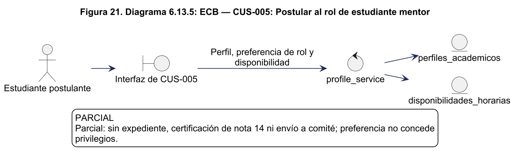

Fuente: Elaboración propia, DOC-H06. [Fuente PlantUML](docs/revision_srs/diagramas/doc-h06/srs/puml/CUS-005_ecb.puml).

### 6.3.1.6. CUS-021 — Evaluar postulaciones a mentor por comité

**Figura 22. Diagrama 6.13.6: ECB — CUS-021: Evaluar postulaciones a mentor por comité**

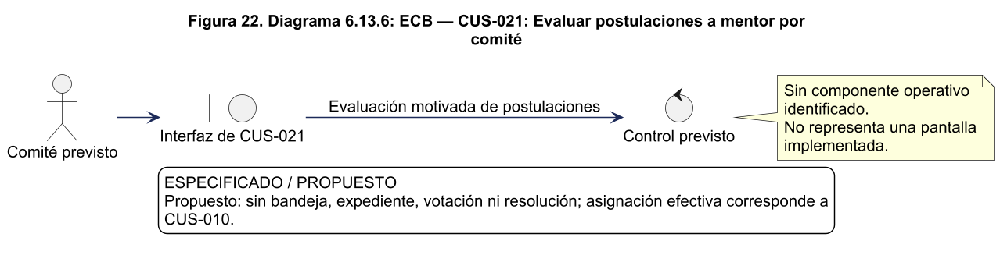

Fuente: Elaboración propia, DOC-H06. [Fuente PlantUML](docs/revision_srs/diagramas/doc-h06/srs/puml/CUS-021_ecb.puml).

### 6.3.1.7. CUS-002 — Consultar catálogo de mentorías con recomendación

**Figura 23. Diagrama 6.13.7: ECB — CUS-002: Consultar catálogo de mentorías con recomendación**

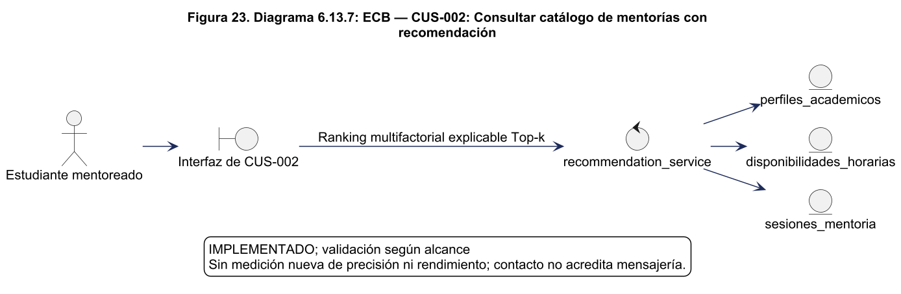

Fuente: Elaboración propia, DOC-H06. [Fuente PlantUML](docs/revision_srs/diagramas/doc-h06/srs/puml/CUS-002_ecb.puml).

### 6.3.1.8. CUS-003 — Reservar cupo para sesión de mentoría

**Figura 24. Diagrama 6.13.8: ECB — CUS-003: Reservar cupo para sesión de mentoría**

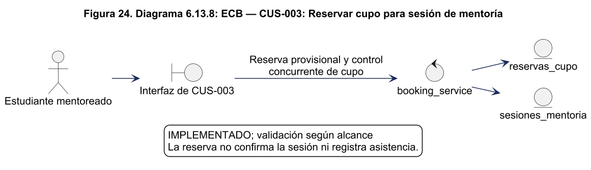

Fuente: Elaboración propia, DOC-H06. [Fuente PlantUML](docs/revision_srs/diagramas/doc-h06/srs/puml/CUS-003_ecb.puml).

### 6.3.1.9. CUS-004 — Ratificar asistencia a sesión de mentoría (T-24h)

**Figura 25. Diagrama 6.13.9: ECB — CUS-004: Ratificar asistencia a sesión de mentoría (T-24h)**

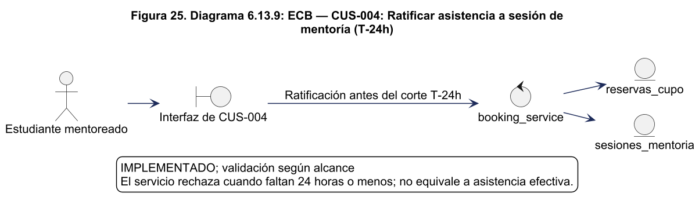

Fuente: Elaboración propia, DOC-H06. [Fuente PlantUML](docs/revision_srs/diagramas/doc-h06/srs/puml/CUS-004_ecb.puml).

### 6.3.1.10. CUS-023 — Evaluar quórum y ejecutar corte automático (T-24h)

**Figura 26. Diagrama 6.13.10: ECB — CUS-023: Evaluar quórum y ejecutar corte automático (T-24h)**

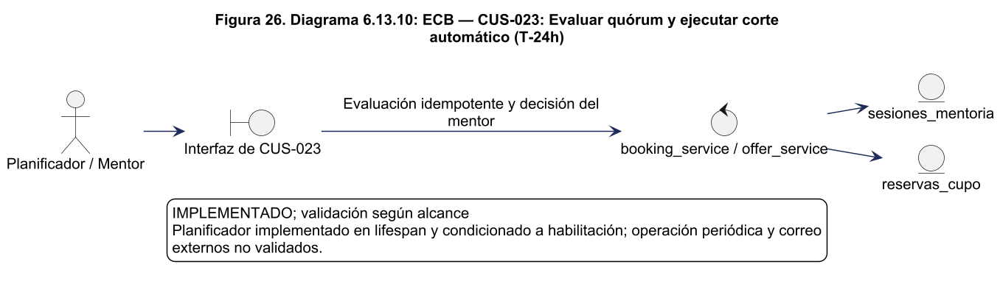

Fuente: Elaboración propia, DOC-H06. [Fuente PlantUML](docs/revision_srs/diagramas/doc-h06/srs/puml/CUS-023_ecb.puml).

### 6.3.1.11. CUS-024 — Cancelar reserva de cupo por estudiante

**Figura 27. Diagrama 6.13.11: ECB — CUS-024: Cancelar reserva de cupo por estudiante**

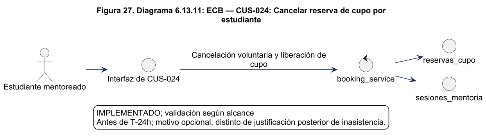

Fuente: Elaboración propia, DOC-H06. [Fuente PlantUML](docs/revision_srs/diagramas/doc-h06/srs/puml/CUS-024_ecb.puml).

### 6.3.1.12. CUS-007 — Registrar asistencia y bitácora pedagógica

**Figura 28. Diagrama 6.13.12: ECB — CUS-007: Registrar asistencia y bitácora pedagógica**

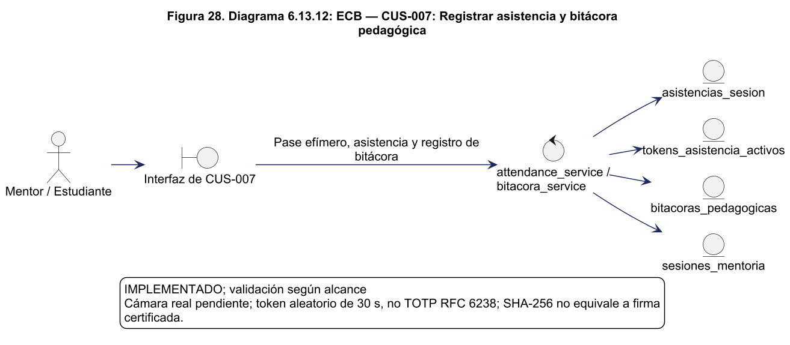

Fuente: Elaboración propia, DOC-H06. [Fuente PlantUML](docs/revision_srs/diagramas/doc-h06/srs/puml/CUS-007_ecb.puml).

### 6.3.1.13. CUS-012 — Registrar calificación y feedback bidireccional

**Figura 29. Diagrama 6.13.13: ECB — CUS-012: Registrar calificación y feedback bidireccional**

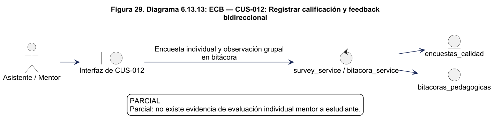

Fuente: Elaboración propia, DOC-H06. [Fuente PlantUML](docs/revision_srs/diagramas/doc-h06/srs/puml/CUS-012_ecb.puml).

### 6.3.1.14. CUS-013 — Consultar historial académico de mentorías

**Figura 30. Diagrama 6.13.14: ECB — CUS-013: Consultar historial académico de mentorías**

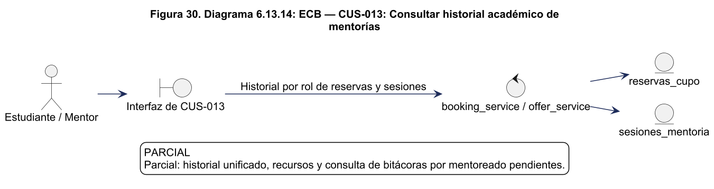

Fuente: Elaboración propia, DOC-H06. [Fuente PlantUML](docs/revision_srs/diagramas/doc-h06/srs/puml/CUS-013_ecb.puml).

### 6.3.1.15. CUS-014 — Emitir constancia de horas de mentoría

**Figura 31. Diagrama 6.13.15: ECB — CUS-014: Emitir constancia de horas de mentoría**

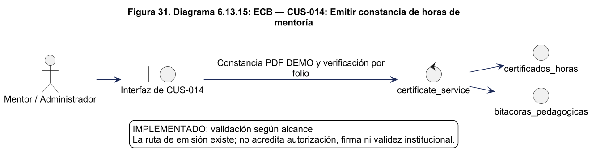

Fuente: Elaboración propia, DOC-H06. [Fuente PlantUML](docs/revision_srs/diagramas/doc-h06/srs/puml/CUS-014_ecb.puml).

### 6.3.1.16. CUS-018 — Gestionar justificación de inasistencia a sesión

**Figura 32. Diagrama 6.13.16: ECB — CUS-018: Gestionar justificación de inasistencia a sesión**

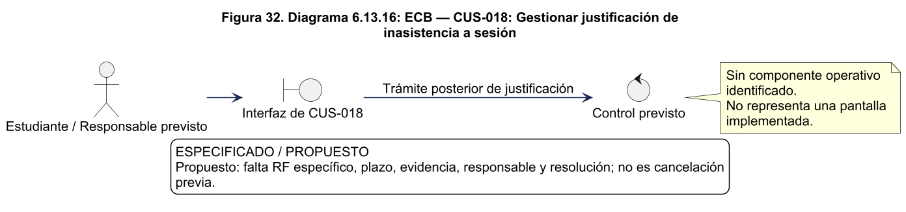

Fuente: Elaboración propia, DOC-H06. [Fuente PlantUML](docs/revision_srs/diagramas/doc-h06/srs/puml/CUS-018_ecb.puml).

### 6.3.1.17. CUS-019 — Consultar bitácoras de mentoría por tutor

**Figura 33. Diagrama 6.13.17: ECB — CUS-019: Consultar bitácoras de mentoría por tutor**

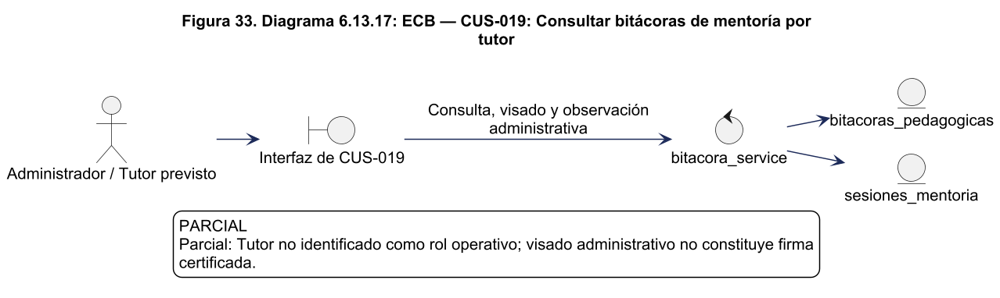

Fuente: Elaboración propia, DOC-H06. [Fuente PlantUML](docs/revision_srs/diagramas/doc-h06/srs/puml/CUS-019_ecb.puml).

### 6.3.1.18. CUS-009 — Consultar analítica institucional de mentorías

**Figura 34. Diagrama 6.13.18: ECB — CUS-009: Consultar analítica institucional de mentorías**

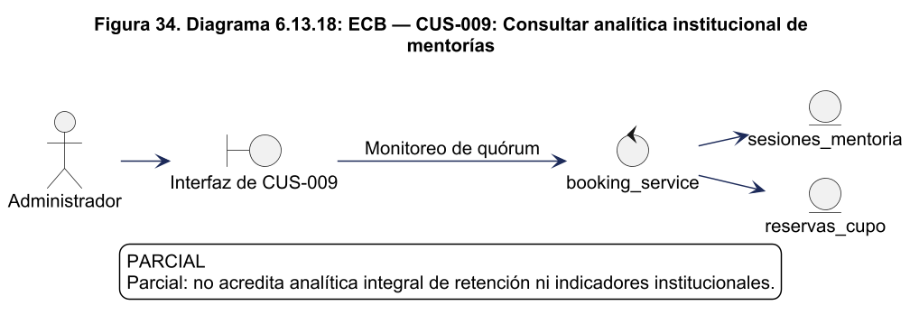

Fuente: Elaboración propia, DOC-H06. [Fuente PlantUML](docs/revision_srs/diagramas/doc-h06/srs/puml/CUS-009_ecb.puml).

### 6.3.1.19. CUS-011 — Exportar reportes ejecutivos consolidados

**Figura 35. Diagrama 6.13.19: ECB — CUS-011: Exportar reportes ejecutivos consolidados**

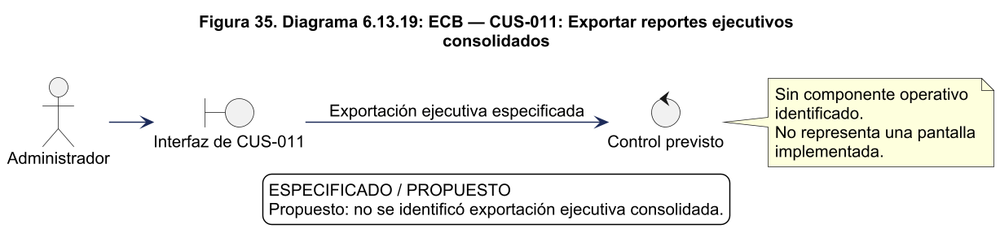

Fuente: Elaboración propia, DOC-H06. [Fuente PlantUML](docs/revision_srs/diagramas/doc-h06/srs/puml/CUS-011_ecb.puml).

### 6.3.1.20. CUS-015 — Configurar parámetros del algoritmo de recomendación

**Figura 36. Diagrama 6.13.20: ECB — CUS-015: Configurar parámetros del algoritmo de recomendación**

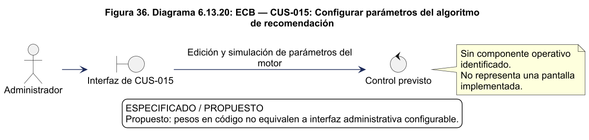

Fuente: Elaboración propia, DOC-H06. [Fuente PlantUML](docs/revision_srs/diagramas/doc-h06/srs/puml/CUS-015_ecb.puml).

### 6.3.1.21. CUS-016 — Gestionar auditoría de eventos de seguridad

**Figura 37. Diagrama 6.13.21: ECB — CUS-016: Gestionar auditoría de eventos de seguridad**

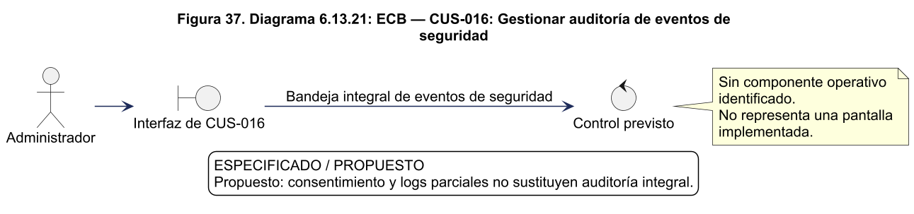

Fuente: Elaboración propia, DOC-H06. [Fuente PlantUML](docs/revision_srs/diagramas/doc-h06/srs/puml/CUS-016_ecb.puml).

### 6.3.1.22. CUS-017 — Configurar ambientes físicos y virtuales

**Figura 38. Diagrama 6.13.22: ECB — CUS-017: Configurar ambientes físicos y virtuales**

Fuente: Elaboración propia, DOC-H06. [Fuente PlantUML](docs/revision_srs/diagramas/doc-h06/srs/puml/CUS-017_ecb.puml).

### 6.3.1.23. CUS-020 — Gestionar catálogo curricular y asignaturas

**Figura 39. Diagrama 6.13.23: ECB — CUS-020: Gestionar catálogo curricular y asignaturas**

Fuente: Elaboración propia, DOC-H06. [Fuente PlantUML](docs/revision_srs/diagramas/doc-h06/srs/puml/CUS-020_ecb.puml).

### 6.3.1.24. CUS-022 — Configurar parámetros de corte y penalización

**Figura 40. Diagrama 6.13.24: ECB — CUS-022: Configurar parámetros de corte y penalización**

Fuente: Elaboración propia, DOC-H06. [Fuente PlantUML](docs/revision_srs/diagramas/doc-h06/srs/puml/CUS-022_ecb.puml).

## 6.3.2. Diagrama de Actividades con objetos

### Diagrama 6.14: Vista general

**Figura 41. Diagrama de Actividades con objetos: vista general**

Fuente: Elaboración propia, DOC-H06. [Fuente PlantUML](docs/revision_srs/diagramas/doc-h06/srs/puml/diag_041_general.puml).

### 6.3.2.1. CUS-001 — Iniciar sesión institucional con 2FA

**Figura 42. Diagrama 6.14.1: Actividades con objetos — CUS-001: Iniciar sesión institucional con 2FA**

Fuente: Elaboración propia, DOC-H06. [Fuente PlantUML](docs/revision_srs/diagramas/doc-h06/srs/puml/CUS-001_actividades.puml).

### 6.3.2.2. CUS-010 — Gestionar asignación de roles de usuario

**Figura 43. Diagrama 6.14.2: Actividades con objetos — CUS-010: Gestionar asignación de roles de usuario**

Fuente: Elaboración propia, DOC-H06. [Fuente PlantUML](docs/revision_srs/diagramas/doc-h06/srs/puml/CUS-010_actividades.puml).

### 6.3.2.3. CUS-006 — Registrar oferta de mentoría académica

**Figura 44. Diagrama 6.14.3: Actividades con objetos — CUS-006: Registrar oferta de mentoría académica**

Fuente: Elaboración propia, DOC-H06. [Fuente PlantUML](docs/revision_srs/diagramas/doc-h06/srs/puml/CUS-006_actividades.puml).

### 6.3.2.4. CUS-008 — Gestionar demanda insatisfecha de mentoría

**Figura 45. Diagrama 6.14.4: Actividades con objetos — CUS-008: Gestionar demanda insatisfecha de mentoría**

Fuente: Elaboración propia, DOC-H06. [Fuente PlantUML](docs/revision_srs/diagramas/doc-h06/srs/puml/CUS-008_actividades.puml).

### 6.3.2.5. CUS-005 — Postular al rol de estudiante mentor

**Figura 46. Diagrama 6.14.5: Actividades con objetos — CUS-005: Postular al rol de estudiante mentor**

Fuente: Elaboración propia, DOC-H06. [Fuente PlantUML](docs/revision_srs/diagramas/doc-h06/srs/puml/CUS-005_actividades.puml).

### 6.3.2.6. CUS-021 — Evaluar postulaciones a mentor por comité

**Figura 47. Diagrama 6.14.6: Actividades con objetos — CUS-021: Evaluar postulaciones a mentor por comité**

Fuente: Elaboración propia, DOC-H06. [Fuente PlantUML](docs/revision_srs/diagramas/doc-h06/srs/puml/CUS-021_actividades.puml).

### 6.3.2.7. CUS-002 — Consultar catálogo de mentorías con recomendación

**Figura 48. Diagrama 6.14.7: Actividades con objetos — CUS-002: Consultar catálogo de mentorías con recomendación**

Fuente: Elaboración propia, DOC-H06. [Fuente PlantUML](docs/revision_srs/diagramas/doc-h06/srs/puml/CUS-002_actividades.puml).

### 6.3.2.8. CUS-003 — Reservar cupo para sesión de mentoría

**Figura 49. Diagrama 6.14.8: Actividades con objetos — CUS-003: Reservar cupo para sesión de mentoría**

Fuente: Elaboración propia, DOC-H06. [Fuente PlantUML](docs/revision_srs/diagramas/doc-h06/srs/puml/CUS-003_actividades.puml).

### 6.3.2.9. CUS-004 — Ratificar asistencia a sesión de mentoría (T-24h)

**Figura 50. Diagrama 6.14.9: Actividades con objetos — CUS-004: Ratificar asistencia a sesión de mentoría (T-24h)**

Fuente: Elaboración propia, DOC-H06. [Fuente PlantUML](docs/revision_srs/diagramas/doc-h06/srs/puml/CUS-004_actividades.puml).

### 6.3.2.10. CUS-023 — Evaluar quórum y ejecutar corte automático (T-24h)

**Figura 51. Diagrama 6.14.10: Actividades con objetos — CUS-023: Evaluar quórum y ejecutar corte automático (T-24h)**

Fuente: Elaboración propia, DOC-H06. [Fuente PlantUML](docs/revision_srs/diagramas/doc-h06/srs/puml/CUS-023_actividades.puml).

### 6.3.2.11. CUS-024 — Cancelar reserva de cupo por estudiante

**Figura 52. Diagrama 6.14.11: Actividades con objetos — CUS-024: Cancelar reserva de cupo por estudiante**

Fuente: Elaboración propia, DOC-H06. [Fuente PlantUML](docs/revision_srs/diagramas/doc-h06/srs/puml/CUS-024_actividades.puml).

### 6.3.2.12. CUS-007 — Registrar asistencia y bitácora pedagógica

**Figura 53. Diagrama 6.14.12: Actividades con objetos — CUS-007: Registrar asistencia y bitácora pedagógica**

Fuente: Elaboración propia, DOC-H06. [Fuente PlantUML](docs/revision_srs/diagramas/doc-h06/srs/puml/CUS-007_actividades.puml).

### 6.3.2.13. CUS-012 — Registrar calificación y feedback bidireccional

**Figura 54. Diagrama 6.14.13: Actividades con objetos — CUS-012: Registrar calificación y feedback bidireccional**

Fuente: Elaboración propia, DOC-H06. [Fuente PlantUML](docs/revision_srs/diagramas/doc-h06/srs/puml/CUS-012_actividades.puml).

### 6.3.2.14. CUS-013 — Consultar historial académico de mentorías

**Figura 55. Diagrama 6.14.14: Actividades con objetos — CUS-013: Consultar historial académico de mentorías**

Fuente: Elaboración propia, DOC-H06. [Fuente PlantUML](docs/revision_srs/diagramas/doc-h06/srs/puml/CUS-013_actividades.puml).

### 6.3.2.15. CUS-014 — Emitir constancia de horas de mentoría

**Figura 56. Diagrama 6.14.15: Actividades con objetos — CUS-014: Emitir constancia de horas de mentoría**

Fuente: Elaboración propia, DOC-H06. [Fuente PlantUML](docs/revision_srs/diagramas/doc-h06/srs/puml/CUS-014_actividades.puml).

### 6.3.2.16. CUS-018 — Gestionar justificación de inasistencia a sesión

**Figura 57. Diagrama 6.14.16: Actividades con objetos — CUS-018: Gestionar justificación de inasistencia a sesión**

Fuente: Elaboración propia, DOC-H06. [Fuente PlantUML](docs/revision_srs/diagramas/doc-h06/srs/puml/CUS-018_actividades.puml).

### 6.3.2.17. CUS-019 — Consultar bitácoras de mentoría por tutor

**Figura 58. Diagrama 6.14.17: Actividades con objetos — CUS-019: Consultar bitácoras de mentoría por tutor**

Fuente: Elaboración propia, DOC-H06. [Fuente PlantUML](docs/revision_srs/diagramas/doc-h06/srs/puml/CUS-019_actividades.puml).

### 6.3.2.18. CUS-009 — Consultar analítica institucional de mentorías

**Figura 59. Diagrama 6.14.18: Actividades con objetos — CUS-009: Consultar analítica institucional de mentorías**

Fuente: Elaboración propia, DOC-H06. [Fuente PlantUML](docs/revision_srs/diagramas/doc-h06/srs/puml/CUS-009_actividades.puml).

### 6.3.2.19. CUS-011 — Exportar reportes ejecutivos consolidados

**Figura 60. Diagrama 6.14.19: Actividades con objetos — CUS-011: Exportar reportes ejecutivos consolidados**

Fuente: Elaboración propia, DOC-H06. [Fuente PlantUML](docs/revision_srs/diagramas/doc-h06/srs/puml/CUS-011_actividades.puml).

### 6.3.2.20. CUS-015 — Configurar parámetros del algoritmo de recomendación

**Figura 61. Diagrama 6.14.20: Actividades con objetos — CUS-015: Configurar parámetros del algoritmo de recomendación**

Fuente: Elaboración propia, DOC-H06. [Fuente PlantUML](docs/revision_srs/diagramas/doc-h06/srs/puml/CUS-015_actividades.puml).

### 6.3.2.21. CUS-016 — Gestionar auditoría de eventos de seguridad

**Figura 62. Diagrama 6.14.21: Actividades con objetos — CUS-016: Gestionar auditoría de eventos de seguridad**

Fuente: Elaboración propia, DOC-H06. [Fuente PlantUML](docs/revision_srs/diagramas/doc-h06/srs/puml/CUS-016_actividades.puml).

### 6.3.2.22. CUS-017 — Configurar ambientes físicos y virtuales

**Figura 63. Diagrama 6.14.22: Actividades con objetos — CUS-017: Configurar ambientes físicos y virtuales**

Fuente: Elaboración propia, DOC-H06. [Fuente PlantUML](docs/revision_srs/diagramas/doc-h06/srs/puml/CUS-017_actividades.puml).

### 6.3.2.23. CUS-020 — Gestionar catálogo curricular y asignaturas

**Figura 64. Diagrama 6.14.23: Actividades con objetos — CUS-020: Gestionar catálogo curricular y asignaturas**

Fuente: Elaboración propia, DOC-H06. [Fuente PlantUML](docs/revision_srs/diagramas/doc-h06/srs/puml/CUS-020_actividades.puml).

### 6.3.2.24. CUS-022 — Configurar parámetros de corte y penalización

**Figura 65. Diagrama 6.14.24: Actividades con objetos — CUS-022: Configurar parámetros de corte y penalización**

Fuente: Elaboración propia, DOC-H06. [Fuente PlantUML](docs/revision_srs/diagramas/doc-h06/srs/puml/CUS-022_actividades.puml).

## 6.3.3. Diagramas de Secuencia del Sistema (Fase de Diseño)

### Criterio del recomendador y claves de ordenamiento

El motor implementado en `recommendation_service.py` calcula un ranking multifactorial, sin similitud coseno ni filtrado colaborativo. La función `compute_candidate_score` aplica:

$$s = round\left(w_c (0.40 J + 0.35 H + 0.15 M + 0.10 A), 4\right)$$

- **J:** Jaccard entre conjuntos de temas; dos conjuntos vacíos producen 0. Dice se calcula para explicación, sin intervenir en la suma.
- **H:** en mentores, intersección de franjas exactas dividida por las franjas del mentoreado. Sin agenda del mentoreado vale 0.5. En ofertas usa la hora de inicio truncada a la hora y una o dos franjas completas según duración; no representa solapamiento continuo al minuto.
- **M:** 1 para igual modalidad, 0.9 cuando alguna es híbrida y 0.2 para presencial frente a virtual. Las ofertas admiten presencial o virtual; la preferencia puede ser híbrida.
- **A:** asignaturas comunes divididas por las asignaturas del mentoreado; sin intereses previos vale 0.
- **w_c:** máximo peso crítico aplicable: IDs 1/2/4 = 1.2, ID 3 = 1.3, ID 5 = 1.1; resto 1.0. En ofertas, si no hay cursos comunes se consideran los cursos de la oferta. La puntuación puede exceder 1; no es una probabilidad.

El candidato es elegible con ciclo >= 7 **o** autorización de rol. Esto no acredita la nota mínima 14 exigida por RN-03. El orden de mentores es puntuación, peso crítico, ciclo y franjas coincidentes descendentes, luego correo ascendente. El de ofertas es puntuación, peso y cupos disponibles descendentes, fecha y código ascendentes. La reputación y la menor carga docente no forman parte de estas claves. Los pesos críticos están definidos en código: editar `factor_ponderacion` en currículo no acredita que el motor los relea dinámicamente. CUS-015 conserva la configuración administrativa como propuesta.

La revisión es estática: no aporta resultados nuevos de precisión ni de latencia. Los datos sintéticos o modos de respaldo se distinguen del perfil persistido y de la utilización en entorno real.

### Diagrama 6.15: Vista general

**Figura 66. Diagramas de Secuencia del Sistema (Fase de Diseño): vista general**

Fuente: Elaboración propia, DOC-H06. [Fuente PlantUML](docs/revision_srs/diagramas/doc-h06/srs/puml/diag_066_general.puml).

### 6.3.3.1. CUS-001 — Iniciar sesión institucional con 2FA

**Figura 67. Diagrama 6.15.1: Secuencia — CUS-001: Iniciar sesión institucional con 2FA**

Fuente: Elaboración propia, DOC-H06. [Fuente PlantUML](docs/revision_srs/diagramas/doc-h06/srs/puml/CUS-001_secuencia.puml).

### 6.3.3.2. CUS-010 — Gestionar asignación de roles de usuario

**Figura 68. Diagrama 6.15.2: Secuencia — CUS-010: Gestionar asignación de roles de usuario**

Fuente: Elaboración propia, DOC-H06. [Fuente PlantUML](docs/revision_srs/diagramas/doc-h06/srs/puml/CUS-010_secuencia.puml).

### 6.3.3.3. CUS-006 — Registrar oferta de mentoría académica

**Figura 69. Diagrama 6.15.3: Secuencia — CUS-006: Registrar oferta de mentoría académica**

Fuente: Elaboración propia, DOC-H06. [Fuente PlantUML](docs/revision_srs/diagramas/doc-h06/srs/puml/CUS-006_secuencia.puml).

### 6.3.3.4. CUS-008 — Gestionar demanda insatisfecha de mentoría

**Figura 70. Diagrama 6.15.4: Secuencia — CUS-008: Gestionar demanda insatisfecha de mentoría**

Fuente: Elaboración propia, DOC-H06. [Fuente PlantUML](docs/revision_srs/diagramas/doc-h06/srs/puml/CUS-008_secuencia.puml).

### 6.3.3.5. CUS-005 — Postular al rol de estudiante mentor

**Figura 71. Diagrama 6.15.5: Secuencia — CUS-005: Postular al rol de estudiante mentor**

Fuente: Elaboración propia, DOC-H06. [Fuente PlantUML](docs/revision_srs/diagramas/doc-h06/srs/puml/CUS-005_secuencia.puml).

### 6.3.3.6. CUS-021 — Evaluar postulaciones a mentor por comité

**Figura 72. Diagrama 6.15.6: Secuencia — CUS-021: Evaluar postulaciones a mentor por comité**

Fuente: Elaboración propia, DOC-H06. [Fuente PlantUML](docs/revision_srs/diagramas/doc-h06/srs/puml/CUS-021_secuencia.puml).

### 6.3.3.7. CUS-002 — Consultar catálogo de mentorías con recomendación

**Figura 73. Diagrama 6.15.7: Secuencia — CUS-002: Consultar catálogo de mentorías con recomendación**

Fuente: Elaboración propia, DOC-H06. [Fuente PlantUML](docs/revision_srs/diagramas/doc-h06/srs/puml/CUS-002_secuencia.puml).

### 6.3.3.8. CUS-003 — Reservar cupo para sesión de mentoría

**Figura 74. Diagrama 6.15.8: Secuencia — CUS-003: Reservar cupo para sesión de mentoría**

Fuente: Elaboración propia, DOC-H06. [Fuente PlantUML](docs/revision_srs/diagramas/doc-h06/srs/puml/CUS-003_secuencia.puml).

### 6.3.3.9. CUS-004 — Ratificar asistencia a sesión de mentoría (T-24h)

**Figura 75. Diagrama 6.15.9: Secuencia — CUS-004: Ratificar asistencia a sesión de mentoría (T-24h)**

Fuente: Elaboración propia, DOC-H06. [Fuente PlantUML](docs/revision_srs/diagramas/doc-h06/srs/puml/CUS-004_secuencia.puml).

### 6.3.3.10. CUS-023 — Evaluar quórum y ejecutar corte automático (T-24h)

**Figura 76. Diagrama 6.15.10: Secuencia — CUS-023: Evaluar quórum y ejecutar corte automático (T-24h)**

Fuente: Elaboración propia, DOC-H06. [Fuente PlantUML](docs/revision_srs/diagramas/doc-h06/srs/puml/CUS-023_secuencia.puml).

### 6.3.3.11. CUS-024 — Cancelar reserva de cupo por estudiante

**Figura 77. Diagrama 6.15.11: Secuencia — CUS-024: Cancelar reserva de cupo por estudiante**

Fuente: Elaboración propia, DOC-H06. [Fuente PlantUML](docs/revision_srs/diagramas/doc-h06/srs/puml/CUS-024_secuencia.puml).

### 6.3.3.12. CUS-007 — Registrar asistencia y bitácora pedagógica

**Figura 78. Diagrama 6.15.12: Secuencia — CUS-007: Registrar asistencia y bitácora pedagógica**

Fuente: Elaboración propia, DOC-H06. [Fuente PlantUML](docs/revision_srs/diagramas/doc-h06/srs/puml/CUS-007_secuencia.puml).

### 6.3.3.13. CUS-012 — Registrar calificación y feedback bidireccional

**Figura 79. Diagrama 6.15.13: Secuencia — CUS-012: Registrar calificación y feedback bidireccional**

Fuente: Elaboración propia, DOC-H06. [Fuente PlantUML](docs/revision_srs/diagramas/doc-h06/srs/puml/CUS-012_secuencia.puml).

### 6.3.3.14. CUS-013 — Consultar historial académico de mentorías

**Figura 80. Diagrama 6.15.14: Secuencia — CUS-013: Consultar historial académico de mentorías**

Fuente: Elaboración propia, DOC-H06. [Fuente PlantUML](docs/revision_srs/diagramas/doc-h06/srs/puml/CUS-013_secuencia.puml).

### 6.3.3.15. CUS-014 — Emitir constancia de horas de mentoría

**Figura 81. Diagrama 6.15.15: Secuencia — CUS-014: Emitir constancia de horas de mentoría**

Fuente: Elaboración propia, DOC-H06. [Fuente PlantUML](docs/revision_srs/diagramas/doc-h06/srs/puml/CUS-014_secuencia.puml).

### 6.3.3.16. CUS-018 — Gestionar justificación de inasistencia a sesión

**Figura 82. Diagrama 6.15.16: Secuencia — CUS-018: Gestionar justificación de inasistencia a sesión**

Fuente: Elaboración propia, DOC-H06. [Fuente PlantUML](docs/revision_srs/diagramas/doc-h06/srs/puml/CUS-018_secuencia.puml).

### 6.3.3.17. CUS-019 — Consultar bitácoras de mentoría por tutor

**Figura 83. Diagrama 6.15.17: Secuencia — CUS-019: Consultar bitácoras de mentoría por tutor**

Fuente: Elaboración propia, DOC-H06. [Fuente PlantUML](docs/revision_srs/diagramas/doc-h06/srs/puml/CUS-019_secuencia.puml).

### 6.3.3.18. CUS-009 — Consultar analítica institucional de mentorías

**Figura 84. Diagrama 6.15.18: Secuencia — CUS-009: Consultar analítica institucional de mentorías**

Fuente: Elaboración propia, DOC-H06. [Fuente PlantUML](docs/revision_srs/diagramas/doc-h06/srs/puml/CUS-009_secuencia.puml).

### 6.3.3.19. CUS-011 — Exportar reportes ejecutivos consolidados

**Figura 85. Diagrama 6.15.19: Secuencia — CUS-011: Exportar reportes ejecutivos consolidados**

Fuente: Elaboración propia, DOC-H06. [Fuente PlantUML](docs/revision_srs/diagramas/doc-h06/srs/puml/CUS-011_secuencia.puml).

### 6.3.3.20. CUS-015 — Configurar parámetros del algoritmo de recomendación

**Figura 86. Diagrama 6.15.20: Secuencia — CUS-015: Configurar parámetros del algoritmo de recomendación**

Fuente: Elaboración propia, DOC-H06. [Fuente PlantUML](docs/revision_srs/diagramas/doc-h06/srs/puml/CUS-015_secuencia.puml).

### 6.3.3.21. CUS-016 — Gestionar auditoría de eventos de seguridad

**Figura 87. Diagrama 6.15.21: Secuencia — CUS-016: Gestionar auditoría de eventos de seguridad**

Fuente: Elaboración propia, DOC-H06. [Fuente PlantUML](docs/revision_srs/diagramas/doc-h06/srs/puml/CUS-016_secuencia.puml).

### 6.3.3.22. CUS-017 — Configurar ambientes físicos y virtuales

**Figura 88. Diagrama 6.15.22: Secuencia — CUS-017: Configurar ambientes físicos y virtuales**

Fuente: Elaboración propia, DOC-H06. [Fuente PlantUML](docs/revision_srs/diagramas/doc-h06/srs/puml/CUS-017_secuencia.puml).

### 6.3.3.23. CUS-020 — Gestionar catálogo curricular y asignaturas

**Figura 89. Diagrama 6.15.23: Secuencia — CUS-020: Gestionar catálogo curricular y asignaturas**

Fuente: Elaboración propia, DOC-H06. [Fuente PlantUML](docs/revision_srs/diagramas/doc-h06/srs/puml/CUS-020_secuencia.puml).

### 6.3.3.24. CUS-022 — Configurar parámetros de corte y penalización

**Figura 90. Diagrama 6.15.24: Secuencia — CUS-022: Configurar parámetros de corte y penalización**

Fuente: Elaboración propia, DOC-H06. [Fuente PlantUML](docs/revision_srs/diagramas/doc-h06/srs/puml/CUS-022_secuencia.puml).

## 6.3.4. Diagrama de Clases del Modelo Lógico

### Diagrama 6.16: Vista general

**Figura 91. Diagrama de Clases del Modelo Lógico: vista general**

Fuente: Elaboración propia, DOC-H06. [Fuente PlantUML](docs/revision_srs/diagramas/doc-h06/srs/puml/diag_091_general.puml).

### 6.3.4.1. CUS-001 — Iniciar sesión institucional con 2FA

**Figura 92. Diagrama 6.16.1: Clases del dominio — CUS-001: Iniciar sesión institucional con 2FA**

Fuente: Elaboración propia, DOC-H06. [Fuente PlantUML](docs/revision_srs/diagramas/doc-h06/srs/puml/CUS-001_clases.puml).

### 6.3.4.2. CUS-010 — Gestionar asignación de roles de usuario

**Figura 93. Diagrama 6.16.2: Clases del dominio — CUS-010: Gestionar asignación de roles de usuario**

Fuente: Elaboración propia, DOC-H06. [Fuente PlantUML](docs/revision_srs/diagramas/doc-h06/srs/puml/CUS-010_clases.puml).

### 6.3.4.3. CUS-006 — Registrar oferta de mentoría académica

**Figura 94. Diagrama 6.16.3: Clases del dominio — CUS-006: Registrar oferta de mentoría académica**

Fuente: Elaboración propia, DOC-H06. [Fuente PlantUML](docs/revision_srs/diagramas/doc-h06/srs/puml/CUS-006_clases.puml).

### 6.3.4.4. CUS-008 — Gestionar demanda insatisfecha de mentoría

**Figura 95. Diagrama 6.16.4: Clases del dominio — CUS-008: Gestionar demanda insatisfecha de mentoría**

Fuente: Elaboración propia, DOC-H06. [Fuente PlantUML](docs/revision_srs/diagramas/doc-h06/srs/puml/CUS-008_clases.puml).

### 6.3.4.5. CUS-005 — Postular al rol de estudiante mentor

**Figura 96. Diagrama 6.16.5: Clases del dominio — CUS-005: Postular al rol de estudiante mentor**

Fuente: Elaboración propia, DOC-H06. [Fuente PlantUML](docs/revision_srs/diagramas/doc-h06/srs/puml/CUS-005_clases.puml).

### 6.3.4.6. CUS-021 — Evaluar postulaciones a mentor por comité

**Figura 97. Diagrama 6.16.6: Clases del dominio — CUS-021: Evaluar postulaciones a mentor por comité**

Fuente: Elaboración propia, DOC-H06. [Fuente PlantUML](docs/revision_srs/diagramas/doc-h06/srs/puml/CUS-021_clases.puml).

### 6.3.4.7. CUS-002 — Consultar catálogo de mentorías con recomendación

**Figura 98. Diagrama 6.16.7: Clases del dominio — CUS-002: Consultar catálogo de mentorías con recomendación**

Fuente: Elaboración propia, DOC-H06. [Fuente PlantUML](docs/revision_srs/diagramas/doc-h06/srs/puml/CUS-002_clases.puml).

### 6.3.4.8. CUS-003 — Reservar cupo para sesión de mentoría

**Figura 99. Diagrama 6.16.8: Clases del dominio — CUS-003: Reservar cupo para sesión de mentoría**

Fuente: Elaboración propia, DOC-H06. [Fuente PlantUML](docs/revision_srs/diagramas/doc-h06/srs/puml/CUS-003_clases.puml).

### 6.3.4.9. CUS-004 — Ratificar asistencia a sesión de mentoría (T-24h)

**Figura 100. Diagrama 6.16.9: Clases del dominio — CUS-004: Ratificar asistencia a sesión de mentoría (T-24h)**

Fuente: Elaboración propia, DOC-H06. [Fuente PlantUML](docs/revision_srs/diagramas/doc-h06/srs/puml/CUS-004_clases.puml).

### 6.3.4.10. CUS-023 — Evaluar quórum y ejecutar corte automático (T-24h)

**Figura 101. Diagrama 6.16.10: Clases del dominio — CUS-023: Evaluar quórum y ejecutar corte automático (T-24h)**

Fuente: Elaboración propia, DOC-H06. [Fuente PlantUML](docs/revision_srs/diagramas/doc-h06/srs/puml/CUS-023_clases.puml).

### 6.3.4.11. CUS-024 — Cancelar reserva de cupo por estudiante

**Figura 102. Diagrama 6.16.11: Clases del dominio — CUS-024: Cancelar reserva de cupo por estudiante**

Fuente: Elaboración propia, DOC-H06. [Fuente PlantUML](docs/revision_srs/diagramas/doc-h06/srs/puml/CUS-024_clases.puml).

### 6.3.4.12. CUS-007 — Registrar asistencia y bitácora pedagógica

**Figura 103. Diagrama 6.16.12: Clases del dominio — CUS-007: Registrar asistencia y bitácora pedagógica**

Fuente: Elaboración propia, DOC-H06. [Fuente PlantUML](docs/revision_srs/diagramas/doc-h06/srs/puml/CUS-007_clases.puml).

### 6.3.4.13. CUS-012 — Registrar calificación y feedback bidireccional

**Figura 104. Diagrama 6.16.13: Clases del dominio — CUS-012: Registrar calificación y feedback bidireccional**

Fuente: Elaboración propia, DOC-H06. [Fuente PlantUML](docs/revision_srs/diagramas/doc-h06/srs/puml/CUS-012_clases.puml).

### 6.3.4.14. CUS-013 — Consultar historial académico de mentorías

**Figura 105. Diagrama 6.16.14: Clases del dominio — CUS-013: Consultar historial académico de mentorías**

Fuente: Elaboración propia, DOC-H06. [Fuente PlantUML](docs/revision_srs/diagramas/doc-h06/srs/puml/CUS-013_clases.puml).

### 6.3.4.15. CUS-014 — Emitir constancia de horas de mentoría

**Figura 106. Diagrama 6.16.15: Clases del dominio — CUS-014: Emitir constancia de horas de mentoría**

Fuente: Elaboración propia, DOC-H06. [Fuente PlantUML](docs/revision_srs/diagramas/doc-h06/srs/puml/CUS-014_clases.puml).

### 6.3.4.16. CUS-018 — Gestionar justificación de inasistencia a sesión

**Figura 107. Diagrama 6.16.16: Clases del dominio — CUS-018: Gestionar justificación de inasistencia a sesión**

Fuente: Elaboración propia, DOC-H06. [Fuente PlantUML](docs/revision_srs/diagramas/doc-h06/srs/puml/CUS-018_clases.puml).

### 6.3.4.17. CUS-019 — Consultar bitácoras de mentoría por tutor

**Figura 108. Diagrama 6.16.17: Clases del dominio — CUS-019: Consultar bitácoras de mentoría por tutor**

Fuente: Elaboración propia, DOC-H06. [Fuente PlantUML](docs/revision_srs/diagramas/doc-h06/srs/puml/CUS-019_clases.puml).

### 6.3.4.18. CUS-009 — Consultar analítica institucional de mentorías

**Figura 109. Diagrama 6.16.18: Clases del dominio — CUS-009: Consultar analítica institucional de mentorías**

Fuente: Elaboración propia, DOC-H06. [Fuente PlantUML](docs/revision_srs/diagramas/doc-h06/srs/puml/CUS-009_clases.puml).

### 6.3.4.19. CUS-011 — Exportar reportes ejecutivos consolidados

**Figura 110. Diagrama 6.16.19: Clases del dominio — CUS-011: Exportar reportes ejecutivos consolidados**

Fuente: Elaboración propia, DOC-H06. [Fuente PlantUML](docs/revision_srs/diagramas/doc-h06/srs/puml/CUS-011_clases.puml).

### 6.3.4.20. CUS-015 — Configurar parámetros del algoritmo de recomendación

**Figura 111. Diagrama 6.16.20: Clases del dominio — CUS-015: Configurar parámetros del algoritmo de recomendación**

Fuente: Elaboración propia, DOC-H06. [Fuente PlantUML](docs/revision_srs/diagramas/doc-h06/srs/puml/CUS-015_clases.puml).

### 6.3.4.21. CUS-016 — Gestionar auditoría de eventos de seguridad

**Figura 112. Diagrama 6.16.21: Clases del dominio — CUS-016: Gestionar auditoría de eventos de seguridad**

Fuente: Elaboración propia, DOC-H06. [Fuente PlantUML](docs/revision_srs/diagramas/doc-h06/srs/puml/CUS-016_clases.puml).

### 6.3.4.22. CUS-017 — Configurar ambientes físicos y virtuales

**Figura 113. Diagrama 6.16.22: Clases del dominio — CUS-017: Configurar ambientes físicos y virtuales**

Fuente: Elaboración propia, DOC-H06. [Fuente PlantUML](docs/revision_srs/diagramas/doc-h06/srs/puml/CUS-017_clases.puml).

### 6.3.4.23. CUS-020 — Gestionar catálogo curricular y asignaturas

**Figura 114. Diagrama 6.16.23: Clases del dominio — CUS-020: Gestionar catálogo curricular y asignaturas**

Fuente: Elaboración propia, DOC-H06. [Fuente PlantUML](docs/revision_srs/diagramas/doc-h06/srs/puml/CUS-020_clases.puml).

### 6.3.4.24. CUS-022 — Configurar parámetros de corte y penalización

**Figura 115. Diagrama 6.16.24: Clases del dominio — CUS-022: Configurar parámetros de corte y penalización**

Fuente: Elaboración propia, DOC-H06. [Fuente PlantUML](docs/revision_srs/diagramas/doc-h06/srs/puml/CUS-022_clases.puml).

## 6.3.5. Diagramas de Máquinas de Estados Finitas (FSM)

Los estados permitidos por una restricción física no equivalen a transiciones efectivamente ejecutadas. `sesiones_mentoria` admite 13 valores y `reservas_cupo` nueve; se conservan las variantes históricas. El corte escribe `CANCELADA_NO_CONFIRMADA`, mientras la cancelación del mentor escribe `CANCELADA_SISTEMA_QUORUM` en reservas afectadas. No sustituir estos valores por nombres conceptuales ni inferir un paso de tiempo automático a EN_CURSO, CONCLUIDA o FINALIZADA sin invocación del servicio.

La asistencia se registra mediante reserva confirmada y pase vigente, en la ventana inicio −15 min a **fin +30 min**. El pase contiene token hash y código aleatorio con vencimiento de 30 segundos y respaldo en `tokens_asistencia_activos`; no implementa TOTP basado en secreto compartido. La prueba de cámara en dispositivo real continúa pendiente.

La bitácora carece de columna `estado`: contiene `visado_administrador`; el servicio actualiza también `sesiones_mentoria.estado` a BITACORA_REGISTRADA, HORAS_VISADAS u OBSERVADA. El plazo de registro es fin +48 h. La encuesta del asistente dispone de 24 h tras la sesión y no equivale a feedback individual inverso. Los certificados almacenan `EMITIDO_DEMO` o `EMITIDO` según el servicio, sin que el texto del estado pruebe validez institucional. Se mantiene RN-14 como requisito pendiente de autorización y validación externa.

### Diagrama 6.17: Sesión de mentoría

**Figura 116. Estados: Sesión de mentoría**

Fuente: Elaboración propia, DOC-H06. [Fuente PlantUML](docs/revision_srs/diagramas/doc-h06/srs/puml/diag_116_fsm_sesion.puml).

### Diagrama 6.18: Reserva de cupo

**Figura 117. Estados: Reserva de cupo**

Fuente: Elaboración propia, DOC-H06. [Fuente PlantUML](docs/revision_srs/diagramas/doc-h06/srs/puml/diag_117_fsm_reserva.puml).

### Diagrama 6.19: Bitácora y certificado

**Figura 118. Estados: Bitácora y certificado**

Fuente: Elaboración propia, DOC-H06. [Fuente PlantUML](docs/revision_srs/diagramas/doc-h06/srs/puml/diag_118_fsm_bitacora.puml).

## 6.3.6. Modelo Físico de Base de Datos Relacional y Diccionario DDL

El inventario vigente declara **19 tablas ORM**, no 15. No se ha consultado ni alterado una base de datos durante DOC-H06; el modelo físico documentado corresponde a código y migraciones, sin acreditar su despliegue. Los correos son identificadores en varias tablas: no hay tabla ORM `usuarios`, `espacios_fisicos`, `ofertas_mentoria`, `codigos_otp`, `perfiles_formativos`, `reservas_cupos` ni `asistencias_sesiones` en esta línea base. Los nombres vigentes son los del diccionario siguiente.

Se dibujan exclusivamente claves foráneas declaradas; los correos repetidos y `id_mentor` no se convierten en FK ficticias. `sesiones_mentoria` contiene la oferta y la sesión; `espacio_asignado` es texto. La disponibilidad y los cronogramas son entidades distintas.

La cabeza de migraciones es `20261123_008`: une `20261116_006` (límites de autenticación) con `20261121_007` (cronogramas), que desciende de `20261121_006` (alineación del cierre). Esta última conserva columnas históricas auxiliares y transforma bitácoras, encuestas y certificados; por ello el ORM no es un volcado completo de columnas residuales de una instalación migrada. Cuando hay certificados repetidos, la migración conserva revisiones mediante `revision_historica` y una unicidad de tres columnas; el modelo declara unicidad de mentor y período. Esta diferencia de compatibilidad requiere comprobación por instalación y no se oculta como igualdad exacta.

Los modelos incluyen desafíos y límites de autenticación, tokens activos de asistencia y cronogramas persistentes. Esto corrige la auditoría antigua que los describía exclusivamente en memoria o ausentes de migraciones. Existen rutas de respaldo en memoria en desarrollo/pruebas: no se consideran persistencia durable ni garantía multiworker. Las políticas RLS históricas se conservan en los documentos de referencia; no se certifican activas por la existencia de controles de autorización en FastAPI.

### Diagrama 6.20: Modelo físico vigente de 19 tablas

**Figura 119. Modelo físico declarado: 19 tablas**

Fuente: Elaboración propia, DOC-H06. [Fuente PlantUML](docs/revision_srs/diagramas/doc-h06/srs/puml/diag_119_der_19tablas.puml).

### Diccionario de datos del modelo físico vigente

#### 1. Tabla `asignaturas`
Fuente: [Asignatura](aplicacion/backend/app/models/curriculum.py).

| Campo | Tipo declarado | Admite nulo | Restricción / valor inicial |
| --- | --- | --- | --- |
| id_asignatura | Integer | No | PK |
| codigo_curso | String(20) | No | UNIQUE |
| nombre_curso | String(150) | No |  |
| ciclo_plan | Integer | No |  |
| creditos | Integer | No |  |
| es_prioritaria | Boolean | No |  / default: True |
| factor_ponderacion | Float | No |  / default: 1.0 |
| estado_activo | Boolean | No |  / default: True |
| created_at | DateTime(timezone=True) | No |  / default: UTC al crear |

#### 2. Tabla `asistencias_sesion`
Fuente: [AsistenciaSesion](aplicacion/backend/app/models/attendance.py).

| Campo | Tipo declarado | Admite nulo | Restricción / valor inicial |
| --- | --- | --- | --- |
| id_asistencia | Integer | No | PK |
| id_sesion | Integer | No | FK sesiones_mentoria.id_sesion; ON DELETE CASCADE |
| estudiante_email | String(255) | No |  |
| asistio | Boolean | No |  / default: False |
| fecha_checkin | DateTime(timezone=True) | Sí |  |
| ip_origen | String(45) | Sí |  |
| created_at | DateTime(timezone=True) | No |  / default: UTC al crear |

Restricciones declaradas: `UniqueConstraint('id_sesion', 'estudiante_email')`.

#### 3. Tabla `auth_challenges`
Fuente: [AuthChallenge](aplicacion/backend/app/models/auth.py).

| Campo | Tipo declarado | Admite nulo | Restricción / valor inicial |
| --- | --- | --- | --- |
| id_challenge | String(64) | No | PK |
| email | String(255) | No |  |
| code_hash | String(255) | No |  |
| code_salt | String(64) | No |  |
| created_at | DateTime(timezone=True) | No |  / default: UTC al crear |
| expires_at | DateTime(timezone=True) | No |  |
| resend_available_at | DateTime(timezone=True) | No |  |
| consumed | Boolean | No |  / default: False |
| attempts | Integer | No |  / default: 0 |

#### 4. Tabla `auth_rate_limits`
Fuente: [AuthRateLimit](aplicacion/backend/app/models/auth.py).

| Campo | Tipo declarado | Admite nulo | Restricción / valor inicial |
| --- | --- | --- | --- |
| key | String(128) | No | PK |
| count | Integer | No |  / default: 1 |
| window_expires_at | DateTime(timezone=True) | No |  |
| updated_at | DateTime(timezone=True) | No |  / default: UTC al crear |

#### 5. Tabla `bitacoras_pedagogicas`
Fuente: [BitacoraPedagogica](aplicacion/backend/app/models/bitacora.py).

| Campo | Tipo declarado | Admite nulo | Restricción / valor inicial |
| --- | --- | --- | --- |
| id_bitacora | Integer | No | PK |
| id_sesion | Integer | No | FK sesiones_mentoria.id_sesion; ON DELETE CASCADE; UNIQUE |
| id_mentor | String(255) | No |  |
| temas_cubiertos | JSON | No |  / default: list |
| observaciones | Text | No |  |
| nivel_dificultad | String(20) | No | nivel_dificultad IN ('Bajo', 'Medio', 'Alto') / default: 'Medio' |
| hash_firma | String(64) | No |  |
| horas_declaradas | Float | No |  / default: 0.0 |
| visado_administrador | Boolean | No |  / default: False |
| created_at | DateTime(timezone=True) | No |  / default: UTC al crear |

Restricciones declaradas: `CheckConstraint("nivel_dificultad IN ('Bajo', 'Medio', 'Alto')")`.

#### 6. Tabla `certificados_horas`
Fuente: [CertificadoHoras](aplicacion/backend/app/models/certificate.py).

| Campo | Tipo declarado | Admite nulo | Restricción / valor inicial |
| --- | --- | --- | --- |
| id_certificado | Integer | No | PK |
| id_mentor | String(255) | No |  |
| codigo_folio | String(50) | No | UNIQUE |
| periodo_academico | String(20) | No |  / default: '2026-II' |
| horas_acreditadas | Float | No |  |
| hash_firma | String(64) | No |  |
| estado | String(30) | No |  / default: 'EMITIDO_DEMO' |
| created_at | DateTime(timezone=True) | No |  / default: UTC al crear |

Restricciones declaradas: `UniqueConstraint('id_mentor', 'periodo_academico')`; `CheckConstraint('horas_acreditadas >= 20.0')`.

#### 7. Tabla `consentimientos_legales`
Fuente: [ConsentimientoLegal](aplicacion/backend/app/models/consent.py).

| Campo | Tipo declarado | Admite nulo | Restricción / valor inicial |
| --- | --- | --- | --- |
| id_consentimiento | Integer | No | PK |
| email | String(255) | No |  |
| terms_version | String(50) | No |  / default: '2026-II-v1.0' |
| accepted | Boolean | No |  / default: True |
| consented_at | DateTime(timezone=True) | No |  / default: UTC al crear |
| ip_address | String(45) | Sí |  |
| user_agent | Text | Sí |  |

#### 8. Tabla `cronograma_activo`
Fuente: [CronogramaActivo](aplicacion/backend/app/models/schedule.py).

| Campo | Tipo declarado | Admite nulo | Restricción / valor inicial |
| --- | --- | --- | --- |
| id | Integer | No | PK |
| id_version | Integer | Sí | FK versiones_cronograma.id |

Restricciones declaradas: `CheckConstraint('id = 1')`.

#### 9. Tabla `disponibilidades_horarias`
Fuente: [DisponibilidadHoraria](aplicacion/backend/app/models/profile.py).

| Campo | Tipo declarado | Admite nulo | Restricción / valor inicial |
| --- | --- | --- | --- |
| id_disponibilidad | Integer | No | PK |
| email | String(255) | No |  |
| dia_semana | Integer | No | dia_semana >= 1 AND dia_semana <= 6 |
| hora_inicio | String(10) | No |  |
| hora_fin | String(10) | No |  |
| created_at | DateTime(timezone=True) | No |  / default: UTC al crear |

Restricciones declaradas: `CheckConstraint('dia_semana >= 1 AND dia_semana <= 6')`.

#### 10. Tabla `encuestas_calidad`
Fuente: [EncuestaCalidad](aplicacion/backend/app/models/survey.py).

| Campo | Tipo declarado | Admite nulo | Restricción / valor inicial |
| --- | --- | --- | --- |
| id_encuesta | Integer | No | PK |
| id_sesion | Integer | No | FK sesiones_mentoria.id_sesion; ON DELETE CASCADE |
| estudiante_email | String(255) | No |  |
| calificacion_general | Integer | No |  |
| dominio_tema | Integer | No |  |
| claridad_explicacion | Integer | No |  |
| puntualidad | Integer | No |  |
| comentarios | Text | Sí |  |
| created_at | DateTime(timezone=True) | No |  / default: UTC al crear |

Restricciones declaradas: `UniqueConstraint('id_sesion', 'estudiante_email')`; `CheckConstraint('calificacion_general >= 1 AND calificacion_general <= 5')`; `CheckConstraint('dominio_tema >= 1 AND dominio_tema <= 5')`; `CheckConstraint('claridad_explicacion >= 1 AND claridad_explicacion <= 5')`; `CheckConstraint('puntualidad >= 1 AND puntualidad <= 5')`.

#### 11. Tabla `perfiles_academicos`
Fuente: [PerfilAcademico](aplicacion/backend/app/models/profile.py).

| Campo | Tipo declarado | Admite nulo | Restricción / valor inicial |
| --- | --- | --- | --- |
| id_perfil | Integer | No | PK |
| email | String(255) | No | UNIQUE |
| codigo_estudiante | String(20) | Sí |  |
| nombres | String(100) | Sí |  |
| apellidos | String(100) | Sí |  |
| ciclo_actual | Integer | No | ciclo_actual >= 1 AND ciclo_actual <= 10 / default: 1 |
| rol_postulacion | String(20) | No |  / default: 'mentoreado' |
| materias_interes | JSON | No |  / default: list |
| temas_seleccionados | JSON | No |  / default: list |
| biografia | Text | Sí |  |
| modalidad_preferida | String(20) | No |  / default: 'presencial' |
| updated_at | DateTime(timezone=True) | No |  / default: UTC al crear |

Restricciones declaradas: `CheckConstraint('ciclo_actual >= 1 AND ciclo_actual <= 10')`.

#### 12. Tabla `reservas_cupo`
Fuente: [ReservaCupo](aplicacion/backend/app/models/booking.py).

| Campo | Tipo declarado | Admite nulo | Restricción / valor inicial |
| --- | --- | --- | --- |
| id_reserva | Integer | No | PK |
| codigo_reserva | String(20) | No | UNIQUE |
| id_sesion | Integer | No | FK sesiones_mentoria.id_sesion; ON DELETE CASCADE |
| estudiante_email | String(255) | No |  |
| estado | String(30) | No | estado IN ('PENDIENTE_CONFIRMACION', 'CONFIRMADA', 'CANCELADA_USUARIO', 'NO_CONFIRMADA', 'CANCELADA_NO_CONFIRMADA', 'CANCELADA_SISTEMA', 'CANCELADA_SISTEMA_QUORUM', 'ASISTIDA', 'INASISTENCIA') / default: 'PENDIENTE_CONFIRMACION' |
| fecha_reserva | DateTime(timezone=True) | No |  / default: UTC al crear |
| fecha_ratificacion | DateTime(timezone=True) | Sí |  |
| motivo_cancelacion | Text | Sí |  |
| ticket_hash | String(64) | Sí |  |
| created_at | DateTime(timezone=True) | No |  / default: UTC al crear |
| updated_at | DateTime(timezone=True) | No |  / default: UTC al crear |

Restricciones declaradas: `UniqueConstraint('id_sesion', 'estudiante_email')`; `CheckConstraint("estado IN ('PENDIENTE_CONFIRMACION', 'CONFIRMADA', 'CANCELADA_USUARIO', 'NO_CONFIRMADA', 'CANCELADA_NO_CONFIRMADA', 'CANCELADA_SISTEMA', 'CANCELADA_SISTEMA_QUORUM', 'ASISTIDA', 'INASISTENCIA')")`.

#### 13. Tabla `roles`
Fuente: [Rol](aplicacion/backend/app/models/roles.py).

| Campo | Tipo declarado | Admite nulo | Restricción / valor inicial |
| --- | --- | --- | --- |
| id_rol | Integer | No | PK |
| nombre_rol | String(50) | No | UNIQUE |
| descripcion | Text | Sí |  |

#### 14. Tabla `sesiones_mentoria`
Fuente: [SesionMentoria](aplicacion/backend/app/models/offer.py).

| Campo | Tipo declarado | Admite nulo | Restricción / valor inicial |
| --- | --- | --- | --- |
| id_sesion | Integer | No | PK |
| codigo_sesion | String(20) | No | UNIQUE |
| mentor_email | String(255) | No |  |
| id_asignatura | Integer | No | FK asignaturas.id_asignatura; ON DELETE RESTRICT |
| id_tema | Integer | No | FK temas_conceptuales.id_tema; ON DELETE RESTRICT |
| fecha_inicio | DateTime(timezone=True) | No |  |
| duracion_minutos | Integer | No | duracion_minutos IN (60, 90) / default: 60 |
| modalidad | String(20) | No | modalidad IN ('presencial', 'virtual') |
| aforo_maximo | Integer | No | aforo_maximo IN (10, 20) |
| espacio_asignado | String(255) | No |  |
| notas_adicionales | Text | Sí |  |
| estado | String(30) | No | estado IN ('PUBLICADA', 'PENDIENTE_CONFIRMACION', 'QUORUM_INSUFICIENTE', 'CONFIRMADA', 'EN_CURSO', 'CONCLUIDA', 'BITACORA_REGISTRADA', 'HORAS_VISADAS', 'OBSERVADA', 'CANCELADA_SISTEMA', 'CANCELADA_MENTOR', 'CANCELADA_QUORUM', 'FINALIZADA') / default: 'PUBLICADA' |
| quorumevaluated_at | DateTime(timezone=True) | Sí |  / default: None |
| created_at | DateTime(timezone=True) | No |  / default: UTC al crear |

Restricciones declaradas: `CheckConstraint('duracion_minutos IN (60, 90)')`; `CheckConstraint("modalidad IN ('presencial', 'virtual')")`; `CheckConstraint('aforo_maximo IN (10, 20)')`; `CheckConstraint("estado IN ('PUBLICADA', 'PENDIENTE_CONFIRMACION', 'QUORUM_INSUFICIENTE', 'CONFIRMADA', 'EN_CURSO', 'CONCLUIDA', 'BITACORA_REGISTRADA', 'HORAS_VISADAS', 'OBSERVADA', 'CANCELADA_SISTEMA', 'CANCELADA_MENTOR', 'CANCELADA_QUORUM', 'FINALIZADA')")`.

#### 15. Tabla `solicitudes_demanda`
Fuente: [SolicitudDemanda](aplicacion/backend/app/models/booking.py).

| Campo | Tipo declarado | Admite nulo | Restricción / valor inicial |
| --- | --- | --- | --- |
| id_demanda | Integer | No | PK |
| estudiante_email | String(255) | No |  |
| id_asignatura | Integer | No | FK asignaturas.id_asignatura; ON DELETE RESTRICT |
| id_tema | Integer | No | FK temas_conceptuales.id_tema; ON DELETE RESTRICT |
| observaciones | Text | Sí |  |
| estado | String(20) | No | estado IN ('PENDIENTE', 'ATENDIDA', 'CANCELADA') / default: 'PENDIENTE' |
| created_at | DateTime(timezone=True) | No |  / default: UTC al crear |

Restricciones declaradas: `CheckConstraint("estado IN ('PENDIENTE', 'ATENDIDA', 'CANCELADA')")`.

#### 16. Tabla `temas_conceptuales`
Fuente: [TemaConceptual](aplicacion/backend/app/models/curriculum.py).

| Campo | Tipo declarado | Admite nulo | Restricción / valor inicial |
| --- | --- | --- | --- |
| id_tema | Integer | No | PK |
| id_asignatura | Integer | No | FK asignaturas.id_asignatura; ON DELETE CASCADE |
| nombre_tema | String(150) | No |  |
| descripcion_silabo | Text | Sí |  |
| unidad_silabica | Integer | No |  / default: 1 |
| estado_activo | Boolean | No |  / default: True |
| created_at | DateTime(timezone=True) | No |  / default: UTC al crear |

#### 17. Tabla `tokens_asistencia_activos`
Fuente: [TokenAsistenciaActivo](aplicacion/backend/app/models/attendance.py).

| Campo | Tipo declarado | Admite nulo | Restricción / valor inicial |
| --- | --- | --- | --- |
| id_token | Integer | No | PK |
| id_sesion | Integer | No | FK sesiones_mentoria.id_sesion; ON DELETE CASCADE; UNIQUE |
| token | String(64) | No |  |
| totp_code | String(6) | No |  |
| expires_at | DateTime(timezone=True) | No |  |
| created_at | DateTime(timezone=True) | No |  / default: UTC al crear |

#### 18. Tabla `usuario_roles`
Fuente: [UsuarioRol](aplicacion/backend/app/models/roles.py).

| Campo | Tipo declarado | Admite nulo | Restricción / valor inicial |
| --- | --- | --- | --- |
| id_usuario_rol | Integer | No | PK |
| email | String(255) | No |  |
| id_rol | Integer | No | FK roles.id_rol; ON DELETE CASCADE |
| fecha_asignacion | DateTime(timezone=True) | No |  / default: UTC al crear |
| asignado_por | String(255) | Sí |  |
| activo | Boolean | No |  / default: True |

Restricciones declaradas: `UniqueConstraint('email', 'id_rol')`.

#### 19. Tabla `versiones_cronograma`
Fuente: [VersionCronograma](aplicacion/backend/app/models/schedule.py).

| Campo | Tipo declarado | Admite nulo | Restricción / valor inicial |
| --- | --- | --- | --- |
| id | Integer | No | PK |
| archivo | String(255) | No |  |
| franjas | JSON | No |  |
| creado | DateTime(timezone=True) | No |  / default: UTC al crear |

### Políticas de Seguridad a Nivel de Fila (RLS)

Las declaraciones históricas de aislamiento total se sustituyen por estado **pendiente de verificación por instalación**. Las dependencias de autorización del SAD documentan controles en la aplicación; no se ha inspeccionado un servidor ni las políticas efectivas de PostgreSQL.

# 7. Conclusiones

La edición DOC-H06 adopta el catálogo vigente y distingue la implementación identificada de los requisitos y propuestas pendientes. Se conserva la trazabilidad histórica sin reutilizar los identificadores antiguos para otros objetivos.

El recomendador, las tablas, los contratos y las transiciones se describen con referencia al código de la base revisada. La persistencia desplegada, las integraciones externas y las métricas de calidad requieren validación propia. Las 24 narrativas y sus 48 figuras conservan su estructura y nivel de detalle; el diseño actualizado no declara cumplidas las brechas institucionales.

El [informe de cierre DOC-H06](docs/revision_srs/DOC-H06-CIERRE.md) registra verificaciones, límites y dictamen documental. Esta edición no declara aprobación institucional ni aptitud operativa para producción.

# 8. Bibliografía

- Congreso de la República del Perú. (2011). *Ley N° 29733: Ley de Protección de Datos Personales*. Diario Oficial El Peruano, 3 de julio de 2011.
- Congreso de la República del Perú. (2014). *Ley N° 30220: Ley Universitaria (Art. 40: Tutoría y Consejería Estudiantil)*. Diario Oficial El Peruano, 9 de julio de 2014.
- IEEE Computer Society. (1998). *IEEE Std 830-1998: IEEE Recommended Practice for Software Requirements Specifications*. IEEE Standards Association.
- ISO/IEC/IEEE. (2018). *ISO/IEC/IEEE 29148:2018 Systems and software engineering - Life cycle processes - Requirements engineering*. International Organization for Standardization.
- ISO/IEC. (2011). *ISO/IEC 25010:2011 Systems and software engineering - Systems and software Quality Requirements and Evaluation (SQuaRE) - System and software quality models*. International Organization for Standardization.
- Jacobson, I., Booch, G., & Rumbaugh, J. (1999). *The Unified Software Development Process*. Addison-Wesley.
- Koch, N., & Kraus, A. (2002). *The Expressive Power of UML-based Web Engineering*. En Second International Workshop on Web-oriented Software Technology (IWWOST02).
- Pressman, R. S., & Maxim, B. R. (2020). *Ingeniería del software: Un enfoque práctico* (9.ª ed.). McGraw-Hill Interamericana.
- Ricci, F., Rokach, L., & Shapira, B. (2015). *Recommender Systems Handbook* (2.ª ed.). Springer.
- Sommerville, I. (2016). *Software Engineering* (10.ª ed.). Pearson Education.
- Stallings, W. (2017). *Cryptography and Network Security: Principles and Practice* (7.ª ed.). Pearson.
- W3C. (2018). *Web Content Accessibility Guidelines (WCAG) 2.1*. World Wide Web Consortium.

---

# 9. Anexos del catálogo

Los [documentos de referencia](docs/revision_srs/MATRIZ_HOMOLOGACION_SRS_V4.md) conservan los detalles de diseño y las variantes de los escenarios anteriores. Los anexos siguientes preservan el registro de discrepancias, la correspondencia de numeración y las fuentes del catálogo.

## Anexo A. Matriz de revisión y pendientes de homologación

Las observaciones siguientes son de control documental. No forman parte del flujo visible al usuario ni sustituyen pruebas de ejecución. Los requisitos propuestos no se declaran implementados.

| Caso | Evidencia / diferencia pendiente | Archivos de referencia en la línea base |
|---|---|---|
| CUS-001 | Se conserva texto aprobado. Validación externa Google y correo pendiente; ver matriz H01. | NARRATIVAS_CASOS_DE_USO.md; docs/revision_srs/CUS-001/MATRIZ_REVISION_H01.md |
| CUS-010 | El buscador no admite correctamente @virtual.upt.pe; la promoción no acredita notas mínimas; el resultado por defecto no acredita existencia de cuenta. No se certifica persistencia ante todos los fallos, cancelación de ofertas, cambio inmediato de permisos en sesiones abiertas, ni auditoría integral. No hay asignación general de Administrador/Coordinador ni confirmación previa. | AdminDashboardView.tsx; role_service.py; roles.py; profile_service.py; test_roles.py |
| CUS-006 | La elegibilidad acepta rol Mentor/Administrador O ciclo VII o superior; falta comprobar nota 14 y disponibilidad personal. El enlace generado no garantiza una reunión real, admite URLs genéricas; un solo tema, sin adjuntos separados, observaciones hasta 1000 caracteres sin límite visible. RN-04 exige >24 h. No se certificó la UI integrada en ejecución. | OfferPublishView.tsx; offerService.ts; offer_service.py; offer.py; virtual_room_service.py; MentorSessionsView.tsx; App.tsx; test_offers.py |
| CUS-008 | El SRS anterior asigna RF07 a CUS-003 y CUS-008 a espacios; prevalece el catálogo nuevo. No se acredita control de duplicados, matrícula, relación tema/curso, rol del solicitante ni autorización explícita de consulta del banco que expone correos. No hay horario tentativo, notificaciones, filtro visible por ciclo ni seguimiento/cancelación del solicitante. El cierre × no cancela un envío en curso. La tarjeta de oferta llena tiene reserva deshabilitada; no se garantiza acceso al flujo de aforo agotado. | MentoringDemandModalView.tsx; RecommendationFeedView.tsx; BookingModalView.tsx; MentorSessionsView.tsx; bookings.py; booking_service.py; offer_service.py; App.tsx |
| CUS-005 | No hay validación acreditada de notas de 14, documentos adjuntos, expediente de postulación, estados de evaluación o envío a comité. El ciclo se selecciona en el perfil y no equivale a certificación académica. La preferencia de mentor no concede privilegios. | ProfileAvailabilityView.tsx; profile_service.py; profiles.py; navigationConfig.ts; role_service.py |
| CUS-021 | No existe rol Comité en navegación ni bandeja, votación, expedientes o resoluciones de comité identificados. El único flujo operativo relacionado es la preferencia de rol en Mi perfil y promoción administrativa directa del CUS-010. Los pasos en futuro son diseño propuesto y requieren aprobación del responsable; no son pantallas reales. | ProfileAvailabilityView.tsx; AdminDashboardView.tsx; navigationConfig.ts; role_service.py; SRS_NUEVO.md (RF03/RN-03) |
| CUS-002 | El SRS describe el recomendador Top-k; no se certifica exactitud, rendimiento ni personalización en vivo en esta revisión. La acción de contacto no acredita mensajería. El filtro de asignatura se muestra en sesiones; el límite visible es 3, 4 o 5. | RecommendationFeedView.tsx; recommendationService.ts; recommendations.py; recommendation_service.py; App.tsx; test_recommendations.py |
| CUS-003 | El SRS anterior denomina esta función CUS-004; el catálogo nuevo usa CUS-003. No se debe confundir una reserva provisional con una sesión confirmada por quórum. La disponibilidad se comprueba nuevamente al registrar. | BookingModalView.tsx; RecommendationFeedView.tsx; bookingService.ts; booking_service.py; bookings.py; test_bookings.py; App.tsx |
| CUS-004 | La identificación previa era CUS-024. La ratificación no equivale a asistencia efectiva. El límite exacto se aplica en el servicio; la interfaz puede quedar desactualizada mientras está abierta. | StudentBookingsView.tsx; bookingService.ts; booking_service.py; bookings.py; test_bookings.py |
| CUS-023 | No se demuestra aquí que el planificador esté activo en staging/producción ni que se envíen notificaciones externas. El SRS anterior separa la resolución del mentor como CUS-007; se conserva como alternativa de CUS-023 en el catálogo nuevo. No cambiar el porcentaje sin evidencia de configuración. | quorum.py; booking_service.py; offer_service.py; AdminDashboardView.tsx; MentorSessionsView.tsx; StudentBookingsView.tsx |
| CUS-024 | El SRS anterior utiliza CUS-017 para desistimiento. El motivo es opcional; no confundir con justificación posterior de inasistencia (CUS-018), que no está acreditada como flujo propio. | StudentBookingsView.tsx; bookingService.ts; booking_service.py; bookings.py; test_bookings.py |
| CUS-007 | El SRS anterior separa asistencia CUS-012 y bitácora CUS-013. Se agrupan conforme al catálogo. No se certificó cámara/QR en dispositivo real, ni reapertura extemporánea. El sello de integridad no equivale a firma digital certificada ni visado. | SessionAttendanceView.tsx; StudentBookingsView.tsx; MentorSessionsView.tsx; BitacoraFormView.tsx; attendance.py; bitacora.py |
| CUS-012 | La denominación bidireccional del catálogo supera la implementación identificada: existe evaluación estudiante→mentor y observaciones grupales del mentor; falta definir/evidenciar calificación mentor→estudiante y consulta de feedback individual. | PostSessionSurveyModal.tsx; StudentBookingsView.tsx; survey.py; BitacoraFormView.tsx; bitacora.py |
| CUS-013 | El SRS exige historial con bitácoras y recursos compartidos. No se identificó un historial académico unificado con descarga de material o consulta de bitácoras por mentoreado; conservar como alcance pendiente. | StudentBookingsView.tsx; MentorSessionsView.tsx; bookingService.ts; bookings.py; offers.py; bitacora.py; SRS_NUEVO.md (RF19) |
| CUS-014 | La interfaz y el servicio se identifican como DEMO; no se acredita reconocimiento oficial por Dirección, firma certificada o emisión real de la universidad. El SRS anterior usa CUS-018. La verificación por folio no equivale a certificar validez legal externa. | CertificateDownloadView.tsx; certificates.py; certificateService.ts; AdminDashboardView.tsx; SRS_NUEVO.md (RF22/RF23/RN14) |
| CUS-018 | No se identificó formulario, servicio, política de plazo, evidencia requerida ni flujo de aprobación específico. No inventar botones ni sanciones; la propuesta requiere definir RF y reglas, y no confundir con el desistimiento de CUS-024. | StudentBookingsView.tsx; bookings.py; booking_service.py; navigationConfig.ts; CONTROL_AVANCE.md |
| CUS-019 | No se encontró rol Tutor ni interfaz de seguimiento por tutor. No acreditar visado o subsanación extemporánea por tutor. La administración sí dispone de consulta, visado y observación; la relación con certificados está en RN-14. | AdminDashboardView.tsx; bitacora.py; navigationConfig.ts; CertificateDownloadView.tsx; SRS_NUEVO.md (RF26) |
| CUS-009 | RF25 contempla métricas de retención y desempeño; no se identificó pantalla de analítica integral. El monitoreo de quórum sí está presente. Servicios de simulación no prueban un tablero de producción ni indicadores de impacto. | AdminDashboardView.tsx; quorum.py; simulation.py; recommendations.py; SRS_NUEVO.md (RF25) |
| CUS-011 | No se identificó botón, servicio ni formato de exportación ejecutiva. No confundir con importación de cronograma Excel/PDF o descarga de constancias individuales. El formato y las métricas requieren aprobación. | AdminDashboardView.tsx; simulation.py; SRS_NUEVO.md (RF25/RF26); navigationConfig.ts |
| CUS-015 | El recomendador y el selector Top 3/4/5 existen, pero no se identificó interfaz administrativa de pesos, umbrales, simulación o restauración. La prioridad curricular puede editarse en el catálogo (CUS-020); no equivale a cambiar pesos globales. Rangos y política de versionado son propuestas. | recommendation_service.py; RecommendationFeedView.tsx; AdminDashboardView.tsx; simulation.py; SRS_NUEVO.md (RF06/RF24/RN11) |
| CUS-016 | Existen mecanismos de autenticación, consentimiento y control de roles, pero no se acredita una bandeja integral de trazas de seguridad ni exportación, inmutabilidad o cobertura de todos los eventos. «Auditoría de Bitácoras» es pedagógica y no sustituye la auditoría de seguridad. | auth.py; consent.py; roles.py; AdminDashboardView.tsx; navigationConfig.ts; SRS_NUEVO.md (RF26/RN01/RN02) |
| CUS-017 | El SRS anterior usa CUS-008 para espacios y RF10 para cronogramas; CUS-011 histórico corresponde a reportes. DOC-H06 corrige esa cita de origen. No se acredita CRUD separado de aulas, aforo/equipamiento individual, configuración de proveedores o creación de salas reales. La disponibilidad se calcula según franjas y ocupación, no por el solo hecho de que el aula aparezca en catálogo. | AdminScheduleUploadView.tsx; AdminDashboardView.tsx; spacesService.ts; spaces.py; schedule_parser_service.py; offer_service.py; virtual_room_service.py |
| CUS-020 | El filtro de consulta muestra ciclos I–IV, mientras que el formulario admite ciclo 1–10; requiere homologación con la política de materias prioritarias. No confundir este CUS con el CUS-021 del SRS anterior (consulta curricular), ni con el CUS-022 anterior (gestión del catálogo). | CurriculumCatalogView.tsx; curriculum.py; AdminDashboardView.tsx; navigationConfig.ts; SRS_NUEVO.md (RF05) |
| CUS-022 | No se identificó panel de modificación de corte, porcentaje o penalizaciones. La referencia de 24 h y 50 % no prueba que sean editables desde la interfaz. No se acredita tabla de sanciones o aplicación configurable de penalidades; requiere política institucional explícita. | AdminDashboardView.tsx; quorum.py; booking_service.py; offer_service.py; SRS_NUEVO.md (RF24/RN08/RN09/RN10) |

### Actualización de evidencia DOC-H06

Las observaciones del Anexo A conservan su procedencia. La revisión estática actual confirma 19 tablas, persistencia del pase efímero y de cronogramas, cabeza de migraciones 20261123_008 y un planificador condicional en lifespan. Esto reemplaza conclusiones antiguas de ausencia total de dichos componentes, sin certificar su activación o despliegue. El código utiliza `CANCELADA_QUORUM` para la sesión cancelada por decisión del mentor y `CANCELADA_SISTEMA_QUORUM` para sus reservas. La asistencia no cambia por sí sola el estado de sesión a EN_CURSO; no se acredita una transición automática por mero transcurso del tiempo. Bitácoras: el servicio permite actualizar un registro existente y recalcula el hash; no se declara inmutabilidad absoluta.

Los generadores de evidencias de sprints 7 y 8 incorporados en la base son herramientas, no prueba de que se hayan ejecutado ni de sus resultados. Las etiquetas históricas de aprobación de narrativas no acreditan aprobación institucional del documento.

**Recuperación DOC-H06-R:** la base final es `ed6c1cc06f0794c661636e1893723e025c206b68`, tras contrastar `c67d877`, `a05b80c` y `ed6c1cc`. Solo cambian trazas y pistas del OTP y sus pruebas: en desarrollo se imprime el código incluso con correo habilitado; la pista de respuesta depende de su bandera y se excluye en producción/staging, sin condicionarse a correo deshabilitado. El respaldo de correo puede registrar el cuerpo del mensaje cuando falta SMTP habilitado o usuario, sin guarda propia de entorno. Estos mecanismos no prueban entrega externa ni añaden un factor de autenticación. No cambian los flujos visibles documentados ni sus figuras. El detalle de las condiciones y sus límites queda en SAD 3.2; las pruebas modificadas se inspeccionaron estáticamente, sin ejecutarlas ni reproducir códigos reales.

## Anexo B. Correspondencia con la numeración anterior del SRS

La equivalencia es funcional, no implica que los identificadores sean intercambiables. La numeración canónica de trabajo es la del nuevo catálogo. No reemplazar automáticamente los identificadores de código, pruebas o SRS sin revisar la matriz completa.

| Nuevo catálogo | SRS_NUEVO.md anterior (función relacionada) |
|---|---|
| CUS-001 | CUS-001 (autenticación) |
| CUS-010 | CUS-010 (roles) |
| CUS-006 | CUS-006 (publicar oferta), parte de CUS-008 (espacios) |
| CUS-008 | CUS-003 (registrar solicitud de demanda) |
| CUS-005 | CUS-005 (perfil y disponibilidad), relación con CUS-010 |
| CUS-021 | Sin caso equivalente de comité identificado; relación RF03/CUS-010 |
| CUS-002 | CUS-002 (recomendación) |
| CUS-003 | CUS-004 (reserva) |
| CUS-004 | CUS-024 (ratificación) |
| CUS-023 | CUS-023 (corte), CUS-007 (decisión del mentor) |
| CUS-024 | CUS-017 (desistimiento) |
| CUS-007 | CUS-012 (asistencia), CUS-013 (bitácora) |
| CUS-012 | Encuestas RF20; retroalimentación del mentor mediante bitácora |
| CUS-013 | CUS-014 (historial y bitácoras) |
| CUS-014 | CUS-018 (constancia) |
| CUS-018 | Sin equivalente directo de justificación identificado |
| CUS-019 | CUS-013/CUS-014 y auditoría RF26; sin rol tutor acreditado |
| CUS-009 | CUS-011/CUS-015 (reportes/retención) |
| CUS-011 | CUS-011 (reportes, exportación específica pendiente) |
| CUS-015 | CUS-020 (configuración/umbrales), RF06/RF24 |
| CUS-016 | CUS-016 (auditoría de seguridad) |
| CUS-017 | CUS-008 (espacios), RF10 (cronogramas) |
| CUS-020 | CUS-021 (consulta), CUS-022 (gestión curricular) |
| CUS-022 | CUS-020 (configuración y umbrales) |

## Anexo C. Fuentes generales de consulta

- [SRS_NUEVO.md](https://github.com/JMedina255/sistema_web_p2p/blob/044d2a8473908def9a40503cc9692426e02198a8/SRS_NUEVO.md): requisitos RF01–RF26, reglas RN01–RN14 y narrativas anteriores.
- [CONTROL_AVANCE.md](https://github.com/JMedina255/sistema_web_p2p/blob/044d2a8473908def9a40503cc9692426e02198a8/docs/narrativas/CONTROL_AVANCE.md): orden, títulos y módulos del nuevo catálogo.
- [Componentes de la interfaz](https://github.com/JMedina255/sistema_web_p2p/tree/044d2a8473908def9a40503cc9692426e02198a8/aplicacion/frontend/src/components): pantallas y controles.
- [Navegación institucional](https://github.com/JMedina255/sistema_web_p2p/blob/044d2a8473908def9a40503cc9692426e02198a8/aplicacion/frontend/src/navigation/navigationConfig.ts): nombres de menú y roles visibles.
- [Servicios de aplicación](https://github.com/JMedina255/sistema_web_p2p/tree/044d2a8473908def9a40503cc9692426e02198a8/aplicacion/backend/app/services) y [operaciones del servidor](https://github.com/JMedina255/sistema_web_p2p/tree/044d2a8473908def9a40503cc9692426e02198a8/aplicacion/backend/app/api/v1/endpoints): contraste de comportamiento y restricciones.

**Cierre documental:** 24/24 narrativas redactadas y 48/48 figuras renderizadas e inspeccionadas en DOC-H04, con 19 figuras corregidas y comparadas en DOC-H04-R. Quedan pendientes la revisión y aprobación del responsable, la homologación de requisitos e identificadores y las validaciones de ejecución indicadas en el Anexo A.
