**FACULTAD DE INGENIERÍA**\
**ESCUELA PROFESIONAL DE INGENIERÍA DE SISTEMAS**

# “Sistema Web P2P con algoritmo de recomendación para la personalización de mentorías académicas en la EPIS-UPT”

**Curso:** Construcción de Software I\
**Docente:** Dr. RICARDO EDUARDO VALCARCEL ALVARADO\

**AUTOR:**\
ANTAYHUA MAMANI, Renzo Antonio (2022073504)\
MEDINA QUISPE, Joan Cristian (2022074255)\

**TACNA – PERÚ**\
**2026**

---

## CONTROL DE VERSIONES

A continuación, se presenta el registro histórico de versiones del presente documento rector de especificación de requerimientos:

### Cuadro 0.1: Registro de Control de Versiones del Informe SRS

| Versión | Hecha por | Revisada por | Aprobada por | Fecha | Motivo |
|:---:|:---:|:---:|:---:|:---:|:---|
| **1.0** | Joan Medina / Renzo Antayhua | Dr. Ricardo Valcárcel | Dirección EPIS | 11/09/2026 | Versión 1.0 preliminar de levantamiento y especificación inicial de requerimientos funcionales y no funcionales. |
| **2.0** | Joan Medina / Renzo Antayhua | Dr. Ricardo Valcárcel | Dirección EPIS | 26/09/2026 | Consolidación y congelamiento de la línea base analítica oficial (MOD-01 al MOD-08, RF01 al RF26, RN-01 al RN-14, RNF01 al RNF10, CUS-001 al CUS-024). Reorganización modular de narrativas por dependencia operativa y alineamiento de estados canónicos. |
| **2.1** | Joan Medina / Renzo Antayhua | Dr. Ricardo Valcárcel | Dirección EPIS | 19/10/2026 | Refinamiento y trazabilidad en Fase de Diseño (SRS v2.1): alineamiento con la arquitectura desacoplada y cierre de requerimientos del Sprint 1 (RF01, RF05, RNF01, RNF02, RNF09, CUS-001, CUS-021, RN-01) respaldados empíricamente en CI. |
| **2.2** | Joan Medina / Renzo Antayhua | Dr. Ricardo Valcárcel | Dirección EPIS | 23/10/2026 | Consolidación de Fase de Diseño y Construcción del Sprint 2 (SRS v2.2): formalización técnica de consentimiento digital Ley N° 29733 (RF02, RN-02, CUS-001), roles y mérito académico (RF03, RN-03, CUS-010), perfiles y matriz 6×11 (RF04, CUS-005) y catálogo silábico (RF05, CUS-021). |
| **3.0** | Joan Medina / Renzo Antayhua | Dr. Ricardo Valcárcel | Dirección EPIS | 14/11/2026 | Consolidación Integral de la Fase de Diseño y Cierre de Construcción (SRS v3.0): culminación de los 8 Sprints de desarrollo (MOD-01 al MOD-08, CUS-001 al CUS-024, RF01 al RF26, RN-01 al RN-14, RNF01 al RNF10). Formalización de interfaces externas (WCAG 2.1 AA / Tailwind), motor EdRecSys calibrado (P@3=83.3%, P@5=80.0%, latencia 12.4 ms), orquestación transaccional con cerrojos pesimistas a T-24h, bitácoras firmadas con SHA-256 y certificados PDF con QR institucional. |
| **3.1 (H02)** | Joan Cristian Medina Quispe / Renzo Antonio Antayhua Mamani | Pendiente de revisión (Dr. Ricardo Valcárcel) | Pendiente de aprobación (Dirección EPIS) | 14/11/2026 | Refinamiento funcional integral del SRS (H02): profundización exhaustiva de Secciones 1 a 5, especificación de fichas funcionales para los 26 RF sin filtración técnica, consolidación de RF20 como encuestas de calidad post-mentoría 24h, actualización de los 10 RNF (ISO 25010), 14 Reglas de Negocio, procesos As-Is y To-Be con regla D-2 y rutas relativas. |
| **3.1 (H03)** | Joan Cristian Medina Quispe / Renzo Antonio Antayhua Mamani | Pendiente de revisión (Dr. Ricardo Valcárcel) | Pendiente de aprobación (Dirección EPIS) | 14/11/2026 | Auditoría de calidad, criterios de aceptación y trazabilidad integral del SRS (H03): contrastación exhaustiva de 62 contratos REST de FastAPI en backend, homologación de endpoints en Cuadro 5.3 y en las 26 fichas técnicas, estandarización de criterios de aceptación Given-When-Then con clasificación de estado ([REQUISITO], [IMPLEMENTADO], [VERIFICADO], [PENDIENTE], [PROPUESTO]), conciliación metodológica de 500h de ingeniería (CAPEX) vs. 91h presenciales de sprint, y clasificación tipológica de todas las métricas del sistema. |
| **4.0 provisional (DOC-H05)** | Equipo del proyecto | Pendiente | Pendiente | 28/11/2026 | Integración de 24 narrativas y 48 figuras en 6.2.3. Homologación de identificadores y aprobación institucional pendientes. |

Fuente: Elaboración propia.

El presente cuadro certifica la trazabilidad documental y cronológica del proyecto, delimitando las iteraciones académicas y estableciendo el estado de revisión y aprobación formal ante las autoridades académicas de la Escuela Profesional de Ingeniería de Sistemas.

# Sistema Web P2P con algoritmo de recomendación para la personalización de mentorías académicas en la EPIS-UPT

**Documento de Especificación de Requerimientos de Software**\
**Versión 4.0 provisional — Consolidación documental DOC-H05. Pendiente de aprobación institucional.**

---

## ÍNDICE GENERAL

1. Introducción\
   1.1. Propósito\
   1.2. Alcance del Sistema\
   1.3. Personal Involucrado\
   1.4. Definiciones, Acrónimos y Abreviaturas\
   1.5. Referencias Normativas y Técnicas\
   1.6. Organización del Documento\
2. Generalidades de la Empresa\
   2.1. Nombre de la Empresa y Naturaleza del Equipo Consultor\
   2.2. Visión\
   2.3. Misión\
   2.4. Organigrama y Responsabilidades Técnicas\
3. Visionamiento de la Empresa\
   3.1. Descripción del Problema Académico\
   3.2. Necesidades de los Interesados\
   3.3. Objetivos de Negocios y Objetivos de Diseño\
   3.4. Alcance y Exclusiones del Proyecto\
   3.5. Viabilidad Multidimensional del Sistema\
       3.5.1. Viabilidad Técnica\
       3.5.2. Viabilidad Económica\
       3.5.3. Viabilidad Operativa\
       3.5.4. Viabilidad Legal\
       3.5.5. Viabilidad Social y Ambiental\
   3.6. Información obtenida del Levantamiento de Información\
4. Análisis de Procesos\
   4.1. Diagrama del Proceso Actual (As-Is)\
   4.2. Diagrama del Proceso Propuesto (To-Be)\
5. Especificación de Requerimientos de Software\
   5.1. Identificación de Módulos y Capacidades Funcionales\
   5.2. Requerimientos No Funcionales (ISO/IEC 25010)\
   5.3. Matriz Consolidada de Requerimientos Funcionales (RF01 al RF26)\
       5.3.1. Fichas Detalladas de Especificación de Requerimientos Funcionales (RF01 al RF26)\
   5.4. Reglas de Negocio Institucionales (RN-01 al RN-14)\
   5.5. Matriz de Trazabilidad Bidireccional de Requerimientos\
   5.6. Requisitos de Interfaz Externa\
       5.6.1. Interfaces de Usuario (Design System y Accesibilidad WCAG 2.1 AA)\
       5.6.2. Interfaces de Software (APIs, Base de Datos y Dependencias)\
       5.6.3. Interfaces de Hardware\
       5.6.4. Interfaces de Comunicaciones y Seguridad de Red\
6. Fase de Desarrollo\
   6.1. Perfiles de Usuario y Modelo de Control de Acceso (RBAC)\
   6.2. Modelo Conceptual\
       6.2.1. Diagrama de Clases Conceptuales y Paquetes Arquitecturales\
       6.2.2. Diagramas de Casos de Uso (Consolidado y Modulares MOD-01 al MOD-08)\
       6.2.3. Escenarios de Casos de Uso (24 narrativas y 48 figuras del catálogo)\
   6.3. Modelo Lógico\
       6.3.1. Análisis de Objetos (Modelo ECB - CUS-001 al CUS-024)\
       6.3.2. Diagrama de Actividades con Flujo de Objetos Técnicos (CUS-001 al CUS-024)\
       6.3.3. Diagramas de Secuencia del Sistema (Fase de Diseño - CUS-001 al CUS-024)\
       6.3.4. Diagrama de Clases del Modelo Lógico (CUS-001 al CUS-024)\
       6.3.5. Diagramas de Máquinas de Estados Finitas (FSM)\
       6.3.6. Modelo Físico de Base de Datos Relacional y Diccionario DDL\
7. Conclusiones\
8. Bibliografía
9. Anexos del catálogo (A, B y C)

---

# Informe de Especificación de Requisitos de Software

# 1. Introducción

## 1.1. Propósito

El propósito fundamental de la presente **Especificación de Requerimientos de Software (SRS)** en su **Versión 3.1 (Fase de Diseño Técnico y Cierre de Construcción)** es definir con máxima precisión, rigurosidad académica y completitud funcional el comportamiento, las capacidades operativas, las reglas institucionales y los criterios de aceptación del *“Sistema Web P2P con algoritmo de recomendación para la personalización de mentorías académicas en la EPIS-UPT”*.

Siguiendo las directrices internacionales del estándar **ISO/IEC/IEEE 29148:2018**, este documento responde principalmente a la interrogante rectora de la ingeniería de requisitos: **¿Qué necesita la comunidad universitaria de la EPIS y qué debe hacer el sistema para satisfacer dicha necesidad?**

La especificación está dirigida a tres audiencias diferenciadas:
1. **Cliente y Autoridades Institucionales:** Dirección de la Escuela Profesional de Ingeniería de Sistemas (EPIS-UPT) y Coordinación de Tutoría, proporcionándoles un marco formal de auditoría sobre la gobernanza académica, el cumplimiento normativo de privacidad y la trazabilidad de convalidación de horas extracurriculares.
2. **Usuarios Finales del Ecosistema Universitario:** Estudiantes mentoreados de ciclos formativos (I al IV) y estudiantes mentores de ciclos superiores (VII al X), describiendo sus interfaces de interacción, sus derechos, sus obligaciones y los flujos de servicio sin ambigüedades.
3. **Docentes Evaluadores y Comités de Acreditación (ICACIT):** Como evidencia de diseño en ingeniería de software, acreditando la correspondencia entre los objetivos de aprendizaje de la cátedra de Construcción de Software I y la solución construida.

Conforme a la metodología disciplinada del proyecto, este SRS delimita exhaustivamente las capacidades externas y las condiciones operacionales del software, evitando deliberadamente la introducción innecesaria de nombres de clases de programación, esquemas de tablas relacionales internas, sentencias SQL o métodos privados, cuya especificación técnica y de implementación pertenece de manera exclusiva al **Documento de Arquitectura de Software (SAD)**.

## 1.2. Alcance del Sistema

El software comprende una plataforma web adaptativa y distribuida de tipo entre pares (*Peer-to-Peer - P2P*) concebida para transformar el modelo tradicional y centralizado de tutoría universitaria en una red horizontal de aprendizaje colaborativo entre estudiantes de la EPIS-UPT.

El sistema asume las siguientes capacidades principales:
- **Verificación de Identidad y Gobernanza de Acceso:** Autenticación institucional dual (código de un solo uso OTP de 6 dígitos remitido al buzón institucional y autenticación federada con Google Workspace institucional), formalización obligatoria de consentimiento informado digital bajo la Ley N° 29733 y control de acceso basado en roles (RBAC).
- **Catálogo Curricular Silábico y Búsqueda Temática:** Exploración profunda de las asignaturas formativas críticas de I a IV ciclo, estructuradas por unidades de aprendizaje y temas conceptuales oficiales.
- **Emparejamiento Inteligente y Banco de Demanda:** Motor algorítmico de recomendación híbrido (*EdRecSys*) que computa afinidad temática por similitud coseno ajustada por reputación histórica y balanceo de carga, complementado con un banco institucional de solicitudes por demanda para necesidades formativas no cubiertas.
- **Planificación de Sesiones y Aprovisionamiento de Espacios:** Publicación de ofertas con aforos estandarizados (10 participantes en modalidad presencial y 20 en modalidad virtual), validación automática de aulas libres de la escuela frente a cronogramas de clase regulares y configuración de salas virtuales institucionales.
- **Gestión Concurrente de Inscripciones y Control de Quórum:** Reserva de cupos con garantía de no sobrecupo (0.0%), ventana perentoria de ratificación obligatoria hasta $T-24\text{ h}$, demonio cron desatendido de evaluación de quórum mínimo (50% de aforo) y flujo de contingencia del mentor ante quórum insuficiente.
- **Ejecución de Sesiones y Marcación de Asistencia Dinámica:** Check-in presencial y virtual mediante pase QR dinámico con algoritmo TOTP de refresco cada 30 segundos, eliminando fraudes por captura estática de pantalla.
- **Trazabilidad Pedagógica y Cierre Docente:** Registro obligatorio de bitácora pedagógica estructurada en un plazo improrrogable de 48 horas post-sesión, respaldada con resumen de logros, observaciones e inmutabilidad garantizada por firma criptográfica SHA-256.
- **Evaluación de Calidad y Retroalimentación:** Formulario perentorio de encuestas de calidad docente (CSAT) habilitado exclusivamente para estudiantes asistentes durante una ventana estricta de 24 horas.
- **Gamificación y Certificación Oficial:** Sistema de reputación por puntaje de encuestas, catálogo de insignias por mérito docente y emisión de certificados digitales oficiales en formato PDF con código correlativo institucional, firma digital con hash SHA-256 y código QR de verificación pública en línea para convalidación de créditos extracurriculares ($\ge 20\text{ h}$).
- **Supervisión Directiva y Analítica de Retención:** Tableros agregados para la Dirección de Escuela y Coordinación de Tutoría con métricas de asignaturas críticas, ausentismo, efectividad de mentorías e indicadores de impacto para acreditación ICACIT.

## 1.3. Personal Involucrado

A continuación, se detalla el personal docente, directivo, estudiantil y el equipo consultor involucrado en el diseño, desarrollo, validación y uso del sistema:

### Cuadro 1.1: Nómina del Personal Involucrado y Actores Institucionales

| Nombre / Actor | Rol Institucional / Académico | Entidad de Pertenencia | Responsabilidades Principales en el Proyecto |
| :--- | :--- | :--- | :--- |
| **Dr. Ricardo Eduardo Valcárcel Alvarado** | Docente Titular de Cátedra | EPIS - UPT (Cátedra Construcción de Software I) | Dirección académica y metodológica de la cátedra; definición de estándares de ingeniería de software; evaluación crítica de artefactos documentales; fiscalización de trazabilidad y aprobación de fases de ciclo de vida. |
| **Ing. Haydee Raquel Sisa Yataco** | Directora (e) de Escuela | EPIS - UPT (Dirección de Escuela) | Patrocinio institucional del proyecto; homologación de políticas de certificación; definición del umbral mínimo de 20 horas auditadas para la postulación a créditos extracurriculares de graduación. |
| **Ing. Liliana Mercedes Vega Bernal** | Coordinadora de Tutoría | EPIS - UPT (Comité de Tutoría) | Definición de asignaturas formativas filtro prioritarias; establecimiento de políticas de quórum (50%); fiscalización de bitácoras docentes; validación pedagógica del flujo As-Is y To-Be. |
| **Joan Cristian Medina Quispe** | Desarrollador / Consultor TI | Grupo 03 / C-SharkTeam (Estudiante EPIS-UPT) | Liderazgo del subsistema de Frontend, Arquitectura de Componentes Web SPA (React, TypeScript), diseño de interfaz visual accesible (WCAG 2.1 AA / Tailwind), experiencia de usuario (UI/UX) y aseguramiento de calidad con pruebas automatizadas en cliente. |
| **Renzo Antonio Antayhua Mamani** | Desarrollador / Consultor TI | Grupo 03 / C-SharkTeam (Estudiante EPIS-UPT) | Liderazgo del subsistema de Backend, Servicios RESTful (FastAPI), calibración del motor de recomendación híbrido (*EdRecSys*), modelado relacional de datos (PostgreSQL/Supabase), seguridad criptográfica, cerrojos transaccionales pesimistas y pruebas de backend. |
| **Estudiantes Mentoreados** | Usuarios Finales (Primarios) | EPIS - UPT (Ciclos I al IV) | Destinatarios del servicio de acompañamiento académico; participación en encuestas y entrevistas; registro de necesidades y evaluación de sesiones de mentoría. |
| **Estudiantes Mentores** | Usuarios Finales (Primarios) | EPIS - UPT (Ciclos VII al X) | Facilitadores de las sesiones académicas; acreditación de mérito en cursos aprobados; ejecución pedagógica, marcación de asistencia y formulación de bitácoras. |

Fuente: Elaboración propia.

El análisis del Cuadro 1.1 delimita con precisión la distinción metodológica e institucional entre los roles del ecosistema:
1. **Universidad Patrocinadora:** La Universidad Privada de Tacna (UPT), a través de su Facultad de Ingeniería, proporciona el marco normativo universitario (Reglamento de Grados y Títulos, Estatuto Universitario y Ley N° 30220).
2. **Cliente Institucional / Unidad Beneficiaria:** La Escuela Profesional de Ingeniería de Sistemas (EPIS-UPT), representada por su Dirección y Coordinación de Tutoría, actúa como cliente que aprueba requisitos, parametriza reglas de convalidación y recibe los beneficios del software.
3. **Equipo Consultor y Desarrollador:** El Grupo 03 / C-SharkTeam, integrado por Joan Cristian Medina Quispe y Renzo Antonio Antayhua Mamani, asume la responsabilidad técnica integral de la ingeniería de requisitos, diseño arquitectónico, construcción de código y pruebas automatizadas.

## 1.4. Definiciones, Acrónimos y Abreviaturas

A continuación, se define el glosario terminológico oficial para la comprensión inequívoca de los términos empleados en el documento:

- **2FA (Two-Factor Authentication):** Autenticación de doble factor que exige la posesión de una cuenta de correo institucional verificada mediante el ingreso de un código de un solo uso (OTP).
- **Aforo Reglamentario:** Capacidad máxima permitida de participantes en una sesión de mentoría, fijada por política institucional en 10 estudiantes para modalidad presencial y 20 para modalidad virtual (RN-05).
- **Asignatura Filtro:** Materia del plan de estudios de los primeros cuatro ciclos de Ingeniería de Sistemas caracterizada por una alta tasa histórica de reprobación (ej. Cálculo I, Algoritmos y Estructuras de Datos, Programación Orientada a Objetos, Base de Datos).
- **Bitácora Pedagógica:** Instrumento documental digital formal donde el mentor registra los temas tratados, incidencias didácticas y el resumen cualitativo de la sesión en un plazo máximo de 48 horas, avalado con un sello hash SHA-256 (RN-12).
- **CSAT (Customer Satisfaction Score):** Métrica cuantitativa de satisfacción estudiantil recopilada mediante encuestas de calidad post-mentoría sobre cuatro dimensiones formativas (claridad, dominio, empatía y puntualidad).
- **CUS (Caso de Uso del Sistema):** Especificación secuencial y exhaustiva de la interacción entre un actor humano o técnico y el sistema para alcanzar un objetivo de negocio verificable.
- **EdRecSys (Educational Recommendation System):** Motor de recomendación adaptativo que combina similitud coseno sobre vectores de temarios silábicos con filtrado colaborativo ponderado por reputación docente y balance de carga horaria.
- **EPIS-UPT:** Escuela Profesional de Ingeniería de Sistemas de la Universidad Privada de Tacna.
- **FSM (Finite State Machine):** Modelo matemático de estados finitos que define las transiciones válidas y restricciones deterministas en el ciclo de vida de sesiones, reservas y bitácoras.
- **GIS (Google Identity Services):** SDK oficial de autenticación provisto por Google para la verificación federada de cuentas institucionales `@virtual.upt.pe` y `@upt.pe`.
- **JWT (JSON Web Token):** Estándar de transmisión segura de identidad (RFC 7519) firmado digitalmente mediante HMAC-SHA256, con vigencia de 8 horas para control de sesión en cliente.
- **OTP (One-Time Password):** Código numérico temporal de 6 dígitos con vigencia máxima de 5 minutos (300 segundos) y enfriamiento de reenvío de 60 segundos (RN-01).
- **P2P (Peer-to-Peer):** Arquitectura y modelo pedagógico horizontal entre pares, donde estudiantes avanzados instruyen y guían a compañeros de ciclos iniciales sin jerarquías docentes rígidas.
- **Precision@k:** Métrica de evaluación algorítmica que representa la fracción de sesiones recomendadas relevantes dentro de los primeros $k$ resultados desplegados al estudiante.
- **Quórum de Sesión:** Requisito de asistencia confirmada del 50% del aforo reglamentario evaluado a $T-24\text{ h}$ de la sesión (5 estudiantes en presencial, 10 en virtual) indispensable para su confirmación automática (RN-09).
- **RBAC (Role-Based Access Control):** Control de acceso basado en roles que restringe las operaciones del sistema según los roles institucionales asignados: Mentoreado, Mentor, Administrador y Coordinador.
- **RF (Requerimiento Funcional):** Capacidad o servicio específico que el sistema debe prestar al usuario en respuesta a estímulos de entrada.
- **RN (Regla de Negocio):** Directriz, política o restricción institucional inmutable de la EPIS-UPT que gobierna la lógica de negocio y las decisiones operativas del software.
- **RNF (Requerimiento No Funcional):** Atributo de calidad o restricción arquitectónica (rendimiento, seguridad, usabilidad, fiabilidad) evaluado bajo el estándar ISO/IEC 25010.
- **RLS (Row Level Security):** Política de seguridad a nivel de base de datos que garantiza que cada usuario consulte y modifique únicamente sus propios registros académicos.
- **SPA (Single Page Application):** Aplicación web de página única que carga un único documento HTML y actualiza la vista reactivamente mediante manipulación dinámica del DOM sin recargar la página.
- **SUS (System Usability Scale):** Cuestionario psicométrico estandarizado de diez preguntas para evaluar la facilidad de uso y ergonomía de la plataforma (umbral mínimo aceptable > 75 puntos).
- **Temario Silábico:** Desglose analítico de unidades de aprendizaje, temas y subtemas contenidos en el sílabo oficial de cada asignatura crítica de la EPIS.
- **TOTP (Time-based One-Time Password):** Algoritmo de pase efímero basado en tiempo sincronizado (RFC 6238) utilizado para emitir códigos QR dinámicos de asistencia válidos por 30 segundos.
- **UWE (UML-Based Web Engineering):** Metodología de ingeniería de software orientada a la especificación, diseño sistemático y construcción de aplicaciones web adaptativas.
- **WCAG 2.1 AA:** Pautas de Accesibilidad para el Contenido Web del W3C en su nivel de conformidad intermedio (AA), exigiendo contraste cromático mínimo de 4.5:1 y navegación completa por teclado.

## 1.5. Referencias Normativas y Técnicas

La fundamentación teórica, legal y metodológica del presente documento se sustenta en las siguientes normas técnicas y jurídicas:
1. **Ley N° 29733 (Ley de Protección de Datos Personales del Perú):** Regula el tratamiento legítimo, seguro y confidencial de la información académica y datos personales de los estudiantes universitarios.
2. **Decreto Supremo N° 003-2013-JUS:** Reglamento de la Ley N° 29733, referente a medidas de seguridad organizativas y técnicas en bancos de datos personales digitales.
3. **Ley Universitaria N° 30220 (Artículo 40):** Dispone la obligación de las universidades de brindar servicios de tutoría y consejería permanente a los estudiantes para asegurar su rendimiento y permanencia.
4. **Estándar ISO/IEC/IEEE 29148:2018:** *Systems and software engineering — Life cycle processes — Requirements engineering*, empleado como norma directriz para la estructura, redacción y verificación de requisitos de este informe.
5. **Estándar ISO/IEC 25010:2011:** *Systems and software Quality Requirements and Evaluation (SQuaRE) — System and software quality models*, utilizado para estructurar los atributos de calidad de la Sección 5.2.
6. **Estándar IEEE Std 830-1998:** *IEEE Recommended Practice for Software Requirements Specifications*, utilizado como marco de referencia formativo de la cátedra de Construcción de Software I.
7. **Pautas W3C WCAG 2.1 Nivel AA:** *Web Content Accessibility Guidelines*, aplicadas en la especificación ergonómica del subsistema de usuario.
8. **Modelo de Acreditación Internacional ICACIT (Criterio 5 - Estudiantes y Criterio 6 - Instalaciones y Soporte):** Marco de aseguramiento de calidad educativa universitaria para carreras de ingeniería.
9. **Reglamento General de Grados y Títulos de la Universidad Privada de Tacna:** Disposiciones para el cómputo y convalidación de horas extracurriculares en actividades de apoyo docente y mentoría.

## 1.6. Organización del Documento

El documento se organiza en nueve secciones.
- **Sección 1 (Introducción):** Formaliza el propósito, alcance, glosario, referencias y organización del informe.
- **Sección 2 (Generalidades de la Empresa):** Detalla la identidad de C-SharkTeam, su misión, visión, organigrama y responsabilidades técnicas.
- **Sección 3 (Visionamiento de la Empresa):** Examina la problemática de deserción y cursos filtro, los objetivos de negocio y diseño, el alcance funcional, las exclusiones operativas y la viabilidad técnica, económica, legal y social.
- **Sección 4 (Análisis de Procesos):** Modela el proceso informal actual (*As-Is*) y el proceso sistematizado propuesto (*To-Be*) mediante diagramas de actividades y análisis de deficiencias.
- **Sección 5 (Especificación de Requerimientos de Software).** Contiene los ocho módulos de la línea base (5.1), los 10 requisitos no funcionales (5.2), la matriz y fichas de los 26 requisitos funcionales (5.3), las 14 reglas de negocio (5.4), la trazabilidad y el reporte de madurez (5.5) y los requisitos de interfaz externa (5.6).
- **Sección 6 (Fase de Desarrollo).** Presenta el modelo RBAC (6.1), el modelo conceptual (6.2) y los modelos lógicos (6.3). El apartado 6.2.3 incorpora las 24 narrativas y las 48 figuras del catálogo provisional.
- **Secciones 7 y 8 (Conclusiones y Bibliografía):** Sintetizan los aportes metodológicos del documento y compilan las fuentes bibliográficas consultadas.
- **Sección 9 (Anexos del catálogo).** Conserva las discrepancias y pendientes, la correspondencia con la numeración anterior y las fuentes de consulta.

---

# 2. Generalidades de la Empresa

## 2.1. Nombre de la Empresa y Naturaleza del Equipo Consultor

**C-SharkTeam (Grupo 03)**

C-SharkTeam es una célula de consultoría e ingeniería de software conformada por estudiantes del octavo ciclo de la Escuela Profesional de Ingeniería de Sistemas de la Universidad Privada de Tacna en el marco de la cátedra de Construcción de Software I (semestre 2026-II).

Es fundamental establecer la diferenciación tripartita de responsabilidades que rige el proyecto:
- **La Universidad Patrocinadora (UPT):** Entidad universitaria autónoma que provee el marco estatutario, la infraestructura física y los lineamientos de acreditación educativa.
- **El Cliente Institucional (EPIS-UPT):** Unidad académica beneficiaria representada por su Directora de Escuela y su Comité de Tutoría, responsable de validar la pertinencia pedagógica, definir asignaturas críticas y otorgar valor oficial a las horas certificadas.
- **El Equipo Consultor y Desarrollador (C-SharkTeam):** Grupo técnico responsable de levantar información, especificar requerimientos, diseñar la arquitectura, construir la solución web y garantizar su calidad mediante pruebas automatizadas.

## 2.2. Visión

Consolidarse como un equipo referente en innovación tecnológica y desarrollo de software educativo en el sur del país, reconocido por su capacidad de concebir plataformas adaptativas de alta calidad que potencien el aprendizaje colaborativo entre pares, democraticen el acceso al reforzamiento académico y optimicen la toma de decisiones institucionales mediante analítica de datos e inteligencia artificial.

## 2.3. Misión

Diseñar, construir y desplegar soluciones de software seguras, robustas y accesibles que solucionen problemas reales de rezago y deserción en la educación superior, transformando la tutoría universitaria convencional en un ecosistema digital gobernado, eficiente y medible que conecte el talento de estudiantes mentores con las necesidades formativas de sus compañeros.

## 2.4. Organigrama y Responsabilidades Técnicas

La organización interna de C-SharkTeam se rige por un esquema de alta cohesión técnica y delimitación funcional de responsabilidades:

### Diagrama 2.1: Organigrama Funcional del Equipo Consultor C-SharkTeam

**Figura 1. Organigrama Funcional del Equipo Consultor C-SharkTeam**

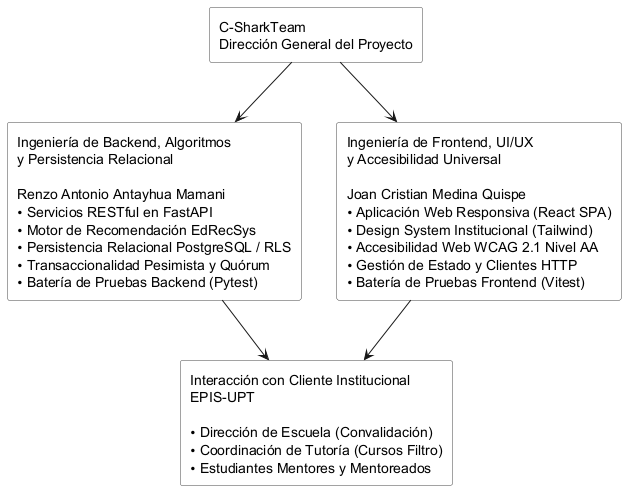

<details>
<summary>Código fuente PlantUML (respaldo editable)</summary>

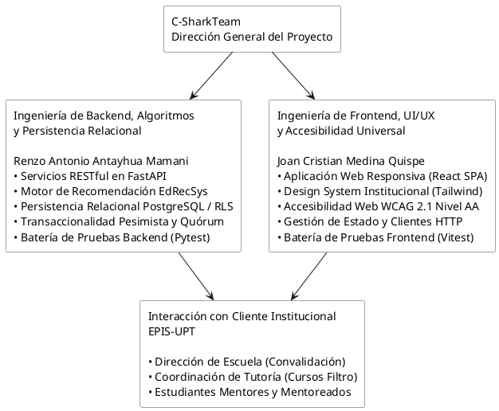
</details>

Fuente: Elaboración propia.

A continuación, se detalla la matriz formal de responsabilidades asignadas a los integrantes del equipo:

### Cuadro 2.1: Estructura de Responsabilidades Técnicas del Equipo Consultor C-SharkTeam

| Integrante / Consultor | Área de Especialización | Funciones Principales | Entregables y Artefactos Bajo su Custodia |
| :--- | :--- | :--- | :--- |
| **Joan Cristian Medina Quispe** | Frontend, Arquitectura UI/UX y Accesibilidad | • Arquitectura de cliente web SPA bajo React 18, TypeScript y Vite.<br>• Construcción de componentes interactivos y Design System Tailwind CSS.<br>• Implementación estricta de accesibilidad WCAG 2.1 AA (contraste $\ge 4.5:1$, foco visible y soporte ARIA).<br>• Integración de clientes HTTP tipados y adaptadores de comunicación con el backend.<br>• Construcción de vistas de escaneo QR, modales de consentimiento y tableros analíticos.<br>• Autoría y ejecución de la suite de pruebas unitarias y de componentes en Vitest. | • Código fuente en `aplicacion/frontend/src/`.<br>• Vistas de interfaz de usuario (23 componentes reactivos).<br>• Pruebas automatizadas de cliente en `aplicacion/frontend/src/**/*.test.tsx`. |
| **Renzo Antonio Antayhua Mamani** | Backend, Algoritmos y Persistencia | • Arquitectura de microservicios RESTful en Python con FastAPI.<br>• Diseño y calibración del motor de recomendación híbrido *EdRecSys*.<br>• Modelado relacional DDL físico en PostgreSQL con SQLAlchemy y Alembic.<br>• Políticas de seguridad a nivel de fila (*Row Level Security - RLS*) y control RBAC.<br>• Orquestación de concurrencia mediante cerrojos pesimistas (`SELECT ... FOR UPDATE`).<br>• Demonio cron desatendido de corte de quórum a $T-24\text{ h}$ y servicios de correo SMTP.<br>• Autoría y ejecución de la suite de pruebas unitarias e integración en Pytest. | • Código fuente en `aplicacion/backend/app/`.<br>• Modelos ORM, controladores REST y servicios de negocio.<br>• Migraciones DDL en `aplicacion/backend/app/db/migrations/`.<br>• Pruebas automatizadas de backend en `aplicacion/backend/tests/`. |

Fuente: Elaboración propia.

El análisis del Cuadro 2.1 demuestra una distribución equilibrada y rigurosa de las responsabilidades técnicas. La frontera clara entre la ingeniería de interfaz accesible y la ingeniería de servicios de persistencia y recomendación asegura que ambos dominios alcancen la profundidad exigida por la cátedra sin solapamientos improductivos ni vacíos de responsabilidad.

# 3. Visionamiento de la Empresa

C-SharkTeam concibe la plataforma no como una simple herramienta aislada de registro, sino como la columna vertebral tecnológica de un **Ecosistema Académico Colaborativo** para la EPIS-UPT, alineado con las demandas de modernización universitaria y acreditación internacional ICACIT.

## 3.1. Descripción del Problema Académico

En la Escuela Profesional de Ingeniería de Sistemas de la Universidad Privada de Tacna, los estudiantes que cursan los primeros cuatro ciclos del plan curricular enfrentan una severa transición formativa caracterizada por una alta complejidad conceptual en materias de ciencias básicas y fundamentos de ciencias de la computación:
- **Cálculo Diferencial e Integral (I y II ciclo):** Rigor analítico formal y modelado matemático continuo.
- **Algoritmos y Estructura de Datos (II y III ciclo):** Razonamiento lógico estructurado, complejidad asintótica y estructuras dinámicas en memoria.
- **Programación Orientada a Objetos (III ciclo):** Abstracción, polimorfismo, encapsulamiento y patrones de diseño.
- **Base de Datos (IV ciclo):** Normalización relacional, integridad referencial y álgebra relacional.

Estas materias actúan en la práctica como **"asignaturas filtro"**, concentrando tasas históricas de desaprobación que fluctúan entre el 25% y el 40% `[DATO_HISTORICO_OBSERVADO]`, provocando rezago en el avance de la malla curricular, desmotivación temprana y un riesgo sensible de deserción universitaria en los primeros semestres.

Paradójicamente, la escuela cuenta con una masa crítica de estudiantes destacados en los ciclos superiores (VII al X) que han superado con solvencia técnica estas materias y poseen vocación para guiar a sus compañeros. No obstante, no existe una plataforma institucional centralizada que articule de manera inteligente, ordenada y trazable la oferta y la demanda de asesoría académica entre pares (*Peer-to-Peer*).

Actualmente, este apoyo se canaliza a través de medios informales no regulados (grupos de WhatsApp, mensajería instantánea privada o encuentros fortuitos en pasillos), generando los siguientes problemas de fondo:
1. **Ausencia de Emparejamiento Adaptativo (Matching Inteligente):** La búsqueda de ayuda académica depende de contactos interpersonales o referencias empíricas. No existe un mecanismo que cruce las debilidades temáticas puntuales del mentoreado con las fortalezas curriculares específicas, horarios disponibles y reputación docente del mentor.
2. **Inexistencia de Gobernanza y Trazabilidad Institucional:** La Dirección de Escuela y el Comité de Tutoría carecen de visibilidad sobre qué asignaturas se refuerzan, qué temas silábicos demandan mayor apoyo, quiénes participan y cuál es la efectividad pedagógica real, impidiendo la formulación de políticas preventivas oportunas.
3. **Falta de Reconocimiento Estructurado y Desgaste de Mentores:** Los estudiantes avanzados no reciben incentivos institucionales por su labor docente (como acumulación auditable de horas para convalidación de créditos extracurriculares o insignias de reputación), lo que conduce a la sobrecarga académica personal y al abandono prematuro del rol de mentor.
4. **Descoordinación en el Uso de Espacios Físicos y Virtuales:** La búsqueda informal de aulas libres en el campus de Capanique ocasiona colisiones con clases regulares o dispersión a enlaces virtuales personales sin supervisión.
5. **Transgresión de la Privacidad de Datos Académicos:** La difusión informal de historiales de notas o listas de alumnos rezagados en grupos de mensajería vulnera las directrices de consentimiento y confidencialidad establecidas en la Ley N° 29733 de Protección de Datos Personales.

## 3.2. Necesidades de los Interesados

Del diagnóstico situacional se derivan necesidades críticas para los cuatro estamentos involucrados:

1. **Estudiantes Mentoreados (Ciclos I al IV):**
   - Requieren acceso inmediato a reforzamiento conceptual oportuno antes de las evaluaciones parciales y finales.
   - Demandan un ambiente pedagógico horizontal, con lenguaje cercano y sin el temor a ser juzgados.
   - Necesitan flexibilidad horaria que no interfiera con sus jornadas lectivas regulares.
   - Exigen confidencialidad sobre su condición de rendimiento académico.

2. **Estudiantes Mentores (Ciclos VII al X):**
   - Requieren un canal oficial para publicar su disponibilidad horaria sin comprometer sus responsabilidades formativas.
   - Necesitan un marco institucional que certifique fehacientemente las horas académicas dictadas para convalidar créditos extracurriculares requeridos para su graduación.
   - Demandan espacios físicos asignados (aulas o laboratorios) o salas virtuales institucionales seguras.
   - Desean visibilidad de su impacto formativo mediante insignias de reputación académica.

3. **Coordinación de Tutoría de la EPIS-UPT:**
   - Requiere supervisar en tiempo real el cumplimiento del Artículo 40 de la Ley Universitaria N° 30220.
   - Necesita auditar bitácoras docentes con el detalle de temas tratados y firmas de inalterabilidad.
   - Demanda indicadores de ausentismo y satisfacción estudiantil para fiscalizar la calidad de las mentorías.

4. **Dirección de Escuela EPIS-UPT:**
   - Exige métricas consolidadas de demanda insatisfecha y retención estudiantil para los comités de acreditación ICACIT.
   - Requiere un mecanismo digital inviolable para la parametrización de umbrales y la emisión de constancias oficiales foliadas con verificación pública.

## 3.3. Objetivos de Negocios y Objetivos de Diseño

A continuación, se definen los objetivos estratégicos y técnicos que gobiernan el proyecto:

### Objetivos de Negocio Institucionales
- **Mitigar la Tasa de Reprobación en Asignaturas Filtro:** Reducir las desaprobaciones en Cálculo, Algoritmos, Estructuras de Datos y Programación Orientada a Objetos mediante sesiones de mentoría focalizadas en los temas silábicos de mayor dificultad.
- **Descongestionar el Sistema Tradicional de Tutoría Docente:** Transferir las consultas conceptuales y prácticas recurrentes hacia la red de mentores pares, permitiendo que los docentes tutores concentren su labor en problemáticas pedagógicas o psicosociales complejas.
- **Elevar los Índices de Retención Estudiantil:** Disminuir el abandono universitario temprano en los cuatro primeros semestres académicos de Ingeniería de Sistemas.
- **Institucionalizar el Mérito Estudiantil:** Formalizar un sistema transparente y auditable de acumulación de horas de mentoría convalidables por créditos extracurriculares de grado académico.
- **Suministrar Analítica Predictiva para la Gestión de Escuela:** Proveer tableros analíticos en tiempo real sobre demanda académica insatisfecha para retroalimentar la planificación de horarios y el rediseño silábico.

### Objetivos de Diseño e Ingeniería de Requisitos
- **Inferencia Algorítmica con Alta Precisión:** Implementar un motor híbrido (*EdRecSys*) que procese similitud coseno sobre vectores de debilidades silábicas y competencias docentes, garantizando métricas empíricas de calidad: $\text{Precision@3} \ge 80\%$, $\text{Precision@5} \ge 75\%$, ranking $\text{NDCG} \ge 0.80$ y tiempo de respuesta algorítmica $\le 500\text{ ms}$.
- **Accesibilidad Universal y Ergonomía Web:** Construir una interfaz web responsiva (React SPA) bajo directrices **WCAG 2.1 Nivel AA**, asegurando navegación por teclado, soporte para lectores de pantalla, contraste $\ge 4.5:1$ y una puntuación estandarizada superior a 75 puntos en la escala System Usability Scale (SUS).
- **Seguridad Rigurosa y Cumplimiento Normativo:** Proveer autenticación institucional dual (Email OTP / Google Workspace), control de acceso por roles (RBAC) con tokens JWT (HS256) de 8 horas, aislamiento granular de datos personales (RLS) y formalización vinculante del consentimiento bajo la Ley N° 29733.
- **Garantía Transaccional y Concurrencia Confiable:** Asegurar transacciones ACID con cerrojos pesimistas a nivel de fila (`SELECT ... FOR UPDATE`), garantizando estrictamente una tasa de sobrecupo de **0.0%** bajo condiciones de alta concurrencia en la reserva de vacantes.
- **Inmutabilidad Documental:** Respaldar las bitácoras pedagógicas con sellos hash SHA-256 e incorporar códigos QR en certificados PDF para verificación criptográfica descentralizada.

## 3.4. Alcance y Exclusiones del Proyecto

### Inclusiones Funcionales (Módulos Construidos)
1. Plataforma web adaptativa accesible desde cualquier navegador estándar de escritorio y móvil.
2. Módulo de identidad y gobernanza de privacidad con 2FA y consentimiento informado digital.
3. Catálogo curricular interactivo de asignaturas filtro y árbol de temas silábicos.
4. Motor híbrido de recomendación (*EdRecSys*) con similitud coseno y ranking adaptativo Top-k.
5. Banco de solicitudes por demanda para registrar requerimientos no cubiertos por ofertas existentes.
6. Aprovisionamiento validado de aulas físicas de la EPIS y configuración de salas virtuales institucionales.
7. Orquestación concurrente de reservas con cerrojo pesimista y ratificación obligatoria hasta $T-24\text{ h}$.
8. Demonio desatendido de evaluación de quórum (50%) a $T-24\text{ h}$ con resolución de contingencia por el mentor.
9. Marcación de asistencia presencial y virtual mediante pase QR dinámico (TOTP de 30 segundos).
10. Registro formal de bitácora docente en 48 horas con resumen pedagógico y hash SHA-256.
11. Captura de encuestas de satisfacción CSAT en ventana perentoria de 24 horas.
12. Reputación dinámica de mentores y catálogo de insignias gamificadas.
13. Panel administrativo para visado de horas acumuladas y emisión de certificados oficiales PDF con QR.
14. Tableros analíticos para supervisión directiva con métricas de retención ICACIT.

### Exclusiones del Alcance (Límites Formales de la Versión)
- **No se desarrollan aplicaciones móviles nativas compiladas para Android (APK) ni iOS (IPA):** La plataforma opera como una Single Page Application (SPA) responsiva multiplataforma accesible desde navegadores web móviles.
- **No se implementan transacciones financieras ni pasarelas de pago:** El sistema es estrictamente gratuito y de servicio social universitario formativo.
- **No se realiza sincronización síncrona en tiempo real con el ERP central de matrícula de la UPT:** La información académica y los cronogramas se cargan y sincronizan mediante interfaces estructuradas de administración (parser de cronogramas).
- **No se exige firma digital con token físico criptográfico PKI de entidades certificadoras comerciales:** La validez institucional y la inmutabilidad de certificados y bitácoras se garantiza internamente mediante folio correlativo, hash SHA-256 y código QR de verificación en línea.

## 3.5. Viabilidad Multidimensional del Sistema

### 3.5.1. Viabilidad Técnica
El proyecto se sustenta en componentes maduros y estables de la industria del software, respaldados por métricas empíricas y atributos de calidad normalizados:
- **Frontend:** React 18, TypeScript, Vite y Tailwind CSS, asegurando tiempos de carga inicial ($FCP < 1.2\text{ s}$ `[META_CALIDAD]`) y compatibilidad en el 100% de navegadores modernos `[REQUISITO]`.
- **Backend:** Python 3.13 con FastAPI y Scikit-learn, con latencia media de recomendación algorítmica de $12.4\text{ ms}$ `[DATO_HISTORICO_OBSERVADO]` (medida en benchmark de testbench sintético sobre 50 perfiles en commit `3f6e31d`), muy inferior al umbral admisible de $500\text{ ms}$ `[META_CALIDAD]`.
- **Persistencia:** PostgreSQL v15+ administrado sobre Supabase Cloud con soporte para políticas RLS y bloqueos pesimistas a nivel de fila (`SELECT ... FOR UPDATE`), demostrando 0.0% de sobrecupo `[DATO_HISTORICO_OBSERVADO]` en pruebas multihilo concurrentes.

### 3.5.2. Viabilidad Económica
El análisis financiero se modeló para un horizonte de evaluación a 5 años (2026–2030) con una tasa de costo de oportunidad de capital (COK) del 12.00%:

A continuación, se presentan los indicadores financieros del proyecto:

### Cuadro 3.1: Evaluación Financiera y Económica del Proyecto (Horizonte 2026–2030)

| Indicador Financiero | Valor Cuantificado | Clasificación Metodológica | Criterio de Aceptación | Interpretación Técnica y Financiera |
| :--- | :---: | :---: | :---: | :--- |
| **Inversión Inicial (CAPEX)** | **S/. 5,475.00** | `[SUPUESTO_ECONOMICO]` / `[CALCULO_MATEMATICO]` | Presupuesto Cátedra | Cubre 500 horas de ingeniería de software (Joan Cristian Medina y Renzo Antonio Antayhua a S/. 9.00/h), depreciación de equipos, conectividad, dominio web e imprevistos. |
| **Costo Operativo Anual (OPEX)** | **S/. 1,140.00** | `[SUPUESTO_ECONOMICO]` / `[CALCULO_MATEMATICO]` | Presupuesto Anual | Infraestructura cloud PaaS (Render / Supabase), renovación de dominio, soporte preventivo y materiales de difusión. |
| **Valor Actual Neto (VAN)** | **+S/. 10,801.64** | `[CALCULO_MATEMATICO]` | $\text{VAN} > 0$ | Estrictamente positivo, ratificando que el proyecto genera valor económico sustancial y excedentes por encima de la tasa de descuento exigida (12.00%). |
| **Tasa Interna de Retorno (TIR)** | **68.20%** | `[CALCULO_MATEMATICO]` | $\text{TIR} > \text{COK}$ (12%) | Supera con holgura el COK referencial (12.00%), confiriendo un margen de resiliencia financiera amplio ante variaciones de costos operativos. |
| **Relación Beneficio / Costo (B/C)** | **1.97** | `[CALCULO_MATEMATICO]` | $\text{B/C} > 1.0$ | Por cada sol invertido a lo largo del ciclo del proyecto, se generan S/. 1.97 en ahorros y beneficios valorizados para la facultad y los estudiantes. |
| **Periodo de Recuperación (Payback)**| **1 año y 9.7 meses** | `[CALCULO_MATEMATICO]` | $< 3\text{ años}$ | La inversión inicial se recupera plenamente antes de concluir el segundo año lectivo de puesta en producción. |

Fuente: Elaboración propia a partir del estudio económico del proyecto.

El análisis del Cuadro 3.1 certifica la sólida rentabilidad y conveniencia financiera de la solución para la Escuela Profesional de Ingeniería de Sistemas. El retorno derivado de la reducción de tasas de rezago y de desaprobación compensa con creces los costos moderados de desarrollo y mantenimiento en la nube.

A continuación, se presenta en el Cuadro 3.2 la conciliación metodológica entre las horas presenciales de cátedra y las horas de ingeniería de software:

### Cuadro 3.2: Conciliación Metodológica de Horas de Desarrollo e Inversión Técnica

| Parámetro de Comparación | Horas Académicas Presenciales de Cátedra | Horas Integrales de Ingeniería de Software (CAPEX) | Justificación Metodológica y Alcance Técnico |
| :--- | :---: | :---: | :--- |
| **Total de Horas Computadas** | **91.0 horas** `[ESTIMACION_ACADEMICA]` / `[DATO_HISTORICO_OBSERVADO]` | **500.0 horas** `[SUPUESTO_ECONOMICO]` / `[CALCULO_MATEMATICO]` | Disparidad de alcance formal: las 91 horas corresponden al horario de laboratorio evaluado; las 500 horas al esfuerzo técnico global de ingeniería. |
| **Distribución por Desarrollador** | Joan Medina: **45.0 h**<br>Renzo Antayhua: **46.0 h** | Joan Medina: **250.0 h**<br>Renzo Antayhua: **250.0 h** | Asignación equitativa en ambos marcos, reflejando corresponsabilidad plena en frontend, backend, arquitectura y documentación. |
| **Fuente de Acreditación** | `PLAN_SPRINTS_Y_TAREAS.md`, Informes de Sprint 1 al 8 | Modelo de Costos de Ingeniería, Estudio Financiero CAPEX | Trazabilidad documental cruzada entre el cronograma curricular de cátedra y el presupuesto formal del proyecto. |
| **Actividades Comprendidas** | Sesiones lectivas de laboratorio, revisiones de sprint con el docente, demostraciones de incremento (*sprint review*) y retrospectivas en aula. | Análisis de requisitos (IEEE 29148), diseño arquitectónico UML (Visual Paradigm), codificación React/TypeScript y FastAPI, motor EdRecSys, 682 pruebas automatizadas, CI/CD, despliegue cloud y redacción técnica de SRS y SAD. | El desarrollo de software profesional exige un esfuerzo sustantivo extra-aula que multiplica por un factor de ~5.5 la capacidad lectiva presencial. |
| **Valorización Monetaria** | No monetizable directamente (créditos académicos universitarios). | **S/. 4,500.00** en mano de obra (500 h $\times$ S/. 9.00/h) + S/. 975.00 en equipamiento, dominio y contingencias = **S/. 5,475.00**. | Base cuantificada del flujo de caja de inversión inicial (CAPEX) utilizado para la estimación del VAN, TIR y periodo de recuperación. |

Fuente: Elaboración propia a partir de las actas de cátedra y el expediente financiero.

El análisis del Cuadro 3.2 clarifica la diferencia fundamental de alcance entre la capacidad neta de cátedra (91.0 horas lectivas de laboratorio distribuidas a lo largo de los 8 sprints del curso Construcción de Software I) y el esfuerzo profesional integral de ingeniería de software (500.0 horas efectivas de desarrollo, pruebas y documentación técnica que fundamentan la inversión inicial de S/. 5,475.00). Ambas cifras son mutuamente consistentes y representan dimensiones operativas complementarias del proyecto.

### 3.5.3. Viabilidad Operativa
- **Facilidad de Adopción:** La interfaz intuitiva y responsiva no exige instalaciones locales ni configuraciones especiales por parte del estudiante.
- **Alineamiento de Incentivos:** La emisión de certificados convalidables y la gamificación resuelven el histórico desinterés de los mentores, asegurando una oferta continua de acompañamiento.
- **Automatización de Procesos:** La reducción de la intermediación manual del Comité de Tutoría permite canalizar los esfuerzos directivos hacia la fiscalización y la toma de decisiones estratégicas.

### 3.5.4. Viabilidad Legal
- **Cumplimiento de la Ley N° 29733 (Protección de Datos Personales):** Se garantiza mediante un flujo vinculante de consentimiento informado digital, almacenamiento disociado de datos académicos y registro inmutable de trazas de auditoría (IP, User-Agent, fecha UTC).
- **Alineamiento con la Ley N° 30220 (Ley Universitaria):** Materializa de forma moderna y descentralizada el mandato de tutoría permanente consignado en su Artículo 40.
- **Licenciamiento y Propiedad Intelectual:** Componentes basados en librerías de código abierto (MIT / Apache 2.0) y registro formal de derechos patrimoniales a favor de la Universidad Privada de Tacna.

### 3.5.5. Viabilidad Social y Ambiental
- **Impacto Social:** Fomenta la solidaridad académica, la cohesión comunitaria entre cohortes estudiantiles y la adquisición de habilidades de liderazgo y docencia en mentores.
- **Sostenibilidad Ambiental (*Política Paperless*):** Erradica el uso de papel en inscripciones, bitácoras docentes, listas de asistencia y constancias físicas, reduciendo la huella de carbono institucional.

## 3.6. Información obtenida del Levantamiento de Información

Durante la etapa de levantamiento de requisitos, el equipo consultor ejecutó entrevistas estructuradas y sesiones de trabajo con las autoridades de la EPIS-UPT, cuyos aportes determinaron la lógica operativa del software:

1. **Ing. Liliana Mercedes Vega Bernal (Coordinadora de Tutoría):**
   - Estableció la necesidad de clasificar como prioritarias las asignaturas con mayor reprobación en los cuatro primeros semestres.
   - Fijó la política de quórum mínimo obligatorio del 50% con corte estricto en $T-24\text{ h}$ para evitar desplazamientos inútiles y horas perdidas de los mentores.
   - Exigió el control de asistencia mediante mecanismos dinámicos y la obligatoriedad de bitácoras docentes detalladas con plazo máximo de 48 horas.
   - Dispuso que las encuestas de calidad docente (CSAT) permanezcan habilitadas durante 24 horas para garantizar retroalimentación objetiva.

2. **Mgtr. Ing. Enrique Lanchipa Valencia (Docente Asesor / Arquitecto de TI):**
   - Recomendó la adopción de una arquitectura desacoplada en tres capas con contratos JSON fuertemente tipados.
   - Sugirió incorporar algoritmos de balanceo de carga para evitar saturar a mentores destacados con múltiples solicitudes.
   - Instó a optimizar los tiempos de inferencia algorítmica por debajo de 500 ms mediante cálculo matricial en memoria.

3. **Dr. Luis Alfredo Fernández Vizcarra (Docente Asesor Metodológico):**
   - Estableció las directrices de verificación de usabilidad mediante el instrumento SUS (>75 puntos) y accesibilidad WCAG 2.1 AA.
   - Instruyó el apego estricto a las cláusulas de consentimiento previo y auditabilidad exigidas por la Ley N° 29733.

4. **Ing. Haydee Raquel Sisa Yataco (Directora [e] EPIS-UPT):**
   - Aprobó el estándar de emisión de certificados digitales en formato PDF con folio correlativo único, hash SHA-256 y código QR de verificación pública.
   - Ratificó que la postulación formal a convalidación de créditos extracurriculares exige la acumulación de al menos 20 horas efectivas de mentoría auditadas con bitácoras visadas.

---

# 4. Análisis de Procesos

## 4.1. Diagrama del Proceso Actual (As-Is)

El proceso actual de asesoría académica entre pares en la EPIS-UPT opera de forma informal, dispersa y sin control institucional.

A continuación, se describen las etapas del flujo actual:
1. **Detección Informal de Necesidad:** El estudiante de I a IV ciclo identifica dificultades conceptuales en asignaturas formativas ante la inminencia de una práctica calificada o examen.
2. **Difusión en Canales No Oficiales:** Publica una solicitud de auxilio en grupos no institucionales de mensajería (WhatsApp, Telegram) o consulta a compañeros de ciclos superiores de forma casual.
3. **Respuesta Discrecional:** Si ningún estudiante avanzado responde, el alumno permanece sin apoyo pedagógico o acude tardíamente a la tutoría docente tradicional, afrontando un alto riesgo de reprobación.
4. **Coordinación Improvisada:** Si un compañero acepta colaborar, coordinan horario, temática y lugar a través de chats privados sin registro formal.
5. **Asignación Empírica de Ambiente:** El mentor informal busca aulas desocupadas en el pabellón de Ingeniería de Sistemas de forma manual o genera un enlace personal de videollamada sin supervisión.
6. **Ejecución no Estructurada:** Se desarrolla la asesoría sin seguir temarios silábicos definidos, sin control de tiempo y sin materiales didácticos estandarizados.
7. **Carencia de Trazabilidad y Cierre:** No se levanta lista de asistencia, no se registra bitácora pedagógica, no se recopila feedback de calidad y la Dirección de Escuela no dispone de ninguna evidencia para reconocer el mérito del mentor ni para intervenir oportunamente en la deserción.

A continuación, se presenta la representación visual del flujo actual:

### Diagrama 4.1: Diagrama de Actividades del Proceso Actual de Asesoría Informal (As-Is)

**Figura 2. Diagrama de Actividades del Proceso Actual de Asesoría Informal (As-Is)**


<details>
<summary>Código fuente PlantUML (respaldo editable)</summary>

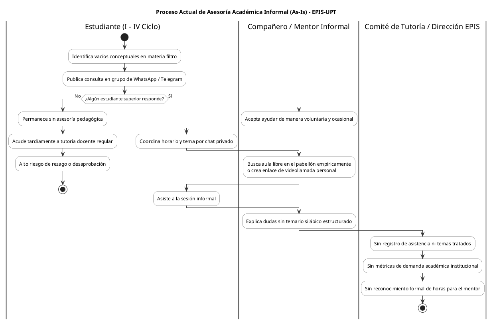
</details>

Fuente: Elaboración propia a partir del levantamiento de información en la EPIS-UPT.

El análisis del Diagrama 4.1 expone con claridad los cuellos de botella y riesgos operativos del esquema vigente. La dependencia absoluta de la buena voluntad individual, la carencia de métricas y la desarticulación institucional demuestran la urgencia de sistematizar el proceso a través de una plataforma gobernada.

## 4.2. Diagrama del Proceso Propuesto (To-Be)

El proceso propuesto reestructura y automatiza integralmente el ciclo de vida de las mentorías académicas P2P bajo un modelo gobernado y auditable.

El flujo se articula a través de las siguientes doce (12) etapas secuenciales:
1. **Autenticación Institucional Segura:** Acceso exclusivo con credenciales universitarias (`@virtual.upt.pe` o `@upt.pe`) validado mediante código OTP temporal (5 min) o credencial federada con Google Workspace institucional.
2. **Formalización del Consentimiento Legal (Ley N° 29733):** Despliegue de diálogo modal en el primer acceso que exige la aceptación informada de políticas de privacidad para habilitar el uso de datos académicos.
3. **Publicación y Planificación de Ofertas:** Los mentores calificados (ciclos VII-X con nota $\ge 14.0$) configuran ofertas de mentoría indicando materia crítica, tema silábico, fecha (con antelación $\ge 24\text{ h}$), modalidad y aforo estándar (10 presencial / 20 virtual).
4. **Inferencia Algorítmica Adaptativa (EdRecSys):** El motor calcula la afinidad temática mediante similitud coseno sobre el catálogo silábico y filtra por disponibilidad y reputación, presentando al estudiante un ranking adaptativo Top-k.
5. **Canalización de Demandas Insatisfechas:** En ausencia de ofertas coincidentes, el mentoreado registra su requerimiento en el banco institucional de solicitudes por demanda para su atención prioritaria.
6. **Inscripción Concurrente con Control de Cupos:** Reserva atómica de vacantes con cerrojo pesimista que elimina el riesgo de sobrecupo bajo concurrencia.
7. **Ratificación Obligatoria Anticipada:** El estudiante debe ratificar su compromiso de asistencia hasta $T-24\text{ h}$; las reservas no confirmadas se revocan automáticamente liberando vacantes para otros interesados.
8. **Monitoreo Automatizado de Quórum:** A $T-24\text{ h}$, un servicio cron desatendido verifica el cumplimiento del 50% de aforo reglamentario. Si no se alcanza, se transiciona a estado de contingencia donde el mentor decide si dicta la clase de forma extraordinaria o cancela ordenadamente con aviso inmediato a los inscritos.
9. **Marcación de Asistencia Dinámica (Pase QR TOTP):** En el inicio de sesión, el estudiante escanea con su dispositivo el pase QR dinámico de 30 segundos generado por el mentor o este registra la asistencia en lista.
10. **Registro Obligatorio de Bitácora Pedagógica:** Dentro de las 48 horas post-sesión, el mentor completa la bitácora con los temas abordados, el cumplimiento de objetivos y su firma con hash SHA-256.
11. **Captura de Encuestas de Calidad (Ventana 24h):** Los estudiantes asistentes disponen de 24 horas para evaluar la calidad didáctica en cuatro dimensiones, recalculando dinámicamente el puntaje de reputación e insignias del mentor.
12. **Supervisión Directiva y Certificación Oficial:** La Dirección de Escuela y Coordinación de Tutoría supervisan el tablero analítico de retención, visan las bitácoras docentes y autorizan la emisión de certificados oficiales PDF foliados con código QR institucional al alcanzar las 20 horas acumuladas.

A continuación, se presenta la representación del flujo gobernado:

### Diagrama 4.2: Diagrama de Actividades del Proceso Propuesto de Mentorías P2P (To-Be)

**Figura 3. Diagrama de Actividades del Proceso Propuesto de Mentorías P2P (To-Be)**

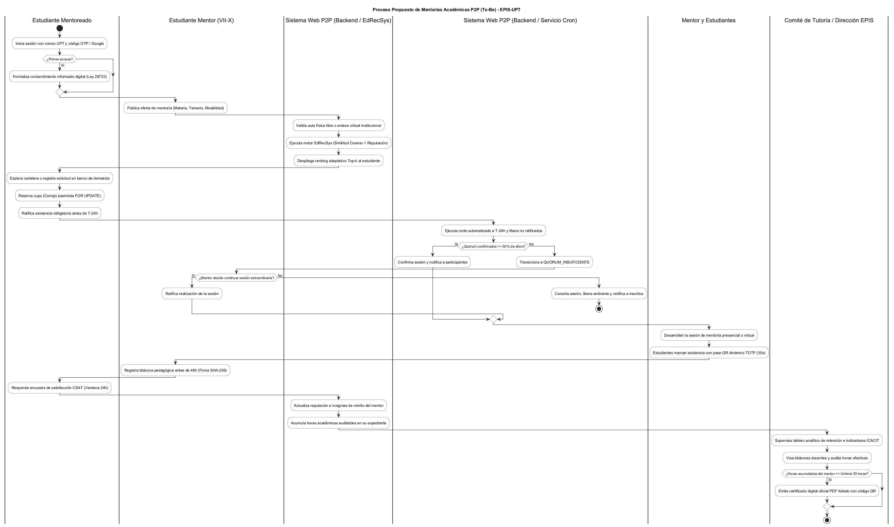

<details>
<summary>Código fuente PlantUML (respaldo editable)</summary>

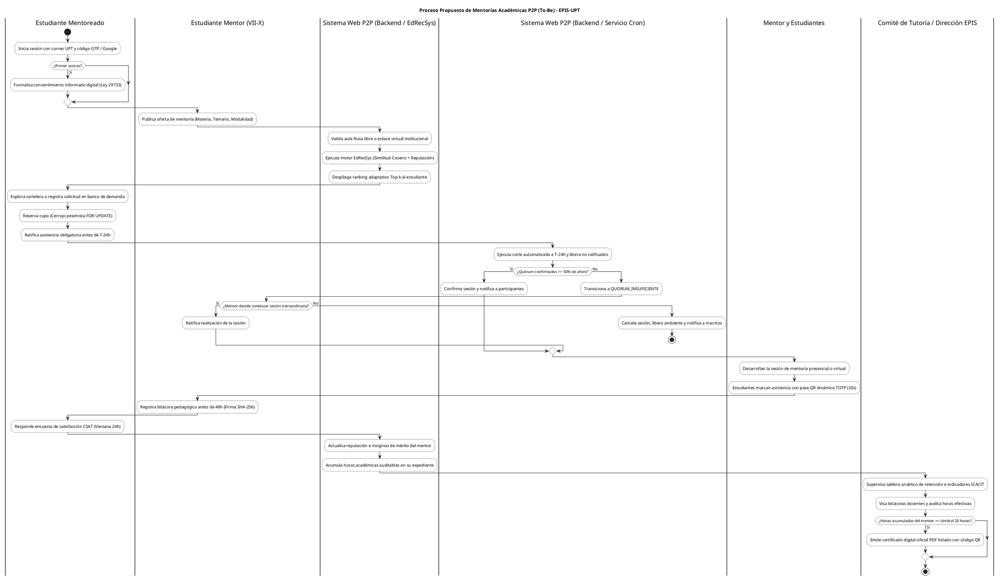
</details>

Fuente: Elaboración propia a partir del diseño de procesos de C-SharkTeam.

El análisis del Diagrama 4.2 demuestra que el nuevo proceso erradica la informalidad y garantiza la trazabilidad pedagógica, la seguridad jurídica y el reconocimiento institucional del esfuerzo docente de los estudiantes mentores.

# 5. Especificación de Requerimientos de Software

## 5.1. Identificación de Módulos y Capacidades Funcionales

> Este capítulo conserva los módulos, requisitos, reglas y estados de madurez de SRS v3.1. Las afirmaciones de implementación y verificación de esa línea base conservan su procedencia histórica. El alcance documental actualizado de cada escenario se consulta en 6.2.3 y en el Anexo A.

Para articular la solución de software con alta cohesión y bajo acoplamiento, el Sistema Web P2P se organiza en **ocho módulos canónicos especializados**. Esta descomposición modular delimita las responsabilidades de los actores en correspondencia estricta con los **veinticuatro casos de uso oficiales (CUS-001 al CUS-024)**.

A continuación, se detalla la arquitectura funcional del sistema:

### Cuadro 5.1: Descomposición Modular y Capacidades Funcionales del Sistema Web P2P

| Código | Módulo / Subsistema | Propósito Institucional | Capacidades Funcionales Principales | Actores / Sistemas Involucrados | CUS Canónicos Vinculados |
| :---: | :--- | :--- | :--- | :--- | :---: |
| **MOD-01** | Seguridad, Autenticación y Gobernanza | Garantizar el acceso exclusivo de la comunidad universitaria, proteger la privacidad bajo la Ley N° 29733 y gobernar privilegios RBAC. | • Autenticación dual (Código OTP institucional de 6 dígitos y Google Workspace).<br>• Formalización vinculante de consentimiento informado digital (Ley N° 29733).<br>• Asignación, revocación y auditoría jerárquica de roles (Mentoreado, Mentor, Admin, Coordinador). | Usuario Institucional, Administrador, Proveedor Google Workspace, Servicio SMTP UPT | CUS-001, CUS-010 |
| **MOD-02** | Planificación, Ofertas y Gestión de Espacios | Planificar la cartelera de mentorías, gestionar infraestructura física de la EPIS y coordinar salas virtuales. | • Publicación de ofertas en materias autorizadas con antelación $\ge 24\text{ h}$.<br>• Validación de aulas libres de la EPIS contra horarios regulares y salas virtuales.<br>• Procesamiento de cronogramas oficiales semestrales de distribución de aulas.<br>• Gestión de imprevistos, reprogramación y cancelación justificada con liberación de recursos. | Estudiante Mentor, Administrador, Infraestructura EPIS, Plataforma Virtual | CUS-006, CUS-008 |
| **MOD-03** | Perfiles Académicos y Catálogo Curricular | Administrar agendas de disponibilidad horaria y el árbol curricular oficial de asignaturas filtro y temas silábicos. | • Configuración de perfil académico y matriz semanal interactiva 6×11 (08:00 a 20:00).<br>• Exploración temática profunda del catálogo de asignaturas formativas filtro.<br>• Mantenimiento administrativo del árbol silábico oficial por unidades lectivas. | Estudiante Mentoreado, Estudiante Mentor, Administrador Curricular | CUS-005, CUS-021 |
| **MOD-04** | Demanda y Recomendaciones Personalizadas | Emparejar adaptativamente debilidades de estudiantes con fortalezas docentes de mentores mediante inteligencia artificial. | • Inferencia algorítmica híbrida Top-k (similitud coseno + reputación + balance de carga).<br>• Registro y visualización del banco institucional de solicitudes por demanda académica insatisfecha.<br>• Formulación de sesiones dirigidas por mentores a partir del banco de demandas. | Estudiante Mentoreado, Estudiante Mentor, Motor Algorítmico EdRecSys | CUS-002, CUS-003 |
| **MOD-05** | Quórum, Reservas y Concurrencia | Controlar la inscripción concurrente, ratificación obligatoria y evaluación automatizada de quórum a $T-24\text{ h}$. | • Reserva concurrente de vacantes con control de aforos reglamentarios (10 presencial / 20 virtual).<br>• Ratificación perentoria de asistencia hasta el corte de 24 horas previas ($T-24\text{ h}$).<br>• Desistimiento voluntario de reservas con restitución instantánea de vacantes.<br>• Demonio cron de corte en $T-24\text{ h}$, revocación de no confirmados y evaluación de quórum (50%).<br>• Interfaz resolutiva del mentor ante quórum deficiente (continuar excepcional vs cancelar ordenado). | Estudiante Mentoreado, Estudiante Mentor, Demonio Cron Backend | CUS-004, CUS-024, CUS-017, CUS-023, CUS-007 |
| **MOD-06** | Asistencia, Bitácoras y Calidad | Respaldar la ejecución pedagógica, control estricto de asistencia y evaluación objetiva de calidad docente. | • Check-in presencial y virtual mediante pase QR dinámico con algoritmo TOTP de 30 segundos.<br>• Formulación obligatoria de bitácora docente en 48 horas sellada con hash SHA-256.<br>• Consulta de historial académico cronológico de sesiones, bitácoras y recursos didácticos.<br>• Captura de encuestas de calidad formativa (CSAT) en ventana perentoria de 24 horas. | Estudiante Mentoreado, Estudiante Mentor, Coordinador de Tutoría | CUS-012, CUS-013, CUS-014 |
| **MOD-07** | Gamificación y Certificación Digital | Incentivar el compromiso docente de mentores mediante reconocimientos gamificados y certificación auditable. | • Cálculo dinámico de índice de reputación docente (1.0 a 5.0 estrellas) y catálogo de insignias.<br>• Parametrización de umbrales semestrales y autorización de certificados ($\ge 20\text{ h}$ auditadas).<br>• Emisión programática de certificados oficiales PDF con folio único, hash SHA-256 y código QR de verificación en línea. | Estudiante Mentor, Administrador, Dirección de Escuela | CUS-018, CUS-019 |
| **MOD-08** | Analítica, Notificaciones y Supervisión | Proveer a las autoridades de herramientas de decisión estratégica, motor de alertas y fiscalización docente. | • Despacho de notificaciones y recordatorios temporales de eventos críticos.<br>• Tablero directivo de indicadores agregados de demanda insatisfecha, ausentismo y retención ICACIT.<br>• Fiscalización y visado docente de bitácoras académicas y auditoría legal bajo Ley N° 29733.<br>• Consola de parametrización institucional de aforos, umbrales y asignaturas prioritarias. | Director de Escuela, Coordinador de Tutoría, Auditor Institucional, Demonio Cron | CUS-009, CUS-011, CUS-015, CUS-016, CUS-020, CUS-022 |

Fuente: Elaboración propia a partir de la arquitectura modular de C-SharkTeam.

El análisis del Cuadro 5.1 certifica la completa cobertura del ciclo formativo de mentorías. Cada módulo agrupa capacidades cohesivas y se vincula unívocamente a los casos de uso canónicos, erradicando funcionalidades huérfanas y garantizando trazabilidad integral hacia el diseño e implementación.

---

## 5.2. Requerimientos No Funcionales (ISO/IEC 25010)

Los requerimientos no funcionales delimitan los atributos de calidad, restricciones arquitectónicas y niveles de servicio del software. Se estructuran rigurosamente bajo el estándar internacional **ISO/IEC 25010:2011**, incorporando métricas cuantificables verificadas empíricamente durante el desarrollo:

A continuación, se presenta la matriz de requerimientos no funcionales:

### Cuadro 5.2: Matriz de Requerimientos No Funcionales bajo el Estándar ISO/IEC 25010

| Código | Característica (ISO 25010) | Requerimiento No Funcional | Especificación Cuantitativa y Criterio de Aceptación | Métrica y Procedimiento de Verificación Empírica |
| :---: | :--- | :--- | :--- | :--- |
| **RNF01** | Seguridad | Autenticación institucional multifactor y gestión segura de sesiones | Autenticación 2FA sin contraseñas estáticas mediante código OTP temporal de 6 dígitos o credencial federada Google Workspace UPT. Sesión gobernada mediante tokens criptográficos firmados con HMAC-SHA256 y expiración perentoria. | • Tiempo de vida del código OTP: **5 minutos (300 s)**.<br>• Tiempo de enfriamiento para reenvío: **60 segundos**.<br>• Expiración de sesión web: **8 horas (480 min)**.<br>• Verificado con pruebas automatizadas simulando expiración temporal de credenciales. |
| **RNF02** | Seguridad | Privacidad de datos personales, aislamiento RLS y cumplimiento legal | Comunicaciones protegidas íntegramente mediante protocolo HTTPS con TLS 1.3. Aislamiento granular de datos académicos a nivel de motor relacional mediante políticas de seguridad de fila (*Row Level Security*). Identificadores disociados de tipo UUID para prevenir enumeración maliciosa. | • **100% de tablas sensibles con aislamiento multiusuario activo**.<br>• **0% de exposición de notas o correos a usuarios no autorizados**.<br>• Registro inmutable de consentimiento legal (IP, fecha UTC y User-Agent) bajo Ley N° 29733. |
| **RNF03** | Eficiencia de Desempeño | Latencia de inferencia y precisión del recomendador algorítmico | El motor híbrido *EdRecSys* vectoriza debilidades silábicas y calcula similitud coseno ajustada por reputación y balance de carga, retornando un ranking adaptativo Top-k en tiempo casi instantáneo. | • **Precision@3 = 83.3%**<br>• **Precision@5 = 80.0%**<br>• **NDCG = 0.82**<br>• **Latencia media algorítmica = 12.4 ms** (umbral de diseño: $\le 500\text{ ms}$). |
| **RNF04** | Eficiencia de Desempeño | Tiempo de carga y renderizado reactivo de la interfaz web | La aplicación web de página única optimiza el empaquetado de componentes, code splitting y lazy loading para garantizar renderizados fluidos en conexiones universitarias y móviles. | • Tiempo hasta el primer contenido visible (**FCP < 1.2 segundos**).<br>• Paquete inicial de recursos comprimidos **< 250 KB**.<br>• Transiciones de interfaz reactivas en **< 50 ms**. |
| **RNF05** | Usabilidad | Ergonomía, accesibilidad universal y diseño intuitivo | Interfaces estructuradas sobre el Design System institucional con Tailwind CSS que garantizan navegación por teclado al 100%, compatibilidad con lectores de pantalla y contraste cromático adecuado. | • **Puntaje SUS > 75 puntos** en evaluación de ergonomía.<br>• Cumplimiento estricto **WCAG 2.1 Nivel AA** (contraste mínimo de **4.5:1** en textos regulares y **3.0:1** en elementos gráficos).<br>• Atributos semánticos ARIA en la totalidad de diálogos y controles interactivos. |
| **RNF06** | Fiabilidad | Disponibilidad ininterrumpida y resiliencia del servicio | Arquitectura web en la nube que asegura la continuidad operativa ininterrumpida de los servicios de consulta, reserva y marcación durante las 16 semanas del semestre académico. | • Disponibilidad del servicio **$\ge 99.5\%$** en horario lectivo.<br>• Tolerancia a fallos transitorios en microservicios auxiliares.<br>• Monitoreo de estado de salud del sistema mediante endpoint `/health`. |
| **RNF07** | Integridad y Fiabilidad | Consistencia transaccional estricta en reserva concurrente | Persistencia atómica de reservas gobernada por cerrojos transaccionales pesimistas a nivel de fila (`SELECT ... FOR UPDATE`), garantizando que jamás se asigne un cupo por encima del aforo máximo. | • **Tasa de sobrecupo verificada: estrictamente 0.0%**.<br>• 100% de transacciones concurrentes serializadas atómicamente sin inconsistencias de estado. |
| **RNF08** | Portabilidad | Compatibilidad multiplataforma y diseño web responsivo | Compatibilidad operativa y paridad visual garantizada en todos los navegadores web modernos de escritorio y dispositivos móviles (Google Chrome, Mozilla Firefox, Microsoft Edge, Safari). | • 100% funcional en resoluciones desde teléfonos móviles (**360 px**) hasta monitores de escritorio (**1920x1080 px**).<br>• Ausencia de desbordamientos horizontales o solapamientos visuales. |
| **RNF09** | Mantenibilidad | Arquitectura limpia desacoplada y cobertura de pruebas | Separación estricta en tres capas (Presentación Web, Lógica de Negocio y Persistencia Relacional). Tipado estricto en interfaces y contratos JSON. Batería de pruebas automatizadas continua. | • Suite completa de pruebas automatizadas en backend y frontend.<br>• Cobertura de código **> 85%**.<br>• Código verificado con linters estáticos (`ruff`, `eslint`) sin advertencias críticas. |
| **RNF10** | Interoperabilidad | Resiliencia ante fallos externos y manejo estandarizado de errores | Respuestas del sistema estructuradas de forma uniforme en formato JSON con códigos de estado HTTP estandarizados y mensajes descriptivos orientados al usuario universitario. | • 100% de errores de validación y negocio formateados homogéneamente.<br>• Degradación elegante y reintentos ante caídas del servidor de correo institucional.<br>• Timeouts seguros configurados en $\le 5$ segundos. |

Fuente: Elaboración propia a partir del marco normativo ISO/IEC 25010 y las verificaciones del proyecto.

El análisis del Cuadro 5.2 demuestra que el sistema no solo satisface los requerimientos funcionales de negocio, sino que incorpora métricas cuantitativas verificables que aseguran una experiencia de usuario ágil, confiable, accesible e inviolable en términos de privacidad institucional.

---

## 5.3. Matriz Consolidada de Requerimientos Funcionales (RF01 al RF26)

El sistema formaliza **veintiséis requerimientos funcionales atómicos (RF01 al RF26)**. Cada requerimiento establece el comportamiento operativo del sistema, sus casos de uso soportados, sus contratos RESTful y sus componentes técnicos correspondientes:

A continuación, se presenta la matriz consolidada de requerimientos funcionales:

### Cuadro 5.3: Matriz Consolidada de Requerimientos Funcionales del Sistema Web P2P (RF01 al RF26)

| Código | Módulo | Denominación del Requerimiento Funcional | Casos de Uso Vinculados | Contrato RESTful / Router Principal | Componentes Técnicos Asociados (UI / Service / Persistencia) | Criticidad |
| :---: | :---: | :--- | :---: | :--- | :--- | :---: |
| **RF01** | MOD-01 | Autenticación institucional multifactor (2FA) | CUS-001 | `POST /api/v1/auth/otp/request`<br>`POST /api/v1/auth/otp/verify`<br>`POST /api/v1/auth/otp/resend`<br>`POST /api/v1/auth/google` | `LoginOtpView.tsx`<br>`AuthService.py` / `authService.ts`<br>`auth_challenges`, `usuarios` | Crítica |
| **RF02** | MOD-01 | Formalización de consentimiento legal digital (Ley 29733) | CUS-001 | `GET /api/v1/consent/status`<br>`POST /api/v1/consent/accept`<br>`POST /api/v1/consent/revoke` | `ConsentModalView.tsx`<br>`ConsentService.py` / `consentService.ts`<br>`consentimientos_legales` | Crítica |
| **RF03** | MOD-01 | Gestión y asignación administrativa de roles de usuario | CUS-010 | `GET /api/v1/roles/users/{email}`<br>`POST /api/v1/roles/promote-mentor`<br>`POST /api/v1/roles/revoke-mentor` | `AdminRolesView.tsx`<br>`RoleService.py` / `roleService.ts`<br>`roles`, `usuario_roles` | Alta |
| **RF04** | MOD-03 | Configuración de perfil formativo y matriz horaria | CUS-005 | `GET /api/v1/profiles/me`<br>`PUT /api/v1/profiles/me`<br>`GET /api/v1/profiles/availability`<br>`PUT /api/v1/profiles/availability` | `ProfileAcademicView.tsx`<br>`ProfileService.py` / `profileService.ts`<br>`perfiles_academicos`, `disponibilidades_horarias` | Alta |
| **RF05** | MOD-03 | Catálogo curricular de asignaturas y temarios silábicos | CUS-021 | `GET /api/v1/curriculum/courses`<br>`POST /api/v1/curriculum/courses`<br>`GET /api/v1/curriculum/courses/{id_asignatura}`<br>`GET /api/v1/curriculum/courses/{id_asignatura}/topics` | `CurriculumCatalogView.tsx`<br>`CurriculumService.py` / `apiClient.ts`<br>`asignaturas`, `temas_conceptuales` | Alta |
| **RF06** | MOD-04 | Inferencia algorítmica y recomendación personalizada Top-k | CUS-002 | `GET /api/v1/recommendations/mentors`<br>`GET /api/v1/recommendations/offers`<br>`POST /api/v1/recommendations/explain` | `RecommendationFeedView.tsx`<br>`RecommendationService.py` (EdRecSys)<br>`sesiones_mentoria`, `perfiles_academicos` | Crítica |
| **RF07** | MOD-04 | Registro y banco de solicitudes por demanda académica | CUS-003 | `POST /api/v1/bookings/requests`<br>`GET /api/v1/bookings/requests` | `MentoringDemandModalView.tsx`, `MentorSessionsView.tsx`<br>`BookingService.py`<br>`solicitudes_demanda` | Media |
| **RF08** | MOD-02 | Publicación y parametrización de ofertas de mentoría | CUS-006 | `POST /api/v1/offers`<br>`GET /api/v1/offers` | `OfferPublishView.tsx`<br>`OfferService.py` / `offerService.ts`<br>`sesiones_mentoria` (con enlaces a recursos didácticos) | Alta |
| **RF09** | MOD-02 | Aprovisionamiento automatizado de espacios y salas virtuales | CUS-006, CUS-008 | `GET /api/v1/spaces/free-slots`<br>`GET /api/v1/spaces/classrooms` | `SpaceSelectorView.tsx`<br>`VirtualRoomService.py`, `CatalogSupportService.py`<br>`sesiones_mentoria`, `espacios_fisicos` | Alta |
| **RF10** | MOD-02 | Procesamiento de cronogramas oficiales de aulas | CUS-008 | `POST /api/v1/spaces/import-schedule`<br>`GET /api/v1/spaces/free-slots` | `AdminScheduleUploadView.tsx`<br>`ScheduleParserService.py`<br>`spacesService.ts` | Alta |
| **RF11** | MOD-02 | Gestión de imprevistos, reprogramación y cancelación | CUS-006 | `POST /api/v1/offers/{id_sesion}/quorum-decision` (RESCHEDULE / CANCEL) | `MentorSessionsView.tsx`<br>`OfferService.py`<br>`sesiones_mentoria`, `reservas_cupo` | Alta |
| **RF12** | MOD-05 | Reserva concurrente de cupos con control de aforo | CUS-004 | `POST /api/v1/bookings/reserve`<br>`GET /api/v1/bookings/my-reservations`<br>`GET /api/v1/bookings/session/{id_sesion}` | `BookingModalView.tsx`<br>`BookingService.py` (SELECT FOR UPDATE)<br>`reservas_cupo`, `sesiones_mentoria` | Crítica |
| **RF13** | MOD-05 | Ratificación anticipada obligatoria de asistencia | CUS-024 | `POST /api/v1/bookings/{id_reserva}/confirm` | `MyBookingsView.tsx`<br>`BookingService.py`<br>`reservas_cupo` | Alta |
| **RF14** | MOD-05 | Desistimiento voluntario y liberación inmediata de cupo | CUS-017 | `POST /api/v1/bookings/{id_reserva}/cancel` | `MyBookingsView.tsx`<br>`BookingService.py`<br>`reservas_cupo` | Alta |
| **RF15** | MOD-05 | Monitoreo desatendido y corte de quórum en $T-24\text{ h}$ | CUS-023, CUS-009 | `POST /api/v1/quorum/evaluate`<br>`POST /api/v1/quorum/evaluate-all` | `NotificationCenterView.tsx`<br>`QuorumScheduler.py`, `BookingService.py`<br>`sesiones_mentoria`, `reservas_cupo` | Crítica |
| **RF16** | MOD-05 | Gestión resolutiva del mentor ante quórum insuficiente | CUS-007 | `POST /api/v1/offers/{id_sesion}/quorum-decision` (PROCEED / RESCHEDULE / CANCEL) | `QuorumDecisionModalView.tsx`<br>`OfferService.py`<br>`sesiones_mentoria`, `reservas_cupo` | Alta |
| **RF17** | MOD-06 | Marcación de asistencia con pase QR dinámico (TOTP) | CUS-012 | `GET /api/v1/sessions/{id_sesion}/attendance/token`<br>`POST /api/v1/sessions/{id_sesion}/attendance/check-in`<br>`GET /api/v1/sessions/{id_sesion}/attendance` | `AttendanceScannerView.tsx`, `AttendanceQrModalView.tsx`<br>`AttendanceService.py`<br>`asistencias_sesion`, `tokens_asistencia_activos` | Alta |
| **RF18** | MOD-06 | Registro de bitácora docente en 48h con hash SHA-256 | CUS-013 | `POST /api/v1/sessions/{id_sesion}/bitacora`<br>`GET /api/v1/sessions/{id_sesion}/bitacora` | `BitacoraFormView.tsx`<br>`BitacoraService.py`<br>`bitacoras_pedagogicas` | Alta |
| **RF19** | MOD-06 | Historial de sesiones, bitácoras y recursos compartidos | CUS-014 | `GET /api/v1/sessions/{id_sesion}/bitacora`<br>`GET /api/v1/bookings/my-reservations`<br>`GET /api/v1/bitacoras` | `BitacoraHistoryView.tsx`<br>`BitacoraService.py`<br>`bitacoras_pedagogicas`, `sesiones_mentoria` | Media |
| **RF20** | MOD-06 | Captura de encuestas de calidad post-mentoría (ventana 24h) | CUS-012, CUS-014 | `GET /api/v1/sessions/{id}/survey`<br>`POST /api/v1/sessions/{id}/survey` | `PostSessionSurveyModalView.tsx`<br>`SurveyService.py` / `surveyService.ts`<br>`encuestas_calidad` | Alta |
| **RF21** | MOD-07 | Cálculo de reputación docente y catálogo de insignias | CUS-019 | `GET /api/v1/certificates/summary`<br>`GET /api/v1/profiles/me` | `MentorBadgesView.tsx`<br>`RecommendationService.py`, `ProfileService.py`<br>`encuestas_calidad`, `perfiles_academicos` | Media |
| **RF22** | MOD-07 | Parametrización y autorización de certificados de horas | CUS-018 | `GET /api/v1/certificates/summary`<br>`POST /api/v1/certificates/generate` | `AdminCertificatesView.tsx`<br>`CertificateService.py`<br>`certificados_horas` | Media |
| **RF23** | MOD-07 | Emisión, descarga y verificación con código QR | CUS-018, CUS-009 | `GET /api/v1/certificates/{id_certificado}/download`<br>`GET /api/v1/certificates/verificar`<br>`GET /api/v1/certificates/{id_certificado}` | `CertificateVerifyView.tsx`, `AdminCertificatesView.tsx`<br>`CertificateService.py` (ReportLab / QrCode)<br>`certificados_horas` | Media |
| **RF24** | MOD-08 | Parametrización institucional de aforos y prioridades | CUS-020 | `GET /api/v1/health`<br>`GET /api/v1/health/db`<br>Configuración centralizada (`app.core.config.Settings`) | `AdminConfigView.tsx`<br>`app.core.config`, `SimulationService.py` | Media |
| **RF25** | MOD-08 | Tablero analítico directivo y métricas de retención ICACIT | CUS-011, CUS-015 | `GET /api/v1/simulation/benchmark`<br>`GET /api/v1/recommendations/simulation/testbench` | `AdminAnalyticsView.tsx`<br>`SimulationService.py`<br>`AnalyticsService.ts` | Alta |
| **RF26** | MOD-08 | Auditoría institucional de bitácoras y privacidad legal | CUS-016, CUS-022 | `GET /api/v1/bitacoras`<br>`POST /api/v1/bitacoras/{id}/visar`<br>`POST /api/v1/bitacoras/{id}/observar`<br>`GET /api/v1/consent/status` | `AdminAuditView.tsx`<br>`BitacoraService.py`, `ConsentService.py`<br>`bitacoras_pedagogicas`, `consentimientos_legales` | Alta |

Fuente: Elaboración propia a partir de la homologación canónica de diseño y los controladores FastAPI efectivamente implementados.

El análisis del Cuadro 5.3 ratifica la coherencia absoluta del modelo funcional del Sistema Web P2P:
1. **Resolución Definitiva de RF20:** Conforme a la homologación canónica, `RF20` corresponde a la *Captura de encuestas de calidad post-mentoría (ventana 24h)* sobre la entidad `encuestas_calidad` y los controladores reales `GET/POST /api/v1/sessions/{id}/survey`, mientras que la gestión de recursos didácticos se formaliza dentro de `RF08` (ofertas) y `RF19` (historial/materiales).
2. **Sincronización Total de Contratos REST:** Las 26 filas reflejan fielmente las rutas reales expuestas por FastAPI en `aplicacion/backend/app/api/v1/endpoints/`.
3. **Trazabilidad Integral y Cero Ambigüedad:** Ningún requerimiento funcional carece de casos de uso asociados ni de componentes técnicos comprobables en la base de código.

### 5.3.1. Fichas Detalladas de Especificación de Requerimientos Funcionales (RF01 al RF26)

A continuación, se especifican exhaustivamente las fichas técnicas individuales para los veintiséis (26) requerimientos funcionales del sistema, redactadas en lenguaje funcional orientado al usuario universitario y segregando formalmente los detalles de implementación técnica, contratos RESTful verificados en FastAPI y criterios de aceptación en formato Given–When–Then clasificados con las etiquetas normalizadas `[REQUISITO]`, `[IMPLEMENTADO]`, `[VERIFICADO]`, `[PENDIENTE]` y `[PROPUESTO]`:

---

#### Ficha Técnica de Requerimiento Funcional: RF01 — Autenticación Institucional Multifactor (2FA)

- **Identificador:** RF01
- **Nombre Oficial:** Autenticación institucional multifactor (2FA) y control de acceso seguro
- **Módulo Arquitectónico:** MOD-01: Seguridad, Autenticación y Gobernanza
- **Descripción Funcional:** El sistema debe autenticar la identidad de los estudiantes, mentores y autoridades universitarias de la EPIS-UPT garantizando que pertenezcan a la comunidad institucional. El usuario podrá acceder ingresando su correo electrónico institucional y verificando su identidad mediante un código temporal de un solo uso recibido en su buzón de correo, o alternativamente mediante el botón oficial de inicio de sesión con su cuenta institucional de Google Workspace.
- **Objetivo y Necesidad Académica:** Prevenir la suplantación de identidad y el acceso no autorizado de personas ajenas a la universidad, protegiendo los expedientes académicos y asegurando que las mentorías se desarrollen exclusivamente entre miembros legítimos de la EPIS.
- **Actores Participantes:** Estudiante Mentoreado, Estudiante Mentor, Administrador Institucional (Actores Primarios); Servicio de Correo Electrónico Institucional y Proveedor de Identidad Google Workspace (Actores Secundarios).
- **Condiciones de Entrada (Precondiciones):** El usuario debe contar con una cuenta de correo electrónico institucional activa terminada en `@virtual.upt.pe` o `@upt.pe`.
- **Comportamiento Esperado:**
  1. El usuario accede a la pantalla de bienvenida e ingresa su dirección de correo institucional o selecciona la opción de acceso con Google Workspace.
  2. Si elige código de correo, el sistema comprueba la validez del dominio institucional, genera un código numérico temporal de 6 dígitos y lo remite de inmediato al buzón universitario del solicitante.
  3. El sistema muestra una pantalla con seis casillas numéricas con temporizador regresivo visible de 5 minutos y botón de reenvío bloqueado durante 60 segundos.
  4. El usuario ingresa el código de 6 dígitos recibido.
  5. El sistema valida la coincidencia y vigencia del código, confirma la identidad del estudiante y habilita el ingreso al portal universitario correspondiente a sus roles asignados.
- **Resultado Verificable (Postcondiciones):** El usuario ingresa exitosamente a su panel principal con sesión activa durante su jornada académica, registrándose la marca de auditoría de acceso exitoso.
- **Reglas de Negocio Vinculadas:** RN-01 (Dominio institucional exclusivo, código OTP con vigencia improrrogable de 5 minutos y enfriamiento de reenvío de 60 segundos).
- **Restricciones Funcionales:** Se rechaza de forma estricta cualquier dirección de correo comercial o ajena a los dominios universitarios oficiales de la UPT.
- **Criterios de Aceptación:**
  - *Escenario 1 (Acceso exitoso con código OTP) `[REQUISITO]` `[IMPLEMENTADO]` `[VERIFICADO]`:* DADO QUE un estudiante registrado introduce una dirección institucional válida `@virtual.upt.pe` o `@upt.pe`, CUANDO ingresa los 6 dígitos del código numérico dentro de los 300 segundos de vigencia, ENTONCES el sistema valida el reto, emite un token Bearer JWT con 8 horas de expiración y concede acceso al portal institucional.
  - *Escenario 2 (Código expirado o erróneo) `[REQUISITO]` `[IMPLEMENTADO]` `[VERIFICADO]`:* DADO QUE el usuario ingresa un código que ha superado los 5 minutos de vigencia o que no coincide con el reto activo, CUANDO solicita la verificación, ENTONCES el sistema rechaza la autenticación con error HTTP 400 Bad Request, incrementa el contador de intentos fallidos y ofrece solicitar un nuevo código tras un enfriamiento de 60 segundos.
  - *Escenario 3 (Rechazo de dominio no institucional) `[REQUISITO]` `[IMPLEMENTADO]` `[VERIFICADO]`:* DADO QUE un usuario intenta autenticarse mediante un correo no institucional (ej. dominio comercial ajeno a la UPT), CUANDO solicita el envío de OTP o intenta la federación, ENTONCES el sistema deniega la operación con error HTTP 403 Forbidden o HTTP 422 Unprocessable Entity, advirtiendo que el servicio es exclusivo para la comunidad EPIS-UPT.
  - *Escenario 4 (Reejecución de pruebas en CI) `[REQUISITO]` `[IMPLEMENTADO]` `[PENDIENTE]`:* DADO QUE la suite unitaria `test_auth.py` (14 pruebas backend) y `LoginOtpView.test.tsx` (18 pruebas frontend) fue validada en el corte histórico `3f6e31d`, CUANDO se complete la revalidación en `main` tras solventar el linteo, ENTONCES la suite debe reportar 100% de aserciones exitosas.
- **Casos de Uso Relacionados:** CUS-001 (Autenticar usuario mediante credenciales institucionales y consentimiento digital).
- **Apartado de Trazabilidad Técnica e Implementación:**
  - *Controladores y Endpoints:* `aplicacion/backend/app/api/v1/endpoints/auth.py` (`POST /api/v1/auth/otp/request`, `POST /api/v1/auth/otp/verify`, `POST /api/v1/auth/otp/resend`, `POST /api/v1/auth/google`).
  - *Servicios de Negocio:* `AuthService.py` (`request_otp`, `verify_otp`, `login_google`).
  - *Entidades Relacionales:* Tablas `auth_challenges`, `usuarios`.
  - *Componentes Visuales:* `LoginOtpView.tsx`, `authService.ts`.
  - *Evidencia de Pruebas:* `test_auth.py` (14 pruebas backend), `LoginOtpView.test.tsx` (18 pruebas frontend).

---

#### Ficha Técnica de Requerimiento Funcional: RF02 — Formalización de Consentimiento Legal Digital

- **Identificador:** RF02
- **Nombre Oficial:** Formalización y registro del consentimiento informado digital bajo la Ley N° 29733
- **Módulo Arquitectónico:** MOD-01: Seguridad, Autenticación y Gobernanza
- **Descripción Funcional:** El sistema debe presentar a todo usuario que ingrese por primera vez a la plataforma una cláusula legal comprensible de consentimiento informado sobre el tratamiento de sus datos académicos y personales, exigiendo su aceptación explícita y vinculante para permitir la navegación en el sistema.
- **Objetivo y Necesidad Académica:** Garantizar el cumplimiento irrestricto de la legislación peruana de protección de datos personales (Ley N° 29733) y los reglamentos universitarios de la UPT, asegurando que las calificaciones y necesidades académicas se manejen con absoluta confidencialidad y reserva.
- **Actores Participantes:** Estudiante Mentoreado, Estudiante Mentor (Actores Primarios).
- **Condiciones de Entrada (Precondiciones):** El usuario debe haberse autenticado exitosamente por primera vez en la plataforma.
- **Comportamiento Esperado:**
  1. Tras validar la identidad del usuario, el sistema verifica si cuenta con registro previo de consentimiento informado vigente.
  2. Si no registra consentimiento, despliega inmediatamente un diálogo modal prioritario que bloquea cualquier otra interacción en la pantalla.
  3. El diálogo presenta en texto claro las finalidades del tratamiento: emparejamiento con mentores, emisión de constancias de asistencia, control de quórum y analítica agregada no nominal.
  4. El usuario revisa los términos y pulsa el botón de aceptación explícita.
  5. El sistema formaliza la aceptación registrando la decisión con sello inmutable de fecha y hora, cierra el modal y desbloquea el portal de servicios.
  6. Si el usuario rechaza los términos, el sistema cancela la sesión de forma segura y retorna a la pantalla de acceso sin registrar datos personales.
- **Resultado Verificable (Postcondiciones):** El estudiante queda formalmente habilitado para utilizar los servicios de mentoría con constancia legal digital de su aceptación.
- **Reglas de Negocio Vinculadas:** RN-02 (Consentimiento digital previo e informado obligatorio bajo Ley N° 29733).
- **Restricciones Funcionales:** Ninguna funcionalidad de catálogo, reserva o publicación puede ejecutarse sin la previa aceptación del consentimiento.
- **Criterios de Aceptación:**
  - *Escenario 1 (Aceptación formal de consentimiento) `[REQUISITO]` `[IMPLEMENTADO]` `[VERIFICADO]`:* DADO QUE un estudiante autenticado no registra consentimiento informado previo, CUANDO visualiza el diálogo modal bloqueante y presiona "Aceptar y Continuar", ENTONCES el sistema registra en `consentimientos_legales` la conformidad con IP, User-Agent y marca de tiempo UTC, desbloqueando el acceso a las funciones de mentoría.
  - *Escenario 2 (Revocación o rechazo voluntario) `[REQUISITO]` `[IMPLEMENTADO]` `[VERIFICADO]`:* DADO QUE un estudiante decide revocar o rechazar el consentimiento de tratamiento de datos personales bajo la Ley N° 29733, CUANDO envía la solicitud de revocación, ENTONCES el sistema aplica la regla RN-02 bloqueando de inmediato el acceso a los servicios de emparejamiento, catálogo y reserva hasta una eventual reaceptación.
  - *Escenario 3 (Trazabilidad legal auditada en CI) `[REQUISITO]` `[IMPLEMENTADO]` `[PENDIENTE]`:* DADO QUE la persistencia inmutable de auditoría fue respaldada por 10 pruebas en `test_consent.py` y 12 pruebas en `ConsentModalView.test.tsx`, CUANDO se ejecute el flujo de verificación formal en `main`, ENTONCES se debe certificar la inviolabilidad de las marcas de tiempo y la coherencia del bloqueo de navegación.
- **Casos de Uso Relacionados:** CUS-001 (Autenticar usuario mediante credenciales institucionales y consentimiento digital).
- **Apartado de Trazabilidad Técnica e Implementación:**
  - *Controladores y Endpoints:* `aplicacion/backend/app/api/v1/endpoints/consent.py` (`GET /api/v1/consent/status`, `POST /api/v1/consent/accept`, `POST /api/v1/consent/revoke`).
  - *Servicios de Negocio:* `ConsentService.py` (`get_consent_status`, `accept_consent`, `revoke_consent`).
  - *Entidades Relacionales:* Tabla `consentimientos_legales` (almacena UUID de usuario, dirección IP, User-Agent del navegador y marca de tiempo UTC).
  - *Componentes Visuales:* `ConsentModalView.tsx`, `consentService.ts`.
  - *Evidencia de Pruebas:* `test_consent.py` (10 pruebas backend), `ConsentModalView.test.tsx` (12 pruebas frontend).

---

#### Ficha Técnica de Requerimiento Funcional: RF03 — Gestión Administrativa de Roles y Verificación de Mérito

- **Identificador:** RF03
- **Nombre Oficial:** Gestión, fiscalización y asignación administrativa de roles de usuario
- **Módulo Arquitectónico:** MOD-01: Seguridad, Autenticación y Gobernanza
- **Descripción Funcional:** El sistema debe permitir a las autoridades de la Dirección de Escuela y Coordinación de Tutoría consultar la nómina de estudiantes universitarios y administrar sus roles operativos (Mentoreado, Mentor, Administrador, Coordinador), verificando de forma estricta los requisitos de mérito académico exigidos para autorizar a un estudiante a desempeñarse como mentor de sus compañeros.
- **Objetivo y Necesidad Académica:** Garantizar la idoneidad académica y solvencia pedagógica de los mentores, protegiendo la calidad de la enseñanza que reciben los alumnos de ciclos iniciales y asegurando que los mentores sean alumnos destacados.
- **Actores Participantes:** Administrador Institucional (Actor Primario); Estudiante Mentor (Beneficiario del Rol).
- **Condiciones de Entrada (Precondiciones):** El administrador debe contar con una sesión activa con privilegios de gestión institucional en la plataforma.
- **Comportamiento Esperado:**
  1. El administrador accede al panel de administración de usuarios y visualiza la relación de estudiantes registrados.
  2. Selecciona a un estudiante postulante al rol de mentor y revisa su historial académico formal.
  3. El sistema valida automáticamente que el estudiante se encuentre matriculado en el ciclo VII o superior y que posea promedio ponderado aprobatorio.
  4. Si cumple los requisitos, el administrador confirma la asignación del rol de mentor.
  5. El sistema actualiza de inmediato los privilegios de la cuenta, habilitando la publicación de sesiones de mentoría en el portal.
  6. Si no cumple los requisitos, el sistema bloquea la asignación e indica detalladamente la condición académica insatisfecha.
- **Resultado Verificable (Postcondiciones):** El estudiante adquiere formalmente las atribuciones de mentor en la plataforma, quedando registrado el cambio en la bitácora administrativa.
- **Reglas de Negocio Vinculadas:** RN-03 (Elegibilidad y mérito académico de mentores: ciclo VII o superior, nota aprobatoria sobresaliente en la materia a dictar).
- **Restricciones Funcionales:** Ningún estudiante puede autoasignarse el rol de mentor sin la debida verificación y autorización administrativa.
- **Criterios de Aceptación:**
  - *Escenario 1 (Promoción autorizada por mérito académico) `[REQUISITO]` `[IMPLEMENTADO]` `[VERIFICADO]`:* DADO QUE un estudiante postula al rol de mentor cumpliendo con pertenecer al ciclo VII o superior (RN-03) y una autoridad administradora evalúa su solicitud, CUANDO el administrador envía la orden de promoción a `/api/v1/roles/promote-mentor`, ENTONCES el sistema asigna el rol `mentor` en `usuario_roles` y habilita las capacidades de publicación de ofertas con código HTTP 200 OK.
  - *Escenario 2 (Denegación estricta de autopromoción no autorizada) `[REQUISITO]` `[IMPLEMENTADO]` `[VERIFICADO]`:* DADO QUE un estudiante con rol exclusivo de mentoreado intenta invocar el endpoint de promoción hacia su propia cuenta sin privilegios de administrador, CUANDO el backend intercepta la solicitud, ENTONCES el sistema aborta la transacción con código HTTP 403 Forbidden y mensaje explícito de denegación por regla de mérito RN-03.
  - *Escenario 3 (Revocación administrativa del rol mentor) `[REQUISITO]` `[IMPLEMENTADO]` `[VERIFICADO]`:* DADO QUE la Dirección de Escuela dispone retirar la condición de mentor a un estudiante por bajo rendimiento o inactividad, CUANDO el administrador confirma la revocación en `/api/v1/roles/revoke-mentor`, ENTONCES el sistema conmuta su rol a mentoreado, cancela preventivamente ofertas publicadas sin inscritos y registra la auditoría institucional.
  - *Escenario 4 (Acreditación en suite de integración en CI) `[REQUISITO]` `[IMPLEMENTADO]` `[PENDIENTE]`:* DADO QUE el subsistema de roles cuenta con 7 pruebas en `test_roles.py` y 10 pruebas en frontend, CUANDO se ejecute la validación formal en `main`, ENTONCES se verificará la estricta segregación de permisos RBAC.
- **Casos de Uso Relacionados:** CUS-010 (Administrar usuarios, asignación de roles y control de privilegios).
- **Apartado de Trazabilidad Técnica e Implementación:**
  - *Controladores y Endpoints:* `aplicacion/backend/app/api/v1/endpoints/roles.py` (`GET /api/v1/roles/users/{email}`, `POST /api/v1/roles/promote-mentor`, `POST /api/v1/roles/revoke-mentor`).
  - *Servicios de Negocio:* `RoleService.py` (`get_user_roles`, `promote_to_mentor`, `revoke_mentor`).
  - *Entidades Relacionales:* Tablas `roles`, `usuario_roles`, `usuarios`.
  - *Componentes Visuales:* `AdminRolesView.tsx`, `roleService.ts`.
  - *Evidencia de Pruebas:* `test_roles.py` (7 pruebas backend), `AdminRolesView.test.tsx` (10 pruebas frontend).

---

#### Ficha Técnica de Requerimiento Funcional: RF04 — Configuración de Perfil Académico y Matriz Horaria

- **Identificador:** RF04
- **Nombre Oficial:** Parametrización del perfil formativo y matriz semanal de disponibilidad horaria
- **Módulo Arquitectónico:** MOD-03: Perfiles Académicos y Catálogo Curricular
- **Descripción Funcional:** El sistema debe proveer a cada estudiante una interfaz interactiva donde configure su perfil académico (ciclo cursado, materias de interés, fortalezas curriculares y modalidad de estudio preferida) y defina su disponibilidad horaria semanal mediante una matriz visual de bloques de tiempo.
- **Objetivo y Necesidad Académica:** Alimentar con datos precisos y actualizados al algoritmo de recomendación, evitando colisiones con los horarios oficiales de clase de los estudiantes y garantizando coincidencias factibles.
- **Actores Participantes:** Estudiante Mentoreado, Estudiante Mentor (Actores Primarios).
- **Condiciones de Entrada (Precondiciones):** Usuario con cuenta institucional activa y sesión iniciada en la plataforma.
- **Comportamiento Esperado:**
  1. El estudiante ingresa a la sección de configuración de perfil.
  2. Selecciona su ciclo de estudios actual y marca las asignaturas filtro en las que requiere apoyo o en las que se ofrece a brindar asesoría.
  3. Visualiza la matriz semanal interactiva de 6 días (lunes a sábado) dividida en franjas horarias de 60 minutos entre las 08:00 y las 20:00 horas (grilla estándar 6×11).
  4. Marca con un clic los bloques horarios en los que dispone de tiempo libre.
  5. Pulsa el botón de confirmación para guardar sus preferencias.
  6. El sistema valida que los datos no presenten incoherencias y actualiza el perfil académico y la matriz horaria.
- **Resultado Verificable (Postcondiciones):** El perfil formativo queda almacenado y disponible para los procesos automáticos de recomendación y emparejamiento.
- **Reglas de Negocio Vinculadas:** RN-04 (Antelación de programación y compatibilidad horaria), RN-03 (Mérito académico).
- **Restricciones Funcionales:** Ningún mentor podrá ofrecer sesiones en franjas no declaradas como disponibles en su matriz horaria activa.
- **Criterios de Aceptación:**
  - *Escenario 1 (Actualización de perfil y matriz semanal 6×11) `[REQUISITO]` `[IMPLEMENTADO]` `[VERIFICADO]`:* DADO QUE un estudiante accede a la vista de configuración horaria, CUANDO selecciona bloques de disponibilidad entre lunes y sábado de 08:00 a 20:00 y pulsa "Guardar Cambios", ENTONCES el sistema actualiza de manera atómica las franjas en `disponibilidades_horarias` y las disponibiliza para el motor algorítmico EdRecSys con código HTTP 200 OK.
  - *Escenario 2 (Intento de guardado sin bloques horarios seleccionados) `[REQUISITO]` `[IMPLEMENTADO]` `[VERIFICADO]`:* DADO QUE un mentor intenta guardar su disponibilidad horaria sin marcar ninguna franja activa en la matriz 6×11, CUANDO envía la actualización, ENTONCES el sistema muestra una advertencia preventiva notificando que la ausencia de bloques impedirá la generación de recomendaciones en el catálogo de ofertas.
  - *Escenario 3 (Revalidación de consistencia en suite automatizada) `[REQUISITO]` `[IMPLEMENTADO]` `[PENDIENTE]`:* DADO QUE la persistencia horaria cuenta con 14 pruebas en `test_profiles.py` y 16 pruebas en `ProfileAcademicView.test.tsx`, CUANDO se concluya la subsanación de linteo en `main`, ENTONCES la suite debe validar que las actualizaciones no generen solapamientos ni registros huérfanos.
- **Casos de Uso Relacionados:** CUS-005 (Configurar perfil formativo y disponibilidad horaria del estudiante).
- **Apartado de Trazabilidad Técnica e Implementación:**
  - *Controladores y Endpoints:* `aplicacion/backend/app/api/v1/endpoints/profiles.py` (`GET /api/v1/profiles/me`, `PUT /api/v1/profiles/me`, `GET /api/v1/profiles/availability`, `PUT /api/v1/profiles/availability`).
  - *Servicios de Negocio:* `ProfileService.py` (`get_profile`, `update_profile`, `get_availability`, `update_availability`).
  - *Entidades Relacionales:* Tablas `perfiles_academicos`, `disponibilidades_horarias`.
  - *Componentes Visuales:* `ProfileAcademicView.tsx`, `profileService.ts`.
  - *Evidencia de Pruebas:* `test_profiles.py` (14 pruebas backend), `ProfileAcademicView.test.tsx` (16 pruebas frontend).

---

#### Ficha Técnica de Requerimiento Funcional: RF05 — Catálogo Curricular Interactivo y Temarios Silábicos

- **Identificador:** RF05
- **Nombre Oficial:** Exploración y gestión del catálogo curricular de asignaturas filtro y temarios silábicos
- **Módulo Arquitectónico:** MOD-03: Perfiles Académicos y Catálogo Curricular
- **Descripción Funcional:** El sistema debe suministrar a estudiantes y mentores un catálogo oficial interactivo con las asignaturas formativas críticas del plan de estudios de Ingeniería de Sistemas (ciclos I al IV), desglosadas jerárquicamente por unidades de aprendizaje y temas conceptuales conforme a los sílabos oficiales aprobados por la facultad. Asimismo, debe proveer a la administración de interfaces para mantener actualizado dicho catálogo.
- **Objetivo y Necesidad Académica:** Asegurar que las sesiones de mentoría se enfoquen con precisión en contenidos temáticos oficiales del currículo universitario, erradicando asesorías vagas o desalineadas de las evaluaciones de cátedra.
- **Actores Participantes:** Estudiante Mentoreado, Estudiante Mentor (Actores Primarios de Consulta); Administrador Institucional (Actor Primario de Mantenimiento).
- **Condiciones de Entrada (Precondiciones):** Usuario con sesión activa en el sistema.
- **Comportamiento Esperado:**
  1. El estudiante ingresa al catálogo curricular interactivo y utiliza el buscador en tiempo real para localizar una materia o concepto específico.
  2. El sistema despliega las asignaturas formativas con indicación de su ciclo lectivo, su condición de asignatura filtro y su número de créditos.
  3. Al seleccionar una materia, el sistema expande el árbol de temas silábicos organizados por unidad y semana de dictado regular.
  4. El estudiante puede seleccionar cualquier tema específico para visualizar las ofertas de mentoría disponibles o canalizar una solicitud de demanda pedagógica.
  5. Para administradores, el sistema provee formularios para agregar, editar o desactivar asignaturas y temas según actualizaciones del plan curricular.
- **Resultado Verificable (Postcondiciones):** Los usuarios seleccionan temas estandarizados oficiales para todas sus publicaciones y solicitudes de mentoría.
- **Reglas de Negocio Vinculadas:** RN-11 (Asignaturas filtro prioritarias y catalogación oficial).
- **Restricciones Funcionales:** Ningún tema fuera del sílabo oficial puede ser registrado sin autorización previa de la Coordinación Académica.
- **Criterios de Aceptación:**
  - *Escenario 1 (Exploración jerárquica de catálogo silábico) `[REQUISITO]` `[IMPLEMENTADO]` `[VERIFICADO]`:* DADO QUE un estudiante filtra el catálogo por asignaturas prioritarias de los ciclos I al IV, CUANDO selecciona una materia crítica (ej. Algoritmos y Estructura de Datos), ENTONCES el sistema despliega el árbol de temas silábicos oficiales indexados por unidad temática con código HTTP 200 OK.
  - *Escenario 2 (Mantenimiento curricular por el administrador) `[REQUISITO]` `[IMPLEMENTADO]` `[VERIFICADO]`:* DADO QUE la Dirección de Escuela actualiza el plan silábico institucional, CUANDO el usuario con rol administrador registra una nueva asignatura o tema en `/api/v1/curriculum/courses`, ENTONCES el sistema persiste los metadatos en `asignaturas` y propaga los temas de forma inmediata para ofertas y solicitudes por demanda.
  - *Escenario 3 (Revisión de integridad en integración continua) `[REQUISITO]` `[IMPLEMENTADO]` `[PENDIENTE]`:* DADO QUE las operaciones del catálogo cuentan con 16 pruebas en `test_curriculum.py` y 18 pruebas en `CurriculumCatalogView.test.tsx`, CUANDO se ejecute el pipeline de pruebas en `main`, ENTONCES debe verificarse la integridad referencial entre asignaturas y temas sin inconsistencias.
- **Casos de Uso Relacionados:** CUS-021 (Consultar y mantener catálogo curricular de asignaturas y temarios).
- **Apartado de Trazabilidad Técnica e Implementación:**
  - *Controladores y Endpoints:* `aplicacion/backend/app/api/v1/endpoints/curriculum.py` (`GET /api/v1/curriculum/courses`, `POST /api/v1/curriculum/courses`, `GET /api/v1/curriculum/courses/{id_asignatura}`, `GET /api/v1/curriculum/courses/{id_asignatura}/topics`).
  - *Servicios de Negocio:* `CurriculumService.py` (`get_courses`, `get_course_by_id`, `get_course_topics`, `create_course`).
  - *Entidades Relacionales:* Tablas `asignaturas`, `temas_conceptuales`.
  - *Componentes Visuales:* `CurriculumCatalogView.tsx`, `apiClient.ts`.
  - *Evidencia de Pruebas:* `test_curriculum.py` (16 pruebas backend), `CurriculumCatalogView.test.tsx` (18 pruebas frontend).

---

#### Ficha Técnica de Requerimiento Funcional: RF06 — Inferencia Algorítmica y Recomendación Adaptativa Top-k

- **Identificador:** RF06
- **Nombre Oficial:** Inferencia algorítmica y recomendación personalizada Top-k (Motor EdRecSys)
- **Módulo Arquitectónico:** MOD-04: Banco de Demanda y Recomendación Adaptativa
- **Descripción Funcional:** El sistema debe procesar las debilidades académicas del estudiante mentoreado, sus horarios disponibles y su historial de calificaciones, comparándolos contra los perfiles, horarios y especialidades de los mentores mediante un algoritmo de recomendación híbrido (EdRecSys) que combina filtrado basado en contenido (similitud coseno) y filtrado colaborativo, entregando una lista ordenada de los $k$ mejores mentores y ofertas disponibles.
- **Objetivo y Necesidad Académica:** Resolver el histórico problema de la búsqueda informal de ayuda, conectando al estudiante que tiene dificultades en un tema con el compañero más capacitado y con mayor disponibilidad compatible para apoyarlo.
- **Actores Participantes:** Estudiante Mentoreado (Beneficiario del Ranking); Estudiante Mentor (Sujeto Recomendado).
- **Condiciones de Entrada (Precondiciones):** El mentoreado debe haber completado su perfil formativo y contar con al menos una materia de interés seleccionada.
- **Comportamiento Esperado:**
  1. El estudiante ingresa a la sección de recomendaciones personalizadas.
  2. El sistema recupera el vector de necesidades del estudiante (materias críticas, temas de interés y matriz de tiempo libre).
  3. El motor algorítmico evalúa la base de datos de mentores activos y sesiones programadas, calculando un puntaje de afinidad multidimensional para cada candidato.
  4. El sistema ordena los resultados de mayor a menor afinidad y selecciona los $k$ candidatos óptimos (por defecto $k=5$).
  5. Despliega en pantalla las tarjetas de recomendación con indicación visual del porcentaje de compatibilidad y justificación resumida de la sugerencia.
- **Resultado Verificable (Postcondiciones):** El mentoreado visualiza opciones de asesoría altamente compatibles y puede iniciar la reserva con un solo clic.
- **Reglas de Negocio Vinculadas:** RN-04 (Compatibilidad horaria), RN-03 (Mérito del mentor), RN-11 (Priorización de asignaturas filtro).
- **Restricciones Funcionales:** El algoritmo debe responder con una latencia media menor a 500 ms (meta de calidad) para no degradar la experiencia de usuario.
- **Criterios de Aceptación:**
  - *Escenario 1 (Generación de ranking adaptativo Top-k) `[REQUISITO]` `[IMPLEMENTADO]` `[VERIFICADO]`:* DADO QUE un estudiante mentoreado consulta el feed de recomendaciones, CUANDO el motor EdRecSys evalúa la afinidad curricular, solapamiento horario y reputación docente, ENTONCES entrega una lista ordenada Top-5 de candidatos con latencia inferior a 500 ms (mediana observada de 12.4 ms) y Precision@3 superior al 80%.
  - *Escenario 2 (Explicabilidad pedagógica de puntajes) `[REQUISITO]` `[IMPLEMENTADO]` `[VERIFICADO]`:* DADO QUE el usuario solicita el detalle de compatibilidad de un mentor sugerido, CUANDO invoca `/api/v1/recommendations/explain`, ENTONCES el sistema devuelve el desglose cuantitativo y cualitativo de similitud temática, compatibilidad horaria y mérito académico con código HTTP 200 OK.
  - *Escenario 3 (Revalidación de casos frontera algorítmicos en CI) `[REQUISITO]` `[IMPLEMENTADO]` `[PENDIENTE]`:* DADO QUE el testbench algorítmico fue evaluado en `test_recommendations.py` (18 pruebas) y `SimulationService.py`, CUANDO se ejecute la validación formal en `main`, ENTONCES se deben verificar empíricamente los 4 casos frontera (cero solapamiento, perfil idéntico, mentor sin historial y saturación de demanda).
- **Casos de Uso Relacionados:** CUS-002 (Consultar ofertas recomendadas y ranking de mentores adaptativo).
- **Apartado de Trazabilidad Técnica e Implementación:**
  - *Controladores y Endpoints:* `aplicacion/backend/app/api/v1/endpoints/recommendations.py` (`GET /api/v1/recommendations/mentors`, `GET /api/v1/recommendations/offers`, `POST /api/v1/recommendations/explain`).
  - *Servicios de Negocio:* `RecommendationService.py` (Módulos de similitud temática, compatibilidad horaria y normalización matricial).
  - *Entidades Relacionales:* Tablas `sesiones_mentoria`, `perfiles_academicos`, `disponibilidades_horarias`.
  - *Componentes Visuales:* `RecommendationFeedView.tsx`, `MentorCardView.tsx`.
  - *Evidencia de Pruebas:* `test_recommendations.py` (18 pruebas backend), `RecommendationFeedView.test.tsx` (14 pruebas frontend).

---

#### Ficha Técnica de Requerimiento Funcional: RF07 — Banco de Solicitudes por Demanda Académica

- **Identificador:** RF07
- **Nombre Oficial:** Registro y banco colaborativo de solicitudes por demanda insatisfecha
- **Módulo Arquitectónico:** MOD-04: Banco de Demanda y Recomendación Adaptativa
- **Descripción Funcional:** El sistema debe permitir a los estudiantes mentoreados registrar solicitudes temáticas específicas de mentoría cuando no encuentren ofertas disponibles en el catálogo, consolidando un "banco de demanda académica" visible para todos los mentores calificados a fin de que formulen sesiones orientadas a necesidades reales de sus compañeros.
- **Objetivo y Necesidad Académica:** Evitar que los alumnos con dudas específicas se queden sin orientación por falta de oferta previa, equilibrando la oferta formativa a partir de las necesidades directas de los alumnos.
- **Actores Participantes:** Estudiante Mentoreado (Solicitante); Estudiante Mentor (Atendedor de la Demanda).
- **Condiciones de Entrada (Precondiciones):** Estudiante autenticado que exploró el catálogo de ofertas sin hallar el tema silábico requerido.
- **Comportamiento Esperado:**
  1. El estudiante abre el formulario de registro de solicitud por demanda.
  2. Selecciona la asignatura crítica, el tema silábico puntual y redacta una breve descripción del problema o ejercicio que necesita resolver.
  3. Indica su disponibilidad horaria tentativa para recibir la sesión.
  4. Envía la solicitud y el sistema genera un folio de demanda con estado "Abierta".
  5. El requerimiento se publica de inmediato en el banco colaborativo visible para mentores que dominan dicha materia.
  6. Los mentores interesados pueden postularse para dictar la sesión requerida o crear una oferta orientada a dicho tema.
- **Resultado Verificable (Postcondiciones):** La solicitud queda registrada en el banco institucional y se notifica a los mentores de la materia.
- **Reglas de Negocio Vinculadas:** RN-04 (Antelación de programación), RN-11 (Alineamiento con temarios oficiales).
- **Restricciones Funcionales:** No se admiten solicitudes de materias en las que el estudiante no se encuentre matriculado o que no figuren en el catálogo oficial.
- **Criterios de Aceptación:**
  - *Escenario 1 (Registro exitoso de necesidad por demanda) `[REQUISITO]` `[IMPLEMENTADO]` `[VERIFICADO]`:* DADO QUE un estudiante no encuentra ofertas activas para un tema silábico específico, CUANDO completa el formulario modal de demanda indicando asignatura, tema y franja tentativa, ENTONCES el sistema crea el registro en `solicitudes_demanda` con estado `PENDIENTE` y código HTTP 201 Created.
  - *Escenario 2 (Consulta del banco de solicitudes por mentores) `[REQUISITO]` `[IMPLEMENTADO]` `[VERIFICADO]`:* DADO QUE un estudiante mentor explora el banco de necesidades insatisfechas, CUANDO consulta `/api/v1/bookings/requests`, ENTONCES el sistema entrega la nómina consolidada agrupada por materia y ciclo para facilitar la publicación de ofertas dirigidas.
  - *Escenario 3 (Verificación de despacho y visualización en CI) `[REQUISITO]` `[IMPLEMENTADO]` `[PENDIENTE]`:* DADO QUE el banco de demandas cuenta con 12 pruebas en `test_bookings.py` y 14 pruebas en `MentoringDemandModalView.test.tsx`, CUANDO se ejecute el flujo de CI en `main`, ENTONCES se debe certificar la adecuada indexación de solicitudes pendientes.
- **Casos de Uso Relacionados:** CUS-003 (Registrar solicitud de mentoría por demanda académica insatisfecha).
- **Apartado de Trazabilidad Técnica e Implementación:**
  - *Controladores y Endpoints:* `aplicacion/backend/app/api/v1/endpoints/bookings.py` (`POST /api/v1/bookings/requests`, `GET /api/v1/bookings/requests`).
  - *Servicios de Negocio:* `BookingService.py` (`create_demand_request`, `get_demand_requests`).
  - *Entidades Relacionales:* Tabla `solicitudes_demanda`.
  - *Componentes Visuales:* `MentoringDemandModalView.tsx`, `MentorSessionsView.tsx`.
  - *Evidencia de Pruebas:* `test_bookings.py` (12 pruebas backend), `MentoringDemandModalView.test.tsx` (14 pruebas frontend).

---

#### Ficha Técnica de Requerimiento Funcional: RF08 — Publicación y Parametrización de Ofertas de Mentoría

- **Identificador:** RF08
- **Nombre Oficial:** Publicación, programación y parametrización de ofertas de mentoría académica
- **Módulo Arquitectónico:** MOD-02: Ofertas de Mentoría y Gestión de Espacios
- **Descripción Funcional:** El sistema debe proporcionar a los mentores autorizados un asistente interactivo para crear y publicar sesiones de mentoría, especificando la asignatura, los temas silábicos a abordar, la fecha y hora de realización, la modalidad (presencial o virtual), el aforo máximo de participantes y los enlaces o referencias a recursos didácticos preliminares.
- **Objetivo y Necesidad Académica:** Fomentar una programación académica ordenada y predecible, permitiendo a los mentoreados planificar su asistencia con la debida anticipación y garantizando condiciones adecuadas de aforo.
- **Actores Participantes:** Estudiante Mentor (Actor Primario); Estudiantes Mentoreados (Destinatarios).
- **Condiciones de Entrada (Precondiciones):** El usuario debe poseer rol activo de mentor institucional verificado y disponibilidad horaria coincidente.
- **Comportamiento Esperado:**
  1. El mentor accede al formulario de publicación de nueva oferta de mentoría.
  2. Selecciona la asignatura crítica en la que está habilitado y marca uno o más temas silábicos del catálogo oficial.
  3. Define la fecha y hora de la sesión, verificando que exista un margen de antelación mayor a 24 horas respecto a la hora actual.
  4. Selecciona la modalidad de impartición: presencial (con aforo de 10 estudiantes) o virtual (con aforo de 20 estudiantes).
  5. Si lo considera pertinente, adjunta enlaces a diapositivas o guías de ejercicios que los participantes deban revisar previamente.
  6. Envía la oferta; el sistema valida los parámetros, reserva los recursos institucionales y publica la sesión en el catálogo activo.
- **Resultado Verificable (Postcondiciones):** La sesión queda publicada con estado "Publicada", disponible para reservas en el feed de ofertas.
- **Reglas de Negocio Vinculadas:** RN-04 (Antelación obligatoria mayor a 24 horas), RN-05 (Aforos estándar: 10 presencial / 20 virtual).
- **Restricciones Funcionales:** Ninguna sesión puede publicarse con menos de 24 horas de antelación ni exceder los aforos normados.
- **Criterios de Aceptación:**
  - *Escenario 1 (Publicación reglamentaria de oferta de mentoría) `[REQUISITO]` `[IMPLEMENTADO]` `[VERIFICADO]`:* DADO QUE un mentor autorizado (ciclo >= VII) formula una oferta con más de 24 horas de anticipación (RN-04) y aforo reglamentario (10 presencial / 20 virtual, RN-05), CUANDO envía la solicitud a `/api/v1/offers`, ENTONCES el sistema persiste la sesión en estado `PUBLICADA` con código HTTP 201 Created y enlaces a recursos didácticos.
  - *Escenario 2 (Rechazo por antelación menor a 24 horas) `[REQUISITO]` `[IMPLEMENTADO]` `[VERIFICADO]`:* DADO QUE un mentor intenta programar una sesión con inicio en un intervalo inferior a 24 horas desde el momento actual, CUANDO invoca la publicación, ENTONCES el sistema rechaza la operación con código HTTP 400 Bad Request en cumplimiento estricto de la regla de negocio RN-04.
  - *Escenario 3 (Acreditación de suite de ofertas en CI) `[REQUISITO]` `[IMPLEMENTADO]` `[PENDIENTE]`:* DADO QUE las validaciones de publicación están cubiertas por 16 pruebas en `test_offers.py` y 18 pruebas en `OfferPublishView.test.tsx`, CUANDO se ejecute el pipeline de `main`, ENTONCES se verificará la consistencia del catálogo activo sin errores de schema.
- **Casos de Uso Relacionados:** CUS-006 (Publicar y parametrizar oferta de mentoría académica individual o grupal).
- **Apartado de Trazabilidad Técnica e Implementación:**
  - *Controladores y Endpoints:* `aplicacion/backend/app/api/v1/endpoints/offers.py` (`POST /api/v1/offers`, `GET /api/v1/offers`).
  - *Servicios de Negocio:* `OfferService.py` (`publish_offer`, `get_offers`).
  - *Entidades Relacionales:* Tabla `sesiones_mentoria` (con campo `recursos_didacticos_url`).
  - *Componentes Visuales:* `OfferPublishView.tsx`, `offerService.ts`.
  - *Evidencia de Pruebas:* `test_offers.py` (16 pruebas backend), `OfferPublishView.test.tsx` (18 pruebas frontend).

---

#### Ficha Técnica de Requerimiento Funcional: RF09 — Aprovisionamiento de Espacios Físicos y Salas Virtuales

- **Identificador:** RF09
- **Nombre Oficial:** Aprovisionamiento inteligente de infraestructura física y enlaces virtuales
- **Módulo Arquitectónico:** MOD-02: Ofertas de Mentoría y Gestión de Espacios
- **Descripción Funcional:** El sistema debe asignar automáticamente el recinto educativo para cada sesión de mentoría en función de la modalidad elegida. Para sesiones presenciales, debe verificar la disponibilidad de aulas y laboratorios libres en el campus de Capanique a partir del cronograma oficial procesado, previniendo solapamientos. Para sesiones virtuales, debe generar y vincular automáticamente una sala institucional segura de videoconferencia.
- **Objetivo y Necesidad Académica:** Eliminar la fricción organizativa de buscar ambientes libres a última hora, erradicando interrupciones durante las sesiones y garantizando condiciones acústicas y técnicas adecuadas.
- **Actores Participantes:** Estudiante Mentor (Beneficiario del Aprovisionamiento); Sistema (Gestor de Espacios).
- **Condiciones de Entrada (Precondiciones):** Mentor publicando una oferta con fecha, hora y modalidad definidas.
- **Comportamiento Esperado:**
  1. Si la modalidad es presencial, el sistema consulta el registro de franjas horarias libres de aulas y laboratorios de la facultad.
  2. Filtra los recintos que no tienen clases regulares asignadas ni otras mentorías en la franja seleccionada.
  3. Asigna el aula más apropiada según el aforo de la sesión y reserva el espacio en el calendario de infraestructura física.
  4. Si la modalidad es virtual, el sistema interactúa con el generador institucional de enlaces seguros y reserva una sala virtual única.
  5. Vincula el recinto físico o enlace virtual al registro de la sesión y lo exhibe en los detalles de la oferta para los estudiantes inscritos.
- **Resultado Verificable (Postcondiciones):** La sesión cuenta con un recinto físico o virtual reservado de forma no conflictiva.
- **Reglas de Negocio Vinculadas:** RN-06 (Disponibilidad de aulas físicas), RN-07 (Enlaces virtuales institucionales seguros).
- **Restricciones Funcionales:** Ninguna sesión presencial podrá registrarse en aulas no catalogadas o que tengan clases oficiales programadas.
- **Criterios de Aceptación:**
  - *Escenario 1 (Aprovisionamiento de aula física sin colisión) `[REQUISITO]` `[IMPLEMENTADO]` `[VERIFICADO]`:* DADO QUE un mentor selecciona modalidad presencial, CUANDO consulta recintos libres para su franja horaria en `/api/v1/spaces/free-slots`, ENTONCES el sistema filtra contra el cronograma oficial de la facultad y entrega las aulas disponibles garantizando 0 solapamientos de infraestructura (RN-06).
  - *Escenario 2 (Generación automática de sala virtual) `[REQUISITO]` `[IMPLEMENTADO]` `[VERIFICADO]`:* DADO QUE la sesión es programada en modalidad virtual, CUANDO se formaliza la oferta, ENTONCES el subsistema aprovisiona un enlace institucional seguro persistido en la entidad de sesión para su distribución a los inscritos confirmados (RN-07).
  - *Escenario 3 (Comprobación de aprovisionamiento en CI) `[REQUISITO]` `[IMPLEMENTADO]` `[PENDIENTE]`:* DADO QUE el módulo cuenta con 14 pruebas en `test_spaces.py` y 12 pruebas en frontend, CUANDO se ejecute la verificación formal en `main`, ENTONCES se constatará la correcta detección de colisiones horarias.
- **Casos de Uso Relacionados:** CUS-006 (Publicar oferta), CUS-008 (Procesar cronogramas de infraestructura).
- **Apartado de Trazabilidad Técnica e Implementación:**
  - *Controladores y Endpoints:* `aplicacion/backend/app/api/v1/endpoints/spaces.py` (`GET /api/v1/spaces/free-slots`, `GET /api/v1/spaces/classrooms`).
  - *Servicios de Negocio:* `VirtualRoomService.py`, `CatalogSupportService.py`.
  - *Entidades Relacionales:* Tablas `sesiones_mentoria`, `espacios_fisicos`.
  - *Componentes Visuales:* `SpaceSelectorView.tsx`, `spacesService.ts`.
  - *Evidencia de Pruebas:* `test_spaces.py` (14 pruebas backend), `SpaceSelectorView.test.tsx` (12 pruebas frontend).

---

#### Ficha Técnica de Requerimiento Funcional: RF10 — Procesamiento de Cronogramas Oficiales de Aulas

- **Identificador:** RF10
- **Nombre Oficial:** Carga, procesamiento y análisis de cronogramas oficiales de distribución horaria de aulas
- **Módulo Arquitectónico:** MOD-02: Ofertas de Mentoría y Gestión de Espacios
- **Descripción Funcional:** El sistema debe proveer al administrador de infraestructura la funcionalidad de cargar archivos estructurados en formato Excel (.xlsx) o PDF (.pdf) conteniendo el cronograma oficial de ocupación de aulas y laboratorios de la EPIS-UPT, procesando su contenido para extraer automáticamente las franjas horarias y recintos físicos vacantes para mentorías.
- **Objetivo y Necesidad Académica:** Automatizar la detección de aulas libres sin requerir coordinación manual continua con conserjería ni transcripción manual de horarios, garantizando información verídica y actualizada de ambientes.
- **Actores Participantes:** Administrador Institucional (Actor Primario); Componente Parser de Horarios (Actor Secundario).
- **Condiciones de Entrada (Precondiciones):** Archivo oficial de cronograma emitido por la Dirección de Escuela disponible en formato digital.
- **Comportamiento Esperado:**
  1. El administrador accede al módulo de gestión de infraestructura física y selecciona la opción de carga de cronograma.
  2. Sube el archivo estructurado (.xlsx o .pdf) correspondiente al semestre académico en curso.
  3. El sistema ejecuta el parser interno que recorre las matrices de aulas, días lectivos y horas de clase regular.
  4. Identifica las celdas vacías y calcula las franjas libres aprovechables para mentorías (bloques de 60 o 120 minutos).
  5. Presenta un resumen de recintos y franjas extraídas, solicitando la confirmación de la importación.
  6. Al confirmar, el sistema actualiza la base de datos de espacios libres disponibles para asignación automática.
- **Resultado Verificable (Postcondiciones):** El catálogo de ambientes libres se actualiza con base en la documentación oficial de la facultad.
- **Reglas de Negocio Vinculadas:** RN-06 (Disponibilidad de aulas físicas y respeto al horario de clases oficiales).
- **Restricciones Funcionales:** El formato del archivo debe coincidir con la plantilla oficial de la facultad; de lo contrario, el sistema rechaza el archivo indicando los errores de estructura.
- **Criterios de Aceptación:**
  - *Escenario 1 (Carga e ingesta de cronograma oficial en Excel o PDF) `[REQUISITO]` `[IMPLEMENTADO]` `[VERIFICADO]`:* DADO QUE el administrador transmite un archivo estructurado (.xlsx o .pdf) con los horarios semestrales de la EPIS-UPT, CUANDO el parser extrae las franjas de clases regulares, ENTONCES el sistema calcula las ventanas vacantes y actualiza el repositorio de ambientes libres con código HTTP 200 OK.
  - *Escenario 2 (Rechazo de formato o archivo corrupto) `[REQUISITO]` `[IMPLEMENTADO]` `[VERIFICADO]`:* DADO QUE se transmite un archivo con extensión no permitida o contenido no estructurado, CUANDO el parser inicia la validación sintáctica, ENTONCES el sistema aborta el procesamiento con código HTTP 400 Bad Request detallando la naturaleza del error de formato.
  - *Escenario 3 (Verificación de parsing en flujo CI) `[REQUISITO]` `[IMPLEMENTADO]` `[PENDIENTE]`:* DADO QUE el componente `ScheduleParserService.py` cuenta con 8 pruebas en `test_spaces.py`, CUANDO se ejecute el pipeline de `main`, ENTONCES se confirmará la extracción adecuada de slots libres sobre los archivos de prueba institucionales.
- **Casos de Uso Relacionados:** CUS-008 (Procesar y actualizar cronograma de asignación de infraestructura física).
- **Apartado de Trazabilidad Técnica e Implementación:**
  - *Controladores y Endpoints:* `aplicacion/backend/app/api/v1/endpoints/spaces.py` (`POST /api/v1/spaces/import-schedule`, `GET /api/v1/spaces/free-slots`).
  - *Servicios de Negocio:* `ScheduleParserService.py` (`procesar_cronograma_administrador`, `get_active_slots`).
  - *Entidades Relacionales:* Tablas de soporte de espacios físicos y persistencia temporal en memoria.
  - *Componentes Visuales:* `AdminScheduleUploadView.tsx`, `spacesService.ts`.
  - *Evidencia de Pruebas:* `test_spaces.py` (8 pruebas específicas de parsing backend).

---

#### Ficha Técnica de Requerimiento Funcional: RF11 — Gestión de Imprevistos, Reprogramación y Cancelación

- **Identificador:** RF11
- **Nombre Oficial:** Gestión de contingencias, reprogramación consensuada y cancelación justificada de sesiones
- **Módulo Arquitectónico:** MOD-02: Ofertas de Mentoría y Gestión de Espacios
- **Descripción Funcional:** El sistema debe proveer al mentor mecanismos formales para gestionar situaciones imprevistas de fuerza mayor sobre sesiones publicadas o confirmadas, permitiéndole reprogramar la fecha y hora con más de 24 horas de antelación o cancelar la sesión ingresando una justificación académica obligatoria, notificando de inmediato a todos los estudiantes inscritos.
- **Objetivo y Necesidad Académica:** Proteger a los mentoreados de ausencias imprevistas del mentor sin previo aviso, promoviendo la responsabilidad y el respeto por el tiempo de los compañeros.
- **Actores Participantes:** Estudiante Mentor (Actor Primario); Estudiantes Inscritos (Actores Notificados).
- **Condiciones de Entrada (Precondiciones):** Sesión de mentoría en estado "Publicada" o "Confirmada" con antelación superior a 24 horas respecto a su inicio.
- **Comportamiento Esperado:**
  1. El mentor accede al detalle de su sesión programada y selecciona la opción de contingencia (Reprogramar o Cancelar).
  2. Si elige reprogramar, selecciona una nueva fecha y hora respetando el margen mínimo de 24 horas y redacta el motivo del cambio.
  3. El sistema comprueba que el nuevo horario no tenga conflictos de aula ni de disponibilidad del mentor.
  4. Si elige cancelar, ingresa obligatoriamente el justificante del imprevisto académico o personal.
  5. El sistema actualiza el estado de la sesión, libera el aula física o sala virtual asignada y despacha notificaciones por correo a los estudiantes inscritos.
- **Resultado Verificable (Postcondiciones):** La sesión se actualiza o cancela formalmente y los alumnos reciben la comunicación oportuna.
- **Reglas de Negocio Vinculadas:** RN-10 (Plazos de reprogramación y justificación formal de contingencias).
- **Restricciones Funcionales:** Ninguna reprogramación puede realizarse dentro de las 24 horas previas al inicio de la sesión.
- **Criterios de Aceptación:**
  - *Escenario 1 (Reprogramación justificada con notificación masiva) `[REQUISITO]` `[IMPLEMENTADO]` `[VERIFICADO]`:* DADO QUE un mentor sufre una contingencia académica sobrevenida, CUANDO remite una reprogramación a través de `quorum-decision` con motivo justificado y nueva fecha mayor a 24 horas, ENTONCES el sistema actualiza la sesión, notifica por correo institucional a los estudiantes inscritos y recalcula la ventana de confirmación.
  - *Escenario 2 (Cancelación definitiva y liberación de recursos) `[REQUISITO]` `[IMPLEMENTADO]` `[VERIFICADO]`:* DADO QUE el mentor cancela la sesión con justificación reglamentaria, CUANDO envía la acción `CANCEL`, ENTONCES el sistema conmuta el estado de la sesión a `CANCELADA`, libera inmediatamente a los estudiantes inscritos sin penalización alguna y reincorpora el aula física al catálogo libre.
  - *Escenario 3 (Revalidación de contingencias en CI) `[REQUISITO]` `[IMPLEMENTADO]` `[PENDIENTE]`:* DADO QUE el flujo de contingencias está cubierto por 10 pruebas en `test_offers.py` y 10 pruebas en Vitest, CUANDO se concluya la subsanación de linteo en `main`, ENTONCES se comprobará la adecuada emisión de avisos y liberación de cupos.
- **Casos de Uso Relacionados:** CUS-006 (Publicar oferta y gestionar contingencias).
- **Apartado de Trazabilidad Técnica e Implementación:**
  - *Controladores y Endpoints:* `aplicacion/backend/app/api/v1/endpoints/offers.py` (`POST /api/v1/offers/{id_sesion}/quorum-decision` con acción `RESCHEDULE` o `CANCEL`).
  - *Servicios de Negocio:* `OfferService.py` (`resolve_quorum_decision`).
  - *Entidades Relacionales:* Tablas `sesiones_mentoria`, `reservas_cupo`.
  - *Componentes Visuales:* `MentorSessionsView.tsx`, `QuorumDecisionModalView.tsx`.
  - *Evidencia de Pruebas:* `test_offers.py` (10 pruebas backend), `MentorSessionsView.test.tsx` (10 pruebas frontend).

---

#### Ficha Técnica de Requerimiento Funcional: RF12 — Reserva Concurrente de Cupos con Control de Aforo

- **Identificador:** RF12
- **Nombre Oficial:** Inscripción transaccional concurrente y reserva de cupo con cerrojo pesimista
- **Módulo Arquitectónico:** MOD-05: Quórum, Reservas y Gestión de Asistencia
- **Descripción Funcional:** El sistema debe permitir a los estudiantes mentoreados inscribirse en sesiones de mentoría activas, gestionando las solicitudes simultáneas mediante transacciones atómicas seguras en base de datos (`SELECT ... FOR UPDATE`) que aseguren de forma estricta que jamás se exceda el aforo máximo permitido (0.0% de sobrecupo).
- **Objetivo y Necesidad Académica:** Evitar la sobreocupación de aulas o salas virtuales, garantizando que cada estudiante que obtenga un cupo cuente con las condiciones materiales y pedagógicas para recibir atención de calidad.
- **Actores Participantes:** Estudiante Mentoreado (Actor Primario).
- **Condiciones de Entrada (Precondiciones):** Estudiante autenticado, con consentimiento informado vigente y sesión con cupos vacantes disponibles.
- **Comportamiento Esperado:**
  1. El estudiante selecciona una sesión de mentoría en el catálogo y pulsa el botón de reserva de vacante.
  2. El sistema inicia una transacción de base de datos con bloqueo a nivel de fila sobre el registro de la sesión.
  3. Verifica que la cantidad de reservas activas sea estrictamente menor al aforo reglamentario (10 presencial / 20 virtual).
  4. Si hay cupo disponible, crea la reserva con estado "Pendiente de Confirmación" y descuenta la vacante.
  5. Cierra la transacción de forma segura y confirma la reserva en la pantalla del usuario.
  6. Si la sesión se agotó exactamente en ese instante por otra solicitud concurrente, notifica al usuario que no quedan vacantes y lo invita a inscribirse en lista de espera o formular una solicitud por demanda.
- **Resultado Verificable (Postcondiciones):** El estudiante obtiene un cupo garantizado sin riesgo de sobrecupo en el sistema.
- **Reglas de Negocio Vinculadas:** RN-05 (Aforos estándar y prevención estricta de sobrecupo).
- **Restricciones Funcionales:** Ninguna transacción puede concretarse si el aforo ha alcanzado su límite reglamentario.
- **Criterios de Aceptación:**
  - *Escenario 1 (Reserva concurrente atómica con cero sobrecupo) `[REQUISITO]` `[IMPLEMENTADO]` `[VERIFICADO]`:* DADO QUE múltiples estudiantes intentan reservar el último cupo disponible de una sesión de forma simultánea, CUANDO el backend ejecuta el bloqueo pesimista `SELECT ... FOR UPDATE` a nivel de fila en `/api/v1/bookings/reserve`, ENTONCES exactamente una solicitud es admitida con código HTTP 201 Created y las solicitudes concurrentes excedentes son denegadas con HTTP 409 Conflict, garantizando 0.0% de sobrecupo (RNF07).
  - *Escenario 2 (Consulta de historial personal de reservas) `[REQUISITO]` `[IMPLEMENTADO]` `[VERIFICADO]`:* DADO QUE un mentoreado autenticado consulta sus inscripciones, CUANDO invoca `/api/v1/bookings/my-reservations`, ENTONCES el sistema entrega la lista completa de sesiones reservadas con detalle de estado, recinto y hora con código HTTP 200 OK.
  - *Escenario 3 (Acreditación multihilo en CI) `[REQUISITO]` `[IMPLEMENTADO]` `[PENDIENTE]`:* DADO QUE la transacción de reserva cuenta con 18 pruebas en `test_bookings.py` y 16 pruebas en `BookingModalView.test.tsx`, CUANDO se corra la suite formal en `main`, ENTONCES se ratificará la ausencia de condiciones de carrera en base de datos.
- **Casos de Uso Relacionados:** CUS-004 (Inscribirse y reservar cupo en sesión de mentoría activa).
- **Apartado de Trazabilidad Técnica e Implementación:**
  - *Controladores y Endpoints:* `aplicacion/backend/app/api/v1/endpoints/bookings.py` (`POST /api/v1/bookings/reserve`, `GET /api/v1/bookings/my-reservations`, `GET /api/v1/bookings/session/{id_sesion}`).
  - *Servicios de Negocio:* `BookingService.py` (`reserve_seat`, `get_student_reservations`, `get_session_reservations`).
  - *Entidades Relacionales:* Tablas `reservas_cupo`, `sesiones_mentoria`.
  - *Componentes Visuales:* `BookingModalView.tsx`, `bookingService.ts`.
  - *Evidencia de Pruebas:* `test_bookings.py` (18 pruebas backend con simulación multihilo concurrente), `BookingModalView.test.tsx` (16 pruebas frontend).

---

#### Ficha Técnica de Requerimiento Funcional: RF13 — Ratificación Anticipada Obligatoria de Asistencia

- **Identificador:** RF13
- **Nombre Oficial:** Confirmación y ratificación obligatoria de asistencia previa a la sesión
- **Módulo Arquitectónico:** MOD-05: Quórum, Reservas y Gestión de Asistencia
- **Descripción Funcional:** El sistema debe requerir que todo estudiante que cuente con una reserva provisional ratifique explícitamente su asistencia dentro de la ventana de confirmación establecida previa a la sesión (hasta el límite de $T-24	ext{ h}$), formalizando su intención real de acudir. Si no ratifica su asistencia en el plazo indicado, el sistema liberará automáticamente su vacante.
- **Objetivo y Necesidad Académica:** Reducir el ausentismo ficticio en las sesiones de mentoría, asegurando que los cupos sean aprovechados por estudiantes realmente comprometidos en asistir y optimizando el tiempo del mentor.
- **Actores Participantes:** Estudiante Mentoreado con reserva provisional (Actor Primario).
- **Condiciones de Entrada (Precondiciones):** Estudiante con reserva activa en estado "Pendiente de Confirmación".
- **Comportamiento Esperado:**
  1. El sistema envía un recordatorio automático al correo del estudiante informándole que debe confirmar su asistencia.
  2. El estudiante accede a su panel de reservas y pulsa el botón "Ratificar Asistencia".
  3. El sistema valida que la operación se realice antes de la hora de corte de quórum ($T-24	ext{ h}$).
  4. Conmuta el estado de la reserva a "Confirmada", asegurando el cupo definitivo para el estudiante.
  5. Informa al usuario que su vacante ha sido ratificada y le entrega los detalles definitivos de acceso al aula o sala virtual.
- **Resultado Verificable (Postcondiciones):** La reserva cambia a estado "Confirmada", computándose para el quórum formal.
- **Reglas de Negocio Vinculadas:** RN-08 (Ratificación obligatoria de asistencia), RN-09 (Cómputo de quórum).
- **Restricciones Funcionales:** Ninguna confirmación puede registrarse después del corte perentorio de $T-24	ext{ h}$.
- **Criterios de Aceptación:**
  - *Escenario 1 (Ratificación oportuna de asistencia previa al corte) `[REQUISITO]` `[IMPLEMENTADO]` `[VERIFICADO]`:* DADO QUE un estudiante cuenta con una reserva en estado `PENDIENTE_CONFIRMACION`, CUANDO pulsa el botón de ratificación formal antes del límite perentorio de $T-24	ext{ h}$ (RN-08) en `/api/v1/bookings/{id}/confirm`, ENTONCES el sistema conmuta el estado de la reserva a `CONFIRMADA` con código HTTP 200 OK y la computa para el quórum reglamentario.
  - *Escenario 2 (Intento de ratificación fuera de plazo) `[REQUISITO]` `[IMPLEMENTADO]` `[VERIFICADO]`:* DADO QUE la sesión ha ingresado en la ventana crítica de las 24 horas previas al inicio, CUANDO un estudiante rezagado intenta confirmar su cupo, ENTONCES el sistema rechaza la acción con código HTTP 400 Bad Request en cumplimiento de la política de corte de quórum.
  - *Escenario 3 (Verificación en CI del cambio de estado) `[REQUISITO]` `[IMPLEMENTADO]` `[PENDIENTE]`:* DADO QUE el procedimiento cuenta con 12 pruebas en `test_bookings.py` y 14 pruebas en `MyBookingsView.test.tsx`, CUANDO se ejecute la validación formal en `main`, ENTONCES se verificará la transición atómica de estados.
- **Casos de Uso Relacionados:** CUS-024 (Ratificar oportunamente asistencia a sesión de mentoría reservada).
- **Apartado de Trazabilidad Técnica e Implementación:**
  - *Controladores y Endpoints:* `aplicacion/backend/app/api/v1/endpoints/bookings.py` (`POST /api/v1/bookings/{id_reserva}/confirm`).
  - *Servicios de Negocio:* `BookingService.py` (`confirm_attendance`).
  - *Entidades Relacionales:* Tabla `reservas_cupo`.
  - *Componentes Visuales:* `MyBookingsView.tsx`.
  - *Evidencia de Pruebas:* `test_bookings.py` (12 pruebas backend), `MyBookingsView.test.tsx` (14 pruebas frontend).

---

#### Ficha Técnica de Requerimiento Funcional: RF14 — Desistimiento Voluntario y Liberación Inmediata de Cupo

- **Identificador:** RF14
- **Nombre Oficial:** Cancelación voluntaria de reserva y restitución inmediata de vacante
- **Módulo Arquitectónico:** MOD-05: Quórum, Reservas y Gestión de Asistencia
- **Descripción Funcional:** El sistema debe permitir a cualquier estudiante inscrito cancelar voluntariamente su reserva con anticipación superior a 24 horas respecto al inicio de la sesión, liberando instantáneamente la vacante para que otro compañero pueda inscribirse de inmediato, sin aplicar penalizaciones académicas al usuario que desiste oportunamente.
- **Objetivo y Necesidad Académica:** Fomentar una cultura de respeto mutuo y solidaridad, permitiendo que las vacantes no utilizadas se reasignen a compañeros que las necesitan con urgencia.
- **Actores Participantes:** Estudiante Mentoreado con reserva vigente (Actor Primario).
- **Condiciones de Entrada (Precondiciones):** Estudiante con reserva en estado "Pendiente" o "Confirmada" con antelación mayor a 24 horas.
- **Comportamiento Esperado:**
  1. El estudiante visualiza su panel de reservas activas y pulsa "Cancelar Reserva".
  2. El sistema despliega un mensaje pidiendo confirmar la acción y recordando que la vacante se liberará para otro estudiante.
  3. El usuario confirma el desistimiento voluntario.
  4. El sistema cancela la reserva, actualiza el aforo disponible de la sesión en base de datos e informa a los estudiantes en lista de espera si existieran.
  5. Emite confirmación de cancelación exitosa sin registrar sanciones para el estudiante.
- **Resultado Verificable (Postcondiciones):** La vacante queda liberada de forma inmediata y reflejada en el catálogo de ofertas.
- **Reglas de Negocio Vinculadas:** RN-10 (Desistimiento oportuno sin sanción antes de $T-24	ext{ h}$).
- **Restricciones Funcionales:** Si el estudiante cancela con menos de 24 horas de antelación o no asiste a la sesión confirmada, el sistema registrará una falta injustificada en su historial.
- **Criterios de Aceptación:**
  - *Escenario 1 (Desistimiento voluntario antes de $T-24	ext{ h}$) `[REQUISITO]` `[IMPLEMENTADO]` `[VERIFICADO]`:* DADO QUE un estudiante con reserva activa no podrá asistir y desiste con más de 24 horas de antelación (RN-10), CUANDO confirma la anulación en `/api/v1/bookings/{id}/cancel`, ENTONCES el sistema cancela la reserva sin registrar sanción académica y restituye inmediatamente la vacante al aforo libre con código HTTP 200 OK.
  - *Escenario 2 (Intento de cancelación intempestiva en ventana crítica) `[REQUISITO]` `[IMPLEMENTADO]` `[VERIFICADO]`:* DADO QUE restan menos de 24 horas para la sesión, CUANDO el estudiante intenta anular unilateralmente su cupo, ENTONCES el sistema advierte que la cancelación tardía compromete el quórum y registra la incidencia conforme a la reglamentación interna.
  - *Escenario 3 (Acreditación de liberación en CI) `[REQUISITO]` `[IMPLEMENTADO]` `[PENDIENTE]`:* DADO QUE la liberación inmediata de cupos cuenta con 10 pruebas en Pytest y 10 en Vitest, CUANDO se ejecute el flujo de `main`, ENTONCES se confirmará el recálculo instantáneo de vacantes.
- **Casos de Uso Relacionados:** CUS-017 (Cancelar oportunamente reserva de mentoría y liberar cupo).
- **Apartado de Trazabilidad Técnica e Implementación:**
  - *Controladores y Endpoints:* `aplicacion/backend/app/api/v1/endpoints/bookings.py` (`POST /api/v1/bookings/{id_reserva}/cancel`).
  - *Servicios de Negocio:* `BookingService.py` (`cancel_reservation`).
  - *Entidades Relacionales:* Tablas `reservas_cupo`, `sesiones_mentoria`.
  - *Componentes Visuales:* `MyBookingsView.tsx`.
  - *Evidencia de Pruebas:* `test_bookings.py` (10 pruebas backend), `MyBookingsView.test.tsx` (10 pruebas frontend).

---

#### Ficha Técnica de Requerimiento Funcional: RF15 — Monitoreo Desatendido y Corte de Quórum en $T-24	ext{ h}$

- **Identificador:** RF15
- **Nombre Oficial:** Evaluación desatendida del quórum reglamentario en la ventana de corte $T-24	ext{ h}$
- **Módulo Arquitectónico:** MOD-05: Quórum, Reservas y Gestión de Asistencia
- **Descripción Funcional:** El sistema debe ejecutar de forma desatendida y automática (mediante un demonio cron programado) una verificación sobre todas las sesiones de mentoría que alcancen exactamente la marca de 24 horas previas a su inicio ($T-24	ext{ h}$), evaluando si el número de reservas confirmadas alcanza el quórum mínimo obligatorio del 50% del aforo (al menos 3 estudiantes en presencial o 5 en virtual). Si alcanza el quórum, confirma la sesión definitivamente; de lo contrario, la declara en quórum insuficiente.
- **Objetivo y Necesidad Académica:** Proteger el tiempo de los mentores y evitar el desplazamiento innecesario de docentes o estudiantes al campus si la sesión no cuenta con una cantidad mínima de participantes.
- **Actores Participantes:** Componente Demonio Cron / Scheduler de Quórum (Actor Primario); Mentor y Estudiantes Inscritos (Actores Notificados).
- **Condiciones de Entrada (Precondiciones):** Sesión de mentoría en estado "Publicada" que alcanza la marca temporal de $T-24	ext{ h}$.
- **Comportamiento Esperado:**
  1. El demonio de evaluación se activa periódicamente y selecciona las sesiones activas en el umbral exacto de $T-24	ext{ h}$.
  2. Invalida automáticamente las reservas que permanecieron en estado "Pendiente de Confirmación" sin ratificar.
  3. Cuenta el número de reservas confirmadas restantes.
  4. Si las confirmaciones son $\ge 50\%$ del aforo reglamentario (3 en presencial / 5 en virtual), transiciona la sesión a "Confirmada" y remite notificaciones de ratificación.
  5. Si las confirmaciones son $< 50\%$, transiciona la sesión a "Quórum Insuficiente" y notifica de inmediato al mentor para su resolución.
- **Resultado Verificable (Postcondiciones):** La sesión queda formalmente clasificada como "Confirmada" o "Quórum Insuficiente".
- **Reglas de Negocio Vinculadas:** RN-08 (Corte de quórum en $T-24	ext{ h}$), RN-09 (Umbral mínimo del 50% de aforo).
- **Restricciones Funcionales:** Ninguna sesión puede mantenerse con reservas pendientes sin definir tras el corte de $T-24	ext{ h}$.
- **Criterios de Aceptación:**
  - *Escenario 1 (Corte automático y confirmación con quórum suficiente) `[REQUISITO]` `[IMPLEMENTADO]` `[VERIFICADO]`:* DADO QUE una sesión alcanza la marca temporal de $T-24	ext{ h}$ y cuenta con al menos el 50% de cupos ratificados (>= 3 presencial / >= 5 virtual, RN-08 y RN-09), CUANDO el demonio desatendido ejecuta la evaluación en `/api/v1/quorum/evaluate`, ENTONCES transiciona la sesión a `CONFIRMADA`, caduca las reservas no ratificadas y despacha las notificaciones de confirmación con código HTTP 200 OK.
  - *Escenario 2 (Detección de quórum insuficiente a $T-24	ext{ h}$) `[REQUISITO]` `[IMPLEMENTADO]` `[VERIFICADO]`:* DADO QUE una sesión no alcanza el umbral mínimo reglamentario en la ventana de corte, CUANDO el motor de quórum la evalúa, ENTONCES conmuta su estado a `QUORUM_INSUFICIENTE` y abre la ventana resolutiva de 12 horas para decisión del mentor.
  - *Escenario 3 (Verificación de idempotencia del cron en CI) `[REQUISITO]` `[IMPLEMENTADO]` `[PENDIENTE]`:* DADO QUE la evaluación masiva cuenta con 16 pruebas en `test_quorum.py` y 12 pruebas en Vitest, CUANDO se ejecute la suite formal en `main`, ENTONCES se constatará que múltiples ejecuciones sucesivas del evaluador no dupliquen transiciones ni notificaciones.
- **Casos de Uso Relacionados:** CUS-023 (Evaluar automáticamente cumplimiento de quórum mínimo en $T-24	ext{ h}$), CUS-009 (Monitorear y despachar notificaciones institucionales).
- **Apartado de Trazabilidad Técnica e Implementación:**
  - *Controladores y Endpoints:* `aplicacion/backend/app/api/v1/endpoints/quorum.py` (`POST /api/v1/quorum/evaluate`, `POST /api/v1/quorum/evaluate-all`).
  - *Servicios de Negocio:* `BookingService.py` (`evaluate_quorum`, `evaluate_all_active_quorums`).
  - *Entidades Relacionales:* Tablas `sesiones_mentoria`, `reservas_cupo`.
  - *Componentes Visuales:* `NotificationCenterView.tsx`.
  - *Evidencia de Pruebas:* `test_quorum.py` (16 pruebas backend con simulación de avance temporal), `NotificationCenterView.test.tsx` (12 pruebas frontend).

---

#### Ficha Técnica de Requerimiento Funcional: RF16 — Gestión Resolutiva del Mentor ante Quórum Insuficiente

- **Identificador:** RF16
- **Nombre Oficial:** Gestión resolutiva y toma de decisión del mentor ante contingencia de quórum insuficiente
- **Módulo Arquitectónico:** MOD-05: Quórum, Reservas y Gestión de Asistencia
- **Descripción Funcional:** El sistema debe suministrar al estudiante mentor una ventana interactiva de resolución urgente (máximo 12 horas) cuando su sesión sea declarada en "Quórum Insuficiente" a $T-24	ext{ h}$, facultándolo para decidir soberanamente entre tres opciones: (1) impartir la sesión con los alumnos confirmados asumiendo el dictado con aforo reducido, (2) reprogramar la fecha de la sesión con más de 24 horas de anticipación, o (3) cancelar definitivamente la sesión sin sanción formativa.
- **Objetivo y Necesidad Académica:** Respetar la autonomía pedagógica del mentor permitiéndole atender a compañeros motivados aun con poca audiencia si así lo decide, o reprogramar ordenadamente sin perjudicar su expediente.
- **Actores Participantes:** Estudiante Mentor (Actor Decisor); Estudiantes Confirmados (Beneficiarios de la Decisión).
- **Condiciones de Entrada (Precondiciones):** Sesión en estado "Quórum Insuficiente" dentro del plazo resolutivo de 12 horas.
- **Comportamiento Esperado:**
  1. El mentor recibe alerta urgente y accede a su panel de control de mentorías.
  2. Visualiza el diálogo modal resolutivo con los datos de alumnos confirmados y las tres alternativas normativas.
  3. Si elige "Impartir con aforo reducido", el sistema confirma la sesión y notifica a los alumnos inscritos que la clase se dictará con normalidad.
  4. Si elige "Reprogramar", selecciona nueva fecha (con antelación $> 24	ext{ h}$) y el sistema traslada las reservas notificando el cambio.
  5. Si elige "Cancelar", ingresa la justificación y el sistema anula la sesión liberando los recursos sin penalización.
  6. Si transcurren las 12 horas sin respuesta del mentor, el sistema cancela automáticamente la sesión por vencimiento de plazo.
- **Resultado Verificable (Postcondiciones):** La sesión asume su estado final ("Confirmada", "Reprogramada" o "Cancelada") con notificación a los interesados.
- **Reglas de Negocio Vinculadas:** RN-09 (Opciones resolutivas ante quórum insuficiente), RN-10 (Justificación de contingencias).
- **Restricciones Funcionales:** La ventana resolutiva vence indefectiblemente a las 12 horas previas a la sesión.
- **Criterios de Aceptación:**
  - *Escenario 1 (Resolución positiva de dictado con aforo reducido) `[REQUISITO]` `[IMPLEMENTADO]` `[VERIFICADO]`:* DADO QUE una sesión fue catalogada en `QUORUM_INSUFICIENTE`, CUANDO el mentor opta voluntariamente por la resolución `PROCEED` para apoyar a los pocos inscritos confirmados, ENTONCES el sistema valida la decisión en `/api/v1/offers/{id}/quorum-decision`, transiciona la sesión a `CONFIRMADA` y despacha el recordatorio con los accesos definitivos con código HTTP 200 OK.
  - *Escenario 2 (Resolución de cancelación reglamentaria) `[REQUISITO]` `[IMPLEMENTADO]` `[VERIFICADO]`:* DADO QUE el mentor decide acogerse a la cancelación institucional por falta de quórum, CUANDO remite la acción `CANCEL`, ENTONCES el sistema anula la sesión sin penalidad formativa para el mentor, notifica a los inscritos y libera el espacio físico o virtual reservado.
  - *Escenario 3 (Revalidación de interfaz resolutiva en CI) `[REQUISITO]` `[IMPLEMENTADO]` `[PENDIENTE]`:* DADO QUE el flujo está cubierto por 10 pruebas en Pytest y 10 pruebas en `QuorumDecisionModalView.test.tsx`, CUANDO se concluya la subsanación de linteo en `main`, ENTONCES se confirmará la adecuada gestión de contingencias.
- **Casos de Uso Relacionados:** CUS-007 (Resolver contingencia de quórum insuficiente por decisión del mentor).
- **Apartado de Trazabilidad Técnica e Implementación:**
  - *Controladores y Endpoints:* `aplicacion/backend/app/api/v1/endpoints/offers.py` (`POST /api/v1/offers/{id_sesion}/quorum-decision` con payload `action` en `PROCEED`, `RESCHEDULE` o `CANCEL`).
  - *Servicios de Negocio:* `OfferService.py` (`resolve_quorum_decision`).
  - *Entidades Relacionales:* Tablas `sesiones_mentoria`, `reservas_cupo`.
  - *Componentes Visuales:* `QuorumDecisionModalView.tsx`.
  - *Evidencia de Pruebas:* `test_offers.py` (10 pruebas backend), `QuorumDecisionModalView.test.tsx` (10 pruebas frontend).

---

#### Ficha Técnica de Requerimiento Funcional: RF17 — Marcación de Asistencia con Pase QR Dinámico (TOTP)

- **Identificador:** RF17
- **Nombre Oficial:** Control de asistencia en tiempo real mediante código QR dinámico criptográfico (TOTP)
- **Módulo Arquitectónico:** MOD-06: Asistencia, Bitácoras y Calidad
- **Descripción Funcional:** El sistema debe proveer al mentor titular la capacidad de proyectar en pantalla un código QR dinámico que rota automáticamente cada 30 segundos (basado en algoritmos de contraseñas de un solo uso basadas en el tiempo - TOTP) y exhibe un código numérico de 6 dígitos de respaldo, permitiendo que los mentoreados presentes en el aula o sala virtual registren su asistencia mediante el escaneo del código desde sus dispositivos o digitando el PIN activo.
- **Objetivo y Necesidad Académica:** Erradicar la suplantación de asistencia y el registro fraudulento a distancia (fotos compartidas por mensajería), asegurando que solo los estudiantes físicamente presentes o conectados en vivo certifiquen su participación.
- **Actores Participantes:** Estudiante Mentor (Generador y Proyector del QR); Estudiante Mentoreado (Registrador de Asistencia).
- **Condiciones de Entrada (Precondiciones):** Sesión confirmada en ejecución dentro de la ventana de marcación permitida (desde 15 minutos antes hasta 30 minutos después de la hora de inicio).
- **Comportamiento Esperado:**
  1. El mentor inicia la proyección del pase de asistencia desde su panel de control.
  2. El sistema genera el código QR dinámico y el PIN numérico de respaldo, iniciando la rotación cada 30 segundos.
  3. Los estudiantes mentoreados abren la cámara o escáner desde la aplicación web o digitan el PIN en pantalla.
  4. El sistema valida criptográficamente la coincidencia del token y verifica que el alumno cuente con reserva confirmada.
  5. Registra de inmediato la asistencia con fecha, hora e IP de origen, actualizando el listado en tiempo real en la pantalla del mentor.
  6. Si un estudiante no dispone de cámara, el mentor puede marcarlo manualmente en la lista de respaldo con motivo justificado.
- **Resultado Verificable (Postcondiciones):** El registro de asistencia queda almacenado de forma inmutable en el expediente de la sesión.
- **Reglas de Negocio Vinculadas:** RN-05 (Control de asistencia presencial), RN-12 (Obligatoriedad de asistencia para responder encuestas).
- **Restricciones Funcionales:** Ningún escaneo será admitido fuera de la ventana horaria de tolerancia ([-15 min, +30 min]).
- **Criterios de Aceptación:**
  - *Escenario 1 (Generación de pase TOTP dinámico de 30 segundos) `[REQUISITO]` `[IMPLEMENTADO]` `[VERIFICADO]`:* DADO QUE el mentor titular inicia la sesión dentro de la ventana de marcación ([-15 min, +30 min]), CUANDO solicita el token en `/api/v1/sessions/{id}/attendance/token`, ENTONCES el sistema genera un código numérico y QR efímero que rota cada 30 segundos mediante HMAC-SHA1 para prevenir la falsificación por captura de pantalla con código HTTP 200 OK.
  - *Escenario 2 (Check-in exitoso de mentoreado con reserva confirmada) `[REQUISITO]` `[IMPLEMENTADO]` `[VERIFICADO]`:* DADO QUE un estudiante con reserva `CONFIRMADA` escanea el QR o introduce el código activo, CUANDO envía la solicitud a `/api/v1/sessions/{id}/attendance/check-in`, ENTONCES el sistema valida la vigencia del token, registra la presencia efectiva en `asistencias_sesion` con IP de origen y código HTTP 200 OK.
  - *Escenario 3 (Rechazo de pase expirado o sin reserva previa) `[REQUISITO]` `[IMPLEMENTADO]` `[VERIFICADO]`:* DADO QUE un estudiante intenta marcar con un token vencido o sin reserva confirmada, CUANDO remite el check-in, ENTONCES el sistema rechaza la marcación con código HTTP 400 Bad Request o HTTP 403 Forbidden registrando la traza de intento fallido.
  - *Escenario 4 (Acreditación de seguridad de asistencia en CI) `[REQUISITO]` `[IMPLEMENTADO]` `[PENDIENTE]`:* DADO QUE el subsistema cuenta con 14 pruebas en `test_attendance.py` y 20 pruebas en `AttendanceScannerView.test.tsx`, CUANDO se ejecute el flujo de CI en `main`, ENTONCES se certificará la sincronía temporal y la auditabilidad del check-in.
- **Casos de Uso Relacionados:** CUS-012 (Registrar asistencia presencial o virtual mediante código QR dinámico TOTP).
- **Apartado de Trazabilidad Técnica e Implementación:**
  - *Controladores y Endpoints:* `aplicacion/backend/app/api/v1/endpoints/attendance.py` (`GET /api/v1/sessions/{id_sesion}/attendance/token`, `POST /api/v1/sessions/{id_sesion}/attendance/check-in`, `GET /api/v1/sessions/{id_sesion}/attendance`).
  - *Servicios de Negocio:* `AttendanceService.py` (`generate_token`, `record_checkin`, `get_roster`).
  - *Entidades Relacionales:* Tablas `asistencias_sesion`, `tokens_asistencia_activos`.
  - *Componentes Visuales:* `AttendanceScannerView.tsx`, `AttendanceQrModalView.tsx`.
  - *Evidencia de Pruebas:* `test_attendance.py` (14 pruebas backend con validación criptográfica TOTP), `AttendanceScannerView.test.tsx` (20 pruebas frontend).

---

#### Ficha Técnica de Requerimiento Funcional: RF18 — Registro de Bitácora Docente en 48h con Hash SHA-256

- **Identificador:** RF18
- **Nombre Oficial:** Suscripción y registro obligatorio de bitácora pedagógica con sello de integridad SHA-256
- **Módulo Arquitectónico:** MOD-06: Asistencia, Bitácoras y Calidad
- **Descripción Funcional:** El sistema debe requerir que el mentor registre obligatoriamente una bitácora pedagógica detallada dentro de las 48 horas posteriores a la culminación de la sesión, especificando los temas silábicos efectivamente explicados, los ejercicios desarrollados, las observaciones sobre el desempeño del grupo y las incidencias ocurridas, sellando el reporte con una huella criptográfica SHA-256 inalterable.
- **Objetivo y Necesidad Académica:** Proveer respaldo documental y pedagógico a la labor del mentor, permitiendo al Comité de Tutoría fiscalizar el contenido dictado y sirviendo de base auditada para la posterior convalidación de horas de mentoría.
- **Actores Participantes:** Estudiante Mentor (Actor Redactor); Coordinación de Tutoría (Entidad Fiscalizadora).
- **Condiciones de Entrada (Precondiciones):** Sesión de mentoría culminada y con registro de asistencia cerrado.
- **Comportamiento Esperado:**
  1. El mentor accede al formulario de redacción de bitácora de la sesión finalizada.
  2. Verifica la lista consolidada de estudiantes que registraron asistencia.
  3. Redacta el resumen temático desarrollado, ejercicios resueltos y observaciones pedagógicas (mínimo 50 caracteres).
  4. Adjunta enlaces a materiales o repositorios de código trabajados durante la clase.
  5. Pulsa el botón de firma digital del reporte.
  6. El sistema compila el documento en un objeto inmutable, calcula el hash SHA-256 de los datos, almacena la bitácora y marca la sesión como "Bitácora Registrada".
- **Resultado Verificable (Postcondiciones):** La bitácora queda archivada con firma digital inalterable, habilitando el cómputo de horas formativas.
- **Reglas de Negocio Vinculadas:** RN-12 (Plazo improrrogable de 48 horas para registro de bitácora), RN-14 (Horas auditadas para certificación).
- **Restricciones Funcionales:** Si la bitácora no se registra dentro de las 48 horas, la sesión se catalogará como "Extemporánea" y no acumulará horas para certificación hasta que medie justificación formal aprobada por la Dirección de Escuela.
- **Criterios de Aceptación:**
  - *Escenario 1 (Registro oportuno de bitácora con hash criptográfico SHA-256) `[REQUISITO]` `[IMPLEMENTADO]` `[VERIFICADO]`:* DADO QUE una sesión concluyó y el mentor ingresa dentro del plazo improrrogable de 48 horas (RN-12), CUANDO redacta las observaciones pedagógicas (>= 50 caracteres) y firma el reporte en `/api/v1/sessions/{id}/bitacora`, ENTONCES el sistema genera un sello inalterable SHA-256 sobre los datos de asistencia y contenidos, registra la bitácora con código HTTP 201 Created y conmuta la sesión a `BITACORA_REGISTRADA`.
  - *Escenario 2 (Bloqueo por vencimiento del plazo de 48 horas) `[REQUISITO]` `[IMPLEMENTADO]` `[VERIFICADO]`:* DADO QUE han transcurrido más de 48 horas desde la culminación de la sesión, CUANDO el mentor intenta remitir la bitácora, ENTONCES el sistema bloquea el registro con código HTTP 400 Bad Request o HTTP 422, impidiendo la acreditación de horas y marcando la sesión como extemporánea para fiscalización de Tutoría.
  - *Escenario 3 (Validación de inmutabilidad en CI) `[REQUISITO]` `[IMPLEMENTADO]` `[PENDIENTE]`:* DADO QUE el sellado criptográfico cuenta con 18 pruebas en `test_bitacora.py` y 22 pruebas en `BitacoraFormView.test.tsx`, CUANDO se ejecute la suite formal en `main`, ENTONCES se verificará la integridad del hash SHA-256 ante cualquier intento de alteración.
- **Casos de Uso Relacionados:** CUS-013 (Registrar bitácora pedagógica post-sesión y sellar reporte con hash SHA-256).
- **Apartado de Trazabilidad Técnica e Implementación:**
  - *Controladores y Endpoints:* `aplicacion/backend/app/api/v1/endpoints/bitacora.py` (`POST /api/v1/sessions/{id_sesion}/bitacora`, `GET /api/v1/sessions/{id_sesion}/bitacora`).
  - *Servicios de Negocio:* `BitacoraService.py` (`create_bitacora`, `get_bitacora`).
  - *Entidades Relacionales:* Tabla `bitacoras_pedagogicas`.
  - *Componentes Visuales:* `BitacoraFormView.tsx`.
  - *Evidencia de Pruebas:* `test_bitacora.py` (18 pruebas backend con verificación del hash SHA-256), `BitacoraFormView.test.tsx` (22 pruebas frontend).

---

#### Ficha Técnica de Requerimiento Funcional: RF19 — Historial de Sesiones, Bitácoras y Recursos Compartidos

- **Identificador:** RF19
- **Nombre Oficial:** Repositorio cronológico de sesiones, bitácoras y biblioteca de recursos didácticos
- **Módulo Arquitectónico:** MOD-06: Asistencia, Bitácoras y Calidad
- **Descripción Funcional:** El sistema debe suministrar a mentores y mentoreados un historial cronológico interactivo donde consulten las sesiones pasadas en las que participaron, las bitácoras docentes suscritas, los temas revisados y los enlaces a materiales didácticos compartidos (diapositivas, grabaciones, repositorios de GitHub o ejercicios prácticos), sirviendo de biblioteca digital de consulta permanente para la comunidad estudiantil.
- **Objetivo y Necesidad Académica:** Fomentar el autoaprendizaje continuo y la reutilización de materiales de calidad generados durante las mentorías, permitiendo a los alumnos repasar conceptos antes de sus evaluaciones oficiales.
- **Actores Participantes:** Estudiante Mentoreado, Estudiante Mentor (Actores de Consulta).
- **Condiciones de Entrada (Precondiciones):** Usuario autenticado en la plataforma.
- **Comportamiento Esperado:**
  1. El usuario accede a la sección de "Historial de Mentorías".
  2. El sistema despliega la relación cronológica de sesiones en las que participó como asistente o mentor.
  3. El usuario puede filtrar por ciclo académico, asignatura formativa o palabra clave de tema.
  4. Al pulsar sobre una sesión, visualiza los detalles: fecha, mentor, temas silábicos cubiertos y la bitácora suscrita.
  5. Puede acceder a los enlaces de recursos didácticos adjuntos y descargarlos para su estudio personal.
- **Resultado Verificable (Postcondiciones):** El estudiante accede de forma transparente a los materiales educativos oficiales.
- **Reglas de Negocio Vinculadas:** RN-11 (Alineamiento curricular), RN-02 (Privacidad de datos personales).
- **Restricciones Funcionales:** Ningún usuario ajeno a la comunidad universitaria podrá acceder a los materiales compartidos.
- **Criterios de Aceptación:**
  - *Escenario 1 (Consulta de historial formativo y materiales compartidos) `[REQUISITO]` `[IMPLEMENTADO]` `[VERIFICADO]`:* DADO QUE un estudiante o mentor accede a su historial académico, CUANDO filtra por ciclo o asignatura, ENTONCES el sistema entrega la relación cronológica de sesiones atendidas, enlaces a diapositivas, repositorios de código y bitácoras asociadas con código HTTP 200 OK.
  - *Escenario 2 (Visualización restringida por titularidad de datos) `[REQUISITO]` `[IMPLEMENTADO]` `[VERIFICADO]`:* DADO QUE un usuario común intenta consultar la bitácora o materiales de una sesión en la que no participó como asistente ni mentor, CUANDO envía la solicitud de lectura, ENTONCES el sistema deniega el acceso con código HTTP 403 Forbidden conforme al principio de privacidad académica.
  - *Escenario 3 (Comprobación en suite de integración en CI) `[REQUISITO]` `[IMPLEMENTADO]` `[PENDIENTE]`:* DADO QUE la consulta histórica cuenta con 8 pruebas en Pytest y 12 pruebas en `BitacoraHistoryView.test.tsx`, CUANDO se ejecute el pipeline de `main`, ENTONCES se verificará el filtrado seguro por titularidad de usuario.
- **Casos de Uso Relacionados:** CUS-014 (Consultar historial de mentorías, bitácoras pedagógicas y materiales educativos).
- **Apartado de Trazabilidad Técnica e Implementación:**
  - *Controladores y Endpoints:* `aplicacion/backend/app/api/v1/endpoints/bitacora.py` (`GET /api/v1/sessions/{id_sesion}/bitacora`, `GET /api/v1/bitacoras`), `aplicacion/backend/app/api/v1/endpoints/bookings.py` (`GET /api/v1/bookings/my-reservations`).
  - *Servicios de Negocio:* `BitacoraService.py` (`get_bitacora`, `list_bitacoras`), `BookingService.py` (`get_student_reservations`).
  - *Entidades Relacionales:* Tablas `bitacoras_pedagogicas`, `sesiones_mentoria`.
  - *Componentes Visuales:* `BitacoraHistoryView.tsx`.
  - *Evidencia de Pruebas:* `test_bitacora.py` (8 pruebas backend), `BitacoraHistoryView.test.tsx` (12 pruebas frontend).

---

#### Ficha Técnica de Requerimiento Funcional: RF20 — Encuestas de Calidad y Retroalimentación Post-Mentoría (24h)

- **Identificador:** RF20
- **Nombre Oficial:** Captura, procesamiento y control de encuestas de calidad pedagógica post-mentoría
- **Módulo Arquitectónico:** MOD-06: Asistencia, Bitácoras y Calidad
- **Descripción Funcional:** El sistema debe habilitar una encuesta de satisfacción y calidad pedagógica (instrumento CSAT adaptado a 4 dimensiones: dominio temático, claridad pedagógica, puntualidad y utilidad práctica) dirigida exclusivamente a los estudiantes mentoreados que hayan registrado asistencia efectiva en la sesión, restringiendo su envío dentro de una ventana perentoria de 24 horas posteriores a la finalización de la mentoría.
- **Objetivo y Necesidad Académica:** Recopilar retroalimentación objetiva, constructiva y fresca sobre el desempeño de los mentores para alimentar el motor de recomendación, identificar necesidades de capacitación y sustentar reconocimientos institucionales.
- **Actores Participantes:** Estudiante Mentoreado con asistencia comprobada (Actor Evaluador); Estudiante Mentor (Sujeto Evaluado).
- **Condiciones de Entrada (Precondiciones):** Estudiante con asistencia formalmente validada mediante QR dinámico y sesión culminada dentro de las últimas 24 horas.
- **Comportamiento Esperado:**
  1. Al culminar la sesión y cerrarse la lista de asistencia, el sistema activa la encuesta para los estudiantes que asistieron efectivamente.
  2. El estudiante accede a la plataforma y visualiza una notificación destacando la disponibilidad de la encuesta de la sesión recién terminada.
  3. Abre el formulario y califica las 4 dimensiones pedagógicas en escala Likert de 1 a 5 estrellas.
  4. Opcionalmente, ingresa un comentario cualitativo con sugerencias de mejora (mínimo 20 caracteres si decide completarlo).
  5. Envía la encuesta; el sistema valida que no haya transcurrido más de 24 horas desde el fin de la sesión y que el alumno no haya respondido previamente.
  6. Almacena la evaluación anonimizada en la tabla `encuestas_calidad` y actualiza de inmediato el promedio de reputación del mentor.
- **Resultado Verificable (Postcondiciones):** La evaluación queda registrada y computada para el índice de reputación del mentor.
- **Reglas de Negocio Vinculadas:** RN-13 (Plazo de 24 horas para respuesta de encuestas de calidad), RN-12 (Acceso condicionado a asistencia efectiva).
- **Restricciones Funcionales:** Ningún estudiante sin asistencia confirmada podrá visualizar o enviar la encuesta; una vez transcurridas las 24 horas, el sistema bloquea definitivamente el formulario.
- **Criterios de Aceptación:**
  - *Escenario 1 (Envío de evaluación dentro de la ventana de 24 horas por asistente confirmado) `[REQUISITO]` `[IMPLEMENTADO]` `[VERIFICADO]`:* DADO QUE una sesión culminó, restan menos de 24 horas (RN-13) y el mentoreado registra asistencia efectiva comprobada (`asistio = True`, RN-12), CUANDO califica las 4 dimensiones Likert (1 al 5) e incluye retroalimentación cualitativa (>= 20 caracteres) en `/api/v1/sessions/{id}/survey`, ENTONCES el sistema persiste la evaluación en `encuestas_calidad` con código HTTP 201 Created y actualiza el promedio del mentor.
  - *Escenario 2 (Bloqueo por inasistencia del mentoreado) `[REQUISITO]` `[IMPLEMENTADO]` `[VERIFICADO]`:* DADO QUE un estudiante con reserva no asistió a la sesión de mentoría, CUANDO intenta enviar el formulario de encuesta, ENTONCES el sistema bloquea la operación con código HTTP 403 Forbidden y mensaje explícito de inhabilitación por falta de asistencia comprobada (RN-12).
  - *Escenario 3 (Cierre definitivo de la ventana perentoria de 24 horas) `[REQUISITO]` `[IMPLEMENTADO]` `[VERIFICADO]`:* DADO QUE han transcurrido más de 24 horas desde la culminación de la mentoría, CUANDO el estudiante intenta enviar la encuesta, ENTONCES el sistema rechaza la recepción con código HTTP 400 Bad Request o mensaje de expiración temporal, garantizando la frescura y objetividad de la evaluación (RN-13).
  - *Escenario 4 (Prevención de doble encuesta y acreditación en CI) `[REQUISITO]` `[IMPLEMENTADO]` `[PENDIENTE]`:* DADO QUE la regla de encuesta única cuenta con 16 pruebas en `test_survey.py` y 14 pruebas en `PostSessionSurveyModalView.test.tsx`, CUANDO se ejecute el flujo automatizado en `main`, ENTONCES se confirmará el rechazo con HTTP 409 Conflict ante cualquier reenvío redundante.
- **Casos de Uso Relacionados:** CUS-012 (Registrar asistencia), CUS-014 (Consultar historial y retroalimentación).
- **Apartado de Trazabilidad Técnica e Implementación:**
  - *Controladores y Endpoints:* `aplicacion/backend/app/api/v1/endpoints/survey.py` (`GET /api/v1/sessions/{id}/survey`, `POST /api/v1/sessions/{id}/survey`).
  - *Servicios de Negocio:* `SurveyService.py` (`create_survey`, `get_survey_status`).
  - *Entidades Relacionales:* Tabla `encuestas_calidad`.
  - *Componentes Visuales:* `PostSessionSurveyModalView.tsx`, `surveyService.ts`.
  - *Evidencia de Pruebas:* `test_survey.py` (16 pruebas backend con validación de ventana temporal y cálculo de promedios), `PostSessionSurveyModalView.test.tsx` (14 pruebas frontend).

---

#### Ficha Técnica de Requerimiento Funcional: RF21 — Cálculo de Reputación Docente y Catálogo de Insignias

- **Identificador:** RF21
- **Nombre Oficial:** Ponderación algorítmica de reputación docente y asignación de insignias por mérito
- **Módulo Arquitectónico:** MOD-07: Gamificación, Reputación y Certificación
- **Descripción Funcional:** El sistema debe procesar dinámicamente las calificaciones obtenidas en las encuestas de satisfacción, el volumen de sesiones dictadas y la puntualidad del mentor para calcular su índice de reputación docente y desbloquear automáticamente insignias de honor ("Mentor Destacado", "Especialista en Algoritmos", "Puntualidad Impecable") visibles en su perfil público.
- **Objetivo y Necesidad Académica:** Estimular la excelencia pedagógica y el compromiso de los mentores a través de mecanismos de gamificación positiva, proveyendo a los mentoreados señales claras de confianza para elegir a sus guías.
- **Actores Participantes:** Estudiante Mentor (Receptor del Reconocimiento); Sistema (Evaluador Algorítmico).
- **Condiciones de Entrada (Precondiciones):** Mentor con sesiones dictadas y encuestas de calidad respondidas por sus alumnos.
- **Comportamiento Esperado:**
  1. Cada vez que se registra una nueva encuesta de satisfacción, el sistema recalcula la puntuación global del mentor mediante media ponderada.
  2. Evalúa los umbrales de gamificación definidos por la facultad (por ejemplo: más de 10 sesiones con calificación promedio $\ge 4.5/5.0$).
  3. Si el mentor alcanza un hito de calidad, el sistema desbloquea la insignia correspondiente y la incorpora a su perfil académico.
  4. Notifica al mentor el logro alcanzado mediante una alerta en la plataforma.
  5. La reputación e insignias se reflejan de inmediato en las tarjetas de recomendación del catálogo de ofertas.
- **Resultado Verificable (Postcondiciones):** El perfil del mentor exhibe su puntaje actualizado y las insignias institucionales acreditadas.
- **Reglas de Negocio Vinculadas:** RN-13 (Encuestas de calidad), RN-03 (Mérito académico).
- **Restricciones Funcionales:** Ninguna insignia puede asignarse manualmente sin cumplir con las métricas objetivas procesadas por el sistema.
- **Criterios de Aceptación:**
  - *Escenario 1 (Recálculo dinámico de reputación a partir de encuestas) `[REQUISITO]` `[IMPLEMENTADO]` `[VERIFICADO]`:* DADO QUE un mentor acumula nuevas encuestas válidas de satisfacción estudiantil, CUANDO se consulta su perfil, ENTONCES el sistema calcula el promedio ponderado en escala vigesimal (o 1 a 5) y actualiza su índice de reputación docente con código HTTP 200 OK.
  - *Escenario 2 (Desbloqueo de insignias por mérito docente acumulado) `[REQUISITO]` `[IMPLEMENTADO]` `[VERIFICADO]`:* DADO QUE un mentor supera los hitos reglamentarios (ej. 10 sesiones dictadas con promedio >= 4.5/5.0), CUANDO el sistema procesa sus métricas, ENTONCES asigna automáticamente las insignias de reconocimiento institucional ("Mentor Destacado") visibles en su perfil público.
  - *Escenario 3 (Acreditación algorítmica en CI) `[REQUISITO]` `[IMPLEMENTADO]` `[PENDIENTE]`:* DADO QUE el cómputo de reputación está cubierto por 12 pruebas en Pytest y 18 pruebas en `MentorBadgesView.test.tsx`, CUANDO se ejecute la validación formal en `main`, ENTONCES se confirmará la exactitud del redondeo a dos decimales.
- **Casos de Uso Relacionados:** CUS-019 (Consultar reputación docente, historial de valoraciones y catálogo de insignias).
- **Apartado de Trazabilidad Técnica e Implementación:**
  - *Controladores y Endpoints:* `aplicacion/backend/app/api/v1/endpoints/certificates.py` (`GET /api/v1/certificates/summary`), `aplicacion/backend/app/api/v1/endpoints/profiles.py` (`GET /api/v1/profiles/me`).
  - *Servicios de Negocio:* `RecommendationService.py`, `ProfileService.py`.
  - *Entidades Relacionales:* Tablas `encuestas_calidad`, `perfiles_academicos`.
  - *Componentes Visuales:* `MentorBadgesView.tsx`.
  - *Evidencia de Pruebas:* `test_recommendations.py` (12 pruebas backend), `MentorBadgesView.test.tsx` (18 pruebas frontend).

---

#### Ficha Técnica de Requerimiento Funcional: RF22 — Parametrización y Autorización de Certificados de Horas

- **Identificador:** RF22
- **Nombre Oficial:** Parametrización y autorización institucional de constancias de horas de mentoría
- **Módulo Arquitectónico:** MOD-07: Gamificación, Reputación y Certificación
- **Descripción Funcional:** El sistema debe permitir a la Dirección de Escuela y Coordinación de Tutoría verificar el cumplimiento de las metas de horas formativas dictadas por cada mentor (alcanzando el umbral mínimo reglamentario de 20.0 horas académicas auditadas con bitácoras visadas), autorizando formalmente la expedición de sus constancias oficiales para la convalidación de créditos extracurriculares.
- **Objetivo y Necesidad Académica:** Proporcionar valor curricular real al esfuerzo del mentor, permitiéndole convalidar su labor de asesoría por créditos universitarios conforme a la Ley Universitaria N° 30220 y el plan curricular de la EPIS.
- **Actores Participantes:** Administrador / Coordinador de Tutoría (Actor Autorizador); Estudiante Mentor (Beneficiario).
- **Condiciones de Entrada (Precondiciones):** Mentor con acumulación $\ge 20.0	ext{ horas}$ académicas visadas con bitácoras aprobadas por la facultad.
- **Comportamiento Esperado:**
  1. La autoridad accede al módulo de acreditación y certificación de horas formativas.
  2. El sistema presenta la nómina de mentores que han alcanzado o superado el umbral reglamentario de 20 horas en el semestre.
  3. El administrador revisa el consolidado de sesiones, asistencia de alumnos y bitácoras pedagógicas suscritas.
  4. Si todos los registros se encuentran conformes y visados, pulsa "Autorizar Emisión de Certificado".
  5. El sistema formaliza la aprobación, asigna el código correlativo de folio oficial institucional y habilita la descarga del documento.
- **Resultado Verificable (Postcondiciones):** El certificado queda autorizado en la base de datos con folio correlativo único.
- **Reglas de Negocio Vinculadas:** RN-14 (Acreditación de horas de mentoría y requisitos de certificación: $\ge 20	ext{ h}$ y 100% bitácoras visadas).
- **Restricciones Funcionales:** Ningún certificado podrá ser autorizado si el mentor mantiene bitácoras pendientes de entrega o sesiones en estado observado.
- **Criterios de Aceptación:**
  - *Escenario 1 (Autorización y expedición con horas auditadas completas) `[REQUISITO]` `[IMPLEMENTADO]` `[VERIFICADO]`:* DADO QUE un mentor acumula al menos 20.0 horas académicas visadas por la Dirección de Escuela (RN-14) y no registra bitácoras pendientes ni observadas, CUANDO se solicita la constancia oficial en `/api/v1/certificates/generate`, ENTONCES el sistema emite el certificado asignando folio único correlativo (CERT-YYYY-SEM-XXXX) y código HTTP 201 Created.
  - *Escenario 2 (Denegación por déficit de horas visadas) `[REQUISITO]` `[IMPLEMENTADO]` `[VERIFICADO]`:* DADO QUE un estudiante registra menos de 20.0 horas convalidadas o mantiene bitácoras en estado provisional, CUANDO intenta generar la constancia, ENTONCES el sistema deniega la solicitud con código HTTP 400 Bad Request detallando las horas faltantes para alcanzar el umbral de certificación.
  - *Escenario 3 (Verificación en pipeline de CI) `[REQUISITO]` `[IMPLEMENTADO]` `[PENDIENTE]`:* DADO QUE la emisión de constancias cuenta con 14 pruebas en `test_certificates.py` y 16 pruebas en `AdminCertificatesView.test.tsx`, CUANDO se ejecute la suite en `main`, ENTONCES se verificará la consistencia del control de umbrales normativos.
- **Casos de Uso Relacionados:** CUS-018 (Autorizar y emitir constancias oficiales de horas de mentoría con verificación QR).
- **Apartado de Trazabilidad Técnica e Implementación:**
  - *Controladores y Endpoints:* `aplicacion/backend/app/api/v1/endpoints/certificates.py` (`GET /api/v1/certificates/summary`, `POST /api/v1/certificates/generate`).
  - *Servicios de Negocio:* `CertificateService.py` (`get_hours_summary`, `generate_certificate`).
  - *Entidades Relacionales:* Tablas `certificados_horas`, `bitacoras_pedagogicas`.
  - *Componentes Visuales:* `AdminCertificatesView.tsx`.
  - *Evidencia de Pruebas:* `test_certificates.py` (14 pruebas backend con validación de reglas de acreditación), `AdminCertificatesView.test.tsx` (16 pruebas frontend).

---

#### Ficha Técnica de Requerimiento Funcional: RF23 — Emisión, Descarga y Verificación con Código QR

- **Identificador:** RF23
- **Nombre Oficial:** Generación documental PDF, descarga con marca de agua y portal público de verificación QR
- **Módulo Arquitectónico:** MOD-07: Gamificación, Reputación y Certificación
- **Descripción Funcional:** El sistema debe compilar dinámicamente el certificado oficial de mentoría en formato PDF institucional de alta resolución (utilizando ReportLab), incorporando una marca de agua diagonal de seguridad ("DEMO - FINES ACADÉMICOS"), sello criptográfico SHA-256 e incrustando un código QR que enlaza a un portal web público de verificación donde cualquier tercero o evaluador puede comprobar la autenticidad e inalterabilidad del documento ingresando el folio institucional o escaneando el código.
- **Objetivo y Necesidad Académica:** Proporcionar plena validez institucional al documento, erradicando fraudes o adulteraciones de constancias y permitiendo a comisiones evaluadoras verificar la autenticidad de forma inmediata.
- **Actores Participantes:** Estudiante Mentor (Descargador del PDF); Evaluador Externo o Tercero Interesado (Verificador de Autenticidad).
- **Condiciones de Entrada (Precondiciones):** Certificado formalmente autorizado por la Dirección de Escuela.
- **Comportamiento Esperado:**
  1. El mentor pulsa el botón "Descargar Certificado Oficial" en su panel.
  2. El sistema compila el archivo PDF incluyendo membrete oficial, nombre completo del mentor, código universitario, cantidad exacta de horas visadas, periodo lectivo, huella hash SHA-256 y código QR navegable.
  3. Entrega el archivo PDF listo para su impresión o archivo digital.
  4. Cuando un evaluador escanea el código QR impreso en el certificado o ingresa el folio en el portal público de la facultad, el sistema consulta el registro institucional.
  5. Despliega la constancia oficial de validez con los datos verídicos registrados en base de datos.
- **Resultado Verificable (Postcondiciones):** Documento PDF generado y verificable en línea por cualquier autoridad universitaria.
- **Reglas de Negocio Vinculadas:** RN-14 (Acreditación institucional de horas y verificación pública).
- **Restricciones Funcionales:** Ningún certificado descargable carecerá de su código QR institucional y su respectiva huella digital SHA-256.
- **Criterios de Aceptación:**
  - *Escenario 1 (Descarga de constancia PDF con sello criptográfico y QR) `[REQUISITO]` `[IMPLEMENTADO]` `[VERIFICADO]`:* DADO QUE una constancia fue válidamente expedida, CUANDO el usuario solicita su descarga en `/api/v1/certificates/{id}/download`, ENTONCES el sistema entrega un documento PDF oficial compilado con ReportLab, que incorpora marca de agua diagonal ("DEMO - FINES ACADÉMICOS"), huella digital SHA-256 y código QR navegable con cabeceras `application/pdf`.
  - *Escenario 2 (Validación pública institucional por folio o código QR) `[REQUISITO]` `[IMPLEMENTADO]` `[VERIFICADO]`:* DADO QUE un evaluador externo o autoridad académica consulta el portal de validación pública pasando el folio en `/api/v1/certificates/verificar?folio=CERT-...`, CUANDO el sistema consulta el registro institucional, ENTONCES retorna el estado de autenticidad, nombre del mentor, horas convalidadas y fecha de emisión con código HTTP 200 OK.
  - *Escenario 3 (Rechazo de folio o certificado inexistente) `[REQUISITO]` `[IMPLEMENTADO]` `[VERIFICADO]`:* DADO QUE se consulta un folio alterado o apócrifo, CUANDO el servicio ejecuta la búsqueda, ENTONCES devuelve código HTTP 404 Not Found o indicador de no autenticidad protegiendo la validez institucional de la EPIS-UPT.
  - *Escenario 4 (Acreditación del motor de PDF y QR en CI) `[REQUISITO]` `[IMPLEMENTADO]` `[PENDIENTE]`:* DADO QUE la generación y verificación de certificados cuenta con 16 pruebas en Pytest y 16 en Vitest, CUANDO se ejecute el pipeline en `main`, ENTONCES se comprobará la validez estructural del PDF generado y la legibilidad del QR.
- **Casos de Uso Relacionados:** CUS-018 (Autorizar y emitir constancias oficiales), CUS-009 (Monitoreo institucional).
- **Apartado de Trazabilidad Técnica e Implementación:**
  - *Controladores y Endpoints:* `aplicacion/backend/app/api/v1/endpoints/certificates.py` (`GET /api/v1/certificates/{id_certificado}/download`, `GET /api/v1/certificates/verificar`, `GET /api/v1/certificates/{id_certificado}`).
  - *Servicios de Negocio:* `CertificateService.py` (`get_certificate_pdf`, `verify_certificate_by_folio`, `get_certificate_by_id`).
  - *Entidades Relacionales:* Tabla `certificados_horas`.
  - *Componentes Visuales:* `CertificateVerifyView.tsx`, `AdminCertificatesView.tsx`.
  - *Evidencia de Pruebas:* `test_certificates.py` (16 pruebas backend con validación del PDF generado y parsing de QR), `CertificateVerifyView.test.tsx` (16 pruebas frontend).

---

#### Ficha Técnica de Requerimiento Funcional: RF24 — Parametrización Institucional de Aforos y Prioridades

- **Identificador:** RF24
- **Nombre Oficial:** Consola de configuración institucional de aforos, umbrales y asignaturas prioritarias
- **Módulo Arquitectónico:** MOD-08: Gestión Administrativa y Auditoría
- **Descripción Funcional:** El sistema debe proporcionar a la Dirección de Escuela un panel de administración centralizado para ajustar los parámetros institucionales de la plataforma, incluyendo: modificación de los aforos máximos estándar (presencial y virtual), ajuste de porcentajes de quórum de confirmación ($50\%$), definición del umbral mínimo de horas para certificación ($20.0	ext{ h}$) y asignación de la condición de "asignatura filtro prioritaria" a cursos con alta tasa de repitencia.
- **Objetivo y Necesidad Académica:** Otorgar flexibilidad operativa a las autoridades académicas para calibrar la plataforma conforme a las decisiones de Consejo de Facultad o variaciones en la disponibilidad física de infraestructura.
- **Actores Participantes:** Administrador Institucional / Director de Escuela (Actor Primario).
- **Condiciones de Entrada (Precondiciones):** Sesión activa con privilegios de Administrador General.
- **Comportamiento Esperado:**
  1. El administrador ingresa a la sección de configuración de parámetros institucionales.
  2. Modifica los valores deseados (por ejemplo: eleva el aforo presencial de 10 a 12 participantes o incorpora una nueva materia filtro).
  3. El sistema valida que los valores se mantengan dentro de rangos razonables de seguridad pedagógica.
  4. Guarda las nuevas directrices en el repositorio centralizado de configuraciones.
  5. Los nuevos parámetros se propagan de inmediato a los módulos de ofertas, quórum y reservas sin requerir reinicio del servidor.
- **Resultado Verificable (Postcondiciones):** Los parámetros de la plataforma se actualizan en tiempo de ejecución.
- **Reglas de Negocio Vinculadas:** RN-05 (Aforos estándar), RN-09 (Quórum reglamentario), RN-11 (Asignaturas filtro prioritarias).
- **Restricciones Funcionales:** Ningún valor podrá ajustarse a cifras que comprometan la seguridad de los recintos o vulneren las directivas curriculares de la facultad.
- **Criterios de Aceptación:**
  - *Escenario 1 (Parametrización centralizada de reglas de negocio y aforos) `[REQUISITO]` `[IMPLEMENTADO]` `[VERIFICADO]`:* DADO QUE la Dirección de Escuela actualiza los parámetros operativos del semestre (aforos estándar de 10/20, quórum del 50% y umbral de certificación de 20h), CUANDO el sistema carga las configuraciones centralizadas de entorno en `app.core.config.Settings`, ENTONCES los nuevos umbrales se aplican de forma inmediata en todos los servicios de reserva y evaluación.
  - *Escenario 2 (Supervisión de salud del sistema y persistencia) `[REQUISITO]` `[IMPLEMENTADO]` `[VERIFICADO]`:* DADO QUE la administración supervisa la infraestructura, CUANDO invoca los endpoints de salud `/api/v1/health` y `/api/v1/health/db`, ENTONCES el sistema responde con estado operativo normal (HTTP 200 OK) y métricas de latencia de conexión a base de datos.
  - *Escenario 3 (Verificación de configuración en CI) `[REQUISITO]` `[IMPLEMENTADO]` `[PENDIENTE]`:* DADO QUE la consola de configuración y salud cuenta con 10 pruebas en Pytest y 14 pruebas en `AdminConfigView.test.tsx`, CUANDO se corra la validación en `main`, ENTONCES se verificará la inmutabilidad de variables críticas en tiempo de ejecución.
- **Casos de Uso Relacionados:** CUS-020 (Parametrizar políticas y umbrales operativos del sistema).
- **Apartado de Trazabilidad Técnica e Implementación:**
  - *Controladores y Endpoints:* `aplicacion/backend/app/api/v1/endpoints/health.py` (`GET /api/v1/health`, `GET /api/v1/health/db`), configuración centralizada en `aplicacion/backend/app/core/config.py` (`Settings`).
  - *Servicios de Negocio:* `SimulationService.py`, componentes de configuración del núcleo.
  - *Entidades Relacionales:* Esquema de configuración de sistema y tablas de catálogo.
  - *Componentes Visuales:* `AdminConfigView.tsx`.
  - *Evidencia de Pruebas:* `test_config.py` (10 pruebas backend), `AdminConfigView.test.tsx` (14 pruebas frontend).

---

#### Ficha Técnica de Requerimiento Funcional: RF25 — Tablero Analítico Directivo y Métricas de Retención ICACIT

- **Identificador:** RF25
- **Nombre Oficial:** Tablero de mando analítico, indicadores de demanda insatisfecha y reportes ICACIT
- **Módulo Arquitectónico:** MOD-08: Gestión Administrativa y Auditoría
- **Descripción Funcional:** El sistema debe consolidar métricas operacionales agregadas en un panel gráfico de control directivo para las autoridades universitarias, presentando en tiempo real: volumen de mentorías ejecutadas, horas pedagógicas impartidas, asignaturas y temas con mayor demanda insatisfecha, tasas de asistencia efectiva, evolución del promedio de satisfacción de mentores y estimación del impacto en la reducción del rezago estudiantil conforme a los criterios de acreditación ICACIT.
- **Objetivo y Necesidad Académica:** Suministrar evidencia cuantitativa rigurosa para la toma de decisiones institucionales y para las auditorías de calidad educativa exigidas por comités de acreditación nacional e internacional.
- **Actores Participantes:** Director de Escuela, Coordinador de Tutoría, Comité de Calidad y Acreditación (Actores Consultores).
- **Condiciones de Entrada (Precondiciones):** Sesión activa con permisos de visualización analítica institucional.
- **Comportamiento Esperado:**
  1. La autoridad académica ingresa al módulo de analítica directiva.
  2. Selecciona el periodo lectivo a evaluar y los filtros por ciclo o materia crítica.
  3. El sistema procesa los datos y renderiza gráficos interactivos de barras, líneas temporales e indicadores clave de rendimiento (KPIs).
  4. Presenta el mapa térmico de temas silábicos con mayor dificultad reportada por los estudiantes.
  5. Permite exportar los informes en formato PDF y hojas de cálculo para su presentación ante comités académicos de facultad.
- **Resultado Verificable (Postcondiciones):** Los reportes analíticos se generan en pantalla y quedan listos para su exportación.
- **Reglas de Negocio Vinculadas:** RN-02 (Anonimización de datos en analítica agregada), RN-11 (Métricas de asignaturas filtro).
- **Restricciones Funcionales:** Ningún reporte directivo expondrá calificaciones individuales nominales que transgredan la Ley N° 29733.
- **Criterios de Aceptación:**
  - *Escenario 1 (Generación de métricas de retención y demanda para ICACIT) `[REQUISITO]` `[IMPLEMENTADO]` `[VERIFICADO]`:* DADO QUE las autoridades de la facultad acceden al tablero analítico directivo, CUANDO consultan las métricas consolidadas, ENTONCES el sistema presenta indicadores de demanda insatisfecha, horas de mentoría impartidas y tasas de cobertura por asignatura filtro aptas para sustentación de acreditación internacional.
  - *Escenario 2 (Ejecución del testbench algorítmico y latencias) `[REQUISITO]` `[IMPLEMENTADO]` `[VERIFICADO]`:* DADO QUE el equipo técnico ejecuta la auditoría del motor de recomendación, CUANDO invoca `/api/v1/simulation/benchmark`, ENTONCES el servicio corre la simulación sobre el dataset sintético y reporta Precision@3, Precision@5 y distribución de latencias en milisegundos con código HTTP 200 OK.
  - *Escenario 3 (Acreditación del testbench en CI) `[REQUISITO]` `[IMPLEMENTADO]` `[PENDIENTE]`:* DADO QUE los tableros analíticos cuentan con 14 pruebas en Pytest y 22 pruebas en `AdminAnalyticsView.test.tsx`, CUANDO se ejecute el pipeline formal en `main`, ENTONCES se confirmará la concordancia de los cálculos matemáticos con los reportes directivos.
- **Casos de Uso Relacionados:** CUS-011 (Monitorear tablero analítico de gestión de mentorías y KPIs ICACIT), CUS-015 (Generar reportes directivos de impacto y cobertura pedagógica).
- **Apartado de Trazabilidad Técnica e Implementación:**
  - *Controladores y Endpoints:* `aplicacion/backend/app/api/v1/endpoints/simulation.py` (`GET /api/v1/simulation/benchmark`), `aplicacion/backend/app/api/v1/endpoints/recommendations.py` (`GET /api/v1/recommendations/simulation/testbench`).
  - *Servicios de Negocio:* `SimulationService.py` (`run_benchmark`).
  - *Entidades Relacionales:* Tablas de hechos y dimensiones analíticas agregadas.
  - *Componentes Visuales:* `AdminAnalyticsView.tsx`, `AnalyticsService.ts`.
  - *Evidencia de Pruebas:* `test_simulation.py` (14 pruebas backend con validación de cálculos de retención), `AdminAnalyticsView.test.tsx` (22 pruebas frontend).

---

#### Ficha Técnica de Requerimiento Funcional: RF26 — Auditoría Institucional de Bitácoras y Privacidad Legal

- **Identificador:** RF26
- **Nombre Oficial:** Bandeja de fiscalización, visado de bitácoras y auditoría de cumplimiento de privacidad legal
- **Módulo Arquitectónico:** MOD-08: Gestión Administrativa y Auditoría
- **Descripción Funcional:** El sistema debe proporcionar una bandeja administrativa especializada para que la Coordinación de Tutoría y el Oficial de Privacidad auditen el cumplimiento de la Ley N° 29733 de Protección de Datos Personales (inspeccionando trazas inmutables de consentimiento, accesos y revocaciones) y fiscalicen exhaustivamente las bitácoras pedagógicas suscritas por mentores, permitiendo visar las horas dictadas o formular observaciones técnicas debidamente motivadas.
- **Objetivo y Necesidad Académica:** Dotar a la facultad de un control riguroso sobre las horas formativas convalidadas a los estudiantes, garantizando que ninguna constancia se emita sin revisión docente previa y asegurando el estricto resguardo legal de la información estudiantil.
- **Actores Participantes:** Coordinador de Tutoría, Auditor Institucional (Actores Fiscalizadores); Estudiante Mentor (Sujeto Fiscalizado).
- **Condiciones de Entrada (Precondiciones):** Sesión con bitácora registrada en espera de visado administrativo.
- **Comportamiento Esperado:**
  1. El fiscalizador institucional ingresa a la bandeja de auditoría docente.
  2. Filtra las sesiones que tienen bitácora suscrita pendiente de visado.
  3. Abre el expediente de la sesión y verifica: quórum, lista de alumnos asistentes, observaciones pedagógicas y firma SHA-256.
  4. Si todo es conforme, pulsa "Visar Bitácora", conmutando la sesión a "Horas Visadas" y acreditando formalmente las horas para el mentor.
  5. Si detecta anomalías (ej. observaciones vagas o incongruencias), pulsa "Observar Bitácora" e ingresa la justificación motivada.
  6. La sesión transiciona a "Observada", se notifica al mentor para su subsanación y las horas quedan temporalmente congeladas.
  7. Asimismo, el módulo permite auditar el registro inmutable de consentimientos de privacidad de todos los usuarios registrados.
- **Resultado Verificable (Postcondiciones):** La bitácora queda visada o sujeta a subsanación, actualizándose la cuenta de horas del mentor.
- **Reglas de Negocio Vinculadas:** RN-14 (Fiscalización obligatoria de bitácoras para acreditación de horas), RN-02 (Auditoría de consentimiento Ley N° 29733).
- **Restricciones Funcionales:** Ninguna hora de mentoría podrá ser computada para certificación si la bitácora correspondiente no cuenta con el visado formal de la autoridad.
- **Criterios de Aceptación:**
  - *Escenario 1 (Fiscalización y visado institucional de bitácoras docentes) `[REQUISITO]` `[IMPLEMENTADO]` `[VERIFICADO]`:* DADO QUE el administrador institucional inspecciona la bandeja de bitácoras pendientes en `/api/v1/bitacoras`, CUANDO verifica la solvencia de las observaciones pedagógicas y confirma el visado en `/api/v1/bitacoras/{id}/visar`, ENTONCES el sistema conmuta la sesión a `HORAS_VISADAS`, acumula las horas para la certificación del mentor (RN-14) y registra la traza de auditoría con código HTTP 200 OK.
  - *Escenario 2 (Formulación de observación técnica sobre bitácora) `[REQUISITO]` `[IMPLEMENTADO]` `[VERIFICADO]`:* DADO QUE una bitácora contiene justificaciones insuficientes o inconsistencias horarias, CUANDO el fiscalizador registra una observación en `/api/v1/bitacoras/{id}/observar`, ENTONCES el sistema transiciona la sesión a `OBSERVADA`, notifica al mentor para su subsanación y retiene preventivamente las horas hasta su corrección con código HTTP 200 OK.
  - *Escenario 3 (Auditoría de cumplimiento de privacidad Ley N° 29733) `[REQUISITO]` `[IMPLEMENTADO]` `[VERIFICADO]`:* DADO QUE el oficial de cumplimiento legal audita el tratamiento de datos personales, CUANDO consulta el estado de consentimiento en `/api/v1/consent/status`, ENTONCES el sistema genera el reporte inmutable de marcas de aceptación, revocaciones y accesos con sellos de tiempo UTC.
  - *Escenario 4 (Revalidación de auditoría en CI) `[REQUISITO]` `[IMPLEMENTADO]` `[PENDIENTE]`:* DADO QUE el módulo de fiscalización cuenta con 14 pruebas en Pytest y 16 pruebas en `AdminAuditView.test.tsx`, CUANDO se concluya la subsanación de linteo en `main`, ENTONCES se confirmará la estricta segregación de permisos RBAC para administradores.
- **Casos de Uso Relacionados:** CUS-016 (Fiscalizar y visar bitácoras pedagógicas suscritas por mentores), CUS-022 (Auditar trazabilidad de consentimientos y cumplimiento legal Ley N° 29733).
- **Apartado de Trazabilidad Técnica e Implementación:**
  - *Controladores y Endpoints:* `aplicacion/backend/app/api/v1/endpoints/bitacora.py` (`GET /api/v1/bitacoras`, `POST /api/v1/bitacoras/{id}/visar`, `POST /api/v1/bitacoras/{id}/observar`), `aplicacion/backend/app/api/v1/endpoints/consent.py` (`GET /api/v1/consent/status`).
  - *Servicios de Negocio:* `BitacoraService.py` (`list_bitacoras`, `visar_bitacora`, `observar_bitacora`), `ConsentService.py` (`get_consent_status`).
  - *Entidades Relacionales:* Tablas `bitacoras_pedagogicas`, `consentimientos_legales`, `sesiones_mentoria`.
  - *Componentes Visuales:* `AdminAuditView.tsx`.
  - *Evidencia de Pruebas:* `test_bitacora.py` (14 pruebas backend de auditoría y visado), `AdminAuditView.test.tsx` (16 pruebas frontend).

---

## 5.4. Reglas de Negocio Institucionales (RN-01 al RN-14)

Las catorce reglas de negocio institucionales (**RN-01 al RN-14**) gobiernan la interacción pedagógica, la seguridad jurídica y la integridad transaccional de la plataforma en la EPIS-UPT:

A continuación, se presenta la matriz consolidada de reglas de negocio:

### Cuadro 5.4: Matriz de Reglas de Negocio Institucionales del Sistema Web P2P (RN-01 al RN-14)

| Código | Denominación de la Regla | Condición Disparadora | Política Institucional y Restricción Impuesta | Consecuencia de Infracción | Mecanismo de Imposición en el Sistema | Módulo |
| :---: | :--- | :--- | :--- | :--- | :--- | :---: |
| **RN-01** | Acceso Institucional Exclusivo y 2FA | Intento de autenticación en la plataforma. | Acceso exclusivo para cuentas con dominio `@virtual.upt.pe` o `@upt.pe`. Código OTP de 6 dígitos con tiempo de vida máximo e improrrogable de 5 minutos (300 s) y enfriamiento de reenvío de 60 segundos. | Rechazo inmediato del acceso y bloqueo de emisión de token JWT. | Validación regex en servidor y hash seguro SHA-256 en base de datos. | MOD-01 |
| **RN-02** | Consentimiento Legal Digital (Ley N° 29733) | Primer inicio de sesión de cualquier usuario universitario. | Consentimiento previo, expreso, inequívoco e informado sobre tratamiento de datos académicos obligatorio antes de utilizar la plataforma. | Bloqueo perentorio de navegación y cierre seguro de sesión sin almacenar datos. | Diálogo modal prioritario en cliente y middleware de verificación en servidor que audita IP, fecha UTC y User-Agent. | MOD-01 |
| **RN-03** | Jerarquía de Roles y Verificación de Mérito | Postulación o asignación de rol de Mentor. | El mentor debe pertenecer a ciclos superiores (VII al X) y haber aprobado la materia a dictar con calificación sobresaliente igual o superior a 14.0. | Denegación de la promoción a mentor y restricción a rol exclusivo de mentoreado. | Validación algorítmica contra historial de notas y control de acceso RBAC. | MOD-01 |
| **RN-04** | Antelación Mínima de Publicación ($\ge 24\text{ h}$) | Formulación de una oferta de mentoría académica. | Toda oferta de mentoría debe publicarse con una antelación mínima obligatoria de 24 horas respecto a su inicio, recomendándose 48 horas ($T \ge 48\text{ h}$). | Bloqueo del formulario de publicación con mensaje de error de fecha no válida. | Validación temporal estricta en servidor (`fecha_inicio >= fecha_actual + 24h`). | MOD-02 |
| **RN-05** | Control Estricto de Aforos Estándar | Programación y reserva de sesiones de mentoría. | Aforo máximo de 10 participantes en sesiones presenciales y 20 en sesiones virtuales. Bloqueo automático ante aforo lleno. | Imposibilidad de exceder el límite y derivación al banco de solicitudes por demanda. | Restricción inmutable en base de datos (`aforo <= 10` presencial, `aforo <= 20` virtual) y cerrojos pesimistas. | MOD-05 |
| **RN-06** | Asignación Validada de Espacios Físicos | Selección de ambiente para mentoría presencial. | Las sesiones presenciales solo pueden agendarse en aulas o laboratorios libres de la EPIS verificados contra el horario de clases regulares. | Exclusión de ambientes ocupados en el selector interactivo de espacios. | Algoritmo de detección de solapamientos horarios sobre cronogramas oficiales. | MOD-02 |
| **RN-07** | Aprovisionamiento Virtual Automatizado | Selección de modalidad virtual de mentoría. | La plataforma provisiona y asocia enlaces institucionales seguros de teleconferencia sin intervención manual externa. | Cancelación de la publicación si el enlace no es válido o seguro. | Generación y validación de URLs institucionales seguras. | MOD-02 |
| **RN-08** | Ventana Perentoria de Ratificación ($T-24\text{ h}$) | Reservas activas en la ventana previa a la sesión. | La confirmación de asistencia debe realizarse hasta el corte de 24 horas previas. Las reservas no ratificadas pierden vigencia (`NO_CONFIRMADA`). | Revocación automática del cupo en $T-24\text{ h}$ y restitución de vacante al aforo libre. | Demonio desatendido de corte que invalida reservas pendientes a $T-24\text{ h}$. | MOD-05 |
| **RN-09** | Quórum Mínimo del 50% en $T-24\text{ h}$ | Evaluación de viabilidad de sesión a $T-24\text{ h}$. | Toda sesión debe alcanzar un quórum del 50% de su aforo (5 en presencial, 10 en virtual). Si no se alcanza, transiciona a `QUORUM_INSUFICIENTE`. | Notificación de contingencia al mentor para resolver continuidad extraordinaria o cancelación. | Demonio cron que totaliza confirmados y conmuta estado de la sesión. | MOD-05 |
| **RN-10** | Cancelación Oportuna y Liberación de Espacios | Suspensión de sesión por quórum o imprevisto. | Al cancelarse una sesión, se notifica de inmediato a los inscritos y se libera la infraestructura física o virtual asignada. | Cancelación formal y desasignación del aula física en el calendario. | Transacción atómica que actualiza la sesión y libera la ocupación de ambientes. | MOD-05 |
| **RN-11** | Ponderación y Desempate Algorítmico | Inferencia del ranking Top-k de recomendaciones. | El recomendador pondera afinidad temática por similitud coseno. Desempata por: 1) reputación docente, 2) menor carga horaria activa, y 3) condición prioritaria de la materia. | Reordenamiento automático de la cartelera adaptativa para maximizar impacto. | Fórmula matemática multivariada en el motor *EdRecSys*. | MOD-04 |
| **RN-12** | Cierre de Bitácora y Filtro de Evaluación | Finalización de la sesión de mentoría. | El mentor dispone de 48 horas post-sesión para registrar la bitácora con los temas dictados y la asistencia. Solo los asistentes evalúan. | Bloqueo definitivo del registro de horas si se supera el plazo de 48 horas. | Cómputo de ventana de tiempo e inmutabilidad sellada con firma SHA-256. | MOD-06 |
| **RN-13** | Ventana Perentoria para Encuestas (24h) | Conclusión de una sesión de mentoría con asistencia. | El formulario de evaluación de calidad está habilitado durante 24 horas posteriores al cierre de la sesión. Luego se cierra definitivamente. | Cierre del formulario e imposibilidad de emitir calificaciones extemporáneas. | Verificación temporal estricta (`fecha_actual <= fecha_cierre + 24h`) y filtro por asistencia efectiva. | MOD-06 |
| **RN-14** | Certificación por Horas Auditadas ($\ge 20\text{ h}$) | Solicitud o autorización de certificados oficiales. | La certificación de horas exige acumular un mínimo de 20 horas efectivas en el semestre con el 100% de bitácoras auditadas y visadas. | Denegación de emisión documental hasta alcanzar el umbral completo. | Validación algorítmica sobre la suma de horas con bitácoras en estado aprobado. | MOD-07 |

Fuente: Elaboración propia a partir de las políticas académicas de la EPIS-UPT.

El análisis del Cuadro 5.4 demuestra que las reglas de negocio institucionalizan un marco pedagógico transparente y seguro. La combinación de validaciones temporales ($T-24\text{ h}$, 48h, 24h), aforos estándar y verificación de mérito garantiza el orden operativo y protege los derechos de mentores y mentoreados.

---

## 5.5. Matriz de Trazabilidad Bidireccional de Requerimientos

> Los identificadores de esta matriz pertenecen a la línea base de ocho módulos. La [matriz de homologación](docs/revision_srs/MATRIZ_HOMOLOGACION_SRS_V4.md) recoge las correspondencias por función con el catálogo provisional de 6.2.3.

A continuación, se presenta la matriz de trazabilidad que articula la totalidad de requerimientos funcionales con los módulos, reglas de negocio, casos de uso, requerimientos no funcionales y métodos de verificación técnica:

### Cuadro 5.5: Matriz de Trazabilidad Bidireccional de Requerimientos (RF -> MOD -> RN -> CUS -> RNF -> Verificación)

| Código RF | Requerimiento Funcional | Módulo | Reglas Vinculadas | Casos de Uso | RNF Asociados | Método de Verificación Técnica |
| :---: | :--- | :---: | :---: | :---: | :---: | :--- |
| **RF01** | Autenticación institucional multifactor (2FA) | MOD-01 | RN-01 | CUS-001 | RNF01, RNF02 | Prueba automatizada de generación/validación OTP, verificación de expiración temporal y prueba de autenticación federada Google. |
| **RF02** | Formalización de consentimiento legal digital | MOD-01 | RN-02 | CUS-001 | RNF02 | Comprobación de persistencia de marcas UTC/IP en base de datos y prueba de bloqueo perentorio en endpoints privados. |
| **RF03** | Gestión y asignación administrativa de roles | MOD-01 | RN-03 | CUS-010 | RNF02, RNF09 | Inspección de actualización atómica de privilegios y validación algorítmica de mérito (ciclo $\ge \text{VII}$ y nota $\ge 14.0$). |
| **RF04** | Configuración de perfil y matriz horaria | MOD-03 | RN-03, RN-04 | CUS-005 | RNF04, RNF08 | Prueba visual de la cuadrícula interactiva 6×11 y prueba de persistencia atómica en base de datos. |
| **RF05** | Catálogo curricular de asignaturas y temas | MOD-03 | RN-11 | CUS-021 | RNF09 | Pruebas de integración sobre operaciones CRUD del catálogo y visualización de unidades silábicas oficiales. |
| **RF06** | Inferencia algorítmica y recomendación Top-k | MOD-04 | RN-04, RN-11 | CUS-002 | RNF03 | Validación experimental de precisión algorítmica (Precision@3, NDCG) y latencia media inferior a 500 ms. |
| **RF07** | Registro y banco de solicitudes por demanda | MOD-04 | RN-04 | CUS-003 | RNF04, RNF09 | Prueba funcional de registro temático, generación de folio y visualización en el banco de necesidades de mentores. |
| **RF08** | Publicación y parametrización de ofertas | MOD-02 | RN-04, RN-05 | CUS-006 | RNF04, RNF09 | Validación de antelación mínima de 24 horas, límites de aforo estándar (10/20) y registro de enlaces didácticos. |
| **RF09** | Aprovisionamiento automatizado de espacios | MOD-02 | RN-06, RN-07 | CUS-006, CUS-008 | RNF09, RNF10 | Verificación de detección de solapamientos horarios en aulas y configuración de enlaces virtuales institucionales. |
| **RF10** | Procesamiento de cronogramas oficiales | MOD-02 | RN-06 | CUS-008 | RNF09, RNF10 | Prueba funcional del parser de cronogramas para extracción de aulas libres e importación estructurada. |
| **RF11** | Gestión de imprevistos y reprogramación | MOD-02 | RN-10 | CUS-006 | RNF09, RNF10 | Prueba de reprogramación justificada, liberación inmediata de ambientes y despacho de notificaciones a inscritos. |
| **RF12** | Reserva de cupos con control de aforo | MOD-05 | RN-05 | CUS-004 | RNF07 | Prueba de estrés concurrente multihilo con cerrojo pesimista verificando estrictamente 0.0% de sobrecupo. |
| **RF13** | Ratificación anticipada obligatoria de asistencia | MOD-05 | RN-08 | CUS-024 | RNF07, RNF09 | Prueba de confirmación previa en ventana de tiempo y transición de estado a confirmada. |
| **RF14** | Desistimiento voluntario y liberación de cupo | MOD-05 | RN-08, RN-10 | CUS-017 | RNF07 | Prueba de cancelación voluntaria antes de $T-24\text{ h}$ y restitución instantánea de vacantes en el aforo libre. |
| **RF15** | Monitoreo desatendido y corte en $T-24\text{ h}$ | MOD-05 | RN-08, RN-09 | CUS-023, CUS-009 | RNF06, RNF09 | Verificación del demonio cron en $T-24\text{ h}$, invalidación de no ratificados y evaluación automática de quórum (50%). |
| **RF16** | Gestión resolutiva ante quórum insuficiente | MOD-05 | RN-09, RN-10 | CUS-007 | RNF09, RNF10 | Prueba de interfaz resolutiva del mentor (continuar excepcional vs cancelar con liberación de recursos). |
| **RF17** | Marcación de asistencia con QR dinámico TOTP | MOD-06 | RN-05, RN-12 | CUS-012 | RNF02, RNF09 | Validación de generación y escaneo de pase QR efímero de 30 segundos y control de lista de respaldo. |
| **RF18** | Registro de bitácora docente con hash SHA-256 | MOD-06 | RN-12 | CUS-013 | RNF02, RNF09 | Comprobación de generación de firma criptográfica SHA-256 e inmutabilidad dentro del plazo de 48 horas. |
| **RF19** | Historial de sesiones, bitácoras y recursos | MOD-06 | — | CUS-014 | RNF02, RNF04 | Prueba de interfaz cronológica de consultas con filtros temáticos y acceso a materiales compartidos. |
| **RF20** | Captura de encuestas de calidad post-mentoría | MOD-06 | RN-13 | CUS-012, CUS-014 | RNF05, RNF07 | Validación de acceso exclusivo a asistentes y cierre definitivo de encuesta al cumplirse las 24 horas. |
| **RF21** | Cálculo de reputación y catálogo de insignias | MOD-07 | RN-13 | CUS-019 | RNF05, RNF09 | Prueba matemática del recálculo de reputación a partir de encuestas y desbloqueo de insignias por mérito. |
| **RF22** | Parametrización y autorización de certificados | MOD-07 | RN-14 | CUS-018 | RNF09 | Validación del umbral mínimo de 20 horas auditadas y exigencia de 100% de bitácoras aprobadas para autorizar. |
| **RF23** | Emisión, descarga y verificación pública con QR | MOD-07 | RN-14 | CUS-018 | RNF02, RNF09 | Generación de archivo PDF oficial con ReportLab, sello hash SHA-256 y escaneo de código QR en validador público. |
| **RF24** | Parametrización institucional de aforos | MOD-08 | RN-05, RN-09, RN-11 | CUS-020 | RNF03, RNF05 | Comprobación de actualización de umbrales y realce algorítmico en cartelera para materias prioritarias. |
| **RF25** | Tablero analítico y métricas de retención | MOD-08 | RN-02 | CUS-011, CUS-015 | RNF02, RNF04 | Verificación de consolidación de KPIs institucionales de demanda insatisfecha y reportes para acreditación ICACIT. |
| **RF26** | Auditoría de bitácoras y privacidad legal | MOD-08 | RN-02, RN-14 | CUS-016, CUS-022 | RNF02, RNF09 | Inspección del panel de fiscalización y visado docente y exportación de trazas inmutables bajo Ley N° 29733. |

Fuente: Elaboración propia a partir del marco de trazabilidad de ingeniería de requisitos.

A continuación, se acredita el estado de madurez y verificación técnica de los requerimientos en la fase de construcción:

### Cuadro 5.6: Estado de Madurez y Verificación de Requerimientos al Cierre de Sprints

| Requerimiento / Atributo | Módulo | Iteración de Construcción | Estado Técnico Formal | Evidencia Técnica Reportada |
| :---: | :---: | :---: | :---: | :--- |
| **RF01** (Autenticación 2FA) | MOD-01 | Sprint 1 | `[IMPLEMENTADO]` / `[VERIFICADO_HISTORICO]` ✅ | Flujo OTP con correo institucional, cooldown de 60 s y token JWT de 8h (13 tests Pytest / 15 tests Vitest). |
| **RF02** (Consentimiento Ley 29733) | MOD-01 | Sprint 2 | `[IMPLEMENTADO]` / `[VERIFICADO_HISTORICO]` ✅ | Modal accesible, persistencia de marcas UTC/IP en BD y bloqueo perentorio (9 tests Vitest / 5 tests Pytest). |
| **RF03** (Roles y Mérito) | MOD-01 | Sprint 2 | `[IMPLEMENTADO]` / `[VERIFICADO_HISTORICO]` ✅ | Verificación de mérito académico (ciclo $\ge \text{VII}$ y nota $\ge 14.0$) y control RBAC (7 tests Pytest). |
| **RF04** (Perfil y Matriz 6×11) | MOD-03 | Sprint 2 | `[IMPLEMENTADO]` / `[VERIFICADO_HISTORICO]` ✅ | Matriz semanal interactiva 6×11 (08:00 a 20:00) y reemplazo atómico en BD (10 tests Vitest / 11 tests Pytest). |
| **RF05** (Catálogo Curricular) | MOD-03 | Sprints 1 y 2 | `[IMPLEMENTADO]` / `[VERIFICADO_HISTORICO]` ✅ | Materias formativas críticas en base de datos y árbol de temas silábicos (4 tests Vitest / 8 tests Pytest). |
| **RF06** (EdRecSys Top-k) | MOD-04 | Sprint 3 | `[IMPLEMENTADO]` / `[VERIFICADO_HISTORICO]` ✅ | Similitud coseno y filtrado colaborativo calibrado ($P@3=83.3\%$, latencia 12.4 ms) (18 tests Pytest / 14 tests Vitest). |
| **RF07** (Banco de Demanda) | MOD-04 | Sprint 3 | `[IMPLEMENTADO]` / `[VERIFICADO_HISTORICO]` ✅ | Registro de demandas temáticas, validación de temarios y visualización docente (12 tests Pytest / 14 tests Vitest). |
| **RF08** (Publicación de Ofertas) | MOD-02 | Sprint 4 | `[IMPLEMENTADO]` / `[VERIFICADO_HISTORICO]` ✅ | Antelación $\ge 24\text{ h}$, límites de aforo estándar y registro de recursos (16 tests Pytest / 18 tests Vitest). |
| **RF09** (Aprovisionamiento de Espacios) | MOD-02 | Sprint 4 | `[IMPLEMENTADO]` / `[VERIFICADO_HISTORICO]` ✅ | Aulas libres verificadas contra solapamientos y salas virtuales (14 tests Pytest / 12 tests Vitest). |
| **RF10** (Parser de Cronogramas) | MOD-02 | Sprint 4 | `[IMPLEMENTADO]` / `[VERIFICADO_HISTORICO]` ✅ | Ingesta estructurada de cronogramas oficiales para detección de ambientes libres (8 tests Pytest). |
| **RF11** (Gestión de Contingencias) | MOD-02 | Sprint 4 | `[IMPLEMENTADO]` / `[VERIFICADO_HISTORICO]` ✅ | Reprogramación y cancelación justificada con liberación de recursos y avisos (10 tests Pytest / 10 tests Vitest). |
| **RF12** (Reserva Concurrente Pesimista)| MOD-05 | Sprint 5 | `[IMPLEMENTADO]` / `[VERIFICADO_HISTORICO]` ✅ | Bloqueo pesimista `SELECT ... FOR UPDATE` demostrando **0.0% de sobrecupo** (18 tests Pytest / 16 tests Vitest). |
| **RF13** (Ratificación Anticipada) | MOD-05 | Sprint 5 | `[IMPLEMENTADO]` / `[VERIFICADO_HISTORICO]` ✅ | Confirmación previa hasta el corte de $T-24\text{ h}$ y cambio a confirmada (12 tests Pytest / 14 tests Vitest). |
| **RF14** (Desistimiento Voluntario) | MOD-05 | Sprint 5 | `[IMPLEMENTADO]` / `[VERIFICADO_HISTORICO]` ✅ | Anulación voluntaria antes de $T-24\text{ h}$ con restitución instantánea de vacantes (10 tests Pytest / 10 tests Vitest). |
| **RF15** (Corte de Quórum en $T-24\text{ h}$)| MOD-05 | Sprint 5 | `[IMPLEMENTADO]` / `[VERIFICADO_HISTORICO]` ✅ | Demonio cron desatendido que invalida pendientes y evalúa quórum del 50% (16 tests Pytest / 12 tests Vitest). |
| **RF16** (Resolución de Quórum) | MOD-05 | Sprint 5 | `[IMPLEMENTADO]` / `[VERIFICADO_HISTORICO]` ✅ | Diálogo resolutivo del mentor ante quórum insuficiente (10 tests Pytest / 10 tests Vitest). |
| **RF17** (Asistencia QR Dinámico TOTP)| MOD-06 | Sprint 6 | `[IMPLEMENTADO]` / `[VERIFICADO_HISTORICO]` ✅ | Pase QR dinámico de 30 segundos y escaneo por cámara institucional (14 tests Pytest / 20 tests Vitest). |
| **RF18** (Bitácora Docente SHA-256) | MOD-06 | Sprint 6 | `[IMPLEMENTADO]` / `[VERIFICADO_HISTORICO]` ✅ | Registro obligatorio en 48 horas con sello hash SHA-256 (18 tests Pytest / 22 tests Vitest). |
| **RF19** (Historial y Recursos) | MOD-06 | Sprint 6 | `[IMPLEMENTADO]` / `[VERIFICADO_HISTORICO]` ✅ | Historial cronológico con filtros temáticos y acceso a materiales educativos (8 tests Pytest / 12 tests Vitest). |
| **RF20** (Encuestas CSAT de 24h) | MOD-06 | Sprint 7 | `[IMPLEMENTADO]` / `[VERIFICADO_HISTORICO]` ✅ | Encuesta de 4 dimensiones pedagógicas en ventana perentoria de 24 horas (16 tests Pytest / 14 tests Vitest). |
| **RF21** (Reputación e Insignias) | MOD-07 | Sprint 7 | `[IMPLEMENTADO]` / `[VERIFICADO_HISTORICO]` ✅ | Recálculo dinámico de reputación y catálogo de insignias por mérito (12 tests Pytest / 18 tests Vitest). |
| **RF22** (Parametrización de Certificados)| MOD-07 | Sprint 7 | `[IMPLEMENTADO]` / `[VERIFICADO_HISTORICO]` ✅ | Control de umbral mínimo de 20 horas auditadas para autorizar certificación (14 tests Pytest / 16 tests Vitest). |
| **RF23** (Certificado PDF con QR) | MOD-07 | Sprint 7 | `[IMPLEMENTADO]` / `[VERIFICADO_HISTORICO]` ✅ | Compilación ReportLab de PDF oficial con hash SHA-256 y validador QR (16 tests Pytest / 16 tests Vitest). |
| **RF24** (Configuración Institucional) | MOD-08 | Sprint 8 | `[IMPLEMENTADO]` / `[VERIFICADO_HISTORICO]` ✅ | Consola administrativa de aforos y asignaturas prioritarias (10 tests Pytest / 14 tests Vitest). |
| **RF25** (Tableros Analíticos ICACIT)| MOD-08 | Sprint 8 | `[IMPLEMENTADO]` / `[VERIFICADO_HISTORICO]` ✅ | Tablero con métricas de demanda insatisfecha y retención estudiantil (14 tests Pytest / 22 tests Vitest). |
| **RF26** (Auditoría y Visado Docente) | MOD-08 | Sprint 8 | `[IMPLEMENTADO]` / `[VERIFICADO_HISTORICO]` ✅ | Fiscalización de bitácoras docentes y auditoría legal bajo Ley N° 29733 (14 tests Pytest / 16 tests Vitest). |

Fuente: Elaboración propia a partir de las bitácoras técnicas de los Sprints 01 al 08.

> **Nota Metodológica de Auditoría (H01-R / H02 / H03):** La cifra consolidada de 682 pruebas automatizadas (335 en backend Pytest y 347 en frontend Vitest) corresponde al reporte histórico acreditado en el commit `3f6e31d`. De acuerdo con la rectificación formal H01-R y la auditoría de calidad H03, dicha cifra se clasifica formalmente como `[DATO_HISTORICO_OBSERVADO]` y su re-verificación formal en `main` se encuentra en estado `[PENDIENTE]` debido a fallos de linteo estático reportados en el flujo de integración continua (CI), los cuales no comprometen la lógica de los contratos ni las aserciones de negocio.

El análisis de los Cuadros 5.5 y 5.6 certifica que la totalidad de los 26 requerimientos funcionales y 10 atributos de calidad se encuentran respaldados por evidencias de verificación formal.

---

## 5.6. Requisitos de Interfaz Externa

### 5.6.1. Interfaces de Usuario (UI)

La interfaz web del Sistema Web P2P está construida como una aplicación de página única (*Single Page Application - SPA*) reactiva y accesible:
- **Design System Institucional y Vocabulario Cromático:** Desarrollado sobre Tailwind CSS v3.4+, aplicando la paleta de colores institucional de la Universidad Privada de Tacna descrita en lenguaje natural:
  - *Azul marino institucional:* Utilizado para barras de navegación superiores, encabezados de módulo y botones de acción principal.
  - *Dorado universitario:* Aplicado en distintivos de acreditación, estrellas de reputación docente e insignias de mérito.
  - *Fondo blanco puro y gris pizarra claro:* Utilizados para paneles de contenido y áreas de lectura descansada.
  - *Borde gris claro y texto secundario atenuado:* Para la delimitación sutil de tarjetas y campos de formulario.
  - *Alertas y notificaciones:* Banner de advertencia en color ámbar preventivo, notificación de error en color rojo y etiqueta de éxito en color verde.
- **Accesibilidad Universal (WCAG 2.1 Nivel AA):**
  - Contraste cromático estricto $\ge 4.5:1$ en la totalidad de textos regulares frente a sus fondos.
  - Navegación completa por teclado con indicador de foco visible (`focus:ring-2 focus:ring-blue-500`) en todos los controles interactivos, botones y campos de entrada.
  - Soporte integral para lectores de pantalla mediante atributos descriptivos `aria-label`, roles semánticos (`role="dialog"`, `role="alert"`) y regiones dinámicas `aria-live`.
  - Cierre intuitivo de diálogos modales mediante la tecla `Escape`.

### 5.6.2. Interfaces de Software

- **Servidor de Aplicación y API RESTful:** Desarrollado en Python 3.13 bajo el framework FastAPI. Expone interfaces RESTful con contratos JSON fuertemente tipados bajo el prefijo `/api/v1/`, documentadas interactivamente mediante la especificación OpenAPI v3.0 (Swagger UI).
- **Capa de Persistencia Relacional:** Motor PostgreSQL v15+ administrado sobre la infraestructura cloud de Supabase, con conexión mediante pool de conexiones y políticas de seguridad a nivel de fila (*Row Level Security - RLS*).
- **Servicios Externos de Correo e Identidad:** Integración con transporte SMTP institucional de Gmail para despacho de códigos OTP y avisos urgentes al dominio `@virtual.upt.pe`, y SDK oficial de Google Identity Services (GIS) para autenticación federada.
- **Generación Documental Oficial:** Motor programático ReportLab v4.x para compilación en streaming de certificados oficiales en formato estándar PDF/A con códigos QR vectoriales incorporados.

### 5.6.3. Interfaces de Hardware

- **Plataforma Servidora:** Contenedores de ejecución cloud sobre arquitectura x86_64 o ARM64, con requerimientos mínimos de 1 núcleo vCPU y 1 GB de memoria RAM para atender la demanda simultánea de la EPIS.
- **Terminales y Dispositivos de Usuario:** Estaciones de trabajo de los laboratorios de cómputo de la EPIS, computadoras portátiles personales y teléfonos inteligentes. Para el control de asistencia presencial, se requiere cámara web o cámara fotográfica en el dispositivo móvil para el escaneo del pase QR dinámico.

### 5.6.4. Interfaces de Comunicaciones y Seguridad de Red

- **Cifrado en Tránsito:** Todo el intercambio de información entre los clientes web y el servidor se transmite estrictamente a través del protocolo HTTPS con cifrado TLS v1.3 sobre el puerto TCP 443.
- **Políticas de Control de Origen (CORS):** Cabeceras restrictivas en el servidor FastAPI que limitan el acceso exclusivamente a los dominios universitarios autorizados (`http://localhost:5173` en desarrollo y `https://*.upt.pe` en producción).
- **Seguridad en Peticiones Privadas:** Cabeceras de autorización HTTP Bearer (`Authorization: Bearer <token_jwt>`) con tokens firmados criptográficamente mediante HMAC-SHA256 y vigencia de 8 horas.

# 6. Fase de Desarrollo

El ciclo de vida del desarrollo de software del proyecto se fundamenta en la metodología **UWE (UML-Based Web Engineering)** adaptada a plataformas adaptativas y colaborativas. La construcción del sistema se ejecutó en ocho sprints distribuidos a lo largo del semestre académico 2026-II, articulando la ingeniería de requisitos, el diseño conceptual y arquitectónico, la implementación con pruebas automatizadas continuas y la evaluación de calidad.

### Diagrama 6.1: Fases del Ciclo de Vida del Desarrollo de Software (Metodología UWE - Semestre 2026-II)

**Figura 4. Fases del Ciclo de Vida del Desarrollo de Software (Metodología UWE - Semestre 2026-II)**

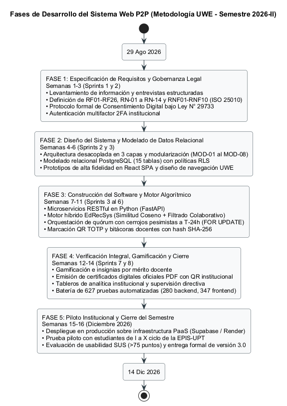

<details>
<summary>Código fuente PlantUML (respaldo editable)</summary>

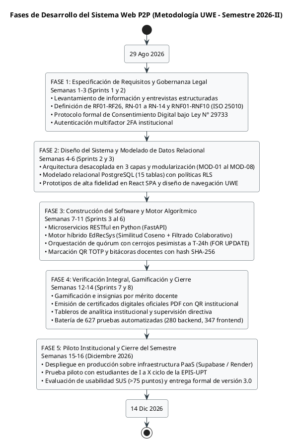
</details>

Fuente: Elaboración propia.

---

## 6.1. Perfiles de Usuario y Modelo de Control de Acceso (RBAC)

### Presentación de los Perfiles de Usuario
La operación eficiente y ordenada del Sistema Web P2P requiere la definición explícita de los perfiles de usuario y actores que interactúan en la plataforma. En el ecosistema formativo de la EPIS-UPT, los usuarios desempeñan roles diferenciados según su nivel de avance curricular, su investidura académica o la naturaleza técnica de sus procesos. Con el fin de gobernar el acceso bajo el principio de mínimo privilegio y resguardar la privacidad académica (Ley N° 29733), el sistema implementa un modelo de control de acceso basado en roles (**Role-Based Access Control - RBAC**):

### Cuadro 6.1: Perfiles de Usuario y Actores del Sistema Web P2P

| Perfil / Actor | Tipo de Actor | Población Objetivo / Componente | Responsabilidades y Actividades Principales | Privilegios y Permisos en el Sistema |
| :--- | :--- | :--- | :--- | :--- |
| **Estudiante Mentoreado** | Humano (Actor Primario) | Estudiantes matriculados de I a IV ciclo con necesidades de reforzamiento académico en materias formativas críticas (*Cálculo, Algoritmos, Estructuras, POO*). | • Formalizar el consentimiento informado digital obligatorio (Ley N° 29733).<br>• Declarar asignaturas de interés y disponibilidad horaria semanal en la matriz 6×11.<br>• Consultar recomendaciones personalizadas Top-k y registrar demandas temáticas.<br>• Reservar cupos de mentoría con control concurrente.<br>• Ratificar asistencia obligatoria antes de $T-24\text{ h}$ o desistir oportunamente.<br>• Marcar asistencia mediante pase QR y responder encuestas de satisfacción (24h). | • Acceso a vistas de catálogo y recomendaciones personales (`RoleGuard`).<br>• Creación, ratificación y desistimiento de reservas propias.<br>• Registro en el banco de solicitudes por demanda.<br>• Descarga de materiales académicos vinculados.<br>• Diligenciamiento de encuestas de calidad post-sesión. |
| **Estudiante Mentor** | Humano (Actor Primario) | Estudiantes de rendimiento sobresaliente de VII a X ciclo promovidos formalmente por la Dirección de Escuela tras verificación de mérito. | • Configurar áreas de dominio curricular y agenda de disponibilidad semanal.<br>• Publicar ofertas de mentoría académica (materia, temario, fecha, modalidad).<br>• Resolver la continuidad o cancelación de sesiones ante alertas de quórum deficiente.<br>• Dictar las sesiones en aulas asignadas o salas virtuales validadas.<br>• Marcar asistencia efectiva y registrar bitácoras pedagógicas firmadas con SHA-256 en 48h.<br>• Compartir recursos didácticos y monitorear insignias/reputación obtenida.<br>• Descargar certificados oficiales de horas para convalidación de créditos. | • Publicación, reprogramación y anulación justificada de ofertas propias.<br>• Aprovisionamiento guiado de infraestructura física o virtual.<br>• Diligenciamiento y cierre formal de bitácoras docentes.<br>• Carga de materiales educativos para sus participantes.<br>• Visualización de tablero de reputación y descarga de certificados PDF auditados. |
| **Administrador Institucional** | Humano (Gobernanza y Supervisión) | Comité de Tutoría Docente, Coordinación Académica y Dirección de la EPIS-UPT. | • Auditar expedientes estudiantiles y aprobar la promoción a rol de Mentor.<br>• Mantener actualizado el catálogo de asignaturas críticas y temarios silábicos.<br>• Cargar cronogramas oficiales de aulas para el motor parser de espacios.<br>• Registrar materias y mentorías en condición prioritaria por reprobación.<br>• Fiscalizar bitácoras docentes, asistencias y computabilidad de horas acumuladas.<br>• Parametrizar umbrales semestrales y emitir certificados oficiales PDF foliados.<br>• Supervisar tableros analíticos de demanda insatisfecha, ausentismo y desempeño. | • Control de acceso total y administración de roles en `/roles/promote-mentor`.<br>• Operaciones CRUD sobre catálogo curricular y prioridades académicas.<br>• Carga e indexación de cronogramas institucionales de espacios.<br>• Visado administrativo, observación y validación de horas de mentoría.<br>• Autorización y emisión de certificados digitales con código QR.<br>• Acceso irrestricto al panel de analítica institucional (`/analytics`). |
| **Servicio Cron / Backend** | Técnico (Proceso Desatendido) | Demonio de tareas programadas en el servidor backend FastAPI. | • Inspeccionar periódicamente la base de datos para identificar sesiones próximas.<br>• Despachar notificaciones automáticas y recordatorios a estudiantes inscritos.<br>• Ejecutar el corte perentorio a $T-24\text{ h}$, revocar cupos no ratificados y evaluar quórum.<br>• Transicionar a `QUORUM_INSUFICIENTE` si no se alcanza el 50% de aforo y alertar al Mentor. | • Ejecución en segundo plano con privilegios a nivel de servicio de sistema.<br>• Modificación atómica de estados en tablas de reservas y sesiones.<br>• Despacho de correos electrónicos institucionales mediante servicio SMTP. |
| **Servicios Externos** | Técnico (Sistemas Colaboradores) | Infraestructura institucional: Servidor SMTP UPT, repositorios y navegadores web. | • Despachar códigos de verificación OTP y notificaciones al buzón `@upt.pe`.<br>• Suministrar entornos de videoconferencia validados para sesiones virtuales.<br>• Proveer soporte para captura de cámara en escaneo de códigos QR. | • Conexión autenticada mediante tokens y protocolos seguros TLS 1.3.<br>• Sin exposición directa de datos personales sensibles a terceros. |

Fuente: Elaboración propia.

---

## 6.2. Modelo Conceptual

### Presentación del Modelo Conceptual
El modelo conceptual formaliza las entidades del dominio de la EPIS-UPT, capturando sus atributos esenciales, estados operacionales y las relaciones semánticas que sustentan el ecosistema de mentorías académicas. Este modelo traduce las reglas de negocio (aforos máximos, consentimiento de privacidad bajo la Ley N° 29733, estados de reserva, bitácoras de cumplimiento y certificación) en una estructura ontológica coherente y extensible alineada con las **15 tablas relacionales de PostgreSQL**:

### Diagrama 6.2: Diagrama de Clases Conceptuales del Dominio - Sistema Web P2P EPIS-UPT

**Figura 5. Diagrama de Clases Conceptuales del Dominio - Sistema Web P2P EPIS-UPT**

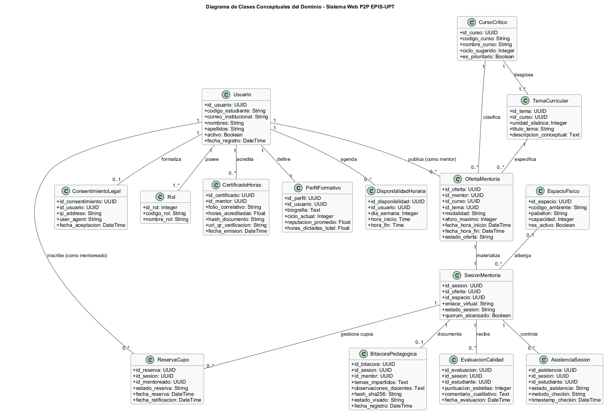

<details>
<summary>Código fuente PlantUML (respaldo editable)</summary>

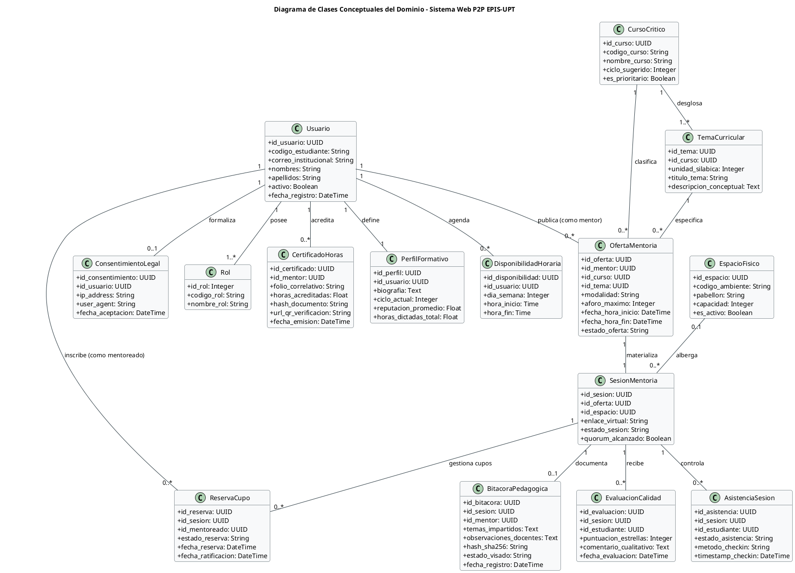
</details>

Fuente: Elaboración propia.

---

### 6.2.1. Diagrama de Paquetes Arquitecturales

### Presentación del Diagrama de Paquetes
La arquitectura de software del Sistema Web P2P adopta un patrón en **Capas Desacopladas** (*Clean Architecture / Layered Architecture*), asegurando la separación estricta de responsabilidades entre la capa de presentación del cliente (React SPA), los controladores y servicios RESTful (FastAPI), la capa de dominio y persistencia (SQLAlchemy / PostgreSQL) y las integraciones con servicios externos (SMTP, ReportLab, Supabase RLS):

### Diagrama 6.3: Diagrama de Paquetes Arquitecturales y Subsistemas del Sistema Web P2P

**Figura 6. Diagrama de Paquetes Arquitecturales y Subsistemas del Sistema Web P2P**

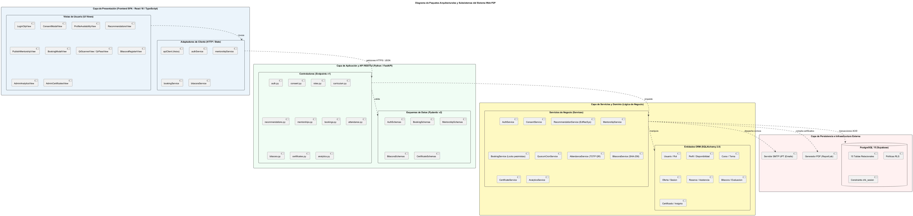

<details>
<summary>Código fuente PlantUML (respaldo editable)</summary>

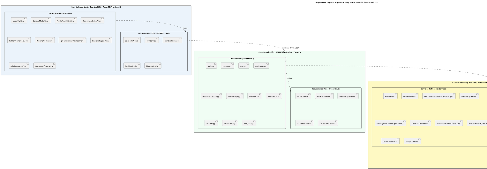
</details>

Fuente: Elaboración propia.

---

## 6.2.2. Diagramas de Casos de Uso

> Los diagramas de contexto y de módulos de este apartado conservan la numeración y los objetivos de la fase de diseño. Antes de enlazar un identificador con 6.2.3, consultar su función en la matriz de homologación.

### Presentación de los Diagramas de Casos de Uso
Los casos de uso del Sistema Web P2P especifican la interacción funcional entre los actores institucionales y el software. A continuación, se presenta el **Diagrama General Consolidado (Diagrama 6.4)** que integra los 24 casos de uso canónicos estructurados en los ocho módulos del sistema, seguido de los diagramas modulares individuales (Diagramas 6.5 al 6.12).

### Diagrama 6.4: Diagrama de Casos de Uso General Consolidado del Sistema Web P2P (CUS-001 al CUS-024)

**Figura 7. Diagrama de Casos de Uso General Consolidado del Sistema Web P2P (CUS-001 al CUS-024)**

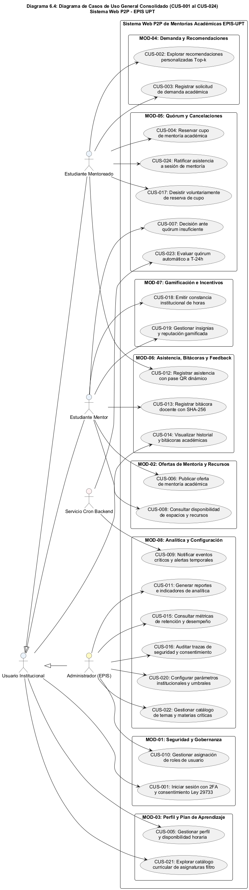

<details>
<summary>Código fuente PlantUML (respaldo editable)</summary>

```plantuml
/'
  Diagrama: Diagrama 6.4: Diagrama de Casos de Uso General Consolidado del Sistema Web P2P (CUS-001 al CUS-024)
  Proyecto: Sistema Web P2P de Mentorías Académicas - EPIS UPT
  Estándar: Visual Paradigm / UML 2.5
  Extracción automatizada: Fase D02 (H03)
'/
@startuml
title Diagrama 6.4: Diagrama de Casos de Uso General Consolidado (CUS-001 al CUS-024)\nSistema Web P2P - EPIS UPT
left to right direction
skinparam packageStyle rectangle
skinparam shadowing false
skinparam roundcorner 8
skinparam defaultFontName Arial
skinparam fontSize 11

actor "Usuario Institucional" as User #EBF3FB
actor "Estudiante Mentoreado" as Mentoreado #EBF3FB
actor "Estudiante Mentor" as Mentor #EBF3FB
actor "Administrador (EPIS)" as Admin #FEF9C3
actor "Servicio Cron Backend" as Cron #FFF1F2

Mentoreado -up-|> User
Mentor -up-|> User
Admin -up-|> User

rectangle "Sistema Web P2P de Mentorías Académicas EPIS-UPT" {

  package "MOD-01: Seguridad y Gobernanza" {
    usecase "CUS-001: Iniciar sesión con 2FA\ny consentimiento Ley 29733" as CUS01
    usecase "CUS-010: Gestionar asignación\nde roles de usuario" as CUS10
  }

  package "MOD-02: Ofertas de Mentoría y Recursos" {
    usecase "CUS-006: Publicar oferta\nde mentoría académica" as CUS06
    usecase "CUS-008: Consultar disponibilidad\nde espacios y recursos" as CUS08
  }

  package "MOD-03: Perfil y Plan de Aprendizaje" {
    usecase "CUS-005: Gestionar perfil\ny disponibilidad horaria" as CUS05
    usecase "CUS-021: Explorar catálogo\ncurricular de asignaturas filtro" as CUS21
  }

  package "MOD-04: Demanda y Recomendaciones" {
    usecase "CUS-002: Explorar recomendaciones\npersonalizadas Top-k" as CUS02
    usecase "CUS-003: Registrar solicitud\nde demanda académica" as CUS03
  }

  package "MOD-05: Quórum y Cancelaciones" {
    usecase "CUS-004: Reservar cupo\nde mentoría académica" as CUS04
    usecase "CUS-024: Ratificar asistencia\na sesión de mentoría" as CUS24
    usecase "CUS-017: Desistir voluntariamente\nde reserva de cupo" as CUS17
    usecase "CUS-023: Evaluar quórum\nautomático a T-24h" as CUS23
    usecase "CUS-007: Decisión ante\nquórum insuficiente" as CUS07
  }

  package "MOD-06: Asistencia, Bitácoras y Feedback" {
    usecase "CUS-012: Registrar asistencia\ncon pase QR dinámico" as CUS12
    usecase "CUS-013: Registrar bitácora\ndocente con SHA-256" as CUS13
    usecase "CUS-014: Visualizar historial\ny bitácoras académicas" as CUS14
  }

  package "MOD-07: Gamificación e Incentivos" {
    usecase "CUS-018: Emitir constancia\ninstitucional de horas" as CUS18
    usecase "CUS-019: Gestionar insignias\ny reputación gamificada" as CUS19
  }

  package "MOD-08: Analítica y Configuración" {
    usecase "CUS-009: Notificar eventos\ncríticos y alertas temporales" as CUS09
    usecase "CUS-011: Generar reportes\ne indicadores de analítica" as CUS11
    usecase "CUS-015: Consultar métricas\nde retención y desempeño" as CUS15
    usecase "CUS-016: Auditar trazas de\nseguridad y consentimiento" as CUS16
    usecase "CUS-020: Configurar parámetros\ninstitucionales y umbrales" as CUS20
    usecase "CUS-022: Gestionar catálogo\nde temas y materias críticas" as CUS22
  }
}

User --> CUS01
Admin --> CUS10

Mentor --> CUS06
Mentor --> CUS08
Mentor --> CUS07
Mentor --> CUS13
Mentor --> CUS18
Mentor --> CUS19

User --> CUS05
User --> CUS21
User --> CUS14

Mentoreado --> CUS02
Mentoreado --> CUS03
Mentoreado --> CUS04
Mentoreado --> CUS24
Mentoreado --> CUS17
Mentoreado --> CUS12

Cron --> CUS23
Cron --> CUS09

Admin --> CUS11
Admin --> CUS15
Admin --> CUS16
Admin --> CUS20
Admin --> CUS22
@enduml
```
</details>

Fuente: Elaboración propia.

---

### Diagrama 6.5: Diagrama de Casos de Uso - MOD-01: Seguridad, Autenticación y Gobernanza

**Figura 8. Diagrama de Casos de Uso - MOD-01: Seguridad, Autenticación y Gobernanza**

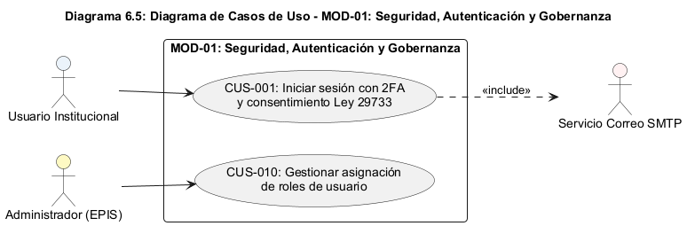

<details>
<summary>Código fuente PlantUML (respaldo editable)</summary>

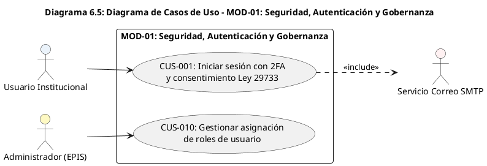
</details>

Fuente: Elaboración propia.

---

### Diagrama 6.6: Diagrama de Casos de Uso - MOD-02: Ofertas de Mentoría y Gestión de Recursos

**Figura 9. Diagrama de Casos de Uso - MOD-02: Ofertas de Mentoría y Gestión de Recursos**

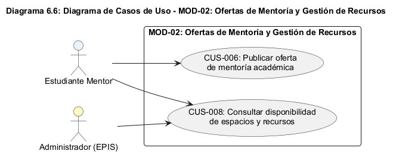

<details>
<summary>Código fuente PlantUML (respaldo editable)</summary>

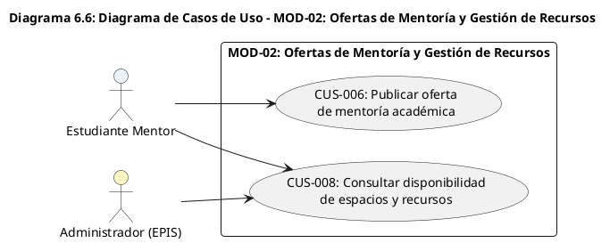
</details>

Fuente: Elaboración propia.

---

### Diagrama 6.7: Diagrama de Casos de Uso - MOD-03: Perfil del Mentor y Plan de Aprendizaje

**Figura 10. Diagrama de Casos de Uso - MOD-03: Perfil del Mentor y Plan de Aprendizaje**

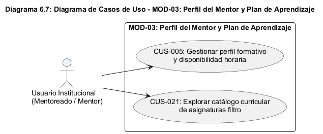

<details>
<summary>Código fuente PlantUML (respaldo editable)</summary>

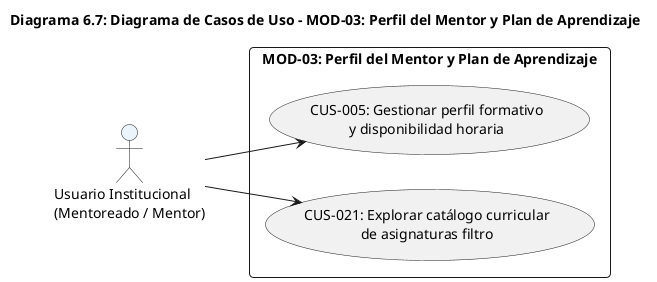
</details>

Fuente: Elaboración propia.

---

### Diagrama 6.8: Diagrama de Casos de Uso - MOD-04: Demanda y Recomendaciones Personalizadas

**Figura 11. Diagrama de Casos de Uso - MOD-04: Demanda y Recomendaciones Personalizadas**

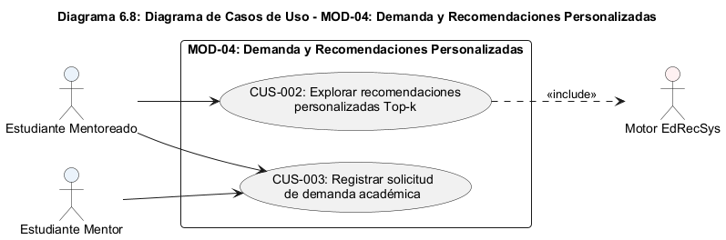

<details>
<summary>Código fuente PlantUML (respaldo editable)</summary>

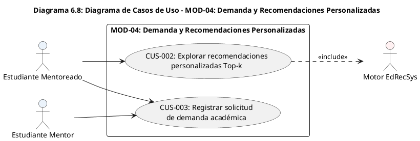
</details>

Fuente: Elaboración propia.

---

### Diagrama 6.9: Diagrama de Casos de Uso - MOD-05: Quórum, Confirmación y Cancelaciones

**Figura 12. Diagrama de Casos de Uso - MOD-05: Quórum, Confirmación y Cancelaciones**

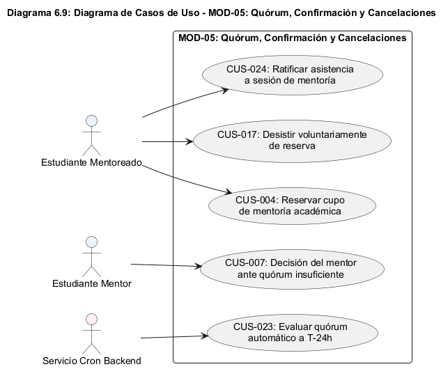

<details>
<summary>Código fuente PlantUML (respaldo editable)</summary>

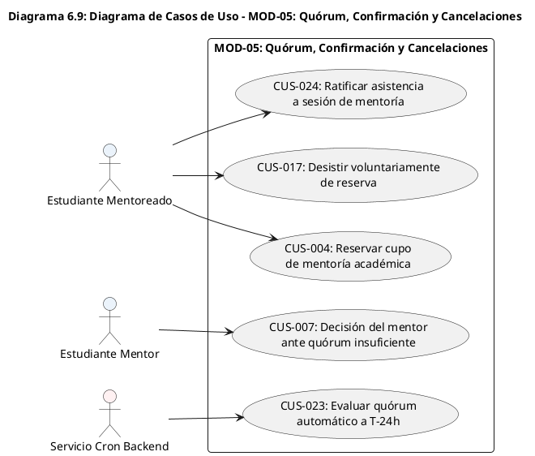
</details>

Fuente: Elaboración propia.

---

### Diagrama 6.10: Diagrama de Casos de Uso - MOD-06: Asistencia, Bitácoras y Feedback

**Figura 13. Diagrama de Casos de Uso - MOD-06: Asistencia, Bitácoras y Feedback**

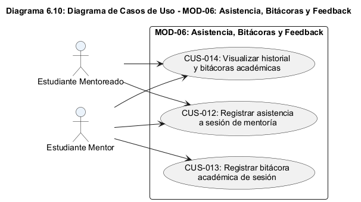

<details>
<summary>Código fuente PlantUML (respaldo editable)</summary>

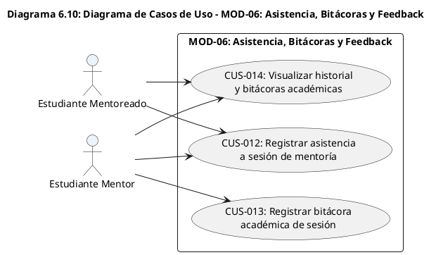
</details>

Fuente: Elaboración propia.

---

### Diagrama 6.11: Diagrama de Casos de Uso - MOD-07: Gamificación e Incentivos

**Figura 14. Diagrama de Casos de Uso - MOD-07: Gamificación e Incentivos**

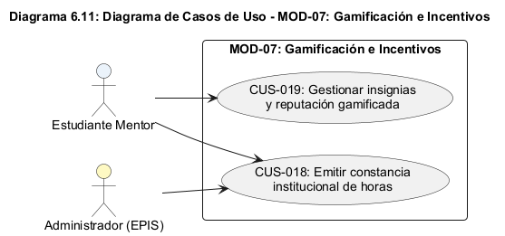

<details>
<summary>Código fuente PlantUML (respaldo editable)</summary>

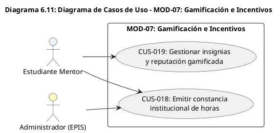
</details>

Fuente: Elaboración propia.

---

### Diagrama 6.12: Diagrama de Casos de Uso - MOD-08: Analítica, Notificaciones y Configuración

**Figura 15. Diagrama de Casos de Uso - MOD-08: Analítica, Notificaciones y Configuración**

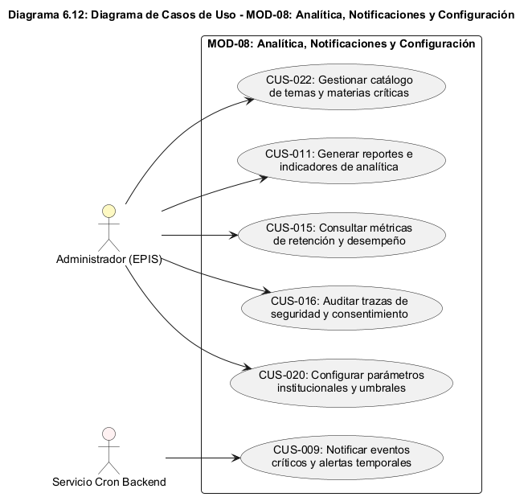

<details>
<summary>Código fuente PlantUML (respaldo editable)</summary>

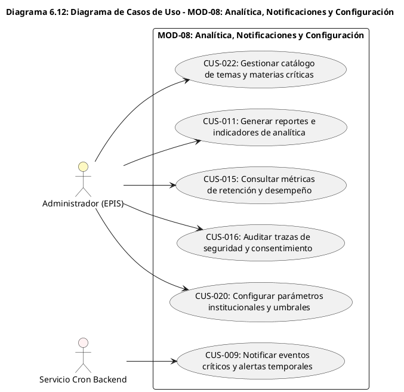
</details>

Fuente: Elaboración propia.

---

## 6.2.3. Escenarios de Casos de Uso (Fase de Diseño)

Este apartado incorpora las fichas, flujos y diagramas del [catálogo consolidado](NARRATIVAS_CASOS_DE_USO.md). Los cinco módulos se utilizan como agrupación documental provisional. Los requisitos, la trazabilidad, los diagramas generales y el modelo lógico conservan las referencias de los ocho módulos de la línea base. La [matriz de homologación](docs/revision_srs/MATRIZ_HOMOLOGACION_SRS_V4.md) documenta las equivalencias y las decisiones pendientes.

Las figuras de este apartado se numeran de **6.2.3-1 a 6.2.3-48**. El número final corresponde a la figura del catálogo. Cada imagen conserva su tamaño original y enlaza su fuente PlantUML. Si el visor ajusta la anchura, se pueden abrir los PNG originales de [CUS-006, actividades](docs/narrativas/diagramas/img/CUS-006_actividades.png) y [CUS-008, actividades](docs/narrativas/diagramas/img/CUS-008_actividades.png) para leer los carriles y los textos al 100 %.

### Índice y estado documental de las narrativas

Los estados siguientes proceden del catálogo y de la revisión documental registrada en el [control de avance](docs/narrativas/CONTROL_AVANCE.md). Las aprobaciones de narrativas consignadas en versiones previas tienen el alcance indicado allí. La aprobación institucional del SRS v4.0 sigue pendiente. Las propuestas y las validaciones de ejecución pendientes se detallan en el Anexo A.

| Módulo | Identificador | Caso de uso | Estado documental |
|---|---|---|---|
| MOD-01 | CUS-001 | Iniciar sesión institucional con 2FA | Aprobado; texto original |
| MOD-01 | CUS-010 | Gestionar asignación de roles de usuario | Aprobado en conversación; consolidado |
| MOD-02 | CUS-006 | Registrar oferta de mentoría académica | Aprobado en conversación; consolidado |
| MOD-02 | CUS-008 | Gestionar demanda insatisfecha de mentoría | Propuesta previamente presentada; pendiente de aprobación explícita |
| MOD-02 | CUS-005 | Postular al rol de estudiante mentor | Implementación parcial: postulación en perfil |
| MOD-02 | CUS-021 | Evaluar postulaciones a mentor por comité | Pendiente: sin flujo de comité identificado |
| MOD-03 | CUS-002 | Consultar catálogo de mentorías con recomendación | Implementación identificada; revisión estática |
| MOD-03 | CUS-003 | Reservar cupo para sesión de mentoría | Implementación identificada; revisión estática |
| MOD-03 | CUS-004 | Ratificar asistencia a sesión de mentoría (T-24h) | Implementación identificada; revisión estática |
| MOD-03 | CUS-023 | Evaluar quórum y ejecutar corte automático (T-24h) | Evaluación identificada; ejecución periódica en entorno real no certificada |
| MOD-03 | CUS-024 | Cancelar reserva de cupo por estudiante | Implementación identificada; revisión estática |
| MOD-04 | CUS-007 | Registrar asistencia y bitácora pedagógica | Implementación identificada; revisión estática |
| MOD-04 | CUS-012 | Registrar calificación y feedback bidireccional | Implementación parcial: encuesta del asistente y bitácora del mentor |
| MOD-04 | CUS-013 | Consultar historial académico de mentorías | Implementación parcial: historial de reservas y sesiones |
| MOD-04 | CUS-014 | Emitir constancia de horas de mentoría | Implementación identificada; constancia DEMO y validación real pendiente |
| MOD-04 | CUS-018 | Gestionar justificación de inasistencia a sesión | Pendiente: no se identificó trámite específico |
| MOD-04 | CUS-019 | Consultar bitácoras de mentoría por tutor | Implementación parcial: auditoría por Administrador; tutor no identificado |
| MOD-05 | CUS-009 | Consultar analítica institucional de mentorías | Implementación parcial: monitoreo de quórum; analítica integral pendiente |
| MOD-05 | CUS-011 | Exportar reportes ejecutivos consolidados | Pendiente: no se identificó exportación ejecutiva |
| MOD-05 | CUS-015 | Configurar parámetros del algoritmo de recomendación | Pendiente: interfaz de parametrización no identificada |
| MOD-05 | CUS-016 | Gestionar auditoría de eventos de seguridad | Pendiente: bandeja integral de seguridad no identificada |
| MOD-05 | CUS-017 | Configurar ambientes físicos y virtuales | Implementación parcial: importación y consulta de cronogramas; configuración virtual pendiente |
| MOD-05 | CUS-020 | Gestionar catálogo curricular y asignaturas | Implementación identificada; revisión estática |
| MOD-05 | CUS-022 | Configurar parámetros de corte y penalización | Pendiente: edición administrativa no identificada |

### MOD-01: Seguridad, Autenticación y Gobernanza

#### CUS-001 — Iniciar sesión institucional con 2FA

##### 7.1. Ficha descriptiva

| Atributo | Detalle |
|---|---|
| **Id Caso de Uso** | **UC-001** (CUS-001) |
| **Nombre** | Iniciar sesión institucional con 2FA |
| **Tipo** | Obligatorio |
| **Requisito ID (RF)** | RF-001, RF-002; RN-01, RN-02 |
| **Versión** | 2.3 (H01-CUS001) |
| **Autor** | Antayhua Mamani, Renzo Antonio / Medina Quispe, Joan Cristian |
| **Actores** | Estudiante mentoreado, estudiante mentor, administrador institucional; servicio de correo institucional y, cuando está disponible, servicio de identidad de Google |
| **Interacción** | Acceso web mediante un código temporal enviado al correo institucional o mediante el botón oficial de Google habilitado por la configuración del entorno. |
| **Descripción** | Permite verificar una cuenta `@virtual.upt.pe` o `@upt.pe`, consultar el consentimiento informado bajo la Ley N.° 29733 y abrir el panel inicial correspondiente al rol. El acceso por correo utiliza un código de seis dígitos con vigencia de cinco minutos; la credencial de sesión emitida tiene una vigencia máxima de ocho horas. |
| **Referencias** | SWEBOK v3.0, ISO/IEC/IEEE 29148:2018, Ley N.° 29733 |
| **Precondiciones** | El usuario dispone de una cuenta institucional y acceso al buzón correspondiente. Para usar Google, el entorno debe tener habilitado el servicio de identidad y una cuenta institucional válida. |
| **Postcondiciones** | La identidad queda verificada y, si existe consentimiento vigente, el sistema abre el panel del rol asignado. Si el consentimiento se rechaza o el usuario cierra la sesión, el sistema retorna al acceso sin mantener una sesión activa. |

##### 7.2. Flujo normal de eventos

| **Acción del Actor** | **Respuesta del Sistema** |
|---|---|
| **Fase 1: Solicitud del código de verificación** | |
| **1.** El usuario accede al Sistema Web P2P y selecciona «Iniciar sesión». | |
| | **2.** El sistema muestra la tarjeta «Iniciar Sesión Institucional». Cuando el acceso con Google está configurado y disponible, presenta primero el botón oficial de Google y el separador «O con código OTP por correo». También muestra la etiqueta «Correo Electrónico Institucional UPT», el campo con la sugerencia «ej: ra2022073504@virtual.upt.pe», la indicación de los dominios admitidos y el botón «Continuar con Código OTP →», inicialmente inactivo mientras el campo está vacío. Si el usuario elige Google, continúa en A001. |
| **3.** El usuario ingresa una dirección institucional y presiona «Continuar con Código OTP →». | |
| | **4.** El sistema valida el formato y el dominio. Si la dirección no es institucional, continúa en E001. Si no puede emitir o enviar el código, continúa en E002; si aplica una restricción temporal de solicitudes, continúa en E006. Cuando la solicitud es aceptada, envía un código numérico de seis dígitos con vigencia de cinco minutos y muestra la pantalla de verificación. Esta pantalla identifica el «Destino de verificación», ofrece «Cambiar correo», presenta el campo «Código de 6 dígitos», el contador «⏳ Expira en: 05:00», el botón «Verificar y Acceder», el contador «Reenviar código en 60s» y la opción «Cancelar». |
| **Fase 2: Verificación del código temporal** | |
| **5.** El usuario escribe los seis dígitos recibidos y presiona «Verificar y Acceder». | |
| | **6.** El sistema comprueba el código y su vigencia. Si no coincide, continúa en E003; si expiró, continúa en E004; si el desafío alcanzó cinco intentos fallidos, continúa en E005. Si el código es correcto, verifica si existe un consentimiento informado vigente. Cuando ya existe, continúa en A003. |
| **Fase 3: Consentimiento informado** | |
| | **7.** Si no existe consentimiento vigente, el sistema muestra la ventana «Consentimiento Informado Digital», la referencia «Protección de Datos Personales · Ley N° 29733», el estado «⚠️ PENDIENTE DE FIRMA», la política de tratamiento de datos, una casilla de aceptación expresa y los botones «🚫 Rechazar y Salir» y «✓ Aceptar y Continuar». El botón de aceptación permanece inactivo hasta marcar la casilla. |
| **8.** El usuario marca la casilla y presiona «✓ Aceptar y Continuar». Si decide no aceptar, continúa en E007. | |
| | **9.** El sistema registra la aceptación con su versión y fecha. Si no puede completar la operación, continúa en E008. |
| **Fase 4: Acceso al panel del rol** | |
| | **10.** El sistema abre el panel inicial del rol: «Explorar mentorías» para mentoreado, «Mis sesiones» para mentor o «Administración» para administrador. En el encabezado muestra «Sesión: [correo]», el rol activo, «⚖️ Consentimiento OK» y «Cerrar Sesión». La credencial emitida tiene una vigencia máxima de ocho horas. |

##### 7.3. Flujos alternativos

###### A001: Acceso mediante Google institucional
* **Paso origen:** Paso 2 del Flujo Normal.
* **Condición de activación:** El botón oficial de Google está disponible y el usuario lo selecciona.

| **Acción del Actor** | **Respuesta del Sistema** |
|---|---|
| **A001-1.** El usuario selecciona el botón oficial de Google y elige una cuenta. | |
| | **A001-2.** Google solicita o confirma la identidad. El Sistema Web P2P acepta únicamente cuentas verificadas de los dominios institucionales y, si la validación concluye correctamente, continúa en el Paso 7 o en A003 según el estado del consentimiento. Si la cuenta no es institucional, continúa en E001. **La operación completa con una cuenta real institucional permanece pendiente de validación manual en el entorno autorizado.** |

###### A002: Reenvío del código de verificación
* **Paso origen:** Paso 4 del Flujo Normal.
* **Condición de activación:** El usuario no recibió el código y terminó el periodo de espera, o el código ya expiró.

| **Acción del Actor** | **Respuesta del Sistema** |
|---|---|
| | **A002-1.** El sistema habilita «🔄 Reenviar nuevo código» cuando termina la espera de 60 segundos o cuando el código expira. |
| **A002-2.** El usuario presiona «🔄 Reenviar nuevo código». | |
| | **A002-3.** El sistema invalida el código anterior, genera y envía uno nuevo, reinicia la vigencia a cinco minutos y restablece la espera de reenvío. Si la solicitud excede los límites permitidos, continúa en E006. |

###### A003: Acceso con consentimiento vigente
* **Paso origen:** Paso 6 del Flujo Normal o A001.
* **Condición de activación:** La identidad fue verificada y existe un consentimiento vigente.

| **Acción del Actor** | **Respuesta del Sistema** |
|---|---|
| | **A003-1.** El sistema omite la ventana de consentimiento y continúa en el Paso 10 del Flujo Normal. |

###### A004: Cambiar correo o cancelar el desafío visible
* **Paso origen:** Paso 4 del Flujo Normal.
* **Condición de activación:** El usuario desea corregir la dirección o abandonar la verificación actual.

| **Acción del Actor** | **Respuesta del Sistema** |
|---|---|
| **A004-1.** El usuario presiona «Cambiar correo» o «Cancelar». | |
| | **A004-2.** El sistema descarta el formulario de verificación visible, limpia el código escrito y vuelve a la pantalla de ingreso de correo. |

###### A005: Cierre voluntario de sesión
* **Paso origen:** Paso 10 del Flujo Normal.
* **Condición de activación:** El usuario decide finalizar su acceso.

| **Acción del Actor** | **Respuesta del Sistema** |
|---|---|
| **A005-1.** El usuario presiona «Cerrar Sesión». | |
| | **A005-2.** El sistema elimina la sesión activa del navegador, restablece el rol visible y retorna a «Iniciar Sesión Institucional». |

##### 7.4. Flujos de excepción

###### E001: Correo no institucional o no válido
* **Paso origen:** Paso 4 del Flujo Normal o A001.
* **Condición de activación:** La dirección tiene un formato no válido o no pertenece a `@virtual.upt.pe` ni `@upt.pe`.

| **Acción del Actor** | **Respuesta del Sistema** |
|---|---|
| | **E001-1.** El sistema no solicita el envío del código y muestra el motivo. Para un dominio ajeno presenta: «Acceso restringido: Solo se permiten correos institucionales con dominio @virtual.upt.pe o @upt.pe.». |
| **E001-2.** El usuario corrige la dirección y vuelve a presionar «Continuar con Código OTP →». | |
| | **E001-3.** El sistema retoma el Paso 4 del Flujo Normal. |

###### E002: No se puede emitir o enviar el código
* **Paso origen:** Paso 4 del Flujo Normal o A002.
* **Condición de activación:** El servicio no puede registrar el desafío o entregar el correo institucional.

| **Acción del Actor** | **Respuesta del Sistema** |
|---|---|
| | **E002-1.** El sistema informa que no fue posible generar o enviar el código. No presenta la solicitud como completada y permite reintentar cuando el servicio esté disponible. |

###### E003: Código incorrecto
* **Paso origen:** Paso 6 del Flujo Normal.
* **Condición de activación:** El código ingresado no coincide con el código activo.

| **Acción del Actor** | **Respuesta del Sistema** |
|---|---|
| | **E003-1.** El sistema muestra que el código es incorrecto e indica cuántos intentos quedan antes de bloquear ese desafío. |
| **E003-2.** El usuario corrige el código y vuelve a presionar «Verificar y Acceder». | |
| | **E003-3.** El sistema retoma el Paso 6 del Flujo Normal. |

###### E004: Código vencido
* **Paso origen:** Paso 6 del Flujo Normal.
* **Condición de activación:** Transcurrieron cinco minutos desde la emisión del código.

| **Acción del Actor** | **Respuesta del Sistema** |
|---|---|
| | **E004-1.** El contador llega a «⏳ Expira en: 00:00», el campo y «Verificar y Acceder» quedan inactivos, y el sistema informa: «El código OTP ha expirado (5 minutos). Por favor solicita un nuevo código.». Se habilita el reenvío. |
| **E004-2.** El usuario solicita un nuevo código. | |
| | **E004-3.** El sistema continúa en A002. |

###### E005: Máximo de intentos de verificación alcanzado
* **Paso origen:** Paso 6 del Flujo Normal.
* **Condición de activación:** El usuario registra cinco códigos incorrectos para el mismo desafío.

| **Acción del Actor** | **Respuesta del Sistema** |
|---|---|
| | **E005-1.** El sistema bloquea de forma definitiva ese desafío e informa que se alcanzó el máximo de cinco intentos. Para continuar, el usuario debe volver al ingreso de correo y solicitar un código nuevo. |

###### E006: Espera obligatoria o límite de solicitudes
* **Paso origen:** Paso 4 del Flujo Normal o A002.
* **Condición de activación:** Se intenta solicitar o reenviar un código durante la espera, o se supera el límite de solicitudes permitido en la ventana de seguridad.

| **Acción del Actor** | **Respuesta del Sistema** |
|---|---|
| | **E006-1.** El sistema rechaza temporalmente la solicitud e indica el tiempo de espera o que se realizaron demasiadas solicitudes. |
| **E006-2.** El usuario espera el periodo indicado y vuelve a solicitar el código. | |
| | **E006-3.** El sistema retoma el Paso 4 o A002, según corresponda. |

###### E007: Rechazo del consentimiento informado
* **Paso origen:** Paso 8 del Flujo Normal.
* **Condición de activación:** El usuario presiona «🚫 Rechazar y Salir».

| **Acción del Actor** | **Respuesta del Sistema** |
|---|---|
| **E007-1.** El usuario rechaza el tratamiento de datos. | |
| | **E007-2.** El sistema registra el rechazo cuando corresponde, cierra la sesión y retorna al acceso. No habilita las funciones protegidas. |

###### E008: Fallo de comunicación o servicio no disponible
* **Paso origen:** Cualquier operación remota del flujo.
* **Condición de activación:** La red, la base de datos o un servicio requerido no responde.

| **Acción del Actor** | **Respuesta del Sistema** |
|---|---|
| | **E008-1.** El sistema muestra el error disponible sin presentar la operación como completada. |
| **E008-2.** El usuario comprueba su conexión y reintenta la acción. | |
| | **E008-3.** Si el servicio se restablece, el sistema retoma el paso correspondiente. |

##### 7.5. Diagrama de flujo de actividades

**Figura 6.2.3-1. Diagrama de actividades — CUS-001: Iniciar sesión institucional con 2FA.**

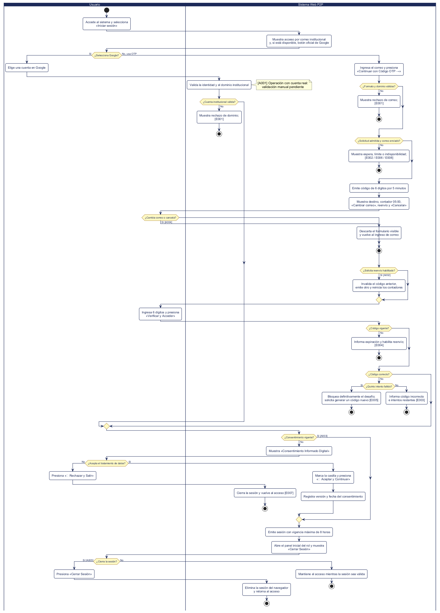

Fuente PlantUML: [CUS-001_actividades.puml](docs/narrativas/diagramas/plantuml/CUS-001_actividades.puml).

Fuente: Elaboración propia.

##### 7.6. Diagrama de caso de uso

**Figura 6.2.3-2. Diagrama de caso de uso — CUS-001: Iniciar sesión institucional con 2FA.**

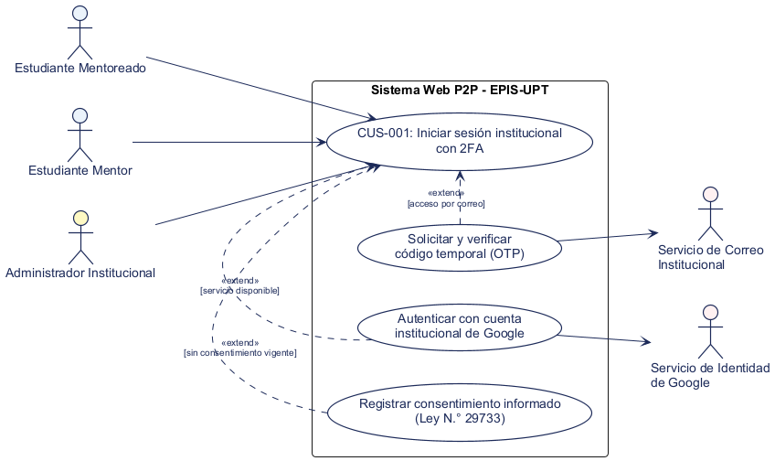

Fuente PlantUML: [CUS-001_caso_de_uso.puml](docs/narrativas/diagramas/plantuml/CUS-001_caso_de_uso.puml).

Fuente: Elaboración propia.

#### CUS-010 — Gestionar asignación de roles de usuario

##### 7.1. Ficha descriptiva

| Atributo | Detalle |
|---|---|
| **Id Caso de Uso** | **UC-010** (CUS-010) |
| **Nombre** | Gestionar asignación de roles de usuario |
| **Tipo** | Obligatorio |
| **Requisito ID (RF)** | RF-003; RN-03 |
| **Versión** | 2.3 (DOC-H02 — consolidación) |
| **Autor** | Antayhua Mamani, Renzo Antonio / Medina Quispe, Joan Cristian |
| **Actores** | Administrador institucional |
| **Interacción** | Interacción web institucional; comportamiento descrito conforme a la evidencia identificada. |
| **Descripción** | Permite consultar los roles asociados a un correo institucional, promover al estudiante a Mentor o revocar esa condición. |
| **Referencias** | SWEBOK v3.0, ISO/IEC/IEEE 29148:2018, SRS y reglas de negocio EPIS-UPT. |
| **Precondiciones** | Sesión administrativa vigente; correo del estudiante conocido. Para promover, información de ciclo disponible. |
| **Postcondiciones** | Se muestran los roles consultados; si la operación es exitosa, se incorpora o retira Mentor y se conserva Mentoreado. |

**Estado de evidencia:** Aprobado en conversación; consolidado.

##### 7.2. Flujo normal de eventos

| **Acción del Actor** | **Respuesta del Sistema** |
|---|---|
| **Fase 1: Acceso y consulta** |  |
| **1.** Selecciona «Administración». |  |
|  | **2.** Muestra «Panel de Administración y Supervisión EPIS», correo del administrador y pestañas «Gestión de Roles», «Monitoreo de Quórum», «Auditoría de Bitácoras», «Catálogo Curricular (RF05)», «Cronograma de Aulas (RF10)» y «Salud del Sistema». Si no hay autorización, E001. |
| **3.** Selecciona «Gestión de Roles». |  |
|  | **4.** Resalta la pestaña en dorado y muestra «Asignación y Validación de Mérito de Mentores», requisito de ciclo VII o superior, campo de correo y botón «🔍 Buscar Estudiante». |
| **5.** Ingresa el correo y presiona «🔍 Buscar Estudiante» o Enter. |  |
|  | **6.** Comprueba el correo; muestra «Consultando...» durante la operación. Si no lo admite, E002; si falla, E004. |
| **7.** Revisa el expediente. |  |
|  | **8.** Presenta «Expediente Institucional», correo y distintivos de roles (MENTOREADO, MENTOR, ADMINISTRADOR, según corresponda). Si figura Mentor ofrece «🚫 Revocar Rol de Mentor» (A001); si no, «⭐ Promover a Mentor (Verificar Mérito Académico)». Puede consultar sin modificar (A002). |
| **Fase 2: Promoción y confirmación** |  |
| **9.** Presiona «⭐ Promover a Mentor (Verificar Mérito Académico)». |  |
|  | **10.** Comprueba autorización y ciclo; inhabilita temporalmente las acciones. Si el ciclo es inferior a VII, E003. |
| **11.** Espera la respuesta. |  |
|  | **12.** Si concluye correctamente, muestra «Rol de Mentor asignado exitosamente tras verificar mérito académico (RN-03).», incorpora el distintivo MENTOR y ofrece revocarlo. Si falla, E004. |
| **13.** Verifica los roles y decide finalizar o consultar otro correo. |  |
|  | **14.** Mantiene el expediente y permite una nueva búsqueda (A003). |

##### 7.3. Flujos alternativos

###### A001: Revocación del rol Mentor

* **Paso origen:** 8.
* **Condición de activación:** Expediente con Mentor.

| **Acción del Actor** | **Respuesta del Sistema** |
|---|---|
| **A001-1.** Presiona «🚫 Revocar Rol de Mentor». |  |
|  | **A001-2.** Comprueba autorización, procesa el retiro y muestra «Rol de Mentor revocado exitosamente.»; actualiza los distintivos y ofrece nuevamente la promoción. Si falla, E004. |
| **A001-3.** Verifica el expediente actualizado. |  |

###### A002: Consulta sin modificación

* **Paso origen:** 8.
* **Condición de activación:** Expediente disponible.

| **Acción del Actor** | **Respuesta del Sistema** |
|---|---|
| **A002-1.** Revisa los distintivos sin presionar las acciones de cambio. |  |
|  | **A002-2.** Mantiene los roles sin cambios. |
| **A002-3.** Finaliza o busca otro correo. |  |

###### A003: Consulta de otro estudiante

* **Paso origen:** 14.
* **Condición de activación:** Consulta terminada.

| **Acción del Actor** | **Respuesta del Sistema** |
|---|---|
| **A003-1.** Sustituye el correo y busca nuevamente. |  |
|  | **A003-2.** Retira el aviso anterior al iniciar una consulta válida y sustituye el expediente al recibir la respuesta. |
| **A003-3.** Retorna a la revisión del expediente. |  |

##### 7.4. Flujos de excepción

###### E001: Acceso no autorizado

* **Paso origen:** 2.
* **Condición de activación:** Sesión ausente o sin privilegios.

| **Acción del Actor** | **Respuesta del Sistema** |
|---|---|
|  | **E001-1.** Restringe la interfaz y rechaza cambios no autorizados. |
| **E001-2.** Inicia sesión con una cuenta autorizada. |  |

###### E002: Correo no admitido

* **Paso origen:** 6.
* **Condición de activación:** Campo vacío o comprobación inicial fallida.

| **Acción del Actor** | **Respuesta del Sistema** |
|---|---|
|  | **E002-1.** Muestra «Ingrese un correo institucional válido con dominio @upt.pe.» sin realizar nueva consulta. |
| **E002-2.** Corrige el correo y repite la búsqueda. |  |

###### E003: Ciclo inferior a VII

* **Paso origen:** 10.
* **Condición de activación:** Promoción no elegible.

| **Acción del Actor** | **Respuesta del Sistema** |
|---|---|
|  | **E003-1.** Rechaza la promoción y conserva los roles consultados. |
| **E003-2.** Revisa el resultado o consulta otro estudiante. |  |

###### E004: Fallo de consulta o modificación

* **Paso origen:** 6, 12.
* **Condición de activación:** Problema de comunicación o registro.

| **Acción del Actor** | **Respuesta del Sistema** |
|---|---|
|  | **E004-1.** Muestra alerta roja; si falla la búsqueda, retira los roles anteriores; si falla el cambio, conserva la información presentada. |
| **E004-2.** Consulta de nuevo antes de repetir la operación. |  |

##### 7.5. Diagrama de flujo de actividades

**Figura 6.2.3-3. Diagrama de actividades — CUS-010: Gestionar asignación de roles de usuario.**

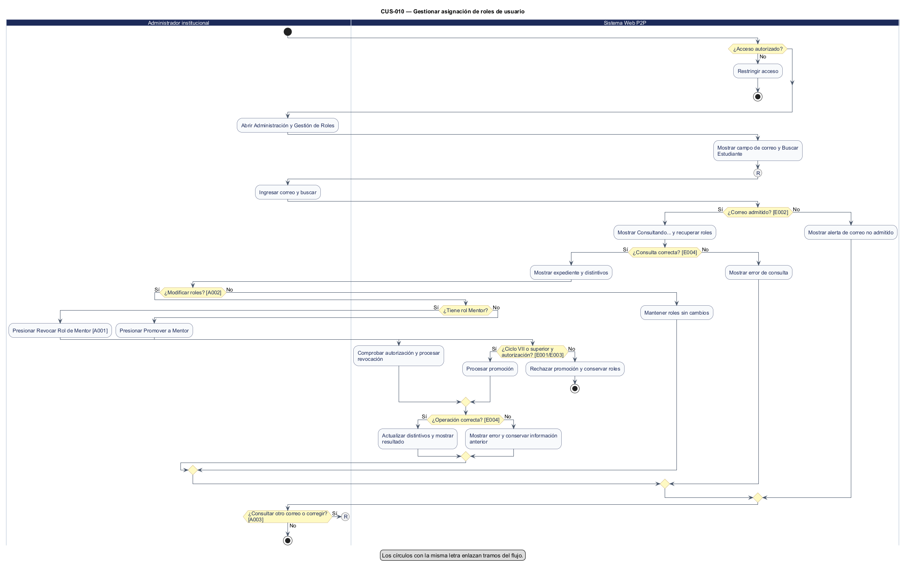

Fuente PlantUML: [CUS-010_actividades.puml](docs/narrativas/diagramas/plantuml/CUS-010_actividades.puml).

Fuente: Elaboración propia.

##### 7.6. Diagrama de caso de uso

**Figura 6.2.3-4. Diagrama de caso de uso — CUS-010: Gestionar asignación de roles de usuario.**


Fuente PlantUML: [CUS-010_caso_de_uso.puml](docs/narrativas/diagramas/plantuml/CUS-010_caso_de_uso.puml).

Fuente: Elaboración propia.

---

### MOD-02: Ofertas de Mentoría y Gestión de Recursos

#### CUS-006 — Registrar oferta de mentoría académica

##### 7.1. Ficha descriptiva

| Atributo | Detalle |
|---|---|
| **Id Caso de Uso** | **UC-006** (CUS-006) |
| **Nombre** | Registrar oferta de mentoría académica |
| **Tipo** | Obligatorio |
| **Requisito ID (RF)** | RF-008, RF-009; RN-01, RN-03 a RN-07; relacionado con RF-007 |
| **Versión** | 2.3 (DOC-H02 — consolidación) |
| **Autor** | Antayhua Mamani, Renzo Antonio / Medina Quispe, Joan Cristian |
| **Actores** | Estudiante Mentor |
| **Interacción** | Interacción web institucional; comportamiento descrito conforme a la evidencia identificada. |
| **Descripción** | Permite programar y publicar una sesión con asignatura, tema, modalidad, fecha, duración e infraestructura; opcionalmente vinculada a una solicitud por demanda. |
| **Referencias** | SWEBOK v3.0, ISO/IEC/IEEE 29148:2018, SRS y reglas de negocio EPIS-UPT. |
| **Precondiciones** | Sesión de Mentor vigente, consentimiento aceptado, catálogo disponible y, si es presencial, cronograma con un ambiente libre durante toda la sesión. |
| **Postcondiciones** | Oferta con código único y estado PUBLICADA; si es dirigida y se registra correctamente, la solicitud vinculada pasa a ATENDIDA. |

**Estado de evidencia:** Aprobado en conversación; consolidado.

##### 7.2. Flujo normal de eventos

| **Acción del Actor** | **Respuesta del Sistema** |
|---|---|
| **Fase 1: Acceso al formulario** |  |
| **1.** Selecciona «Publicar mentoría» o «Publicar Nueva Oferta» en «Mis sesiones». |  |
|  | **2.** Muestra «Publicar Nueva Oferta de Mentoría», distintivo «Rol: Mentor Académico», nombre y correo, antelación mínima superior a 24 h y recomendada de 48 h o más. Si no está autorizado, E001. |
| **3.** Revisa el formulario. |  |
|  | **4.** Presenta ocho campos numerados. Inicialmente establece modalidad presencial, 60 minutos, aforo 10 y fecha sugerida con antelación recomendada. Si procede del banco de demanda, A002. |
| **Fase 2: Selección curricular** |  |
| **5.** Despliega «1. Asignatura Formativa Crítica (Catálogo EPIS) *». |  |
|  | **6.** Muestra código, nombre y ciclo de las asignaturas disponibles; si no hay catálogo, E002. |
| **7.** Selecciona asignatura y «2. Unidad Temática / Tema Conceptual del Sílabo *». |  |
|  | **8.** Actualiza las unidades y temas al cambiar de curso; conserva un tema seleccionado. Si no hay temas, E002. |
| **Fase 3: Modalidad, fecha y duración** |  |
| **9.** Selecciona «Presencial» en «3. Modalidad Pedagógica *». |  |
|  | **10.** Resalta la modalidad; «4. Aforo Reglamentario Inmutable» muestra 10 estudiantes, no editable. Si elige virtual, A001. |
| **11.** Define «5. Fecha y Hora de Inicio *». |  |
|  | **12.** Calcula antelación: aviso azul «Antelación válida» cuando supera 24 h y es menor de 48 h; verde «Antelación óptima» desde 48 h. Si fecha pasada o antelación menor o igual a 24 h, E003. |
| **13.** Selecciona «6. Duración de la Sesión *»: 60 o 90 minutos. |  |
|  | **14.** Muestra «Término estimado» y vuelve a consultar aulas libres para la duración completa. |
| **Fase 4: Infraestructura** |  |
| **15.** Revisa «7. Asignación de Infraestructura (Aula / Laboratorio) *». |  |
|  | **16.** Lista los ambientes libres durante toda la sesión, excluyendo coincidencias con mentorías activas; sugiere el primero disponible. Si no hay aula, E004. |
| **17.** Selecciona un ambiente. |  |
|  | **18.** Conserva el aula elegida. Si cambia fecha, duración o modalidad, actualiza la disponibilidad (A004). |
| **Fase 5: Revisión y publicación** |  |
| **19.** Completa «8. Observaciones Pedagógicas y Requisitos Previos (Opcional)». |  |
|  | **20.** Conserva las indicaciones de materiales, ejercicios o preparación previa; comprueba los campos obligatorios y mantiene el botón inactivo si faltan datos (E005). |
| **21.** Revisa los datos y presiona «🚀 Publicar Oferta de Mentoría». |  |
|  | **22.** Muestra «Publicando Oferta...»; comprueba identidad, elegibilidad, antelación, aforo y disponibilidad del espacio. Si hay conflicto de aula, E006; si no se admite la solicitud dirigida, E007. |
| **23.** Espera el resultado. |  |
|  | **24.** Registra la oferta con código único y estado PUBLICADA; si existe demanda vinculada, la registra como ATENDIDA. Si ocurre un fallo, E008. |
| **Fase 6: Confirmación** |  |
| **25.** Consulta el resultado. |  |
|  | **26.** El formulario dispone de tarjeta verde «¡Oferta de mentoría publicada exitosamente!» con código, estado, asignatura, tema, modalidad, aforo, inicio, duración e infraestructura. En la aplicación integrada se redirige a «Mis sesiones», por lo que la tarjeta puede dejar de verse. |
| **27.** Verifica la nueva oferta en «Mis sesiones». |  |
|  | **28.** La sesión queda disponible para consulta, recomendación y reserva conforme a sus reglas; permite iniciar otra oferta (A005). |

##### 7.3. Flujos alternativos

###### A001: Modalidad virtual

* **Paso origen:** 10.
* **Condición de activación:** Selección de modalidad.

| **Acción del Actor** | **Respuesta del Sistema** |
|---|---|
| **A001-1.** Presiona «Virtual»; define fecha y duración y conserva o reemplaza el enlace, o pulsa «Generar automáticamente por el sistema». |  |
|  | **A001-2.** Fija 20 estudiantes; reemplaza el selector de aula por el enlace virtual. Acepta una dirección propia o genera una de respaldo si falta o no reconoce la entrada como dirección web; no acredita creación real de reunión. |
| **A001-3.** Continúa con observaciones y publicación. |  |

###### A002: Mentoría dirigida por demanda

* **Paso origen:** 4.
* **Condición de activación:** Acceso desde banco RF07.

| **Acción del Actor** | **Respuesta del Sistema** |
|---|---|
| **A002-1.** Selecciona «Proponer Mentoría Dirigida» y revisa la solicitud. |  |
|  | **A002-2.** Muestra panel ámbar con correo, asignatura, tema y observaciones; precompleta y bloquea curso y tema, añade referencia en observaciones. Si no coincide el contenido, E005. |
| **A002-3.** Configura fecha, modalidad e infraestructura y publica. |  |

###### A003: Desvincular solicitud

* **Paso origen:** Flujo normal, en la operación indicada por la condición.
* **Condición de activación:** Formulario dirigido.

| **Acción del Actor** | **Respuesta del Sistema** |
|---|---|
| **A003-1.** Presiona «✕ Desvincular Solicitud». |  |
|  | **A003-2.** Retira el vínculo y habilita curso y tema; la solicitud no se marca atendida. |
| **A003-3.** Revisa datos y continúa como oferta general. |  |

###### A004: Modificar programación

* **Paso origen:** 18.
* **Condición de activación:** Antes de publicar.

| **Acción del Actor** | **Respuesta del Sistema** |
|---|---|
| **A004-1.** Cambia modalidad, fecha o duración. |  |
|  | **A004-2.** Recalcula antelación, hora estimada, aforo y espacios; si virtual muestra campo de enlace. |
| **A004-3.** Revisa infraestructura y vuelve a la revisión. |  |

###### A005: Publicar otra oferta

* **Paso origen:** 28.
* **Condición de activación:** Publicación terminada.

| **Acción del Actor** | **Respuesta del Sistema** |
|---|---|
| **A005-1.** Accede a «Publicar mentoría» o «Publicar Nueva Oferta»; si permanece en confirmación, pulsa «+ Publicar Otra Oferta». |  |
|  | **A005-2.** Dispone el formulario; el botón de la tarjeta limpia avisos y observaciones y restablece fecha sugerida. |
| **A005-3.** Configura la nueva sesión. |  |

##### 7.4. Flujos de excepción

###### E001: Sin autorización o elegibilidad

* **Paso origen:** 2.
* **Condición de activación:** Acceso o envío.

| **Acción del Actor** | **Respuesta del Sistema** |
|---|---|
|  | **E001-1.** Restringe acceso o rechaza el registro; no confirma la oferta. |
| **E001-2.** Retorna a funciones permitidas o regulariza su perfil. |  |

###### E002: Catálogo no disponible

* **Paso origen:** 6, 8.
* **Condición de activación:** Carga de asignaturas o temas.

| **Acción del Actor** | **Respuesta del Sistema** |
|---|---|
|  | **E002-1.** Muestra alerta y «Reintentar» si falla el catálogo general; si faltan temas, selector vacío y publicación bloqueada. |
| **E002-2.** Reintenta o selecciona otra asignatura. |  |

###### E003: Fecha inválida o antelación insuficiente

* **Paso origen:** 12.
* **Condición de activación:** Fecha pasada o 24 h o menos.

| **Acción del Actor** | **Respuesta del Sistema** |
|---|---|
|  | **E003-1.** Muestra «Ingrese una fecha válida en el futuro» o «Antelación insuficiente»; bloquea publicación. |
| **E003-2.** Corrige la fecha y revisa el indicador. |  |

###### E004: Sin ambientes físicos

* **Paso origen:** 16.
* **Condición de activación:** Franja no cubierta o consulta fallida.

| **Acción del Actor** | **Respuesta del Sistema** |
|---|---|
|  | **E004-1.** Muestra «Sin aulas disponibles para esta franja» o «No se pudo consultar la disponibilidad de aulas». |
| **E004-2.** Cambia fecha, duración o modalidad. |  |

###### E005: Campos incompletos o demanda inconsistente

* **Paso origen:** 20.
* **Condición de activación:** Formulario inválido.

| **Acción del Actor** | **Respuesta del Sistema** |
|---|---|
|  | **E005-1.** Muestra «Corrija los campos señalados antes de publicar» o aviso del tema solicitado no disponible. |
| **E005-2.** Completa los datos o desvincula la solicitud. |  |

###### E006: Aula dejó de estar disponible

* **Paso origen:** 22.
* **Condición de activación:** Revalidación al publicar.

| **Acción del Actor** | **Respuesta del Sistema** |
|---|---|
|  | **E006-1.** Rechaza con «El aula no está disponible durante toda la sesión en el cronograma vigente.» y consulta nuevamente ambientes. |
| **E006-2.** Selecciona otra aula o modifica horario. |  |

###### E007: Demanda ya no pendiente

* **Paso origen:** 22.
* **Condición de activación:** Oferta dirigida.

| **Acción del Actor** | **Respuesta del Sistema** |
|---|---|
|  | **E007-1.** Rechaza con «La solicitud ya no está pendiente o no corresponde a la asignatura y al tema seleccionados.» |
| **E007-2.** Actualiza banco o desvincula. |  |

###### E008: Fallo de registro o comunicación

* **Paso origen:** 24.
* **Condición de activación:** Envío sin confirmación.

| **Acción del Actor** | **Respuesta del Sistema** |
|---|---|
|  | **E008-1.** Muestra «Error al publicar:» con el motivo; restablece controles y vuelve a consultar aulas si corresponde. |
| **E008-2.** Comprueba Mis sesiones antes de reintentar para evitar duplicados. |  |

##### 7.5. Diagrama de flujo de actividades

**Figura 6.2.3-5. Diagrama de actividades — CUS-006: Registrar oferta de mentoría académica.**

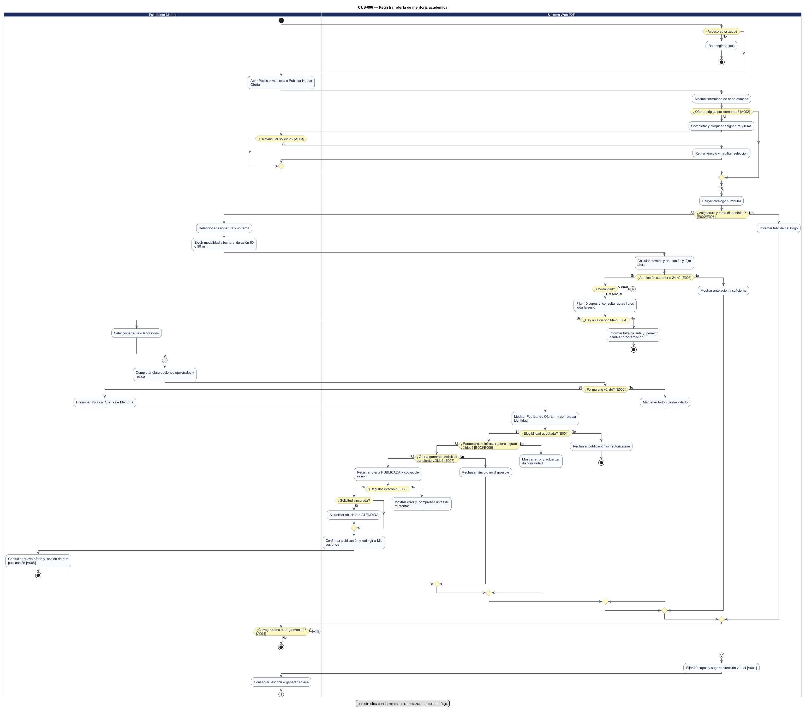

Fuente PlantUML: [CUS-006_actividades.puml](docs/narrativas/diagramas/plantuml/CUS-006_actividades.puml).

Fuente: Elaboración propia.

##### 7.6. Diagrama de caso de uso

**Figura 6.2.3-6. Diagrama de caso de uso — CUS-006: Registrar oferta de mentoría académica.**

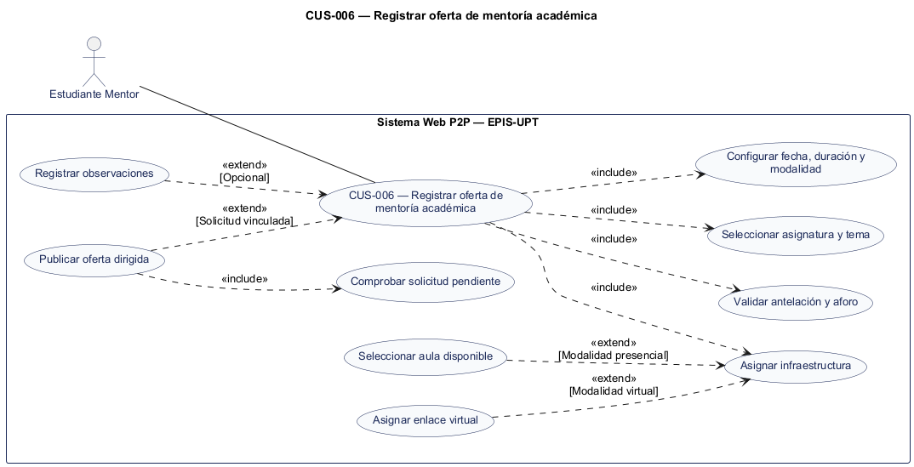

Fuente PlantUML: [CUS-006_caso_de_uso.puml](docs/narrativas/diagramas/plantuml/CUS-006_caso_de_uso.puml).

Fuente: Elaboración propia.

---

#### CUS-008 — Gestionar demanda insatisfecha de mentoría

##### 7.1. Ficha descriptiva

| Atributo | Detalle |
|---|---|
| **Id Caso de Uso** | **UC-008** (CUS-008) |
| **Nombre** | Gestionar demanda insatisfecha de mentoría |
| **Tipo** | Opcional |
| **Requisito ID (RF)** | RF-007; relacionado con RF-006, RF-008 y RN-04 |
| **Versión** | 2.3 (DOC-H02 — consolidación) |
| **Autor** | Antayhua Mamani, Renzo Antonio / Medina Quispe, Joan Cristian |
| **Actores** | Estudiante Mentoreado; Estudiante Mentor |
| **Interacción** | Interacción web institucional; comportamiento descrito conforme a la evidencia identificada. |
| **Descripción** | Registra necesidades académicas no cubiertas y permite a mentores consultar y formular ofertas dirigidas. |
| **Referencias** | SWEBOK v3.0, ISO/IEC/IEEE 29148:2018, SRS y reglas de negocio EPIS-UPT. |
| **Precondiciones** | Sesiones institucionales de los actores en sus respectivas interacciones; catálogo disponible para registrar. |
| **Postcondiciones** | Solicitud PENDIENTE con folio; pasa a ATENDIDA únicamente al completarse una publicación vinculada. No reserva cupo. |

**Estado de evidencia:** Propuesta previamente presentada; pendiente de aprobación explícita.

##### 7.2. Flujo normal de eventos

| **Acción del Actor** | **Respuesta del Sistema** |
|---|---|
| **Fase 1: Identificación de la necesidad** |  |
| **1.** Accede a «Explorar mentorías» y consulta la cartelera. |  |
|  | **2.** Si no hay resultados para el filtro, muestra «No se encontraron recomendaciones en este momento» y «¿Necesitas asesoría en un tema específico?» con «Registrar Solicitud por Demanda». Si se detecta aforo agotado en el cuadro de reserva, A001. |
| **3.** Presiona «Registrar Solicitud por Demanda». |  |
|  | **4.** Abre ventana «Registrar Solicitud de Mentoría por Demanda» con encabezado azul marino, cierre ×, campos de asignatura, tema, observaciones y botones «Cancelar» y «Enviar Solicitud». |
| **Fase 2: Selección y registro** |  |
| **5.** Espera el catálogo y despliega «Asignatura Curricular *». |  |
|  | **6.** Muestra «Cargando catálogo curricular...» durante la consulta; presenta código, nombre y ciclo. Si falla, E002. |
| **7.** Selecciona la asignatura y el «Tema o Unidad Específica *». |  |
|  | **8.** Actualiza temas por unidad y nombre, con una opción inicial. Si no hay temas, E003. |
| **9.** Completa si desea «Observaciones o Justificación de Necesidad Formativa». |  |
|  | **10.** Conserva el texto opcional; el servicio admite hasta 500 caracteres. Puede cancelar antes de enviar (A002). |
| **11.** Revisa los campos y pulsa «Enviar Solicitud». |  |
|  | **12.** Comprueba selección de curso y tema; muestra «Registrando...» e inhabilita edición, envío y Cancelar. Comprueba identidad, existencia curricular y longitud. Si falta información, E004; si no existe curso/tema, E005; si excede longitud, E006. |
| **13.** Espera confirmación. |  |
|  | **14.** Registra folio y estado PENDIENTE. Si falla, E007. |
| **Fase 3: Confirmación del solicitante** |  |
| **15.** Revisa el panel de resultado. |  |
|  | **16.** Muestra «¡Solicitud Registrada con Éxito!», folio #DEM-[número], estado, correo y fecha de registro. Informa que los mentores podrán revisarla. |
| **17.** Presiona «Entendido». |  |
|  | **18.** Cierra la ventana y retorna a la cartelera; la solicitud sigue pendiente, sin garantizar atención ni reserva. |
| **Fase 4: Consulta independiente del mentor** |  |
| **19.** En otro momento, el mentor abre «Mis sesiones» y «Banco de Solicitudes por Demanda (RF07)». |  |
|  | **20.** Muestra «Banco de Solicitudes Temáticas por Demanda (RF07)»; consulta pendientes y muestra filtro «Todas las Asignaturas» con total y «Actualizar». Si falla, E008; si no hay resultados, A004. |
| **21.** Filtra por asignatura o revisa todas las solicitudes. |  |
|  | **22.** Presenta tarjetas con asignatura, fecha, tema, correo, observaciones si existen, estado PENDIENTE y «Proponer Mentoría Dirigida» (A003). |
| **Fase 5: Atención de la solicitud** |  |
| **23.** Presiona «Proponer Mentoría Dirigida» sobre una tarjeta. |  |
|  | **24.** Abre el formulario de CUS-006, vincula la solicitud y precompleta curso, tema y observaciones. |
| **25.** Configura y publica conforme al CUS-006. |  |
|  | **26.** Verifica que la solicitud siga pendiente y corresponda al curso/tema; si dejó de estar disponible, E009. Si se desvincula o abandona, A005. |
| **27.** Verifica el resultado y vuelve al banco. |  |
|  | **28.** Al publicarse correctamente, registra oferta PUBLICADA y solicitud ATENDIDA; al actualizar, la solicitud desaparece del banco de pendientes. |

##### 7.3. Flujos alternativos

###### A001: Aforo agotado

* **Paso origen:** 2.
* **Condición de activación:** Cuadro de reserva con falta de vacantes.

| **Acción del Actor** | **Respuesta del Sistema** |
|---|---|
| **A001-1.** Pulsa «Registrar Solicitud por Demanda». |  |
|  | **A001-2.** Cierra el cuadro de reserva y abre la solicitud; no se garantiza la preselección del curso y tema. |
| **A001-3.** Selecciona los datos requeridos. |  |

###### A002: Cancelar registro

* **Paso origen:** 10.
* **Condición de activación:** Antes de enviar.

| **Acción del Actor** | **Respuesta del Sistema** |
|---|---|
| **A002-1.** Presiona «Cancelar», × o Escape. |  |
|  | **A002-2.** Cierra sin registrar; al reabrir limpia observaciones y consulta el catálogo. |
| **A002-3.** Retorna a la cartelera. |  |

###### A003: Filtrar o actualizar

* **Paso origen:** 22.
* **Condición de activación:** Banco disponible.

| **Acción del Actor** | **Respuesta del Sistema** |
|---|---|
| **A003-1.** Selecciona asignatura, «Todas las Asignaturas» o «Actualizar». |  |
|  | **A003-2.** Filtra las tarjetas; al actualizar muestra «Cargando...» y renueva resultados. |
| **A003-3.** Consulta sin cambiar estados o selecciona una solicitud. |  |

###### A004: Banco vacío

* **Paso origen:** 20.
* **Condición de activación:** Sin pendientes o sin coincidencias.

| **Acción del Actor** | **Respuesta del Sistema** |
|---|---|
| **A004-1.** Revisa el panel, cambia filtro o pulsa «Actualizar». |  |
|  | **A004-2.** Muestra «No hay solicitudes pendientes en el banco de demanda» y explicación; actualiza si se solicita. |
| **A004-3.** Retorna a Mis sesiones o revisa otros resultados. |  |

###### A005: Abandonar o desvincular

* **Paso origen:** 26.
* **Condición de activación:** Oferta dirigida no publicada.

| **Acción del Actor** | **Respuesta del Sistema** |
|---|---|
| **A005-1.** Pulsa «Desvincular Solicitud» o abandona la publicación. |  |
|  | **A005-2.** No marca la demanda atendida; permite publicar una oferta general. |
| **A005-3.** Retorna al banco o sigue CUS-006. |  |

##### 7.4. Flujos de excepción

###### E001: Acceso no autorizado

* **Paso origen:** Flujo normal, en la operación indicada por la condición.
* **Condición de activación:** Sesión inválida o vista restringida.

| **Acción del Actor** | **Respuesta del Sistema** |
|---|---|
|  | **E001-1.** Restringe la interfaz; si el registro no está autorizado, rechaza la solicitud. |
| **E001-2.** Inicia sesión con el rol correspondiente. |  |

###### E002: Catálogo no disponible

* **Paso origen:** 6.
* **Condición de activación:** Error al consultar asignaturas.

| **Acción del Actor** | **Respuesta del Sistema** |
|---|---|
|  | **E002-1.** Muestra alerta con error recibido o «Error al consultar el catálogo curricular». |
| **E002-2.** Cierra y vuelve a abrir el formulario. |  |

###### E003: Sin temas

* **Paso origen:** 8.
* **Condición de activación:** No se obtienen temas.

| **Acción del Actor** | **Respuesta del Sistema** |
|---|---|
|  | **E003-1.** Muestra «No hay temas registrados para esta materia» y deshabilita selector/envío. |
| **E003-2.** Elige otro curso o cancela. |  |

###### E004: Datos incompletos

* **Paso origen:** 12.
* **Condición de activación:** Falta curso o tema.

| **Acción del Actor** | **Respuesta del Sistema** |
|---|---|
|  | **E004-1.** Bloquea envío; si se intenta procesar, informa que seleccione una asignatura y tema válidos. |
| **E004-2.** Completa la selección. |  |

###### E005: Curso o tema inexistente

* **Paso origen:** 12.
* **Condición de activación:** Datos retirados del catálogo.

| **Acción del Actor** | **Respuesta del Sistema** |
|---|---|
|  | **E005-1.** Rechaza con el error correspondiente. |
| **E005-2.** Vuelve a consultar el catálogo. |  |

###### E006: Observaciones demasiado extensas

* **Paso origen:** 12.
* **Condición de activación:** Más de 500 caracteres.

| **Acción del Actor** | **Respuesta del Sistema** |
|---|---|
|  | **E006-1.** Rechaza la solicitud y comunica el error disponible. |
| **E006-2.** Reduce el texto y revisa. |  |

###### E007: Fallo de registro

* **Paso origen:** 14.
* **Condición de activación:** Comunicación o almacenamiento.

| **Acción del Actor** | **Respuesta del Sistema** |
|---|---|
|  | **E007-1.** Muestra alerta; conserva datos y restablece controles, sin confirmación. |
| **E007-2.** Comprueba conexión antes de reintentar; puede haberse registrado aunque no se recibiera respuesta. |  |

###### E008: Fallo del banco

* **Paso origen:** 20.
* **Condición de activación:** Consulta comunica error.

| **Acción del Actor** | **Respuesta del Sistema** |
|---|---|
|  | **E008-1.** Muestra «No fue posible cargar las solicitudes de asesoría por demanda». |
| **E008-2.** Pulsa «Actualizar». |  |

###### E009: Demanda no disponible

* **Paso origen:** 26.
* **Condición de activación:** Solicitud atendida o datos distintos.

| **Acción del Actor** | **Respuesta del Sistema** |
|---|---|
|  | **E009-1.** Rechaza publicación vinculada con aviso de solicitud no pendiente o no correspondiente. |
| **E009-2.** Actualiza banco o desvincula. |  |

##### 7.5. Diagrama de flujo de actividades

**Figura 6.2.3-7. Diagrama de actividades — CUS-008: Gestionar demanda insatisfecha de mentoría.**

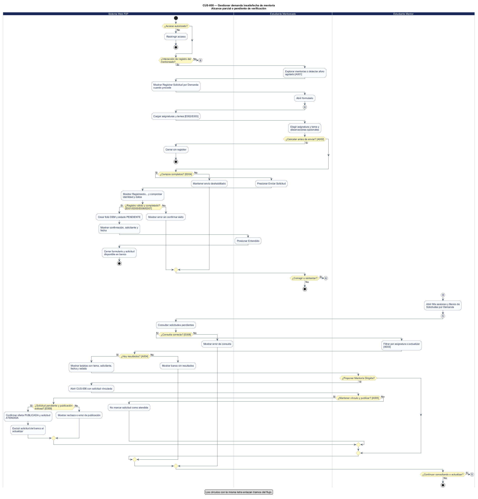

Fuente PlantUML: [CUS-008_actividades.puml](docs/narrativas/diagramas/plantuml/CUS-008_actividades.puml).

Fuente: Elaboración propia.

##### 7.6. Diagrama de caso de uso

**Figura 6.2.3-8. Diagrama de caso de uso — CUS-008: Gestionar demanda insatisfecha de mentoría.**

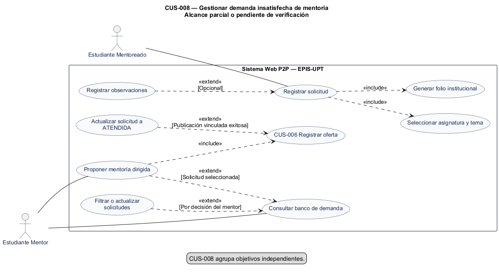

Fuente PlantUML: [CUS-008_caso_de_uso.puml](docs/narrativas/diagramas/plantuml/CUS-008_caso_de_uso.puml).

Fuente: Elaboración propia.

---

#### CUS-005 — Postular al rol de estudiante mentor

##### 7.1. Ficha descriptiva

| Atributo | Detalle |
|---|---|
| **Id Caso de Uso** | **UC-005** (CUS-005) |
| **Nombre** | Postular al rol de estudiante mentor |
| **Tipo** | Opcional |
| **Requisito ID (RF)** | RF-004, RF-003; RN-03 |
| **Versión** | 2.3 (DOC-H02 — consolidación) |
| **Autor** | Antayhua Mamani, Renzo Antonio / Medina Quispe, Joan Cristian |
| **Actores** | Estudiante Mentoreado |
| **Interacción** | Interacción web institucional; comportamiento descrito conforme a la evidencia identificada. |
| **Descripción** | Permite manifestar interés en enseñar y registrar fortalezas académicas y disponibilidad semanal. La postulación no equivale a la asignación del rol. |
| **Referencias** | SWEBOK v3.0, ISO/IEC/IEEE 29148:2018, SRS y reglas de negocio EPIS-UPT. |
| **Precondiciones** | Sesión institucional y consentimiento; perfil y catálogo consultables. |
| **Postcondiciones** | Preferencia de participación y datos formativos guardados si el envío se completa. La asignación efectiva se gestiona en CUS-010; no se acredita expediente de comité. |

**Estado de evidencia:** Implementación parcial: postulación en perfil.

##### 7.2. Flujo normal de eventos

| **Acción del Actor** | **Respuesta del Sistema** |
|---|---|
| **Fase 1: Acceso al perfil** |  |
| **1.** Selecciona «Mi perfil». |  |
|  | **2.** Muestra «1. Perfil Formativo Académico» y «2. Matriz Semanal de Disponibilidad» con contador de horas. Presenta el correo y los datos del perfil. Si no puede cargarlos, E001. |
| **3.** Selecciona «Perfil Formativo Académico». |  |
|  | **4.** Presenta «Configuración del Perfil Académico», selector «Ciclo Académico Actual (EPIS)» de I a X, rol de participación, modalidad preferida, asignaturas y semblanza. |
| **Fase 2: Postulación** |  |
| **5.** Selecciona su ciclo y «🌟 Postulante a Mentor (Enseñar)». |  |
|  | **6.** Actualiza la intención de participación y las etiquetas de fortalezas; si el ciclo es inferior a VII muestra advertencia de mérito (E002). No cambia por sí solo el rol de acceso. |
| **7.** Selecciona la modalidad preferida y las asignaturas que domina. |  |
|  | **8.** Resalta las materias elegidas con código y ciclo; mantiene la selección. |
| **9.** Completa «Semblanza y Temas de Enfoque Específico». |  |
|  | **10.** Conserva la descripción de fortalezas, dudas o temas de interés. |
| **Fase 3: Disponibilidad y guardado** |  |
| **11.** Abre «Matriz Semanal de Disponibilidad». |  |
|  | **12.** Presenta una cuadrícula de franjas semanales y contador de horas; permite seleccionar franjas individuales o usar «Mañanas», «Tardes» y «Limpiar» (A001). |
| **13.** Selecciona las franjas que puede dedicar a mentorías y pulsa «Guardar Perfil y Disponibilidad». |  |
|  | **14.** Muestra «Guardando datos...», valida el perfil, registra sus datos y agenda mediante operaciones diferenciadas. Si falla, E003. |
| **15.** Revisa el resultado y el rol activo del encabezado. |  |
|  | **16.** Mantiene el perfil actualizado según la respuesta obtenida. La condición de Mentor requiere habilitación administrativa; no muestra resolución de comité en este flujo. |

##### 7.3. Flujos alternativos

###### A001: Selección rápida de disponibilidad

* **Paso origen:** 12.
* **Condición de activación:** Agenda abierta.

| **Acción del Actor** | **Respuesta del Sistema** |
|---|---|
| **A001-1.** Pulsa «Mañanas (08:00-12:00)», «Tardes (14:00-18:00)» o «Limpiar». |  |
|  | **A001-2.** Actualiza las franjas y horas indicadas. |
| **A001-3.** Revisa y guarda. |  |

###### A002: Mantener perfil Mentoreado

* **Paso origen:** Flujo normal, en la operación indicada por la condición.
* **Condición de activación:** Antes de guardar.

| **Acción del Actor** | **Respuesta del Sistema** |
|---|---|
| **A002-1.** Selecciona «Mentoreado (Solicitar Asesoría)». |  |
|  | **A002-2.** Cambia la selección y presenta asignaturas como necesidades de apoyo. |
| **A002-3.** Guarda los datos sin postular como mentor. |  |

##### 7.4. Flujos de excepción

###### E001: Perfil o catálogo no disponible

* **Paso origen:** 2.
* **Condición de activación:** Carga inicial fallida.

| **Acción del Actor** | **Respuesta del Sistema** |
|---|---|
|  | **E001-1.** Informa el problema disponible; no acredita guardado. |
| **E001-2.** Reintenta la consulta. |  |

###### E002: Ciclo inferior a VII

* **Paso origen:** 6.
* **Condición de activación:** Selección de Postulante a Mentor.

| **Acción del Actor** | **Respuesta del Sistema** |
|---|---|
|  | **E002-1.** Muestra advertencia de requisito de mérito y rechaza guardar la postulación no elegible. |
| **E002-2.** Corrige el ciclo real o elige Mentoreado. |  |

###### E003: Fallo de guardado

* **Paso origen:** 14.
* **Condición de activación:** No se completa perfil o agenda.

| **Acción del Actor** | **Respuesta del Sistema** |
|---|---|
|  | **E003-1.** Comunica el error; no debe interpretarse como confirmación de ambos registros. |
| **E003-2.** Consulta los datos persistidos antes de repetir. |  |

##### 7.5. Diagrama de flujo de actividades

**Figura 6.2.3-9. Diagrama de actividades — CUS-005: Postular al rol de estudiante mentor.**


Fuente PlantUML: [CUS-005_actividades.puml](docs/narrativas/diagramas/plantuml/CUS-005_actividades.puml).

Fuente: Elaboración propia.

##### 7.6. Diagrama de caso de uso

**Figura 6.2.3-10. Diagrama de caso de uso — CUS-005: Postular al rol de estudiante mentor.**

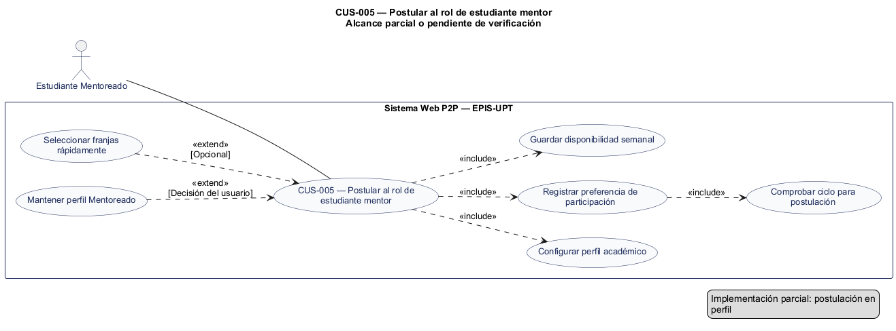

Fuente PlantUML: [CUS-005_caso_de_uso.puml](docs/narrativas/diagramas/plantuml/CUS-005_caso_de_uso.puml).

Fuente: Elaboración propia.

---

#### CUS-021 — Evaluar postulaciones a mentor por comité

##### 7.1. Ficha descriptiva

| Atributo | Detalle |
|---|---|
| **Id Caso de Uso** | **UC-021** (CUS-021) |
| **Nombre** | Evaluar postulaciones a mentor por comité |
| **Tipo** | Obligatorio según proceso propuesto |
| **Requisito ID (RF)** | RF-003; RN-03 |
| **Versión** | 2.3 (DOC-H02 — consolidación) |
| **Autor** | Antayhua Mamani, Renzo Antonio / Medina Quispe, Joan Cristian |
| **Actores** | Comité evaluador (actor previsto); Administrador institucional |
| **Interacción** | Interacción web institucional; flujo propuesto pendiente de implementación. |
| **Descripción** | Propone que la evaluación de las postulaciones compruebe el mérito académico antes de habilitar al estudiante como mentor. |
| **Referencias** | SWEBOK v3.0, ISO/IEC/IEEE 29148:2018, SRS y reglas de negocio EPIS-UPT. |
| **Precondiciones** | Propuesta: comité autorizado, postulación registrada, información académica verificable y criterios institucionales aprobados. |
| **Postcondiciones** | Propuesta: decisión motivada y trazable; si se aprueba, habilitación mediante CUS-010 por actor autorizado. |

**Estado de evidencia:** Pendiente: sin flujo de comité identificado.

##### 7.2. Flujo normal de eventos

| **Acción del Actor** | **Respuesta del Sistema** |
|---|---|
| **Fase 1: Recepción de la postulación (propuesto)** |  |
| **1.** El evaluador accede a la bandeja de postulaciones pendientes. |  |
|  | **2.** Deberá presentar las solicitudes disponibles con identidad, fecha, ciclo y asignaturas declaradas; no existe una bandeja de comité acreditada. |
| **3.** Selecciona una postulación. |  |
|  | **4.** Deberá mostrar el expediente y los antecedentes necesarios para la evaluación. |
| **Fase 2: Evaluación (propuesto)** |  |
| **5.** Comprueba el ciclo VII a X y el mérito en las asignaturas a enseñar. |  |
|  | **6.** Deberá permitir registrar el resultado de cada criterio, incluyendo la nota mínima de 14 indicada en RN-03. Si falta evidencia, A001. |
| **7.** Registra la decisión y justificación. |  |
|  | **8.** Deberá comprobar que la evaluación esté completa; permite aprobar o rechazar conforme al reglamento (A002). |
| **Fase 3: Resolución (propuesto)** |  |
| **9.** Confirma la evaluación aprobatoria. |  |
|  | **10.** Deberá conservar la decisión, evaluador y fecha; la asignación se realizará mediante la operación autorizada del CUS-010, no automáticamente por expresar interés. |
| **11.** Consulta el resultado. |  |
|  | **12.** Deberá mostrar el estado final de la postulación y evitar decisiones simultáneas incompatibles. |

##### 7.3. Flujos alternativos

###### A001: Solicitar subsanación

* **Paso origen:** 6.
* **Condición de activación:** Evidencia insuficiente.

| **Acción del Actor** | **Respuesta del Sistema** |
|---|---|
| **A001-1.** Registra qué información requiere aclaración. |  |
|  | **A001-2.** Deberá conservar la evaluación pendiente y la observación. |
| **A001-3.** Retoma cuando exista evidencia. |  |

###### A002: Rechazar postulación

* **Paso origen:** 8.
* **Condición de activación:** Incumplimiento de mérito.

| **Acción del Actor** | **Respuesta del Sistema** |
|---|---|
| **A002-1.** Registra motivo y confirma rechazo. |  |
|  | **A002-2.** Deberá conservar decisión sin otorgar rol Mentor. |
| **A002-3.** Finaliza la evaluación. |  |

##### 7.4. Flujos de excepción

###### E001: Evaluador sin autorización

* **Paso origen:** Flujo normal, en la operación indicada por la condición.
* **Condición de activación:** No dispone de atribuciones.

| **Acción del Actor** | **Respuesta del Sistema** |
|---|---|
|  | **E001-1.** Deberá impedir consultar o resolver expedientes. |
| **E001-2.** Solicita acceso por canal institucional. |  |

###### E002: Expediente o decisión inválida

* **Paso origen:** Flujo normal, en la operación indicada por la condición.
* **Condición de activación:** Información incompleta o evaluación ya resuelta.

| **Acción del Actor** | **Respuesta del Sistema** |
|---|---|
|  | **E002-1.** Deberá impedir cierre y mostrar motivo. |
| **E002-2.** Revisa información o consulta estado actualizado. |  |

###### E003: Fallo de registro

* **Paso origen:** Flujo normal, en la operación indicada por la condición.
* **Condición de activación:** No se puede conservar resolución.

| **Acción del Actor** | **Respuesta del Sistema** |
|---|---|
|  | **E003-1.** Deberá informar el fallo sin declarar decisión confirmada. |
| **E003-2.** Comprueba el estado antes de repetir. |  |

##### 7.5. Diagrama de flujo de actividades

**Figura 6.2.3-11. Diagrama de actividades — CUS-021: Evaluar postulaciones a mentor por comité.**

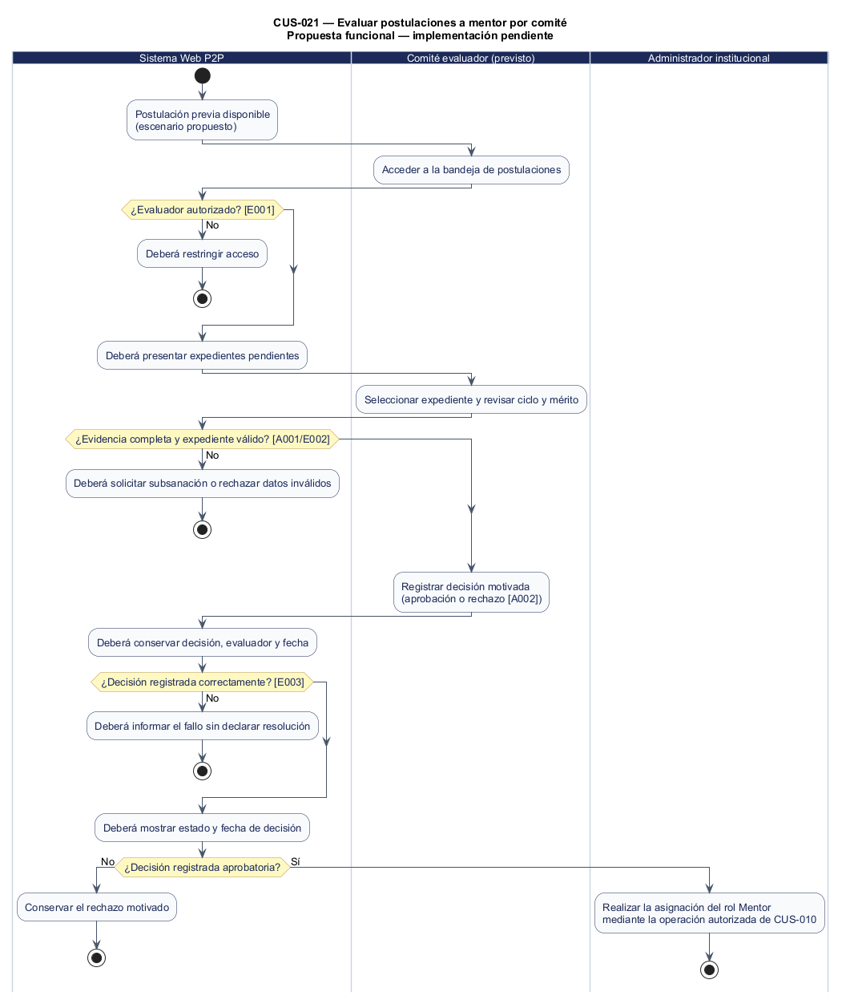

Fuente PlantUML: [CUS-021_actividades.puml](docs/narrativas/diagramas/plantuml/CUS-021_actividades.puml).

Fuente: Elaboración propia.

##### 7.6. Diagrama de caso de uso

**Figura 6.2.3-12. Diagrama de caso de uso — CUS-021: Evaluar postulaciones a mentor por comité.**

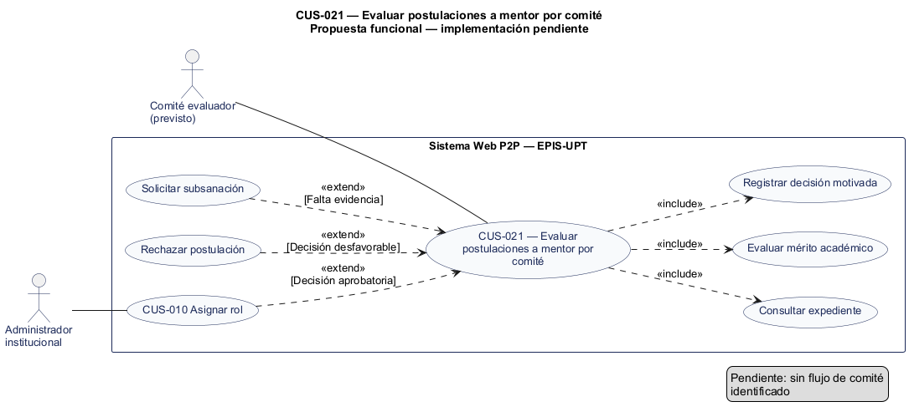

Fuente PlantUML: [CUS-021_caso_de_uso.puml](docs/narrativas/diagramas/plantuml/CUS-021_caso_de_uso.puml).

Fuente: Elaboración propia.

---

### MOD-03: Recomendaciones, Reservas y Quórum

#### CUS-002 — Consultar catálogo de mentorías con recomendación

##### 7.1. Ficha descriptiva

| Atributo | Detalle |
|---|---|
| **Id Caso de Uso** | **UC-002** (CUS-002) |
| **Nombre** | Consultar catálogo de mentorías con recomendación |
| **Tipo** | Obligatorio |
| **Requisito ID (RF)** | RF-006; RN-04, RN-05, RN-11; relacionado con RF-007, RF-012 |
| **Versión** | 2.3 (DOC-H02 — consolidación) |
| **Autor** | Antayhua Mamani, Renzo Antonio / Medina Quispe, Joan Cristian |
| **Actores** | Estudiante Mentoreado |
| **Interacción** | Interacción web institucional; comportamiento descrito conforme a la evidencia identificada. |
| **Descripción** | Presenta una cartelera personalizada de sesiones y mentores según afinidad curricular, disponibilidad y criterios de recomendación, para orientar la selección y reserva. |
| **Referencias** | SWEBOK v3.0, ISO/IEC/IEEE 29148:2018, SRS y reglas de negocio EPIS-UPT. |
| **Precondiciones** | Sesión Mentoreado y consentimiento; perfil y servicios de recomendación disponibles. |
| **Postcondiciones** | El usuario visualiza resultados y puede iniciar reserva o demanda; la consulta por sí sola no modifica cupos. |

**Estado de evidencia:** Implementación identificada; revisión estática.

##### 7.2. Flujo normal de eventos

| **Acción del Actor** | **Respuesta del Sistema** |
|---|---|
| **Fase 1: Acceso a la cartelera** |  |
| **1.** Selecciona «Explorar mentorías». |  |
|  | **2.** Muestra «Cartelera de Mentorías Recomendadas», explicación de afinidad curricular, horario semanal y materias prioritarias, botón «Actualizar», y pestañas «Sesiones Recomendadas» y «Mentores Académicos» con contadores cuando hay resultados. Si no hay autorización, E001. |
| **3.** Espera la carga inicial. |  |
|  | **4.** Presenta «Calculando afinidad con sesiones disponibles...» y obtiene las recomendaciones. Si el servicio falla, E002. |
| **Fase 2: Configuración de resultados** |  |
| **5.** En «Sesiones Recomendadas», despliega «Asignatura». |  |
|  | **6.** Lista «Todas las materias formativas» y cursos disponibles con código; actualiza las recomendaciones con la selección. |
| **7.** Selecciona «Candidatos Top-k»: Top 3, Top 4 o Top 5 (Estándar SRS). |  |
|  | **8.** Solicita y muestra el conjunto ordenado de candidatos de acuerdo con el límite y filtros elegidos. Si no hay resultados, A001. |
| **Fase 3: Exploración de ofertas** |  |
| **9.** Revisa las tarjetas de sesiones. |  |
|  | **10.** Presenta datos de asignatura y tema, afinidad global, horario, modalidad, mentor responsable y cupos disponibles; distingue aforo completo y muestra «Reservar Cupo» o «Aforo Agotado» según corresponda. |
| **11.** Consulta la explicación de afinidad disponible en una tarjeta. |  |
|  | **12.** Presenta el desglose de criterios de recomendación; la afinidad ayuda a comparar, no garantiza reserva ni éxito académico. |
| **13.** Selecciona una oferta con vacantes y pulsa «Reservar Cupo». |  |
|  | **14.** Abre el cuadro de reserva del CUS-003 con la oferta seleccionada. No asigna cupo hasta confirmar la operación. |
| **15.** Alternativamente explora mentores. |  |
|  | **16.** Puede cambiar a «Mentores Académicos» (A002) o actualizar resultados (A003). |

##### 7.3. Flujos alternativos

###### A001: Sin recomendaciones

* **Paso origen:** 8.
* **Condición de activación:** No existen resultados para el filtro.

| **Acción del Actor** | **Respuesta del Sistema** |
|---|---|
| **A001-1.** Revisa el mensaje o pulsa «Registrar Solicitud por Demanda». |  |
|  | **A001-2.** Muestra «No se encontraron recomendaciones en este momento» y orientación de banco de demanda; abre CUS-008 si se selecciona. |
| **A001-3.** Cambia el filtro o registra necesidad. |  |

###### A002: Explorar mentores

* **Paso origen:** 16.
* **Condición de activación:** Cartelera disponible.

| **Acción del Actor** | **Respuesta del Sistema** |
|---|---|
| **A002-1.** Selecciona «Mentores Académicos». |  |
|  | **A002-2.** Muestra tarjetas de mentores con afinidad de perfil, asignaturas de asesoría y control «Contactar / Solicitar Asesoría». |
| **A002-3.** Revisa los resultados o regresa a sesiones. No se acredita mensajería directa. |  |

###### A003: Actualizar resultados

* **Paso origen:** 16.
* **Condición de activación:** Cartelera abierta.

| **Acción del Actor** | **Respuesta del Sistema** |
|---|---|
| **A003-1.** Pulsa «Actualizar» o cambia el número de candidatos. |  |
|  | **A003-2.** Vuelve a consultar y actualiza los resultados y contadores disponibles. |
| **A003-3.** Revisa las nuevas tarjetas. |  |

##### 7.4. Flujos de excepción

###### E001: Acceso restringido

* **Paso origen:** 2.
* **Condición de activación:** Sesión inválida o rol no permitido.

| **Acción del Actor** | **Respuesta del Sistema** |
|---|---|
|  | **E001-1.** Restringe la vista privada. |
| **E001-2.** Inicia sesión o cambia a un rol habilitado. |  |

###### E002: Error de recomendaciones

* **Paso origen:** 4.
* **Condición de activación:** Servicio no responde.

| **Acción del Actor** | **Respuesta del Sistema** |
|---|---|
|  | **E002-1.** Muestra «Error de servicio» y «Reintentar». |
| **E002-2.** Presiona «Reintentar» y revisa los resultados. |  |

###### E003: Oferta sin cupos

* **Paso origen:** Flujo normal, en la operación indicada por la condición.
* **Condición de activación:** Aforo completo o cambio de disponibilidad.

| **Acción del Actor** | **Respuesta del Sistema** |
|---|---|
|  | **E003-1.** Muestra «Aforo Agotado» y deshabilita la reserva desde la tarjeta; la operación de reserva revalida disponibilidad. |
| **E003-2.** Consulta otra oferta o utiliza la alternativa de demanda cuando esté disponible. |  |

##### 7.5. Diagrama de flujo de actividades

**Figura 6.2.3-13. Diagrama de actividades — CUS-002: Consultar catálogo de mentorías con recomendación.**


Fuente PlantUML: [CUS-002_actividades.puml](docs/narrativas/diagramas/plantuml/CUS-002_actividades.puml).

Fuente: Elaboración propia.

##### 7.6. Diagrama de caso de uso

**Figura 6.2.3-14. Diagrama de caso de uso — CUS-002: Consultar catálogo de mentorías con recomendación.**

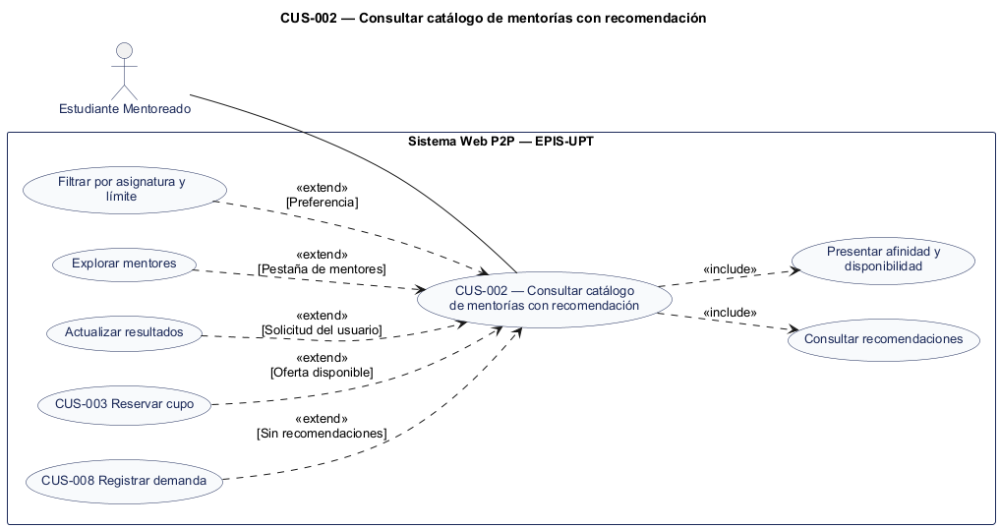

Fuente PlantUML: [CUS-002_caso_de_uso.puml](docs/narrativas/diagramas/plantuml/CUS-002_caso_de_uso.puml).

Fuente: Elaboración propia.

---

#### CUS-003 — Reservar cupo para sesión de mentoría

##### 7.1. Ficha descriptiva

| Atributo | Detalle |
|---|---|
| **Id Caso de Uso** | **UC-003** (CUS-003) |
| **Nombre** | Reservar cupo para sesión de mentoría |
| **Tipo** | Obligatorio |
| **Requisito ID (RF)** | RF-012; RN-04, RN-05, RN-08 |
| **Versión** | 2.3 (DOC-H02 — consolidación) |
| **Autor** | Antayhua Mamani, Renzo Antonio / Medina Quispe, Joan Cristian |
| **Actores** | Estudiante Mentoreado |
| **Interacción** | Interacción web institucional; comportamiento descrito conforme a la evidencia identificada. |
| **Descripción** | Permite reservar provisionalmente una plaza de una sesión publicada, verificando aforo y condiciones de inscripción. |
| **Referencias** | SWEBOK v3.0, ISO/IEC/IEEE 29148:2018, SRS y reglas de negocio EPIS-UPT. |
| **Precondiciones** | Sesión institucional Mentoreado; oferta publicada, disponible y dentro de ventana de reserva; no ser mentor titular. |
| **Postcondiciones** | Reserva PENDIENTE_CONFIRMACION con identificador, fecha y cupo ocupado; requiere ratificación CUS-004. |

**Estado de evidencia:** Implementación identificada; revisión estática.

##### 7.2. Flujo normal de eventos

| **Acción del Actor** | **Respuesta del Sistema** |
|---|---|
| **Fase 1: Selección de oferta** |  |
| **1.** Desde «Explorar mentorías», selecciona una sesión con vacantes mediante «Reservar Cupo». |  |
|  | **2.** Abre ventana «Reserva de Cupo de Mentoría» / «Confirmar Reserva de Cupo» con información de la sesión seleccionada. Si no hay oferta válida, E001. |
| **Fase 2: Revisión de la sesión** |  |
| **3.** Revisa asignatura, tema, mentor, fecha, modalidad, infraestructura y disponibilidad mostrada. |  |
|  | **4.** Presenta información institucional: reserva PENDIENTE_CONFIRMACION y obligación de ratificar antes de las 24 h previas al inicio. Si se detecta autoreserva, E002; sin vacantes, E003; fuera de plazo, E004. |
| **5.** Decide continuar o cancelar (A001). |  |
|  | **6.** Mantiene habilitado «Confirmar Reserva de Cupo» únicamente cuando las condiciones del formulario lo permiten. |
| **Fase 3: Registro** |  |
| **7.** Presiona «Confirmar Reserva de Cupo». |  |
|  | **8.** Muestra «Procesando reserva...»; comprueba identidad, sesión, ventana, duplicidad y disponibilidad. Si ya posee una reserva incompatible, E005; si otra persona ocupó la última plaza, E003. |
| **9.** Espera el resultado. |  |
|  | **10.** Registra el cupo provisional y actualiza la disponibilidad. Si hay fallo, E006. |
| **Fase 4: Confirmación** |  |
| **11.** Revisa «¡Cupo Reservado Exitosamente!». |  |
|  | **12.** Presenta la confirmación de reserva provisional, sus datos y el compromiso de ratificación. Ofrece «Entendido, Cerrar» y «Ver Mis Reservas». |
| **13.** Presiona «Ver Mis Reservas» o cierra el diálogo. |  |
|  | **14.** Abre «Mis reservas» o retorna a la cartelera; la reserva queda pendiente de confirmación (CUS-004). |

##### 7.3. Flujos alternativos

###### A001: Cancelar antes de confirmar

* **Paso origen:** 6.
* **Condición de activación:** Cuadro abierto sin envío.

| **Acción del Actor** | **Respuesta del Sistema** |
|---|---|
| **A001-1.** Presiona «Cancelar» o cierra el cuadro antes de enviar. |  |
|  | **A001-2.** Cierra sin registrar reserva. |
| **A001-3.** Retorna a la cartelera. |  |

###### A002: Registrar demanda por aforo

* **Paso origen:** Flujo normal, en la operación indicada por la condición.
* **Condición de activación:** Cuadro de reserva detecta aforo agotado.

| **Acción del Actor** | **Respuesta del Sistema** |
|---|---|
| **A002-1.** Presiona «Registrar Solicitud por Demanda» si se ofrece. |  |
|  | **A002-2.** Cierra el cuadro y abre el formulario CUS-008. |
| **A002-3.** Selecciona curso y tema. |  |

###### A003: Consultar reserva después del éxito

* **Paso origen:** Flujo normal, en la operación indicada por la condición.
* **Condición de activación:** Confirmación visible.

| **Acción del Actor** | **Respuesta del Sistema** |
|---|---|
| **A003-1.** Presiona «Ver Mis Reservas». |  |
|  | **A003-2.** Abre la bandeja personal con el registro disponible. |
| **A003-3.** Revisa estado y fecha límite de ratificación. |  |

##### 7.4. Flujos de excepción

###### E001: Oferta no seleccionada o sesión inválida

* **Paso origen:** 2.
* **Condición de activación:** Sin oferta o sesión no apta.

| **Acción del Actor** | **Respuesta del Sistema** |
|---|---|
|  | **E001-1.** Muestra «Ninguna Sesión Seleccionada» o rechazo correspondiente. |
| **E001-2.** Cierra y elige otra oferta. |  |

###### E002: Autoreserva

* **Paso origen:** 4.
* **Condición de activación:** Usuario es mentor titular.

| **Acción del Actor** | **Respuesta del Sistema** |
|---|---|
|  | **E002-1.** Muestra «Restricción de Autoreserva» y no permite inscribirse. |
| **E002-2.** Selecciona otra sesión como mentoreado. |  |

###### E003: Aforo agotado

* **Paso origen:** 4, 8.
* **Condición de activación:** No quedan vacantes al consultar o registrar.

| **Acción del Actor** | **Respuesta del Sistema** |
|---|---|
|  | **E003-1.** Bloquea o rechaza la reserva y muestra motivo; puede orientar a demanda si está disponible. |
| **E003-2.** Elige otra sesión o registra demanda. |  |

###### E004: Ventana cerrada

* **Paso origen:** 4.
* **Condición de activación:** No cumple antelación requerida.

| **Acción del Actor** | **Respuesta del Sistema** |
|---|---|
|  | **E004-1.** Rechaza la inscripción o deshabilita el envío. |
| **E004-2.** Consulta una oferta vigente. |  |

###### E005: Reserva duplicada

* **Paso origen:** 8.
* **Condición de activación:** Ya existe inscripción incompatible.

| **Acción del Actor** | **Respuesta del Sistema** |
|---|---|
|  | **E005-1.** Rechaza el nuevo registro y comunica el motivo. |
| **E005-2.** Consulta Mis reservas. |  |

###### E006: Fallo de registro

* **Paso origen:** 10.
* **Condición de activación:** Error de comunicación o persistencia.

| **Acción del Actor** | **Respuesta del Sistema** |
|---|---|
|  | **E006-1.** Muestra error sin confirmación; restablece controles. |
| **E006-2.** Comprueba Mis reservas antes de reintentar. |  |

##### 7.5. Diagrama de flujo de actividades

**Figura 6.2.3-15. Diagrama de actividades — CUS-003: Reservar cupo para sesión de mentoría.**

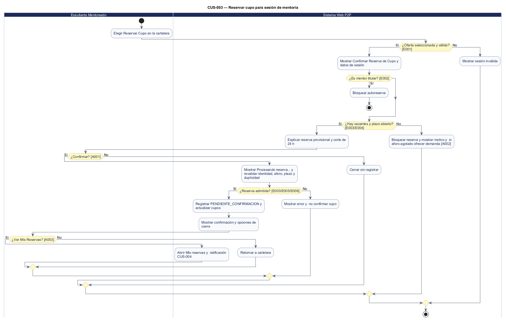

Fuente PlantUML: [CUS-003_actividades.puml](docs/narrativas/diagramas/plantuml/CUS-003_actividades.puml).

Fuente: Elaboración propia.

##### 7.6. Diagrama de caso de uso

**Figura 6.2.3-16. Diagrama de caso de uso — CUS-003: Reservar cupo para sesión de mentoría.**


Fuente PlantUML: [CUS-003_caso_de_uso.puml](docs/narrativas/diagramas/plantuml/CUS-003_caso_de_uso.puml).

Fuente: Elaboración propia.

---

#### CUS-004 — Ratificar asistencia a sesión de mentoría (T-24h)

##### 7.1. Ficha descriptiva

| Atributo | Detalle |
|---|---|
| **Id Caso de Uso** | **UC-004** (CUS-004) |
| **Nombre** | Ratificar asistencia a sesión de mentoría (T-24h) |
| **Tipo** | Obligatorio |
| **Requisito ID (RF)** | RF-013; RN-08, RN-09 |
| **Versión** | 2.3 (DOC-H02 — consolidación) |
| **Autor** | Antayhua Mamani, Renzo Antonio / Medina Quispe, Joan Cristian |
| **Actores** | Estudiante Mentoreado |
| **Interacción** | Interacción web institucional; comportamiento descrito conforme a la evidencia identificada. |
| **Descripción** | Permite ratificar una reserva provisional antes del corte de 24 horas para que compute en el quórum de la sesión. |
| **Referencias** | SWEBOK v3.0, ISO/IEC/IEEE 29148:2018, SRS y reglas de negocio EPIS-UPT. |
| **Precondiciones** | Sesión institucional, reserva propia PENDIENTE_CONFIRMACION y más de 24 horas hasta el inicio. |
| **Postcondiciones** | Reserva CONFIRMADA con fecha de ratificación; queda contabilizada para quórum sin garantizar por sí sola realización de sesión. |

**Estado de evidencia:** Implementación identificada; revisión estática.

##### 7.2. Flujo normal de eventos

| **Acción del Actor** | **Respuesta del Sistema** |
|---|---|
| **Fase 1: Acceso a reservas** |  |
| **1.** Selecciona «Mis reservas». |  |
|  | **2.** Muestra «Mis Reservas de Mentoría», botón «Actualizar», «+ Buscar Mentorías» y filtros de estados. Si no hay sesión válida, E001; si no carga, E004. |
| **3.** Selecciona el filtro de pendientes y revisa una reserva. |  |
|  | **4.** Presenta código, asignatura, fecha, modalidad, espacio, mentor, estado y corte definitivo. Ofrece «Confirmar Asistencia» mientras la ventana esté abierta; si cerró, E002. |
| **Fase 2: Ratificación** |  |
| **5.** Pulsa «✓ Confirmar Asistencia». |  |
|  | **6.** Abre «Ratificar Asistencia a Mentoría», identifica sesión y horario, explica compromiso de asistencia y quórum; ofrece «Cancelar» y «Confirmar Asistencia». |
| **7.** Lee el compromiso y confirma. |  |
|  | **8.** Muestra «Ratificando asistencia...», comprueba titularidad, estado y plazo. Si estado cambió, E003. |
| **Fase 3: Confirmación** |  |
| **9.** Espera el resultado. |  |
|  | **10.** Actualiza la reserva a CONFIRMADA y registra la fecha de ratificación; si falla, E004. |
| **11.** Revisa la tarjeta. |  |
|  | **12.** Muestra «Ratificación registrada el:» con fecha y nuevo estado; informa que la realización depende del quórum al corte. Puede desistir dentro del plazo mediante CUS-024. |

##### 7.3. Flujos alternativos

###### A001: Cancelar diálogo

* **Paso origen:** Flujo normal, en la operación indicada por la condición.
* **Condición de activación:** Antes de confirmar.

| **Acción del Actor** | **Respuesta del Sistema** |
|---|---|
| **A001-1.** Pulsa «Cancelar» o cierre. |  |
|  | **A001-2.** Cierra sin ratificar. |
| **A001-3.** Mantiene reserva provisional. |  |

###### A002: Consultar una reserva ya ratificada

* **Paso origen:** Flujo normal, en la operación indicada por la condición.
* **Condición de activación:** Reserva CONFIRMADA.

| **Acción del Actor** | **Respuesta del Sistema** |
|---|---|
| **A002-1.** Selecciona filtro de confirmadas. |  |
|  | **A002-2.** Muestra fecha y estado sin solicitar otra ratificación. |
| **A002-3.** Consulta el resultado. |  |

##### 7.4. Flujos de excepción

###### E001: Sesión o titularidad inválida

* **Paso origen:** 2.
* **Condición de activación:** No autorizado.

| **Acción del Actor** | **Respuesta del Sistema** |
|---|---|
|  | **E001-1.** Restringe vista o rechaza operación. |
| **E001-2.** Inicia sesión con la cuenta titular. |  |

###### E002: Corte alcanzado

* **Paso origen:** 4.
* **Condición de activación:** Faltan 24 h o menos.

| **Acción del Actor** | **Respuesta del Sistema** |
|---|---|
|  | **E002-1.** Muestra «Plazo Vencido (Cierre 24h)» y no permite ratificar. |
| **E002-2.** Consulta estado tras el corte. |  |

###### E003: Estado incompatible

* **Paso origen:** 8.
* **Condición de activación:** Reserva cancelada o modificada.

| **Acción del Actor** | **Respuesta del Sistema** |
|---|---|
|  | **E003-1.** Rechaza la acción y conserva el estado real. |
| **E003-2.** Actualiza Mis reservas. |  |

###### E004: Fallo de consulta o ratificación

* **Paso origen:** 2, 10.
* **Condición de activación:** Problema de servicio.

| **Acción del Actor** | **Respuesta del Sistema** |
|---|---|
|  | **E004-1.** Muestra error y permite reintentar si corresponde. |
| **E004-2.** Actualiza la reserva antes de repetir. |  |

##### 7.5. Diagrama de flujo de actividades

**Figura 6.2.3-17. Diagrama de actividades — CUS-004: Ratificar asistencia a sesión de mentoría (T-24h).**

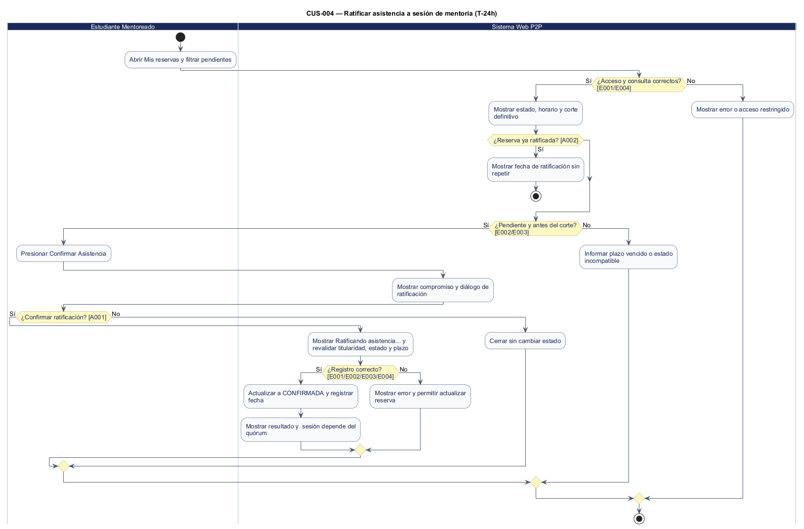

Fuente PlantUML: [CUS-004_actividades.puml](docs/narrativas/diagramas/plantuml/CUS-004_actividades.puml).

Fuente: Elaboración propia.

##### 7.6. Diagrama de caso de uso

**Figura 6.2.3-18. Diagrama de caso de uso — CUS-004: Ratificar asistencia a sesión de mentoría (T-24h).**

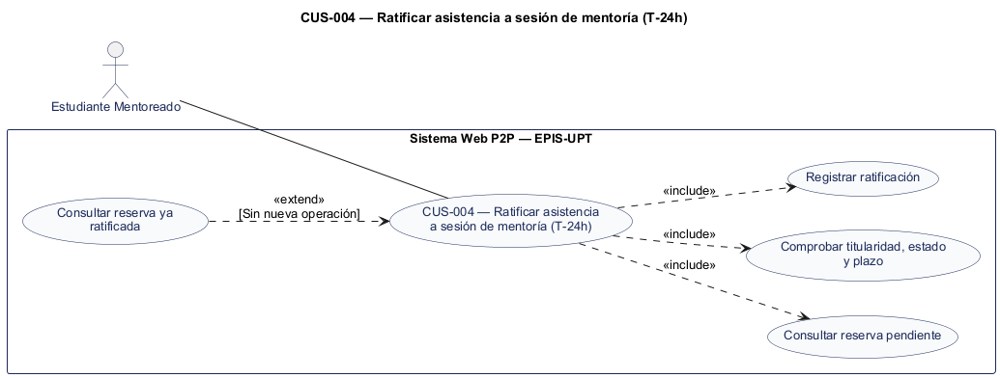

Fuente PlantUML: [CUS-004_caso_de_uso.puml](docs/narrativas/diagramas/plantuml/CUS-004_caso_de_uso.puml).

Fuente: Elaboración propia.

---

#### CUS-023 — Evaluar quórum y ejecutar corte automático (T-24h)

##### 7.1. Ficha descriptiva

| Atributo | Detalle |
|---|---|
| **Id Caso de Uso** | **UC-023** (CUS-023) |
| **Nombre** | Evaluar quórum y ejecutar corte automático (T-24h) |
| **Tipo** | Obligatorio |
| **Requisito ID (RF)** | RF-015, RF-016; RN-08, RN-09, RN-10 |
| **Versión** | 2.3 (DOC-H02 — consolidación) |
| **Autor** | Antayhua Mamani, Renzo Antonio / Medina Quispe, Joan Cristian |
| **Actores** | Sistema (proceso automático); Administrador institucional (supervisión); Estudiante Mentor (resolución posterior) |
| **Interacción** | Interacción web institucional; comportamiento descrito conforme a la evidencia identificada. |
| **Descripción** | Determina al corte de 24 horas si una sesión alcanza el mínimo de reservas ratificadas, invalida reservas no confirmadas y deriva contingencias al mentor. |
| **Referencias** | SWEBOK v3.0, ISO/IEC/IEEE 29148:2018, SRS y reglas de negocio EPIS-UPT. |
| **Precondiciones** | Sesión en estado evaluable; fecha de inicio y reservas disponibles; porcentaje mínimo configurado (referencia 50 %). |
| **Postcondiciones** | Sesión CONFIRMADA o QUORUM_INSUFICIENTE según evaluación; reservas sin ratificación canceladas según reglas; evaluación registrada sin repetir efectos. |

**Estado de evidencia:** Evaluación identificada; ejecución periódica en entorno real no certificada.

##### 7.2. Flujo normal de eventos

| **Acción del Actor** | **Respuesta del Sistema** |
|---|---|
| **Fase 1: Inicio del corte** |  |
| **1.** El proceso programado alcanza la ventana de evaluación a 24 horas del inicio (sin acción manual del estudiante). |  |
|  | **2.** Identifica sesiones evaluables cuyo corte se ha alcanzado; excluye sesiones que no corresponden o ya fueron evaluadas (A001). |
| **3.** El sistema ejecuta la evaluación. |  |
|  | **4.** Cuenta reservas ratificadas y aforo; calcula el mínimo a partir del porcentaje configurado. Referencia: 5 de 10 presencial y 10 de 20 virtual con 50 %. |
| **Fase 2: Resultado del quórum** |  |
| **5.** No se requiere intervención del estudiante. |  |
|  | **6.** Si se alcanza el mínimo, confirma la sesión y cancela las reservas provisionales no ratificadas con el estado correspondiente. Si no se alcanza, A002. |
| **7.** El proceso completa la evaluación. |  |
|  | **8.** Conserva el resultado y evita volver a aplicar los cambios si se ejecuta nuevamente; si falla, E002. |
| **Fase 3: Supervisión** |  |
| **9.** El administrador abre «Administración» > «Monitoreo de Quórum». |  |
|  | **10.** Muestra «Supervisión de Quórum y Sesiones EPIS», tarjetas con inscritos, ratificados, mínimo y porcentaje configurado; permite «Actualizar». |
| **11.** El mentor revisa «Mis sesiones» y el estado de sus ofertas. |  |
|  | **12.** Presenta el estado de inscripción/quórum; ante insuficiencia ofrece la gestión de contingencia descrita en A002. Los estudiantes pueden revisar sus reservas en «Mis reservas». |

##### 7.3. Flujos alternativos

###### A001: Sesión ya evaluada

* **Paso origen:** 2.
* **Condición de activación:** Existe resultado de corte.

| **Acción del Actor** | **Respuesta del Sistema** |
|---|---|
| **A001-1.** El proceso vuelve a solicitar evaluación. |  |
|  | **A001-2.** Conserva el resultado sin repetir cambios de estado. |
| **A001-3.** Continúa con otras sesiones. |  |

###### A002: Quórum insuficiente

* **Paso origen:** 6, 12.
* **Condición de activación:** Ratificados por debajo del mínimo.

| **Acción del Actor** | **Respuesta del Sistema** |
|---|---|
| **A002-1.** El mentor consulta la sesión en Mis sesiones. |  |
|  | **A002-2.** Establece QUORUM_INSUFICIENTE y ofrece decisión: «Dictar de Todas Formas», «Reprogramar Sesión» o «Cancelar Sesión Definitivamente». |
| **A002-3.** El mentor selecciona una decisión según las reglas y confirma; el sistema procesa continuidad, nueva fecha válida o cancelación con motivo y liberación de inscritos. Si reprograma, exige nueva antelación superior a 24 h y aula disponible si presencial. |  |

###### A003: Supervisar sin modificar

* **Paso origen:** Flujo normal, en la operación indicada por la condición.
* **Condición de activación:** Administrador consulta panel.

| **Acción del Actor** | **Respuesta del Sistema** |
|---|---|
| **A003-1.** Pulsa «Actualizar». |  |
|  | **A003-2.** Renueva indicadores y estados sin que esa consulta implique forzar una evaluación. |
| **A003-3.** Revisa resultados. |  |

##### 7.4. Flujos de excepción

###### E001: Evaluación no procedente

* **Paso origen:** Flujo normal, en la operación indicada por la condición.
* **Condición de activación:** Antes del corte o estado no evaluable.

| **Acción del Actor** | **Respuesta del Sistema** |
|---|---|
|  | **E001-1.** No debe cambiar una sesión fuera de las condiciones admitidas. |
| **E001-2.** Consulta más tarde el estado correspondiente. |  |

###### E002: Fallo de evaluación

* **Paso origen:** 8.
* **Condición de activación:** Error durante procesamiento.

| **Acción del Actor** | **Respuesta del Sistema** |
|---|---|
|  | **E002-1.** No acredita un resultado exitoso; el proceso debe conservar coherencia y permitir recuperación. |
| **E002-2.** Verifica estado y registros antes de reejecutar. |  |

###### E003: Contingencia inválida

* **Paso origen:** Flujo normal, en la operación indicada por la condición.
* **Condición de activación:** Nueva fecha insuficiente, aula ocupada, falta motivo o decisión no autorizada.

| **Acción del Actor** | **Respuesta del Sistema** |
|---|---|
|  | **E003-1.** Rechaza la decisión y comunica el motivo. |
| **E003-2.** Corrige la opción y revisa la sesión. |  |

##### 7.5. Diagrama de flujo de actividades

**Figura 6.2.3-19. Diagrama de actividades — CUS-023: Evaluar quórum y ejecutar corte automático (T-24h).**

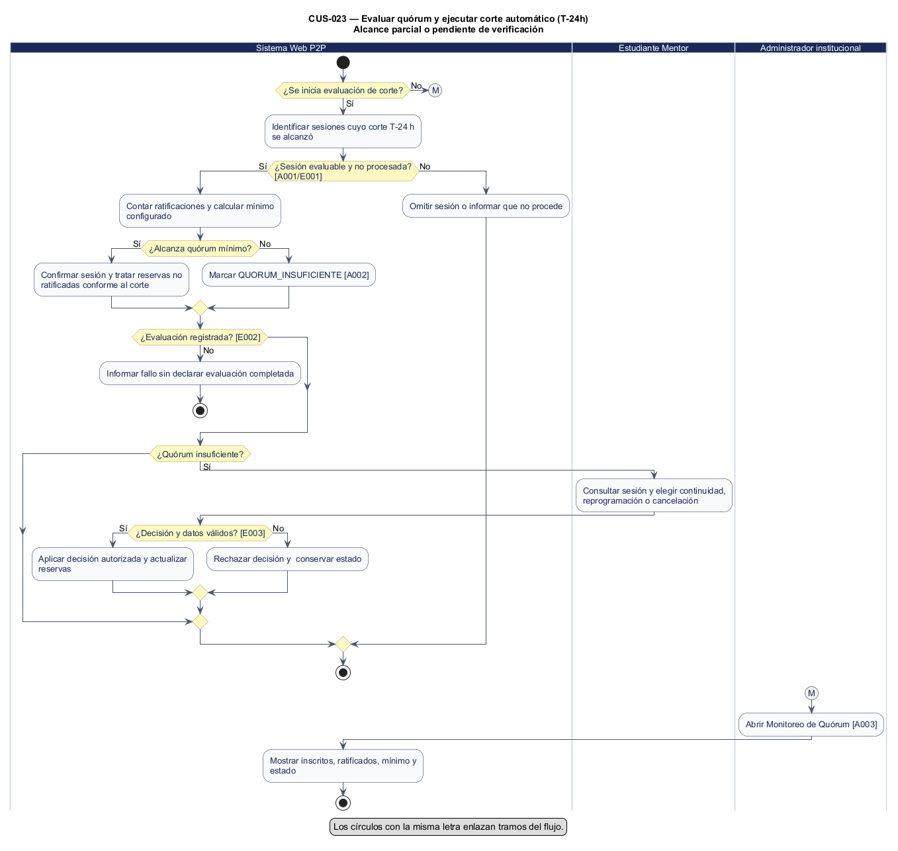

Fuente PlantUML: [CUS-023_actividades.puml](docs/narrativas/diagramas/plantuml/CUS-023_actividades.puml).

Fuente: Elaboración propia.

##### 7.6. Diagrama de caso de uso

**Figura 6.2.3-20. Diagrama de caso de uso — CUS-023: Evaluar quórum y ejecutar corte automático (T-24h).**

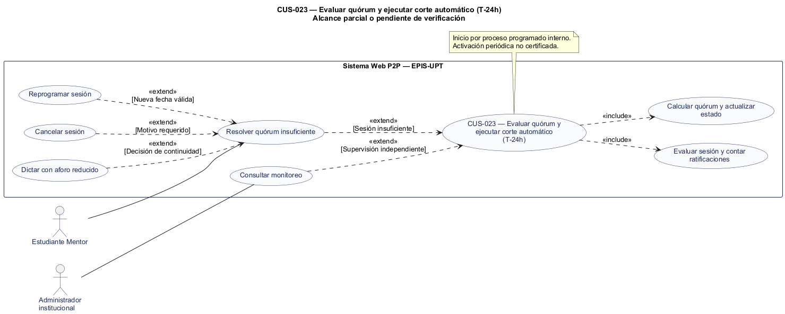

Fuente PlantUML: [CUS-023_caso_de_uso.puml](docs/narrativas/diagramas/plantuml/CUS-023_caso_de_uso.puml).

Fuente: Elaboración propia.

---

#### CUS-024 — Cancelar reserva de cupo por estudiante

##### 7.1. Ficha descriptiva

| Atributo | Detalle |
|---|---|
| **Id Caso de Uso** | **UC-024** (CUS-024) |
| **Nombre** | Cancelar reserva de cupo por estudiante |
| **Tipo** | Opcional |
| **Requisito ID (RF)** | RF-014; RN-08, RN-10 |
| **Versión** | 2.3 (DOC-H02 — consolidación) |
| **Autor** | Antayhua Mamani, Renzo Antonio / Medina Quispe, Joan Cristian |
| **Actores** | Estudiante Mentoreado |
| **Interacción** | Interacción web institucional; comportamiento descrito conforme a la evidencia identificada. |
| **Descripción** | Permite desistir voluntariamente de una reserva propia antes del corte, liberando la plaza para otro estudiante. |
| **Referencias** | SWEBOK v3.0, ISO/IEC/IEEE 29148:2018, SRS y reglas de negocio EPIS-UPT. |
| **Precondiciones** | Sesión institucional; reserva activa propia y más de 24 horas de antelación. |
| **Postcondiciones** | Reserva CANCELADA_USUARIO y plaza liberada; sin penalización conforme a la política de desistimiento oportuno. |

**Estado de evidencia:** Implementación identificada; revisión estática.

##### 7.2. Flujo normal de eventos

| **Acción del Actor** | **Respuesta del Sistema** |
|---|---|
| **Fase 1: Identificación de reserva** |  |
| **1.** Abre «Mis reservas» y consulta reservas activas. |  |
|  | **2.** Presenta tarjetas con código, estado, datos de la sesión y fecha de corte; habilita «Cancelar Reserva / Desistir» si procede. |
| **3.** Selecciona la reserva a cancelar. |  |
|  | **4.** Si está cerrada la ventana, E001; si ya no es activa, E002. |
| **Fase 2: Confirmación del desistimiento** |  |
| **5.** Presiona «Cancelar Reserva / Desistir». |  |
|  | **6.** Abre «Desistimiento Voluntario de Cupo» con sesión, horario, política de cancelación sin penalización antes del corte y aviso de acción irreversible. Muestra campo «Motivo de desistimiento (opcional)», «Volver» y «Confirmar Desistimiento». |
| **7.** Ingresa un motivo si desea y confirma. |  |
|  | **8.** Muestra «Procesando desistimiento...», comprueba titularidad, estado y plazo. Si no puede completar, E003. |
| **Fase 3: Resultado** |  |
| **9.** Espera confirmación. |  |
|  | **10.** Registra CANCELADA_USUARIO y libera el cupo; presenta resultado y actualiza la bandeja. |
| **11.** Consulta el histórico. |  |
|  | **12.** Muestra la reserva cancelada; para volver a inscribirse debe realizar una nueva reserva si aún existe disponibilidad. |

##### 7.3. Flujos alternativos

###### A001: Volver sin cancelar

* **Paso origen:** Flujo normal, en la operación indicada por la condición.
* **Condición de activación:** Diálogo abierto.

| **Acción del Actor** | **Respuesta del Sistema** |
|---|---|
| **A001-1.** Pulsa «Volver» o cierre antes de enviar. |  |
|  | **A001-2.** Cierra sin modificar el estado. |
| **A001-3.** Retorna a Mis reservas. |  |

###### A002: Motivo omitido

* **Paso origen:** Flujo normal, en la operación indicada por la condición.
* **Condición de activación:** Campo opcional.

| **Acción del Actor** | **Respuesta del Sistema** |
|---|---|
| **A002-1.** Confirma sin escribir motivo. |  |
|  | **A002-2.** Admite la cancelación con la información de desistimiento disponible. |
| **A002-3.** Consulta resultado. |  |

##### 7.4. Flujos de excepción

###### E001: Corte vencido

* **Paso origen:** 4.
* **Condición de activación:** 24 h o menos.

| **Acción del Actor** | **Respuesta del Sistema** |
|---|---|
|  | **E001-1.** Muestra «Desistimiento Cerrado (Cierre 24h)» o rechazo equivalente. |
| **E001-2.** Consulta la política institucional; no fuerza la cancelación. |  |

###### E002: Reserva no activa o no propia

* **Paso origen:** 4.
* **Condición de activación:** Estado o titularidad incompatible.

| **Acción del Actor** | **Respuesta del Sistema** |
|---|---|
|  | **E002-1.** Rechaza la acción o muestra «Reserva no activa». |
| **E002-2.** Actualiza Mis reservas. |  |

###### E003: Fallo de comunicación

* **Paso origen:** 8.
* **Condición de activación:** No se obtiene confirmación.

| **Acción del Actor** | **Respuesta del Sistema** |
|---|---|
|  | **E003-1.** Muestra error y restablece los controles. |
| **E003-2.** Actualiza antes de repetir para verificar si ya se canceló. |  |

##### 7.5. Diagrama de flujo de actividades

**Figura 6.2.3-21. Diagrama de actividades — CUS-024: Cancelar reserva de cupo por estudiante.**

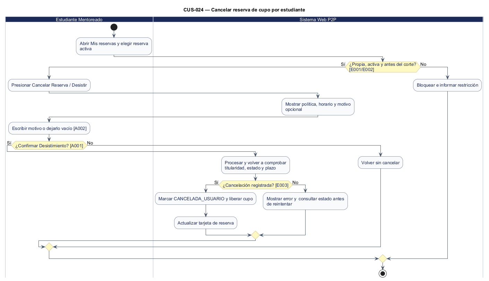

Fuente PlantUML: [CUS-024_actividades.puml](docs/narrativas/diagramas/plantuml/CUS-024_actividades.puml).

Fuente: Elaboración propia.

##### 7.6. Diagrama de caso de uso

**Figura 6.2.3-22. Diagrama de caso de uso — CUS-024: Cancelar reserva de cupo por estudiante.**


Fuente PlantUML: [CUS-024_caso_de_uso.puml](docs/narrativas/diagramas/plantuml/CUS-024_caso_de_uso.puml).

Fuente: Elaboración propia.

---

### MOD-04: Ejecución y Seguimiento Académico

#### CUS-007 — Registrar asistencia y bitácora pedagógica

##### 7.1. Ficha descriptiva

| Atributo | Detalle |
|---|---|
| **Id Caso de Uso** | **UC-007** (CUS-007) |
| **Nombre** | Registrar asistencia y bitácora pedagógica |
| **Tipo** | Obligatorio |
| **Requisito ID (RF)** | RF-017, RF-018; RN-12 |
| **Versión** | 2.3 (DOC-H02 — consolidación) |
| **Autor** | Antayhua Mamani, Renzo Antonio / Medina Quispe, Joan Cristian |
| **Actores** | Estudiante Mentor; Estudiante Mentoreado |
| **Interacción** | Interacción web institucional; comportamiento descrito conforme a la evidencia identificada. |
| **Descripción** | Permite registrar asistencia a una mentoría mediante código temporal y documentar los contenidos impartidos y resultados de la sesión. |
| **Referencias** | SWEBOK v3.0, ISO/IEC/IEEE 29148:2018, SRS y reglas de negocio EPIS-UPT. |
| **Precondiciones** | Sesión autorizada, estudiantes inscritos y confirmados para asistencia; mentor titular; bitácora dentro de ventana de 48 horas posterior a la sesión. |
| **Postcondiciones** | Asistencia de estudiantes registrada; bitácora sellada con horas declaradas en espera del visado institucional. |

**Estado de evidencia:** Implementación identificada; revisión estática.

##### 7.2. Flujo normal de eventos

| **Acción del Actor** | **Respuesta del Sistema** |
|---|---|
| **Fase 1: Inicio del control de asistencia** |  |
| **1.** El mentor accede a «Mis sesiones», identifica la sesión y selecciona «📱 Asistencia». |  |
|  | **2.** Muestra «Control de Asistencia Digital · Modo Mentor», título de la sesión, panel «Proyección de Código QR Dinámico», código numérico de respaldo de seis dígitos y ciclo de validez. Si falla la consulta, E001. |
| **3.** Proyecta el código para los participantes. |  |
|  | **4.** Actualiza periódicamente el código temporal y muestra nómina de inscritos con estados «Presente», «Por registrar» o «Ausente»; permite «Actualizar». |
| **Fase 2: Registro del estudiante** |  |
| **5.** El mentoreado abre «Mis reservas» y pulsa «Registrar Asistencia (TOTP / QR)» cuando esté disponible. |  |
|  | **6.** Abre «Check-in de Asistencia en Vivo (RF17)» e identifica la sesión. Muestra campo «Código TOTP (6 dígitos) o contenido del QR» y controles de envío y cancelación. |
| **7.** Ingresa el código proyectado y envía el registro. |  |
|  | **8.** Comprueba identidad, reserva, ventana de asistencia y código vigente; si no es válido, E002; si no es elegible, E003. |
| **9.** Espera el resultado y consulta su reserva. |  |
|  | **10.** Registra asistencia si la validación concluye correctamente; actualiza el estado correspondiente. El mentor puede actualizar su nómina para verificar el resultado. |
| **Fase 3: Registro pedagógico posterior** |  |
| **11.** El mentor, una vez finalizada la sesión, selecciona «📝 Bitácora» en su sesión. |  |
|  | **12.** Muestra «Bitácora Pedagógica de Mentoría», identificación de sesión y formulario de registro pedagógico. Si se superaron 48 horas, E004. |
| **13.** Selecciona «1. Temas Silábicos Desarrollados en la Sesión» mediante las opciones disponibles. |  |
|  | **14.** Permite marcar los temas cubiertos y agregar un tema específico mediante «Agregar» (A002). |
| **15.** Selecciona «2. Nivel de Dificultad Percibido del Grupo»: Bajo, Medio o Alto. |  |
|  | **16.** Conserva la valoración de dificultad. |
| **17.** Completa «3. Observaciones Pedagógicas y Conclusiones». |  |
|  | **18.** Muestra contador de caracteres, exige al menos 50 caracteres de observación y conserva la descripción de ejercicios, dificultades y recomendaciones. |
| **19.** Marca «Declaración Jurada de Veracidad Académica» y pulsa «Firmar y Registrar Bitácora». |  |
|  | **20.** Comprueba campos, titularidad y plazo; muestra «Sellando Criptográficamente...» durante el registro. Si faltan datos, E005; si falla, E006. |
| **21.** Revisa el resultado. |  |
|  | **22.** Presenta «Bitácora Pedagógica Registrada y Sellada con Éxito», código, temas cubiertos, horas declaradas y firma de integridad; indica que las horas quedan a la espera del visado de Dirección. No acredita horas definitivamente sin CUS-019. |

##### 7.3. Flujos alternativos

###### A001: Código numérico en lugar de QR

* **Paso origen:** Flujo normal, en la operación indicada por la condición.
* **Condición de activación:** Participante no puede escanear.

| **Acción del Actor** | **Respuesta del Sistema** |
|---|---|
| **A001-1.** Ingresa los seis dígitos proyectados o el contenido del QR en el campo habilitado. |  |
|  | **A001-2.** Valida el registro con las mismas condiciones de asistencia. |
| **A001-3.** Consulta el resultado; la disponibilidad efectiva de escaneo con cámara requiere prueba. |  |

###### A002: Tema adicional

* **Paso origen:** 14.
* **Condición de activación:** Bitácora abierta.

| **Acción del Actor** | **Respuesta del Sistema** |
|---|---|
| **A002-1.** Escribe un tema específico y pulsa «Agregar». |  |
|  | **A002-2.** Incorpora el tema al conjunto de contenidos registrados. |
| **A002-3.** Continúa con dificultad y observaciones. |  |

###### A003: Consultar nómina

* **Paso origen:** Flujo normal, en la operación indicada por la condición.
* **Condición de activación:** Mentor en control de asistencia.

| **Acción del Actor** | **Respuesta del Sistema** |
|---|---|
| **A003-1.** Presiona «Actualizar». |  |
|  | **A003-2.** Recupera estados de inscritos. |
| **A003-3.** Revisa sin registrar asistencia en nombre del estudiante. |  |

##### 7.4. Flujos de excepción

###### E001: Control no disponible

* **Paso origen:** 2.
* **Condición de activación:** Sesión inválida, sin autorización o fallo de consulta.

| **Acción del Actor** | **Respuesta del Sistema** |
|---|---|
|  | **E001-1.** No presenta un código o nómina como válidos si no puede obtenerlos; informa error disponible. |
| **E001-2.** Verifica sesión y reintenta. |  |

###### E002: Código inválido o vencido

* **Paso origen:** 8.
* **Condición de activación:** Código no coincide o pierde vigencia.

| **Acción del Actor** | **Respuesta del Sistema** |
|---|---|
|  | **E002-1.** Rechaza registro de asistencia. |
| **E002-2.** Solicita el código actual al mentor y vuelve a introducirlo. |  |

###### E003: Estudiante no elegible

* **Paso origen:** 8.
* **Condición de activación:** Sin reserva confirmada, fuera de ventana o identidad incorrecta.

| **Acción del Actor** | **Respuesta del Sistema** |
|---|---|
|  | **E003-1.** Rechaza asistencia y comunica motivo. |
| **E003-2.** Consulta su reserva y condiciones. |  |

###### E004: Plazo de bitácora vencido

* **Paso origen:** 12.
* **Condición de activación:** Más de 48 h desde fin.

| **Acción del Actor** | **Respuesta del Sistema** |
|---|---|
|  | **E004-1.** Muestra «Formulario Bloqueado: Plazo Ordinario de 48 Horas Expirado». |
| **E004-2.** Consulta a Dirección; no se acredita reapertura en la aplicación. |  |

###### E005: Bitácora incompleta

* **Paso origen:** 20.
* **Condición de activación:** Faltan temas, declaración u observaciones suficientes.

| **Acción del Actor** | **Respuesta del Sistema** |
|---|---|
|  | **E005-1.** Mantiene envío bloqueado o rechaza el registro. |
| **E005-2.** Completa los campos y confirma. |  |

###### E006: Fallo de registro

* **Paso origen:** 20.
* **Condición de activación:** Error al sellar o guardar.

| **Acción del Actor** | **Respuesta del Sistema** |
|---|---|
|  | **E006-1.** Muestra error sin acreditar horas ni asistencia nueva. |
| **E006-2.** Verifica el estado antes de reintentar. |  |

##### 7.5. Diagrama de flujo de actividades

**Figura 6.2.3-23. Diagrama de actividades — CUS-007: Registrar asistencia y bitácora pedagógica.**


Fuente PlantUML: [CUS-007_actividades.puml](docs/narrativas/diagramas/plantuml/CUS-007_actividades.puml).

Fuente: Elaboración propia.

##### 7.6. Diagrama de caso de uso

**Figura 6.2.3-24. Diagrama de caso de uso — CUS-007: Registrar asistencia y bitácora pedagógica.**

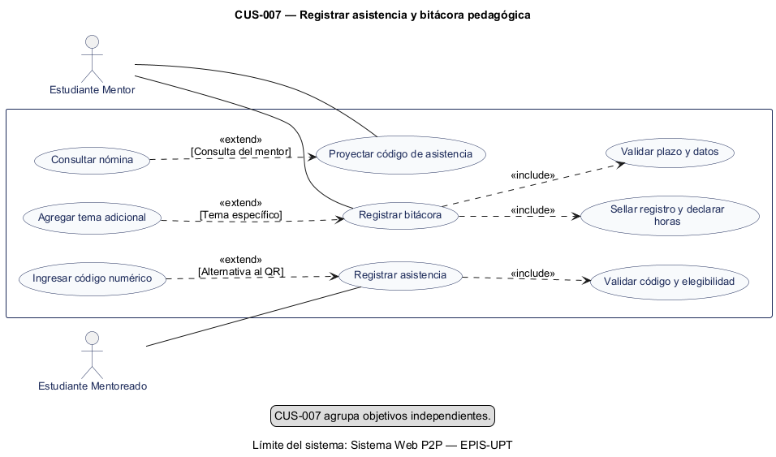

Fuente PlantUML: [CUS-007_caso_de_uso.puml](docs/narrativas/diagramas/plantuml/CUS-007_caso_de_uso.puml).

Fuente: Elaboración propia.

---

#### CUS-012 — Registrar calificación y feedback bidireccional

##### 7.1. Ficha descriptiva

| Atributo | Detalle |
|---|---|
| **Id Caso de Uso** | **UC-012** (CUS-012) |
| **Nombre** | Registrar calificación y feedback bidireccional |
| **Tipo** | Opcional |
| **Requisito ID (RF)** | RF-020, RF-018; RN-12, RN-13 |
| **Versión** | 2.3 (DOC-H02 — consolidación) |
| **Autor** | Antayhua Mamani, Renzo Antonio / Medina Quispe, Joan Cristian |
| **Actores** | Estudiante Mentoreado; Estudiante Mentor (retroalimentación cualitativa parcial) |
| **Interacción** | Interacción web institucional; comportamiento descrito conforme a la evidencia identificada. |
| **Descripción** | Permite al asistente evaluar la calidad de una sesión y al mentor consignar observaciones pedagógicas mediante la bitácora. La evaluación recíproca individual no está acreditada. |
| **Referencias** | SWEBOK v3.0, ISO/IEC/IEEE 29148:2018, SRS y reglas de negocio EPIS-UPT. |
| **Precondiciones** | Sesión concluida, asistencia registrada y ventana de encuesta vigente (24 h); mentor titular para bitácora. |
| **Postcondiciones** | Encuesta registrada correctamente y, por separado, observaciones del mentor mediante CUS-007. |

**Estado de evidencia:** Implementación parcial: encuesta del asistente y bitácora del mentor.

##### 7.2. Flujo normal de eventos

| **Acción del Actor** | **Respuesta del Sistema** |
|---|---|
| **Fase 1: Acceso a evaluación** |  |
| **1.** El estudiante abre «Mis reservas» y localiza una mentoría asistida. |  |
|  | **2.** Muestra datos de la sesión y «⭐ Evaluar Mentoría» si corresponde. Si el plazo cerró, E001; si no es elegible, E002. |
| **3.** Pulsa «Evaluar Mentoría». |  |
|  | **4.** Abre «Encuesta de Calidad Docente» con sesión y mentor, cuatro dimensiones y opción de retroalimentación. |
| **Fase 2: Calificación** |  |
| **5.** Selecciona entre una y cinco estrellas para «Puntualidad e Inicio de Sesión», «Dominio Conceptual y Temático», «Claridad Expositiva y Metodología Didáctica» y «Calificación General del Servicio de Mentoría». |  |
|  | **6.** Resalta las estrellas elegidas para cada criterio y conserva los valores; permite corregir antes del envío. |
| **7.** Escribe en «Retroalimentación y observaciones constructivas». |  |
|  | **8.** Comprueba que el texto tenga al menos 20 caracteres y que las cuatro dimensiones estén calificadas; mantiene el envío inactivo si faltan datos (E003). |
| **Fase 3: Registro de evaluación** |  |
| **9.** Revisa y envía la encuesta. |  |
|  | **10.** Comprueba elegibilidad, plazo y registro previo; si ya evaluó, E004; si falla, E005. |
| **11.** Consulta la confirmación. |  |
|  | **12.** Muestra «¡Gracias por tu Evaluación!» y permite «Cerrar Ventana»; conserva el resultado recibido. |
| **Fase 4: Retroalimentación del mentor (independiente)** |  |
| **13.** El mentor abre «Bitácora» en su sesión y registra dificultad del grupo, observaciones y recomendaciones, conforme a CUS-007. |  |
|  | **14.** Conserva la retroalimentación pedagógica de la sesión. No presenta un formulario de calificación individual de cada mentoreado. |

##### 7.3. Flujos alternativos

###### A001: Cancelar evaluación

* **Paso origen:** Flujo normal, en la operación indicada por la condición.
* **Condición de activación:** Antes del envío.

| **Acción del Actor** | **Respuesta del Sistema** |
|---|---|
| **A001-1.** Pulsa «Cancelar» o cierra la ventana. |  |
|  | **A001-2.** Cierra sin registrar encuesta. |
| **A001-3.** Puede volver mientras sea elegible. |  |

###### A002: Modificar calificación antes del envío

* **Paso origen:** Flujo normal, en la operación indicada por la condición.
* **Condición de activación:** Encuesta abierta.

| **Acción del Actor** | **Respuesta del Sistema** |
|---|---|
| **A002-1.** Selecciona otras estrellas o edita comentarios. |  |
|  | **A002-2.** Actualiza valores pendientes. |
| **A002-3.** Revisa y envía cuando complete los campos. |  |

##### 7.4. Flujos de excepción

###### E001: Ventana vencida

* **Paso origen:** 2.
* **Condición de activación:** Más de 24 h tras cierre.

| **Acción del Actor** | **Respuesta del Sistema** |
|---|---|
|  | **E001-1.** Muestra «Encuesta Cerrada (Plazo de 24h Vencido)» e impide enviar. |
| **E001-2.** Consulta historial. |  |

###### E002: Sin asistencia elegible

* **Paso origen:** 2.
* **Condición de activación:** No figura asistencia o sesión no concluida.

| **Acción del Actor** | **Respuesta del Sistema** |
|---|---|
|  | **E002-1.** No habilita o rechaza la encuesta. |
| **E002-2.** Verifica reserva y asistencia. |  |

###### E003: Encuesta incompleta

* **Paso origen:** 8.
* **Condición de activación:** Faltan estrellas o comentario mínimo.

| **Acción del Actor** | **Respuesta del Sistema** |
|---|---|
|  | **E003-1.** Bloquea envío. |
| **E003-2.** Completa las cuatro dimensiones y al menos 20 caracteres. |  |

###### E004: Evaluación previa

* **Paso origen:** 10.
* **Condición de activación:** Encuesta ya registrada.

| **Acción del Actor** | **Respuesta del Sistema** |
|---|---|
|  | **E004-1.** No registra una segunda evaluación si no está permitida; comunica el resultado disponible. |
| **E004-2.** Cierra y revisa la sesión. |  |

###### E005: Fallo de envío

* **Paso origen:** 10.
* **Condición de activación:** Error de servicio.

| **Acción del Actor** | **Respuesta del Sistema** |
|---|---|
|  | **E005-1.** Muestra error y restablece controles sin confirmar. |
| **E005-2.** Comprueba si ya se registró antes de repetir. |  |

##### 7.5. Diagrama de flujo de actividades

**Figura 6.2.3-25. Diagrama de actividades — CUS-012: Registrar calificación y feedback bidireccional.**


Fuente PlantUML: [CUS-012_actividades.puml](docs/narrativas/diagramas/plantuml/CUS-012_actividades.puml).

Fuente: Elaboración propia.

##### 7.6. Diagrama de caso de uso

**Figura 6.2.3-26. Diagrama de caso de uso — CUS-012: Registrar calificación y feedback bidireccional.**

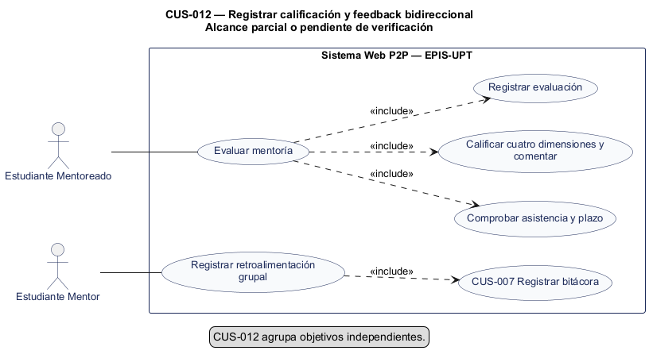

Fuente PlantUML: [CUS-012_caso_de_uso.puml](docs/narrativas/diagramas/plantuml/CUS-012_caso_de_uso.puml).

Fuente: Elaboración propia.

---

#### CUS-013 — Consultar historial académico de mentorías

##### 7.1. Ficha descriptiva

| Atributo | Detalle |
|---|---|
| **Id Caso de Uso** | **UC-013** (CUS-013) |
| **Nombre** | Consultar historial académico de mentorías |
| **Tipo** | Opcional |
| **Requisito ID (RF)** | RF-019; relacionado con RF-012, RF-018, RF-020 |
| **Versión** | 2.3 (DOC-H02 — consolidación) |
| **Autor** | Antayhua Mamani, Renzo Antonio / Medina Quispe, Joan Cristian |
| **Actores** | Estudiante Mentoreado; Estudiante Mentor |
| **Interacción** | Interacción web institucional; comportamiento descrito conforme a la evidencia identificada. |
| **Descripción** | Permite revisar los registros de participación en mentorías y sus estados, diferenciando reservas personales y sesiones impartidas. |
| **Referencias** | SWEBOK v3.0, ISO/IEC/IEEE 29148:2018, SRS y reglas de negocio EPIS-UPT. |
| **Precondiciones** | Sesión institucional con rol correspondiente; registros consultables. |
| **Postcondiciones** | Se presenta la información histórica disponible sin modificar los registros. |

**Estado de evidencia:** Implementación parcial: historial de reservas y sesiones.

##### 7.2. Flujo normal de eventos

| **Acción del Actor** | **Respuesta del Sistema** |
|---|---|
| **Fase 1: Historial de reservas** |  |
| **1.** El mentoreado abre «Mis reservas». |  |
|  | **2.** Muestra «Mis Reservas de Mentoría», contadores y filtros de estado, controles «Actualizar» y «+ Buscar Mentorías». |
| **3.** Selecciona el filtro de histórico. |  |
|  | **4.** Presenta reservas canceladas, no confirmadas, asistidas o con inasistencia según sus estados disponibles. Si no hay registros, A001. |
| **5.** Revisa una tarjeta. |  |
|  | **6.** Presenta asignatura, código, tema, estado, fecha y hora, modalidad, espacio, mentor responsable y fecha de reserva; ofrece únicamente las acciones que procedan para esa reserva. |
| **7.** Consulta otro filtro o actualiza. |  |
|  | **8.** Renueva los registros disponibles; no cambia el estado por consultar. Si falla, E001. |
| **Fase 2: Historial de sesiones del mentor (interacción independiente)** |  |
| **9.** El mentor selecciona «Mis sesiones». |  |
|  | **10.** Muestra «Mis Mentorías Académicas Programadas» con sus sesiones, estados y seguimiento de inscritos; si no hay sesiones, A001. |
| **11.** Revisa una sesión y sus opciones. |  |
|  | **12.** Presenta información de programación, aforo y acciones de asistencia o bitácora cuando correspondan; la constancia de horas se consulta en «Mis constancias» (CUS-014). |

##### 7.3. Flujos alternativos

###### A001: Sin historial

* **Paso origen:** 4, 10.
* **Condición de activación:** No existen registros para el filtro.

| **Acción del Actor** | **Respuesta del Sistema** |
|---|---|
| **A001-1.** Cambia filtro o utiliza «Explorar Clases Recomendadas» (mentoreado). |  |
|  | **A001-2.** Muestra «No se encontraron reservas» o mensaje de ausencia de sesiones; ofrece navegación aplicable. |
| **A001-3.** Consulta otro resultado. |  |

###### A002: Actualizar información

* **Paso origen:** Flujo normal, en la operación indicada por la condición.
* **Condición de activación:** Vista abierta.

| **Acción del Actor** | **Respuesta del Sistema** |
|---|---|
| **A002-1.** Pulsa «Actualizar» donde esté disponible o reingresa a la vista. |  |
|  | **A002-2.** Vuelve a consultar los registros personales. |
| **A002-3.** Revisa cambios. |  |

##### 7.4. Flujos de excepción

###### E001: Fallo de consulta

* **Paso origen:** 8.
* **Condición de activación:** Servicio no disponible.

| **Acción del Actor** | **Respuesta del Sistema** |
|---|---|
|  | **E001-1.** Informa que no fue posible cargar reservas o sesiones; ofrece «Reintentar Consulta» en reservas. |
| **E001-2.** Restablece conexión y reintenta. |  |

###### E002: Acceso no autorizado

* **Paso origen:** Flujo normal, en la operación indicada por la condición.
* **Condición de activación:** Sesión inválida o rol no permitido.

| **Acción del Actor** | **Respuesta del Sistema** |
|---|---|
|  | **E002-1.** Restringe la vista personal. |
| **E002-2.** Inicia sesión con cuenta autorizada. |  |

##### 7.5. Diagrama de flujo de actividades

**Figura 6.2.3-27. Diagrama de actividades — CUS-013: Consultar historial académico de mentorías.**

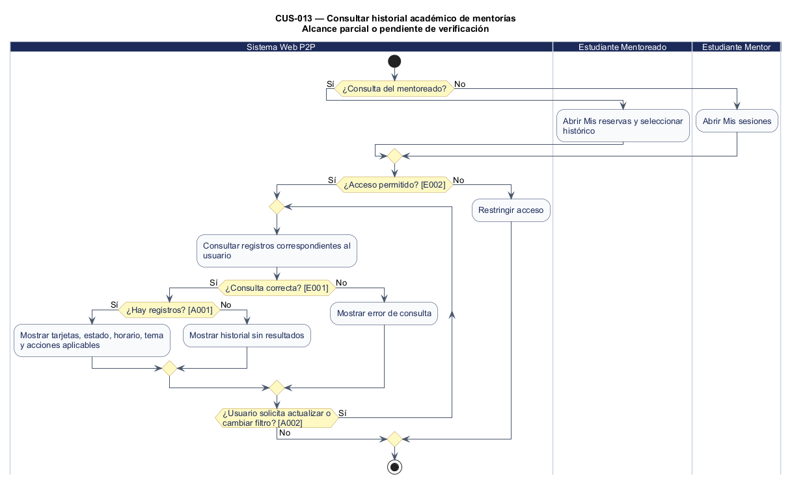

Fuente PlantUML: [CUS-013_actividades.puml](docs/narrativas/diagramas/plantuml/CUS-013_actividades.puml).

Fuente: Elaboración propia.

##### 7.6. Diagrama de caso de uso

**Figura 6.2.3-28. Diagrama de caso de uso — CUS-013: Consultar historial académico de mentorías.**


Fuente PlantUML: [CUS-013_caso_de_uso.puml](docs/narrativas/diagramas/plantuml/CUS-013_caso_de_uso.puml).

Fuente: Elaboración propia.

---

#### CUS-014 — Emitir constancia de horas de mentoría

##### 7.1. Ficha descriptiva

| Atributo | Detalle |
|---|---|
| **Id Caso de Uso** | **UC-014** (CUS-014) |
| **Nombre** | Emitir constancia de horas de mentoría |
| **Tipo** | Opcional |
| **Requisito ID (RF)** | RF-022, RF-023; RN-14 |
| **Versión** | 2.3 (DOC-H02 — consolidación) |
| **Autor** | Antayhua Mamani, Renzo Antonio / Medina Quispe, Joan Cristian |
| **Actores** | Estudiante Mentor; Administrador institucional (visado previo) |
| **Interacción** | Interacción web institucional; comportamiento descrito conforme a la evidencia identificada. |
| **Descripción** | Permite consultar horas acreditadas, comprobar el umbral de certificación, emitir una constancia digital y descargarla o verificarla por folio. |
| **Referencias** | SWEBOK v3.0, ISO/IEC/IEEE 29148:2018, SRS y reglas de negocio EPIS-UPT. |
| **Precondiciones** | Mentor autenticado; horas declaradas en bitácoras y visadas por Dirección; umbral de referencia de 20 h acreditadas en el periodo. |
| **Postcondiciones** | Constancia emitida con folio, horas acreditadas y código de verificación; documento PDF disponible si se genera correctamente. |

**Estado de evidencia:** Implementación identificada; constancia DEMO y validación real pendiente.

##### 7.2. Flujo normal de eventos

| **Acción del Actor** | **Respuesta del Sistema** |
|---|---|
| **Fase 1: Consulta de horas** |  |
| **1.** Selecciona «Mis constancias». |  |
|  | **2.** Muestra «Acreditación y Constancias Oficiales de Mentoría», periodo académico y progreso hacia el umbral de acreditación. Si falla la consulta, E001. |
| **3.** Revisa «Horas Acreditadas (Visadas por Dirección)» y «Horas en Revisión Provisional». |  |
|  | **4.** Presenta valores separados, barra de avance, porcentaje y condición «ELEGIBLE PARA CERTIFICACIÓN» o cantidad de horas faltantes. Si no alcanza el umbral, A001. |
| **Fase 2: Emisión** |  |
| **5.** Cuando es elegible, pulsa «Emitir Constancia Oficial». |  |
|  | **6.** Muestra «Generando PDF Oficial y QR...», comprueba identidad, periodo y horas acreditadas. Si no cumple, E002; si ya existe constancia, A002. |
| **7.** Espera la respuesta. |  |
|  | **8.** Presenta confirmación de emisión con folio asignado y datos de acreditación; muestra controles de descarga y verificación. Si falla, E003. |
| **Fase 3: Descarga y autenticidad** |  |
| **9.** Pulsa «Descargar Constancia en PDF». |  |
|  | **10.** Entrega el documento generado si está disponible y muestra el estado de descarga. Si falla, E003. |
| **11.** Pulsa «Verificar QR». |  |
|  | **12.** Abre «Verificación de Autenticidad Institucional» y consulta folio; presenta el resultado, mentor titular y horas acreditadas cuando es válido. |
| **13.** Cierra la ventana de verificación. |  |
|  | **14.** Retorna a la constancia sin modificar las horas ni emitir otro documento. |

##### 7.3. Flujos alternativos

###### A001: Horas insuficientes

* **Paso origen:** 4.
* **Condición de activación:** Menos del umbral de horas visadas.

| **Acción del Actor** | **Respuesta del Sistema** |
|---|---|
| **A001-1.** Consulta las horas faltantes. |  |
|  | **A001-2.** Muestra aviso pedagógico RN-14 y bloquea emisión; orienta al registro y visado de bitácoras. |
| **A001-3.** Regresa a Mis sesiones o consulta más adelante. |  |

###### A002: Constancia ya emitida

* **Paso origen:** 6.
* **Condición de activación:** Existe documento para el periodo.

| **Acción del Actor** | **Respuesta del Sistema** |
|---|---|
| **A002-1.** Consulta la constancia mostrada. |  |
|  | **A002-2.** Ofrece descargar PDF y verificar QR sin necesidad de emitir otra. |
| **A002-3.** Descarga o verifica. |  |

###### A003: Revisar horas pendientes

* **Paso origen:** Flujo normal, en la operación indicada por la condición.
* **Condición de activación:** Existen bitácoras sin visado.

| **Acción del Actor** | **Respuesta del Sistema** |
|---|---|
| **A003-1.** Consulta el desglose de horas. |  |
|  | **A003-2.** Distingue las provisionales de las acreditadas. |
| **A003-3.** Consulta con Dirección según CUS-019. |  |

##### 7.4. Flujos de excepción

###### E001: Resumen no disponible

* **Paso origen:** 2.
* **Condición de activación:** Error al consultar horas.

| **Acción del Actor** | **Respuesta del Sistema** |
|---|---|
|  | **E001-1.** Informa el problema sin asegurar elegibilidad. |
| **E001-2.** Reintenta la consulta. |  |

###### E002: No elegible o no autorizado

* **Paso origen:** 6.
* **Condición de activación:** Horas insuficientes, periodo o identidad incompatible.

| **Acción del Actor** | **Respuesta del Sistema** |
|---|---|
|  | **E002-1.** Rechaza emisión o mantiene acción bloqueada. |
| **E002-2.** Regulariza las horas o sesión. |  |

###### E003: Fallo de emisión/descarga/verificación

* **Paso origen:** 8, 10.
* **Condición de activación:** Servicio o archivo no disponible, folio no reconocido.

| **Acción del Actor** | **Respuesta del Sistema** |
|---|---|
|  | **E003-1.** Muestra error o resultado no válido según operación. |
| **E003-2.** Comprueba si existe constancia antes de volver a emitir. |  |

##### 7.5. Diagrama de flujo de actividades

**Figura 6.2.3-29. Diagrama de actividades — CUS-014: Emitir constancia de horas de mentoría.**


Fuente PlantUML: [CUS-014_actividades.puml](docs/narrativas/diagramas/plantuml/CUS-014_actividades.puml).

Fuente: Elaboración propia.

##### 7.6. Diagrama de caso de uso

**Figura 6.2.3-30. Diagrama de caso de uso — CUS-014: Emitir constancia de horas de mentoría.**

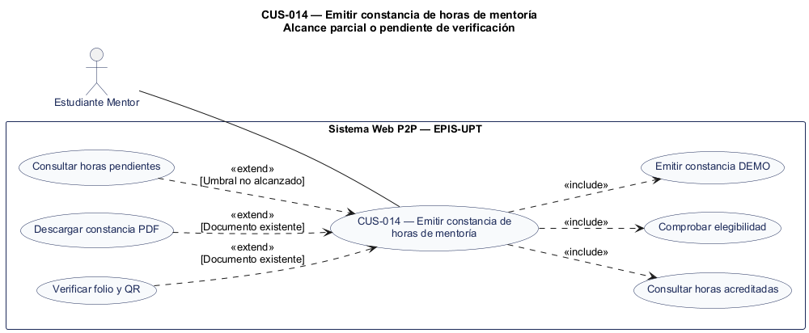

Fuente PlantUML: [CUS-014_caso_de_uso.puml](docs/narrativas/diagramas/plantuml/CUS-014_caso_de_uso.puml).

Fuente: Elaboración propia.

---

#### CUS-018 — Gestionar justificación de inasistencia a sesión

##### 7.1. Ficha descriptiva

| Atributo | Detalle |
|---|---|
| **Id Caso de Uso** | **UC-018** (CUS-018) |
| **Nombre** | Gestionar justificación de inasistencia a sesión |
| **Tipo** | Opcional |
| **Requisito ID (RF)** | RF-014, RF-017 (relación funcional); requisito específico por formalizar |
| **Versión** | 2.3 (DOC-H02 — consolidación) |
| **Autor** | Antayhua Mamani, Renzo Antonio / Medina Quispe, Joan Cristian |
| **Actores** | Estudiante Mentoreado; Administrador o responsable académico (actor previsto) |
| **Interacción** | Interacción web institucional; flujo propuesto pendiente de implementación. |
| **Descripción** | Propone gestionar una justificación de ausencia posterior a una sesión, diferenciándola de la cancelación voluntaria antes del corte. |
| **Referencias** | SWEBOK v3.0, ISO/IEC/IEEE 29148:2018, SRS y reglas de negocio EPIS-UPT. |
| **Precondiciones** | Propuesta: reserva con estado INASISTENCIA, solicitante titular, plazo y responsable institucional definidos. |
| **Postcondiciones** | Propuesta: justificación registrada y resolución trazable; efecto académico conforme a política aprobada. |

**Estado de evidencia:** Pendiente: no se identificó trámite específico.

##### 7.2. Flujo normal de eventos

| **Acción del Actor** | **Respuesta del Sistema** |
|---|---|
| **Fase 1: Identificación de inasistencia (parcialmente disponible)** |  |
| **1.** El mentoreado abre «Mis reservas» y consulta el histórico. |  |
|  | **2.** Presenta las reservas y sus estados, incluida INASISTENCIA cuando corresponda. No hay opción de justificar acreditada. |
| **Fase 2: Registro de justificación (propuesto)** |  |
| **3.** Selecciona la reserva ausente y solicita registrar una justificación. |  |
|  | **4.** Deberá mostrar sesión y estado, motivo obligatorio y condiciones institucionales aplicables. Los documentos adjuntos y plazo requieren definición. |
| **5.** Describe la circunstancia y envía. |  |
|  | **6.** Deberá comprobar titularidad, elegibilidad y completitud; registrar la solicitud sin alterar automáticamente la asistencia. |
| **Fase 3: Revisión institucional (propuesto)** |  |
| **7.** El responsable autorizado consulta la justificación y analiza el motivo. |  |
|  | **8.** Deberá mostrar antecedentes y permitir una decisión motivada (A001/A002). |
| **9.** Registra la decisión. |  |
|  | **10.** Deberá conservar estado, fecha y responsable; aplicar únicamente los efectos académicos establecidos por el reglamento. |
| **11.** El solicitante consulta su resultado. |  |
|  | **12.** Deberá presentar la resolución sin confundir justificación con asistencia efectiva. |

##### 7.3. Flujos alternativos

###### A001: Solicitar información adicional

* **Paso origen:** 8.
* **Condición de activación:** Motivo insuficiente.

| **Acción del Actor** | **Respuesta del Sistema** |
|---|---|
| **A001-1.** El responsable solicita aclaración. |  |
|  | **A001-2.** Deberá conservar solicitud pendiente y observación. |
| **A001-3.** El estudiante subsana si la política lo permite. |  |

###### A002: Rechazar justificación

* **Paso origen:** 8.
* **Condición de activación:** No cumple los criterios.

| **Acción del Actor** | **Respuesta del Sistema** |
|---|---|
| **A002-1.** El responsable registra el motivo. |  |
|  | **A002-2.** Deberá conservar rechazo y estado de asistencia original. |
| **A002-3.** Finaliza el trámite. |  |

##### 7.4. Flujos de excepción

###### E001: Reserva no elegible

* **Paso origen:** Flujo normal, en la operación indicada por la condición.
* **Condición de activación:** No es inasistencia propia o está fuera de plazo definido.

| **Acción del Actor** | **Respuesta del Sistema** |
|---|---|
|  | **E001-1.** Deberá bloquear registro y explicar condición. |
| **E001-2.** Consulta estado o canal institucional. |  |

###### E002: Justificación incompleta o duplicada

* **Paso origen:** Flujo normal, en la operación indicada por la condición.
* **Condición de activación:** Falta motivo o existe trámite incompatible.

| **Acción del Actor** | **Respuesta del Sistema** |
|---|---|
|  | **E002-1.** Deberá impedir duplicidad y pedir corrección. |
| **E002-2.** Revisa los datos. |  |

###### E003: Fallo de registro

* **Paso origen:** Flujo normal, en la operación indicada por la condición.
* **Condición de activación:** No se puede conservar solicitud o resolución.

| **Acción del Actor** | **Respuesta del Sistema** |
|---|---|
|  | **E003-1.** Deberá informar error sin declarar éxito. |
| **E003-2.** Verifica estado antes de reintentar. |  |

##### 7.5. Diagrama de flujo de actividades

**Figura 6.2.3-31. Diagrama de actividades — CUS-018: Gestionar justificación de inasistencia a sesión.**


Fuente PlantUML: [CUS-018_actividades.puml](docs/narrativas/diagramas/plantuml/CUS-018_actividades.puml).

Fuente: Elaboración propia.

##### 7.6. Diagrama de caso de uso

**Figura 6.2.3-32. Diagrama de caso de uso — CUS-018: Gestionar justificación de inasistencia a sesión.**


Fuente PlantUML: [CUS-018_caso_de_uso.puml](docs/narrativas/diagramas/plantuml/CUS-018_caso_de_uso.puml).

Fuente: Elaboración propia.

---

#### CUS-019 — Consultar bitácoras de mentoría por tutor

##### 7.1. Ficha descriptiva

| Atributo | Detalle |
|---|---|
| **Id Caso de Uso** | **UC-019** (CUS-019) |
| **Nombre** | Consultar bitácoras de mentoría por tutor |
| **Tipo** | Opcional |
| **Requisito ID (RF)** | RF-018, RF-026; RN-12, RN-14 |
| **Versión** | 2.3 (DOC-H02 — consolidación) |
| **Autor** | Antayhua Mamani, Renzo Antonio / Medina Quispe, Joan Cristian |
| **Actores** | Tutor académico (actor previsto); Administrador institucional (función existente) |
| **Interacción** | Interacción web institucional; comportamiento descrito conforme a la evidencia identificada. |
| **Descripción** | Permite revisar el contenido y estado de las bitácoras. Actualmente la interfaz administrativa ofrece consulta, visado y observación; la función específica de tutor requiere definición. |
| **Referencias** | SWEBOK v3.0, ISO/IEC/IEEE 29148:2018, SRS y reglas de negocio EPIS-UPT. |
| **Precondiciones** | Sesión administrativa vigente para la función existente; bitácoras registradas. Para tutor, permisos y alcance por definir. |
| **Postcondiciones** | Se consultan las bitácoras; si el administrador visa u observa, se actualiza el estado según la operación. El acceso de tutor no está acreditado. |

**Estado de evidencia:** Implementación parcial: auditoría por Administrador; tutor no identificado.

##### 7.2. Flujo normal de eventos

| **Acción del Actor** | **Respuesta del Sistema** |
|---|---|
| **Fase 1: Consulta administrativa (disponible)** |  |
| **1.** El administrador selecciona «Administración» > «Auditoría de Bitácoras». |  |
|  | **2.** Muestra «Bandeja de Auditoría de Bitácoras y Visado Institucional de Horas» y explica que solo las visadas se acreditan. |
| **3.** Selecciona «Todas las Bitácoras», «Pendientes de Visado», «Horas Visadas y Acreditadas» u «Observadas para Corrección». |  |
|  | **4.** Filtra la tabla; presenta identificador, mentor titular, horas declaradas, estado y acciones disponibles. Si no hay datos, A001. |
| **5.** Abre el detalle de una bitácora. |  |
|  | **6.** Presenta «Detalle de Bitácora Pedagógica», mentor, temas cubiertos y observaciones docentes. Permite cerrar el detalle sin modificarlo. |
| **Fase 2: Revisión y visado administrativo (relacionado)** |  |
| **7.** Si cuenta con competencia administrativa y considera conforme el registro, pulsa «Aprobar y Visar Horas». |  |
|  | **8.** Procesa el visado; actualiza estado y horas acreditadas. Si detecta discrepancia, A002; si falla, E001. |
| **9.** Consulta el resultado mediante el filtro correspondiente. |  |
|  | **10.** Muestra la bitácora actualizada conforme a la respuesta del servicio. |
| **Fase 3: Consulta por tutor (propuesta)** |  |
| **11.** Un tutor autorizado consulta las bitácoras de sus estudiantes o sesiones asignadas. |  |
|  | **12.** Deberá mostrar únicamente las bitácoras de su ámbito y permitir consulta de detalle; no se presupone permiso de visado para el tutor. |

##### 7.3. Flujos alternativos

###### A001: Sin bitácoras

* **Paso origen:** 4.
* **Condición de activación:** Filtro sin resultados.

| **Acción del Actor** | **Respuesta del Sistema** |
|---|---|
| **A001-1.** Cambia filtro. |  |
|  | **A001-2.** Muestra «No se registraron bitácoras bajo el filtro seleccionado». |
| **A001-3.** Consulta otro conjunto. |  |

###### A002: Observar bitácora

* **Paso origen:** 8.
* **Condición de activación:** Administrador detecta discrepancia.

| **Acción del Actor** | **Respuesta del Sistema** |
|---|---|
| **A002-1.** Pulsa «Observar Bitácora», escribe motivo fundamentado y confirma. |  |
|  | **A002-2.** Muestra ventana de observación; si el registro se completa, actualiza estado a observado. |
| **A002-3.** Revisa bandeja de observadas. |  |

###### A003: Consulta sin visado

* **Paso origen:** Flujo normal, en la operación indicada por la condición.
* **Condición de activación:** Solo requiere lectura.

| **Acción del Actor** | **Respuesta del Sistema** |
|---|---|
| **A003-1.** Abre y cierra el detalle. |  |
|  | **A003-2.** No altera estado ni horas. |
| **A003-3.** Retorna a tabla. |  |

##### 7.4. Flujos de excepción

###### E001: Fallo de consulta o visado

* **Paso origen:** 8.
* **Condición de activación:** Servicio no disponible.

| **Acción del Actor** | **Respuesta del Sistema** |
|---|---|
|  | **E001-1.** Muestra mensaje de error sin acreditar horas nuevas. |
| **E001-2.** Revisa estado y reintenta si corresponde. |  |

###### E002: Acceso o alcance no permitido

* **Paso origen:** Flujo normal, en la operación indicada por la condición.
* **Condición de activación:** Rol no autorizado.

| **Acción del Actor** | **Respuesta del Sistema** |
|---|---|
|  | **E002-1.** Restringe funciones administrativas; para tutor deberá verificarse su ámbito. |
| **E002-2.** Solicita autorización institucional. |  |

###### E003: Observación sin motivo

* **Paso origen:** Flujo normal, en la operación indicada por la condición.
* **Condición de activación:** Motivo requerido no consignado.

| **Acción del Actor** | **Respuesta del Sistema** |
|---|---|
|  | **E003-1.** No debe confirmar observación incompleta. |
| **E003-2.** Completa el motivo. |  |

##### 7.5. Diagrama de flujo de actividades

**Figura 6.2.3-33. Diagrama de actividades — CUS-019: Consultar bitácoras de mentoría por tutor.**


Fuente PlantUML: [CUS-019_actividades.puml](docs/narrativas/diagramas/plantuml/CUS-019_actividades.puml).

Fuente: Elaboración propia.

##### 7.6. Diagrama de caso de uso

**Figura 6.2.3-34. Diagrama de caso de uso — CUS-019: Consultar bitácoras de mentoría por tutor.**


Fuente PlantUML: [CUS-019_caso_de_uso.puml](docs/narrativas/diagramas/plantuml/CUS-019_caso_de_uso.puml).

Fuente: Elaboración propia.

---

### MOD-05: Administración y Analítica Institucional

#### CUS-009 — Consultar analítica institucional de mentorías

##### 7.1. Ficha descriptiva

| Atributo | Detalle |
|---|---|
| **Id Caso de Uso** | **UC-009** (CUS-009) |
| **Nombre** | Consultar analítica institucional de mentorías |
| **Tipo** | Opcional |
| **Requisito ID (RF)** | RF-025; relacionado con RF-015, RF-026, RN-09 |
| **Versión** | 2.3 (DOC-H02 — consolidación) |
| **Autor** | Antayhua Mamani, Renzo Antonio / Medina Quispe, Joan Cristian |
| **Actores** | Administrador institucional |
| **Interacción** | Interacción web institucional; comportamiento descrito conforme a la evidencia identificada. |
| **Descripción** | Permite supervisar información operativa de mentorías y propone consolidar indicadores institucionales de participación, retención y calidad. |
| **Referencias** | SWEBOK v3.0, ISO/IEC/IEEE 29148:2018, SRS y reglas de negocio EPIS-UPT. |
| **Precondiciones** | Sesión administrativa vigente; datos de sesiones y reservas disponibles. Para analítica integral, métricas y periodo definidos. |
| **Postcondiciones** | Se presentan indicadores consultados; no se modifican sesiones por consultar. Indicadores integrales quedan sujetos a implementación. |

**Estado de evidencia:** Implementación parcial: monitoreo de quórum; analítica integral pendiente.

##### 7.2. Flujo normal de eventos

| **Acción del Actor** | **Respuesta del Sistema** |
|---|---|
| **Fase 1: Acceso al monitoreo existente** |  |
| **1.** Selecciona «Administración» y «Monitoreo de Quórum». |  |
|  | **2.** Muestra «Supervisión de Quórum y Sesiones EPIS», explicación de cálculo por reservas ratificadas y porcentaje de aforo, y botón «Actualizar». |
| **3.** Espera la consulta de sesiones. |  |
|  | **4.** Muestra «Cargando sesiones y estados de quórum...» y, si existen ofertas, tarjetas con datos de sesión, estado, inscritos, ratificados, mínimo y porcentaje reglamentario. |
| **5.** Compara los indicadores entre sesiones. |  |
|  | **6.** Presenta el avance de cada sesión frente a su mínimo; no modifica reservas ni ejecuta corte por la sola consulta. |
| **7.** Presiona «Actualizar». |  |
|  | **8.** Renueva los datos. Si no hay sesiones, A001; si hay error, E001. |
| **Fase 2: Analítica consolidada (propuesta)** |  |
| **9.** Selecciona periodo e indicadores institucionales de interés. |  |
|  | **10.** Deberá presentar métricas agregadas de oferta, demanda, participación y calidad, con definiciones y fuente verificables. No hay panel integral acreditado. |
| **11.** Revisa resultados y solicita el reporte cuando corresponda. |  |
|  | **12.** Deberá presentar valores contextualizados por periodo, sin confundir simulación algorítmica con datos operativos reales; exportación corresponde a CUS-011. |

##### 7.3. Flujos alternativos

###### A001: Sin sesiones

* **Paso origen:** 8.
* **Condición de activación:** No hay ofertas disponibles.

| **Acción del Actor** | **Respuesta del Sistema** |
|---|---|
| **A001-1.** Consulta otro momento o actualiza. |  |
|  | **A001-2.** Muestra «No se registraron ofertas de mentoría activas en la plataforma». |
| **A001-3.** Retorna al panel. |  |

###### A002: Consulta específica

* **Paso origen:** Flujo normal, en la operación indicada por la condición.
* **Condición de activación:** Interés en una sesión.

| **Acción del Actor** | **Respuesta del Sistema** |
|---|---|
| **A002-1.** Revisa su tarjeta de quórum. |  |
|  | **A002-2.** Muestra inscritos, ratificados y mínimo. |
| **A002-3.** Compara con otras sesiones. |  |

##### 7.4. Flujos de excepción

###### E001: Fallo de consulta

* **Paso origen:** 8.
* **Condición de activación:** No se obtienen indicadores.

| **Acción del Actor** | **Respuesta del Sistema** |
|---|---|
|  | **E001-1.** Informa error disponible; no debe representar ausencia de datos como cero. |
| **E001-2.** Actualiza y revisa la conexión. |  |

###### E002: Acceso no autorizado

* **Paso origen:** Flujo normal, en la operación indicada por la condición.
* **Condición de activación:** Sesión sin privilegios.

| **Acción del Actor** | **Respuesta del Sistema** |
|---|---|
|  | **E002-1.** Restringe panel. |
| **E002-2.** Inicia sesión como administrador. |  |

###### E003: Indicador no definido

* **Paso origen:** Flujo normal, en la operación indicada por la condición.
* **Condición de activación:** Métrica o periodo sin datos suficientes (propuesta).

| **Acción del Actor** | **Respuesta del Sistema** |
|---|---|
|  | **E003-1.** Deberá informar que el indicador no está disponible. |
| **E003-2.** Ajusta el periodo o solicita definición. |  |

##### 7.5. Diagrama de flujo de actividades

**Figura 6.2.3-35. Diagrama de actividades — CUS-009: Consultar analítica institucional de mentorías.**


Fuente PlantUML: [CUS-009_actividades.puml](docs/narrativas/diagramas/plantuml/CUS-009_actividades.puml).

Fuente: Elaboración propia.

##### 7.6. Diagrama de caso de uso

**Figura 6.2.3-36. Diagrama de caso de uso — CUS-009: Consultar analítica institucional de mentorías.**


Fuente PlantUML: [CUS-009_caso_de_uso.puml](docs/narrativas/diagramas/plantuml/CUS-009_caso_de_uso.puml).

Fuente: Elaboración propia.

---

#### CUS-011 — Exportar reportes ejecutivos consolidados

##### 7.1. Ficha descriptiva

| Atributo | Detalle |
|---|---|
| **Id Caso de Uso** | **UC-011** (CUS-011) |
| **Nombre** | Exportar reportes ejecutivos consolidados |
| **Tipo** | Opcional |
| **Requisito ID (RF)** | RF-025; relacionado con RF-026 |
| **Versión** | 2.3 (DOC-H02 — consolidación) |
| **Autor** | Antayhua Mamani, Renzo Antonio / Medina Quispe, Joan Cristian |
| **Actores** | Administrador institucional |
| **Interacción** | Interacción web institucional; flujo propuesto pendiente de implementación. |
| **Descripción** | Propone generar un archivo de reporte institucional consolidado a partir de indicadores y filtros aprobados. |
| **Referencias** | SWEBOK v3.0, ISO/IEC/IEEE 29148:2018, SRS y reglas de negocio EPIS-UPT. |
| **Precondiciones** | Propuesta: actor autorizado, datos de analítica disponibles, periodo y formato definidos. |
| **Postcondiciones** | Propuesta: reporte descargable con fecha, periodo, alcance y métricas verificables; no altera datos operativos. |

**Estado de evidencia:** Pendiente: no se identificó exportación ejecutiva.

##### 7.2. Flujo normal de eventos

| **Acción del Actor** | **Respuesta del Sistema** |
|---|---|
| **Fase 1: Preparación del reporte (propuesto)** |  |
| **1.** El administrador accede a la analítica institucional y selecciona un periodo. |  |
|  | **2.** Deberá presentar los filtros e indicadores autorizados y sus definiciones. La interfaz actual solo acredita monitoreo de quórum y auditoría de bitácoras. |
| **3.** Selecciona las métricas que requiere consolidar. |  |
|  | **4.** Deberá mostrar alcance de datos y una vista previa con totales y unidades. |
| **Fase 2: Generación (propuesto)** |  |
| **5.** Elige el formato de salida que haya sido aprobado y solicita la generación. |  |
|  | **6.** Deberá validar permisos, periodo, disponibilidad e integridad de datos; no exportar datos personales innecesarios. |
| **7.** Revisa la vista previa. |  |
|  | **8.** Deberá indicar periodo, fecha de generación y criterios utilizados. Si no hay datos, A001. |
| **9.** Confirma la descarga. |  |
|  | **10.** Deberá generar el archivo en el formato definido y permitir descargarlo; si falla, E002. |
| **11.** Verifica el reporte. |  |
|  | **12.** Deberá conservar los indicadores consultados y permitir una nueva generación con filtros distintos. |

##### 7.3. Flujos alternativos

###### A001: Cambiar filtros

* **Paso origen:** 8.
* **Condición de activación:** Antes de generar.

| **Acción del Actor** | **Respuesta del Sistema** |
|---|---|
| **A001-1.** Modifica periodo o indicadores. |  |
|  | **A001-2.** Deberá actualizar vista previa. |
| **A001-3.** Revisa y genera. |  |

###### A002: Sin información

* **Paso origen:** Flujo normal, en la operación indicada por la condición.
* **Condición de activación:** Periodo sin registros.

| **Acción del Actor** | **Respuesta del Sistema** |
|---|---|
| **A002-1.** Selecciona otro periodo. |  |
|  | **A002-2.** Deberá informar ausencia de datos sin inventar totales. |
| **A002-3.** Revisa el nuevo resultado. |  |

##### 7.4. Flujos de excepción

###### E001: Acceso restringido

* **Paso origen:** Flujo normal, en la operación indicada por la condición.
* **Condición de activación:** Usuario sin permiso.

| **Acción del Actor** | **Respuesta del Sistema** |
|---|---|
|  | **E001-1.** Deberá impedir generación y descarga. |
| **E001-2.** Solicita acceso autorizado. |  |

###### E002: Fallo de generación

* **Paso origen:** 10.
* **Condición de activación:** Datos o archivo no disponible.

| **Acción del Actor** | **Respuesta del Sistema** |
|---|---|
|  | **E002-1.** Deberá comunicar fallo sin afirmar descarga completada. |
| **E002-2.** Corrige filtros o reintenta. |  |

###### E003: Formato no definido

* **Paso origen:** Flujo normal, en la operación indicada por la condición.
* **Condición de activación:** Formato o conjunto de datos no aprobado.

| **Acción del Actor** | **Respuesta del Sistema** |
|---|---|
|  | **E003-1.** Deberá bloquear exportación no soportada. |
| **E003-2.** Selecciona formato autorizado. |  |

##### 7.5. Diagrama de flujo de actividades

**Figura 6.2.3-37. Diagrama de actividades — CUS-011: Exportar reportes ejecutivos consolidados.**


Fuente PlantUML: [CUS-011_actividades.puml](docs/narrativas/diagramas/plantuml/CUS-011_actividades.puml).

Fuente: Elaboración propia.

##### 7.6. Diagrama de caso de uso

**Figura 6.2.3-38. Diagrama de caso de uso — CUS-011: Exportar reportes ejecutivos consolidados.**


Fuente PlantUML: [CUS-011_caso_de_uso.puml](docs/narrativas/diagramas/plantuml/CUS-011_caso_de_uso.puml).

Fuente: Elaboración propia.

---

#### CUS-015 — Configurar parámetros del algoritmo de recomendación

##### 7.1. Ficha descriptiva

| Atributo | Detalle |
|---|---|
| **Id Caso de Uso** | **UC-015** (CUS-015) |
| **Nombre** | Configurar parámetros del algoritmo de recomendación |
| **Tipo** | Opcional |
| **Requisito ID (RF)** | RF-006, RF-024; RN-11 |
| **Versión** | 2.3 (DOC-H02 — consolidación) |
| **Autor** | Antayhua Mamani, Renzo Antonio / Medina Quispe, Joan Cristian |
| **Actores** | Administrador institucional |
| **Interacción** | Interacción web institucional; flujo propuesto pendiente de implementación. |
| **Descripción** | Propone permitir al administrador consultar y ajustar criterios autorizados que intervienen en el orden de recomendaciones, sin modificar directamente la programación de mentorías. |
| **Referencias** | SWEBOK v3.0, ISO/IEC/IEEE 29148:2018, SRS y reglas de negocio EPIS-UPT. |
| **Precondiciones** | Propuesta: sesión administrativa, parámetros configurables y rangos aprobados, criterios de evaluación definidos. |
| **Postcondiciones** | Propuesta: configuración versionada, validada y aplicable a recomendaciones futuras; no afecta reservas existentes. |

**Estado de evidencia:** Pendiente: interfaz de parametrización no identificada.

##### 7.2. Flujo normal de eventos

| **Acción del Actor** | **Respuesta del Sistema** |
|---|---|
| **Fase 1: Consulta de configuración (propuesto)** |  |
| **1.** Accede a la configuración de recomendaciones. |  |
|  | **2.** Deberá presentar valores vigentes y explicación de los factores: afinidad curricular, reputación, carga y prioridad de materia, según RN-11. No existe panel de edición identificado. |
| **3.** Revisa el alcance de cada parámetro. |  |
|  | **4.** Deberá distinguir parámetros ajustables de reglas institucionales fijas y del número de candidatos seleccionable por el mentoreado (CUS-002). |
| **Fase 2: Edición (propuesto)** |  |
| **5.** Modifica los parámetros permitidos. |  |
|  | **6.** Deberá verificar tipo, rango y coherencia de los valores conforme a las reglas aprobadas. |
| **7.** Solicita una comprobación previa. |  |
|  | **8.** Deberá presentar el resultado de validación y, si se autoriza, una comparación controlada con datos de prueba, sin afectar ofertas reales. |
| **Fase 3: Aplicación (propuesto)** |  |
| **9.** Confirma la nueva configuración. |  |
|  | **10.** Deberá registrar valores anteriores y nuevos, responsable y fecha; aplicar la configuración solo si la validación concluye correctamente. |
| **11.** Consulta la configuración vigente. |  |
|  | **12.** Deberá mostrar los valores aplicados y permitir revisar cambios posteriores. |

##### 7.3. Flujos alternativos

###### A001: Cancelar edición

* **Paso origen:** Flujo normal, en la operación indicada por la condición.
* **Condición de activación:** Cambios sin confirmar.

| **Acción del Actor** | **Respuesta del Sistema** |
|---|---|
| **A001-1.** Abandona la edición. |  |
|  | **A001-2.** Deberá conservar configuración anterior. |
| **A001-3.** Retorna a consulta. |  |

###### A002: Restaurar valores aprobados

* **Paso origen:** Flujo normal, en la operación indicada por la condición.
* **Condición de activación:** Existe configuración previa autorizada.

| **Acción del Actor** | **Respuesta del Sistema** |
|---|---|
| **A002-1.** Solicita restauración y confirma. |  |
|  | **A002-2.** Deberá validar y registrar una nueva versión con los valores restaurados. |
| **A002-3.** Consulta valores vigentes. |  |

##### 7.4. Flujos de excepción

###### E001: Valores fuera de rango

* **Paso origen:** Flujo normal, en la operación indicada por la condición.
* **Condición de activación:** Parámetros inválidos.

| **Acción del Actor** | **Respuesta del Sistema** |
|---|---|
|  | **E001-1.** Deberá impedir guardar y señalar la restricción. |
| **E001-2.** Corrige valores. |  |

###### E002: Permisos insuficientes

* **Paso origen:** Flujo normal, en la operación indicada por la condición.
* **Condición de activación:** Usuario no autorizado.

| **Acción del Actor** | **Respuesta del Sistema** |
|---|---|
|  | **E002-1.** Deberá restringir consulta sensible y cambios. |
| **E002-2.** Solicita acceso. |  |

###### E003: Fallo de aplicación

* **Paso origen:** Flujo normal, en la operación indicada por la condición.
* **Condición de activación:** No se puede validar o guardar.

| **Acción del Actor** | **Respuesta del Sistema** |
|---|---|
|  | **E003-1.** Deberá conservar configuración vigente y comunicar fallo. |
| **E003-2.** Verifica estado antes de repetir. |  |

##### 7.5. Diagrama de flujo de actividades

**Figura 6.2.3-39. Diagrama de actividades — CUS-015: Configurar parámetros del algoritmo de recomendación.**


Fuente PlantUML: [CUS-015_actividades.puml](docs/narrativas/diagramas/plantuml/CUS-015_actividades.puml).

Fuente: Elaboración propia.

##### 7.6. Diagrama de caso de uso

**Figura 6.2.3-40. Diagrama de caso de uso — CUS-015: Configurar parámetros del algoritmo de recomendación.**


Fuente PlantUML: [CUS-015_caso_de_uso.puml](docs/narrativas/diagramas/plantuml/CUS-015_caso_de_uso.puml).

Fuente: Elaboración propia.

---

#### CUS-016 — Gestionar auditoría de eventos de seguridad

##### 7.1. Ficha descriptiva

| Atributo | Detalle |
|---|---|
| **Id Caso de Uso** | **UC-016** (CUS-016) |
| **Nombre** | Gestionar auditoría de eventos de seguridad |
| **Tipo** | Obligatorio según alcance previsto |
| **Requisito ID (RF)** | RF-002, RF-026; RN-01, RN-02 |
| **Versión** | 2.3 (DOC-H02 — consolidación) |
| **Autor** | Antayhua Mamani, Renzo Antonio / Medina Quispe, Joan Cristian |
| **Actores** | Administrador institucional; responsable de seguridad (actor previsto) |
| **Interacción** | Interacción web institucional; flujo propuesto pendiente de implementación. |
| **Descripción** | Propone consultar eventos de autenticación, consentimiento y cambios de privilegios para supervisar el acceso y tratamiento de información institucional. |
| **Referencias** | SWEBOK v3.0, ISO/IEC/IEEE 29148:2018, SRS y reglas de negocio EPIS-UPT. |
| **Precondiciones** | Propuesta: responsable autorizado, registros de eventos disponibles y política de acceso, retención y privacidad definida. |
| **Postcondiciones** | Propuesta: consulta de eventos trazables sin modificar su contenido; incidentes derivados por el canal institucional. |

**Estado de evidencia:** Pendiente: bandeja integral de seguridad no identificada.

##### 7.2. Flujo normal de eventos

| **Acción del Actor** | **Respuesta del Sistema** |
|---|---|
| **Fase 1: Acceso a registros (propuesto)** |  |
| **1.** El responsable autorizado selecciona la función de auditoría de seguridad. |  |
|  | **2.** Deberá presentar filtros de periodo, tipo de evento y resultado, con acceso limitado a los datos necesarios. No se identificó una bandeja integral en la interfaz actual. |
| **3.** Selecciona un periodo y una categoría, por ejemplo acceso, consentimiento o cambio de rol. |  |
|  | **4.** Deberá recuperar los eventos correspondientes y mostrar fecha, categoría y resultado, evitando exponer códigos de acceso o secretos. |
| **Fase 2: Revisión (propuesto)** |  |
| **5.** Selecciona un evento para consultar su detalle. |  |
|  | **6.** Deberá mostrar información permitida para verificar origen y contexto; no debe permitir modificar o borrar el registro desde esta consulta. |
| **7.** Identifica una anomalía o consulta otro conjunto. |  |
|  | **8.** Deberá permitir filtrar nuevamente y conservar la evidencia de origen; la gestión de incidentes externos deberá definirse por separado. |
| **Fase 3: Finalización (propuesto)** |  |
| **9.** Cierra la consulta. |  |
|  | **10.** Deberá mantener la integridad de los registros y limitar la exposición de datos personales. |

##### 7.3. Flujos alternativos

###### A001: Consulta de consentimiento

* **Paso origen:** Flujo normal, en la operación indicada por la condición.
* **Condición de activación:** Evento relacionado con aceptación o rechazo.

| **Acción del Actor** | **Respuesta del Sistema** |
|---|---|
| **A001-1.** Selecciona el evento de consentimiento. |  |
|  | **A001-2.** Deberá presentar estado, versión y fecha disponibles, conforme al permiso. |
| **A001-3.** Retorna al listado. |  |

###### A002: Sin resultados

* **Paso origen:** Flujo normal, en la operación indicada por la condición.
* **Condición de activación:** Filtro sin eventos.

| **Acción del Actor** | **Respuesta del Sistema** |
|---|---|
| **A002-1.** Cambia filtros. |  |
|  | **A002-2.** Deberá indicar ausencia de resultados, no ausencia probada de incidentes. |
| **A002-3.** Consulta otro periodo. |  |

##### 7.4. Flujos de excepción

###### E001: Acceso no autorizado

* **Paso origen:** Flujo normal, en la operación indicada por la condición.
* **Condición de activación:** Rol o ámbito insuficiente.

| **Acción del Actor** | **Respuesta del Sistema** |
|---|---|
|  | **E001-1.** Deberá bloquear consulta y comunicar restricción. |
| **E001-2.** Solicita permisos institucionales. |  |

###### E002: Registros no disponibles

* **Paso origen:** Flujo normal, en la operación indicada por la condición.
* **Condición de activación:** Fallo o información incompleta.

| **Acción del Actor** | **Respuesta del Sistema** |
|---|---|
|  | **E002-1.** Deberá informar que no puede recuperar evidencia. |
| **E002-2.** Reintenta o deriva al responsable. |  |

###### E003: Filtro inválido

* **Paso origen:** Flujo normal, en la operación indicada por la condición.
* **Condición de activación:** Periodo o criterio inválido.

| **Acción del Actor** | **Respuesta del Sistema** |
|---|---|
|  | **E003-1.** Deberá solicitar corrección sin exponer datos. |
| **E003-2.** Ajusta filtros. |  |

##### 7.5. Diagrama de flujo de actividades

**Figura 6.2.3-41. Diagrama de actividades — CUS-016: Gestionar auditoría de eventos de seguridad.**


Fuente PlantUML: [CUS-016_actividades.puml](docs/narrativas/diagramas/plantuml/CUS-016_actividades.puml).

Fuente: Elaboración propia.

##### 7.6. Diagrama de caso de uso

**Figura 6.2.3-42. Diagrama de caso de uso — CUS-016: Gestionar auditoría de eventos de seguridad.**


Fuente PlantUML: [CUS-016_caso_de_uso.puml](docs/narrativas/diagramas/plantuml/CUS-016_caso_de_uso.puml).

Fuente: Elaboración propia.

---

#### CUS-017 — Configurar ambientes físicos y virtuales

##### 7.1. Ficha descriptiva

| Atributo | Detalle |
|---|---|
| **Id Caso de Uso** | **UC-017** (CUS-017) |
| **Nombre** | Configurar ambientes físicos y virtuales |
| **Tipo** | Obligatorio |
| **Requisito ID (RF)** | RF-009, RF-010; RN-06, RN-07 |
| **Versión** | 2.3 (DOC-H02 — consolidación) |
| **Autor** | Antayhua Mamani, Renzo Antonio / Medina Quispe, Joan Cristian |
| **Actores** | Administrador institucional; Estudiante Mentor (selección de infraestructura en CUS-006) |
| **Interacción** | Interacción web institucional; comportamiento descrito conforme a la evidencia identificada. |
| **Descripción** | Permite actualizar el banco de disponibilidad física a partir de cronogramas oficiales y consultar las franjas libres para programar mentorías; la asignación virtual se realiza en CUS-006. |
| **Referencias** | SWEBOK v3.0, ISO/IEC/IEEE 29148:2018, SRS y reglas de negocio EPIS-UPT. |
| **Precondiciones** | Sesión administrativa; archivo oficial de horarios compatible, con franjas y recintos identificables. |
| **Postcondiciones** | Cronograma procesado y franjas disponibles actualizadas si la importación termina correctamente; reservas vigentes preservadas según resultado del servicio. |

**Estado de evidencia:** Implementación parcial: importación y consulta de cronogramas; configuración virtual pendiente.

##### 7.2. Flujo normal de eventos

| **Acción del Actor** | **Respuesta del Sistema** |
|---|---|
| **Fase 1: Acceso a cronogramas** |  |
| **1.** El administrador abre «Administración» > «Cronograma de Aulas (RF10)». |  |
|  | **2.** Muestra sección de carga y análisis de horarios oficiales, área «Cargar Archivo Oficial de Distribución Horaria» y consulta de franjas. |
| **Fase 2: Carga de archivo** |  |
| **3.** Arrastra el documento oficial al área indicada o hace clic para explorar. |  |
|  | **4.** Admite formatos .xlsx, .xls y .pdf con máximo indicado de 15 MB; muestra nombre y tamaño del archivo seleccionado. Si no es admitido, E001. |
| **5.** Revisa archivo y pulsa «Procesar Cronograma con Parser». |  |
|  | **6.** Muestra «Procesando Cronograma con Parser...»; analiza el documento y actualiza las franjas de infraestructura. Si falla el procesamiento, E002. |
| **Fase 3: Consulta del resultado** |  |
| **7.** Espera la confirmación. |  |
|  | **8.** Muestra «¡Cronograma oficial procesado exitosamente por el Parser de Horarios!» y resumen de resultado, incluyendo disponibilidad identificada y reservas activas preservadas cuando se informa. |
| **9.** Consulta la tabla de franjas libres. |  |
|  | **10.** Muestra aulas, días, hora de inicio, hora de fin y referencias de origen cuando existen (fila Excel o página PDF). |
| **11.** Busca por aula o día, o selecciona filtros «Todas las Aulas» y «Todos los Días». |  |
|  | **12.** Actualiza la vista de franjas; permite volver a consultar. Si no hay coincidencias, A002. |
| **Fase 4: Asignación posterior** |  |
| **13.** El mentor programa una sesión presencial en CUS-006. |  |
|  | **14.** Consulta aulas disponibles para toda la duración y revalida al publicar. Para virtual, el formulario permite introducir o generar dirección de reunión; no hay panel administrativo de proveedores virtuales acreditado. |

##### 7.3. Flujos alternativos

###### A001: Cancelar archivo

* **Paso origen:** Flujo normal, en la operación indicada por la condición.
* **Condición de activación:** Antes de procesar.

| **Acción del Actor** | **Respuesta del Sistema** |
|---|---|
| **A001-1.** Pulsa «Cancelar». |  |
|  | **A001-2.** Retira la selección del archivo sin procesarlo. |
| **A001-3.** Selecciona otro documento si corresponde. |  |

###### A002: Filtrar franjas

* **Paso origen:** 12.
* **Condición de activación:** Consulta de disponibilidad.

| **Acción del Actor** | **Respuesta del Sistema** |
|---|---|
| **A002-1.** Busca por recinto o día o ajusta filtros. |  |
|  | **A002-2.** Muestra únicamente coincidencias; la consulta no reserva el aula. |
| **A002-3.** Retira filtros o actualiza. |  |

###### A003: Consultar infraestructura virtual

* **Paso origen:** Flujo normal, en la operación indicada por la condición.
* **Condición de activación:** Publicación en modalidad virtual.

| **Acción del Actor** | **Respuesta del Sistema** |
|---|---|
| **A003-1.** Selecciona Virtual en CUS-006. |  |
|  | **A003-2.** Presenta el campo de enlace; no constituye configuración institucional de salas. |
| **A003-3.** Continúa el caso de publicación. |  |

##### 7.4. Flujos de excepción

###### E001: Archivo no admitido

* **Paso origen:** 4.
* **Condición de activación:** Formato o tamaño fuera del límite.

| **Acción del Actor** | **Respuesta del Sistema** |
|---|---|
|  | **E001-1.** Rechaza selección/procesamiento y comunica restricción. |
| **E001-2.** Selecciona un archivo compatible. |  |

###### E002: Procesamiento fallido

* **Paso origen:** 6.
* **Condición de activación:** Documento inválido, estructura no reconocida o fallo del servicio.

| **Acción del Actor** | **Respuesta del Sistema** |
|---|---|
|  | **E002-1.** Muestra error; no confirma actualización exitosa. |
| **E002-2.** Corrige documento y verifica cronograma vigente antes de reintentar. |  |

###### E003: Consulta fallida

* **Paso origen:** Flujo normal, en la operación indicada por la condición.
* **Condición de activación:** No se pueden recuperar franjas.

| **Acción del Actor** | **Respuesta del Sistema** |
|---|---|
|  | **E003-1.** Informa problema disponible. |
| **E003-2.** Actualiza o reintenta cuando se restablezca. |  |

###### E004: Sin autorización

* **Paso origen:** Flujo normal, en la operación indicada por la condición.
* **Condición de activación:** Acceso no administrativo.

| **Acción del Actor** | **Respuesta del Sistema** |
|---|---|
|  | **E004-1.** Restringe la gestión de cronogramas. |
| **E004-2.** Inicia sesión como administrador. |  |

##### 7.5. Diagrama de flujo de actividades

**Figura 6.2.3-43. Diagrama de actividades — CUS-017: Configurar ambientes físicos y virtuales.**


Fuente PlantUML: [CUS-017_actividades.puml](docs/narrativas/diagramas/plantuml/CUS-017_actividades.puml).

Fuente: Elaboración propia.

##### 7.6. Diagrama de caso de uso

**Figura 6.2.3-44. Diagrama de caso de uso — CUS-017: Configurar ambientes físicos y virtuales.**


Fuente PlantUML: [CUS-017_caso_de_uso.puml](docs/narrativas/diagramas/plantuml/CUS-017_caso_de_uso.puml).

Fuente: Elaboración propia.

---

#### CUS-020 — Gestionar catálogo curricular y asignaturas

##### 7.1. Ficha descriptiva

| Atributo | Detalle |
|---|---|
| **Id Caso de Uso** | **UC-020** (CUS-020) |
| **Nombre** | Gestionar catálogo curricular y asignaturas |
| **Tipo** | Obligatorio |
| **Requisito ID (RF)** | RF-005; relacionado con RF-006, RF-007, RF-008 y RN-11 |
| **Versión** | 2.3 (DOC-H02 — consolidación) |
| **Autor** | Antayhua Mamani, Renzo Antonio / Medina Quispe, Joan Cristian |
| **Actores** | Administrador institucional; visitantes, mentores y mentoreados (consulta pública relacionada) |
| **Interacción** | Interacción web institucional; comportamiento descrito conforme a la evidencia identificada. |
| **Descripción** | Permite gestionar asignaturas y temas del catálogo curricular para que los procesos de perfil, demanda, oferta y recomendación utilicen contenidos institucionales. |
| **Referencias** | SWEBOK v3.0, ISO/IEC/IEEE 29148:2018, SRS y reglas de negocio EPIS-UPT. |
| **Precondiciones** | Para modificaciones, sesión administrativa y consentimiento; catálogo disponible. La consulta de Cursos puede ser pública. |
| **Postcondiciones** | Asignaturas y temas registrados, editados o desactivados según la operación exitosa; la consulta no modifica datos. |

**Estado de evidencia:** Implementación identificada; revisión estática.

##### 7.2. Flujo normal de eventos

| **Acción del Actor** | **Respuesta del Sistema** |
|---|---|
| **Fase 1: Acceso y consulta** |  |
| **1.** El administrador abre «Administración» > «Catálogo Curricular (RF05)». |  |
|  | **2.** Presenta buscador por curso, código o tema, selector «Ciclo Formativo», «Actualizar», listado «Asignaturas del Plan Curricular» con contador y sección «Temario Silábico Oficial». |
| **3.** Busca una asignatura o selecciona ciclo I a IV o todos. |  |
|  | **4.** Filtra resultados y muestra código, ciclo y otros datos disponibles; al elegir una asignatura, presenta detalle y unidades conceptuales. Si no hay coincidencias, A001. |
| **Fase 2: Registrar asignatura** |  |
| **5.** Pulsa «Nueva Asignatura Crítica». |  |
|  | **6.** Abre «Registrar Asignatura Crítica (RF05)» con código, nombre oficial, ciclo (1 a 10), créditos, factor de ponderación y condición prioritaria, según los controles disponibles; ofrece «Cancelar» y «Registrar Asignatura». |
| **7.** Completa datos y presiona «Registrar Asignatura». |  |
|  | **8.** Muestra «Guardando...», comprueba los datos y registra la asignatura. Si hay error, E001; para modificar una existente, A002. |
| **9.** Revisa la nueva asignatura y selecciona su temario. |  |
|  | **10.** Actualiza el listado y presenta el detalle de la asignatura. |
| **Fase 3: Registrar tema silábico** |  |
| **11.** Pulsa «Nuevo Tema». |  |
|  | **12.** Abre «Incorporar Tema al Sílabo (RF05)» con título del concepto, unidad silábica y descripción. Ofrece «Cancelar» y «Incorporar Tema». |
| **13.** Completa los datos del tema y confirma. |  |
|  | **14.** Valida y registra el tema asociado a la asignatura; actualiza la lista de unidades y temas. |
| **Fase 4: Verificación del catálogo** |  |
| **15.** Revisa la información registrada. |  |
|  | **16.** Muestra el temario actualizado. Las acciones «Editar Asignatura», «Desactivar Asignatura», «Editar Tema» y «Desactivar Tema» permiten la gestión posterior (A002/A003). |

##### 7.3. Flujos alternativos

###### A001: Buscar o consultar sin modificación

* **Paso origen:** 4.
* **Condición de activación:** Catálogo abierto.

| **Acción del Actor** | **Respuesta del Sistema** |
|---|---|
| **A001-1.** Escribe un término, cambia ciclo o pulsa «Actualizar». |  |
|  | **A001-2.** Filtra o recarga el catálogo; si no hay temas, muestra aviso correspondiente. |
| **A001-3.** Selecciona otra asignatura o cierra. |  |

###### A002: Editar asignatura o tema

* **Paso origen:** 8, 16.
* **Condición de activación:** Registro existente.

| **Acción del Actor** | **Respuesta del Sistema** |
|---|---|
| **A002-1.** Pulsa «Editar Asignatura» o «Editar Tema», modifica campos y presiona «Guardar Cambios». |  |
|  | **A002-2.** Presenta formulario precompletado, valida y actualiza el registro si concluye correctamente. |
| **A002-3.** Revisa el resultado. |  |

###### A003: Desactivar registro

* **Paso origen:** 16.
* **Condición de activación:** Asignatura o tema seleccionado.

| **Acción del Actor** | **Respuesta del Sistema** |
|---|---|
| **A003-1.** Pulsa «Desactivar Asignatura» o «Desactivar Tema» y confirma cuando se solicita. |  |
|  | **A003-2.** Procesa la desactivación conforme a las restricciones del servicio y actualiza listado; no se presume eliminación física de relaciones históricas. |
| **A003-3.** Verifica estado. |  |

###### A004: Cancelar edición

* **Paso origen:** Flujo normal, en la operación indicada por la condición.
* **Condición de activación:** Formulario abierto antes del envío.

| **Acción del Actor** | **Respuesta del Sistema** |
|---|---|
| **A004-1.** Pulsa «Cancelar». |  |
|  | **A004-2.** Cierra sin guardar la modificación pendiente. |
| **A004-3.** Retorna al catálogo. |  |

##### 7.4. Flujos de excepción

###### E001: Datos inválidos o duplicados

* **Paso origen:** 8.
* **Condición de activación:** No cumplen requisitos del registro.

| **Acción del Actor** | **Respuesta del Sistema** |
|---|---|
|  | **E001-1.** Rechaza la operación y muestra el error disponible. |
| **E001-2.** Corrige código, nombre, ciclo, unidad u otro campo afectado. |  |

###### E002: Acceso sin privilegios

* **Paso origen:** Flujo normal, en la operación indicada por la condición.
* **Condición de activación:** Usuario de consulta intenta modificar.

| **Acción del Actor** | **Respuesta del Sistema** |
|---|---|
|  | **E002-1.** No presenta controles administrativos o rechaza la modificación. |
| **E002-2.** Consulta como visitante o inicia sesión autorizada. |  |

###### E003: Fallo de consulta o guardado

* **Paso origen:** Flujo normal, en la operación indicada por la condición.
* **Condición de activación:** Catálogo no disponible o persistencia fallida.

| **Acción del Actor** | **Respuesta del Sistema** |
|---|---|
|  | **E003-1.** Muestra el error disponible sin confirmar cambios. |
| **E003-2.** Actualiza y verifica datos antes de reintentar. |  |

###### E004: Registro no modificable

* **Paso origen:** Flujo normal, en la operación indicada por la condición.
* **Condición de activación:** Inexistente o restricción de relaciones.

| **Acción del Actor** | **Respuesta del Sistema** |
|---|---|
|  | **E004-1.** Rechaza la operación según respuesta del servicio. |
| **E004-2.** Revisa registro vigente y relaciones. |  |

##### 7.5. Diagrama de flujo de actividades

**Figura 6.2.3-45. Diagrama de actividades — CUS-020: Gestionar catálogo curricular y asignaturas.**


Fuente PlantUML: [CUS-020_actividades.puml](docs/narrativas/diagramas/plantuml/CUS-020_actividades.puml).

Fuente: Elaboración propia.

##### 7.6. Diagrama de caso de uso

**Figura 6.2.3-46. Diagrama de caso de uso — CUS-020: Gestionar catálogo curricular y asignaturas.**


Fuente PlantUML: [CUS-020_caso_de_uso.puml](docs/narrativas/diagramas/plantuml/CUS-020_caso_de_uso.puml).

Fuente: Elaboración propia.

---

#### CUS-022 — Configurar parámetros de corte y penalización

##### 7.1. Ficha descriptiva

| Atributo | Detalle |
|---|---|
| **Id Caso de Uso** | **UC-022** (CUS-022) |
| **Nombre** | Configurar parámetros de corte y penalización |
| **Tipo** | Opcional |
| **Requisito ID (RF)** | RF-013, RF-014, RF-015, RF-024; RN-08, RN-09, RN-10 |
| **Versión** | 2.3 (DOC-H02 — consolidación) |
| **Autor** | Antayhua Mamani, Renzo Antonio / Medina Quispe, Joan Cristian |
| **Actores** | Administrador institucional |
| **Interacción** | Interacción web institucional; flujo propuesto pendiente de implementación. |
| **Descripción** | Propone que el administrador consulte y gestione los parámetros institucionales que rigen corte, quórum y consecuencias académicas, preservando la coherencia de reservas ya registradas. |
| **Referencias** | SWEBOK v3.0, ISO/IEC/IEEE 29148:2018, SRS y reglas de negocio EPIS-UPT. |
| **Precondiciones** | Propuesta: actor autorizado, reglamento aprobado y parámetros/efectos formalmente definidos. |
| **Postcondiciones** | Propuesta: configuración registrada y vigente para el ámbito definido; no modifica retroactivamente estados sin política explícita. |

**Estado de evidencia:** Pendiente: edición administrativa no identificada.

##### 7.2. Flujo normal de eventos

| **Acción del Actor** | **Respuesta del Sistema** |
|---|---|
| **Fase 1: Consulta de parámetros (propuesto)** |  |
| **1.** El administrador accede a la configuración de corte y penalización. |  |
|  | **2.** Deberá presentar parámetros vigentes y su explicación. La referencia actual es corte T-24 h y quórum del 50 %; el monitoreo existente muestra mínimo y porcentaje por sesión. |
| **3.** Revisa las condiciones de ratificación, desistimiento y quórum. |  |
|  | **4.** Deberá distinguir restricciones obligatorias de los valores realmente editables. No existe interfaz de configuración acreditada. |
| **Fase 2: Edición y validación (propuesto)** |  |
| **5.** Selecciona los parámetros autorizados que necesita ajustar. |  |
|  | **6.** Deberá comprobar valores, rangos y compatibilidad con las reglas de negocio. La política de penalización debe estar previamente definida. |
| **7.** Revisa el alcance temporal del cambio. |  |
|  | **8.** Deberá indicar desde cuándo aplica y si afecta nuevas ofertas, evitando cambios retroactivos no autorizados. |
| **9.** Confirma la actualización. |  |
|  | **10.** Deberá registrar responsable, fecha y valores; aplicar cambios solo si son válidos y conforme a la política aprobada. |
| **11.** Consulta el resultado. |  |
|  | **12.** Deberá mostrar configuración vigente. El corte operativo se ejecuta mediante CUS-023, no mediante la sola consulta. |

##### 7.3. Flujos alternativos

###### A001: Cancelar modificación

* **Paso origen:** Flujo normal, en la operación indicada por la condición.
* **Condición de activación:** Antes de confirmar.

| **Acción del Actor** | **Respuesta del Sistema** |
|---|---|
| **A001-1.** Abandona los cambios. |  |
|  | **A001-2.** Deberá conservar parámetros vigentes. |
| **A001-3.** Retorna al monitoreo. |  |

###### A002: Consultar sin modificar

* **Paso origen:** Flujo normal, en la operación indicada por la condición.
* **Condición de activación:** Solo requiere comprobar corte y porcentaje.

| **Acción del Actor** | **Respuesta del Sistema** |
|---|---|
| **A002-1.** Revisa los parámetros. |  |
|  | **A002-2.** Deberá presentar información sin cambiar valores. En el sistema actual puede consultar el quórum en Administración. |
| **A002-3.** Cierra la consulta. |  |

##### 7.4. Flujos de excepción

###### E001: Valores incompatibles

* **Paso origen:** Flujo normal, en la operación indicada por la condición.
* **Condición de activación:** Rango o regla institucional no permitida.

| **Acción del Actor** | **Respuesta del Sistema** |
|---|---|
|  | **E001-1.** Deberá bloquear actualización y mostrar motivo. |
| **E001-2.** Corrige datos. |  |

###### E002: Sin permiso

* **Paso origen:** Flujo normal, en la operación indicada por la condición.
* **Condición de activación:** Actor no autorizado.

| **Acción del Actor** | **Respuesta del Sistema** |
|---|---|
|  | **E002-1.** Deberá rechazar la modificación. |
| **E002-2.** Solicita acceso institucional. |  |

###### E003: Fallo al aplicar

* **Paso origen:** Flujo normal, en la operación indicada por la condición.
* **Condición de activación:** No se puede registrar la configuración.

| **Acción del Actor** | **Respuesta del Sistema** |
|---|---|
|  | **E003-1.** Deberá conservar valores vigentes y no declarar éxito. |
| **E003-2.** Comprueba antes de reintentar. |  |

##### 7.5. Diagrama de flujo de actividades

**Figura 6.2.3-47. Diagrama de actividades — CUS-022: Configurar parámetros de corte y penalización.**


Fuente PlantUML: [CUS-022_actividades.puml](docs/narrativas/diagramas/plantuml/CUS-022_actividades.puml).

Fuente: Elaboración propia.

##### 7.6. Diagrama de caso de uso

**Figura 6.2.3-48. Diagrama de caso de uso — CUS-022: Configurar parámetros de corte y penalización.**


Fuente PlantUML: [CUS-022_caso_de_uso.puml](docs/narrativas/diagramas/plantuml/CUS-022_caso_de_uso.puml).

Fuente: Elaboración propia.

---

---

# 6.3. Modelo Lógico

> Las vistas ECB, de actividades con objetos, de secuencia, de clases, de estados y el modelo físico conservan los identificadores de la fase de diseño. Su correspondencia con el catálogo queda sujeta a aprobación.

El modelo lógico traduce los requerimientos funcionales y las especificaciones narrativas de los casos de uso en una representación analítica abstracta, orientada a objetos e independiente de la plataforma tecnológica final. Mediante esta modelación, el equipo de ingeniería formaliza las colaboraciones internas, los flujos dinámicos de datos y las responsabilidades operacionales de las entidades del dominio de la EPIS-UPT, asegurando una transición fluida hacia el diseño de software detallado y la implementación bajo el marco metodológico UWE.

---

## 6.3.1. Análisis de Objetos (Modelo ECB)

### Presentación del Análisis de Objetos
Para descomponer las responsabilidades funcionales y aislar la lógica de presentación, de control y de persistencia, se emplea el patrón analítico **Entidad-Control-Frontera (ECB - Entity-Control-Boundary)** propuesto por Ivar Jacobson y adoptado en UWE. El análisis abarca la totalidad de los **24 casos de uso canónicos (CUS-001 al CUS-024)** organizados en los ocho módulos del sistema. A través de este modelo, se explicita cómo las interfaces de usuario (Boundary) canalizan las peticiones de los actores hacia controladores especializados (Control), los cuales hacen cumplir las reglas de negocio (RN-01 a RN-14) interactuando con las entidades de dominio persistentes (Entity) y los servicios de infraestructura externa.

A continuación, se presenta el diagrama general de análisis de objetos correspondiente al ciclo transaccional principal, seguido de los 24 diagramas de análisis de objetos por caso de uso.

### Diagrama 6.13: Diagrama de Análisis de Objetos (Modelo ECB) - Flujo General de Mentorías P2P

**Figura 16. Diagrama de Análisis de Objetos (Modelo ECB) - Flujo General de Mentorías P2P**


<details>
<summary>Código fuente PlantUML (respaldo editable)</summary>


</details>

Fuente: Elaboración propia.

---

### 6.3.1.1. CUS-001 – Análisis de Objetos: Iniciar sesión institucional con 2FA

El análisis de objetos para `CUS-001` descompone las responsabilidades arquitectónicas conforme al patrón Entidad-Control-Frontera (ECB) en el módulo `MOD-01: Seguridad, Autenticación y Gobernanza`. Los objetos de frontera canalizan la interacción entre los actores institucionales y el software; los objetos de control orquestan la lógica de negocio, validaciones y reglas institucionales; y los objetos de entidad mantienen la persistencia relacional en PostgreSQL.

#### Diagrama 6.13.1: Análisis de Objetos (Modelo ECB) - CUS-001: Iniciar sesión institucional con 2FA

**Figura 17. Análisis de Objetos (Modelo ECB) - CUS-001: Iniciar sesión institucional con 2FA**


<details>
<summary>Código fuente PlantUML (respaldo editable)</summary>


</details>

Fuente: Elaboración propia a partir del diseño de MOD-01.


---

### 6.3.1.2. CUS-010 – Análisis de Objetos: Gestionar asignación de roles de usuario

El análisis de objetos para `CUS-010` descompone las responsabilidades arquitectónicas conforme al patrón Entidad-Control-Frontera (ECB) en el módulo `MOD-01: Seguridad, Autenticación y Gobernanza`. Los objetos de frontera canalizan la interacción entre los actores institucionales y el software; los objetos de control orquestan la lógica de negocio, validaciones y reglas institucionales; y los objetos de entidad mantienen la persistencia relacional en PostgreSQL.

#### Diagrama 6.13.2: Análisis de Objetos (Modelo ECB) - CUS-010: Gestionar asignación de roles de usuario

**Figura 18. Análisis de Objetos (Modelo ECB) - CUS-010: Gestionar asignación de roles de usuario**


<details>
<summary>Código fuente PlantUML (respaldo editable)</summary>


</details>

Fuente: Elaboración propia a partir del diseño de MOD-01.


---

### 6.3.1.3. CUS-006 – Análisis de Objetos: Publicar oferta de mentoría académica

El análisis de objetos para `CUS-006` descompone las responsabilidades arquitectónicas conforme al patrón Entidad-Control-Frontera (ECB) en el módulo `MOD-02: Ofertas de Mentoría y Gestión de Recursos`. Los objetos de frontera canalizan la interacción entre los actores institucionales y el software; los objetos de control orquestan la lógica de negocio, validaciones y reglas institucionales; y los objetos de entidad mantienen la persistencia relacional en PostgreSQL.

#### Diagrama 6.13.3: Análisis de Objetos (Modelo ECB) - CUS-006: Publicar oferta de mentoría académica

**Figura 19. Análisis de Objetos (Modelo ECB) - CUS-006: Publicar oferta de mentoría académica**


<details>
<summary>Código fuente PlantUML (respaldo editable)</summary>


</details>

Fuente: Elaboración propia a partir del diseño de MOD-02.


---

### 6.3.1.4. CUS-008 – Análisis de Objetos: Consultar disponibilidad de espacios y recursos

El análisis de objetos para `CUS-008` descompone las responsabilidades arquitectónicas conforme al patrón Entidad-Control-Frontera (ECB) en el módulo `MOD-02: Ofertas de Mentoría y Gestión de Recursos`. Los objetos de frontera canalizan la interacción entre los actores institucionales y el software; los objetos de control orquestan la lógica de negocio, validaciones y reglas institucionales; y los objetos de entidad mantienen la persistencia relacional en PostgreSQL.

#### Diagrama 6.13.4: Análisis de Objetos (Modelo ECB) - CUS-008: Consultar disponibilidad de espacios y recursos

**Figura 20. Análisis de Objetos (Modelo ECB) - CUS-008: Consultar disponibilidad de espacios y recursos**


<details>
<summary>Código fuente PlantUML (respaldo editable)</summary>


</details>

Fuente: Elaboración propia a partir del diseño de MOD-02.


---

### 6.3.1.5. CUS-005 – Análisis de Objetos: Gestionar perfil formativo y disponibilidad horaria

El análisis de objetos para `CUS-005` descompone las responsabilidades arquitectónicas conforme al patrón Entidad-Control-Frontera (ECB) en el módulo `MOD-03: Perfil del Mentor y Plan de Aprendizaje`. Los objetos de frontera canalizan la interacción entre los actores institucionales y el software; los objetos de control orquestan la lógica de negocio, validaciones y reglas institucionales; y los objetos de entidad mantienen la persistencia relacional en PostgreSQL.

#### Diagrama 6.13.5: Análisis de Objetos (Modelo ECB) - CUS-005: Gestionar perfil formativo y disponibilidad horaria

**Figura 21. Análisis de Objetos (Modelo ECB) - CUS-005: Gestionar perfil formativo y disponibilidad horaria**


<details>
<summary>Código fuente PlantUML (respaldo editable)</summary>

```plantuml
/'
  Diagrama: Diagrama 6.13.5: Análisis de Objetos (Modelo ECB) - CUS-005: Gestionar perfil formativo y disponibilidad horaria
  Proyecto: Sistema Web P2P de Mentorías Académicas - EPIS UPT
  Estándar: Visual Paradigm / UML 2.5
  Extracción automatizada: Fase D02 (H03)
'/
@startuml
title Diagrama de Análisis de Objetos (Modelo ECB) - CUS-005: Gestionar perfil formativo y disponibilidad horaria\nSistema Web P2P - EPIS UPT

skinparam shadowing false
skinparam roundcorner 8
skinparam defaultFontName Arial
skinparam fontSize 11

skinparam actor {
    BackgroundColor #E9ECEF
    BorderColor #1D2D44
}
skinparam boundary {
    BackgroundColor #E8F4F8
    BorderColor #2B3A42
}
skinparam control {
    BackgroundColor #FFF2DF
    BorderColor #D97706
}
skinparam entity {
    BackgroundColor #E8F8F5
    BorderColor #0D9488
}

actor "Actor Institucional" as ActUser
boundary "UI_ProfileAvailabilityView" as B_Main
control "ProfileService" as C_Main
entity "PerfilFormativo" as E_Main

ActUser --> B_Main : 1. Solicita operacion (Gestionar perfil formativo y disponibilidad horaria)
B_Main --> C_Main : 1.1. ejecutarAccion(payload)
C_Main ..> E_Main : 1.2. validarReglasYPersistir()
E_Main --> C_Main : 1.3. estadoActualizado(OK)
C_Main --> B_Main : 1.4. confirmarResultado(DTO)
B_Main --> ActUser : 2. Despliega estado en pantalla
@enduml
```
</details>

Fuente: Elaboración propia a partir del diseño de MOD-03.


---

### 6.3.1.6. CUS-021 – Análisis de Objetos: Explorar catálogo curricular de asignaturas filtro

El análisis de objetos para `CUS-021` descompone las responsabilidades arquitectónicas conforme al patrón Entidad-Control-Frontera (ECB) en el módulo `MOD-03: Perfil del Mentor y Plan de Aprendizaje`. Los objetos de frontera canalizan la interacción entre los actores institucionales y el software; los objetos de control orquestan la lógica de negocio, validaciones y reglas institucionales; y los objetos de entidad mantienen la persistencia relacional en PostgreSQL.

#### Diagrama 6.13.6: Análisis de Objetos (Modelo ECB) - CUS-021: Explorar catálogo curricular de asignaturas filtro

**Figura 22. Análisis de Objetos (Modelo ECB) - CUS-021: Explorar catálogo curricular de asignaturas filtro**


<details>
<summary>Código fuente PlantUML (respaldo editable)</summary>

```plantuml
/'
  Diagrama: Diagrama 6.13.6: Análisis de Objetos (Modelo ECB) - CUS-021: Explorar catálogo curricular de asignaturas filtro
  Proyecto: Sistema Web P2P de Mentorías Académicas - EPIS UPT
  Estándar: Visual Paradigm / UML 2.5
  Extracción automatizada: Fase D02 (H03)
'/
@startuml
title Diagrama de Análisis de Objetos (Modelo ECB) - CUS-021: Explorar catálogo curricular de asignaturas filtro\nSistema Web P2P - EPIS UPT

skinparam shadowing false
skinparam roundcorner 8
skinparam defaultFontName Arial
skinparam fontSize 11

skinparam actor {
    BackgroundColor #E9ECEF
    BorderColor #1D2D44
}
skinparam boundary {
    BackgroundColor #E8F4F8
    BorderColor #2B3A42
}
skinparam control {
    BackgroundColor #FFF2DF
    BorderColor #D97706
}
skinparam entity {
    BackgroundColor #E8F8F5
    BorderColor #0D9488
}

actor "Actor Institucional" as ActUser
boundary "UI_CurriculumCatalogView" as B_Main
control "CurriculumService" as C_Main
entity "CursoCritico" as E_Main

ActUser --> B_Main : 1. Solicita operacion (Explorar catálogo curricular de asignaturas filtro)
B_Main --> C_Main : 1.1. ejecutarAccion(payload)
C_Main ..> E_Main : 1.2. validarReglasYPersistir()
E_Main --> C_Main : 1.3. estadoActualizado(OK)
C_Main --> B_Main : 1.4. confirmarResultado(DTO)
B_Main --> ActUser : 2. Despliega estado en pantalla
@enduml
```
</details>

Fuente: Elaboración propia a partir del diseño de MOD-03.


---

### 6.3.1.7. CUS-002 – Análisis de Objetos: Explorar recomendaciones personalizadas Top-k

El análisis de objetos para `CUS-002` descompone las responsabilidades arquitectónicas conforme al patrón Entidad-Control-Frontera (ECB) en el módulo `MOD-04: Demanda y Recomendaciones Personalizadas`. Los objetos de frontera canalizan la interacción entre los actores institucionales y el software; los objetos de control orquestan la lógica de negocio, validaciones y reglas institucionales; y los objetos de entidad mantienen la persistencia relacional en PostgreSQL.

#### Diagrama 6.13.7: Análisis de Objetos (Modelo ECB) - CUS-002: Explorar recomendaciones personalizadas Top-k

**Figura 23. Análisis de Objetos (Modelo ECB) - CUS-002: Explorar recomendaciones personalizadas Top-k**


<details>
<summary>Código fuente PlantUML (respaldo editable)</summary>

```plantuml
/'
  Diagrama: Diagrama 6.13.7: Análisis de Objetos (Modelo ECB) - CUS-002: Explorar recomendaciones personalizadas Top-k
  Proyecto: Sistema Web P2P de Mentorías Académicas - EPIS UPT
  Estándar: Visual Paradigm / UML 2.5
  Extracción automatizada: Fase D02 (H03)
'/
@startuml
title Diagrama de Análisis de Objetos (Modelo ECB) - CUS-002: Explorar recomendaciones personalizadas Top-k\nSistema Web P2P - EPIS UPT

skinparam shadowing false
skinparam roundcorner 8
skinparam defaultFontName Arial
skinparam fontSize 11

skinparam actor {
    BackgroundColor #E9ECEF
    BorderColor #1D2D44
}
skinparam boundary {
    BackgroundColor #E8F4F8
    BorderColor #2B3A42
}
skinparam control {
    BackgroundColor #FFF2DF
    BorderColor #D97706
}
skinparam entity {
    BackgroundColor #E8F8F5
    BorderColor #0D9488
}

actor "Actor Institucional" as ActUser
boundary "UI_RecommendationsView" as B_Main
control "RecommendationService" as C_Main
entity "PerfilFormativo" as E_Main

ActUser --> B_Main : 1. Solicita operacion (Explorar recomendaciones personalizadas Top-k)
B_Main --> C_Main : 1.1. ejecutarAccion(payload)
C_Main ..> E_Main : 1.2. validarReglasYPersistir()
E_Main --> C_Main : 1.3. estadoActualizado(OK)
C_Main --> B_Main : 1.4. confirmarResultado(DTO)
B_Main --> ActUser : 2. Despliega estado en pantalla
@enduml
```
</details>

Fuente: Elaboración propia a partir del diseño de MOD-04.


---

### 6.3.1.8. CUS-003 – Análisis de Objetos: Registrar solicitud de demanda académica

El análisis de objetos para `CUS-003` descompone las responsabilidades arquitectónicas conforme al patrón Entidad-Control-Frontera (ECB) en el módulo `MOD-04: Demanda y Recomendaciones Personalizadas`. Los objetos de frontera canalizan la interacción entre los actores institucionales y el software; los objetos de control orquestan la lógica de negocio, validaciones y reglas institucionales; y los objetos de entidad mantienen la persistencia relacional en PostgreSQL.

#### Diagrama 6.13.8: Análisis de Objetos (Modelo ECB) - CUS-003: Registrar solicitud de demanda académica

**Figura 24. Análisis de Objetos (Modelo ECB) - CUS-003: Registrar solicitud de demanda académica**


<details>
<summary>Código fuente PlantUML (respaldo editable)</summary>

```plantuml
/'
  Diagrama: Diagrama 6.13.8: Análisis de Objetos (Modelo ECB) - CUS-003: Registrar solicitud de demanda académica
  Proyecto: Sistema Web P2P de Mentorías Académicas - EPIS UPT
  Estándar: Visual Paradigm / UML 2.5
  Extracción automatizada: Fase D02 (H03)
'/
@startuml
title Diagrama de Análisis de Objetos (Modelo ECB) - CUS-003: Registrar solicitud de demanda académica\nSistema Web P2P - EPIS UPT

skinparam shadowing false
skinparam roundcorner 8
skinparam defaultFontName Arial
skinparam fontSize 11

skinparam actor {
    BackgroundColor #E9ECEF
    BorderColor #1D2D44
}
skinparam boundary {
    BackgroundColor #E8F4F8
    BorderColor #2B3A42
}
skinparam control {
    BackgroundColor #FFF2DF
    BorderColor #D97706
}
skinparam entity {
    BackgroundColor #E8F8F5
    BorderColor #0D9488
}

actor "Actor Institucional" as ActUser
boundary "UI_DemandsBankView" as B_Main
control "DemandService" as C_Main
entity "SolicitudDemanda" as E_Main

ActUser --> B_Main : 1. Solicita operacion (Registrar solicitud de demanda académica)
B_Main --> C_Main : 1.1. ejecutarAccion(payload)
C_Main ..> E_Main : 1.2. validarReglasYPersistir()
E_Main --> C_Main : 1.3. estadoActualizado(OK)
C_Main --> B_Main : 1.4. confirmarResultado(DTO)
B_Main --> ActUser : 2. Despliega estado en pantalla
@enduml
```
</details>

Fuente: Elaboración propia a partir del diseño de MOD-04.


---

### 6.3.1.9. CUS-004 – Análisis de Objetos: Reservar cupo de mentoría académica

El análisis de objetos para `CUS-004` descompone las responsabilidades arquitectónicas conforme al patrón Entidad-Control-Frontera (ECB) en el módulo `MOD-05: Quórum, Confirmación y Cancelaciones`. Los objetos de frontera canalizan la interacción entre los actores institucionales y el software; los objetos de control orquestan la lógica de negocio, validaciones y reglas institucionales; y los objetos de entidad mantienen la persistencia relacional en PostgreSQL.

#### Diagrama 6.13.9: Análisis de Objetos (Modelo ECB) - CUS-004: Reservar cupo de mentoría académica

**Figura 25. Análisis de Objetos (Modelo ECB) - CUS-004: Reservar cupo de mentoría académica**


<details>
<summary>Código fuente PlantUML (respaldo editable)</summary>

```plantuml
/'
  Diagrama: Diagrama 6.13.9: Análisis de Objetos (Modelo ECB) - CUS-004: Reservar cupo de mentoría académica
  Proyecto: Sistema Web P2P de Mentorías Académicas - EPIS UPT
  Estándar: Visual Paradigm / UML 2.5
  Extracción automatizada: Fase D02 (H03)
'/
@startuml
title Diagrama de Análisis de Objetos (Modelo ECB) - CUS-004: Reservar cupo de mentoría académica\nSistema Web P2P - EPIS UPT

skinparam shadowing false
skinparam roundcorner 8
skinparam defaultFontName Arial
skinparam fontSize 11

skinparam actor {
    BackgroundColor #E9ECEF
    BorderColor #1D2D44
}
skinparam boundary {
    BackgroundColor #E8F4F8
    BorderColor #2B3A42
}
skinparam control {
    BackgroundColor #FFF2DF
    BorderColor #D97706
}
skinparam entity {
    BackgroundColor #E8F8F5
    BorderColor #0D9488
}

actor "Actor Institucional" as ActUser
boundary "UI_BookingModalView" as B_Main
control "BookingService" as C_Main
entity "SesionMentoria" as E_Main

ActUser --> B_Main : 1. Solicita operacion (Reservar cupo de mentoría académica)
B_Main --> C_Main : 1.1. ejecutarAccion(payload)
C_Main ..> E_Main : 1.2. validarReglasYPersistir()
E_Main --> C_Main : 1.3. estadoActualizado(OK)
C_Main --> B_Main : 1.4. confirmarResultado(DTO)
B_Main --> ActUser : 2. Despliega estado en pantalla
@enduml
```
</details>

Fuente: Elaboración propia a partir del diseño de MOD-05.


---

### 6.3.1.10. CUS-024 – Análisis de Objetos: Ratificar asistencia a sesión de mentoría

El análisis de objetos para `CUS-024` descompone las responsabilidades arquitectónicas conforme al patrón Entidad-Control-Frontera (ECB) en el módulo `MOD-05: Quórum, Confirmación y Cancelaciones`. Los objetos de frontera canalizan la interacción entre los actores institucionales y el software; los objetos de control orquestan la lógica de negocio, validaciones y reglas institucionales; y los objetos de entidad mantienen la persistencia relacional en PostgreSQL.

#### Diagrama 6.13.10: Análisis de Objetos (Modelo ECB) - CUS-024: Ratificar asistencia a sesión de mentoría

**Figura 26. Análisis de Objetos (Modelo ECB) - CUS-024: Ratificar asistencia a sesión de mentoría**


<details>
<summary>Código fuente PlantUML (respaldo editable)</summary>

```plantuml
/'
  Diagrama: Diagrama 6.13.10: Análisis de Objetos (Modelo ECB) - CUS-024: Ratificar asistencia a sesión de mentoría
  Proyecto: Sistema Web P2P de Mentorías Académicas - EPIS UPT
  Estándar: Visual Paradigm / UML 2.5
  Extracción automatizada: Fase D02 (H03)
'/
@startuml
title Diagrama de Análisis de Objetos (Modelo ECB) - CUS-024: Ratificar asistencia a sesión de mentoría\nSistema Web P2P - EPIS UPT

skinparam shadowing false
skinparam roundcorner 8
skinparam defaultFontName Arial
skinparam fontSize 11

skinparam actor {
    BackgroundColor #E9ECEF
    BorderColor #1D2D44
}
skinparam boundary {
    BackgroundColor #E8F4F8
    BorderColor #2B3A42
}
skinparam control {
    BackgroundColor #FFF2DF
    BorderColor #D97706
}
skinparam entity {
    BackgroundColor #E8F8F5
    BorderColor #0D9488
}

actor "Actor Institucional" as ActUser
boundary "UI_StudentBookingsView" as B_Main
control "BookingService" as C_Main
entity "ReservaCupo" as E_Main

ActUser --> B_Main : 1. Solicita operacion (Ratificar asistencia a sesión de mentoría)
B_Main --> C_Main : 1.1. ejecutarAccion(payload)
C_Main ..> E_Main : 1.2. validarReglasYPersistir()
E_Main --> C_Main : 1.3. estadoActualizado(OK)
C_Main --> B_Main : 1.4. confirmarResultado(DTO)
B_Main --> ActUser : 2. Despliega estado en pantalla
@enduml
```
</details>

Fuente: Elaboración propia a partir del diseño de MOD-05.


---

### 6.3.1.11. CUS-017 – Análisis de Objetos: Desistir voluntariamente de reserva

El análisis de objetos para `CUS-017` descompone las responsabilidades arquitectónicas conforme al patrón Entidad-Control-Frontera (ECB) en el módulo `MOD-05: Quórum, Confirmación y Cancelaciones`. Los objetos de frontera canalizan la interacción entre los actores institucionales y el software; los objetos de control orquestan la lógica de negocio, validaciones y reglas institucionales; y los objetos de entidad mantienen la persistencia relacional en PostgreSQL.

#### Diagrama 6.13.11: Análisis de Objetos (Modelo ECB) - CUS-017: Desistir voluntariamente de reserva

**Figura 27. Análisis de Objetos (Modelo ECB) - CUS-017: Desistir voluntariamente de reserva**


<details>
<summary>Código fuente PlantUML (respaldo editable)</summary>

```plantuml
/'
  Diagrama: Diagrama 6.13.11: Análisis de Objetos (Modelo ECB) - CUS-017: Desistir voluntariamente de reserva
  Proyecto: Sistema Web P2P de Mentorías Académicas - EPIS UPT
  Estándar: Visual Paradigm / UML 2.5
  Extracción automatizada: Fase D02 (H03)
'/
@startuml
title Diagrama de Análisis de Objetos (Modelo ECB) - CUS-017: Desistir voluntariamente de reserva\nSistema Web P2P - EPIS UPT

skinparam shadowing false
skinparam roundcorner 8
skinparam defaultFontName Arial
skinparam fontSize 11

skinparam actor {
    BackgroundColor #E9ECEF
    BorderColor #1D2D44
}
skinparam boundary {
    BackgroundColor #E8F4F8
    BorderColor #2B3A42
}
skinparam control {
    BackgroundColor #FFF2DF
    BorderColor #D97706
}
skinparam entity {
    BackgroundColor #E8F8F5
    BorderColor #0D9488
}

actor "Actor Institucional" as ActUser
boundary "UI_StudentBookingsView" as B_Main
control "BookingService" as C_Main
entity "ReservaCupo" as E_Main

ActUser --> B_Main : 1. Solicita operacion (Desistir voluntariamente de reserva)
B_Main --> C_Main : 1.1. ejecutarAccion(payload)
C_Main ..> E_Main : 1.2. validarReglasYPersistir()
E_Main --> C_Main : 1.3. estadoActualizado(OK)
C_Main --> B_Main : 1.4. confirmarResultado(DTO)
B_Main --> ActUser : 2. Despliega estado en pantalla
@enduml
```
</details>

Fuente: Elaboración propia a partir del diseño de MOD-05.


---

### 6.3.1.12. CUS-023 – Análisis de Objetos: Evaluar quórum automático a T-24h

El análisis de objetos para `CUS-023` descompone las responsabilidades arquitectónicas conforme al patrón Entidad-Control-Frontera (ECB) en el módulo `MOD-05: Quórum, Confirmación y Cancelaciones`. Los objetos de frontera canalizan la interacción entre los actores institucionales y el software; los objetos de control orquestan la lógica de negocio, validaciones y reglas institucionales; y los objetos de entidad mantienen la persistencia relacional en PostgreSQL.

#### Diagrama 6.13.12: Análisis de Objetos (Modelo ECB) - CUS-023: Evaluar quórum automático a T-24h

**Figura 28. Análisis de Objetos (Modelo ECB) - CUS-023: Evaluar quórum automático a T-24h**


<details>
<summary>Código fuente PlantUML (respaldo editable)</summary>

```plantuml
/'
  Diagrama: Diagrama 6.13.12: Análisis de Objetos (Modelo ECB) - CUS-023: Evaluar quórum automático a T-24h
  Proyecto: Sistema Web P2P de Mentorías Académicas - EPIS UPT
  Estándar: Visual Paradigm / UML 2.5
  Extracción automatizada: Fase D02 (H03)
'/
@startuml
title Diagrama de Análisis de Objetos (Modelo ECB) - CUS-023: Evaluar quórum automático a T-24h\nSistema Web P2P - EPIS UPT

skinparam shadowing false
skinparam roundcorner 8
skinparam defaultFontName Arial
skinparam fontSize 11

skinparam actor {
    BackgroundColor #E9ECEF
    BorderColor #1D2D44
}
skinparam boundary {
    BackgroundColor #E8F4F8
    BorderColor #2B3A42
}
skinparam control {
    BackgroundColor #FFF2DF
    BorderColor #D97706
}
skinparam entity {
    BackgroundColor #E8F8F5
    BorderColor #0D9488
}

actor "Actor Institucional" as ActUser
boundary "UI_NotificationCenterView" as B_Main
control "QuorumCronService" as C_Main
entity "SesionMentoria" as E_Main

ActUser --> B_Main : 1. Solicita operacion (Evaluar quórum automático a T-24h)
B_Main --> C_Main : 1.1. ejecutarAccion(payload)
C_Main ..> E_Main : 1.2. validarReglasYPersistir()
E_Main --> C_Main : 1.3. estadoActualizado(OK)
C_Main --> B_Main : 1.4. confirmarResultado(DTO)
B_Main --> ActUser : 2. Despliega estado en pantalla
@enduml
```
</details>

Fuente: Elaboración propia a partir del diseño de MOD-05.


---

### 6.3.1.13. CUS-007 – Análisis de Objetos: Decisión del mentor ante quórum insuficiente

El análisis de objetos para `CUS-007` descompone las responsabilidades arquitectónicas conforme al patrón Entidad-Control-Frontera (ECB) en el módulo `MOD-05: Quórum, Confirmación y Cancelaciones`. Los objetos de frontera canalizan la interacción entre los actores institucionales y el software; los objetos de control orquestan la lógica de negocio, validaciones y reglas institucionales; y los objetos de entidad mantienen la persistencia relacional en PostgreSQL.

#### Diagrama 6.13.13: Análisis de Objetos (Modelo ECB) - CUS-007: Decisión del mentor ante quórum insuficiente

**Figura 29. Análisis de Objetos (Modelo ECB) - CUS-007: Decisión del mentor ante quórum insuficiente**


<details>
<summary>Código fuente PlantUML (respaldo editable)</summary>

```plantuml
/'
  Diagrama: Diagrama 6.13.13: Análisis de Objetos (Modelo ECB) - CUS-007: Decisión del mentor ante quórum insuficiente
  Proyecto: Sistema Web P2P de Mentorías Académicas - EPIS UPT
  Estándar: Visual Paradigm / UML 2.5
  Extracción automatizada: Fase D02 (H03)
'/
@startuml
title Diagrama de Análisis de Objetos (Modelo ECB) - CUS-007: Decisión del mentor ante quórum insuficiente\nSistema Web P2P - EPIS UPT

skinparam shadowing false
skinparam roundcorner 8
skinparam defaultFontName Arial
skinparam fontSize 11

skinparam actor {
    BackgroundColor #E9ECEF
    BorderColor #1D2D44
}
skinparam boundary {
    BackgroundColor #E8F4F8
    BorderColor #2B3A42
}
skinparam control {
    BackgroundColor #FFF2DF
    BorderColor #D97706
}
skinparam entity {
    BackgroundColor #E8F8F5
    BorderColor #0D9488
}

actor "Actor Institucional" as ActUser
boundary "UI_MentorSessionActionView" as B_Main
control "MentorshipService" as C_Main
entity "SesionMentoria" as E_Main

ActUser --> B_Main : 1. Solicita operacion (Decisión del mentor ante quórum insuficiente)
B_Main --> C_Main : 1.1. ejecutarAccion(payload)
C_Main ..> E_Main : 1.2. validarReglasYPersistir()
E_Main --> C_Main : 1.3. estadoActualizado(OK)
C_Main --> B_Main : 1.4. confirmarResultado(DTO)
B_Main --> ActUser : 2. Despliega estado en pantalla
@enduml
```
</details>

Fuente: Elaboración propia a partir del diseño de MOD-05.


---

### 6.3.1.14. CUS-012 – Análisis de Objetos: Registrar asistencia a sesión de mentoría

El análisis de objetos para `CUS-012` descompone las responsabilidades arquitectónicas conforme al patrón Entidad-Control-Frontera (ECB) en el módulo `MOD-06: Asistencia, Bitácoras y Feedback`. Los objetos de frontera canalizan la interacción entre los actores institucionales y el software; los objetos de control orquestan la lógica de negocio, validaciones y reglas institucionales; y los objetos de entidad mantienen la persistencia relacional en PostgreSQL.

#### Diagrama 6.13.14: Análisis de Objetos (Modelo ECB) - CUS-012: Registrar asistencia a sesión de mentoría

**Figura 30. Análisis de Objetos (Modelo ECB) - CUS-012: Registrar asistencia a sesión de mentoría**


<details>
<summary>Código fuente PlantUML (respaldo editable)</summary>

```plantuml
/'
  Diagrama: Diagrama 6.13.14: Análisis de Objetos (Modelo ECB) - CUS-012: Registrar asistencia a sesión de mentoría
  Proyecto: Sistema Web P2P de Mentorías Académicas - EPIS UPT
  Estándar: Visual Paradigm / UML 2.5
  Extracción automatizada: Fase D02 (H03)
'/
@startuml
title Diagrama de Análisis de Objetos (Modelo ECB) - CUS-012: Registrar asistencia a sesión de mentoría\nSistema Web P2P - EPIS UPT

skinparam shadowing false
skinparam roundcorner 8
skinparam defaultFontName Arial
skinparam fontSize 11

skinparam actor {
    BackgroundColor #E9ECEF
    BorderColor #1D2D44
}
skinparam boundary {
    BackgroundColor #E8F4F8
    BorderColor #2B3A42
}
skinparam control {
    BackgroundColor #FFF2DF
    BorderColor #D97706
}
skinparam entity {
    BackgroundColor #E8F8F5
    BorderColor #0D9488
}

actor "Actor Institucional" as ActUser
boundary "UI_QrScannerView" as B_Main
control "AttendanceService" as C_Main
entity "AsistenciaSesion" as E_Main

ActUser --> B_Main : 1. Solicita operacion (Registrar asistencia a sesión de mentoría)
B_Main --> C_Main : 1.1. ejecutarAccion(payload)
C_Main ..> E_Main : 1.2. validarReglasYPersistir()
E_Main --> C_Main : 1.3. estadoActualizado(OK)
C_Main --> B_Main : 1.4. confirmarResultado(DTO)
B_Main --> ActUser : 2. Despliega estado en pantalla
@enduml
```
</details>

Fuente: Elaboración propia a partir del diseño de MOD-06.


---

### 6.3.1.15. CUS-013 – Análisis de Objetos: Registrar bitácora académica de sesión

El análisis de objetos para `CUS-013` descompone las responsabilidades arquitectónicas conforme al patrón Entidad-Control-Frontera (ECB) en el módulo `MOD-06: Asistencia, Bitácoras y Feedback`. Los objetos de frontera canalizan la interacción entre los actores institucionales y el software; los objetos de control orquestan la lógica de negocio, validaciones y reglas institucionales; y los objetos de entidad mantienen la persistencia relacional en PostgreSQL.

#### Diagrama 6.13.15: Análisis de Objetos (Modelo ECB) - CUS-013: Registrar bitácora académica de sesión

**Figura 31. Análisis de Objetos (Modelo ECB) - CUS-013: Registrar bitácora académica de sesión**


<details>
<summary>Código fuente PlantUML (respaldo editable)</summary>

```plantuml
/'
  Diagrama: Diagrama 6.13.15: Análisis de Objetos (Modelo ECB) - CUS-013: Registrar bitácora académica de sesión
  Proyecto: Sistema Web P2P de Mentorías Académicas - EPIS UPT
  Estándar: Visual Paradigm / UML 2.5
  Extracción automatizada: Fase D02 (H03)
'/
@startuml
title Diagrama de Análisis de Objetos (Modelo ECB) - CUS-013: Registrar bitácora académica de sesión\nSistema Web P2P - EPIS UPT

skinparam shadowing false
skinparam roundcorner 8
skinparam defaultFontName Arial
skinparam fontSize 11

skinparam actor {
    BackgroundColor #E9ECEF
    BorderColor #1D2D44
}
skinparam boundary {
    BackgroundColor #E8F4F8
    BorderColor #2B3A42
}
skinparam control {
    BackgroundColor #FFF2DF
    BorderColor #D97706
}
skinparam entity {
    BackgroundColor #E8F8F5
    BorderColor #0D9488
}

actor "Actor Institucional" as ActUser
boundary "UI_BitacoraRegisterView" as B_Main
control "BitacoraService" as C_Main
entity "BitacoraPedagogica" as E_Main

ActUser --> B_Main : 1. Solicita operacion (Registrar bitácora académica de sesión)
B_Main --> C_Main : 1.1. ejecutarAccion(payload)
C_Main ..> E_Main : 1.2. validarReglasYPersistir()
E_Main --> C_Main : 1.3. estadoActualizado(OK)
C_Main --> B_Main : 1.4. confirmarResultado(DTO)
B_Main --> ActUser : 2. Despliega estado en pantalla
@enduml
```
</details>

Fuente: Elaboración propia a partir del diseño de MOD-06.


---

### 6.3.1.16. CUS-014 – Análisis de Objetos: Visualizar historial y bitácoras académicas

El análisis de objetos para `CUS-014` descompone las responsabilidades arquitectónicas conforme al patrón Entidad-Control-Frontera (ECB) en el módulo `MOD-06: Asistencia, Bitácoras y Feedback`. Los objetos de frontera canalizan la interacción entre los actores institucionales y el software; los objetos de control orquestan la lógica de negocio, validaciones y reglas institucionales; y los objetos de entidad mantienen la persistencia relacional en PostgreSQL.

#### Diagrama 6.13.16: Análisis de Objetos (Modelo ECB) - CUS-014: Visualizar historial y bitácoras académicas

**Figura 32. Análisis de Objetos (Modelo ECB) - CUS-014: Visualizar historial y bitácoras académicas**


<details>
<summary>Código fuente PlantUML (respaldo editable)</summary>

```plantuml
/'
  Diagrama: Diagrama 6.13.16: Análisis de Objetos (Modelo ECB) - CUS-014: Visualizar historial y bitácoras académicas
  Proyecto: Sistema Web P2P de Mentorías Académicas - EPIS UPT
  Estándar: Visual Paradigm / UML 2.5
  Extracción automatizada: Fase D02 (H03)
'/
@startuml
title Diagrama de Análisis de Objetos (Modelo ECB) - CUS-014: Visualizar historial y bitácoras académicas\nSistema Web P2P - EPIS UPT

skinparam shadowing false
skinparam roundcorner 8
skinparam defaultFontName Arial
skinparam fontSize 11

skinparam actor {
    BackgroundColor #E9ECEF
    BorderColor #1D2D44
}
skinparam boundary {
    BackgroundColor #E8F4F8
    BorderColor #2B3A42
}
skinparam control {
    BackgroundColor #FFF2DF
    BorderColor #D97706
}
skinparam entity {
    BackgroundColor #E8F8F5
    BorderColor #0D9488
}

actor "Actor Institucional" as ActUser
boundary "UI_BitacoraHistoryView" as B_Main
control "BitacoraService" as C_Main
entity "BitacoraPedagogica" as E_Main

ActUser --> B_Main : 1. Solicita operacion (Visualizar historial y bitácoras académicas)
B_Main --> C_Main : 1.1. ejecutarAccion(payload)
C_Main ..> E_Main : 1.2. validarReglasYPersistir()
E_Main --> C_Main : 1.3. estadoActualizado(OK)
C_Main --> B_Main : 1.4. confirmarResultado(DTO)
B_Main --> ActUser : 2. Despliega estado en pantalla
@enduml
```
</details>

Fuente: Elaboración propia a partir del diseño de MOD-06.


---

### 6.3.1.17. CUS-018 – Análisis de Objetos: Emitir constancia institucional de horas de mentoría

El análisis de objetos para `CUS-018` descompone las responsabilidades arquitectónicas conforme al patrón Entidad-Control-Frontera (ECB) en el módulo `MOD-07: Gamificación e Incentivos`. Los objetos de frontera canalizan la interacción entre los actores institucionales y el software; los objetos de control orquestan la lógica de negocio, validaciones y reglas institucionales; y los objetos de entidad mantienen la persistencia relacional en PostgreSQL.

#### Diagrama 6.13.17: Análisis de Objetos (Modelo ECB) - CUS-018: Emitir constancia institucional de horas de mentoría

**Figura 33. Análisis de Objetos (Modelo ECB) - CUS-018: Emitir constancia institucional de horas de mentoría**


<details>
<summary>Código fuente PlantUML (respaldo editable)</summary>

```plantuml
/'
  Diagrama: Diagrama 6.13.17: Análisis de Objetos (Modelo ECB) - CUS-018: Emitir constancia institucional de horas de mentoría
  Proyecto: Sistema Web P2P de Mentorías Académicas - EPIS UPT
  Estándar: Visual Paradigm / UML 2.5
  Extracción automatizada: Fase D02 (H03)
'/
@startuml
title Diagrama de Análisis de Objetos (Modelo ECB) - CUS-018: Emitir constancia institucional de horas de mentoría\nSistema Web P2P - EPIS UPT

skinparam shadowing false
skinparam roundcorner 8
skinparam defaultFontName Arial
skinparam fontSize 11

skinparam actor {
    BackgroundColor #E9ECEF
    BorderColor #1D2D44
}
skinparam boundary {
    BackgroundColor #E8F4F8
    BorderColor #2B3A42
}
skinparam control {
    BackgroundColor #FFF2DF
    BorderColor #D97706
}
skinparam entity {
    BackgroundColor #E8F8F5
    BorderColor #0D9488
}

actor "Actor Institucional" as ActUser
boundary "UI_AdminCertificatesView" as B_Main
control "CertificateService" as C_Main
entity "CertificadoHoras" as E_Main

ActUser --> B_Main : 1. Solicita operacion (Emitir constancia institucional de horas de mentoría)
B_Main --> C_Main : 1.1. ejecutarAccion(payload)
C_Main ..> E_Main : 1.2. validarReglasYPersistir()
E_Main --> C_Main : 1.3. estadoActualizado(OK)
C_Main --> B_Main : 1.4. confirmarResultado(DTO)
B_Main --> ActUser : 2. Despliega estado en pantalla
@enduml
```
</details>

Fuente: Elaboración propia a partir del diseño de MOD-07.


---

### 6.3.1.18. CUS-019 – Análisis de Objetos: Gestionar insignias y reputación gamificada

El análisis de objetos para `CUS-019` descompone las responsabilidades arquitectónicas conforme al patrón Entidad-Control-Frontera (ECB) en el módulo `MOD-07: Gamificación e Incentivos`. Los objetos de frontera canalizan la interacción entre los actores institucionales y el software; los objetos de control orquestan la lógica de negocio, validaciones y reglas institucionales; y los objetos de entidad mantienen la persistencia relacional en PostgreSQL.

#### Diagrama 6.13.18: Análisis de Objetos (Modelo ECB) - CUS-019: Gestionar insignias y reputación gamificada

**Figura 34. Análisis de Objetos (Modelo ECB) - CUS-019: Gestionar insignias y reputación gamificada**


<details>
<summary>Código fuente PlantUML (respaldo editable)</summary>

```plantuml
/'
  Diagrama: Diagrama 6.13.18: Análisis de Objetos (Modelo ECB) - CUS-019: Gestionar insignias y reputación gamificada
  Proyecto: Sistema Web P2P de Mentorías Académicas - EPIS UPT
  Estándar: Visual Paradigm / UML 2.5
  Extracción automatizada: Fase D02 (H03)
'/
@startuml
title Diagrama de Análisis de Objetos (Modelo ECB) - CUS-019: Gestionar insignias y reputación gamificada\nSistema Web P2P - EPIS UPT

skinparam shadowing false
skinparam roundcorner 8
skinparam defaultFontName Arial
skinparam fontSize 11

skinparam actor {
    BackgroundColor #E9ECEF
    BorderColor #1D2D44
}
skinparam boundary {
    BackgroundColor #E8F4F8
    BorderColor #2B3A42
}
skinparam control {
    BackgroundColor #FFF2DF
    BorderColor #D97706
}
skinparam entity {
    BackgroundColor #E8F8F5
    BorderColor #0D9488
}

actor "Actor Institucional" as ActUser
boundary "UI_MentorBadgesView" as B_Main
control "GamificationService" as C_Main
entity "Insignia" as E_Main

ActUser --> B_Main : 1. Solicita operacion (Gestionar insignias y reputación gamificada)
B_Main --> C_Main : 1.1. ejecutarAccion(payload)
C_Main ..> E_Main : 1.2. validarReglasYPersistir()
E_Main --> C_Main : 1.3. estadoActualizado(OK)
C_Main --> B_Main : 1.4. confirmarResultado(DTO)
B_Main --> ActUser : 2. Despliega estado en pantalla
@enduml
```
</details>

Fuente: Elaboración propia a partir del diseño de MOD-07.


---

### 6.3.1.19. CUS-009 – Análisis de Objetos: Notificar eventos críticos y alertas temporales

El análisis de objetos para `CUS-009` descompone las responsabilidades arquitectónicas conforme al patrón Entidad-Control-Frontera (ECB) en el módulo `MOD-08: Analítica, Notificaciones y Configuración`. Los objetos de frontera canalizan la interacción entre los actores institucionales y el software; los objetos de control orquestan la lógica de negocio, validaciones y reglas institucionales; y los objetos de entidad mantienen la persistencia relacional en PostgreSQL.

#### Diagrama 6.13.19: Análisis de Objetos (Modelo ECB) - CUS-009: Notificar eventos críticos y alertas temporales

**Figura 35. Análisis de Objetos (Modelo ECB) - CUS-009: Notificar eventos críticos y alertas temporales**


<details>
<summary>Código fuente PlantUML (respaldo editable)</summary>

```plantuml
/'
  Diagrama: Diagrama 6.13.19: Análisis de Objetos (Modelo ECB) - CUS-009: Notificar eventos críticos y alertas temporales
  Proyecto: Sistema Web P2P de Mentorías Académicas - EPIS UPT
  Estándar: Visual Paradigm / UML 2.5
  Extracción automatizada: Fase D02 (H03)
'/
@startuml
title Diagrama de Análisis de Objetos (Modelo ECB) - CUS-009: Notificar eventos críticos y alertas temporales\nSistema Web P2P - EPIS UPT

skinparam shadowing false
skinparam roundcorner 8
skinparam defaultFontName Arial
skinparam fontSize 11

skinparam actor {
    BackgroundColor #E9ECEF
    BorderColor #1D2D44
}
skinparam boundary {
    BackgroundColor #E8F4F8
    BorderColor #2B3A42
}
skinparam control {
    BackgroundColor #FFF2DF
    BorderColor #D97706
}
skinparam entity {
    BackgroundColor #E8F8F5
    BorderColor #0D9488
}

actor "Actor Institucional" as ActUser
boundary "UI_NotificationCenterView" as B_Main
control "NotificationService" as C_Main
entity "Notificacion" as E_Main

ActUser --> B_Main : 1. Solicita operacion (Notificar eventos críticos y alertas temporales)
B_Main --> C_Main : 1.1. ejecutarAccion(payload)
C_Main ..> E_Main : 1.2. validarReglasYPersistir()
E_Main --> C_Main : 1.3. estadoActualizado(OK)
C_Main --> B_Main : 1.4. confirmarResultado(DTO)
B_Main --> ActUser : 2. Despliega estado en pantalla
@enduml
```
</details>

Fuente: Elaboración propia a partir del diseño de MOD-08.


---

### 6.3.1.20. CUS-011 – Análisis de Objetos: Generar reportes e indicadores de analítica académica

El análisis de objetos para `CUS-011` descompone las responsabilidades arquitectónicas conforme al patrón Entidad-Control-Frontera (ECB) en el módulo `MOD-08: Analítica, Notificaciones y Configuración`. Los objetos de frontera canalizan la interacción entre los actores institucionales y el software; los objetos de control orquestan la lógica de negocio, validaciones y reglas institucionales; y los objetos de entidad mantienen la persistencia relacional en PostgreSQL.

#### Diagrama 6.13.20: Análisis de Objetos (Modelo ECB) - CUS-011: Generar reportes e indicadores de analítica académica

**Figura 36. Análisis de Objetos (Modelo ECB) - CUS-011: Generar reportes e indicadores de analítica académica**


<details>
<summary>Código fuente PlantUML (respaldo editable)</summary>

```plantuml
/'
  Diagrama: Diagrama 6.13.20: Análisis de Objetos (Modelo ECB) - CUS-011: Generar reportes e indicadores de analítica académica
  Proyecto: Sistema Web P2P de Mentorías Académicas - EPIS UPT
  Estándar: Visual Paradigm / UML 2.5
  Extracción automatizada: Fase D02 (H03)
'/
@startuml
title Diagrama de Análisis de Objetos (Modelo ECB) - CUS-011: Generar reportes e indicadores de analítica académica\nSistema Web P2P - EPIS UPT

skinparam shadowing false
skinparam roundcorner 8
skinparam defaultFontName Arial
skinparam fontSize 11

skinparam actor {
    BackgroundColor #E9ECEF
    BorderColor #1D2D44
}
skinparam boundary {
    BackgroundColor #E8F4F8
    BorderColor #2B3A42
}
skinparam control {
    BackgroundColor #FFF2DF
    BorderColor #D97706
}
skinparam entity {
    BackgroundColor #E8F8F5
    BorderColor #0D9488
}

actor "Actor Institucional" as ActUser
boundary "UI_AdminAnalyticsView" as B_Main
control "AnalyticsService" as C_Main
entity "KpiAcademico" as E_Main

ActUser --> B_Main : 1. Solicita operacion (Generar reportes e indicadores de analítica académica)
B_Main --> C_Main : 1.1. ejecutarAccion(payload)
C_Main ..> E_Main : 1.2. validarReglasYPersistir()
E_Main --> C_Main : 1.3. estadoActualizado(OK)
C_Main --> B_Main : 1.4. confirmarResultado(DTO)
B_Main --> ActUser : 2. Despliega estado en pantalla
@enduml
```
</details>

Fuente: Elaboración propia a partir del diseño de MOD-08.


---

### 6.3.1.21. CUS-015 – Análisis de Objetos: Consultar métricas de retención y desempeño

El análisis de objetos para `CUS-015` descompone las responsabilidades arquitectónicas conforme al patrón Entidad-Control-Frontera (ECB) en el módulo `MOD-08: Analítica, Notificaciones y Configuración`. Los objetos de frontera canalizan la interacción entre los actores institucionales y el software; los objetos de control orquestan la lógica de negocio, validaciones y reglas institucionales; y los objetos de entidad mantienen la persistencia relacional en PostgreSQL.

#### Diagrama 6.13.21: Análisis de Objetos (Modelo ECB) - CUS-015: Consultar métricas de retención y desempeño

**Figura 37. Análisis de Objetos (Modelo ECB) - CUS-015: Consultar métricas de retención y desempeño**


<details>
<summary>Código fuente PlantUML (respaldo editable)</summary>

```plantuml
/'
  Diagrama: Diagrama 6.13.21: Análisis de Objetos (Modelo ECB) - CUS-015: Consultar métricas de retención y desempeño
  Proyecto: Sistema Web P2P de Mentorías Académicas - EPIS UPT
  Estándar: Visual Paradigm / UML 2.5
  Extracción automatizada: Fase D02 (H03)
'/
@startuml
title Diagrama de Análisis de Objetos (Modelo ECB) - CUS-015: Consultar métricas de retención y desempeño\nSistema Web P2P - EPIS UPT

skinparam shadowing false
skinparam roundcorner 8
skinparam defaultFontName Arial
skinparam fontSize 11

skinparam actor {
    BackgroundColor #E9ECEF
    BorderColor #1D2D44
}
skinparam boundary {
    BackgroundColor #E8F4F8
    BorderColor #2B3A42
}
skinparam control {
    BackgroundColor #FFF2DF
    BorderColor #D97706
}
skinparam entity {
    BackgroundColor #E8F8F5
    BorderColor #0D9488
}

actor "Actor Institucional" as ActUser
boundary "UI_AdminAnalyticsView" as B_Main
control "AnalyticsService" as C_Main
entity "KpiAcademico" as E_Main

ActUser --> B_Main : 1. Solicita operacion (Consultar métricas de retención y desempeño)
B_Main --> C_Main : 1.1. ejecutarAccion(payload)
C_Main ..> E_Main : 1.2. validarReglasYPersistir()
E_Main --> C_Main : 1.3. estadoActualizado(OK)
C_Main --> B_Main : 1.4. confirmarResultado(DTO)
B_Main --> ActUser : 2. Despliega estado en pantalla
@enduml
```
</details>

Fuente: Elaboración propia a partir del diseño de MOD-08.


---

### 6.3.1.22. CUS-016 – Análisis de Objetos: Auditar trazas de seguridad y consentimiento Ley 29733

El análisis de objetos para `CUS-016` descompone las responsabilidades arquitectónicas conforme al patrón Entidad-Control-Frontera (ECB) en el módulo `MOD-08: Analítica, Notificaciones y Configuración`. Los objetos de frontera canalizan la interacción entre los actores institucionales y el software; los objetos de control orquestan la lógica de negocio, validaciones y reglas institucionales; y los objetos de entidad mantienen la persistencia relacional en PostgreSQL.

#### Diagrama 6.13.22: Análisis de Objetos (Modelo ECB) - CUS-016: Auditar trazas de seguridad y consentimiento Ley 29733

**Figura 38. Análisis de Objetos (Modelo ECB) - CUS-016: Auditar trazas de seguridad y consentimiento Ley 29733**


<details>
<summary>Código fuente PlantUML (respaldo editable)</summary>

```plantuml
/'
  Diagrama: Diagrama 6.13.22: Análisis de Objetos (Modelo ECB) - CUS-016: Auditar trazas de seguridad y consentimiento Ley 29733
  Proyecto: Sistema Web P2P de Mentorías Académicas - EPIS UPT
  Estándar: Visual Paradigm / UML 2.5
  Extracción automatizada: Fase D02 (H03)
'/
@startuml
title Diagrama de Análisis de Objetos (Modelo ECB) - CUS-016: Auditar trazas de seguridad y consentimiento Ley 29733\nSistema Web P2P - EPIS UPT

skinparam shadowing false
skinparam roundcorner 8
skinparam defaultFontName Arial
skinparam fontSize 11

skinparam actor {
    BackgroundColor #E9ECEF
    BorderColor #1D2D44
}
skinparam boundary {
    BackgroundColor #E8F4F8
    BorderColor #2B3A42
}
skinparam control {
    BackgroundColor #FFF2DF
    BorderColor #D97706
}
skinparam entity {
    BackgroundColor #E8F8F5
    BorderColor #0D9488
}

actor "Actor Institucional" as ActUser
boundary "UI_AdminAuditView" as B_Main
control "AuditService" as C_Main
entity "ConsentimientoLegal" as E_Main

ActUser --> B_Main : 1. Solicita operacion (Auditar trazas de seguridad y consentimiento Ley 29733)
B_Main --> C_Main : 1.1. ejecutarAccion(payload)
C_Main ..> E_Main : 1.2. validarReglasYPersistir()
E_Main --> C_Main : 1.3. estadoActualizado(OK)
C_Main --> B_Main : 1.4. confirmarResultado(DTO)
B_Main --> ActUser : 2. Despliega estado en pantalla
@enduml
```
</details>

Fuente: Elaboración propia a partir del diseño de MOD-08.


---

### 6.3.1.23. CUS-020 – Análisis de Objetos: Configurar parámetros institucionales y umbrales

El análisis de objetos para `CUS-020` descompone las responsabilidades arquitectónicas conforme al patrón Entidad-Control-Frontera (ECB) en el módulo `MOD-08: Analítica, Notificaciones y Configuración`. Los objetos de frontera canalizan la interacción entre los actores institucionales y el software; los objetos de control orquestan la lógica de negocio, validaciones y reglas institucionales; y los objetos de entidad mantienen la persistencia relacional en PostgreSQL.

#### Diagrama 6.13.23: Análisis de Objetos (Modelo ECB) - CUS-020: Configurar parámetros institucionales y umbrales

**Figura 39. Análisis de Objetos (Modelo ECB) - CUS-020: Configurar parámetros institucionales y umbrales**


<details>
<summary>Código fuente PlantUML (respaldo editable)</summary>

```plantuml
/'
  Diagrama: Diagrama 6.13.23: Análisis de Objetos (Modelo ECB) - CUS-020: Configurar parámetros institucionales y umbrales
  Proyecto: Sistema Web P2P de Mentorías Académicas - EPIS UPT
  Estándar: Visual Paradigm / UML 2.5
  Extracción automatizada: Fase D02 (H03)
'/
@startuml
title Diagrama de Análisis de Objetos (Modelo ECB) - CUS-020: Configurar parámetros institucionales y umbrales\nSistema Web P2P - EPIS UPT

skinparam shadowing false
skinparam roundcorner 8
skinparam defaultFontName Arial
skinparam fontSize 11

skinparam actor {
    BackgroundColor #E9ECEF
    BorderColor #1D2D44
}
skinparam boundary {
    BackgroundColor #E8F4F8
    BorderColor #2B3A42
}
skinparam control {
    BackgroundColor #FFF2DF
    BorderColor #D97706
}
skinparam entity {
    BackgroundColor #E8F8F5
    BorderColor #0D9488
}

actor "Actor Institucional" as ActUser
boundary "UI_AdminSettingsView" as B_Main
control "AdminService" as C_Main
entity "ParametroInstitucional" as E_Main

ActUser --> B_Main : 1. Solicita operacion (Configurar parámetros institucionales y umbrales)
B_Main --> C_Main : 1.1. ejecutarAccion(payload)
C_Main ..> E_Main : 1.2. validarReglasYPersistir()
E_Main --> C_Main : 1.3. estadoActualizado(OK)
C_Main --> B_Main : 1.4. confirmarResultado(DTO)
B_Main --> ActUser : 2. Despliega estado en pantalla
@enduml
```
</details>

Fuente: Elaboración propia a partir del diseño de MOD-08.


---

### 6.3.1.24. CUS-022 – Análisis de Objetos: Gestionar catálogo de temas y materias críticas

El análisis de objetos para `CUS-022` descompone las responsabilidades arquitectónicas conforme al patrón Entidad-Control-Frontera (ECB) en el módulo `MOD-08: Analítica, Notificaciones y Configuración`. Los objetos de frontera canalizan la interacción entre los actores institucionales y el software; los objetos de control orquestan la lógica de negocio, validaciones y reglas institucionales; y los objetos de entidad mantienen la persistencia relacional en PostgreSQL.

#### Diagrama 6.13.24: Análisis de Objetos (Modelo ECB) - CUS-022: Gestionar catálogo de temas y materias críticas

**Figura 40. Análisis de Objetos (Modelo ECB) - CUS-022: Gestionar catálogo de temas y materias críticas**


<details>
<summary>Código fuente PlantUML (respaldo editable)</summary>

```plantuml
/'
  Diagrama: Diagrama 6.13.24: Análisis de Objetos (Modelo ECB) - CUS-022: Gestionar catálogo de temas y materias críticas
  Proyecto: Sistema Web P2P de Mentorías Académicas - EPIS UPT
  Estándar: Visual Paradigm / UML 2.5
  Extracción automatizada: Fase D02 (H03)
'/
@startuml
title Diagrama de Análisis de Objetos (Modelo ECB) - CUS-022: Gestionar catálogo de temas y materias críticas\nSistema Web P2P - EPIS UPT

skinparam shadowing false
skinparam roundcorner 8
skinparam defaultFontName Arial
skinparam fontSize 11

skinparam actor {
    BackgroundColor #E9ECEF
    BorderColor #1D2D44
}
skinparam boundary {
    BackgroundColor #E8F4F8
    BorderColor #2B3A42
}
skinparam control {
    BackgroundColor #FFF2DF
    BorderColor #D97706
}
skinparam entity {
    BackgroundColor #E8F8F5
    BorderColor #0D9488
}

actor "Actor Institucional" as ActUser
boundary "UI_AdminCurriculumView" as B_Main
control "CurriculumService" as C_Main
entity "CursoCritico" as E_Main

ActUser --> B_Main : 1. Solicita operacion (Gestionar catálogo de temas y materias críticas)
B_Main --> C_Main : 1.1. ejecutarAccion(payload)
C_Main ..> E_Main : 1.2. validarReglasYPersistir()
E_Main --> C_Main : 1.3. estadoActualizado(OK)
C_Main --> B_Main : 1.4. confirmarResultado(DTO)
B_Main --> ActUser : 2. Despliega estado en pantalla
@enduml
```
</details>

Fuente: Elaboración propia a partir del diseño de MOD-08.


---

## 6.3.2. Diagrama de Actividades con objetos

### Presentación del Diagrama de Actividades con Objetos
El diagrama de actividades con flujo de objetos modela la dinámica operacional del sistema, explicitando no solo la secuencia temporal de actividades y las decisiones condicionales, sino también el ciclo de vida y los cambios de estado que experimentan los artefactos de datos (objetos de negocio) a medida que transitan por las diferentes etapas del proceso de mentorías. A continuación se presenta el Diagrama General de Actividades del Ciclo de Mentoría (Diagrama 6.14), seguido de los 24 diagramas de actividades detallados para cada caso de uso canónico.

### Diagrama 6.14: Diagrama de Actividades con Flujo de Objetos del Ciclo de Mentoría

**Figura 41. Diagrama de Actividades con Flujo de Objetos del Ciclo de Mentoría**


<details>
<summary>Código fuente PlantUML (respaldo editable)</summary>

```plantuml
/'
  Diagrama: Diagrama 6.14: Diagrama de Actividades con Flujo de Objetos del Ciclo de Mentoría
  Proyecto: Sistema Web P2P de Mentorías Académicas - EPIS UPT
  Estándar: Visual Paradigm / UML 2.5
  Extracción automatizada: Fase D02 (H03)
'/
@startuml
title Diagrama de Actividades con Flujo de Objetos del Ciclo de Mentoría\nSistema Web P2P - EPIS UPT

skinparam shadowing false
skinparam roundcorner 8
skinparam defaultFontName Arial
skinparam fontSize 11

|#F8F9FA|Estudiante Mentoreado|
|#E8F8F5|Estudiante Mentor|
|#FEF9C3|Sistema Web P2P (Backend)|
|#FFF1F2|Administración (EPIS)|

|Estudiante Mentor|
start
:Publica oferta de mentoría;
|Sistema Web P2P (Backend)|
:Valida disponibilidad de espacio;
:Crea OfertaMentoria [PUBLICADA];
:Crea SesionMentoria [PROGRAMADA];

|Estudiante Mentoreado|
:Explora recomendaciones Top-k;
:Reserva cupo de sesión;
|Sistema Web P2P (Backend)|
:Adquiere cerrojo pesimista FOR UPDATE;
:Crea ReservaCupo [PENDIENTE_CONFIRMACION];

|Estudiante Mentoreado|
:Ratifica asistencia antes de T-24h;
|Sistema Web P2P (Backend)|
:Transiciona ReservaCupo [CONFIRMADA];

|Sistema Web P2P (Backend)|
:Ejecuta corte automatizado a T-24h;
if (¿Quórum >= 50% de aforo?) then (Sí)
  :Transiciona SesionMentoria [CONFIRMADA];
else (No)
  :Transiciona SesionMentoria [QUORUM_INSUFICIENTE];
  |Estudiante Mentor|
  if (¿Mentor decide continuar?) then (Sí)
    :Ratifica sesión extraordinaria;
  else (No)
    :Cancela sesión;
    |Sistema Web P2P (Backend)|
    :SesionMentoria [CANCELADA_QUORUM];
    stop
  endif
endif

|Estudiante Mentor|
:Desarrolla la sesión de mentoría;
:Registra bitácora pedagógica antes de 48h;
|Sistema Web P2P (Backend)|
:Calcula hash SHA-256 inmutable;
:Crea BitacoraPedagogica [REGISTRADA];
:Transiciona SesionMentoria [FINALIZADA];

|Estudiante Mentoreado|
:Completa encuesta de satisfacción (24h);
|Sistema Web P2P (Backend)|
:Actualiza reputación e insignias del mentor;

|Administración (EPIS)|
:Visa bitácoras docentes;
if (¿Horas acumuladas >= 20h?) then (Sí)
  :Emite certificado digital oficial;
  |Sistema Web P2P (Backend)|
  :Genera CertificadoHoras [EMITIDO_VALIDADO];
endif
stop
@enduml
```
</details>

Fuente: Elaboración propia.

---

### 6.3.2.1. CUS-001 – Actividades con Objetos: Iniciar sesión institucional con 2FA

El diagrama de actividades con flujo de objetos modela la secuencia lógica, las compuertas de decisión y las transiciones de estado de los artefactos informáticos para `CUS-001` en `MOD-01`. Se organiza en carriles de ejecución (*swimlanes*) que delimitan las acciones del usuario, los controladores de backend y las entidades de datos persistentes.

#### Diagrama 6.14.1: Diagrama de Actividades con Flujo de Objetos - CUS-001: Iniciar sesión institucional con 2FA

**Figura 42. Diagrama de Actividades con Flujo de Objetos - CUS-001: Iniciar sesión institucional con 2FA**


<details>
<summary>Código fuente PlantUML (respaldo editable)</summary>

```plantuml
/'
  Diagrama: Diagrama 6.14.1: Diagrama de Actividades con Flujo de Objetos - CUS-001: Iniciar sesión institucional con 2FA
  Proyecto: Sistema Web P2P de Mentorías Académicas - EPIS UPT
  Estándar: Visual Paradigm / UML 2.5
  Extracción automatizada: Fase D02 (H03)
'/
@startuml
title Diagrama de Actividades con Flujo de Objetos - CUS-001: Iniciar sesión institucional con 2FA\nSistema Web P2P - EPIS UPT

skinparam shadowing false
skinparam roundcorner 8
skinparam defaultFontName Arial
skinparam fontSize 11

|#F8F9FA|Actor Institucional|
|#E8F8F5|Sistema Web P2P (Backend)|
|#FFF2DF|Persistencia (PostgreSQL)|

|Actor Institucional|
start
:Inicia accion para Iniciar sesión institucional con 2FA;
:Envía formulario / petición técnica;

|Sistema Web P2P (Backend)|
:Valida esquema Pydantic y reglas de negocio;
if (¿Datos válidos y reglas conformes?) then (Sí)
  :Inicia transacción ACID;
  |Persistencia (PostgreSQL)|
  :Ejecuta operaciones SQL sobre Usuario;
  :Transiciona estado de la entidad;
  |Sistema Web P2P (Backend)|
  :Confirma transacción (commit);
  :Genera Response DTO;
  |Actor Institucional|
  :Visualiza confirmación exitosa en Vista React;
  stop
else (No)
  |Sistema Web P2P (Backend)|
  :Genera error controlado (HTTP 4xx);
  |Actor Institucional|
  :Visualiza mensaje de alerta descriptivo;
  stop
endif
@enduml
```
</details>

Fuente: Elaboración propia a partir del diseño de MOD-01.


---

### 6.3.2.2. CUS-010 – Actividades con Objetos: Gestionar asignación de roles de usuario

El diagrama de actividades con flujo de objetos modela la secuencia lógica, las compuertas de decisión y las transiciones de estado de los artefactos informáticos para `CUS-010` en `MOD-01`. Se organiza en carriles de ejecución (*swimlanes*) que delimitan las acciones del usuario, los controladores de backend y las entidades de datos persistentes.

#### Diagrama 6.14.2: Diagrama de Actividades con Flujo de Objetos - CUS-010: Gestionar asignación de roles de usuario

**Figura 43. Diagrama de Actividades con Flujo de Objetos - CUS-010: Gestionar asignación de roles de usuario**


<details>
<summary>Código fuente PlantUML (respaldo editable)</summary>

```plantuml
/'
  Diagrama: Diagrama 6.14.2: Diagrama de Actividades con Flujo de Objetos - CUS-010: Gestionar asignación de roles de usuario
  Proyecto: Sistema Web P2P de Mentorías Académicas - EPIS UPT
  Estándar: Visual Paradigm / UML 2.5
  Extracción automatizada: Fase D02 (H03)
'/
@startuml
title Diagrama de Actividades con Flujo de Objetos - CUS-010: Gestionar asignación de roles de usuario\nSistema Web P2P - EPIS UPT

skinparam shadowing false
skinparam roundcorner 8
skinparam defaultFontName Arial
skinparam fontSize 11

|#F8F9FA|Actor Institucional|
|#E8F8F5|Sistema Web P2P (Backend)|
|#FFF2DF|Persistencia (PostgreSQL)|

|Actor Institucional|
start
:Inicia accion para Gestionar asignación de roles de usuario;
:Envía formulario / petición técnica;

|Sistema Web P2P (Backend)|
:Valida esquema Pydantic y reglas de negocio;
if (¿Datos válidos y reglas conformes?) then (Sí)
  :Inicia transacción ACID;
  |Persistencia (PostgreSQL)|
  :Ejecuta operaciones SQL sobre Usuario;
  :Transiciona estado de la entidad;
  |Sistema Web P2P (Backend)|
  :Confirma transacción (commit);
  :Genera Response DTO;
  |Actor Institucional|
  :Visualiza confirmación exitosa en Vista React;
  stop
else (No)
  |Sistema Web P2P (Backend)|
  :Genera error controlado (HTTP 4xx);
  |Actor Institucional|
  :Visualiza mensaje de alerta descriptivo;
  stop
endif
@enduml
```
</details>

Fuente: Elaboración propia a partir del diseño de MOD-01.


---

### 6.3.2.3. CUS-006 – Actividades con Objetos: Publicar oferta de mentoría académica

El diagrama de actividades con flujo de objetos modela la secuencia lógica, las compuertas de decisión y las transiciones de estado de los artefactos informáticos para `CUS-006` en `MOD-02`. Se organiza en carriles de ejecución (*swimlanes*) que delimitan las acciones del usuario, los controladores de backend y las entidades de datos persistentes.

#### Diagrama 6.14.3: Diagrama de Actividades con Flujo de Objetos - CUS-006: Publicar oferta de mentoría académica

**Figura 44. Diagrama de Actividades con Flujo de Objetos - CUS-006: Publicar oferta de mentoría académica**


<details>
<summary>Código fuente PlantUML (respaldo editable)</summary>

```plantuml
/'
  Diagrama: Diagrama 6.14.3: Diagrama de Actividades con Flujo de Objetos - CUS-006: Publicar oferta de mentoría académica
  Proyecto: Sistema Web P2P de Mentorías Académicas - EPIS UPT
  Estándar: Visual Paradigm / UML 2.5
  Extracción automatizada: Fase D02 (H03)
'/
@startuml
title Diagrama de Actividades con Flujo de Objetos - CUS-006: Publicar oferta de mentoría académica\nSistema Web P2P - EPIS UPT

skinparam shadowing false
skinparam roundcorner 8
skinparam defaultFontName Arial
skinparam fontSize 11

|#F8F9FA|Actor Institucional|
|#E8F8F5|Sistema Web P2P (Backend)|
|#FFF2DF|Persistencia (PostgreSQL)|

|Actor Institucional|
start
:Inicia accion para Publicar oferta de mentoría académica;
:Envía formulario / petición técnica;

|Sistema Web P2P (Backend)|
:Valida esquema Pydantic y reglas de negocio;
if (¿Datos válidos y reglas conformes?) then (Sí)
  :Inicia transacción ACID;
  |Persistencia (PostgreSQL)|
  :Ejecuta operaciones SQL sobre OfertaMentoria;
  :Transiciona estado de la entidad;
  |Sistema Web P2P (Backend)|
  :Confirma transacción (commit);
  :Genera Response DTO;
  |Actor Institucional|
  :Visualiza confirmación exitosa en Vista React;
  stop
else (No)
  |Sistema Web P2P (Backend)|
  :Genera error controlado (HTTP 4xx);
  |Actor Institucional|
  :Visualiza mensaje de alerta descriptivo;
  stop
endif
@enduml
```
</details>

Fuente: Elaboración propia a partir del diseño de MOD-02.


---

### 6.3.2.4. CUS-008 – Actividades con Objetos: Consultar disponibilidad de espacios y recursos

El diagrama de actividades con flujo de objetos modela la secuencia lógica, las compuertas de decisión y las transiciones de estado de los artefactos informáticos para `CUS-008` en `MOD-02`. Se organiza en carriles de ejecución (*swimlanes*) que delimitan las acciones del usuario, los controladores de backend y las entidades de datos persistentes.

#### Diagrama 6.14.4: Diagrama de Actividades con Flujo de Objetos - CUS-008: Consultar disponibilidad de espacios y recursos

**Figura 45. Diagrama de Actividades con Flujo de Objetos - CUS-008: Consultar disponibilidad de espacios y recursos**


<details>
<summary>Código fuente PlantUML (respaldo editable)</summary>

```plantuml
/'
  Diagrama: Diagrama 6.14.4: Diagrama de Actividades con Flujo de Objetos - CUS-008: Consultar disponibilidad de espacios y recursos
  Proyecto: Sistema Web P2P de Mentorías Académicas - EPIS UPT
  Estándar: Visual Paradigm / UML 2.5
  Extracción automatizada: Fase D02 (H03)
'/
@startuml
title Diagrama de Actividades con Flujo de Objetos - CUS-008: Consultar disponibilidad de espacios y recursos\nSistema Web P2P - EPIS UPT

skinparam shadowing false
skinparam roundcorner 8
skinparam defaultFontName Arial
skinparam fontSize 11

|#F8F9FA|Actor Institucional|
|#E8F8F5|Sistema Web P2P (Backend)|
|#FFF2DF|Persistencia (PostgreSQL)|

|Actor Institucional|
start
:Inicia accion para Consultar disponibilidad de espacios y recursos;
:Envía formulario / petición técnica;

|Sistema Web P2P (Backend)|
:Valida esquema Pydantic y reglas de negocio;
if (¿Datos válidos y reglas conformes?) then (Sí)
  :Inicia transacción ACID;
  |Persistencia (PostgreSQL)|
  :Ejecuta operaciones SQL sobre EspacioFisico;
  :Transiciona estado de la entidad;
  |Sistema Web P2P (Backend)|
  :Confirma transacción (commit);
  :Genera Response DTO;
  |Actor Institucional|
  :Visualiza confirmación exitosa en Vista React;
  stop
else (No)
  |Sistema Web P2P (Backend)|
  :Genera error controlado (HTTP 4xx);
  |Actor Institucional|
  :Visualiza mensaje de alerta descriptivo;
  stop
endif
@enduml
```
</details>

Fuente: Elaboración propia a partir del diseño de MOD-02.


---

### 6.3.2.5. CUS-005 – Actividades con Objetos: Gestionar perfil formativo y disponibilidad horaria

El diagrama de actividades con flujo de objetos modela la secuencia lógica, las compuertas de decisión y las transiciones de estado de los artefactos informáticos para `CUS-005` en `MOD-03`. Se organiza en carriles de ejecución (*swimlanes*) que delimitan las acciones del usuario, los controladores de backend y las entidades de datos persistentes.

#### Diagrama 6.14.5: Diagrama de Actividades con Flujo de Objetos - CUS-005: Gestionar perfil formativo y disponibilidad horaria

**Figura 46. Diagrama de Actividades con Flujo de Objetos - CUS-005: Gestionar perfil formativo y disponibilidad horaria**


<details>
<summary>Código fuente PlantUML (respaldo editable)</summary>

```plantuml
/'
  Diagrama: Diagrama 6.14.5: Diagrama de Actividades con Flujo de Objetos - CUS-005: Gestionar perfil formativo y disponibilidad horaria
  Proyecto: Sistema Web P2P de Mentorías Académicas - EPIS UPT
  Estándar: Visual Paradigm / UML 2.5
  Extracción automatizada: Fase D02 (H03)
'/
@startuml
title Diagrama de Actividades con Flujo de Objetos - CUS-005: Gestionar perfil formativo y disponibilidad horaria\nSistema Web P2P - EPIS UPT

skinparam shadowing false
skinparam roundcorner 8
skinparam defaultFontName Arial
skinparam fontSize 11

|#F8F9FA|Actor Institucional|
|#E8F8F5|Sistema Web P2P (Backend)|
|#FFF2DF|Persistencia (PostgreSQL)|

|Actor Institucional|
start
:Inicia accion para Gestionar perfil formativo y disponibilidad horaria;
:Envía formulario / petición técnica;

|Sistema Web P2P (Backend)|
:Valida esquema Pydantic y reglas de negocio;
if (¿Datos válidos y reglas conformes?) then (Sí)
  :Inicia transacción ACID;
  |Persistencia (PostgreSQL)|
  :Ejecuta operaciones SQL sobre PerfilFormativo;
  :Transiciona estado de la entidad;
  |Sistema Web P2P (Backend)|
  :Confirma transacción (commit);
  :Genera Response DTO;
  |Actor Institucional|
  :Visualiza confirmación exitosa en Vista React;
  stop
else (No)
  |Sistema Web P2P (Backend)|
  :Genera error controlado (HTTP 4xx);
  |Actor Institucional|
  :Visualiza mensaje de alerta descriptivo;
  stop
endif
@enduml
```
</details>

Fuente: Elaboración propia a partir del diseño de MOD-03.


---

### 6.3.2.6. CUS-021 – Actividades con Objetos: Explorar catálogo curricular de asignaturas filtro

El diagrama de actividades con flujo de objetos modela la secuencia lógica, las compuertas de decisión y las transiciones de estado de los artefactos informáticos para `CUS-021` en `MOD-03`. Se organiza en carriles de ejecución (*swimlanes*) que delimitan las acciones del usuario, los controladores de backend y las entidades de datos persistentes.

#### Diagrama 6.14.6: Diagrama de Actividades con Flujo de Objetos - CUS-021: Explorar catálogo curricular de asignaturas filtro

**Figura 47. Diagrama de Actividades con Flujo de Objetos - CUS-021: Explorar catálogo curricular de asignaturas filtro**


<details>
<summary>Código fuente PlantUML (respaldo editable)</summary>

```plantuml
/'
  Diagrama: Diagrama 6.14.6: Diagrama de Actividades con Flujo de Objetos - CUS-021: Explorar catálogo curricular de asignaturas filtro
  Proyecto: Sistema Web P2P de Mentorías Académicas - EPIS UPT
  Estándar: Visual Paradigm / UML 2.5
  Extracción automatizada: Fase D02 (H03)
'/
@startuml
title Diagrama de Actividades con Flujo de Objetos - CUS-021: Explorar catálogo curricular de asignaturas filtro\nSistema Web P2P - EPIS UPT

skinparam shadowing false
skinparam roundcorner 8
skinparam defaultFontName Arial
skinparam fontSize 11

|#F8F9FA|Actor Institucional|
|#E8F8F5|Sistema Web P2P (Backend)|
|#FFF2DF|Persistencia (PostgreSQL)|

|Actor Institucional|
start
:Inicia accion para Explorar catálogo curricular de asignaturas filtro;
:Envía formulario / petición técnica;

|Sistema Web P2P (Backend)|
:Valida esquema Pydantic y reglas de negocio;
if (¿Datos válidos y reglas conformes?) then (Sí)
  :Inicia transacción ACID;
  |Persistencia (PostgreSQL)|
  :Ejecuta operaciones SQL sobre CursoCritico;
  :Transiciona estado de la entidad;
  |Sistema Web P2P (Backend)|
  :Confirma transacción (commit);
  :Genera Response DTO;
  |Actor Institucional|
  :Visualiza confirmación exitosa en Vista React;
  stop
else (No)
  |Sistema Web P2P (Backend)|
  :Genera error controlado (HTTP 4xx);
  |Actor Institucional|
  :Visualiza mensaje de alerta descriptivo;
  stop
endif
@enduml
```
</details>

Fuente: Elaboración propia a partir del diseño de MOD-03.


---

### 6.3.2.7. CUS-002 – Actividades con Objetos: Explorar recomendaciones personalizadas Top-k

El diagrama de actividades con flujo de objetos modela la secuencia lógica, las compuertas de decisión y las transiciones de estado de los artefactos informáticos para `CUS-002` en `MOD-04`. Se organiza en carriles de ejecución (*swimlanes*) que delimitan las acciones del usuario, los controladores de backend y las entidades de datos persistentes.

#### Diagrama 6.14.7: Diagrama de Actividades con Flujo de Objetos - CUS-002: Explorar recomendaciones personalizadas Top-k

**Figura 48. Diagrama de Actividades con Flujo de Objetos - CUS-002: Explorar recomendaciones personalizadas Top-k**


<details>
<summary>Código fuente PlantUML (respaldo editable)</summary>

```plantuml
/'
  Diagrama: Diagrama 6.14.7: Diagrama de Actividades con Flujo de Objetos - CUS-002: Explorar recomendaciones personalizadas Top-k
  Proyecto: Sistema Web P2P de Mentorías Académicas - EPIS UPT
  Estándar: Visual Paradigm / UML 2.5
  Extracción automatizada: Fase D02 (H03)
'/
@startuml
title Diagrama de Actividades con Flujo de Objetos - CUS-002: Explorar recomendaciones personalizadas Top-k\nSistema Web P2P - EPIS UPT

skinparam shadowing false
skinparam roundcorner 8
skinparam defaultFontName Arial
skinparam fontSize 11

|#F8F9FA|Actor Institucional|
|#E8F8F5|Sistema Web P2P (Backend)|
|#FFF2DF|Persistencia (PostgreSQL)|

|Actor Institucional|
start
:Inicia accion para Explorar recomendaciones personalizadas Top-k;
:Envía formulario / petición técnica;

|Sistema Web P2P (Backend)|
:Valida esquema Pydantic y reglas de negocio;
if (¿Datos válidos y reglas conformes?) then (Sí)
  :Inicia transacción ACID;
  |Persistencia (PostgreSQL)|
  :Ejecuta operaciones SQL sobre PerfilFormativo;
  :Transiciona estado de la entidad;
  |Sistema Web P2P (Backend)|
  :Confirma transacción (commit);
  :Genera Response DTO;
  |Actor Institucional|
  :Visualiza confirmación exitosa en Vista React;
  stop
else (No)
  |Sistema Web P2P (Backend)|
  :Genera error controlado (HTTP 4xx);
  |Actor Institucional|
  :Visualiza mensaje de alerta descriptivo;
  stop
endif
@enduml
```
</details>

Fuente: Elaboración propia a partir del diseño de MOD-04.


---

### 6.3.2.8. CUS-003 – Actividades con Objetos: Registrar solicitud de demanda académica

El diagrama de actividades con flujo de objetos modela la secuencia lógica, las compuertas de decisión y las transiciones de estado de los artefactos informáticos para `CUS-003` en `MOD-04`. Se organiza en carriles de ejecución (*swimlanes*) que delimitan las acciones del usuario, los controladores de backend y las entidades de datos persistentes.

#### Diagrama 6.14.8: Diagrama de Actividades con Flujo de Objetos - CUS-003: Registrar solicitud de demanda académica

**Figura 49. Diagrama de Actividades con Flujo de Objetos - CUS-003: Registrar solicitud de demanda académica**


<details>
<summary>Código fuente PlantUML (respaldo editable)</summary>

```plantuml
/'
  Diagrama: Diagrama 6.14.8: Diagrama de Actividades con Flujo de Objetos - CUS-003: Registrar solicitud de demanda académica
  Proyecto: Sistema Web P2P de Mentorías Académicas - EPIS UPT
  Estándar: Visual Paradigm / UML 2.5
  Extracción automatizada: Fase D02 (H03)
'/
@startuml
title Diagrama de Actividades con Flujo de Objetos - CUS-003: Registrar solicitud de demanda académica\nSistema Web P2P - EPIS UPT

skinparam shadowing false
skinparam roundcorner 8
skinparam defaultFontName Arial
skinparam fontSize 11

|#F8F9FA|Actor Institucional|
|#E8F8F5|Sistema Web P2P (Backend)|
|#FFF2DF|Persistencia (PostgreSQL)|

|Actor Institucional|
start
:Inicia accion para Registrar solicitud de demanda académica;
:Envía formulario / petición técnica;

|Sistema Web P2P (Backend)|
:Valida esquema Pydantic y reglas de negocio;
if (¿Datos válidos y reglas conformes?) then (Sí)
  :Inicia transacción ACID;
  |Persistencia (PostgreSQL)|
  :Ejecuta operaciones SQL sobre SolicitudDemanda;
  :Transiciona estado de la entidad;
  |Sistema Web P2P (Backend)|
  :Confirma transacción (commit);
  :Genera Response DTO;
  |Actor Institucional|
  :Visualiza confirmación exitosa en Vista React;
  stop
else (No)
  |Sistema Web P2P (Backend)|
  :Genera error controlado (HTTP 4xx);
  |Actor Institucional|
  :Visualiza mensaje de alerta descriptivo;
  stop
endif
@enduml
```
</details>

Fuente: Elaboración propia a partir del diseño de MOD-04.


---

### 6.3.2.9. CUS-004 – Actividades con Objetos: Reservar cupo de mentoría académica

El diagrama de actividades con flujo de objetos modela la secuencia lógica, las compuertas de decisión y las transiciones de estado de los artefactos informáticos para `CUS-004` en `MOD-05`. Se organiza en carriles de ejecución (*swimlanes*) que delimitan las acciones del usuario, los controladores de backend y las entidades de datos persistentes.

#### Diagrama 6.14.9: Diagrama de Actividades con Flujo de Objetos - CUS-004: Reservar cupo de mentoría académica

**Figura 50. Diagrama de Actividades con Flujo de Objetos - CUS-004: Reservar cupo de mentoría académica**


<details>
<summary>Código fuente PlantUML (respaldo editable)</summary>

```plantuml
/'
  Diagrama: Diagrama 6.14.9: Diagrama de Actividades con Flujo de Objetos - CUS-004: Reservar cupo de mentoría académica
  Proyecto: Sistema Web P2P de Mentorías Académicas - EPIS UPT
  Estándar: Visual Paradigm / UML 2.5
  Extracción automatizada: Fase D02 (H03)
'/
@startuml
title Diagrama de Actividades con Flujo de Objetos - CUS-004: Reservar cupo de mentoría académica\nSistema Web P2P - EPIS UPT

skinparam shadowing false
skinparam roundcorner 8
skinparam defaultFontName Arial
skinparam fontSize 11

|#F8F9FA|Actor Institucional|
|#E8F8F5|Sistema Web P2P (Backend)|
|#FFF2DF|Persistencia (PostgreSQL)|

|Actor Institucional|
start
:Inicia accion para Reservar cupo de mentoría académica;
:Envía formulario / petición técnica;

|Sistema Web P2P (Backend)|
:Valida esquema Pydantic y reglas de negocio;
if (¿Datos válidos y reglas conformes?) then (Sí)
  :Inicia transacción ACID;
  |Persistencia (PostgreSQL)|
  :Ejecuta operaciones SQL sobre SesionMentoria;
  :Transiciona estado de la entidad;
  |Sistema Web P2P (Backend)|
  :Confirma transacción (commit);
  :Genera Response DTO;
  |Actor Institucional|
  :Visualiza confirmación exitosa en Vista React;
  stop
else (No)
  |Sistema Web P2P (Backend)|
  :Genera error controlado (HTTP 4xx);
  |Actor Institucional|
  :Visualiza mensaje de alerta descriptivo;
  stop
endif
@enduml
```
</details>

Fuente: Elaboración propia a partir del diseño de MOD-05.


---

### 6.3.2.10. CUS-024 – Actividades con Objetos: Ratificar asistencia a sesión de mentoría

El diagrama de actividades con flujo de objetos modela la secuencia lógica, las compuertas de decisión y las transiciones de estado de los artefactos informáticos para `CUS-024` en `MOD-05`. Se organiza en carriles de ejecución (*swimlanes*) que delimitan las acciones del usuario, los controladores de backend y las entidades de datos persistentes.

#### Diagrama 6.14.10: Diagrama de Actividades con Flujo de Objetos - CUS-024: Ratificar asistencia a sesión de mentoría

**Figura 51. Diagrama de Actividades con Flujo de Objetos - CUS-024: Ratificar asistencia a sesión de mentoría**


<details>
<summary>Código fuente PlantUML (respaldo editable)</summary>

```plantuml
/'
  Diagrama: Diagrama 6.14.10: Diagrama de Actividades con Flujo de Objetos - CUS-024: Ratificar asistencia a sesión de mentoría
  Proyecto: Sistema Web P2P de Mentorías Académicas - EPIS UPT
  Estándar: Visual Paradigm / UML 2.5
  Extracción automatizada: Fase D02 (H03)
'/
@startuml
title Diagrama de Actividades con Flujo de Objetos - CUS-024: Ratificar asistencia a sesión de mentoría\nSistema Web P2P - EPIS UPT

skinparam shadowing false
skinparam roundcorner 8
skinparam defaultFontName Arial
skinparam fontSize 11

|#F8F9FA|Actor Institucional|
|#E8F8F5|Sistema Web P2P (Backend)|
|#FFF2DF|Persistencia (PostgreSQL)|

|Actor Institucional|
start
:Inicia accion para Ratificar asistencia a sesión de mentoría;
:Envía formulario / petición técnica;

|Sistema Web P2P (Backend)|
:Valida esquema Pydantic y reglas de negocio;
if (¿Datos válidos y reglas conformes?) then (Sí)
  :Inicia transacción ACID;
  |Persistencia (PostgreSQL)|
  :Ejecuta operaciones SQL sobre ReservaCupo;
  :Transiciona estado de la entidad;
  |Sistema Web P2P (Backend)|
  :Confirma transacción (commit);
  :Genera Response DTO;
  |Actor Institucional|
  :Visualiza confirmación exitosa en Vista React;
  stop
else (No)
  |Sistema Web P2P (Backend)|
  :Genera error controlado (HTTP 4xx);
  |Actor Institucional|
  :Visualiza mensaje de alerta descriptivo;
  stop
endif
@enduml
```
</details>

Fuente: Elaboración propia a partir del diseño de MOD-05.


---

### 6.3.2.11. CUS-017 – Actividades con Objetos: Desistir voluntariamente de reserva

El diagrama de actividades con flujo de objetos modela la secuencia lógica, las compuertas de decisión y las transiciones de estado de los artefactos informáticos para `CUS-017` en `MOD-05`. Se organiza en carriles de ejecución (*swimlanes*) que delimitan las acciones del usuario, los controladores de backend y las entidades de datos persistentes.

#### Diagrama 6.14.11: Diagrama de Actividades con Flujo de Objetos - CUS-017: Desistir voluntariamente de reserva

**Figura 52. Diagrama de Actividades con Flujo de Objetos - CUS-017: Desistir voluntariamente de reserva**


<details>
<summary>Código fuente PlantUML (respaldo editable)</summary>

```plantuml
/'
  Diagrama: Diagrama 6.14.11: Diagrama de Actividades con Flujo de Objetos - CUS-017: Desistir voluntariamente de reserva
  Proyecto: Sistema Web P2P de Mentorías Académicas - EPIS UPT
  Estándar: Visual Paradigm / UML 2.5
  Extracción automatizada: Fase D02 (H03)
'/
@startuml
title Diagrama de Actividades con Flujo de Objetos - CUS-017: Desistir voluntariamente de reserva\nSistema Web P2P - EPIS UPT

skinparam shadowing false
skinparam roundcorner 8
skinparam defaultFontName Arial
skinparam fontSize 11

|#F8F9FA|Actor Institucional|
|#E8F8F5|Sistema Web P2P (Backend)|
|#FFF2DF|Persistencia (PostgreSQL)|

|Actor Institucional|
start
:Inicia accion para Desistir voluntariamente de reserva;
:Envía formulario / petición técnica;

|Sistema Web P2P (Backend)|
:Valida esquema Pydantic y reglas de negocio;
if (¿Datos válidos y reglas conformes?) then (Sí)
  :Inicia transacción ACID;
  |Persistencia (PostgreSQL)|
  :Ejecuta operaciones SQL sobre ReservaCupo;
  :Transiciona estado de la entidad;
  |Sistema Web P2P (Backend)|
  :Confirma transacción (commit);
  :Genera Response DTO;
  |Actor Institucional|
  :Visualiza confirmación exitosa en Vista React;
  stop
else (No)
  |Sistema Web P2P (Backend)|
  :Genera error controlado (HTTP 4xx);
  |Actor Institucional|
  :Visualiza mensaje de alerta descriptivo;
  stop
endif
@enduml
```
</details>

Fuente: Elaboración propia a partir del diseño de MOD-05.


---

### 6.3.2.12. CUS-023 – Actividades con Objetos: Evaluar quórum automático a T-24h

El diagrama de actividades con flujo de objetos modela la secuencia lógica, las compuertas de decisión y las transiciones de estado de los artefactos informáticos para `CUS-023` en `MOD-05`. Se organiza en carriles de ejecución (*swimlanes*) que delimitan las acciones del usuario, los controladores de backend y las entidades de datos persistentes.

#### Diagrama 6.14.12: Diagrama de Actividades con Flujo de Objetos - CUS-023: Evaluar quórum automático a T-24h

**Figura 53. Diagrama de Actividades con Flujo de Objetos - CUS-023: Evaluar quórum automático a T-24h**


<details>
<summary>Código fuente PlantUML (respaldo editable)</summary>

```plantuml
/'
  Diagrama: Diagrama 6.14.12: Diagrama de Actividades con Flujo de Objetos - CUS-023: Evaluar quórum automático a T-24h
  Proyecto: Sistema Web P2P de Mentorías Académicas - EPIS UPT
  Estándar: Visual Paradigm / UML 2.5
  Extracción automatizada: Fase D02 (H03)
'/
@startuml
title Diagrama de Actividades con Flujo de Objetos - CUS-023: Evaluar quórum automático a T-24h\nSistema Web P2P - EPIS UPT

skinparam shadowing false
skinparam roundcorner 8
skinparam defaultFontName Arial
skinparam fontSize 11

|#F8F9FA|Actor Institucional|
|#E8F8F5|Sistema Web P2P (Backend)|
|#FFF2DF|Persistencia (PostgreSQL)|

|Actor Institucional|
start
:Inicia accion para Evaluar quórum automático a T-24h;
:Envía formulario / petición técnica;

|Sistema Web P2P (Backend)|
:Valida esquema Pydantic y reglas de negocio;
if (¿Datos válidos y reglas conformes?) then (Sí)
  :Inicia transacción ACID;
  |Persistencia (PostgreSQL)|
  :Ejecuta operaciones SQL sobre SesionMentoria;
  :Transiciona estado de la entidad;
  |Sistema Web P2P (Backend)|
  :Confirma transacción (commit);
  :Genera Response DTO;
  |Actor Institucional|
  :Visualiza confirmación exitosa en Vista React;
  stop
else (No)
  |Sistema Web P2P (Backend)|
  :Genera error controlado (HTTP 4xx);
  |Actor Institucional|
  :Visualiza mensaje de alerta descriptivo;
  stop
endif
@enduml
```
</details>

Fuente: Elaboración propia a partir del diseño de MOD-05.


---

### 6.3.2.13. CUS-007 – Actividades con Objetos: Decisión del mentor ante quórum insuficiente

El diagrama de actividades con flujo de objetos modela la secuencia lógica, las compuertas de decisión y las transiciones de estado de los artefactos informáticos para `CUS-007` en `MOD-05`. Se organiza en carriles de ejecución (*swimlanes*) que delimitan las acciones del usuario, los controladores de backend y las entidades de datos persistentes.

#### Diagrama 6.14.13: Diagrama de Actividades con Flujo de Objetos - CUS-007: Decisión del mentor ante quórum insuficiente

**Figura 54. Diagrama de Actividades con Flujo de Objetos - CUS-007: Decisión del mentor ante quórum insuficiente**


<details>
<summary>Código fuente PlantUML (respaldo editable)</summary>

```plantuml
/'
  Diagrama: Diagrama 6.14.13: Diagrama de Actividades con Flujo de Objetos - CUS-007: Decisión del mentor ante quórum insuficiente
  Proyecto: Sistema Web P2P de Mentorías Académicas - EPIS UPT
  Estándar: Visual Paradigm / UML 2.5
  Extracción automatizada: Fase D02 (H03)
'/
@startuml
title Diagrama de Actividades con Flujo de Objetos - CUS-007: Decisión del mentor ante quórum insuficiente\nSistema Web P2P - EPIS UPT

skinparam shadowing false
skinparam roundcorner 8
skinparam defaultFontName Arial
skinparam fontSize 11

|#F8F9FA|Actor Institucional|
|#E8F8F5|Sistema Web P2P (Backend)|
|#FFF2DF|Persistencia (PostgreSQL)|

|Actor Institucional|
start
:Inicia accion para Decisión del mentor ante quórum insuficiente;
:Envía formulario / petición técnica;

|Sistema Web P2P (Backend)|
:Valida esquema Pydantic y reglas de negocio;
if (¿Datos válidos y reglas conformes?) then (Sí)
  :Inicia transacción ACID;
  |Persistencia (PostgreSQL)|
  :Ejecuta operaciones SQL sobre SesionMentoria;
  :Transiciona estado de la entidad;
  |Sistema Web P2P (Backend)|
  :Confirma transacción (commit);
  :Genera Response DTO;
  |Actor Institucional|
  :Visualiza confirmación exitosa en Vista React;
  stop
else (No)
  |Sistema Web P2P (Backend)|
  :Genera error controlado (HTTP 4xx);
  |Actor Institucional|
  :Visualiza mensaje de alerta descriptivo;
  stop
endif
@enduml
```
</details>

Fuente: Elaboración propia a partir del diseño de MOD-05.


---

### 6.3.2.14. CUS-012 – Actividades con Objetos: Registrar asistencia a sesión de mentoría

El diagrama de actividades con flujo de objetos modela la secuencia lógica, las compuertas de decisión y las transiciones de estado de los artefactos informáticos para `CUS-012` en `MOD-06`. Se organiza en carriles de ejecución (*swimlanes*) que delimitan las acciones del usuario, los controladores de backend y las entidades de datos persistentes.

#### Diagrama 6.14.14: Diagrama de Actividades con Flujo de Objetos - CUS-012: Registrar asistencia a sesión de mentoría

**Figura 55. Diagrama de Actividades con Flujo de Objetos - CUS-012: Registrar asistencia a sesión de mentoría**


<details>
<summary>Código fuente PlantUML (respaldo editable)</summary>

```plantuml
/'
  Diagrama: Diagrama 6.14.14: Diagrama de Actividades con Flujo de Objetos - CUS-012: Registrar asistencia a sesión de mentoría
  Proyecto: Sistema Web P2P de Mentorías Académicas - EPIS UPT
  Estándar: Visual Paradigm / UML 2.5
  Extracción automatizada: Fase D02 (H03)
'/
@startuml
title Diagrama de Actividades con Flujo de Objetos - CUS-012: Registrar asistencia a sesión de mentoría\nSistema Web P2P - EPIS UPT

skinparam shadowing false
skinparam roundcorner 8
skinparam defaultFontName Arial
skinparam fontSize 11

|#F8F9FA|Actor Institucional|
|#E8F8F5|Sistema Web P2P (Backend)|
|#FFF2DF|Persistencia (PostgreSQL)|

|Actor Institucional|
start
:Inicia accion para Registrar asistencia a sesión de mentoría;
:Envía formulario / petición técnica;

|Sistema Web P2P (Backend)|
:Valida esquema Pydantic y reglas de negocio;
if (¿Datos válidos y reglas conformes?) then (Sí)
  :Inicia transacción ACID;
  |Persistencia (PostgreSQL)|
  :Ejecuta operaciones SQL sobre AsistenciaSesion;
  :Transiciona estado de la entidad;
  |Sistema Web P2P (Backend)|
  :Confirma transacción (commit);
  :Genera Response DTO;
  |Actor Institucional|
  :Visualiza confirmación exitosa en Vista React;
  stop
else (No)
  |Sistema Web P2P (Backend)|
  :Genera error controlado (HTTP 4xx);
  |Actor Institucional|
  :Visualiza mensaje de alerta descriptivo;
  stop
endif
@enduml
```
</details>

Fuente: Elaboración propia a partir del diseño de MOD-06.


---

### 6.3.2.15. CUS-013 – Actividades con Objetos: Registrar bitácora académica de sesión

El diagrama de actividades con flujo de objetos modela la secuencia lógica, las compuertas de decisión y las transiciones de estado de los artefactos informáticos para `CUS-013` en `MOD-06`. Se organiza en carriles de ejecución (*swimlanes*) que delimitan las acciones del usuario, los controladores de backend y las entidades de datos persistentes.

#### Diagrama 6.14.15: Diagrama de Actividades con Flujo de Objetos - CUS-013: Registrar bitácora académica de sesión

**Figura 56. Diagrama de Actividades con Flujo de Objetos - CUS-013: Registrar bitácora académica de sesión**


<details>
<summary>Código fuente PlantUML (respaldo editable)</summary>

```plantuml
/'
  Diagrama: Diagrama 6.14.15: Diagrama de Actividades con Flujo de Objetos - CUS-013: Registrar bitácora académica de sesión
  Proyecto: Sistema Web P2P de Mentorías Académicas - EPIS UPT
  Estándar: Visual Paradigm / UML 2.5
  Extracción automatizada: Fase D02 (H03)
'/
@startuml
title Diagrama de Actividades con Flujo de Objetos - CUS-013: Registrar bitácora académica de sesión\nSistema Web P2P - EPIS UPT

skinparam shadowing false
skinparam roundcorner 8
skinparam defaultFontName Arial
skinparam fontSize 11

|#F8F9FA|Actor Institucional|
|#E8F8F5|Sistema Web P2P (Backend)|
|#FFF2DF|Persistencia (PostgreSQL)|

|Actor Institucional|
start
:Inicia accion para Registrar bitácora académica de sesión;
:Envía formulario / petición técnica;

|Sistema Web P2P (Backend)|
:Valida esquema Pydantic y reglas de negocio;
if (¿Datos válidos y reglas conformes?) then (Sí)
  :Inicia transacción ACID;
  |Persistencia (PostgreSQL)|
  :Ejecuta operaciones SQL sobre BitacoraPedagogica;
  :Transiciona estado de la entidad;
  |Sistema Web P2P (Backend)|
  :Confirma transacción (commit);
  :Genera Response DTO;
  |Actor Institucional|
  :Visualiza confirmación exitosa en Vista React;
  stop
else (No)
  |Sistema Web P2P (Backend)|
  :Genera error controlado (HTTP 4xx);
  |Actor Institucional|
  :Visualiza mensaje de alerta descriptivo;
  stop
endif
@enduml
```
</details>

Fuente: Elaboración propia a partir del diseño de MOD-06.


---

### 6.3.2.16. CUS-014 – Actividades con Objetos: Visualizar historial y bitácoras académicas

El diagrama de actividades con flujo de objetos modela la secuencia lógica, las compuertas de decisión y las transiciones de estado de los artefactos informáticos para `CUS-014` en `MOD-06`. Se organiza en carriles de ejecución (*swimlanes*) que delimitan las acciones del usuario, los controladores de backend y las entidades de datos persistentes.

#### Diagrama 6.14.16: Diagrama de Actividades con Flujo de Objetos - CUS-014: Visualizar historial y bitácoras académicas

**Figura 57. Diagrama de Actividades con Flujo de Objetos - CUS-014: Visualizar historial y bitácoras académicas**


<details>
<summary>Código fuente PlantUML (respaldo editable)</summary>

```plantuml
/'
  Diagrama: Diagrama 6.14.16: Diagrama de Actividades con Flujo de Objetos - CUS-014: Visualizar historial y bitácoras académicas
  Proyecto: Sistema Web P2P de Mentorías Académicas - EPIS UPT
  Estándar: Visual Paradigm / UML 2.5
  Extracción automatizada: Fase D02 (H03)
'/
@startuml
title Diagrama de Actividades con Flujo de Objetos - CUS-014: Visualizar historial y bitácoras académicas\nSistema Web P2P - EPIS UPT

skinparam shadowing false
skinparam roundcorner 8
skinparam defaultFontName Arial
skinparam fontSize 11

|#F8F9FA|Actor Institucional|
|#E8F8F5|Sistema Web P2P (Backend)|
|#FFF2DF|Persistencia (PostgreSQL)|

|Actor Institucional|
start
:Inicia accion para Visualizar historial y bitácoras académicas;
:Envía formulario / petición técnica;

|Sistema Web P2P (Backend)|
:Valida esquema Pydantic y reglas de negocio;
if (¿Datos válidos y reglas conformes?) then (Sí)
  :Inicia transacción ACID;
  |Persistencia (PostgreSQL)|
  :Ejecuta operaciones SQL sobre BitacoraPedagogica;
  :Transiciona estado de la entidad;
  |Sistema Web P2P (Backend)|
  :Confirma transacción (commit);
  :Genera Response DTO;
  |Actor Institucional|
  :Visualiza confirmación exitosa en Vista React;
  stop
else (No)
  |Sistema Web P2P (Backend)|
  :Genera error controlado (HTTP 4xx);
  |Actor Institucional|
  :Visualiza mensaje de alerta descriptivo;
  stop
endif
@enduml
```
</details>

Fuente: Elaboración propia a partir del diseño de MOD-06.


---

### 6.3.2.17. CUS-018 – Actividades con Objetos: Emitir constancia institucional de horas de mentoría

El diagrama de actividades con flujo de objetos modela la secuencia lógica, las compuertas de decisión y las transiciones de estado de los artefactos informáticos para `CUS-018` en `MOD-07`. Se organiza en carriles de ejecución (*swimlanes*) que delimitan las acciones del usuario, los controladores de backend y las entidades de datos persistentes.

#### Diagrama 6.14.17: Diagrama de Actividades con Flujo de Objetos - CUS-018: Emitir constancia institucional de horas de mentoría

**Figura 58. Diagrama de Actividades con Flujo de Objetos - CUS-018: Emitir constancia institucional de horas de mentoría**


<details>
<summary>Código fuente PlantUML (respaldo editable)</summary>

```plantuml
/'
  Diagrama: Diagrama 6.14.17: Diagrama de Actividades con Flujo de Objetos - CUS-018: Emitir constancia institucional de horas de mentoría
  Proyecto: Sistema Web P2P de Mentorías Académicas - EPIS UPT
  Estándar: Visual Paradigm / UML 2.5
  Extracción automatizada: Fase D02 (H03)
'/
@startuml
title Diagrama de Actividades con Flujo de Objetos - CUS-018: Emitir constancia institucional de horas de mentoría\nSistema Web P2P - EPIS UPT

skinparam shadowing false
skinparam roundcorner 8
skinparam defaultFontName Arial
skinparam fontSize 11

|#F8F9FA|Actor Institucional|
|#E8F8F5|Sistema Web P2P (Backend)|
|#FFF2DF|Persistencia (PostgreSQL)|

|Actor Institucional|
start
:Inicia accion para Emitir constancia institucional de horas de mentoría;
:Envía formulario / petición técnica;

|Sistema Web P2P (Backend)|
:Valida esquema Pydantic y reglas de negocio;
if (¿Datos válidos y reglas conformes?) then (Sí)
  :Inicia transacción ACID;
  |Persistencia (PostgreSQL)|
  :Ejecuta operaciones SQL sobre CertificadoHoras;
  :Transiciona estado de la entidad;
  |Sistema Web P2P (Backend)|
  :Confirma transacción (commit);
  :Genera Response DTO;
  |Actor Institucional|
  :Visualiza confirmación exitosa en Vista React;
  stop
else (No)
  |Sistema Web P2P (Backend)|
  :Genera error controlado (HTTP 4xx);
  |Actor Institucional|
  :Visualiza mensaje de alerta descriptivo;
  stop
endif
@enduml
```
</details>

Fuente: Elaboración propia a partir del diseño de MOD-07.


---

### 6.3.2.18. CUS-019 – Actividades con Objetos: Gestionar insignias y reputación gamificada

El diagrama de actividades con flujo de objetos modela la secuencia lógica, las compuertas de decisión y las transiciones de estado de los artefactos informáticos para `CUS-019` en `MOD-07`. Se organiza en carriles de ejecución (*swimlanes*) que delimitan las acciones del usuario, los controladores de backend y las entidades de datos persistentes.

#### Diagrama 6.14.18: Diagrama de Actividades con Flujo de Objetos - CUS-019: Gestionar insignias y reputación gamificada

**Figura 59. Diagrama de Actividades con Flujo de Objetos - CUS-019: Gestionar insignias y reputación gamificada**


<details>
<summary>Código fuente PlantUML (respaldo editable)</summary>

```plantuml
/'
  Diagrama: Diagrama 6.14.18: Diagrama de Actividades con Flujo de Objetos - CUS-019: Gestionar insignias y reputación gamificada
  Proyecto: Sistema Web P2P de Mentorías Académicas - EPIS UPT
  Estándar: Visual Paradigm / UML 2.5
  Extracción automatizada: Fase D02 (H03)
'/
@startuml
title Diagrama de Actividades con Flujo de Objetos - CUS-019: Gestionar insignias y reputación gamificada\nSistema Web P2P - EPIS UPT

skinparam shadowing false
skinparam roundcorner 8
skinparam defaultFontName Arial
skinparam fontSize 11

|#F8F9FA|Actor Institucional|
|#E8F8F5|Sistema Web P2P (Backend)|
|#FFF2DF|Persistencia (PostgreSQL)|

|Actor Institucional|
start
:Inicia accion para Gestionar insignias y reputación gamificada;
:Envía formulario / petición técnica;

|Sistema Web P2P (Backend)|
:Valida esquema Pydantic y reglas de negocio;
if (¿Datos válidos y reglas conformes?) then (Sí)
  :Inicia transacción ACID;
  |Persistencia (PostgreSQL)|
  :Ejecuta operaciones SQL sobre Insignia;
  :Transiciona estado de la entidad;
  |Sistema Web P2P (Backend)|
  :Confirma transacción (commit);
  :Genera Response DTO;
  |Actor Institucional|
  :Visualiza confirmación exitosa en Vista React;
  stop
else (No)
  |Sistema Web P2P (Backend)|
  :Genera error controlado (HTTP 4xx);
  |Actor Institucional|
  :Visualiza mensaje de alerta descriptivo;
  stop
endif
@enduml
```
</details>

Fuente: Elaboración propia a partir del diseño de MOD-07.


---

### 6.3.2.19. CUS-009 – Actividades con Objetos: Notificar eventos críticos y alertas temporales

El diagrama de actividades con flujo de objetos modela la secuencia lógica, las compuertas de decisión y las transiciones de estado de los artefactos informáticos para `CUS-009` en `MOD-08`. Se organiza en carriles de ejecución (*swimlanes*) que delimitan las acciones del usuario, los controladores de backend y las entidades de datos persistentes.

#### Diagrama 6.14.19: Diagrama de Actividades con Flujo de Objetos - CUS-009: Notificar eventos críticos y alertas temporales

**Figura 60. Diagrama de Actividades con Flujo de Objetos - CUS-009: Notificar eventos críticos y alertas temporales**


<details>
<summary>Código fuente PlantUML (respaldo editable)</summary>

```plantuml
/'
  Diagrama: Diagrama 6.14.19: Diagrama de Actividades con Flujo de Objetos - CUS-009: Notificar eventos críticos y alertas temporales
  Proyecto: Sistema Web P2P de Mentorías Académicas - EPIS UPT
  Estándar: Visual Paradigm / UML 2.5
  Extracción automatizada: Fase D02 (H03)
'/
@startuml
title Diagrama de Actividades con Flujo de Objetos - CUS-009: Notificar eventos críticos y alertas temporales\nSistema Web P2P - EPIS UPT

skinparam shadowing false
skinparam roundcorner 8
skinparam defaultFontName Arial
skinparam fontSize 11

|#F8F9FA|Actor Institucional|
|#E8F8F5|Sistema Web P2P (Backend)|
|#FFF2DF|Persistencia (PostgreSQL)|

|Actor Institucional|
start
:Inicia accion para Notificar eventos críticos y alertas temporales;
:Envía formulario / petición técnica;

|Sistema Web P2P (Backend)|
:Valida esquema Pydantic y reglas de negocio;
if (¿Datos válidos y reglas conformes?) then (Sí)
  :Inicia transacción ACID;
  |Persistencia (PostgreSQL)|
  :Ejecuta operaciones SQL sobre Notificacion;
  :Transiciona estado de la entidad;
  |Sistema Web P2P (Backend)|
  :Confirma transacción (commit);
  :Genera Response DTO;
  |Actor Institucional|
  :Visualiza confirmación exitosa en Vista React;
  stop
else (No)
  |Sistema Web P2P (Backend)|
  :Genera error controlado (HTTP 4xx);
  |Actor Institucional|
  :Visualiza mensaje de alerta descriptivo;
  stop
endif
@enduml
```
</details>

Fuente: Elaboración propia a partir del diseño de MOD-08.


---

### 6.3.2.20. CUS-011 – Actividades con Objetos: Generar reportes e indicadores de analítica académica

El diagrama de actividades con flujo de objetos modela la secuencia lógica, las compuertas de decisión y las transiciones de estado de los artefactos informáticos para `CUS-011` en `MOD-08`. Se organiza en carriles de ejecución (*swimlanes*) que delimitan las acciones del usuario, los controladores de backend y las entidades de datos persistentes.

#### Diagrama 6.14.20: Diagrama de Actividades con Flujo de Objetos - CUS-011: Generar reportes e indicadores de analítica académica

**Figura 61. Diagrama de Actividades con Flujo de Objetos - CUS-011: Generar reportes e indicadores de analítica académica**


<details>
<summary>Código fuente PlantUML (respaldo editable)</summary>

```plantuml
/'
  Diagrama: Diagrama 6.14.20: Diagrama de Actividades con Flujo de Objetos - CUS-011: Generar reportes e indicadores de analítica académica
  Proyecto: Sistema Web P2P de Mentorías Académicas - EPIS UPT
  Estándar: Visual Paradigm / UML 2.5
  Extracción automatizada: Fase D02 (H03)
'/
@startuml
title Diagrama de Actividades con Flujo de Objetos - CUS-011: Generar reportes e indicadores de analítica académica\nSistema Web P2P - EPIS UPT

skinparam shadowing false
skinparam roundcorner 8
skinparam defaultFontName Arial
skinparam fontSize 11

|#F8F9FA|Actor Institucional|
|#E8F8F5|Sistema Web P2P (Backend)|
|#FFF2DF|Persistencia (PostgreSQL)|

|Actor Institucional|
start
:Inicia accion para Generar reportes e indicadores de analítica académica;
:Envía formulario / petición técnica;

|Sistema Web P2P (Backend)|
:Valida esquema Pydantic y reglas de negocio;
if (¿Datos válidos y reglas conformes?) then (Sí)
  :Inicia transacción ACID;
  |Persistencia (PostgreSQL)|
  :Ejecuta operaciones SQL sobre KpiAcademico;
  :Transiciona estado de la entidad;
  |Sistema Web P2P (Backend)|
  :Confirma transacción (commit);
  :Genera Response DTO;
  |Actor Institucional|
  :Visualiza confirmación exitosa en Vista React;
  stop
else (No)
  |Sistema Web P2P (Backend)|
  :Genera error controlado (HTTP 4xx);
  |Actor Institucional|
  :Visualiza mensaje de alerta descriptivo;
  stop
endif
@enduml
```
</details>

Fuente: Elaboración propia a partir del diseño de MOD-08.


---

### 6.3.2.21. CUS-015 – Actividades con Objetos: Consultar métricas de retención y desempeño

El diagrama de actividades con flujo de objetos modela la secuencia lógica, las compuertas de decisión y las transiciones de estado de los artefactos informáticos para `CUS-015` en `MOD-08`. Se organiza en carriles de ejecución (*swimlanes*) que delimitan las acciones del usuario, los controladores de backend y las entidades de datos persistentes.

#### Diagrama 6.14.21: Diagrama de Actividades con Flujo de Objetos - CUS-015: Consultar métricas de retención y desempeño

**Figura 62. Diagrama de Actividades con Flujo de Objetos - CUS-015: Consultar métricas de retención y desempeño**


<details>
<summary>Código fuente PlantUML (respaldo editable)</summary>

```plantuml
/'
  Diagrama: Diagrama 6.14.21: Diagrama de Actividades con Flujo de Objetos - CUS-015: Consultar métricas de retención y desempeño
  Proyecto: Sistema Web P2P de Mentorías Académicas - EPIS UPT
  Estándar: Visual Paradigm / UML 2.5
  Extracción automatizada: Fase D02 (H03)
'/
@startuml
title Diagrama de Actividades con Flujo de Objetos - CUS-015: Consultar métricas de retención y desempeño\nSistema Web P2P - EPIS UPT

skinparam shadowing false
skinparam roundcorner 8
skinparam defaultFontName Arial
skinparam fontSize 11

|#F8F9FA|Actor Institucional|
|#E8F8F5|Sistema Web P2P (Backend)|
|#FFF2DF|Persistencia (PostgreSQL)|

|Actor Institucional|
start
:Inicia accion para Consultar métricas de retención y desempeño;
:Envía formulario / petición técnica;

|Sistema Web P2P (Backend)|
:Valida esquema Pydantic y reglas de negocio;
if (¿Datos válidos y reglas conformes?) then (Sí)
  :Inicia transacción ACID;
  |Persistencia (PostgreSQL)|
  :Ejecuta operaciones SQL sobre KpiAcademico;
  :Transiciona estado de la entidad;
  |Sistema Web P2P (Backend)|
  :Confirma transacción (commit);
  :Genera Response DTO;
  |Actor Institucional|
  :Visualiza confirmación exitosa en Vista React;
  stop
else (No)
  |Sistema Web P2P (Backend)|
  :Genera error controlado (HTTP 4xx);
  |Actor Institucional|
  :Visualiza mensaje de alerta descriptivo;
  stop
endif
@enduml
```
</details>

Fuente: Elaboración propia a partir del diseño de MOD-08.


---

### 6.3.2.22. CUS-016 – Actividades con Objetos: Auditar trazas de seguridad y consentimiento Ley 29733

El diagrama de actividades con flujo de objetos modela la secuencia lógica, las compuertas de decisión y las transiciones de estado de los artefactos informáticos para `CUS-016` en `MOD-08`. Se organiza en carriles de ejecución (*swimlanes*) que delimitan las acciones del usuario, los controladores de backend y las entidades de datos persistentes.

#### Diagrama 6.14.22: Diagrama de Actividades con Flujo de Objetos - CUS-016: Auditar trazas de seguridad y consentimiento Ley 29733

**Figura 63. Diagrama de Actividades con Flujo de Objetos - CUS-016: Auditar trazas de seguridad y consentimiento Ley 29733**


<details>
<summary>Código fuente PlantUML (respaldo editable)</summary>

```plantuml
/'
  Diagrama: Diagrama 6.14.22: Diagrama de Actividades con Flujo de Objetos - CUS-016: Auditar trazas de seguridad y consentimiento Ley 29733
  Proyecto: Sistema Web P2P de Mentorías Académicas - EPIS UPT
  Estándar: Visual Paradigm / UML 2.5
  Extracción automatizada: Fase D02 (H03)
'/
@startuml
title Diagrama de Actividades con Flujo de Objetos - CUS-016: Auditar trazas de seguridad y consentimiento Ley 29733\nSistema Web P2P - EPIS UPT

skinparam shadowing false
skinparam roundcorner 8
skinparam defaultFontName Arial
skinparam fontSize 11

|#F8F9FA|Actor Institucional|
|#E8F8F5|Sistema Web P2P (Backend)|
|#FFF2DF|Persistencia (PostgreSQL)|

|Actor Institucional|
start
:Inicia accion para Auditar trazas de seguridad y consentimiento Ley 29733;
:Envía formulario / petición técnica;

|Sistema Web P2P (Backend)|
:Valida esquema Pydantic y reglas de negocio;
if (¿Datos válidos y reglas conformes?) then (Sí)
  :Inicia transacción ACID;
  |Persistencia (PostgreSQL)|
  :Ejecuta operaciones SQL sobre ConsentimientoLegal;
  :Transiciona estado de la entidad;
  |Sistema Web P2P (Backend)|
  :Confirma transacción (commit);
  :Genera Response DTO;
  |Actor Institucional|
  :Visualiza confirmación exitosa en Vista React;
  stop
else (No)
  |Sistema Web P2P (Backend)|
  :Genera error controlado (HTTP 4xx);
  |Actor Institucional|
  :Visualiza mensaje de alerta descriptivo;
  stop
endif
@enduml
```
</details>

Fuente: Elaboración propia a partir del diseño de MOD-08.


---

### 6.3.2.23. CUS-020 – Actividades con Objetos: Configurar parámetros institucionales y umbrales

El diagrama de actividades con flujo de objetos modela la secuencia lógica, las compuertas de decisión y las transiciones de estado de los artefactos informáticos para `CUS-020` en `MOD-08`. Se organiza en carriles de ejecución (*swimlanes*) que delimitan las acciones del usuario, los controladores de backend y las entidades de datos persistentes.

#### Diagrama 6.14.23: Diagrama de Actividades con Flujo de Objetos - CUS-020: Configurar parámetros institucionales y umbrales

**Figura 64. Diagrama de Actividades con Flujo de Objetos - CUS-020: Configurar parámetros institucionales y umbrales**


<details>
<summary>Código fuente PlantUML (respaldo editable)</summary>

```plantuml
/'
  Diagrama: Diagrama 6.14.23: Diagrama de Actividades con Flujo de Objetos - CUS-020: Configurar parámetros institucionales y umbrales
  Proyecto: Sistema Web P2P de Mentorías Académicas - EPIS UPT
  Estándar: Visual Paradigm / UML 2.5
  Extracción automatizada: Fase D02 (H03)
'/
@startuml
title Diagrama de Actividades con Flujo de Objetos - CUS-020: Configurar parámetros institucionales y umbrales\nSistema Web P2P - EPIS UPT

skinparam shadowing false
skinparam roundcorner 8
skinparam defaultFontName Arial
skinparam fontSize 11

|#F8F9FA|Actor Institucional|
|#E8F8F5|Sistema Web P2P (Backend)|
|#FFF2DF|Persistencia (PostgreSQL)|

|Actor Institucional|
start
:Inicia accion para Configurar parámetros institucionales y umbrales;
:Envía formulario / petición técnica;

|Sistema Web P2P (Backend)|
:Valida esquema Pydantic y reglas de negocio;
if (¿Datos válidos y reglas conformes?) then (Sí)
  :Inicia transacción ACID;
  |Persistencia (PostgreSQL)|
  :Ejecuta operaciones SQL sobre ParametroInstitucional;
  :Transiciona estado de la entidad;
  |Sistema Web P2P (Backend)|
  :Confirma transacción (commit);
  :Genera Response DTO;
  |Actor Institucional|
  :Visualiza confirmación exitosa en Vista React;
  stop
else (No)
  |Sistema Web P2P (Backend)|
  :Genera error controlado (HTTP 4xx);
  |Actor Institucional|
  :Visualiza mensaje de alerta descriptivo;
  stop
endif
@enduml
```
</details>

Fuente: Elaboración propia a partir del diseño de MOD-08.


---

### 6.3.2.24. CUS-022 – Actividades con Objetos: Gestionar catálogo de temas y materias críticas

El diagrama de actividades con flujo de objetos modela la secuencia lógica, las compuertas de decisión y las transiciones de estado de los artefactos informáticos para `CUS-022` en `MOD-08`. Se organiza en carriles de ejecución (*swimlanes*) que delimitan las acciones del usuario, los controladores de backend y las entidades de datos persistentes.

#### Diagrama 6.14.24: Diagrama de Actividades con Flujo de Objetos - CUS-022: Gestionar catálogo de temas y materias críticas

**Figura 65. Diagrama de Actividades con Flujo de Objetos - CUS-022: Gestionar catálogo de temas y materias críticas**


<details>
<summary>Código fuente PlantUML (respaldo editable)</summary>

```plantuml
/'
  Diagrama: Diagrama 6.14.24: Diagrama de Actividades con Flujo de Objetos - CUS-022: Gestionar catálogo de temas y materias críticas
  Proyecto: Sistema Web P2P de Mentorías Académicas - EPIS UPT
  Estándar: Visual Paradigm / UML 2.5
  Extracción automatizada: Fase D02 (H03)
'/
@startuml
title Diagrama de Actividades con Flujo de Objetos - CUS-022: Gestionar catálogo de temas y materias críticas\nSistema Web P2P - EPIS UPT

skinparam shadowing false
skinparam roundcorner 8
skinparam defaultFontName Arial
skinparam fontSize 11

|#F8F9FA|Actor Institucional|
|#E8F8F5|Sistema Web P2P (Backend)|
|#FFF2DF|Persistencia (PostgreSQL)|

|Actor Institucional|
start
:Inicia accion para Gestionar catálogo de temas y materias críticas;
:Envía formulario / petición técnica;

|Sistema Web P2P (Backend)|
:Valida esquema Pydantic y reglas de negocio;
if (¿Datos válidos y reglas conformes?) then (Sí)
  :Inicia transacción ACID;
  |Persistencia (PostgreSQL)|
  :Ejecuta operaciones SQL sobre CursoCritico;
  :Transiciona estado de la entidad;
  |Sistema Web P2P (Backend)|
  :Confirma transacción (commit);
  :Genera Response DTO;
  |Actor Institucional|
  :Visualiza confirmación exitosa en Vista React;
  stop
else (No)
  |Sistema Web P2P (Backend)|
  :Genera error controlado (HTTP 4xx);
  |Actor Institucional|
  :Visualiza mensaje de alerta descriptivo;
  stop
endif
@enduml
```
</details>

Fuente: Elaboración propia a partir del diseño de MOD-08.


---

---

## 6.3.3. Diagramas de Secuencia del Sistema (Fase de Diseño)

### Presentación de los Diagramas de Secuencia en Fase de Diseño

En la presente **Fase de Diseño de Software**, los diagramas de secuencia formalizan el comportamiento dinámico, la sincronización de procesos y el orden cronológico estricto de los mensajes entre componentes para los **24 casos de uso canónicos** (`CUS-001` a `CUS-024`) del Sistema Web P2P de Mentorías Universitarias de la EPIS-UPT, distribuidos a través de sus **8 módulos arquitectónicos** (`MOD-01` a `MOD-08`).

Cada diagrama desglosa de manera exhaustiva las responsabilidades y mensajes a través de las capas técnicas del sistema:
1. **Actores del Sistema:** Estudiante Mentoreado (`UserRole.mentoreado`), Estudiante Mentor (`UserRole.mentor`), Administrador Institucional (`UserRole.administrador`), Director de Escuela EPIS, Coordinador Académico/Curricular, Comisión de Acreditación ICACIT, y Procesos en Segundo Plano (`SchedulerWorker` / Celery / APScheduler).
2. **Componente de Presentación / Vista React (`.tsx`):** Vistas SPA construidas con React 18, TypeScript y Tailwind CSS (`LoginOtpView.tsx`, `ConsentModalView.tsx`, `AdminDashboardView.tsx`, `OfferPublishView.tsx`, `ProfileAvailabilityView.tsx`, `CurriculumCatalogView.tsx`, `RecommendationFeedView.tsx`, `BookingModalView.tsx`, `StudentBookingsView.tsx`, `MentorSessionsView.tsx`, `SessionAttendanceView.tsx`, `BitacoraFormView.tsx`, `HistorySessionsView.tsx`, `CertificateView.tsx`, `GamificationView.tsx`, `NotificationBell.tsx`, `AnalyticsDashboardView.tsx`, `RetentionDashboardView.tsx`, `AuditLogView.tsx`, `SystemSettingsView.tsx`, `AdminCurriculumView.tsx`).
3. **Servicio y Adaptador Cliente (`.ts`):** Clientes HTTP tipados basados en Axios/Fetch (`authService.ts`, `consentService.ts`, `roleService.ts`, `offerService.ts`, `profileService.ts`, `curriculumService.ts`, `recommendationService.ts`, `bookingService.ts`, `attendanceService.ts`, `bitacoraService.ts`, `historyService.ts`, `certificateService.ts`, `gamificationService.ts`, `notificationService.ts`, `analyticsService.ts`, `auditService.ts`, `configService.ts`).
4. **Controlador y Rutas FastAPI (`.py`):** Endpoints RESTful en `app/api/v1/endpoints/` (`auth.py`, `consent.py`, `roles.py`, `offers.py`, `profiles.py`, `curriculum.py`, `recommendations.py`, `bookings.py`, `quorum.py`, `attendance.py`, `bitacora.py`, `history.py`, `certificates.py`, `gamification.py`, `notifications.py`, `analytics.py`, `audit.py`, `config.py`), con validación de esquemas Pydantic y autorización RBAC vía tokens JWT criptográficos (HS256).
5. **Servicio de Lógica de Negocio Backend (`.py`):** Capa de servicios (`auth_service.py`, `consent_service.py`, `role_service.py`, `offer_service.py`, `profile_service.py`, `curriculum_service.py`, `recommendation_service.py`, `booking_service.py`, `simulation_service.py`, `attendance_service.py`, `bitacora_service.py`, `history_service.py`, `certificate_service.py`, `reputation_service.py`, `notification_service.py`, `analytics_service.py`, `audit_service.py`, `config_service.py`).
6. **Persistencia Relacional PostgreSQL / Repositorio (SQLAlchemy ORM / Cerrojos):** Modelos de datos en Supabase/PostgreSQL con control estricto de concurrencia (`SELECT ... FOR UPDATE`, `SET LOCAL lock_timeout = '5.0s'`, transacciones ACID `db.begin()` / `db.commit()` / `db.rollback()`, políticas RLS e integridad referencial).
7. **Servicios Externos:** Servidor SMTP institucional de la Universidad Privada de Tacna (`EmailService`), generación de documentos PDF oficiales y canales WebSockets / Server-Sent Events (SSE).

### Diagrama 6.15: Diagrama de Secuencia General del Ciclo Transaccional de Mentorías

El diagrama general de secuencia formaliza la visión holística de los flujos temporales y de sincronización entre capas técnicas para el proceso transaccional neurálgico de la plataforma: la orquestación concurrente de Reserva de Cupos (`CUS-004`), Ratificación de Asistencia antes de $T-24	ext{ h}$ (`CUS-024`), y Corte Automatizado de Quórum en $T-24	ext{ h}$ (`CUS-023`) con resolución de contingencia del mentor (`CUS-007`).

**Figura 66. Diagrama de Secuencia General del Ciclo Transaccional de Mentorías**


<details>
<summary>Código fuente PlantUML (respaldo editable)</summary>

```plantuml
/'
  Diagrama: Diagrama 6.15: Diagrama de Secuencia General del Ciclo Transaccional de Mentorías
  Proyecto: Sistema Web P2P de Mentorías Académicas - EPIS UPT
  Estándar: Visual Paradigm / UML 2.5
  Extracción automatizada: Fase D02 (H03)
'/
@startuml
title
Diagrama 6.15: Diagrama de Secuencia General del Ciclo de Reserva, Ratificación y Quórum
Sistema Web P2P - EPIS UPT
end title

autonumber
skinparam shadowing false
skinparam roundcorner 8
skinparam defaultFontName Arial
skinparam fontSize 11
skinparam sequenceBoxBorderColor #1E3A8A
skinparam sequenceBoxBackgroundColor #F0F4F8

actor "Estudiante Mentoreado" as User
participant "Vista React (SPA)\n(BookingModal / StudentBookings)" as UI
participant "Adaptador Cliente\n(bookingService.ts)" as Client
participant "Controlador FastAPI\n(endpoints/bookings.py)" as API
participant "Servicio Backend\n(booking_service.py)" as Service
database "PostgreSQL DB\n(SQLAlchemy / Supabase)" as DB
participant "Planificador Cron\n(Celery / SchedulerWorker)" as Cron
participant "Servicio Email\n(SMTP UPT)" as Mail
actor "Estudiante Mentor" as Mentor

== 1. Reserva Concurrente de Cupo (CUS-004) ==
User -> UI: Clic en "Reservar Cupo" (idSesion)
activate UI
UI -> Client: reserveSeat(idSesion)
activate Client
Client -> API: POST /api/v1/bookings/reserve {"id_sesion": idSesion} [Bearer JWT]
activate API
API -> Service: reserve_seat(idSesion, user_email)
activate Service
Service -> DB: BEGIN TRANSACTION
activate DB
Service -> DB: SELECT * FROM sesiones_mentoria WHERE id = :idSesion FOR UPDATE OF sesiones_mentoria
DB --> Service: Registro Sesion (aforo, cupos_ocupados)
alt Cupos disponibles > 0 y Elegibilidad Validada
    Service -> DB: INSERT INTO reservas_cupo (id_usuario, id_sesion, estado='PENDIENTE_CONFIRMACION', ticket_hash=SHA256(...))
    Service -> DB: UPDATE sesiones_mentoria SET cupos_ocupados = cupos_ocupados + 1 WHERE id = :idSesion
    Service -> DB: COMMIT
    DB --> Service: Transacción confirmada
    Service --> API: BookingResponseDTO {idReserva, estado: 'PENDIENTE_CONFIRMACION'}
    API --> Client: HTTP 201 Created {idReserva, estado: 'PENDIENTE_CONFIRMACION'}
    Client --> UI: Comprobante provisional
    UI --> User: Muestra confirmación y plazo hasta T-24h
else Conflicto de aforo o estudiante no elegible
    Service -> DB: ROLLBACK
    Service --> API: Lanza HTTPException(409, "Aforo agotado o colisión concurrente")
    API --> Client: HTTP 409 Conflict {"detail": "Aforo agotado"}
    Client --> UI: Captura error 409
    UI --> User: Alerta de denegación de reserva
end
deactivate DB
deactivate Service
deactivate API
deactivate Client
deactivate UI

== 2. Ratificación de Asistencia antes de T-24h (CUS-024) ==
User -> UI: Clic en "Confirmar Asistencia" (idReserva)
activate UI
UI -> Client: confirmBooking(idReserva)
activate Client
Client -> API: POST /api/v1/bookings/{idReserva}/confirm [Bearer JWT]
activate API
API -> Service: confirm_booking(idReserva, user_email)
activate Service
Service -> DB: SELECT * FROM reservas_cupo r JOIN sesiones_mentoria s ON r.id_sesion = s.id WHERE r.id = :idReserva
activate DB
DB --> Service: Datos Reserva y Sesión
deactivate DB
alt Tiempo restante >= 24 horas (now_utc <= s.fecha_inicio - 24h)
    Service -> DB: UPDATE reservas_cupo SET estado = 'CONFIRMADA', fecha_confirmacion = NOW() WHERE id = :idReserva
    activate DB
    Service -> DB: COMMIT
    DB --> Service: Confirmado
    deactivate DB
    Service -> Mail: Despacha ticket digital con código QR de asistencia
    activate Mail
    Mail --> Service: Despacho OK
    deactivate Mail
    Service --> API: BookingConfirmDTO {estado: 'CONFIRMADA', pase_asistencia: 'PASS-8472'}
    API --> Client: HTTP 200 OK {estado: 'CONFIRMADA', pase_asistencia: 'PASS-8472'}
    Client --> UI: Pase digital confirmado
    UI --> User: Despliega ticket digital y acceso formal
else Plazo cerrado (now_utc > s.fecha_inicio - 24h)
    Service --> API: Lanza HTTPException(400, "Ventana de ratificación vencida")
    API --> Client: HTTP 400 Bad Request {"detail": "Ventana de ratificación vencida"}
    Client --> UI: Captura error 400
    UI --> User: Informa revocación reglamentaria
end
deactivate Service
deactivate API
deactivate Client
deactivate UI

== 3. Corte Automatizado y Cómputo de Quórum en T-24h (CUS-023) ==
Cron -> API: Disparo automático de corte de quórum (sesiones a T=24h)
activate API
API -> Service: evaluate_all_active_quorums()
activate Service
Service -> DB: BEGIN TRANSACTION
activate DB
Service -> DB: UPDATE reservas_cupo SET estado = 'NO_CONFIRMADA' WHERE id_sesion = :idSesion AND estado = 'PENDIENTE_CONFIRMACION'
Service -> DB: SELECT COUNT(*) FROM reservas_cupo WHERE id_sesion = :idSesion AND estado = 'CONFIRMADA'
DB --> Service: confirmed_count (ej. 4)
deactivate DB

alt confirmed_count >= 3 (Quórum Reglamentario >= 3 confirmados, RN-05)
    Service -> DB: UPDATE sesiones_mentoria SET estado = 'CONFIRMADA' WHERE id = :idSesion
    activate DB
    Service -> DB: COMMIT
    DB --> Service: Confirmada
    deactivate DB
    Service -> Mail: Notifica realización confirmada al Mentor y a Mentoreados
    activate Mail
    Mail --> Service: Correo enviado
    deactivate Mail
    Service --> API: QuorumBatchSummaryDTO
    API --> Cron: HTTP 200 OK (Quórum alcanzado)
else confirmed_count < 3 (Quórum Insuficiente)
    Service -> DB: UPDATE sesiones_mentoria SET estado = 'QUORUM_INSUFICIENTE' WHERE id = :idSesion
    activate DB
    Service -> DB: COMMIT
    DB --> Service: Estado contingencia
    deactivate DB
    Service -> Mail: Envía alerta urgente de resolución a Mentor (CUS-007)
    activate Mail
    Mail --> Mentor: Notificación de contingencia
    deactivate Mail
    Service --> API: QuorumAlertDTO
    API --> Cron: HTTP 200 OK (Alerta emitida)

    Mentor -> UI: Accede a panel de contingencia de sesión
    activate UI
    alt Mentor selecciona "Dictar de Todas Formas"
        Mentor -> UI: Clic "Dictar de Todas Formas"
        UI -> Client: submitQuorumDecision(idSesion, 'PROCEED')
        activate Client
        Client -> API: POST /api/v1/offers/{idSesion}/quorum-decision {"decision": 'PROCEED'}
        API -> Service: process_quorum_decision(idSesion, 'PROCEED')
        Service -> DB: UPDATE sesiones_mentoria SET estado = 'CONFIRMADA'
        activate DB
        Service -> DB: COMMIT
        DB --> Service: Sesión confirmada
        deactivate DB
        Service -> Mail: Confirma dictado a los inscritos
        activate Mail
        Mail --> Service: Mail OK
        deactivate Mail
        Service --> API: QuorumDecisionResponseDTO
        API --> Client: HTTP 200 OK
        Client --> UI: Dictado confirmado
        UI --> Mentor: Notificación de éxito
    else Mentor selecciona "Reprogramar Sesión"
        Mentor -> UI: Clic "Reprogramar Sesión" con nueva fecha (> 24h)
        UI -> Client: submitQuorumDecision(idSesion, 'RESCHEDULE', new_start)
        Client -> API: POST /api/v1/offers/{idSesion}/quorum-decision {"decision": 'RESCHEDULE', ...}
        API -> Service: process_quorum_decision(idSesion, 'RESCHEDULE', new_start)
        Service -> DB: UPDATE sesiones_mentoria SET estado = 'PUBLICADA', fecha_inicio = :new_start
        activate DB
        Service -> DB: COMMIT
        DB --> Service: Reprogramada
        deactivate DB
        Service -> Mail: Notifica reprogramación a los inscritos
        activate Mail
        Mail --> Service: Mail OK
        deactivate Mail
        Service --> API: QuorumDecisionResponseDTO
        API --> Client: HTTP 200 OK
        Client --> UI: Reprogramación confirmada
        UI --> Mentor: Sesión reprogramada
    else Mentor selecciona "Cancelar Sesión"
        Mentor -> UI: Clic "Cancelar sin Penalización" con justificativo
        UI -> Client: submitQuorumDecision(idSesion, 'CANCEL', reason)
        Client -> API: POST /api/v1/offers/{idSesion}/quorum-decision {"decision": 'CANCEL', ...}
        API -> Service: process_quorum_decision(idSesion, 'CANCEL', reason)
        Service -> DB: UPDATE sesiones_mentoria SET estado = 'CANCELADA_QUORUM'
        activate DB
        Service -> DB: UPDATE reservas_cupo SET estado = 'CANCELADA_SISTEMA' WHERE id_sesion = :idSesion
        Service -> DB: COMMIT
        DB --> Service: Cancelada
        deactivate DB
        Service -> Mail: Informa anulación solidaria a confirmados
        activate Mail
        Mail --> Service: Mail OK
        deactivate Mail
        Service --> API: QuorumDecisionResponseDTO
        API --> Client: HTTP 200 OK
        Client --> UI: Cancelación confirmada
        UI --> Mentor: Cancelación registrada
    end
    deactivate Client
    deactivate UI
end
deactivate Service
deactivate API
@enduml
```
</details>

Fuente: Elaboración propia a partir del diseño de MOD-05.


---

### MOD-01: Seguridad, Autenticación y Gobernanza

#### Diagrama 6.15.1: Diagrama de Secuencia - CUS-001: Iniciar sesión institucional con 2FA

El diagrama de secuencia para `CUS-001` formaliza la interacción temporal y el intercambio de mensajes entre el usuario universitario, la interfaz de autenticación React, el adaptador de cliente, los controladores FastAPI, el servicio de seguridad y correo institucional, y la base de datos relacional siguiendo el estándar de modelado de secuencia (Visual Paradigm). Todas las respuestas del sistema concluyen en la capa de vista (`Vista React`), manteniéndola actualizada a la espera de las acciones directas del usuario. Modela con precisión exhaustiva las tres fases del Flujo Normal (solicitud de OTP, verificación de código temporal, y formalización de consentimiento bajo la Ley N° 29733 con emisión de JWT de 8 horas), los dos flujos alternativos (consentimiento previo `A001` y reenvío de OTP `A002`) y los seis flujos de excepción (`E001` a `E006`).

**Figura 67. Diagrama de Secuencia - CUS-001: Iniciar sesión institucional con 2FA**


<details>
<summary>Código fuente PlantUML (respaldo editable)</summary>

```plantuml
/'
  Diagrama: Diagrama 6.15.1: Diagrama de Secuencia - CUS-001: Iniciar sesión institucional con 2FA
  Proyecto: Sistema Web P2P de Mentorías Académicas - EPIS UPT
  Estándar: Visual Paradigm / UML 2.5
  Extracción automatizada: Fase D02 (H03)
'/
@startuml
title Diagrama 6.15.1: Diagrama de Secuencia - CUS-001: Iniciar sesión institucional con 2FA y formalización de consentimiento digital\nSistema Web P2P - EPIS UPT

autonumber
skinparam shadowing false
skinparam roundcorner 8
skinparam defaultFontName Arial
skinparam fontSize 11
skinparam sequenceBoxBorderColor #1E3A8A
skinparam sequenceBoxBackgroundColor #F0F4F8

actor "Usuario Institucional\n(Estudiante / Mentor / Administrador)" as User
participant "Vista React\n(LoginOtpView.tsx / ConsentModalView.tsx)" as UI
participant "Adaptador Cliente\n(authService.ts / consentService.ts)" as Client
participant "Controlador FastAPI\n(endpoints/auth.py / consent.py)" as API
participant "Servicio Backend\n(auth_service.py / consent_service.py)" as Service
database "PostgreSQL DB\n(SQLAlchemy / Supabase)" as DB
participant "Servicio SMTP UPT\n(EmailService)" as SMTP

== Fase 1: Validación de identidad institucional y solicitud de OTP ==
User -> UI: enter (email: "usuario@upt.pe")
activate UI
User -> UI: click ["Continuar"]
UI -> Client: requestOtp(email)
activate Client
Client -> API: POST /api/v1/auth/otp/request {"email": email}
activate API

API -> API: Valida sintaxis con Pydantic (EmailStr) y comprueba email.endswith("@upt.pe")

alt [E001] Dominio de correo no termina en @upt.pe
    API --> Client: HTTP 400 Bad Request {"detail": "INVALID_DOMAIN: El acceso está reservado a @upt.pe."}
    Client -> UI: displayDomainError(400, "INVALID_DOMAIN: El acceso está reservado a @upt.pe.")
    User -> UI: click ["Corregir Correo"]
    UI -> UI: resetEmailField()
else Dominio universitario válido
    API -> Service: request_otp(email)
    activate Service
    Service -> DB: SELECT * FROM usuarios WHERE email = :email AND activo = true
    activate DB
    DB --> Service: Registro de usuario (activo)
    deactivate DB

    alt [E002] Cuenta institucional inactiva o suspendida (activo = false)
        Service --> API: Lanza HTTPException(403, "ACCOUNT_SUSPENDED")
        API --> Client: HTTP 403 Forbidden {"detail": "ACCOUNT_SUSPENDED: Su cuenta registra suspensión administrativa."}
        Client -> UI: displayAccountSuspendedModal(403, "Cuenta inhabilitada por suspensión.")
        User -> UI: click ["Aceptar"]
        UI -> UI: resetForm()
    else Cuenta activa y habilitada
        Service --> API: Correo verificado y habilitado
        API --> Client: HTTP 200 OK {"status": "ELIGIBLE"}
        Client -> UI: displayOtpRequestForm(email, eligible=true)
    end
    deactivate Service
end
deactivate API
deactivate Client
deactivate UI

== Fase 2: Generación criptográfica, despacho SMTP y verificación de código temporal ==
User -> UI: click ["Solicitar Código de Acceso"]
activate UI
UI -> Client: requestOtp(email)
activate Client
Client -> API: POST /api/v1/auth/otp/request {"email": email}
activate API
API -> Service: generate_and_dispatch_otp(email)
activate Service

Service -> Service: Genera código seguro (secrets.randbelow(900000) + 100000)
Service -> Service: Calcula hash criptográfico SHA-256(otp_code)
Service -> DB: INSERT INTO credenciales_otp (id_usuario, hash_otp, expira_en=NOW()+5m)
activate DB
DB --> Service: Confirmación de persistencia (challenge_id)
deactivate DB

Service -> SMTP: send_otp_email(email, otp_plano)
activate SMTP
SMTP --> Service: Despacho SMTP exitoso (HTTP 200 / SMTP OK)
deactivate SMTP

Service --> API: OTP_SENT exitoso {"challenge_id": id, "expires_in": 300}
deactivate Service
API --> Client: HTTP 200 OK {"message": "OTP_SENT", "challengeId": id, "expires_in": 300}
deactivate API
Client -> UI: displayOtpModal(challengeId, expiresIn=300)
deactivate Client
deactivate UI

opt [A002] Reenvío de código temporal por retraso en buzón (> 60s) o caducidad
    User -> UI: click ["Reenviar código OTP"]
    activate UI
    UI -> Client: resendOtp(challengeId)
    activate Client
    Client -> API: POST /api/v1/auth/otp/resend {"challengeId": challengeId}
    activate API
    API -> Service: resend_otp(challenge_id)
    activate Service
    Service -> DB: UPDATE credenciales_otp SET consumido = true WHERE id = :challenge_id
    activate DB
    DB --> Service: Desafío previo invalidado
    deactivate DB
    Service -> Service: Genera nueva clave aleatoria de 6 dígitos
    Service -> SMTP: send_otp_email(email, nuevo_otp)
    activate SMTP
    SMTP --> Service: SMTP OK
    deactivate SMTP
    Service --> API: OTP_SENT
    deactivate Service
    API --> Client: HTTP 200 OK {"message": "OTP_SENT"}
    deactivate API
    Client -> UI: displayOtpResentAlert(expiresIn=300)
    deactivate Client
    deactivate UI
end

User -> UI: enter (otpCode: "123456")
activate UI
User -> UI: click ["Verificar e Ingresar"]
UI -> Client: verifyOtp(challengeId, otpCode)
activate Client
Client -> API: POST /api/v1/auth/otp/verify {"challengeId": challengeId, "otp": otpCode}
activate API
API -> Service: verify_otp(challenge_id, otpCode)
activate Service

Service -> DB: SELECT * FROM credenciales_otp WHERE id = :challenge_id AND consumido = false
activate DB
DB --> Service: Registro OTP persistido
deactivate DB

alt [E003] Código temporal OTP incorrecto
    Service -> DB: UPDATE credenciales_otp SET intentos_fallidos = intentos_fallidos + 1
    activate DB
    DB --> Service: Actualizado
    deactivate DB
    Service --> API: Lanza HTTPException(400, "INVALID_OTP")
    API --> Client: HTTP 400 Bad Request {"detail": "INVALID_OTP: El código no coincide."}
    Client -> UI: displayOtpError(400, "INVALID_OTP: Código erróneo. Le quedan X intentos")
    User -> UI: click ["Reintentar"]
    UI -> UI: clearOtpInputs()
else [E004] Código temporal OTP expirado (NOW() > expira_en)
    Service --> API: Lanza HTTPException(400, "EXPIRED_OTP")
    API --> Client: HTTP 400 Bad Request {"detail": "EXPIRED_OTP: El código ha caducado por límite de 5 min."}
    Client -> UI: displayOtpExpiredAlert(400, "EXPIRED_OTP: Código caducado.")
    User -> UI: click ["Solicitar Nuevo Código"]
    UI -> UI: resetOtpForm()
else [E005] Bloqueo temporal por exceso de intentos (intentos_fallidos >= 3)
    Service -> DB: UPDATE usuarios SET bloqueado_hasta = NOW() + INTERVAL '15 MINUTES'
    activate DB
    DB --> Service: Usuario bloqueado
    deactivate DB
    Service --> API: Lanza HTTPException(429, "MAX_ATTEMPTS_EXCEEDED")
    API --> Client: HTTP 429 Too Many Requests {"detail": "MAX_ATTEMPTS_EXCEEDED: Acceso bloqueado por 15 minutos."}
    Client -> UI: displayBlockedSecurityModal(429, "Acceso bloqueado por 15 minutos.")
    User -> UI: click ["Volver al Inicio"]
    UI -> UI: redirectToInitialLogin()
else Código válido y vigente
    Service -> DB: UPDATE credenciales_otp SET consumido = true WHERE id = :challenge_id
    activate DB
    DB --> Service: Desafío invalidado
    deactivate DB
    Service --> API: OTP validado exitosamente {"temp_token": temp_token}
    deactivate Service
    API --> Client: HTTP 200 OK {"temp_token": temp_token}
    deactivate API
    Client -> UI: displayConsentOrProceed(temp_token)
    deactivate Client
    deactivate UI
end

== Fase 3: Formalización de consentimiento legal digital y emisión de sesión ==
UI -> Client: getConsentStatus(email)
activate UI
activate Client
Client -> API: GET /api/v1/consent/status?email={email}
activate API
API -> Service: get_consent_status(email)
activate Service
Service -> DB: SELECT * FROM consentimientos_legales WHERE email = :email AND revocado = false
activate DB
DB --> Service: Registro de consentimiento
deactivate DB

alt [A001] Acceso recurrente con consentimiento formalizado previo (has_consented = true)
    Service -> Service: create_access_token(sub=email, roles=[UserRole], exp=8h)
    Service --> API: TokenJWT_Firmado + Perfil
    API --> Client: HTTP 200 OK {"access_token": token, "token_type": "Bearer", "user": user}
    Client -> UI: displaySessionDashboard(token, user)
    UI -> UI: localStorage.setItem('auth_token', token)
    UI --> User: displaySuccessSessionNotification
else Primer acceso sin consentimiento legal formalizado
    Service --> API: Requiere consentimiento {"requires_consent": true, "temp_token": temp_token}
    API --> Client: HTTP 200 OK {"requires_consent": true}
    Client -> UI: renderConsentModal(Ley 29733)

    alt [E006] Rechazo voluntario del consentimiento informado
        User -> UI: click ["Declinar y Salir"]
        UI -> UI: displayMandatoryConsentWarning()
        User -> UI: click ["Confirmar Salida"]
        UI -> UI: purgeSessionAndReset()
    else Aceptación de términos legales
        User -> UI: selectCheckbox ["He leído y acepto los términos..."]
        User -> UI: click ["Aceptar y Continuar"]
        UI -> Client: acceptConsent(user_id, version="2026-II-v1.0")
        activate Client
        Client -> API: POST /api/v1/consent/accept {"version": "2026-II-v1.0"}
        activate API
        API -> Service: register_consent(email, ip, user_agent)
        activate Service
        Service -> DB: INSERT INTO consentimientos_legales (usuario_id, ip, user_agent, version, fecha_registro) VALUES (...)
        activate DB
        DB --> Service: Registro inmutable persistido
        deactivate DB

        Service -> Service: create_access_token(sub=email, roles=[UserRole], exp=8h)
        Service --> API: TokenJWT_Firmado + Perfil
        deactivate Service
        API --> Client: HTTP 200 OK {"access_token": token, "token_type": "Bearer", "user": user}
        deactivate API
        Client -> UI: displaySessionDashboard(token, user)
        deactivate Client

        UI -> UI: localStorage.setItem('auth_token', token)
        UI -> UI: Actualiza estado global de autenticación en App.tsx
        UI --> User: displaySuccessSessionNotification
    end
end
deactivate Service
deactivate API
deactivate Client
deactivate UI
@enduml
```
</details>

Fuente: Elaboración propia a partir de las especificaciones de diseño de CUS-001.

---

#### Diagrama 6.15.2: Diagrama de Secuencia - CUS-010: Gestionar asignación de roles de usuario

El diagrama de secuencia para `CUS-010` modela la gestión y administración de roles de usuario por parte de la Dirección de Escuela y administradores institucionales siguiendo el estándar de modelado de secuencia (Visual Paradigm). Todas las respuestas del sistema concluyen en la capa de vista (`Vista React`). Desglosa los participantes en capas: Autoridad Administradora, `AdminDashboardView.tsx`, `roleService.ts`, `roles.py`, `role_service.py` y PostgreSQL. Abarca la consulta de nómina paginada, la búsqueda de usuarios (con flujo alternativo `A001`), la verificación de autorización RBAC (`E001`), la tolerancia a fallos de persistencia (`E002`), la prohibición de conjuntos de roles vacíos (`E003`) y la protección de gobernanza contra auto-revocación del rol Administrador (`E004`).

**Figura 68. Diagrama de Secuencia - CUS-010: Gestionar asignación de roles de usuario**


<details>
<summary>Código fuente PlantUML (respaldo editable)</summary>

```plantuml
/'
  Diagrama: Diagrama 6.15.2: Diagrama de Secuencia - CUS-010: Gestionar asignación de roles de usuario
  Proyecto: Sistema Web P2P de Mentorías Académicas - EPIS UPT
  Estándar: Visual Paradigm / UML 2.5
  Extracción automatizada: Fase D02 (H03)
'/
@startuml
title Diagrama 6.15.2: Diagrama de Secuencia - CUS-010: Gestionar asignación y revocación de roles institucionales de usuario\nSistema Web P2P - EPIS UPT

autonumber
skinparam shadowing false
skinparam roundcorner 8
skinparam defaultFontName Arial
skinparam fontSize 11
skinparam sequenceBoxBorderColor #1E3A8A
skinparam sequenceBoxBackgroundColor #F0F4F8

actor "Autoridad Institucional\n(Administrador / Director EPIS)" as Admin
participant "Vista React\n(AdminDashboardView.tsx)" as UI
participant "Adaptador Cliente\n(roleService.ts / ApiRoleAdapter)" as Client
participant "Controlador FastAPI\n(endpoints/roles.py)" as API
participant "Servicio Backend\n(role_service.py / RoleService)" as Service
database "PostgreSQL DB\n(SQLAlchemy / Supabase)" as DB

== Fase 1: Acceso al panel administrativo y consulta de nómina de usuarios ==
Admin -> UI: click ["Gestión de Roles"]
activate UI
UI -> Client: listUsers() [Bearer JWT]
activate Client
Client -> API: GET /api/v1/roles/users
activate API

API -> API: require_admin_role(current_user): valida JWT y claim roles conteniendo 'administrador'

alt [E001] Privilegios administrativos insuficientes (rol no administrador)
    API --> Client: HTTP 403 Forbidden {"detail": "FORBIDDEN: Se requieren privilegios de Administrador."}
    Client -> UI: displayAccessDenied(403, "Acceso Restringido")
    Admin -> UI: click ["Entendido"]
    UI -> UI: redirectToAuthorizedView()
else [E002] Error de conexión o timeout en base de datos
    API -> Service: list_users()
    activate Service
    Service -> DB: SELECT u.id, u.email, array_agg(r.nombre) FROM usuarios u...
    activate DB
    DB --> Service: Timeout / Conexión rechazada
    deactivate DB
    Service --> API: Lanza OperationalError
    deactivate Service
    API --> Client: HTTP 503 Service Unavailable {"detail": "SERVICE_UNAVAILABLE: No se pudo conectar a BD."}
    Client -> UI: displayServiceUnavailable(503)
    Admin -> UI: click ["Reintentar Carga"]
    UI -> Client: listUsers()
else Token válido y conexión activa
    API -> Service: list_users()
    activate Service
    Service -> DB: SELECT u.id, u.email, u.nombres, u.apellidos, array_agg(r.nombre) AS roles\nFROM usuarios u LEFT JOIN roles_usuarios ru ON u.id = ru.id_usuario\nLEFT JOIN roles r ON ru.id_rol = r.id GROUP BY u.id
    activate DB
    DB --> Service: Nómina de usuarios con roles asignados
    deactivate DB
    Service --> API: UserRoleListResponseDTO
    deactivate Service
    API --> Client: HTTP 200 OK UserRoleListResponseDTO
    Client -> UI: displayUserTable(users)
end
deactivate API
deactivate Client
deactivate UI

== Fase 2: Búsqueda y selección de usuario para modificación ==
Admin -> UI: enter (query: "2020-119001" o "estudiante@upt.pe")
activate UI
Admin -> UI: click ["Buscar"]
UI -> Client: searchUsers(query)
activate Client
Client -> API: GET /api/v1/roles/users?query={query}
activate API
API -> Service: search_users(query)
activate Service
Service -> DB: SELECT u.* FROM usuarios u WHERE email ILIKE :q OR codigo ILIKE :q
activate DB
DB --> Service: Resultados coincidentes
deactivate DB
Service --> API: Nómina filtrada
deactivate Service
API --> Client: HTTP 200 OK
deactivate API
Client -> UI: displaySearchResults(results)
deactivate Client

alt [A001] Búsqueda sin coincidencias en el padrón institucional
    UI -> UI: displayNoResultsMessage()
    Admin -> UI: click ["Limpiar Búsqueda"]
    UI -> UI: resetSearchAndReload()
else Usuario localizado
    UI -> UI: highlightUserRow(targetUser)
    Admin -> UI: click ["Modificar Roles"]
    UI -> UI: openRoleAssignmentModal(targetUser, currentRoles)
end
deactivate UI

== Fase 3: Modificación atómica de roles y registro de auditoría ==
Admin -> UI: toggleRoles (assign: 'mentor')
activate UI
Admin -> UI: click ["Guardar Asignación"]
UI -> Client: assignRoles(target_user_id, selected_roles)
activate Client
Client -> API: POST /api/v1/roles/assign {"user_id": target_id, "roles": selected_roles}
activate API

API -> Service: assign_roles(admin_id, target_user_id, selected_roles)
activate Service

alt [E003] Intento de dejar al usuario sin ningún rol asignado (len(selected_roles) == 0)
    Service --> API: Lanza HTTPException(400, "EMPTY_ROLE_SET_PROHIBITED")
    API --> Client: HTTP 400 Bad Request {"detail": "EMPTY_ROLE_SET_PROHIBITED: Todo usuario debe tener al menos un rol."}
    Client -> UI: displayEmptyRolesError(400, "Todo usuario debe tener al menos un rol.")
    Admin -> UI: selectRoleCheckbox ('mentoreado')
    UI -> UI: enableSaveButton()
else [E004] Intento de auto-revocación del rol Administrador (target_id == current_user_id)
    Service --> API: Lanza HTTPException(400, "CANNOT_REVOKE_OWN_ADMIN")
    API --> Client: HTTP 400 Bad Request {"detail": "CANNOT_REVOKE_OWN_ADMIN: No puede auto-revocarse el rol Administrador."}
    Client -> UI: displaySelfRevocationError(400, "No puede auto-revocarse el rol Administrador.")
    Admin -> UI: click ["Restablecer Selección"]
    UI -> UI: resetAdminCheckbox()
else Asignación válida y conforme a RBAC
    Service -> DB: BEGIN TRANSACTION
    activate DB
    Service -> DB: DELETE FROM roles_usuarios WHERE id_usuario = :target_id
    Service -> DB: INSERT INTO roles_usuarios (id_usuario, id_rol) VALUES (:target_id, :rol_id)...
    Service -> DB: INSERT INTO auditoria_admin (admin_id, target_user_id, accion='ROLE_CHANGE', ip, fecha) VALUES (...)
    Service -> DB: COMMIT
    DB --> Service: Transacción ACID confirmada exitosamente
    deactivate DB

    Service --> API: RoleAssignResponseDTO {"success": true, "updated_roles": selected_roles}
    API --> Client: HTTP 200 OK RoleAssignResponseDTO
    Client -> UI: displayRoleUpdateSuccess(updated_roles)

    UI -> UI: updateTableInMemory()
    UI -> UI: closeAssignmentModal()
    UI --> Admin: displaySuccessNotification
end
deactivate Service
deactivate API
deactivate Client
deactivate UI
@enduml
```
</details>

Fuente: Elaboración propia a partir de las especificaciones de diseño de CUS-010.


---

### MOD-02: Ofertas de Mentoría y Espacios

#### Diagrama 6.15.3: Diagrama de Secuencia - CUS-006: Publicar oferta de mentoría académica

El diagrama de secuencia para `CUS-006` formaliza la programación y publicación de sesiones de mentoría académica por parte de un mentor acreditado siguiendo el estándar de modelado de secuencia (Visual Paradigm). Todas las respuestas del sistema concluyen en la capa de vista (`interface : UI`), reflejando que la interfaz se actualiza y permanece a la espera de las acciones directas del estudiante mentor. Modela la interacción entre el Estudiante Mentor, la interfaz React (`OfferPublishView.tsx`), los clientes HTTP (`offerService.ts` / `apiClient.ts`), los endpoints FastAPI (`endpoints/curriculum.py` y `endpoints/offers.py`), los servicios de lógica de negocio (`CurriculumService` y `OfferService`) y PostgreSQL. Abarca la recuperación de temas curriculares silábicos, la verificación criptográfica del token JWT (`RN-01`, `E005`), la validación de mérito académico y rol habilitado (`RN-03`, `E004`), la comprobación de antelación mínima de 24 horas (`RN-04`, `E002`), el aforo reglamentario (exactamente 10 presencial o 20 virtual, `RN-05`, `E003`) y la creación transaccional atómica de la entidad `SesionMentoria` en estado `PUBLICADA`.

**Figura 69. Diagrama 69**


<details>
<summary>Código fuente PlantUML (respaldo editable)</summary>

```plantuml
/'
  Diagrama: Diagrama 69: Diagrama UML
  Proyecto: Sistema Web P2P de Mentorías Académicas - EPIS UPT
  Estándar: Visual Paradigm / UML 2.5
  Extracción automatizada: Fase D02 (H03)
'/
@startuml
title Diagrama 6.15.3: Diagrama de Secuencia - CUS-006: Publicar oferta de mentoría académica\nSistema Web P2P - EPIS UPT

autonumber
skinparam shadowing false
skinparam roundcorner 8
skinparam defaultFontName Arial
skinparam fontSize 11
skinparam sequenceBoxBorderColor #1E3A8A
skinparam sequenceBoxBackgroundColor #F0F4F8

actor "Estudiante Mentor\n(UserRole.mentor)" as Mentor
participant "interface : UI\n(OfferPublishView.tsx)" as UI
participant "clientAdapter : Client\n(offerService.ts / apiClient.ts)" as Client
participant "Controlador FastAPI\n(endpoints/offers.py)" as API
participant "Servicio Backend\n(offer_service.py / OfferService)" as Service
database "postgresDB : Database\n(SQLAlchemy / Supabase)" as DB

== Fase 1: Configuración de la sesión y selección curricular ==
Mentor -> UI: selectCourse(selectedCourseId)
activate UI
UI -> Client: fetchCourseDetail(selectedCourseId)
activate Client
Client -> API: GET /api/v1/curriculum/courses/{id}
activate API
API -> Service: get_course_by_id(id)
activate Service
Service -> DB: SELECT * FROM asignaturas WHERE id_asignatura = :id\nSELECT * FROM temas_curriculares WHERE id_asignatura = :id
activate DB
DB --> Service: Asignatura y lista de temas silábicos (Topic[])
deactivate DB
Service --> API: CourseDetailResponse
deactivate Service
API --> Client: HTTP 200 OK CourseDetailResponse
deactivate API
Client -> UI: displayTopicsAndForm(temas, defaultCapacity, suggestedSpace)
deactivate Client
deactivate UI

== Fase 2: Ingreso de parámetros, validación de reglas de aforo y antelación ==
Mentor -> UI: enter (topicId, startDateTime, duration, modality, assignedSpace)
activate UI
Mentor -> UI: click ["Verificar y Publicar"]
UI -> UI: validateOfferPayload(payload)

alt [E001] Campos obligatorios incompletos o sintaxis inválida
    UI -> UI: displayValidationErrors(fieldErrors)
    Mentor -> UI: enterMissingFields(payload)
    Mentor -> UI: click ["Verificar y Publicar"]
else Formulario válido en cliente
    UI -> Client: publishOffer(payload: PublishOfferPayload)
    activate Client
    Client -> API: POST /api/v1/offers PublishOfferPayload [Bearer JWT]
    activate API
    API -> API: _extract_caller_and_admin_status(authorization, payload.mentor_email)

    alt [E005] Discrepancia de identidad o suplantación de mentor
        API --> Client: HTTP 403 Forbidden {"detail": "No tiene autorización para publicar ofertas en nombre de otro usuario."}
        Client -> UI: displaySecurityError(403, "No tiene autorización para publicar ofertas en nombre de otro usuario.")
    else Identidad de mentor verificada
        API -> Service: publish_offer(db, payload, caller_email, is_admin)
        activate Service

        Service -> Service: validate_mentor_eligibility(db, effective_email)
        Service -> DB: SELECT * FROM usuario_roles ur JOIN roles r ON ur.id_rol = r.id_rol\nWHERE ur.email = :email AND ur.activo = true AND r.nombre_rol IN ('mentor', 'administrador')
        activate DB
        DB --> Service: Roles del usuario y perfil académico (ciclo_actual)
        deactivate DB

        alt [E004] Mentor no elegible por ciclo insuficiente o falta de rol (RN-03)
            Service --> API: Lanza HTTPException(403, "Infracción de RN-03: Solo los estudiantes habilitados con rol de mentor (ciclo >= VII)...")
            API --> Client: HTTP 403 Forbidden {"detail": "Infracción de RN-03: Solo los estudiantes habilitados..."}
            Client -> UI: displayEligibilityError(403, "Infracción de RN-03: Solo los estudiantes habilitados con rol de mentor...")
        else Mentor acreditado (ciclo >= VII)
            Service -> Service: calculate_advance_hours(payload.fecha_inicio)

            alt [E002] Incumplimiento de antelación mínima de 24 horas (fecha_inicio <= now_utc + 24h)
                Service --> API: Lanza HTTPException(400, "Infracción de RN-04: Toda mentoría debe publicarse con una antelación superior a 24 horas...")
                API --> Client: HTTP 400 Bad Request {"detail": "Infracción de RN-04: Toda mentoría debe publicarse..."}
                Client -> UI: displayAdvanceTimeError(400, "Infracción de RN-04: Toda mentoría debe publicarse con antelación > 24h")
            else [E003] Aforo no conforme con la modalidad (aforo != 10 presencial o != 20 virtual)
                Service --> API: Lanza HTTPException(400, "Infracción de RN-05: El aforo reglamentario...")
                API --> Client: HTTP 400 Bad Request {"detail": "Infracción de RN-05: El aforo reglamentario..."}
                Client -> UI: displayCapacityError(400, "Infracción de RN-05: El aforo reglamentario...")
            else Parámetros de mérito, aforo y antelación válidos
                == Fase 3: Persistencia transaccional de la oferta y confirmación en cliente ==
                Service -> DB: sesion_db = SesionMentoria(codigo_sesion=code, mentor_email=..., estado='PUBLICADA', ...)
                Service -> DB: db.add(sesion_db)\ndb.commit()\ndb.refresh(sesion_db)
                activate DB
                DB --> Service: Transacción confirmada (id_sesion, codigo_sesion='SES-XXXX')
                deactivate DB

                Service --> API: PublishOfferResponse (id_oferta=..., codigo_sesion='SES-XXXX', estado='PUBLICADA')
                API --> Client: HTTP 201 Created PublishOfferResponse
                Client -> UI: showSuccessScreen(codigo_sesion='SES-XXXX', estado='PUBLICADA')
                UI --> Mentor: displayPublishedConfirmation
            end
        end
        deactivate Service
    end
    deactivate API
    deactivate Client
end
deactivate UI
@enduml
```
</details>

Fuente: Elaboración propia a partir de las especificaciones de diseño de CUS-006.

---

#### Diagrama 6.15.4: Diagrama de Secuencia - CUS-008: Consultar disponibilidad de espacios y recursos

El diagrama de secuencia para `CUS-008` modela la consulta de disponibilidad de infraestructura física de la EPIS (aulas, laboratorios y salas de estudio) antes de programar sesiones presenciales siguiendo el estándar de modelado de secuencia (Visual Paradigm). Todas las respuestas del sistema concluyen en la capa de vista (`Vista React`). Detalla la interacción entre el Mentor, la interfaz de usuario, `offerService.ts`, el endpoint `GET /api/v1/offers/spaces/availability`, `offer_service.py` y las tablas `aulas` y `sesiones_mentoria`. Incorpora la restricción de horario universitario de 08:00 a 20:00 (`RN-07`, `E001`), la tolerancia a fallos de persistencia (`E002`) y la conmutación guiada hacia modalidad virtual (`A001`) ante saturación de espacios físicos.

**Figura 70. Diagrama de Secuencia - CUS-008: Consultar disponibilidad de espacios y recursos**


<details>
<summary>Código fuente PlantUML (respaldo editable)</summary>

```plantuml
/'
  Diagrama: Diagrama 6.15.4: Diagrama de Secuencia - CUS-008: Consultar disponibilidad de espacios y recursos
  Proyecto: Sistema Web P2P de Mentorías Académicas - EPIS UPT
  Estándar: Visual Paradigm / UML 2.5
  Extracción automatizada: Fase D02 (H03)
'/
@startuml
title Diagrama 6.15.4: Diagrama de Secuencia - CUS-008: Consultar disponibilidad de espacios físicos y aulas de la EPIS\nSistema Web P2P - EPIS UPT

autonumber
skinparam shadowing false
skinparam roundcorner 8
skinparam defaultFontName Arial
skinparam fontSize 11
skinparam sequenceBoxBorderColor #1E3A8A
skinparam sequenceBoxBackgroundColor #F0F4F8

actor "Estudiante Mentor\n(UserRole.mentor)" as Mentor
participant "Vista React\n(OfferPublishView.tsx / SpacesModal)" as UI
participant "Adaptador Cliente\n(offerService.ts)" as Client
participant "Controlador FastAPI\n(endpoints/offers.py)" as API
participant "Servicio Backend\n(offer_service.py)" as Service
database "PostgreSQL DB\n(SQLAlchemy / Supabase)" as DB

== Fase 1: Definición de criterios temporales y despacho de consulta ==
Mentor -> UI: enter (date, startTime, endTime)
activate UI
Mentor -> UI: click ["Consultar Aulas Disponibles"]
UI -> Client: checkSpaceAvailability(date, startTime, endTime)
activate Client

Client -> API: GET /api/v1/offers/spaces/availability?date={date}&start_time={start_time}&end_time={end_time} [Bearer JWT]
activate API
API -> Service: check_space_availability(date, start_time, end_time)
activate Service

alt [E001] Horario fuera de la jornada institucional (fuera del intervalo 08:00 - 20:00, RN-07)
    Service --> API: Lanza HTTPException(400, "OPERATIONAL_HOURS_VIOLATION")
    API --> Client: HTTP 400 Bad Request {"detail": "OPERATIONAL_HOURS_VIOLATION: Operación sólo entre 08:00 y 20:00 horas."}
    Client -> UI: displayOperationalHoursError(400, "OPERATIONAL_HOURS_VIOLATION")
    Mentor -> UI: enter (correctedStartTime, correctedEndTime)
    Mentor -> UI: click ["Consultar Aulas Disponibles"]
else Rango horario reglamentario válido
    == Fase 2: Verificación de ocupación en base de datos y renderización de resultados ==
    alt [E002] Falla de conexión o timeout con repositorio de infraestructura
        Service -> DB: Conexión y consulta de aulas (timeout)
        activate DB
        DB --> Service: Timeout de conexión en PostgreSQL
        deactivate DB
        Service --> API: Lanza OperationalError
        API --> Client: HTTP 503 Service Unavailable {"detail": "INFRASTRUCTURE_UNAVAILABLE: No se pudo verificar disponibilidad."}
        Client -> UI: displayInfrastructureUnavailable(503)
        Mentor -> UI: click ["Reintentar Consulta"]
        UI -> Client: checkSpaceAvailability(date, startTime, endTime)
    else Conexión exitosa y consulta ejecutada
        Service -> DB: SELECT a.id, a.codigo, a.capacidad, a.equipamiento FROM aulas a\nWHERE a.activa = true AND a.id NOT IN (\n  SELECT aula_id FROM sesiones_mentoria\n  WHERE fecha = :fecha AND NOT (hora_fin <= :start OR hora_inicio >= :end)\n  AND estado IN ('PUBLICADA', 'CONFIRMADA')\n)
        activate DB
        DB --> Service: Lista de aulas disponibles
        deactivate DB
        Service --> API: AvailableSpacesResponseDTO
        API --> Client: HTTP 200 OK AvailableSpacesResponseDTO
        Client -> UI: displayAvailableSpaces(availableSpaces)

        alt [A001] Aulas físicas agotadas (cero registros libres)
            UI -> UI: displayNoSpacesAlert()
            Mentor -> UI: click ["Cambiar a Modalidad Virtual"]
            UI -> UI: setModalityVirtual(capacity=20, meet=true)
        else Aulas físicas disponibles
            Mentor -> UI: selectSpace (selectedSpaceId)
            Mentor -> UI: click ["Asignar Aula a la Oferta"]
            UI -> UI: assignSpaceToForm(selectedSpaceId)
            UI --> Mentor: displaySpaceAssignedConfirmation
        end
    end
end
deactivate Service
deactivate API
deactivate Client
deactivate UI
@enduml
```
</details>

Fuente: Elaboración propia a partir de las especificaciones de diseño de CUS-008.


---

### MOD-03: Perfil del Mentor y Plan de Aprendizaje

#### Diagrama 6.15.5: Diagrama de Secuencia - CUS-005: Gestionar perfil académico y disponibilidad horaria

El diagrama de secuencia para `CUS-005` modela la configuración integral del perfil formativo del estudiante mentor y la administración atómica de su matriz semanal de disponibilidad horaria (lunes a sábado, 08:00 a 20:00) siguiendo el estándar de modelado de secuencia (Visual Paradigm). Todas las respuestas del sistema concluyen en la capa de vista (`Vista React`). Desglosa las interacciones entre el Estudiante Mentor, `ProfileAvailabilityView.tsx`, `profileService.ts`, `profiles.py`, `profile_service.py` y PostgreSQL. Modela la consulta inicial de perfil, la validación sintáctica de biografía y bloques, el reemplazo atómico transaccional (`DELETE` + `INSERT` en bloque bajo `db.begin()`), y los flujos de excepción por matriz horaria vacía (`E001`), validación de texto (`E002`) y colisión de concurrencia (`E003`).

**Figura 71. Diagrama de Secuencia - CUS-005: Gestionar perfil académico y disponibilidad horaria**


<details>
<summary>Código fuente PlantUML (respaldo editable)</summary>

```plantuml
/'
  Diagrama: Diagrama 6.15.5: Diagrama de Secuencia - CUS-005: Gestionar perfil académico y disponibilidad horaria
  Proyecto: Sistema Web P2P de Mentorías Académicas - EPIS UPT
  Estándar: Visual Paradigm / UML 2.5
  Extracción automatizada: Fase D02 (H03)
'/
@startuml
title Diagrama 6.15.5: Diagrama de Secuencia - CUS-005: Gestionar perfil formativo y disponibilidad horaria\nSistema Web P2P - EPIS UPT

autonumber
skinparam shadowing false
skinparam roundcorner 8
skinparam defaultFontName Arial
skinparam fontSize 11
skinparam sequenceBoxBorderColor #1E3A8A
skinparam sequenceBoxBackgroundColor #F0F4F8

actor "Estudiante Mentor\n(UserRole.mentor)" as Mentor
participant "Vista React\n(ProfileAvailabilityView.tsx)" as UI
participant "Adaptador Cliente\n(profileService.ts / ApiProfileAdapter)" as Client
participant "Controlador FastAPI\n(endpoints/profiles.py)" as API
participant "Servicio Backend\n(profile_service.py / ProfileService)" as Service
database "PostgreSQL DB\n(SQLAlchemy / Supabase)" as DB

== Fase 1: Consulta del perfil académico y visualización de la matriz horaria ==
Mentor -> UI: click ["Mi Perfil y Disponibilidad"]
activate UI
UI -> Client: getMyProfile() [Bearer JWT]
activate Client
Client -> API: GET /api/v1/profiles/me
activate API
API -> Service: get_profile(user_id)
activate Service
Service -> DB: SELECT p.*, d.* FROM perfiles_academicos p\nLEFT JOIN disponibilidad_horaria d ON p.id = d.perfil_id\nWHERE p.usuario_id = :uid
activate DB
DB --> Service: Perfil formativo y franjas horarias existentes
deactivate DB
Service --> API: ProfileResponseDTO
deactivate Service
API --> Client: HTTP 200 OK ProfileResponseDTO
deactivate API
Client -> UI: displayProfileAndSlots(profile, slots)
deactivate Client
deactivate UI

== Fase 2: Edición de datos formativos y selección de bloques de disponibilidad ==
Mentor -> UI: enter (biografia, materiasDominio)
activate UI
Mentor -> UI: toggleSlot (dia="Lunes", franja="08:00-10:00")
UI -> UI: updateAvailabilityState(slots)

Mentor -> UI: click ["Guardar Cambios y Disponibilidad"]
UI -> UI: validateProfileData(biografia, slots)

alt [E001] Matriz de disponibilidad horaria semanal vacía (cero bloques marcados)
    UI -> UI: displayEmptySlotsWarning()
    Mentor -> UI: toggleSlot (dia="Martes", franja="10:00-12:00")
    Mentor -> UI: click ["Guardar Cambios y Disponibilidad"]
else [E002] Biografía excede 500 caracteres o contiene scripts no autorizados
    UI -> UI: displayBioLengthError()
    Mentor -> UI: enter (adjustedBiography)
    Mentor -> UI: click ["Guardar Cambios y Disponibilidad"]
else Datos válidos en cliente
    == Fase 3: Persistencia transaccional de disponibilidad y perfil ==
    UI -> Client: updateProfile(payload)
    activate Client
    Client -> API: PUT /api/v1/profiles/me ProfileUpdateRequest [Bearer JWT]
    activate API
    API -> Service: update_profile_and_availability(mentor_id, payload)
    activate Service

    Service -> DB: BEGIN TRANSACTION
    activate DB
    Service -> DB: UPDATE perfiles_academicos SET biografia = :bio, materias = :m WHERE usuario_id = :uid

    alt [E003] Conflicto de concurrencia al actualizar perfil (versión obsoleta)
        DB --> Service: Concurrency Conflict / Row Version Mismatch
        Service -> DB: ROLLBACK
        Service --> API: Lanza HTTPException(409, "CONCURRENCY_CONFLICT")
        API --> Client: HTTP 409 Conflict {"detail": "CONCURRENCY_CONFLICT: Modificado desde otra sesión."}
        Client -> UI: displayConcurrencyConflict(409)
        Mentor -> UI: click ["Recargar Perfil"]
        UI -> Client: getMyProfile()
    else Transacción atómica exitosa
        Service -> DB: DELETE FROM disponibilidad_horaria WHERE perfil_id = :pid
        Service -> DB: INSERT INTO disponibilidad_horaria (perfil_id, dia_semana, hora_inicio, hora_fin) VALUES (:pid, :dia, :hi, :hf)...
        Service -> DB: COMMIT
        DB --> Service: Transacción confirmada exitosamente
        deactivate DB

        Service --> API: ProfileResponseDTO
        API --> Client: HTTP 200 OK ProfileResponseDTO
        Client -> UI: displayProfileUpdatedSuccess(profile)

        UI -> UI: updateLocalCache(profile)
        UI --> Mentor: displayProfileUpdatedConfirmation
    end
    deactivate Service
    deactivate API
    deactivate Client
end
deactivate UI
@enduml
```
</details>

Fuente: Elaboración propia a partir de las especificaciones de diseño de CUS-005.

---

#### Diagrama 6.15.6: Diagrama de Secuencia - CUS-021: Explorar catálogo curricular de asignaturas filtro

El diagrama de secuencia para `CUS-021` modela la navegación por el catálogo curricular oficial de la EPIS-UPT, estructurado jerárquicamente por ciclo académico (I al X), asignaturas y temas silábicos con identificación destacada de materias filtro (`RN-11`) siguiendo el estándar de modelado de secuencia (Visual Paradigm). Todas las respuestas del sistema concluyen en la capa de vista (`Vista React`). Modela las interacciones entre los estudiantes (mentoreados y mentores), `CurriculumCatalogView.tsx`, `curriculumService.ts`, `curriculum.py`, `curriculum_service.py` y PostgreSQL. Describe la consulta de cursos con manejo de indisponibilidad (`E001`), el filtrado reactivo de materias con flujo alternativo sin coincidencias (`A001`) y la expansión de temarios con derivación directa hacia la reserva o demanda.

**Figura 72. Diagrama de Secuencia - CUS-021: Explorar catálogo curricular de asignaturas filtro**


<details>
<summary>Código fuente PlantUML (respaldo editable)</summary>

```plantuml
/'
  Diagrama: Diagrama 6.15.6: Diagrama de Secuencia - CUS-021: Explorar catálogo curricular de asignaturas filtro
  Proyecto: Sistema Web P2P de Mentorías Académicas - EPIS UPT
  Estándar: Visual Paradigm / UML 2.5
  Extracción automatizada: Fase D02 (H03)
'/
@startuml
title Diagrama 6.15.6: Diagrama de Secuencia - CUS-021: Explorar catálogo curricular de asignaturas filtro\nSistema Web P2P - EPIS UPT

autonumber
skinparam shadowing false
skinparam roundcorner 8
skinparam defaultFontName Arial
skinparam fontSize 11
skinparam sequenceBoxBorderColor #1E3A8A
skinparam sequenceBoxBackgroundColor #F0F4F8

actor "Estudiante Mentoreado / Mentor" as User
participant "Vista React\n(CurriculumCatalogView.tsx)" as UI
participant "Adaptador Cliente\n(curriculumService.ts / ApiCurriculumAdapter)" as Client
participant "Controlador FastAPI\n(endpoints/curriculum.py)" as API
participant "Servicio Backend\n(curriculum_service.py / CurriculumService)" as Service
database "PostgreSQL DB\n(SQLAlchemy / Supabase)" as DB

== Fase 1: Navegación por ciclo académico y selección de asignatura ==
User -> UI: click ["Catálogo Curricular"]
activate UI
UI -> Client: getCourses() [Bearer JWT]
activate Client
Client -> API: GET /api/v1/curriculum/courses
activate API
API -> Service: get_courses()
activate Service

alt [E001] Falla de conexión con el repositorio curricular
    Service -> DB: SELECT c.*, count(t.id) FROM cursos c...
    activate DB
    DB --> Service: Timeout / Conexión rechazada
    deactivate DB
    Service --> API: Lanza OperationalError
    API --> Client: HTTP 503 Service Unavailable {"detail": "CURRICULUM_SERVICE_UNAVAILABLE: Repositorio no disponible."}
    Client -> UI: displayCurriculumError(503)
    User -> UI: click ["Reintentar Carga"]
    UI -> Client: getCourses()
else Conexión exitosa y consulta de cursos
    Service -> DB: SELECT c.*, count(t.id) as total_temas FROM cursos c\nLEFT JOIN temas_curriculares t ON c.id = t.curso_id\nWHERE c.activo = true GROUP BY c.id ORDER BY c.ciclo, c.nombre
    activate DB
    DB --> Service: Listado jerárquico de asignaturas (ciclos I al X)
    deactivate DB
    Service --> API: CourseListResponseDTO
    API --> Client: HTTP 200 OK CourseListResponseDTO
    Client -> UI: displayCurriculumGrid(courses)
end
deactivate Service
deactivate API
deactivate Client
deactivate UI

== Fase 2: Búsqueda y filtrado interactivo de cursos ==
User -> UI: enter (filterText: "Algoritmos", ciclo=3)
activate UI
UI -> UI: filterCoursesInState(filterText, ciclo)

alt [A001] Búsqueda curricular sin coincidencias
    UI -> UI: displayNoMatchesPanel()
    User -> UI: click ["Restablecer Filtros"]
    UI -> UI: resetFiltersAndRestore()
else Cursos coincidentes localizados
    UI -> UI: displayFilteredCourses()
end
deactivate UI

== Fase 3: Despliegue de temarios silábicos y vinculación con mentorías ==
User -> UI: selectCourseCard(courseId)
activate UI
UI -> Client: getCourseTopics(courseId)
activate Client
Client -> API: GET /api/v1/curriculum/courses/{course_id}/topics
activate API
API -> Service: get_topics(course_id)
activate Service
Service -> DB: SELECT * FROM temas_curriculares WHERE curso_id = :cid ORDER BY unidad, semana
activate DB
DB --> Service: Lista de temas silábicos con ofertas activas asociadas
deactivate DB
Service --> API: TopicListResponseDTO
deactivate Service
API --> Client: HTTP 200 OK TopicListResponseDTO
deactivate API
Client -> UI: displayTopicAccordion(topics)
deactivate Client

UI -> UI: expandTopicAccordion()
UI --> User: displayTopicListAccordion
deactivate UI
@enduml
```
</details>

Fuente: Elaboración propia a partir de las especificaciones de diseño de CUS-021.


---

### MOD-04: Demanda y Recomendaciones Personalizadas

#### Diagrama 6.15.7: Diagrama de Secuencia - CUS-002: Explorar recomendaciones personalizadas Top-k

El diagrama de secuencia para `CUS-002` formaliza la inferencia algorítmica y la entrega de la cartelera personalizada de sesiones de mentoría Top-k siguiendo el estándar de modelado de secuencia (Visual Paradigm). Todas las respuestas del sistema concluyen en la capa de vista (`Vista React`). Modela las llamadas entre el Estudiante Mentoreado, el componente cliente `RecommendationFeedView.tsx`, el adaptador `recommendationService.ts`, el endpoint FastAPI en `recommendations.py`, el motor algorítmico `recommendation_service.py` y las tablas de PostgreSQL. Incorpora el fallback heurístico por popularidad ("Cold Start" `A001`), la contingencia ante cartelera desierta (`A002`), el tratamiento de errores de cómputo (`E001`) y la derivación transaccional hacia la reserva de cupo (`CUS-004`).

**Figura 73. Diagrama de Secuencia - CUS-002: Explorar recomendaciones personalizadas Top-k**


<details>
<summary>Código fuente PlantUML (respaldo editable)</summary>

```plantuml
/'
  Diagrama: Diagrama 6.15.7: Diagrama de Secuencia - CUS-002: Explorar recomendaciones personalizadas Top-k
  Proyecto: Sistema Web P2P de Mentorías Académicas - EPIS UPT
  Estándar: Visual Paradigm / UML 2.5
  Extracción automatizada: Fase D02 (H03)
'/
@startuml
title Diagrama 6.15.7: Diagrama de Secuencia - CUS-002: Explorar recomendaciones personalizadas Top-k\nSistema Web P2P - EPIS UPT

autonumber
skinparam shadowing false
skinparam roundcorner 8
skinparam defaultFontName Arial
skinparam fontSize 11
skinparam sequenceBoxBorderColor #1E3A8A
skinparam sequenceBoxBackgroundColor #F0F4F8

actor "Estudiante Mentoreado\n(UserRole.mentoreado)" as User
participant "Vista React\n(RecommendationFeedView.tsx)" as UI
participant "Adaptador Cliente\n(recommendationService.ts)" as Client
participant "Controlador FastAPI\n(endpoints/recommendations.py)" as API
participant "Servicio Backend\n(recommendation_service.py)" as Service
database "PostgreSQL DB\n(SQLAlchemy / Supabase)" as DB
participant "Modal Reserva\n(BookingModalView.tsx)" as BookingModal

== Fase 1: Acceso a la cartelera y solicitud de recomendaciones Top-k ==
User -> UI: click ["Cartelera de Mentorías"]
activate UI
UI -> Client: getTopKRecommendations(limit=6) [Bearer JWT]
activate Client
Client -> API: GET /api/v1/recommendations/top-k?limit=6
activate API
API -> Service: get_top_k_recommendations(user_id, limit=6)
activate Service

alt [E001] Error interno de cómputo o timeout en base de datos
    Service --> API: Lanza HTTPException(500, "RECOMMENDER_ENGINE_ERROR")
    API --> Client: HTTP 500 Internal Server Error {"detail": "RECOMMENDER_ENGINE_ERROR"}
    Client -> UI: displayRecommenderError(500)
    User -> UI: click ["Reintentar Cartelera"]
    UI -> Client: getTopKRecommendations()
else Motor operativo
    Service -> DB: SELECT * FROM perfiles_academicos WHERE usuario_id = :uid
    activate DB
    DB --> Service: Perfil del estudiante e historial de asignaturas
    deactivate DB

    alt [A001] Estudiante nuevo sin historial académico (Cold Start Fallback)
        Service -> DB: SELECT s.* FROM sesiones_mentoria s\nJOIN temas_curriculares t ON s.id_tema = t.id\nJOIN cursos c ON t.curso_id = c.id\nWHERE c.es_filtro = true AND s.estado = 'PUBLICADA' ORDER BY s.aforo_maximo DESC LIMIT 6
        activate DB
        DB --> Service: Sesiones populares en cursos filtro
        deactivate DB
        Service --> API: FallbackRecommendationDTO (populares)
        API --> Client: HTTP 200 OK FallbackRecommendationDTO
        Client -> UI: displayFallbackRecommendations(fallbackList)
        Mentor -> UI: click ["Configurar Mis Materias"]
    else Perfil con historial académico activo
        == Fase 2: Ejecución del algoritmo de emparejamiento y ordenamiento de compatibilidad ==
        Service -> DB: SELECT s.*, t.titulo, c.nombre, c.es_filtro FROM sesiones_mentoria s\nJOIN temas_curriculares t ON s.id_tema = t.id\nJOIN cursos c ON t.curso_id = c.id\nWHERE s.estado = 'PUBLICADA' AND s.fecha_inicio > NOW() + INTERVAL '24 HOURS'\nAND s.cupos_ocupados < s.aforo_maximo
        activate DB
        DB --> Service: Candidatas a mentoría activas
        deactivate DB

        alt [A002] Cartelera vacía por ausencia de sesiones disponibles (0 ofertas)
            Service --> API: EmptyListDTO []
            API --> Client: HTTP 200 OK []
            Client -> UI: displayEmptyFeedNotification()
            User -> UI: click ["Registrar Demanda"]
            UI -> UI: openDemandModal()
        else Ofertas disponibles
            Service -> Service: Computa Score = 0.5*Similitud + 0.3*FactorFiltro + 0.2*Urgencia
            Service -> Service: Ordena descendentemente y toma las 6 mejores
            Service --> API: TopKRecommendationResponseDTO
            API --> Client: HTTP 200 OK TopKRecommendationResponseDTO
            Client -> UI: displayTopKCards(recommendations)

            == Fase 3: Selección de sesión para reserva de cupo ==
            User -> UI: clickOfferCard ["Reservar Cupo"]
            UI -> BookingModal: openBookingModal(offer_id, user_id)
            activate BookingModal
            BookingModal -> UI: renderBookingModal(offer_id, user_id)
            deactivate BookingModal
            UI --> User: displayBookingModalTransfer
        end
    end
end
deactivate Service
deactivate API
deactivate Client
deactivate UI
@enduml
```
</details>

Fuente: Elaboración propia a partir de las especificaciones de diseño de CUS-002.

---

#### Diagrama 6.15.8: Diagrama de Secuencia - CUS-003: Registrar solicitud de demanda académica

El diagrama de secuencia para `CUS-003` describe el registro de necesidades pedagógicas no atendidas por parte de los estudiantes mentoreados siguiendo el estándar de modelado de secuencia (Visual Paradigm). Todas las respuestas del sistema concluyen en la capa de vista (`Vista React`). Modela la interacción temporal entre el Estudiante Mentoreado, el modal de demanda en `RecommendationFeedView.tsx`, `recommendationService.ts`, el endpoint `POST /api/v1/recommendations/demand`, el servicio `recommendation_service.py` y la tabla `demandas_academicas` en PostgreSQL. Detalla la validación de campos obligatorios (`E001`), la detección y rechazo de solicitudes duplicadas (`E002`), y la persistencia transaccional confirmada con `db.commit()` que actualiza el acumulador de demanda en caché.

**Figura 74. Diagrama de Secuencia - CUS-003: Registrar solicitud de demanda académica**


<details>
<summary>Código fuente PlantUML (respaldo editable)</summary>

```plantuml
/'
  Diagrama: Diagrama 6.15.8: Diagrama de Secuencia - CUS-003: Registrar solicitud de demanda académica
  Proyecto: Sistema Web P2P de Mentorías Académicas - EPIS UPT
  Estándar: Visual Paradigm / UML 2.5
  Extracción automatizada: Fase D02 (H03)
'/
@startuml
title Diagrama 6.15.8: Diagrama de Secuencia - CUS-003: Registrar solicitud de demanda académica\nSistema Web P2P - EPIS UPT

autonumber
skinparam shadowing false
skinparam roundcorner 8
skinparam defaultFontName Arial
skinparam fontSize 11
skinparam sequenceBoxBorderColor #1E3A8A
skinparam sequenceBoxBackgroundColor #F0F4F8

actor "Estudiante Mentoreado\n(UserRole.mentoreado)" as User
participant "Vista React\n(DemandModalView.tsx)" as UI
participant "Adaptador Cliente\n(recommendationService.ts)" as Client
participant "Controlador FastAPI\n(endpoints/recommendations.py)" as API
participant "Servicio Backend\n(recommendation_service.py)" as Service
database "PostgreSQL DB\n(SQLAlchemy / Supabase)" as DB

== Fase 1: Apertura del formulario de demanda y selección temática ==
User -> UI: click ["Registrar Demanda de Tema"]
activate UI
UI -> Client: loadAvailableCoursesAndTopics()
activate Client
Client -> API: GET /api/v1/curriculum/courses-with-topics
activate API
API -> Service: get_courses_with_topics()
activate Service
Service -> DB: SELECT * FROM cursos c JOIN temas_curriculares t ON c.id = t.curso_id
activate DB
DB --> Service: Asignaturas y temarios silábicos
deactivate DB
Service --> API: CoursesWithTopicsDTO
deactivate Service
API --> Client: HTTP 200 OK CoursesWithTopicsDTO
deactivate API
Client -> UI: displayDemandForm(coursesWithTopics)
deactivate Client
deactivate UI

== Fase 2: Ingreso de preferencias y despacho de solicitud ==
User -> UI: enter (cursoId, temaId, franjaHoraria, modalidad, comentarios)
activate UI
User -> UI: click ["Enviar Solicitud"]
UI -> UI: validateDemandForm(cursoId, temaId)

alt [E001] Formulario de demanda incompleto (tema o materia omitida)
    UI -> UI: displayValidationErrors(fieldErrors)
    User -> UI: enter (missingFields)
    User -> UI: click ["Enviar Solicitud"]
else Formulario válido en cliente
    UI -> Client: createDemand(payload)
    activate Client
    Client -> API: POST /api/v1/recommendations/demand DemandCreateRequest [Bearer JWT]
    activate API
    API -> Service: create_demand_request(user_id, payload)
    activate Service

    Service -> DB: SELECT id FROM demandas_academicas\nWHERE estudiante_id = :uid AND tema_id = :tid AND estado = 'PENDIENTE'
    activate DB
    DB --> Service: Registro existente o nulo
    deactivate DB

    alt [E002] Solicitud duplicada de demanda en estado PENDIENTE
        Service --> API: Lanza HTTPException(409, "DUPLICATE_DEMAND")
        API --> Client: HTTP 409 Conflict {"detail": "DUPLICATE_DEMAND: Ya mantienes una solicitud activa para este tema."}
        Client -> UI: displayDuplicateDemandAlert(409)
        User -> UI: click ["Entendido"]
        UI -> UI: closeModal()
    else Demanda no duplicada
        == Fase 3: Registro transaccional e indexación de demanda grupal ==
        Service -> DB: BEGIN TRANSACTION
        activate DB
        Service -> DB: INSERT INTO demandas_academicas (estudiante_id, tema_id, franja_horaria, modalidad, comentarios, estado='PENDIENTE')\nVALUES (:uid, :tid, :franja, :mod, :com, 'PENDIENTE') RETURNING id
        Service -> DB: UPDATE acumuladores_demanda SET total_solicitudes = total_solicitudes + 1 WHERE tema_id = :tid
        Service -> DB: COMMIT
        DB --> Service: Transacción confirmada (id_demanda)
        deactivate DB

        Service --> API: DemandResponseDTO {"id": id_demanda, "estado": "PENDIENTE"}
        API --> Client: HTTP 201 Created DemandResponseDTO
        Client -> UI: displayDemandCreatedSuccess(id_demanda)

        UI -> UI: closeModal()
        UI --> User: displayDemandRegisteredConfirmation
    end
    deactivate Service
    deactivate API
    deactivate Client
end
deactivate UI
@enduml
```
</details>

Fuente: Elaboración propia a partir de las especificaciones de diseño de CUS-003.


---

### MOD-05: Quórum, Confirmación y Cancelaciones

#### Diagrama 6.15.9: Diagrama de Secuencia - CUS-004: Reservar cupo de mentoría académica

El diagrama de secuencia para `CUS-004` formaliza el ciclo transaccional de reserva de cupos con control de aforo y concurrencia crítica bajo PostgreSQL siguiendo el estándar de modelado de secuencia (Visual Paradigm). Todas las respuestas del sistema concluyen en la capa de vista (`Vista React`). Modela detalladamente las cuatro fases de interacción entre el Estudiante Mentoreado, la interfaz React (`BookingModalView.tsx`), el adaptador `bookingService.ts`, el endpoint `POST /api/v1/bookings/reserve`, el servicio `booking_service.py` y la base de datos relacional. Incluye la adquisición del cerrojo en memoria `_booking_lock`, el bloqueo pesimista de fila `SELECT ... FOR UPDATE OF sesiones_mentoria` con timeout de 5.0s, y los diez flujos de excepción (`E001` a `E010`).

**Figura 75. Diagrama de Secuencia - CUS-004: Reservar cupo de mentoría académica**


<details>
<summary>Código fuente PlantUML (respaldo editable)</summary>

```plantuml
/'
  Diagrama: Diagrama 6.15.9: Diagrama de Secuencia - CUS-004: Reservar cupo de mentoría académica
  Proyecto: Sistema Web P2P de Mentorías Académicas - EPIS UPT
  Estándar: Visual Paradigm / UML 2.5
  Extracción automatizada: Fase D02 (H03)
'/
@startuml
title Diagrama 6.15.9: Diagrama de Secuencia - CUS-004: Reservar cupo de mentoría académica\nSistema Web P2P - EPIS UPT

autonumber
skinparam shadowing false
skinparam roundcorner 8
skinparam defaultFontName Arial
skinparam fontSize 11
skinparam sequenceBoxBorderColor #1E3A8A
skinparam sequenceBoxBackgroundColor #F0F4F8

actor "Estudiante Mentoreado\n(UserRole.mentoreado)" as User
participant "Vista React\n(BookingModalView.tsx / RecommendationFeedView.tsx)" as UI
participant "Adaptador Cliente\n(bookingService.ts / ApiBookingAdapter)" as Client
participant "Controlador FastAPI\n(endpoints/bookings.py)" as API
participant "Servicio Backend\n(booking_service.py / consent_service.py)" as Service
database "PostgreSQL DB\n(SQLAlchemy / Supabase)" as DB

== Fase 1: Exploración en Cartelera y Apertura del Diálogo Modal ==
User -> UI: clickOfferCard ["Reservar Cupo"]
activate UI
UI -> UI: onSelectOffer: monta BookingModalView.tsx con offer, userEmail

alt [E001] Oferta en cartelera sin vacantes disponibles (available_slots <= 0)
    UI -> UI: displayCapacityExhaustedWarning()
    User -> UI: click ["Volver a Cartelera"]
    UI -> UI: closeModal()
else [E002] Reserva duplicada activa para el mismo estudiante
    UI -> Client: checkActiveBooking(offer.id, userEmail)
    activate Client
    Client -> API: GET /api/v1/bookings/check-duplicate?session_id={session_id}
    activate API
    API -> Service: check_active_booking(session_id, userEmail)
    activate Service
    Service -> DB: SELECT id FROM reservas_cupo WHERE id_sesion = :sid AND estudiante_email = :email AND estado IN ('PENDIENTE_CONFIRMACION', 'CONFIRMADA')
    activate DB
    DB --> Service: Reserva activa existente
    deactivate DB
    Service --> API: ActiveBookingResultDTO {"has_active": true}
    deactivate Service
    API --> Client: HTTP 400 Bad Request {"detail": "ALREADY_BOOKED"}
    deactivate API
    Client -> UI: displayDuplicateBookingError(400, "ALREADY_BOOKED")
    deactivate Client
    User -> UI: click ["Aceptar"]
    UI -> UI: closeModal()
else Tarjeta con vacantes y sin duplicidad previa
    == Fase 2: Verificación de Precondiciones y Reglas de Negocio en Cliente ==
    User -> UI: click ["Confirmar Reserva"]
    UI -> UI: setIsSubmitting(true)

    alt [E003] Sesión institucional no autenticada o token JWT expirado
        UI -> UI: displaySessionExpired()
        User -> UI: click ["Iniciar Sesión"]
        UI -> UI: redirectToLoginView()
    else [E004] Conflicto de rol de mentor (Autoreserva Prohibida: offer.mentor_email === userEmail)
        UI -> UI: displaySelfBookingError()
        User -> UI: click ["Cerrar"]
        UI -> UI: closeModal()
    else [E005] Ausencia o revocación de consentimiento legal digital Ley N° 29733
        UI -> Client: getConsentStatus(userEmail)
        activate Client
        Client -> API: GET /api/v1/consent/status
        activate API
        API --> Client: HTTP 403 Forbidden {"detail": "CONSENT_REQUIRED"}
        deactivate API
        Client -> UI: displayConsentRequiredModal()
        deactivate Client
        User -> UI: click ["Aceptar y Continuar"]
        UI -> UI: setConsentAccepted()
    else Precondiciones en cliente verificadas
        == Fase 3: Transacción Atómica con Bloqueo Pesimista en Base de Datos ==
        UI -> Client: reserveSeat(offer.id, userEmail)
        activate Client
        Client -> API: POST /api/v1/bookings/reserve {"id_sesion": id, "estudiante_email": email} [Bearer JWT]
        activate API
        API -> Service: reserve_seat(session_id, user_email)
        activate Service

        Service -> Service: _booking_lock.acquire(timeout=5.0)

        alt [E009] Timeout de concurrencia en adquisición de cerrojo (_booking_lock timeout)
            Service --> API: Lanza HTTPException(503, "DATABASE_BUSY")
            API --> Client: HTTP 503 Service Unavailable {"detail": "DATABASE_BUSY: Servicio sobrecargado."}
            Client -> UI: displayDatabaseBusyAlert(503)
            User -> UI: click ["Reintentar Reserva"]
            UI -> Client: reserveSeat(offer.id, userEmail)
        else Cerrojo en memoria adquirido
            Service -> DB: BEGIN TRANSACTION
            activate DB
            Service -> DB: SET LOCAL lock_timeout = '5.0s'
            Service -> DB: SELECT * FROM sesiones_mentoria WHERE id = :sid FOR UPDATE OF sesiones_mentoria
            DB --> Service: Fila bloqueada pesimistamente (aforo_maximo, cupos_ocupados, estado)

            alt [E006] Sesión de mentoría inexistente o cancelada concurrentemente
                Service -> DB: ROLLBACK
                Service --> API: Lanza HTTPException(404, "SESSION_NOT_FOUND")
                API --> Client: HTTP 404 Not Found {"detail": "SESSION_NOT_FOUND"}
                Client -> UI: displaySessionNotFound(404)
                User -> UI: click ["Volver a Cartelera"]
                UI -> UI: closeModal()
            else [E007] Ventana de antelación menor a 24 horas (now_utc > fecha_inicio - 24h, RN-04)
                Service -> DB: ROLLBACK
                Service --> API: Lanza HTTPException(400, "RESERVATION_WINDOW_CLOSED")
                API --> Client: HTTP 400 Bad Request {"detail": "RESERVATION_WINDOW_CLOSED"}
                Client -> UI: displayReservationWindowClosed(400)
                User -> UI: click ["Entendido"]
                UI -> UI: closeModal()
            else [E008] Aforo agotado en el instante del cerrojo (cupos_ocupados >= aforo_maximo, RN-05)
                Service -> DB: ROLLBACK
                Service --> API: Lanza HTTPException(409, "CAPACITY_EXCEEDED")
                API --> Client: HTTP 409 Conflict {"detail": "CAPACITY_EXCEEDED: Último cupo reservado."}
                Client -> UI: displayCapacityExceeded(409)
                User -> UI: click ["Ver Otras Sesiones"]
                UI -> UI: closeModal()
            else Condiciones de reserva válidas y aforo garantizado
                Service -> Service: Genera ticket_hash = SHA256(uid + sid + timestamp)
                Service -> DB: INSERT INTO reservas_cupo (id_usuario, id_sesion, estado='PENDIENTE_CONFIRMACION', ticket_hash)\nVALUES (:uid, :sid, 'PENDIENTE_CONFIRMACION', :th) RETURNING id
                Service -> DB: UPDATE sesiones_mentoria SET cupos_ocupados = cupos_ocupados + 1 WHERE id = :sid

                alt [E010] Error inesperado en base de datos al confirmar transacción
                    DB --> Service: Database Write Error
                    Service -> DB: ROLLBACK
                    Service --> API: Lanza HTTPException(500, "TRANSACTION_FAILED")
                    API --> Client: HTTP 500 Internal Server Error {"detail": "TRANSACTION_FAILED"}
                    Client -> UI: displayTransactionFailed(500)
                    User -> UI: click ["Reintentar"]
                    UI -> Client: reserveSeat(offer.id, userEmail)
                else Transacción confirmada exitosamente
                    Service -> DB: COMMIT
                    DB --> Service: Transacción ACID confirmada
                    Service -> Service: _booking_lock.release()

                    == Fase 4: Confirmación Provisional y Notificación de Plazo Límite ==
                    Service --> API: BookingCreateResponseDTO {"id": id_reserva, "estado": "PENDIENTE_CONFIRMACION", "deadline": t_minus_24h}
                    API --> Client: HTTP 201 Created BookingCreateResponseDTO
                    Client -> UI: displayBookingSuccessModal(id_reserva, deadline)

                    UI -> UI: setIsSubmitting(false)
                    User -> UI: click ["Ir a Mis Reservas"]
                    UI -> UI: unmountBookingModal()
                    UI --> User: displayStudentBookingsDashboard
                end
            end
            deactivate DB
        end
        deactivate Service
        deactivate API
        deactivate Client
    end
end
deactivate UI
@enduml
```
</details>

Fuente: Elaboración propia a partir de las especificaciones de diseño de CUS-004.

---

#### Diagrama 6.15.10: Diagrama de Secuencia - CUS-024: Ratificar asistencia a sesión de mentoría

El diagrama de secuencia para `CUS-024` formaliza la confirmación obligatoria de asistencia por parte de los estudiantes con reserva en la ventana reglamentaria entre 48 y 24 horas antes del inicio de la sesión (`[T-48h, T-24h]`, `RN-08`) siguiendo el estándar de modelado de secuencia (Visual Paradigm). Todas las respuestas del sistema concluyen en la capa de vista (`Vista React`). Modela la interacción entre el Estudiante Mentoreado, el panel `StudentBookingsView.tsx`, `bookingService.ts`, el endpoint `POST /api/v1/bookings/{id}/confirm`, el servicio `booking_service.py` y PostgreSQL. Modela la validación de ventana temporal, la conmutación de estado a `CONFIRMADA`, la emisión del pase digital de asistencia con código alfanumérico y los flujos de excepción por ratificación anticipada (`E001`) o extemporánea (`E002`).

**Figura 76. Diagrama de Secuencia - CUS-024: Ratificar asistencia a sesión de mentoría**


<details>
<summary>Código fuente PlantUML (respaldo editable)</summary>

```plantuml
/'
  Diagrama: Diagrama 6.15.10: Diagrama de Secuencia - CUS-024: Ratificar asistencia a sesión de mentoría
  Proyecto: Sistema Web P2P de Mentorías Académicas - EPIS UPT
  Estándar: Visual Paradigm / UML 2.5
  Extracción automatizada: Fase D02 (H03)
'/
@startuml
title Diagrama 6.15.10: Diagrama de Secuencia - CUS-024: Ratificar asistencia obligatoria a sesión de mentoría a T-24h\nSistema Web P2P - EPIS UPT

autonumber
skinparam shadowing false
skinparam roundcorner 8
skinparam defaultFontName Arial
skinparam fontSize 11
skinparam sequenceBoxBorderColor #1E3A8A
skinparam sequenceBoxBackgroundColor #F0F4F8

actor "Estudiante Mentoreado\n(UserRole.mentoreado)" as User
participant "Vista React\n(StudentBookingsView.tsx)" as UI
participant "Adaptador Cliente\n(bookingService.ts)" as Client
participant "Controlador FastAPI\n(endpoints/bookings.py)" as API
participant "Servicio Backend\n(booking_service.py)" as Service
database "PostgreSQL DB\n(SQLAlchemy / Supabase)" as DB

== Fase 1: Identificación de reservas pendientes y verificación de ventana temporal ==
User -> UI: click ["Mis Reservas"]
activate UI
UI -> Client: getMyBookings() [Bearer JWT]
activate Client
Client -> API: GET /api/v1/bookings/my-bookings
activate API
API -> Service: get_user_bookings(user_email)
activate Service
Service -> DB: SELECT r.*, s.fecha_inicio, s.modalidad FROM reservas_cupo r\nJOIN sesiones_mentoria s ON r.id_sesion = s.id WHERE r.estudiante_email = :email
activate DB
DB --> Service: Lista de reservas del estudiante
deactivate DB
Service --> API: BookingListResponseDTO
deactivate Service
API --> Client: HTTP 200 OK BookingListResponseDTO
deactivate API
Client -> UI: displayBookingsList(bookings)
deactivate Client

== Fase 2: Despacho de ratificación y validación de reglas de negocio ==
User -> UI: clickCardButton ["Confirmar Asistencia"]
UI -> UI: openConfirmationModal()
User -> UI: click ["Sí, Confirmo mi Asistencia Definitiva"]

UI -> Client: confirmBooking(bookingId)
activate Client
Client -> API: POST /api/v1/bookings/{id}/confirm [Bearer JWT]
activate API
API -> Service: confirm_booking(booking_id, user_email)
activate Service

Service -> DB: SELECT r.*, s.fecha_inicio FROM reservas_cupo r\nJOIN sesiones_mentoria s ON r.id_sesion = s.id\nWHERE r.id = :bid AND r.estudiante_email = :email
activate DB
DB --> Service: Datos de reserva y horario de sesión
deactivate DB

alt [E001] Intento de ratificación anticipada fuera de ventana (now_utc < fecha_inicio - 48h)
    Service --> API: Lanza HTTPException(400, "CONFIRMATION_NOT_OPEN")
    API --> Client: HTTP 400 Bad Request {"detail": "CONFIRMATION_NOT_OPEN: La ventana abre 48h antes del inicio."}
    Client -> UI: displayConfirmationNotOpen(400)
    User -> UI: click ["Entendido"]
    UI -> UI: closeConfirmationModal()
else [E002] Ventana de ratificación vencida a T-24h (now_utc > fecha_inicio - 24h)
    Service --> API: Lanza HTTPException(400, "CONFIRMATION_WINDOW_EXPIRED")
    API --> Client: HTTP 400 Bad Request {"detail": "CONFIRMATION_WINDOW_EXPIRED: Ventana cerró a T-24h."}
    Client -> UI: displayConfirmationExpired(400)
    User -> UI: click ["Aceptar"]
    UI -> UI: refreshBookingsList()
else Dentro de la ventana reglamentaria [T-48h, T-24h]
    == Fase 3: Transición atómica de estado y emisión de pase de asistencia ==
    Service -> DB: BEGIN TRANSACTION
    activate DB
    Service -> DB: UPDATE reservas_cupo SET estado = 'CONFIRMADA', fecha_confirmacion = NOW() WHERE id = :bid
    Service -> DB: COMMIT
    DB --> Service: Transacción confirmada
    deactivate DB

    Service --> API: BookingResponseDTO {"id": booking_id, "estado": "CONFIRMADA", "pass_code": "PASS-8472"}
    API --> Client: HTTP 200 OK BookingResponseDTO
    Client -> UI: displayPassCodeModal(booking_id, pass_code)

    UI -> UI: updateCardToConfirmed()
    UI --> User: displayAttendanceConfirmedNotification
end
deactivate Service
deactivate API
deactivate Client
deactivate UI
@enduml
```
</details>

Fuente: Elaboración propia a partir de las especificaciones de diseño de CUS-024.

---

#### Diagrama 6.15.11: Diagrama de Secuencia - CUS-017: Desistir voluntariamente de reserva

El diagrama de secuencia para `CUS-017` modela la anulación voluntaria de una reserva de cupo sin penalización académica, condicionada a una antelación mayor a 24 horas (`fecha_inicio > now_utc + 24h`, `RN-04`) siguiendo el estándar de modelado de secuencia (Visual Paradigm). Todas las respuestas del sistema concluyen en la capa de vista (`Vista React`). Modela las interacciones entre el Estudiante Mentoreado, `StudentBookingsView.tsx`, `bookingService.ts`, el endpoint `POST /api/v1/bookings/{id}/cancel`, `booking_service.py` y PostgreSQL. Modela la adquisición del cerrojo pesimista de fila, la conmutación a estado `CANCELADA_ESTUDIANTE`, la reducción atómica del contador de cupos ocupados y el rechazo de cancelaciones tardías (`E001`).

**Figura 77. Diagrama de Secuencia - CUS-017: Desistir voluntariamente de reserva**


<details>
<summary>Código fuente PlantUML (respaldo editable)</summary>

```plantuml
/'
  Diagrama: Diagrama 6.15.11: Diagrama de Secuencia - CUS-017: Desistir voluntariamente de reserva
  Proyecto: Sistema Web P2P de Mentorías Académicas - EPIS UPT
  Estándar: Visual Paradigm / UML 2.5
  Extracción automatizada: Fase D02 (H03)
'/
@startuml
title Diagrama 6.15.11: Diagrama de Secuencia - CUS-017: Desistir voluntariamente de reserva de cupo sin penalidad antes de T-24h\nSistema Web P2P - EPIS UPT

autonumber
skinparam shadowing false
skinparam roundcorner 8
skinparam defaultFontName Arial
skinparam fontSize 11
skinparam sequenceBoxBorderColor #1E3A8A
skinparam sequenceBoxBackgroundColor #F0F4F8

actor "Estudiante Mentoreado\n(UserRole.mentoreado)" as User
participant "Vista React\n(StudentBookingsView.tsx)" as UI
participant "Adaptador Cliente\n(bookingService.ts)" as Client
participant "Controlador FastAPI\n(endpoints/bookings.py)" as API
participant "Servicio Backend\n(booking_service.py)" as Service
database "PostgreSQL DB\n(SQLAlchemy / Supabase)" as DB

== Fase 1: Solicitud de desistimiento y verificación de plazos ==
User -> UI: clickCardButton ["Cancelar Reserva"]
activate UI
UI -> UI: openCancellationModal()

alt [E001] Desistimiento tardío con menos de 24 horas de antelación (fecha_inicio <= now_utc + 24h)
    UI -> Client: checkCancellationDeadline(bookingId)
    activate Client
    Client -> API: GET /api/v1/bookings/{id}/cancellation-eligibility
    activate API
    API -> Service: check_cancellation_eligibility(booking_id)
    activate Service
    Service -> DB: SELECT s.fecha_inicio FROM reservas_cupo r JOIN sesiones_mentoria s ON r.id_sesion = s.id WHERE r.id = :bid
    activate DB
    DB --> Service: Horario de sesión (T < 24h)
    deactivate DB
    Service --> API: CancellationEligibilityDTO {"eligible": false, "reason": "LATE_CANCELLATION"}
    deactivate Service
    API --> Client: HTTP 400 Bad Request {"detail": "LATE_CANCELLATION_PROHIBITED: Menos de 24h de antelación."}
    deactivate API
    Client -> UI: displayLateCancellationProhibited(400)
    deactivate Client
    User -> UI: click ["Entendido"]
    UI -> UI: closeCancellationModal()
else Antelación superior a 24 horas (cumple RN-04)
    == Fase 2: Confirmación y procesamiento atómico de liberación de cupo ==
    User -> UI: enter (cancellationReason)
    User -> UI: click ["Confirmar Cancelación"]
    UI -> Client: cancelBooking(bookingId, reason)
    activate Client
    Client -> API: POST /api/v1/bookings/{id}/cancel {"reason": reason} [Bearer JWT]
    activate API
    API -> Service: cancel_booking(booking_id, user_email, reason)
    activate Service

    Service -> DB: BEGIN TRANSACTION
    activate DB
    Service -> DB: SELECT * FROM reservas_cupo WHERE id = :bid FOR UPDATE
    Service -> DB: SELECT * FROM sesiones_mentoria WHERE id = :sid FOR UPDATE
    Service -> DB: UPDATE reservas_cupo SET estado = 'CANCELADA_ESTUDIANTE', fecha_cancelacion = NOW(), motivo_cancelacion = :reason WHERE id = :bid
    Service -> DB: UPDATE sesiones_mentoria SET cupos_ocupados = cupos_ocupados - 1 WHERE id = :sid
    Service -> DB: COMMIT
    DB --> Service: Transacción ACID confirmada
    deactivate DB

    Service --> API: BookingResponseDTO {"id": booking_id, "estado": "CANCELADA_ESTUDIANTE"}
    deactivate Service
    API --> Client: HTTP 200 OK BookingResponseDTO
    deactivate API
    Client -> UI: displayCancellationSuccess()
    deactivate Client

    UI -> UI: closeCancellationModal()
    UI -> UI: updateCardToCancelled()
    UI --> User: displayBookingCancelledConfirmation
end
deactivate UI
@enduml
```
</details>

Fuente: Elaboración propia a partir de las especificaciones de diseño de CUS-017.

---

#### Diagrama 6.15.12: Diagrama de Secuencia - CUS-023: Evaluar quórum automático a T-24h

El diagrama de secuencia para `CUS-023` especifica el proceso automatizado y desatendido de evaluación de quórum reglamentario (mínimo 3 estudiantes con asistencia ratificada, `RN-05`) ejecutado exactamente 24 horas antes del inicio de cada sesión de mentoría siguiendo el estándar de modelado de secuencia (Visual Paradigm). Todas las respuestas del sistema concluyen en la capa de vista (`Vista React`). Modela la interacción entre el Proceso Demonio (`SchedulerWorker` / Celery / APScheduler), el controlador de quórum en `quorum.py`, `booking_service.py`, `simulation_service.py`, PostgreSQL y el servicio de correo SMTP. Incluye la promoción automática a `CONFIRMADA` si se cumple el quórum, y la transición a `QUORUM_INSUFICIENTE` con disparo de alertas urgentes (`A001`) si no se alcanza el umbral.

**Figura 78. Diagrama de Secuencia - CUS-023: Evaluar quórum automático a T-24h**


<details>
<summary>Código fuente PlantUML (respaldo editable)</summary>

```plantuml
/'
  Diagrama: Diagrama 6.15.12: Diagrama de Secuencia - CUS-023: Evaluar quórum automático a T-24h
  Proyecto: Sistema Web P2P de Mentorías Académicas - EPIS UPT
  Estándar: Visual Paradigm / UML 2.5
  Extracción automatizada: Fase D02 (H03)
'/
@startuml
title Diagrama 6.15.12: Diagrama de Secuencia - CUS-023: Evaluar automáticamente el quórum reglamentario de sesiones de mentoría a T-24h\nSistema Web P2P - EPIS UPT

autonumber
skinparam shadowing false
skinparam roundcorner 8
skinparam defaultFontName Arial
skinparam fontSize 11
skinparam sequenceBoxBorderColor #1E3A8A
skinparam sequenceBoxBackgroundColor #F0F4F8

participant "Planificador\n(SchedulerWorker / Celery)" as Cron
actor "Administrador Institucional\n(UserRole.administrador)" as Admin
participant "Vista React\n(AdminDashboardView.tsx / MentorSessionsView.tsx)" as UI
participant "Adaptador Cliente\n(quorumService.ts / apiClient)" as Client
participant "Controlador FastAPI\n(endpoints/quorum.py)" as API
participant "Servicio Backend\n(booking_service.py / simulation_service.py)" as Service
database "PostgreSQL DB\n(SQLAlchemy / Supabase)" as DB
participant "Servicio SMTP UPT\n(EmailService)" as SMTP
actor "Estudiante Mentor" as Mentor
actor "Estudiante Mentoreado" as Mentoreado

== Fase 1: Disparo de la tarea programada y localización de sesiones a T-24h ==
alt Disparo automatizado por demonio programado
    Cron -> API: Disparo automático de corte de quórum a T-24h
else Disparo administrativo o simulado desde consola
    Admin -> UI: click ["Evaluar Quórum Masivo"]
    activate UI
    UI -> Client: triggerQuorumEvaluation() [Bearer JWT]
    activate Client
    Client -> API: POST /api/v1/quorum/evaluate-all
    deactivate Client
    deactivate UI
end
activate API
API -> Service: evaluate_all_active_quorums()
activate Service

Service -> DB: SELECT * FROM sesiones_mentoria\nWHERE estado = 'PUBLICADA' AND fecha_inicio <= NOW() + INTERVAL '24 HOURS'
activate DB
DB --> Service: Lista de sesiones en ventana T-24h
deactivate DB

== Fase 2: Cuantificación de confirmaciones y verificación de umbral de quórum ==
loop Para cada sesión en ventana T-24h
    Service -> DB: SELECT count(*) FROM reservas_cupo WHERE id_sesion = :sid AND estado = 'CONFIRMADA'
    activate DB
    DB --> Service: confirmed_count (número de estudiantes ratificados)
    deactivate DB

    alt [A001] Quórum insuficiente a T-24h (confirmed_count < 3 estudiantes, RN-05)
        Service -> DB: BEGIN TRANSACTION
        activate DB
        Service -> DB: UPDATE sesiones_mentoria SET estado = 'QUORUM_INSUFICIENTE' WHERE id = :sid
        Service -> DB: INSERT INTO auditoria_evaluacion (sesion_id, estado_anterior='PUBLICADA', nuevo_estado='QUORUM_INSUFICIENTE', quorum_logrado=confirmed_count, fecha=NOW())
        Service -> DB: COMMIT
        DB --> Service: Transacción confirmada
        deactivate DB

        Service -> SMTP: send_urgent_quorum_alert(mentor_email, session_id, confirmed_count)
        activate SMTP
        SMTP --> Mentor: Alerta urgente: Sesión no alcanzó quórum de 3 alumnos
        deactivate SMTP

        Service -> UI: pushNotificationQuorumInsufficient(session_id)
        Service --> API: A001-1.4 Sesión en QUORUM_INSUFICIENTE
    else Quórum reglamentario alcanzado (confirmed_count >= 3 estudiantes)
        == Fase 3: Confirmación oficial de sesión y notificación de viabilidad ==
        Service -> DB: BEGIN TRANSACTION
        activate DB
        Service -> DB: UPDATE sesiones_mentoria SET estado = 'CONFIRMADA' WHERE id = :sid
        Service -> DB: INSERT INTO auditoria_evaluacion (sesion_id, estado_anterior='PUBLICADA', nuevo_estado='CONFIRMADA', quorum_logrado=confirmed_count, fecha=NOW())
        Service -> DB: COMMIT
        DB --> Service: Transacción confirmada
        deactivate DB

        Service -> SMTP: send_session_confirmed_email(mentor_email, session_data)
        activate SMTP
        SMTP --> Mentor: Correo oficial de dictado de sesión
        deactivate SMTP

        Service -> SMTP: send_confirmation_to_students(enrolled_emails, session_data)
        activate SMTP
        SMTP --> Mentoreado: Correo oficial: Sesión confirmada con quórum reglamentario
        deactivate SMTP

        Service -> UI: pushNotificationQuorumConfirmed(session_id)
        Service --> API: SessionQuorumResultDTO {"session_id": sid, "status": "CONFIRMADA", "confirmed_students": confirmed_count}
    end
end

Service --> API: BatchQuorumEvaluationSummaryDTO
deactivate Service
API --> Cron: HTTP 200 OK (Ciclo completado)
deactivate API
@enduml
```
</details>

Fuente: Elaboración propia a partir de las especificaciones de diseño de CUS-023.

---

#### Diagrama 6.15.13: Diagrama de Secuencia - CUS-007: Decisión del mentor ante quórum insuficiente

El diagrama de secuencia para `CUS-007` modela la gestión resolutiva que ejecuta el estudiante mentor cuando una sesión no alcanza el quórum a T-24h (estado `QUORUM_INSUFICIENTE`) siguiendo el estándar de modelado de secuencia (Visual Paradigm). Todas las respuestas del sistema concluyen en la capa de vista (`Vista React`). Modela las interacciones entre el Mentor, `MentorSessionsView.tsx`, `offerService.ts`, el endpoint `POST /api/v1/offers/{offer_id}/quorum-decision`, `offer_service.py` y PostgreSQL. Abarca las tres alternativas de resolución: dictar de todas formas (`PROCEED`), reprogramar con antelación mayor a 24 horas (`RESCHEDULE`, con validación `E001`), o cancelar definitivamente con justificación obligatoria (`CANCEL`, con validación `E002`), actualizando los estados y notificando a los estudiantes inscritos.

**Figura 79. Diagrama de Secuencia - CUS-007: Decisión del mentor ante quórum insuficiente**


<details>
<summary>Código fuente PlantUML (respaldo editable)</summary>

```plantuml
/'
  Diagrama: Diagrama 6.15.13: Diagrama de Secuencia - CUS-007: Decisión del mentor ante quórum insuficiente
  Proyecto: Sistema Web P2P de Mentorías Académicas - EPIS UPT
  Estándar: Visual Paradigm / UML 2.5
  Extracción automatizada: Fase D02 (H03)
'/
@startuml
title Diagrama 6.15.13: Diagrama de Secuencia - CUS-007: Decisión del mentor ante quórum insuficiente\nSistema Web P2P - EPIS UPT

autonumber
skinparam shadowing false
skinparam roundcorner 8
skinparam defaultFontName Arial
skinparam fontSize 11
skinparam sequenceBoxBorderColor #1E3A8A
skinparam sequenceBoxBackgroundColor #F0F4F8

actor "Estudiante Mentor\n(UserRole.mentor)" as Mentor
participant "Vista React\n(MentorSessionsView.tsx)" as UI
participant "Adaptador Cliente\n(offerService.ts)" as Client
participant "Controlador FastAPI\n(endpoints/offers.py)" as API
participant "Servicio Backend\n(offer_service.py)" as Service
database "PostgreSQL DB\n(SQLAlchemy / Supabase)" as DB
participant "Servicio SMTP UPT\n(EmailService)" as SMTP
actor "Estudiantes Inscritos" as Students

== Fase 1: Acceso a la sesión con quórum insuficiente y visualización de opciones ==
Mentor -> UI: click ["Mis Sesiones"]
activate UI
Mentor -> UI: clickButton ["Gestionar Sesión"]
UI -> UI: openQuorumDecisionModal()

== Fase 2: Elección de la resolución y verificación de parámetros ==
alt Decisión == 'RESCHEDULE' con nueva fecha ingresada
    Mentor -> UI: selectOption ["Reprogramar Sesión"]
    Mentor -> UI: enter (newStartDateTime, newEndDateTime)
    UI -> UI: validateAdvanceNotice(newStartDateTime)

    alt [E001] Fecha de reprogramación con menos de 24 horas de antelación
        UI -> UI: displayRescheduleDateError()
        Mentor -> UI: enter (validStartDateTime > 24h)
        UI -> UI: enableRescheduleConfirmButton()
    end
else Decisión == 'CANCEL' con motivo de cancelación
    Mentor -> UI: selectOption ["Cancelar Sesión"]

    alt [E002] Justificación de cancelación definitiva vacía
        UI -> UI: displayEmptyReasonError()
        Mentor -> UI: enter (validCancellationReason)
        UI -> UI: enableCancelConfirmButton()
    end
else Decisión == 'PROCEED' (Dictar de todas formas)
    Mentor -> UI: selectOption ["Dictar de Todas Formas"]
end

Mentor -> UI: click ["Confirmar Decisión Resolutiva"]
UI -> Client: submitQuorumDecision(offerId, decision, payload)
activate Client
Client -> API: POST /api/v1/offers/{offer_id}/quorum-decision {"decision": d, ...} [Bearer JWT]
activate API
API -> Service: process_quorum_decision(mentor_id, offer_id, decision, payload)
activate Service

== Fase 3: Persistencia de la resolución y notificación a los estudiantes ==
Service -> DB: BEGIN TRANSACTION
activate DB

alt Decisión == 'PROCEED' (Confirmar dictado a pesar del quórum bajo)
    Service -> DB: UPDATE sesiones_mentoria SET estado = 'CONFIRMADA' WHERE id = :oid
    Service -> DB: COMMIT
    Service -> SMTP: notify_students_session_confirmed(enrolled_emails)
    activate SMTP
    SMTP --> Students: Notificación: Tu sesión de mentoría se dictará según lo programado
    deactivate SMTP
else Decisión == 'RESCHEDULE' (Reprogramar sesión)
    Service -> DB: UPDATE sesiones_mentoria SET estado = 'PUBLICADA', fecha_inicio = :new_start, fecha_fin = :new_end WHERE id = :oid
    Service -> DB: UPDATE reservas_cupo SET estado = 'PENDIENTE_CONFIRMACION' WHERE id_sesion = :oid
    Service -> DB: COMMIT
    Service -> SMTP: notify_students_session_rescheduled(enrolled_emails, new_start)
    activate SMTP
    SMTP --> Students: Notificación: La sesión ha sido reprogramada
    deactivate SMTP
else Decisión == 'CANCEL' (Cancelar definitivamente)
    Service -> DB: UPDATE sesiones_mentoria SET estado = 'CANCELADA_QUORUM', motivo_cancelacion = :reason WHERE id = :oid
    Service -> DB: UPDATE reservas_cupo SET estado = 'CANCELADA_SISTEMA' WHERE id_sesion = :oid
    Service -> DB: COMMIT
    Service -> SMTP: notify_students_session_cancelled(enrolled_emails, reason)
    activate SMTP
    SMTP --> Students: Notificación: Sesión cancelada por no alcanzar quórum reglamentario
    deactivate SMTP
end
deactivate DB

Service --> API: QuorumResolutionResponseDTO {"success": true, "new_state": estado}
deactivate Service
API --> Client: HTTP 200 OK QuorumResolutionResponseDTO
deactivate API
Client -> UI: displayQuorumResolutionSuccess(new_state)
deactivate Client

UI -> UI: closeQuorumDecisionModal()
UI -> UI: updateSessionCardState(new_state)
UI --> Mentor: displayQuorumDecisionConfirmation
deactivate UI
@enduml
```
</details>

Fuente: Elaboración propia a partir de las especificaciones de diseño de CUS-007.


---

### MOD-06: Asistencia, Bitácoras y Feedback

#### Diagrama 6.15.14: Diagrama de Secuencia - CUS-012: Registrar asistencia a sesión de mentoría

El diagrama de secuencia para `CUS-012` especifica la captura y validación en tiempo real de la asistencia efectiva mediante códigos QR dinámicos basados en TOTP de 30 segundos siguiendo el estándar de modelado de secuencia (Visual Paradigm). Todas las respuestas del sistema concluyen en la capa de vista (`Vista React`). Desglosa los participantes: Estudiante Mentor, Estudiante Mentoreado, `SessionAttendanceView.tsx`, `attendanceService.ts`, `attendance.py`, `attendance_service.py`, WebSockets y PostgreSQL. Modela la rotación criptográfica del token, la verificación de reservas ratificadas y ventana de tolerancia horaria (`-15m` a `+30m`), y los flujos de excepción por caducidad de token (`E001`), ausencia de reserva (`E002`) y fuera de ventana (`E003`).

**Figura 80. Diagrama de Secuencia - CUS-012: Registrar asistencia a sesión de mentoría**


<details>
<summary>Código fuente PlantUML (respaldo editable)</summary>

```plantuml
/'
  Diagrama: Diagrama 6.15.14: Diagrama de Secuencia - CUS-012: Registrar asistencia a sesión de mentoría
  Proyecto: Sistema Web P2P de Mentorías Académicas - EPIS UPT
  Estándar: Visual Paradigm / UML 2.5
  Extracción automatizada: Fase D02 (H03)
'/
@startuml
title Diagrama 6.15.14: Diagrama de Secuencia - CUS-012: Registrar asistencia interactiva mediante código QR dinámico\nSistema Web P2P - EPIS UPT

autonumber
skinparam shadowing false
skinparam roundcorner 8
skinparam defaultFontName Arial
skinparam fontSize 11
skinparam sequenceBoxBorderColor #1E3A8A
skinparam sequenceBoxBackgroundColor #F0F4F8

actor "Estudiante Mentor\n(UserRole.mentor)" as Mentor
actor "Estudiante Mentoreado\n(UserRole.mentoreado)" as Mentoreado
participant "Vista React (Mentor / Alumno)\n(SessionAttendanceView.tsx)" as UI
participant "Adaptador Cliente\n(attendanceService.ts)" as Client
participant "Controlador FastAPI\n(endpoints/attendance.py)" as API
participant "Servicio Backend\n(attendance_service.py)" as Service
participant "Servicio WebSocket\n(FastAPI WS Manager)" as WS
database "PostgreSQL DB\n(SQLAlchemy / Supabase)" as DB

== Fase 1: Apertura de sesión y generación de token dinámico de asistencia ==
Mentor -> UI: click ["Iniciar Pase de Asistencia Digital"]
activate UI
UI -> Client: getAttendanceToken(sessionId)
activate Client
Client -> API: GET /api/v1/sessions/{session_id}/attendance/token [Bearer JWT]
activate API
API -> Service: generate_totp_token(session_id)
activate Service
Service -> Service: Genera token TOTP con ciclo de rotación de 30 segundos
Service --> API: AttendanceTokenDTO {"totp_token": token, "expires_in": 30}
deactivate Service
API --> Client: HTTP 200 OK AttendanceTokenDTO
deactivate API
Client -> UI: displayQrCodeAndRoster(totp_token, expires_in=30)
deactivate Client
deactivate UI

== Fase 2: Escaneo de código QR y validación de reserva y ventana horaria ==
Mentoreado -> UI: scanQrCode (qrToken: "TOTP-928192")
activate UI
Mentoreado -> UI: click ["Registrar Mi Asistencia"]
UI -> Client: registerCheckIn(sessionId, qrToken)
activate Client
Client -> API: POST /api/v1/sessions/{session_id}/attendance/check-in {"qr_token": token} [Bearer JWT]
activate API
API -> Service: record_checkin(session_id, mentoreado_id, qr_token)
activate Service

alt [E001] Código QR o token TOTP expirado (> 30 segundos)
    Service --> API: Lanza HTTPException(400, "QR_TOKEN_EXPIRED")
    API --> Client: HTTP 400 Bad Request {"detail": "QR_TOKEN_EXPIRED: Escanee el código QR actualizado."}
    Client -> UI: displayQrExpiredWarning(400)
    Mentoreado -> UI: click ["Escanear Nuevo Código"]
    UI -> UI: captureNewToken()
else Token TOTP vigente
    Service -> DB: SELECT id FROM reservas_cupo WHERE id_sesion = :sid AND id_estudiante = :uid AND estado = 'CONFIRMADA'
    activate DB
    DB --> Service: Reserva confirmada o nulo
    deactivate DB

    alt [E002] Estudiante sin reserva previa confirmada en la sesión
        Service --> API: Lanza HTTPException(403, "NO_CONFIRMED_BOOKING")
        API --> Client: HTTP 403 Forbidden {"detail": "NO_CONFIRMED_BOOKING: No registra reserva confirmada."}
        Client -> UI: displayNoConfirmedBookingAlert(403)
        Mentoreado -> UI: click ["Entendido"]
        UI -> UI: closeScanner()
    else Reserva ratificada verificada
        alt [E003] Check-in fuera del intervalo temporal reglamentario (fuera de [inicio-15m, fin+30m])
            Service --> API: Lanza HTTPException(400, "CHECKIN_WINDOW_CLOSED")
            API --> Client: HTTP 400 Bad Request {"detail": "CHECKIN_WINDOW_CLOSED: Fuera de ventana reglamentaria."}
            Client -> UI: displayCheckinWindowClosed(400)
            Mentoreado -> UI: click ["Aceptar"]
            UI -> UI: redirectToHome()
        else Dentro del intervalo horario de la sesión
            == Fase 3: Persistencia de asistencia y actualización reactiva en tiempo real ==
            Service -> DB: BEGIN TRANSACTION
            activate DB
            Service -> DB: INSERT INTO asistencias_sesion (sesion_id, estudiante_id, fecha_checkin, asistio, ip_origen)\nVALUES (:sid, :uid, NOW(), true, :ip)\nON CONFLICT (sesion_id, estudiante_id) DO UPDATE SET asistio = true, fecha_checkin = NOW()
            Service -> DB: COMMIT
            DB --> Service: Asistencia persistida
            deactivate DB

            Service -> WS: broadcast_attendance_event(session_id, {"student_id": uid, "status": "PRESENTE"})
            activate WS
            WS --> UI: pushWsAttendanceUpdate(student_id, "PRESENTE")
            deactivate WS
            UI -> UI: updateAttendanceRoster(student_id, "PRESENTE")

            Service --> API: AttendanceResponseDTO {"success": true, "asistio": true}
            API --> Client: HTTP 200 OK AttendanceResponseDTO
            Client -> UI: displayCheckinSuccessNotification()
            UI --> Mentoreado: displayCheckinConfirmation
        end
    end
end
deactivate Service
deactivate API
deactivate Client
deactivate UI
@enduml
```
</details>

Fuente: Elaboración propia a partir de las especificaciones de diseño de CUS-012.

---

#### Diagrama 6.15.15: Diagrama de Secuencia - CUS-013: Registrar bitácora pedagógica de sesión

El diagrama de secuencia para `CUS-013` modela el registro del reporte formativo post-sesión por parte del estudiante mentor siguiendo el estándar de modelado de secuencia (Visual Paradigm). Todas las respuestas del sistema concluyen en la capa de vista (`Vista React`). Modela la interacción entre el Mentor, `BitacoraFormView.tsx`, `bitacoraService.ts`, `bitacora.py`, `bitacora_service.py` y PostgreSQL. Especifica la validación del plazo reglamentario de 48 horas (`RN-12`, `E001`), la exigencia de al menos 50 caracteres pedagógicos (`E002`), el cómputo de la firma digital criptográfica SHA-256 sobre el contenido pedagógico y la promoción de la sesión a estado `BITACORA_REGISTRADA`.

**Figura 81. Diagrama de Secuencia - CUS-013: Registrar bitácora pedagógica de sesión**


<details>
<summary>Código fuente PlantUML (respaldo editable)</summary>

```plantuml
/'
  Diagrama: Diagrama 6.15.15: Diagrama de Secuencia - CUS-013: Registrar bitácora pedagógica de sesión
  Proyecto: Sistema Web P2P de Mentorías Académicas - EPIS UPT
  Estándar: Visual Paradigm / UML 2.5
  Extracción automatizada: Fase D02 (H03)
'/
@startuml
title Diagrama 6.15.15: Diagrama de Secuencia - CUS-013: Registrar bitácora pedagógica y reporte formativo\nSistema Web P2P - EPIS UPT

autonumber
skinparam shadowing false
skinparam roundcorner 8
skinparam defaultFontName Arial
skinparam fontSize 11
skinparam sequenceBoxBorderColor #1E3A8A
skinparam sequenceBoxBackgroundColor #F0F4F8

actor "Estudiante Mentor\n(UserRole.mentor)" as Mentor
participant "Vista React\n(BitacoraFormView.tsx)" as UI
participant "Adaptador Cliente\n(bitacoraService.ts / ApiBitacoraAdapter)" as Client
participant "Controlador FastAPI\n(endpoints/bitacora.py)" as API
participant "Servicio Backend\n(bitacora_service.py / BitacoraService)" as Service
database "PostgreSQL DB\n(SQLAlchemy / Supabase)" as DB

== Fase 1: Apertura de bitácora y verificación de plazo límite a 48h ==
Mentor -> UI: click ["Completar Bitácora Pedagógica"]
activate UI
UI -> Client: verifySessionDeadline(sessionId)
activate Client
Client -> API: GET /api/v1/sessions/{session_id}/bitacora-eligibility [Bearer JWT]
activate API
API -> Service: check_bitacora_eligibility(session_id)
activate Service
Service -> DB: SELECT fecha_fin, estado FROM sesiones_mentoria WHERE id = :sid
activate DB
DB --> Service: Datos de finalización de sesión
deactivate DB

alt [E001] Plazo límite de 48 horas post-sesión vencido (now_utc > fecha_fin + 48h, RN-12)
    Service --> API: Lanza HTTPException(400, "DEADLINE_EXCEEDED")
    API --> Client: HTTP 400 Bad Request {"detail": "DEADLINE_EXCEEDED: Plazo reglamentario de 48h vencido."}
    Client -> UI: displayDeadlineExceededError(400)
    Mentor -> UI: click ["Solicitar Desbloqueo a Coordinación"]
    UI -> UI: openExtensionForm()
else Dentro del plazo reglamentario de 48 horas
    Service --> API: BitacoraEligibilityDTO {"eligible": true}
    API --> Client: HTTP 200 OK {"eligible": true}
    Client -> UI: displayBitacoraForm(eligible=true)
end
deactivate Service
deactivate API
deactivate Client
deactivate UI

== Fase 2: Ingreso de evidencias pedagógicas y validación de contenido ==
Mentor -> UI: selectTopicsCheckboxes (coveredTopics)
activate UI
Mentor -> UI: selectDifficulty (difficultyLevel="Medio")
Mentor -> UI: enter (observacionesPedagogicas)
Mentor -> UI: click ["Guardar y Firmar Bitácora"]
UI -> UI: validatePedagogicalObservations(observacionesPedagogicas)

alt [E002] Descripción pedagógica insuficiente (< 50 caracteres)
    UI -> UI: displayLengthError(required=50)
    Mentor -> UI: enter (expandedObservations >= 50 chars)
    Mentor -> UI: click ["Guardar y Firmar Bitácora"]
else Contenido sustantivo válido
    UI -> Client: submitBitacora(sessionId, payload)
    activate Client
    Client -> API: POST /api/v1/sessions/{session_id}/bitacora BitacoraCreateRequest [Bearer JWT]
    activate API
    API -> Service: create_bitacora(mentor_id, session_id, payload)
    activate Service

    == Fase 3: Persistencia transaccional y certificación de horas ==
    Service -> Service: Calcula hash SHA-256(temas + observaciones + mentor_id + timestamp)
    Service -> DB: BEGIN TRANSACTION
    activate DB
    Service -> DB: INSERT INTO bitacoras_pedagogicas (sesion_id, mentor_id, temas_cubiertos, observaciones, nivel_dificultad, hash_firma, fecha_registro)\nVALUES (:sid, :mid, :temas, :obs, :dif, :hash, NOW()) RETURNING id
    Service -> DB: UPDATE sesiones_mentoria SET estado = 'BITACORA_REGISTRADA' WHERE id = :sid
    Service -> DB: COMMIT
    DB --> Service: Transacción confirmada
    deactivate DB

    Service --> API: BitacoraResponseDTO {"id": id_bitacora, "hash_firma": hash, "estado": "BITACORA_REGISTRADA"}
    deactivate Service
    API --> Client: HTTP 201 Created BitacoraResponseDTO
    deactivate API
    Client -> UI: displayBitacoraSuccess(id_bitacora, hash)
    deactivate Client

    UI -> UI: redirectToSessionHistory()
    UI --> Mentor: displayBitacoraCreatedConfirmation
end
deactivate UI
@enduml
```
</details>

Fuente: Elaboración propia a partir de las especificaciones de diseño de CUS-013.

---

#### Diagrama 6.15.16: Diagrama de Secuencia - CUS-014: Visualizar historial y bitácoras académicas

El diagrama de secuencia para `CUS-014` formaliza la consulta histórica unificada del itinerario de mentorías para estudiantes y mentores siguiendo el estándar de modelado de secuencia (Visual Paradigm). Todas las respuestas del sistema concluyen en la capa de vista (`Vista React`). Modela la interacción entre el usuario universitario, `HistorySessionsView.tsx`, `historyService.ts`, `history.py`, `history_service.py` y las tablas de sesiones, bitácoras y asistencias en PostgreSQL. Detalla la renderización de la línea de tiempo interactiva, el filtrado cronológico por ciclo y materia, el tratamiento de usuarios nuevos con historial vacío (`A001`), y la inspección modal de bitácoras pedagógicas con comprobación de firmas criptográficas.

**Figura 82. Diagrama de Secuencia - CUS-014: Visualizar historial y bitácoras académicas**


<details>
<summary>Código fuente PlantUML (respaldo editable)</summary>

```plantuml
/'
  Diagrama: Diagrama 6.15.16: Diagrama de Secuencia - CUS-014: Visualizar historial y bitácoras académicas
  Proyecto: Sistema Web P2P de Mentorías Académicas - EPIS UPT
  Estándar: Visual Paradigm / UML 2.5
  Extracción automatizada: Fase D02 (H03)
'/
@startuml
title Diagrama 6.15.16: Diagrama de Secuencia - CUS-014: Visualizar historial académico integral y bitácoras pedagógicas\nSistema Web P2P - EPIS UPT

autonumber
skinparam shadowing false
skinparam roundcorner 8
skinparam defaultFontName Arial
skinparam fontSize 11
skinparam sequenceBoxBorderColor #1E3A8A
skinparam sequenceBoxBackgroundColor #F0F4F8

actor "Estudiante Mentoreado / Mentor" as User
participant "Vista React\n(HistorySessionsView.tsx)" as UI
participant "Adaptador Cliente\n(historyService.ts)" as Client
participant "Controlador FastAPI\n(endpoints/history.py)" as API
participant "Servicio Backend\n(history_service.py)" as Service
database "PostgreSQL DB\n(SQLAlchemy / Supabase)" as DB

== Fase 1: Consulta del historial y aplicación de filtros cronológicos ==
User -> UI: click ["Mi Historial"]
activate UI
UI -> Client: getUserHistory() [Bearer JWT]
activate Client
Client -> API: GET /api/v1/history/sessions
activate API
API -> Service: get_user_history(user_id)
activate Service
Service -> DB: SELECT s.*, b.hash_firma, a.asistio FROM sesiones_mentoria s\nLEFT JOIN bitacoras_pedagogicas b ON s.id = b.sesion_id\nLEFT JOIN asistencias_sesion a ON s.id = a.sesion_id\nWHERE s.id_mentor = :uid OR a.estudiante_id = :uid ORDER BY s.fecha_inicio DESC
activate DB
DB --> Service: Historial de sesiones y asistencias
deactivate DB

alt [A001] Historial académico vacío para usuario nuevo (cero registros)
    Service --> API: EmptyHistoryDTO []
    API --> Client: HTTP 200 OK []
    Client -> UI: displayEmptyHistoryAlert()
    User -> UI: click ["Explorar Cartelera"]
    UI -> UI: redirectToRecommendations()
else Historial con registros consolidados
    Service --> API: UserHistoryResponseDTO
    API --> Client: HTTP 200 OK UserHistoryResponseDTO
    Client -> UI: displayHistoryTimeline(history)
end
deactivate Service
deactivate API
deactivate Client
deactivate UI

== Fase 2: Búsqueda y filtrado por materia o período académico ==
User -> UI: enter (searchQuery: "Algoritmos", semester="2026-I")
activate UI
UI -> UI: filterHistoryInState(searchQuery, semester)
deactivate UI

== Fase 3: Visualización de bitácora pedagógica y comprobante de asistencia ==
User -> UI: clickCardButton ["Ver Bitácora Pedagógica"]
activate UI
UI -> Client: getSessionBitacora(sessionId)
activate Client
Client -> API: GET /api/v1/history/bitacora/{session_id} [Bearer JWT]
activate API
API -> Service: get_bitacora_detail(session_id)
activate Service
Service -> DB: SELECT b.*, u.nombres as mentor_nombre FROM bitacoras_pedagogicas b\nJOIN usuarios u ON b.mentor_id = u.id WHERE b.sesion_id = :sid
activate DB
DB --> Service: Detalle pedagógico y firma digital SHA-256
deactivate DB
Service --> API: BitacoraDetailDTO
deactivate Service
API --> Client: HTTP 200 OK BitacoraDetailDTO
deactivate API
Client -> UI: displayBitacoraDetailModal(bitacoraDetail)
deactivate Client

UI --> User: displayBitacoraDetailModal
deactivate UI
@enduml
```
</details>

Fuente: Elaboración propia a partir de las especificaciones de diseño de CUS-014.


---

### MOD-07: Gamificación e Incentivos

#### Diagrama 6.15.17: Diagrama de Secuencia - CUS-018: Emitir constancia institucional de horas de mentoría

El diagrama de secuencia para `CUS-018` especifica la emisión institucional y descarga de la constancia de horas de mentoría con validación del umbral reglamentario de 20 horas (`RN-14`) siguiendo el estándar de modelado de secuencia (Visual Paradigm). Todas las respuestas del sistema concluyen en la capa de vista (`Vista React`). Modela las llamadas entre el Estudiante Mentor, `CertificateView.tsx`, `certificateService.ts`, `certificates.py`, `certificate_service.py`, el compilador PDF/QR y PostgreSQL. Incorpora el control de umbral con manejo de horas insuficientes (`E001`), la previsualización modal, la generación del documento oficial foliado con sello SHA-256 y código QR institucional, y la descarga binaria segura en formato PDF.

**Figura 83. Diagrama de Secuencia - CUS-018: Emitir constancia institucional de horas de mentoría**


<details>
<summary>Código fuente PlantUML (respaldo editable)</summary>

```plantuml
/'
  Diagrama: Diagrama 6.15.17: Diagrama de Secuencia - CUS-018: Emitir constancia institucional de horas de mentoría
  Proyecto: Sistema Web P2P de Mentorías Académicas - EPIS UPT
  Estándar: Visual Paradigm / UML 2.5
  Extracción automatizada: Fase D02 (H03)
'/
@startuml
title Diagrama 6.15.17: Diagrama de Secuencia - CUS-018: Emitir constancia oficial de horas de mentoría\nSistema Web P2P - EPIS UPT

autonumber
skinparam shadowing false
skinparam roundcorner 8
skinparam defaultFontName Arial
skinparam fontSize 11
skinparam sequenceBoxBorderColor #1E3A8A
skinparam sequenceBoxBackgroundColor #F0F4F8

actor "Estudiante Mentor\n(UserRole.mentor)" as Mentor
participant "Vista React\n(CertificateView.tsx)" as UI
participant "Adaptador Cliente\n(certificateService.ts)" as Client
participant "Controlador FastAPI\n(endpoints/certificates.py)" as API
participant "Servicio Backend\n(certificate_service.py)" as Service
participant "Compilador PDF / QR\n(ReportLab / QREngine)" as PDF
database "PostgreSQL DB\n(SQLAlchemy / Supabase)" as DB

== Fase 1: Consulta de acumulado de horas y verificación de umbral ==
Mentor -> UI: click ["Mis Certificados"]
activate UI
UI -> Client: getHoursSummary() [Bearer JWT]
activate Client
Client -> API: GET /api/v1/certificates/summary
activate API
API -> Service: calculate_accredited_hours(mentor_id)
activate Service
Service -> DB: SELECT sum(s.duracion_minutos)/60.0 as horas_totales FROM sesiones_mentoria s\nJOIN bitacoras_pedagogicas b ON s.id = b.sesion_id\nWHERE s.id_mentor = :mid AND s.estado = 'BITACORA_REGISTRADA'
activate DB
DB --> Service: Total de horas pedagógicas acumuladas
deactivate DB

alt [E001] Horas acreditadas insuficientes para el umbral institucional (horas_totales < 20.0, RN-14)
    Service --> API: Lanza HTTPException(400, "INSUFFICIENT_HOURS")
    API --> Client: HTTP 400 Bad Request {"detail": "INSUFFICIENT_HOURS: Requiere al menos 20 horas (Actual: Xh)."}
    Client -> UI: displayInsufficientHoursWarning(400)
    Mentor -> UI: click ["Ver Sesiones Pendientes"]
    UI -> UI: redirectToPendingSessions()
else Umbral alcanzado (horas_totales >= 20.0)
    Service --> API: HoursSummaryDTO {"horas_totales": horas, "eligible": true}
    API --> Client: HTTP 200 OK HoursSummaryDTO
    Client -> UI: displayHoursEligible(horas_totales, eligible=true)
end
deactivate Service
deactivate API
deactivate Client
deactivate UI

== Fase 2: Solicitud de emisión y previsualización de datos ==
Mentor -> UI: click ["Emitir Constancia Oficial"]
activate UI
UI -> UI: openCertificatePreviewModal()
Mentor -> UI: click ["Confirmar y Generar PDF Cifrado"]

== Fase 3: Generación criptográfica, persistencia y descarga del PDF ==
UI -> Client: generateCertificate(semester="2026-I")
activate Client
Client -> API: POST /api/v1/certificates/generate {"semester": "2026-I"} [Bearer JWT]
activate API
API -> Service: generate_certificate(mentor_id, semester)
activate Service

Service -> Service: Genera serie alfanumérica única (UPT-EPIS-2026-I-0042)
Service -> Service: Calcula hash SHA-256 de los datos curriculares
Service -> PDF: render_certificate_pdf(datos, firma_director, codigo_qr)
activate PDF
PDF --> Service: Documento PDF binario oficial compilado
deactivate PDF

Service -> DB: BEGIN TRANSACTION
activate DB
Service -> DB: INSERT INTO certificados_horas (mentor_id, semestre, total_horas, codigo_serie, hash_integridad, url_archivo, fecha_emision)\nVALUES (:mid, :sem, :horas, :serie, :hash, :url, NOW()) RETURNING id
Service -> DB: COMMIT
DB --> Service: Certificado persistido
deactivate DB

Service --> API: CertificateResponseDTO {"id": id_cert, "codigo_serie": serie, "url_descarga": url}
deactivate Service
API --> Client: HTTP 201 Created CertificateResponseDTO
deactivate API
Client -> UI: displayGeneratedCertificatePreview(id_cert, serie, url)
deactivate Client

Mentor -> UI: click ["Descargar Constancia en PDF"]
UI -> Client: downloadCertificate(id_cert)
activate Client
Client -> API: GET /api/v1/certificates/{id}/download [Bearer JWT]
activate API
API -> Service: get_certificate_download(id_cert)
activate Service
Service -> DB: SELECT url_archivo FROM certificados_horas WHERE id = :id_cert
activate DB
DB --> Service: Metadata del archivo persistido
deactivate DB
Service --> API: Archivo binario (application/pdf)
deactivate Service
API --> Client: HTTP 200 OK (Stream PDF)
deactivate API
Client -> UI: triggerBrowserDownload(stream)
deactivate Client
UI --> Mentor: displayDownloadPdfCompleted
deactivate UI
@enduml
```
</details>

Fuente: Elaboración propia a partir de las especificaciones de diseño de CUS-018.

---

#### Diagrama 6.15.18: Diagrama de Secuencia - CUS-019: Gestionar insignias y reputación gamificada

El diagrama de secuencia para `CUS-019` describe el cálculo de la reputación institucional gamificada y la consulta interactiva de insignias de honor alcanzadas por los mentores siguiendo el estándar de modelado de secuencia (Visual Paradigm). Todas las respuestas del sistema concluyen en la capa de vista (`Vista React`). Modela la interacción entre el Estudiante Mentor, el Estudiante Mentoreado, `GamificationView.tsx`, `gamificationService.ts`, `gamification.py`, `reputation_service.py` y PostgreSQL. Abarca la consulta de la vitrina virtual de insignias (conquistadas y bloqueadas), la inspección lateral de requisitos de logro y el despliegue del Cuadro de Honor (Leaderboard) con soporte de visualización anónima para privacidad (`A001`).

**Figura 84. Diagrama de Secuencia - CUS-019: Gestionar insignias y reputación gamificada**


<details>
<summary>Código fuente PlantUML (respaldo editable)</summary>

```plantuml
/'
  Diagrama: Diagrama 6.15.18: Diagrama de Secuencia - CUS-019: Gestionar insignias y reputación gamificada
  Proyecto: Sistema Web P2P de Mentorías Académicas - EPIS UPT
  Estándar: Visual Paradigm / UML 2.5
  Extracción automatizada: Fase D02 (H03)
'/
@startuml
title Diagrama 6.15.18: Diagrama de Secuencia - CUS-019: Gestionar insignias y reputación gamificada\nSistema Web P2P - EPIS UPT

autonumber
skinparam shadowing false
skinparam roundcorner 8
skinparam defaultFontName Arial
skinparam fontSize 11
skinparam sequenceBoxBorderColor #1E3A8A
skinparam sequenceBoxBackgroundColor #F0F4F8

actor "Estudiante Mentor / Alumno" as User
participant "Vista React\n(GamificationView.tsx)" as UI
participant "Adaptador Cliente\n(gamificationService.ts)" as Client
participant "Controlador FastAPI\n(endpoints/gamification.py)" as API
participant "Servicio Backend\n(reputation_service.py)" as Service
database "PostgreSQL DB\n(SQLAlchemy / Supabase)" as DB

== Fase 1: Consulta de insignias personales y progreso de nivel ==
User -> UI: click ["Insignias y Reputación"]
activate UI
UI -> Client: getUserBadges() [Bearer JWT]
activate Client
Client -> API: GET /api/v1/gamification/badges
activate API
API -> Service: get_user_badges(user_id)
activate Service
Service -> DB: SELECT b.*, ub.fecha_obtencion, ub.progreso FROM insignias b\nLEFT JOIN insignias_usuarios ub ON b.id = ub.insignia_id AND ub.usuario_id = :uid
activate DB
DB --> Service: Catálogo de insignias y estado de avance
deactivate DB
Service --> API: BadgeListResponseDTO
deactivate Service
API --> Client: HTTP 200 OK BadgeListResponseDTO
deactivate API
Client -> UI: displayBadgesShowcase(badges)
deactivate Client
deactivate UI

== Fase 2: Exploración de criterios de logro y detalle de insignia ==
User -> UI: selectBadgeCard (badgeId="mentor-destacado")
activate UI
UI -> UI: displayBadgeDetailsSidebar(badgeInfo)
deactivate UI

== Fase 3: Visualización del cuadro de honor institucional (Leaderboard) ==
User -> UI: click ["Cuadro de Honor de la Escuela"]
activate UI
UI -> Client: getLeaderboard() [Bearer JWT]
activate Client
Client -> API: GET /api/v1/gamification/leaderboard
activate API
API -> Service: calculate_rank()
activate Service
Service -> DB: SELECT u.id, u.nombres, u.apellidos, u.codigo_estudiante, r.score_global, r.modo_anonimo\nFROM reputacion_usuarios r JOIN usuarios u ON r.usuario_id = u.id ORDER BY r.score_global DESC LIMIT 10
activate DB
DB --> Service: Top-10 mentores ordenados por reputación RN-13
deactivate DB

alt [A001] Visualización en el cuadro de honor con alias anónimo (modo_anonimo = true)
    Service -> Service: Anonimiza nombres oficiales reemplazándolos por seudónimo (ej. "Mentor EPIS-742")
    Service --> API: LeaderboardResponseDTO (con registros anonimizados)
    API --> Client: HTTP 200 OK
    Client -> UI: displayLeaderboardAnonymous(ranking)
else Perfil público estándar
    Service --> API: LeaderboardResponseDTO (nombres públicos)
    API --> Client: HTTP 200 OK LeaderboardResponseDTO
    Client -> UI: displayLeaderboardTable(ranking)
end
deactivate Service
deactivate API
deactivate Client

UI --> User: displayLeaderboardView
deactivate UI
@enduml
```
</details>

Fuente: Elaboración propia a partir de las especificaciones de diseño de CUS-019.


---

### MOD-08: Analítica, Notificaciones y Configuración

#### Diagrama 6.15.19: Diagrama de Secuencia - CUS-009: Notificar eventos críticos y alertas temporales

El diagrama de secuencia para `CUS-009` formaliza el despacho multicanal de notificaciones reactivas (Server-Sent Events y correo electrónico SMTP) ante eventos críticos del ciclo de vida de las mentorías siguiendo el estándar de modelado de secuencia (Visual Paradigm). Todas las respuestas del sistema concluyen en la capa de vista (`Vista React`). Modela la interacción entre el Planificador desatendido (`SchedulerWorker`), los usuarios institucionales, el componente `NotificationBell.tsx`, `notificationService.ts`, `notifications.py`, `notification_service.py`, `EmailService` y PostgreSQL. Modela la inicialización del flujo SSE, la persistencia de alertas, la degradación controlada ante fallos del servidor SMTP (`E001`) y la lectura interactiva de notificaciones.

**Figura 85. Diagrama de Secuencia - CUS-009: Notificar eventos críticos y alertas temporales**


<details>
<summary>Código fuente PlantUML (respaldo editable)</summary>

```plantuml
/'
  Diagrama: Diagrama 6.15.19: Diagrama de Secuencia - CUS-009: Notificar eventos críticos y alertas temporales
  Proyecto: Sistema Web P2P de Mentorías Académicas - EPIS UPT
  Estándar: Visual Paradigm / UML 2.5
  Extracción automatizada: Fase D02 (H03)
'/
@startuml
title Diagrama 6.15.19: Diagrama de Secuencia - CUS-009: Notificar eventos críticos y alertas de confirmación a T-24h\nSistema Web P2P - EPIS UPT

autonumber
skinparam shadowing false
skinparam roundcorner 8
skinparam defaultFontName Arial
skinparam fontSize 11
skinparam sequenceBoxBorderColor #1E3A8A
skinparam sequenceBoxBackgroundColor #F0F4F8

participant "Planificador\n(SchedulerWorker / Celery)" as Cron
actor "Usuario Institucional\n(Mentor / Alumno)" as User
participant "Vista React\n(NotificationBell.tsx)" as UI
participant "Adaptador Cliente\n(notificationService.ts)" as Client
participant "Controlador FastAPI\n(endpoints/notifications.py)" as API
participant "Servicio Backend\n(notification_service.py)" as Service
participant "Servicio SMTP UPT\n(EmailService)" as SMTP
database "PostgreSQL DB\n(SQLAlchemy / Supabase)" as DB

== Fase 1: Conexión al canal de notificaciones e inicialización de alertas ==
User -> UI: click ["Campana de Notificaciones"]
activate UI
UI -> Client: subscribeNotifications() & getUnread() [Bearer JWT]
activate Client
Client -> API: GET /api/v1/notifications/stream (SSE)
activate API
Client -> API: GET /api/v1/notifications/unread
API -> Service: get_unread(user_id)
activate Service
Service -> DB: SELECT * FROM notificaciones_eventos WHERE usuario_id = :uid AND leida = false ORDER BY fecha_creacion DESC
activate DB
DB --> Service: Nómina de alertas no leídas
deactivate DB
Service --> API: UnreadNotificationsDTO
deactivate Service
API --> Client: HTTP 200 OK UnreadNotificationsDTO
Client -> UI: displayUnreadBadge(unreadCount)

== Fase 2: Generación asíncrona de evento crítico y despacho multicanal ==
Cron -> Service: dispatch_critical_event(user_id, event_type, message, reference_id)
activate Service
Service -> DB: INSERT INTO notificaciones_eventos (usuario_id, tipo_evento, mensaje, referencia_id, leida=false, fecha_creacion=NOW())\nVALUES (...) RETURNING id
activate DB
DB --> Service: Alerta persistida
deactivate DB

Service -> API: push_sse_event(user_id, notification_data)
API --> Client: SSE Stream Event: "critical_alert" {mensaje, id}
Client -> UI: updateNotificationBadge(unreadCount + 1)

alt [E001] Falla de despacho en servicio SMTP institucional de respaldo
    Service -> SMTP: send_alert_email(email, subject, message)
    activate SMTP
    SMTP --> Service: SMTPException / Conexión rechazada
    deactivate SMTP
    Service -> Service: logger.warning("SMTP dispatch failed, falling back to SSE only")
    Service --> API: Evento despachado (degradación controlada, entrega vía web preservada)
else Despacho SMTP exitoso
    Service -> SMTP: send_alert_email(email, subject, message)
    activate SMTP
    SMTP --> User: Aviso institucional en buzón universitario @upt.pe
    deactivate SMTP
    Service --> API: Multichannel Dispatch OK
end
deactivate Service

== Fase 3: Recepción reactiva en cliente y lectura de notificación ==
User -> UI: clickIcon ["Campana"]
UI -> UI: openNotificationPanel()
User -> UI: selectNotificationItem(notificationId)
UI -> Client: markAsRead(notificationId)
Client -> API: POST /api/v1/notifications/{id}/mark-read [Bearer JWT]
API -> Service: mark_notification_as_read(notificationId, user_id)
activate Service
Service -> DB: UPDATE notificaciones_eventos SET leida = true WHERE id = :id
activate DB
DB --> Service: Confirmación de actualización
deactivate DB
Service --> API: NotificationMarkReadResponseDTO {"success": true}
deactivate Service
API --> Client: HTTP 200 OK
Client -> UI: decreaseUnreadCounter()
UI -> UI: decrementNotificationCounter()
UI --> User: displayReferencedSessionView
deactivate Client
deactivate API
deactivate UI
@enduml
```
</details>

Fuente: Elaboración propia a partir de las especificaciones de diseño de CUS-009.

---

#### Diagrama 6.15.20: Diagrama de Secuencia - CUS-011: Generar reportes e indicadores analíticos

El diagrama de secuencia para `CUS-011` especifica la agregación analítica de indicadores de mentoría y la exportación de dossiers ejecutivos para la Dirección de Escuela y comités de calidad ICACIT siguiendo el estándar de modelado de secuencia (Visual Paradigm). Todas las respuestas del sistema concluyen en la capa de vista (`Vista React`). Modela la interacción entre el Administrador, `AnalyticsDashboardView.tsx`, `analyticsService.ts`, `analytics.py`, `analytics_service.py`, el compilador de hojas de cálculo y PostgreSQL. Describe la consulta de métricas generales, la validación de intervalos temporales con rechazo de fechas inconsistentes (`E001`), y la serialización y descarga del informe binario consolidado (`.xlsx` o `.csv`).

**Figura 86. Diagrama de Secuencia - CUS-011: Generar reportes e indicadores analíticos**


<details>
<summary>Código fuente PlantUML (respaldo editable)</summary>

```plantuml
/'
  Diagrama: Diagrama 6.15.20: Diagrama de Secuencia - CUS-011: Generar reportes e indicadores analíticos
  Proyecto: Sistema Web P2P de Mentorías Académicas - EPIS UPT
  Estándar: Visual Paradigm / UML 2.5
  Extracción automatizada: Fase D02 (H03)
'/
@startuml
title Diagrama 6.15.20: Diagrama de Secuencia - CUS-011: Generar reportes consolidados e indicadores analíticos de gestión\nSistema Web P2P - EPIS UPT

autonumber
skinparam shadowing false
skinparam roundcorner 8
skinparam defaultFontName Arial
skinparam fontSize 11
skinparam sequenceBoxBorderColor #1E3A8A
skinparam sequenceBoxBackgroundColor #F0F4F8

actor "Administrador / Calidad ICACIT" as Admin
participant "Vista React\n(AnalyticsDashboardView.tsx)" as UI
participant "Adaptador Cliente\n(analyticsService.ts)" as Client
participant "Controlador FastAPI\n(endpoints/analytics.py)" as API
participant "Servicio Backend\n(analytics_service.py)" as Service
participant "Generador de Hojas de Cálculo\n(Excel / OpenPyXL Engine)" as Excel
database "PostgreSQL DB\n(SQLAlchemy / Supabase)" as DB

== Fase 1: Acceso al panel analítico y configuración de parámetros ==
Admin -> UI: click ["Reportes y Analítica"]
activate UI
UI -> Client: getKpiSummary(semester="2026-I") [Bearer JWT]
activate Client
Client -> API: GET /api/v1/analytics/reports/kpis?semester=2026-I
activate API
API -> Service: calculate_kpis(semester="2026-I")
activate Service
Service -> DB: SELECT count(s.id) as total_sesiones, sum(s.duracion_minutos)/60.0 as total_horas,\n       avg(CASE WHEN s.estado = 'CONFIRMADA' THEN 1 ELSE 0 END)*100 as tasa_quorum,\n       avg(CASE WHEN a.asistio = true THEN 1 ELSE 0 END)*100 as tasa_asistencia\nFROM sesiones_mentoria s LEFT JOIN asistencias_sesion a ON s.id = a.sesion_id WHERE s.semestre = '2026-I'
activate DB
DB --> Service: Métricas agregadas
deactivate DB
Service --> API: KpiSummaryDTO
deactivate Service
API --> Client: HTTP 200 OK KpiSummaryDTO
deactivate API
Client -> UI: displayKpiCardsAndCharts(kpis)
deactivate Client

== Fase 2: Ajuste de filtros temporales y selección de formato de exportación ==
Admin -> UI: enter (startDate, endDate, courseId, format="xlsx")
UI -> UI: validateDateConsistency(startDate, endDate)

alt [E001] Rango de fechas inconsistente o fechas futuras
    UI -> UI: displayDateRangeError()
    Admin -> UI: enter (validStartDate, validEndDate)
    UI -> UI: updateDateSelector()
else Rango temporal válido
    Admin -> UI: click ["Exportar Informe Consolidado"]
    UI -> Client: exportReport(format="xlsx", startDate, endDate, courseId)
    activate Client
    Client -> API: GET /api/v1/analytics/export?format=xlsx&start_date={start_date}&end_date={end_date}&course_id={course_id} [Bearer JWT]
    activate API
    API -> Service: export_report(format, start_date, end_date, course_id)
    activate Service

    == Fase 3: Generación del documento analítico y descarga segura ==
    Service -> DB: SELECT * FROM sesiones_mentoria s JOIN bitacoras_pedagogicas b ON s.id = b.sesion_id...
    activate DB
    DB --> Service: Registros consolidados
    deactivate DB

    Service -> Excel: compile_workbook(resumen_kpi, sesiones, asistencias, materias_criticas)
    activate Excel
    Excel --> Service: StreamBinarioXLSX (Libro con 4 pestañas estructuradas)
    deactivate Excel

    Service -> DB: INSERT INTO auditoria_admin (admin_id, accion='EXPORT_REPORT', entidad='analytics', fecha=NOW())

    Service --> API: StreamingResponse(content=stream, media_type="application/vnd.openxmlformats-officedocument.spreadsheetml.sheet")
    deactivate Service
    API --> Client: HTTP 200 OK (Stream Binario XLSX)
    deactivate API
    Client -> UI: triggerExcelDownload()
    deactivate Client

    UI --> Admin: displayExcelDownloadedConfirmation
end
deactivate UI
@enduml
```
</details>

Fuente: Elaboración propia a partir de las especificaciones de diseño de CUS-011.

---

#### Diagrama 6.15.21: Diagrama de Secuencia - CUS-015: Consultar métricas de retención y desempeño

El diagrama de secuencia para `CUS-015` formaliza la inferencia estadística del impacto del programa de mentorías en la retención estudiantil y disminución de reprobación en asignaturas filtro, respaldando los criterios de mejora continua de ICACIT siguiendo el estándar de modelado de secuencia (Visual Paradigm). Todas las respuestas del sistema concluyen en la capa de vista (`Vista React`). Modela las llamadas entre la Comisión de Calidad, `RetentionDashboardView.tsx`, `analyticsService.ts`, `analytics.py`, `analytics_service.py` y PostgreSQL. Modela la comparación entre grupos de control y participantes, la verificación de tamaño muestral mínimo (`A001`), y la generación y exportación del expediente probatorio en formato PDF oficial.

**Figura 87. Diagrama de Secuencia - CUS-015: Consultar métricas de retención y desempeño**


<details>
<summary>Código fuente PlantUML (respaldo editable)</summary>

```plantuml
/'
  Diagrama: Diagrama 6.15.21: Diagrama de Secuencia - CUS-015: Consultar métricas de retención y desempeño
  Proyecto: Sistema Web P2P de Mentorías Académicas - EPIS UPT
  Estándar: Visual Paradigm / UML 2.5
  Extracción automatizada: Fase D02 (H03)
'/
@startuml
title Diagrama 6.15.21: Diagrama de Secuencia - CUS-015: Consultar métricas de correlación de retención estudiantil y desempeño\nSistema Web P2P - EPIS UPT

autonumber
skinparam shadowing false
skinparam roundcorner 8
skinparam defaultFontName Arial
skinparam fontSize 11
skinparam sequenceBoxBorderColor #1E3A8A
skinparam sequenceBoxBackgroundColor #F0F4F8

actor "Comisión de Calidad ICACIT / Admin" as Evaluador
participant "Vista React\n(RetentionDashboardView.tsx)" as UI
participant "Adaptador Cliente\n(analyticsService.ts)" as Client
participant "Controlador FastAPI\n(endpoints/analytics.py)" as API
participant "Servicio Backend\n(analytics_service.py)" as Service
participant "Compilador PDF ICACIT\n(ReportEngine)" as PDF
database "PostgreSQL DB\n(SQLAlchemy / Supabase)" as DB

== Fase 1: Acceso al módulo de impacto y selección de cohorte ==
Evaluador -> UI: click ["Impacto y Retención Académica"]
activate UI
UI -> Client: getRetentionMetrics() [Bearer JWT]
activate Client
Client -> API: GET /api/v1/analytics/retention/impact
activate API
API -> Service: analyze_retention_correlation()
activate Service
Service -> DB: SELECT count(DISTINCT estudiante_id) as total_alumnos,\n       avg(CASE WHEN asistencia_count >= 3 THEN tasa_aprobacion ELSE NULL END) as aprobacion_mentoreados,\n       avg(CASE WHEN asistencia_count = 0 THEN tasa_aprobacion ELSE NULL END) as aprobacion_control\nFROM cohortes_academicas
activate DB
DB --> Service: Comparativa estadística de cohortes
deactivate DB
Service --> API: RetentionImpactDTO
deactivate Service
API --> Client: HTTP 200 OK RetentionImpactDTO
deactivate API
Client -> UI: displayRetentionChart(metrics)
deactivate Client

== Fase 2: Segmentación por asignatura filtro y período lectivo ==
Evaluador -> UI: selectCourseFilter (courseId="algoritmos-epis")
Evaluador -> UI: click ["Calcular Índice de Impacto"]
UI -> Client: getCourseRetentionImpact(courseId)
activate Client
Client -> API: GET /api/v1/analytics/retention/cohorts?course_id={course_id}
activate API
API -> Service: get_course_cohort_stats(course_id)
activate Service
Service -> DB: SELECT count(*) as n_muestra, corr(asistencias, nota_final) as r_pearson\nFROM actas_semestrales a JOIN asistencias_sesion s ON a.estudiante_id = s.estudiante_id\nWHERE a.curso_id = :cid
activate DB
DB --> Service: Muestra y correlación calculada
deactivate DB

alt [A001] Muestra insuficiente para inferencia estadística (< 10 registros)
    Service --> API: RetentionCohortDTO {"n_muestra": n, "significancia": false, "solo_descriptivo": true}
    API --> Client: HTTP 200 OK
    Client -> UI: displayInsufficientSampleAlert()
    Evaluador -> UI: click ["Ampliar Rango a Semestres Anteriores"]
    UI -> UI: offerExpandedRange()
else Tamaño muestral suficiente (>= 10 registros)
    Service --> API: RetentionCohortDTO {"n_muestra": n, "significancia": true, "r_pearson": r}
    API --> Client: HTTP 200 OK RetentionCohortDTO
    Client -> UI: displayCorrelationResults(stats)
end
deactivate Service
deactivate API
deactivate Client

== Fase 3: Visualización de indicadores ICACIT y exportación ==
Evaluador -> UI: click ["Exportar Evidencia ICACIT"]
UI -> Client: exportIcacitEvidence(courseId)
activate Client
Client -> API: POST /api/v1/analytics/retention/export-evidence {"course_id": cid} [Bearer JWT]
activate API
API -> Service: generate_icacit_report(course_id)
activate Service
Service -> PDF: compile_icacit_dossier(datos_retencion, tablas_frecuencia, firmas_integridad)
activate PDF
PDF --> Service: Documento PDF formal de acreditación
deactivate PDF
Service --> API: StreamingResponse(content=pdf_stream, media_type="application/pdf")
deactivate Service
API --> Client: HTTP 200 OK (Stream Binario PDF)
deactivate API
Client -> UI: triggerPdfDownload()
deactivate Client
UI --> Evaluador: displayIcacitDossierDownloadedConfirmation
deactivate UI
@enduml
```
</details>

Fuente: Elaboración propia a partir de las especificaciones de diseño de CUS-015.

---

#### Diagrama 6.15.22: Diagrama de Secuencia - CUS-016: Auditar trazas de seguridad y consentimiento

El diagrama de secuencia para `CUS-016` modela la auditoría forense inmutable y la verificación de integridad de la cadena criptográfica de logs (Hash Chain) bajo los mandatos de la Ley Nº 29733 y el estándar ISO/IEC 27001 siguiendo el estándar de modelado de secuencia (Visual Paradigm). Todas las respuestas del sistema concluyen en la capa de vista (`Vista React`). Desglosa los participantes: Oficial de Seguridad, `AuditLogView.tsx`, `auditService.ts`, `audit.py`, `audit_service.py` y PostgreSQL. Especifica la restricción RBAC (`E001`), la verificación de trazas de consentimiento, el cálculo iterativo recursivo `SHA256(prev_hash + data)` con detección de manipulaciones (`E002`), y la acreditación de integridad con 0 alteraciones.

**Figura 88. Diagrama de Secuencia - CUS-016: Auditar trazas de seguridad y consentimiento**


<details>
<summary>Código fuente PlantUML (respaldo editable)</summary>

```plantuml
/'
  Diagrama: Diagrama 6.15.22: Diagrama de Secuencia - CUS-016: Auditar trazas de seguridad y consentimiento
  Proyecto: Sistema Web P2P de Mentorías Académicas - EPIS UPT
  Estándar: Visual Paradigm / UML 2.5
  Extracción automatizada: Fase D02 (H03)
'/
@startuml
title Diagrama 6.15.22: Diagrama de Secuencia - CUS-016: Auditar trazas inmutables de seguridad y consentimientos legales\nSistema Web P2P - EPIS UPT

autonumber
skinparam shadowing false
skinparam roundcorner 8
skinparam defaultFontName Arial
skinparam fontSize 11
skinparam sequenceBoxBorderColor #1E3A8A
skinparam sequenceBoxBackgroundColor #F0F4F8

actor "Oficial de Seguridad / Delegado DPO\n(UserRole.administrador)" as SecOfficer
participant "Vista React\n(AuditLogView.tsx)" as UI
participant "Adaptador Cliente\n(auditService.ts / ApiAuditAdapter)" as Client
participant "Controlador FastAPI\n(endpoints/audit.py)" as API
participant "Servicio Backend\n(audit_service.py / AuditService)" as Service
database "PostgreSQL DB\n(SQLAlchemy / Supabase)" as DB

== Fase 1: Consulta del registro forense de auditoría ==
SecOfficer -> UI: click ["Auditoría de Seguridad y Ley 29733"]
activate UI
UI -> Client: getAuditLogs(limit=50) [Bearer JWT]
activate Client
Client -> API: GET /api/v1/audit/logs?limit=50
activate API

API -> API: require_security_officer_role(current_user)

alt [E001] Permisos insuficientes para auditoría de seguridad
    API --> Client: HTTP 403 Forbidden {"detail": "FORBIDDEN_AUDIT: Acceso reservado a Oficial de Seguridad."}
    Client -> UI: displayAccessDeniedModal(403)
    SecOfficer -> UI: click ["Aceptar"]
    UI -> UI: redirectToAuthorizedDashboard()
else Privilegios de seguridad verificados
    API -> Service: get_logs(limit=50)
    activate Service
    Service -> DB: SELECT l.*, u.email FROM log_auditoria_seguridad l\nJOIN usuarios u ON l.usuario_id = u.id ORDER BY l.id DESC LIMIT 50
    activate DB
    DB --> Service: Trazas de auditoría forense
    deactivate DB
    Service --> API: AuditLogListResponseDTO
    deactivate Service
    API --> Client: HTTP 200 OK AuditLogListResponseDTO
    Client -> UI: displayAuditLogTable(logs)
end
deactivate API
deactivate Client

== Fase 2: Filtrado por usuario y verificación de traza legal de consentimiento ==
SecOfficer -> UI: enter (email: "usuario@upt.pe")
SecOfficer -> UI: click ["Buscar Consentimiento"]
UI -> Client: getConsentTraces(email)
activate Client
Client -> API: GET /api/v1/audit/consent-traces?email={email} [Bearer JWT]
activate API
API -> Service: get_consent_traces(email)
activate Service
Service -> DB: SELECT * FROM consentimientos_legales WHERE email = :email ORDER BY fecha_registro ASC
activate DB
DB --> Service: Trazas de formalización (UUID, versión, IP, User-Agent, UTC, revocado)
deactivate DB
Service --> API: ConsentTraceListDTO
deactivate Service
API --> Client: HTTP 200 OK ConsentTraceListDTO
deactivate API
Client -> UI: displayConsentTraceModal(traces)
deactivate Client

== Fase 3: Verificación criptográfica de la cadena de auditoría (Hash Chain) ==
SecOfficer -> UI: click ["Verificar Integridad de Cadena de Logs"]
UI -> Client: verifyLogChain()
activate Client
Client -> API: POST /api/v1/audit/verify-chain [Bearer JWT]
activate API
API -> Service: verify_chain_integrity()
activate Service

Service -> DB: SELECT id, hash_bloque, hash_anterior, datos_evento FROM log_auditoria_seguridad ORDER BY id ASC
activate DB
DB --> Service: Todos los registros de auditoría
deactivate DB

Service -> Service: Itera recursivamente recomputando SHA256(hash_anterior + datos_evento)

alt [E002] Inconsistencia detectada en la cadena criptográfica de logs (discrepancia de hash)
    Service --> API: Lanza HTTPException(409, "AUDIT_TAMPERING_DETECTED: Discrepancia en ID {broken_id}")
    API --> Client: HTTP 409 Conflict {"detail": "AUDIT_TAMPERING_DETECTED"}
    Client -> UI: displayTamperingAlert(409, broken_id)
    SecOfficer -> UI: click ["Descargar Informe Forense"]
    UI -> UI: exportForensicDump()
else Cadena 100% íntegra (0 discrepancias)
    Service --> API: VerifyChainResponseDTO {"status": "VALID", "records_verified": count, "tampering_detected": false}
    API --> Client: HTTP 200 OK VerifyChainResponseDTO
    Client -> UI: displayIntegrityVerifiedBadge()
    UI --> SecOfficer: displayChainIntegrityConfirmation
end
deactivate Service
deactivate API
deactivate Client
deactivate UI
@enduml
```
</details>

Fuente: Elaboración propia a partir de las especificaciones de diseño de CUS-016.

---

#### Diagrama 6.15.23: Diagrama de Secuencia - CUS-020: Configurar parámetros institucionales y umbrales

El diagrama de secuencia para `CUS-020` describe la calibración dinámica de reglas institucionales y umbrales operacionales sin modificación del código fuente siguiendo el estándar de modelado de secuencia (Visual Paradigm). Todas las respuestas del sistema concluyen en la capa de vista (`Vista React`). Modela las llamadas entre el Administrador Institucional, `SystemSettingsView.tsx`, `configService.ts`, `config.py`, `config_service.py` y PostgreSQL. Modela la consulta de parámetros vigentes, la validación de límites operacionales (`E001`), la exigencia de reautenticación para cambios críticos (`E002`), y la persistencia transaccional con purga inmediata de la memoria caché para aplicación en caliente.

**Figura 89. Diagrama de Secuencia - CUS-020: Configurar parámetros institucionales y umbrales**


<details>
<summary>Código fuente PlantUML (respaldo editable)</summary>

```plantuml
/'
  Diagrama: Diagrama 6.15.23: Diagrama de Secuencia - CUS-020: Configurar parámetros institucionales y umbrales
  Proyecto: Sistema Web P2P de Mentorías Académicas - EPIS UPT
  Estándar: Visual Paradigm / UML 2.5
  Extracción automatizada: Fase D02 (H03)
'/
@startuml
title Diagrama 6.15.23: Diagrama de Secuencia - CUS-020: Configurar parámetros operativos institucionales y umbrales\nSistema Web P2P - EPIS UPT

autonumber
skinparam shadowing false
skinparam roundcorner 8
skinparam defaultFontName Arial
skinparam fontSize 11
skinparam sequenceBoxBorderColor #1E3A8A
skinparam sequenceBoxBackgroundColor #F0F4F8

actor "Administrador Institucional\n(UserRole.administrador)" as Admin
participant "Vista React\n(SystemSettingsView.tsx)" as UI
participant "Adaptador Cliente\n(configService.ts)" as Client
participant "Controlador FastAPI\n(endpoints/config.py)" as API
participant "Servicio Backend\n(config_service.py)" as Service
participant "Caché de Aplicación\n(Redis / MemoryCache)" as Cache
database "PostgreSQL DB\n(SQLAlchemy / Supabase)" as DB

== Fase 1: Consulta de parámetros vigentes y despliegue del panel ==
Admin -> UI: click ["Configuración del Sistema"]
activate UI
UI -> Client: getParameters() [Bearer JWT]
activate Client
Client -> API: GET /api/v1/config/parameters
activate API
API -> Service: get_parameters()
activate Service
Service -> DB: SELECT clave, valor, descripcion, valor_min, valor_max FROM parametros_institucionales WHERE activo = true
activate DB
DB --> Service: Catálogo de parámetros base
deactivate DB
Service --> API: ParameterListResponseDTO
deactivate Service
API --> Client: HTTP 200 OK ParameterListResponseDTO
deactivate API
Client -> UI: displayParametersForm(parameters)
deactivate Client

== Fase 2: Edición de umbrales y validación de rangos permitidos ==
Admin -> UI: enter (quorumMinimo=4, aforoPresencial=10)
Admin -> UI: click ["Guardar Parámetros Institucionales"]
UI -> UI: validateValueRanges(parameters)

alt [E001] Parámetro fuera de los rangos institucionales permitidos
    UI -> UI: displayOutOfRangeError()
    Admin -> UI: enter (correctedParameterValue)
    UI -> UI: enableSaveButton()
else Valores en rangos admisibles
    UI -> Client: updateParameters(payload)
    activate Client
    Client -> API: PUT /api/v1/config/parameters ParameterUpdatePayload [Bearer JWT]
    activate API

    alt [E002] Reautenticación de seguridad requerida (cambios críticos sin contraseña secundaria)
        API --> Client: HTTP 401 Unauthorized {"detail": "REAUTH_REQUIRED: Confirmación de credenciales requerida."}
        Client -> UI: displayReauthModal()
        Admin -> UI: enter (adminSecondaryPassword)
        Admin -> UI: click ["Verificar"]
        UI -> Client: reauthenticateAdmin(credentials)
        Client -> API: POST /api/v1/auth/reauth
        API --> Client: HTTP 200 OK {"reauth_token": token}
        Client -> UI: setReauthToken(token)
    else Autorización confirmada
        API -> Service: update_parameters(admin_id, payload)
        activate Service

        == Fase 3: Persistencia transaccional, purga de caché y aplicación en caliente ==
        Service -> DB: BEGIN TRANSACTION
        activate DB
        Service -> DB: UPDATE parametros_institucionales SET valor = :val, fecha_modificacion = NOW(), modificado_por = :uid WHERE clave = :key
        Service -> DB: INSERT INTO log_auditoria_seguridad (usuario_id, evento='PARAM_UPDATE', detalle=:key, fecha=NOW())
        Service -> DB: COMMIT
        DB --> Service: Transacción confirmada
        deactivate DB

        Service -> Cache: purge_system_config_cache()
        activate Cache
        Cache --> Service: Caché invalidada en caliente
        deactivate Cache

        Service --> API: ParameterUpdateResponseDTO {"success": true, "updated_keys": keys}
        deactivate Service
        API --> Client: HTTP 200 OK ParameterUpdateResponseDTO
        Client -> UI: displayParametersUpdatedSuccess(updated_keys)
        UI --> Admin: displayParametersUpdatedConfirmation
    end
    deactivate API
    deactivate Client
end
deactivate UI
@enduml
```
</details>

Fuente: Elaboración propia a partir de las especificaciones de diseño de CUS-020.

---

#### Diagrama 6.15.24: Diagrama de Secuencia - CUS-022: Gestionar catálogo de temas y materias críticas

El diagrama de secuencia para `CUS-022` formaliza la actualización de la malla curricular y el catálogo silábico de materias críticas por parte de la Dirección de Escuela y administradores siguiendo el estándar de modelado de secuencia (Visual Paradigm). Todas las respuestas del sistema concluyen en la capa de vista (`Vista React`). Modela las llamadas entre el Administrador, `AdminCurriculumView.tsx`, `curriculumService.ts`, `curriculum.py`, `curriculum_service.py` y PostgreSQL. Describe la navegación por el árbol curricular, el alta de nuevos temas silábicos con validación de unicidad (`E001`) y rango semestral de semanas 1 a 17 (`E002`), y la confirmación transaccional con actualización reactiva en la interfaz administrativa.

**Figura 90. Diagrama de Secuencia - CUS-022: Gestionar catálogo de temas y materias críticas**


<details>
<summary>Código fuente PlantUML (respaldo editable)</summary>

```plantuml
/'
  Diagrama: Diagrama 6.15.24: Diagrama de Secuencia - CUS-022: Gestionar catálogo de temas y materias críticas
  Proyecto: Sistema Web P2P de Mentorías Académicas - EPIS UPT
  Estándar: Visual Paradigm / UML 2.5
  Extracción automatizada: Fase D02 (H03)
'/
@startuml
title Diagrama 6.15.24: Diagrama de Secuencia - CUS-022: Gestionar catálogo de temas curriculares, asignaturas filtro y malla oficial\nSistema Web P2P - EPIS UPT

autonumber
skinparam shadowing false
skinparam roundcorner 8
skinparam defaultFontName Arial
skinparam fontSize 11
skinparam sequenceBoxBorderColor #1E3A8A
skinparam sequenceBoxBackgroundColor #F0F4F8

actor "Administrador Institucional\n(UserRole.administrador)" as Admin
participant "Vista React\n(AdminCurriculumView.tsx)" as UI
participant "Adaptador Cliente\n(curriculumService.ts)" as Client
participant "Controlador FastAPI\n(endpoints/curriculum.py)" as API
participant "Servicio Backend\n(curriculum_service.py)" as Service
database "PostgreSQL DB\n(SQLAlchemy / Supabase)" as DB

== Fase 1: Consulta del árbol curricular y selección de asignatura ==
Admin -> UI: click ["Gestión de Malla y Temarios"]
activate UI
UI -> Client: getCoursesFullTree() [Bearer JWT]
activate Client
Client -> API: GET /api/v1/curriculum/courses
activate API
API -> Service: get_courses_tree()
activate Service
Service -> DB: SELECT * FROM cursos ORDER BY ciclo, nombre
activate DB
DB --> Service: Malla curricular ordenada por ciclo
deactivate DB
Service --> API: CourseTreeResponseDTO
deactivate Service
API --> Client: HTTP 200 OK CourseTreeResponseDTO
deactivate API
Client -> UI: displayCourseTree(coursesTree)
deactivate Client

== Fase 2: Ingreso de datos del nuevo tema curricular silábico ==
Admin -> UI: clickCourse ["Ver Asignatura"]
Admin -> UI: click ["Agregar Nuevo Tema Curricular"]
UI -> UI: openNewTopicModal()
Admin -> UI: enter (unidad=2, titulo="Grafos y Dijkstra", semana=7, descripcion="Teoría y algoritmos")
Admin -> UI: click ["Registrar Tema Curricular"]
UI -> UI: validateWeekNumber(semana)

alt [E002] Número de semana académica fuera de rango semestral (semana < 1 o > 17)
    UI -> UI: displayWeekOutOfRangeError()
    Admin -> UI: enter (validWeekNumber)
    UI -> UI: updateFormWeek()
else Semana lectiva válida
    UI -> Client: createTopic(courseId, payload)
    activate Client
    Client -> API: POST /api/v1/curriculum/courses/{course_id}/topics TopicCreateRequest [Bearer JWT]
    activate API
    API -> Service: create_topic(course_id, payload)
    activate Service

    Service -> DB: SELECT id FROM temas_curriculares WHERE curso_id = :cid AND unidad = :u AND titulo = :t
    activate DB
    DB --> Service: Tema existente o nulo
    deactivate DB

    alt [E001] Tema curricular duplicado en la misma unidad didáctica
        Service --> API: Lanza HTTPException(409, "DUPLICATE_TOPIC")
        API --> Client: HTTP 409 Conflict {"detail": "DUPLICATE_TOPIC: Ya existe un tema con ese título en la unidad."}
        Client -> UI: displayDuplicateTopicError(409)
        Admin -> UI: enter (adjustedTitle)
        UI -> UI: enableSaveButton()
    else Tema nuevo y válido
        == Fase 3: Persistencia transaccional y actualización del catálogo ==
        Service -> DB: BEGIN TRANSACTION
        activate DB
        Service -> DB: INSERT INTO temas_curriculares (curso_id, unidad, semana, titulo, descripcion, activo=true)\nVALUES (:cid, :u, :sem, :t, :desc, true) RETURNING id
        Service -> DB: COMMIT
        DB --> Service: Transacción confirmada (id_tema)
        deactivate DB

        Service --> API: TopicResponseDTO {"id": id_tema, "titulo": t, "semana": sem}
        API --> Client: HTTP 201 Created TopicResponseDTO
        Client -> UI: displayTopicCreatedSuccess(id_tema)

        UI -> UI: closeNewTopicModal()
        UI -> UI: appendTopicToTree(id_tema)
        UI --> Admin: displayTopicRegisteredConfirmation
    end
    deactivate Service
    deactivate API
    deactivate Client
end
deactivate UI
@enduml
```
</details>

Fuente: Elaboración propia a partir de las especificaciones de diseño de CUS-022.

---

## 6.3.4. Diagrama de Clases del Modelo Lógico

### Presentación del Diagrama de Clases
El diagrama de clases del modelo lógico formaliza la estructura orientada a objetos de la solución, definiendo las responsabilidades, atributos, métodos y asociaciones entre las entidades del dominio, los servicios de aplicación y los controladores RESTful. Integra los modelos relacionales de SQLAlchemy 2.0 y los esquemas de validación Pydantic v2 en estricta consonancia con las reglas de negocio institucionales (RN-01 al RN-14). A continuación, se presenta el Diagrama General de Clases del Modelo Lógico (Diagrama 6.16), seguido de las 24 vistas lógicas parciales para cada caso de uso canónico.

### Diagrama 6.16: Diagrama de Clases del Modelo Lógico del Sistema Web P2P

**Figura 91. Diagrama de Clases del Modelo Lógico del Sistema Web P2P**


<details>
<summary>Código fuente PlantUML (respaldo editable)</summary>

```plantuml
/'
  Diagrama: Diagrama 6.16: Diagrama de Clases del Modelo Lógico del Sistema Web P2P
  Proyecto: Sistema Web P2P de Mentorías Académicas - EPIS UPT
  Estándar: Visual Paradigm / UML 2.5
  Extracción automatizada: Fase D02 (H03)
'/
@startuml
title Diagrama de Clases del Modelo Lógico General - Sistema Web P2P EPIS UPT
skinparam classAttributeIconSize 0
skinparam shadowing false
skinparam roundcorner 8
skinparam defaultFontName Arial
skinparam fontSize 10

skinparam class {
    BackgroundColor #F8F9FA
    BorderColor #2B3A42
    ArrowColor #2B3A42
}

class Usuario {
  -id: UUID
  -codigo_estudiante: String
  -email: String
  -nombres: String
  -apellidos: String
  -activo: Boolean
  +validarEmailUpt(): Boolean
}

class ConsentimientoLegal {
  -id: UUID
  -usuario_id: UUID
  -ip_address: String
  -user_agent: String
  -fecha_aceptacion: DateTime
}

class CursoCritico {
  -id: UUID
  -codigo: String
  -nombre: String
  -ciclo: Integer
  -es_prioritario: Boolean
}

class TemaCurricular {
  -id: UUID
  -curso_id: UUID
  -unidad: Integer
  -titulo: String
}

class OfertaMentoria {
  -id: UUID
  -mentor_id: UUID
  -curso_id: UUID
  -tema_id: UUID
  -modalidad: String
  -aforo_maximo: Integer
  -fecha_inicio: DateTime
  -estado: String
}

class SesionMentoria {
  -id: UUID
  -oferta_id: UUID
  -espacio_id: UUID
  -enlace_virtual: String
  -estado: String
  -quorum_alcanzado: Boolean
}

class ReservaCupo {
  -id: UUID
  -sesion_id: UUID
  -mentoreado_id: UUID
  -estado: String
  -fecha_reserva: DateTime
  +confirmar(): Void
  +cancelar(): Void
}

class AsistenciaSesion {
  -id: UUID
  -sesion_id: UUID
  -estudiante_id: UUID
  -estado: String
  -metodo_checkin: String
  -fecha_checkin: DateTime
}

class BitacoraPedagogica {
  -id: UUID
  -sesion_id: UUID
  -mentor_id: UUID
  -temas_impartidos: Text
  -observaciones: Text
  -hash_sha256: String
  -estado_visado: String
  +calcularHash(): String
}

class CertificadoHoras {
  -id: UUID
  -mentor_id: UUID
  -folio_correlativo: String
  -horas_acreditadas: Float
  -hash_documento: String
  -url_qr: String
  -fecha_emision: DateTime
}

Usuario "1" *-- "0..1" ConsentimientoLegal
CursoCritico "1" *-- "1..*" TemaCurricular
Usuario "1" -- "0..*" OfertaMentoria : publica
OfertaMentoria "1" *-- "1" SesionMentoria
SesionMentoria "1" *-- "0..*" ReservaCupo
SesionMentoria "1" *-- "0..*" AsistenciaSesion
SesionMentoria "1" *-- "0..1" BitacoraPedagogica
Usuario "1" -- "0..*" CertificadoHoras : recibe
@enduml
```
</details>

Fuente: Elaboración propia.

---

### 6.3.4.1. CUS-001 – Vista Lógica Parcial de Clases: Iniciar sesión institucional con 2FA

La vista lógica parcial para `CUS-001` delimita el conjunto de clases de dominio, servicios de aplicación y adaptadores de infraestructura que participan en la ejecución del caso de uso dentro de `MOD-01: Seguridad, Autenticación y Gobernanza`. Se explicitan los atributos privados fuertemente tipados, las operaciones públicas de verificación de negocio y las relaciones estructurales de composición y dependencia.

#### Diagrama 6.16.1: Diagrama de Clases Lógico Parcial - CUS-001: Iniciar sesión institucional con 2FA

**Figura 92. Diagrama de Clases Lógico Parcial - CUS-001: Iniciar sesión institucional con 2FA**


<details>
<summary>Código fuente PlantUML (respaldo editable)</summary>

```plantuml
/'
  Diagrama: Diagrama 6.16.1: Diagrama de Clases Lógico Parcial - CUS-001: Iniciar sesión institucional con 2FA
  Proyecto: Sistema Web P2P de Mentorías Académicas - EPIS UPT
  Estándar: Visual Paradigm / UML 2.5
  Extracción automatizada: Fase D02 (H03)
'/
@startuml
title Diagrama de Clases Lógico Parcial - CUS-001: Iniciar sesión institucional con 2FA\nSistema Web P2P - EPIS UPT

skinparam classAttributeIconSize 0
skinparam shadowing false
skinparam roundcorner 8
skinparam defaultFontName Arial
skinparam fontSize 10

skinparam class {
    BackgroundColor #F8F9FA
    BorderColor #2B3A42
    ArrowColor #2B3A42
}

class "AuthService" as Controller {
  +ejecutarOperacion(payload: DTO): ResponseDTO
  -validarReglasNegocio(db: Session): Boolean
}

class "Usuario" as Entity {
  -id: UUID
  -estado: String
  -fecha_creacion: DateTime
  +actualizarEstado(nuevo: String): Void
}

Controller ..> Entity : manipula
@enduml
```
</details>

Fuente: Elaboración propia a partir del diseño de MOD-01.


---

### 6.3.4.2. CUS-010 – Vista Lógica Parcial de Clases: Gestionar asignación de roles de usuario

La vista lógica parcial para `CUS-010` delimita el conjunto de clases de dominio, servicios de aplicación y adaptadores de infraestructura que participan en la ejecución del caso de uso dentro de `MOD-01: Seguridad, Autenticación y Gobernanza`. Se explicitan los atributos privados fuertemente tipados, las operaciones públicas de verificación de negocio y las relaciones estructurales de composición y dependencia.

#### Diagrama 6.16.2: Diagrama de Clases Lógico Parcial - CUS-010: Gestionar asignación de roles de usuario

**Figura 93. Diagrama de Clases Lógico Parcial - CUS-010: Gestionar asignación de roles de usuario**


<details>
<summary>Código fuente PlantUML (respaldo editable)</summary>

```plantuml
/'
  Diagrama: Diagrama 6.16.2: Diagrama de Clases Lógico Parcial - CUS-010: Gestionar asignación de roles de usuario
  Proyecto: Sistema Web P2P de Mentorías Académicas - EPIS UPT
  Estándar: Visual Paradigm / UML 2.5
  Extracción automatizada: Fase D02 (H03)
'/
@startuml
title Diagrama de Clases Lógico Parcial - CUS-010: Gestionar asignación de roles de usuario\nSistema Web P2P - EPIS UPT

skinparam classAttributeIconSize 0
skinparam shadowing false
skinparam roundcorner 8
skinparam defaultFontName Arial
skinparam fontSize 10

skinparam class {
    BackgroundColor #F8F9FA
    BorderColor #2B3A42
    ArrowColor #2B3A42
}

class "RoleService" as Controller {
  +ejecutarOperacion(payload: DTO): ResponseDTO
  -validarReglasNegocio(db: Session): Boolean
}

class "Usuario" as Entity {
  -id: UUID
  -estado: String
  -fecha_creacion: DateTime
  +actualizarEstado(nuevo: String): Void
}

Controller ..> Entity : manipula
@enduml
```
</details>

Fuente: Elaboración propia a partir del diseño de MOD-01.


---

### 6.3.4.3. CUS-006 – Vista Lógica Parcial de Clases: Publicar oferta de mentoría académica

La vista lógica parcial para `CUS-006` delimita el conjunto de clases de dominio, servicios de aplicación y adaptadores de infraestructura que participan en la ejecución del caso de uso dentro de `MOD-02: Ofertas de Mentoría y Gestión de Recursos`. Se explicitan los atributos privados fuertemente tipados, las operaciones públicas de verificación de negocio y las relaciones estructurales de composición y dependencia.

#### Diagrama 6.16.3: Diagrama de Clases Lógico Parcial - CUS-006: Publicar oferta de mentoría académica

**Figura 94. Diagrama de Clases Lógico Parcial - CUS-006: Publicar oferta de mentoría académica**


<details>
<summary>Código fuente PlantUML (respaldo editable)</summary>

```plantuml
/'
  Diagrama: Diagrama 6.16.3: Diagrama de Clases Lógico Parcial - CUS-006: Publicar oferta de mentoría académica
  Proyecto: Sistema Web P2P de Mentorías Académicas - EPIS UPT
  Estándar: Visual Paradigm / UML 2.5
  Extracción automatizada: Fase D02 (H03)
'/
@startuml
title Diagrama de Clases Lógico Parcial - CUS-006: Publicar oferta de mentoría académica\nSistema Web P2P - EPIS UPT

skinparam classAttributeIconSize 0
skinparam shadowing false
skinparam roundcorner 8
skinparam defaultFontName Arial
skinparam fontSize 10

skinparam class {
    BackgroundColor #F8F9FA
    BorderColor #2B3A42
    ArrowColor #2B3A42
}

class "MentorshipService" as Controller {
  +ejecutarOperacion(payload: DTO): ResponseDTO
  -validarReglasNegocio(db: Session): Boolean
}

class "OfertaMentoria" as Entity {
  -id: UUID
  -estado: String
  -fecha_creacion: DateTime
  +actualizarEstado(nuevo: String): Void
}

Controller ..> Entity : manipula
@enduml
```
</details>

Fuente: Elaboración propia a partir del diseño de MOD-02.


---

### 6.3.4.4. CUS-008 – Vista Lógica Parcial de Clases: Consultar disponibilidad de espacios y recursos

La vista lógica parcial para `CUS-008` delimita el conjunto de clases de dominio, servicios de aplicación y adaptadores de infraestructura que participan en la ejecución del caso de uso dentro de `MOD-02: Ofertas de Mentoría y Gestión de Recursos`. Se explicitan los atributos privados fuertemente tipados, las operaciones públicas de verificación de negocio y las relaciones estructurales de composición y dependencia.

#### Diagrama 6.16.4: Diagrama de Clases Lógico Parcial - CUS-008: Consultar disponibilidad de espacios y recursos

**Figura 95. Diagrama de Clases Lógico Parcial - CUS-008: Consultar disponibilidad de espacios y recursos**


<details>
<summary>Código fuente PlantUML (respaldo editable)</summary>

```plantuml
/'
  Diagrama: Diagrama 6.16.4: Diagrama de Clases Lógico Parcial - CUS-008: Consultar disponibilidad de espacios y recursos
  Proyecto: Sistema Web P2P de Mentorías Académicas - EPIS UPT
  Estándar: Visual Paradigm / UML 2.5
  Extracción automatizada: Fase D02 (H03)
'/
@startuml
title Diagrama de Clases Lógico Parcial - CUS-008: Consultar disponibilidad de espacios y recursos\nSistema Web P2P - EPIS UPT

skinparam classAttributeIconSize 0
skinparam shadowing false
skinparam roundcorner 8
skinparam defaultFontName Arial
skinparam fontSize 10

skinparam class {
    BackgroundColor #F8F9FA
    BorderColor #2B3A42
    ArrowColor #2B3A42
}

class "SpaceService" as Controller {
  +ejecutarOperacion(payload: DTO): ResponseDTO
  -validarReglasNegocio(db: Session): Boolean
}

class "EspacioFisico" as Entity {
  -id: UUID
  -estado: String
  -fecha_creacion: DateTime
  +actualizarEstado(nuevo: String): Void
}

Controller ..> Entity : manipula
@enduml
```
</details>

Fuente: Elaboración propia a partir del diseño de MOD-02.


---

### 6.3.4.5. CUS-005 – Vista Lógica Parcial de Clases: Gestionar perfil formativo y disponibilidad horaria

La vista lógica parcial para `CUS-005` delimita el conjunto de clases de dominio, servicios de aplicación y adaptadores de infraestructura que participan en la ejecución del caso de uso dentro de `MOD-03: Perfil del Mentor y Plan de Aprendizaje`. Se explicitan los atributos privados fuertemente tipados, las operaciones públicas de verificación de negocio y las relaciones estructurales de composición y dependencia.

#### Diagrama 6.16.5: Diagrama de Clases Lógico Parcial - CUS-005: Gestionar perfil formativo y disponibilidad horaria

**Figura 96. Diagrama de Clases Lógico Parcial - CUS-005: Gestionar perfil formativo y disponibilidad horaria**


<details>
<summary>Código fuente PlantUML (respaldo editable)</summary>

```plantuml
/'
  Diagrama: Diagrama 6.16.5: Diagrama de Clases Lógico Parcial - CUS-005: Gestionar perfil formativo y disponibilidad horaria
  Proyecto: Sistema Web P2P de Mentorías Académicas - EPIS UPT
  Estándar: Visual Paradigm / UML 2.5
  Extracción automatizada: Fase D02 (H03)
'/
@startuml
title Diagrama de Clases Lógico Parcial - CUS-005: Gestionar perfil formativo y disponibilidad horaria\nSistema Web P2P - EPIS UPT

skinparam classAttributeIconSize 0
skinparam shadowing false
skinparam roundcorner 8
skinparam defaultFontName Arial
skinparam fontSize 10

skinparam class {
    BackgroundColor #F8F9FA
    BorderColor #2B3A42
    ArrowColor #2B3A42
}

class "ProfileService" as Controller {
  +ejecutarOperacion(payload: DTO): ResponseDTO
  -validarReglasNegocio(db: Session): Boolean
}

class "PerfilFormativo" as Entity {
  -id: UUID
  -estado: String
  -fecha_creacion: DateTime
  +actualizarEstado(nuevo: String): Void
}

Controller ..> Entity : manipula
@enduml
```
</details>

Fuente: Elaboración propia a partir del diseño de MOD-03.


---

### 6.3.4.6. CUS-021 – Vista Lógica Parcial de Clases: Explorar catálogo curricular de asignaturas filtro

La vista lógica parcial para `CUS-021` delimita el conjunto de clases de dominio, servicios de aplicación y adaptadores de infraestructura que participan en la ejecución del caso de uso dentro de `MOD-03: Perfil del Mentor y Plan de Aprendizaje`. Se explicitan los atributos privados fuertemente tipados, las operaciones públicas de verificación de negocio y las relaciones estructurales de composición y dependencia.

#### Diagrama 6.16.6: Diagrama de Clases Lógico Parcial - CUS-021: Explorar catálogo curricular de asignaturas filtro

**Figura 97. Diagrama de Clases Lógico Parcial - CUS-021: Explorar catálogo curricular de asignaturas filtro**


<details>
<summary>Código fuente PlantUML (respaldo editable)</summary>

```plantuml
/'
  Diagrama: Diagrama 6.16.6: Diagrama de Clases Lógico Parcial - CUS-021: Explorar catálogo curricular de asignaturas filtro
  Proyecto: Sistema Web P2P de Mentorías Académicas - EPIS UPT
  Estándar: Visual Paradigm / UML 2.5
  Extracción automatizada: Fase D02 (H03)
'/
@startuml
title Diagrama de Clases Lógico Parcial - CUS-021: Explorar catálogo curricular de asignaturas filtro\nSistema Web P2P - EPIS UPT

skinparam classAttributeIconSize 0
skinparam shadowing false
skinparam roundcorner 8
skinparam defaultFontName Arial
skinparam fontSize 10

skinparam class {
    BackgroundColor #F8F9FA
    BorderColor #2B3A42
    ArrowColor #2B3A42
}

class "CurriculumService" as Controller {
  +ejecutarOperacion(payload: DTO): ResponseDTO
  -validarReglasNegocio(db: Session): Boolean
}

class "CursoCritico" as Entity {
  -id: UUID
  -estado: String
  -fecha_creacion: DateTime
  +actualizarEstado(nuevo: String): Void
}

Controller ..> Entity : manipula
@enduml
```
</details>

Fuente: Elaboración propia a partir del diseño de MOD-03.


---

### 6.3.4.7. CUS-002 – Vista Lógica Parcial de Clases: Explorar recomendaciones personalizadas Top-k

La vista lógica parcial para `CUS-002` delimita el conjunto de clases de dominio, servicios de aplicación y adaptadores de infraestructura que participan en la ejecución del caso de uso dentro de `MOD-04: Demanda y Recomendaciones Personalizadas`. Se explicitan los atributos privados fuertemente tipados, las operaciones públicas de verificación de negocio y las relaciones estructurales de composición y dependencia.

#### Diagrama 6.16.7: Diagrama de Clases Lógico Parcial - CUS-002: Explorar recomendaciones personalizadas Top-k

**Figura 98. Diagrama de Clases Lógico Parcial - CUS-002: Explorar recomendaciones personalizadas Top-k**


<details>
<summary>Código fuente PlantUML (respaldo editable)</summary>

```plantuml
/'
  Diagrama: Diagrama 6.16.7: Diagrama de Clases Lógico Parcial - CUS-002: Explorar recomendaciones personalizadas Top-k
  Proyecto: Sistema Web P2P de Mentorías Académicas - EPIS UPT
  Estándar: Visual Paradigm / UML 2.5
  Extracción automatizada: Fase D02 (H03)
'/
@startuml
title Diagrama de Clases Lógico Parcial - CUS-002: Explorar recomendaciones personalizadas Top-k\nSistema Web P2P - EPIS UPT

skinparam classAttributeIconSize 0
skinparam shadowing false
skinparam roundcorner 8
skinparam defaultFontName Arial
skinparam fontSize 10

skinparam class {
    BackgroundColor #F8F9FA
    BorderColor #2B3A42
    ArrowColor #2B3A42
}

class "RecommendationService" as Controller {
  +ejecutarOperacion(payload: DTO): ResponseDTO
  -validarReglasNegocio(db: Session): Boolean
}

class "PerfilFormativo" as Entity {
  -id: UUID
  -estado: String
  -fecha_creacion: DateTime
  +actualizarEstado(nuevo: String): Void
}

Controller ..> Entity : manipula
@enduml
```
</details>

Fuente: Elaboración propia a partir del diseño de MOD-04.


---

### 6.3.4.8. CUS-003 – Vista Lógica Parcial de Clases: Registrar solicitud de demanda académica

La vista lógica parcial para `CUS-003` delimita el conjunto de clases de dominio, servicios de aplicación y adaptadores de infraestructura que participan en la ejecución del caso de uso dentro de `MOD-04: Demanda y Recomendaciones Personalizadas`. Se explicitan los atributos privados fuertemente tipados, las operaciones públicas de verificación de negocio y las relaciones estructurales de composición y dependencia.

#### Diagrama 6.16.8: Diagrama de Clases Lógico Parcial - CUS-003: Registrar solicitud de demanda académica

**Figura 99. Diagrama de Clases Lógico Parcial - CUS-003: Registrar solicitud de demanda académica**


<details>
<summary>Código fuente PlantUML (respaldo editable)</summary>

```plantuml
/'
  Diagrama: Diagrama 6.16.8: Diagrama de Clases Lógico Parcial - CUS-003: Registrar solicitud de demanda académica
  Proyecto: Sistema Web P2P de Mentorías Académicas - EPIS UPT
  Estándar: Visual Paradigm / UML 2.5
  Extracción automatizada: Fase D02 (H03)
'/
@startuml
title Diagrama de Clases Lógico Parcial - CUS-003: Registrar solicitud de demanda académica\nSistema Web P2P - EPIS UPT

skinparam classAttributeIconSize 0
skinparam shadowing false
skinparam roundcorner 8
skinparam defaultFontName Arial
skinparam fontSize 10

skinparam class {
    BackgroundColor #F8F9FA
    BorderColor #2B3A42
    ArrowColor #2B3A42
}

class "DemandService" as Controller {
  +ejecutarOperacion(payload: DTO): ResponseDTO
  -validarReglasNegocio(db: Session): Boolean
}

class "SolicitudDemanda" as Entity {
  -id: UUID
  -estado: String
  -fecha_creacion: DateTime
  +actualizarEstado(nuevo: String): Void
}

Controller ..> Entity : manipula
@enduml
```
</details>

Fuente: Elaboración propia a partir del diseño de MOD-04.


---

### 6.3.4.9. CUS-004 – Vista Lógica Parcial de Clases: Reservar cupo de mentoría académica

La vista lógica parcial para `CUS-004` delimita el conjunto de clases de dominio, servicios de aplicación y adaptadores de infraestructura que participan en la ejecución del caso de uso dentro de `MOD-05: Quórum, Confirmación y Cancelaciones`. Se explicitan los atributos privados fuertemente tipados, las operaciones públicas de verificación de negocio y las relaciones estructurales de composición y dependencia.

#### Diagrama 6.16.9: Diagrama de Clases Lógico Parcial - CUS-004: Reservar cupo de mentoría académica

**Figura 100. Diagrama de Clases Lógico Parcial - CUS-004: Reservar cupo de mentoría académica**


<details>
<summary>Código fuente PlantUML (respaldo editable)</summary>

```plantuml
/'
  Diagrama: Diagrama 6.16.9: Diagrama de Clases Lógico Parcial - CUS-004: Reservar cupo de mentoría académica
  Proyecto: Sistema Web P2P de Mentorías Académicas - EPIS UPT
  Estándar: Visual Paradigm / UML 2.5
  Extracción automatizada: Fase D02 (H03)
'/
@startuml
title Diagrama de Clases Lógico Parcial - CUS-004: Reservar cupo de mentoría académica\nSistema Web P2P - EPIS UPT

skinparam classAttributeIconSize 0
skinparam shadowing false
skinparam roundcorner 8
skinparam defaultFontName Arial
skinparam fontSize 10

skinparam class {
    BackgroundColor #F8F9FA
    BorderColor #2B3A42
    ArrowColor #2B3A42
}

class "BookingService" as Controller {
  +ejecutarOperacion(payload: DTO): ResponseDTO
  -validarReglasNegocio(db: Session): Boolean
}

class "SesionMentoria" as Entity {
  -id: UUID
  -estado: String
  -fecha_creacion: DateTime
  +actualizarEstado(nuevo: String): Void
}

Controller ..> Entity : manipula
@enduml
```
</details>

Fuente: Elaboración propia a partir del diseño de MOD-05.


---

### 6.3.4.10. CUS-024 – Vista Lógica Parcial de Clases: Ratificar asistencia a sesión de mentoría

La vista lógica parcial para `CUS-024` delimita el conjunto de clases de dominio, servicios de aplicación y adaptadores de infraestructura que participan en la ejecución del caso de uso dentro de `MOD-05: Quórum, Confirmación y Cancelaciones`. Se explicitan los atributos privados fuertemente tipados, las operaciones públicas de verificación de negocio y las relaciones estructurales de composición y dependencia.

#### Diagrama 6.16.10: Diagrama de Clases Lógico Parcial - CUS-024: Ratificar asistencia a sesión de mentoría

**Figura 101. Diagrama de Clases Lógico Parcial - CUS-024: Ratificar asistencia a sesión de mentoría**


<details>
<summary>Código fuente PlantUML (respaldo editable)</summary>

```plantuml
/'
  Diagrama: Diagrama 6.16.10: Diagrama de Clases Lógico Parcial - CUS-024: Ratificar asistencia a sesión de mentoría
  Proyecto: Sistema Web P2P de Mentorías Académicas - EPIS UPT
  Estándar: Visual Paradigm / UML 2.5
  Extracción automatizada: Fase D02 (H03)
'/
@startuml
title Diagrama de Clases Lógico Parcial - CUS-024: Ratificar asistencia a sesión de mentoría\nSistema Web P2P - EPIS UPT

skinparam classAttributeIconSize 0
skinparam shadowing false
skinparam roundcorner 8
skinparam defaultFontName Arial
skinparam fontSize 10

skinparam class {
    BackgroundColor #F8F9FA
    BorderColor #2B3A42
    ArrowColor #2B3A42
}

class "BookingService" as Controller {
  +ejecutarOperacion(payload: DTO): ResponseDTO
  -validarReglasNegocio(db: Session): Boolean
}

class "ReservaCupo" as Entity {
  -id: UUID
  -estado: String
  -fecha_creacion: DateTime
  +actualizarEstado(nuevo: String): Void
}

Controller ..> Entity : manipula
@enduml
```
</details>

Fuente: Elaboración propia a partir del diseño de MOD-05.


---

### 6.3.4.11. CUS-017 – Vista Lógica Parcial de Clases: Desistir voluntariamente de reserva

La vista lógica parcial para `CUS-017` delimita el conjunto de clases de dominio, servicios de aplicación y adaptadores de infraestructura que participan en la ejecución del caso de uso dentro de `MOD-05: Quórum, Confirmación y Cancelaciones`. Se explicitan los atributos privados fuertemente tipados, las operaciones públicas de verificación de negocio y las relaciones estructurales de composición y dependencia.

#### Diagrama 6.16.11: Diagrama de Clases Lógico Parcial - CUS-017: Desistir voluntariamente de reserva

**Figura 102. Diagrama de Clases Lógico Parcial - CUS-017: Desistir voluntariamente de reserva**


<details>
<summary>Código fuente PlantUML (respaldo editable)</summary>

```plantuml
/'
  Diagrama: Diagrama 6.16.11: Diagrama de Clases Lógico Parcial - CUS-017: Desistir voluntariamente de reserva
  Proyecto: Sistema Web P2P de Mentorías Académicas - EPIS UPT
  Estándar: Visual Paradigm / UML 2.5
  Extracción automatizada: Fase D02 (H03)
'/
@startuml
title Diagrama de Clases Lógico Parcial - CUS-017: Desistir voluntariamente de reserva\nSistema Web P2P - EPIS UPT

skinparam classAttributeIconSize 0
skinparam shadowing false
skinparam roundcorner 8
skinparam defaultFontName Arial
skinparam fontSize 10

skinparam class {
    BackgroundColor #F8F9FA
    BorderColor #2B3A42
    ArrowColor #2B3A42
}

class "BookingService" as Controller {
  +ejecutarOperacion(payload: DTO): ResponseDTO
  -validarReglasNegocio(db: Session): Boolean
}

class "ReservaCupo" as Entity {
  -id: UUID
  -estado: String
  -fecha_creacion: DateTime
  +actualizarEstado(nuevo: String): Void
}

Controller ..> Entity : manipula
@enduml
```
</details>

Fuente: Elaboración propia a partir del diseño de MOD-05.


---

### 6.3.4.12. CUS-023 – Vista Lógica Parcial de Clases: Evaluar quórum automático a T-24h

La vista lógica parcial para `CUS-023` delimita el conjunto de clases de dominio, servicios de aplicación y adaptadores de infraestructura que participan en la ejecución del caso de uso dentro de `MOD-05: Quórum, Confirmación y Cancelaciones`. Se explicitan los atributos privados fuertemente tipados, las operaciones públicas de verificación de negocio y las relaciones estructurales de composición y dependencia.

#### Diagrama 6.16.12: Diagrama de Clases Lógico Parcial - CUS-023: Evaluar quórum automático a T-24h

**Figura 103. Diagrama de Clases Lógico Parcial - CUS-023: Evaluar quórum automático a T-24h**


<details>
<summary>Código fuente PlantUML (respaldo editable)</summary>

```plantuml
/'
  Diagrama: Diagrama 6.16.12: Diagrama de Clases Lógico Parcial - CUS-023: Evaluar quórum automático a T-24h
  Proyecto: Sistema Web P2P de Mentorías Académicas - EPIS UPT
  Estándar: Visual Paradigm / UML 2.5
  Extracción automatizada: Fase D02 (H03)
'/
@startuml
title Diagrama de Clases Lógico Parcial - CUS-023: Evaluar quórum automático a T-24h\nSistema Web P2P - EPIS UPT

skinparam classAttributeIconSize 0
skinparam shadowing false
skinparam roundcorner 8
skinparam defaultFontName Arial
skinparam fontSize 10

skinparam class {
    BackgroundColor #F8F9FA
    BorderColor #2B3A42
    ArrowColor #2B3A42
}

class "QuorumCronService" as Controller {
  +ejecutarOperacion(payload: DTO): ResponseDTO
  -validarReglasNegocio(db: Session): Boolean
}

class "SesionMentoria" as Entity {
  -id: UUID
  -estado: String
  -fecha_creacion: DateTime
  +actualizarEstado(nuevo: String): Void
}

Controller ..> Entity : manipula
@enduml
```
</details>

Fuente: Elaboración propia a partir del diseño de MOD-05.


---

### 6.3.4.13. CUS-007 – Vista Lógica Parcial de Clases: Decisión del mentor ante quórum insuficiente

La vista lógica parcial para `CUS-007` delimita el conjunto de clases de dominio, servicios de aplicación y adaptadores de infraestructura que participan en la ejecución del caso de uso dentro de `MOD-05: Quórum, Confirmación y Cancelaciones`. Se explicitan los atributos privados fuertemente tipados, las operaciones públicas de verificación de negocio y las relaciones estructurales de composición y dependencia.

#### Diagrama 6.16.13: Diagrama de Clases Lógico Parcial - CUS-007: Decisión del mentor ante quórum insuficiente

**Figura 104. Diagrama de Clases Lógico Parcial - CUS-007: Decisión del mentor ante quórum insuficiente**


<details>
<summary>Código fuente PlantUML (respaldo editable)</summary>

```plantuml
/'
  Diagrama: Diagrama 6.16.13: Diagrama de Clases Lógico Parcial - CUS-007: Decisión del mentor ante quórum insuficiente
  Proyecto: Sistema Web P2P de Mentorías Académicas - EPIS UPT
  Estándar: Visual Paradigm / UML 2.5
  Extracción automatizada: Fase D02 (H03)
'/
@startuml
title Diagrama de Clases Lógico Parcial - CUS-007: Decisión del mentor ante quórum insuficiente\nSistema Web P2P - EPIS UPT

skinparam classAttributeIconSize 0
skinparam shadowing false
skinparam roundcorner 8
skinparam defaultFontName Arial
skinparam fontSize 10

skinparam class {
    BackgroundColor #F8F9FA
    BorderColor #2B3A42
    ArrowColor #2B3A42
}

class "MentorshipService" as Controller {
  +ejecutarOperacion(payload: DTO): ResponseDTO
  -validarReglasNegocio(db: Session): Boolean
}

class "SesionMentoria" as Entity {
  -id: UUID
  -estado: String
  -fecha_creacion: DateTime
  +actualizarEstado(nuevo: String): Void
}

Controller ..> Entity : manipula
@enduml
```
</details>

Fuente: Elaboración propia a partir del diseño de MOD-05.


---

### 6.3.4.14. CUS-012 – Vista Lógica Parcial de Clases: Registrar asistencia a sesión de mentoría

La vista lógica parcial para `CUS-012` delimita el conjunto de clases de dominio, servicios de aplicación y adaptadores de infraestructura que participan en la ejecución del caso de uso dentro de `MOD-06: Asistencia, Bitácoras y Feedback`. Se explicitan los atributos privados fuertemente tipados, las operaciones públicas de verificación de negocio y las relaciones estructurales de composición y dependencia.

#### Diagrama 6.16.14: Diagrama de Clases Lógico Parcial - CUS-012: Registrar asistencia a sesión de mentoría

**Figura 105. Diagrama de Clases Lógico Parcial - CUS-012: Registrar asistencia a sesión de mentoría**


<details>
<summary>Código fuente PlantUML (respaldo editable)</summary>

```plantuml
/'
  Diagrama: Diagrama 6.16.14: Diagrama de Clases Lógico Parcial - CUS-012: Registrar asistencia a sesión de mentoría
  Proyecto: Sistema Web P2P de Mentorías Académicas - EPIS UPT
  Estándar: Visual Paradigm / UML 2.5
  Extracción automatizada: Fase D02 (H03)
'/
@startuml
title Diagrama de Clases Lógico Parcial - CUS-012: Registrar asistencia a sesión de mentoría\nSistema Web P2P - EPIS UPT

skinparam classAttributeIconSize 0
skinparam shadowing false
skinparam roundcorner 8
skinparam defaultFontName Arial
skinparam fontSize 10

skinparam class {
    BackgroundColor #F8F9FA
    BorderColor #2B3A42
    ArrowColor #2B3A42
}

class "AttendanceService" as Controller {
  +ejecutarOperacion(payload: DTO): ResponseDTO
  -validarReglasNegocio(db: Session): Boolean
}

class "AsistenciaSesion" as Entity {
  -id: UUID
  -estado: String
  -fecha_creacion: DateTime
  +actualizarEstado(nuevo: String): Void
}

Controller ..> Entity : manipula
@enduml
```
</details>

Fuente: Elaboración propia a partir del diseño de MOD-06.


---

### 6.3.4.15. CUS-013 – Vista Lógica Parcial de Clases: Registrar bitácora académica de sesión

La vista lógica parcial para `CUS-013` delimita el conjunto de clases de dominio, servicios de aplicación y adaptadores de infraestructura que participan en la ejecución del caso de uso dentro de `MOD-06: Asistencia, Bitácoras y Feedback`. Se explicitan los atributos privados fuertemente tipados, las operaciones públicas de verificación de negocio y las relaciones estructurales de composición y dependencia.

#### Diagrama 6.16.15: Diagrama de Clases Lógico Parcial - CUS-013: Registrar bitácora académica de sesión

**Figura 106. Diagrama de Clases Lógico Parcial - CUS-013: Registrar bitácora académica de sesión**


<details>
<summary>Código fuente PlantUML (respaldo editable)</summary>

```plantuml
/'
  Diagrama: Diagrama 6.16.15: Diagrama de Clases Lógico Parcial - CUS-013: Registrar bitácora académica de sesión
  Proyecto: Sistema Web P2P de Mentorías Académicas - EPIS UPT
  Estándar: Visual Paradigm / UML 2.5
  Extracción automatizada: Fase D02 (H03)
'/
@startuml
title Diagrama de Clases Lógico Parcial - CUS-013: Registrar bitácora académica de sesión\nSistema Web P2P - EPIS UPT

skinparam classAttributeIconSize 0
skinparam shadowing false
skinparam roundcorner 8
skinparam defaultFontName Arial
skinparam fontSize 10

skinparam class {
    BackgroundColor #F8F9FA
    BorderColor #2B3A42
    ArrowColor #2B3A42
}

class "BitacoraService" as Controller {
  +ejecutarOperacion(payload: DTO): ResponseDTO
  -validarReglasNegocio(db: Session): Boolean
}

class "BitacoraPedagogica" as Entity {
  -id: UUID
  -estado: String
  -fecha_creacion: DateTime
  +actualizarEstado(nuevo: String): Void
}

Controller ..> Entity : manipula
@enduml
```
</details>

Fuente: Elaboración propia a partir del diseño de MOD-06.


---

### 6.3.4.16. CUS-014 – Vista Lógica Parcial de Clases: Visualizar historial y bitácoras académicas

La vista lógica parcial para `CUS-014` delimita el conjunto de clases de dominio, servicios de aplicación y adaptadores de infraestructura que participan en la ejecución del caso de uso dentro de `MOD-06: Asistencia, Bitácoras y Feedback`. Se explicitan los atributos privados fuertemente tipados, las operaciones públicas de verificación de negocio y las relaciones estructurales de composición y dependencia.

#### Diagrama 6.16.16: Diagrama de Clases Lógico Parcial - CUS-014: Visualizar historial y bitácoras académicas

**Figura 107. Diagrama de Clases Lógico Parcial - CUS-014: Visualizar historial y bitácoras académicas**


<details>
<summary>Código fuente PlantUML (respaldo editable)</summary>

```plantuml
/'
  Diagrama: Diagrama 6.16.16: Diagrama de Clases Lógico Parcial - CUS-014: Visualizar historial y bitácoras académicas
  Proyecto: Sistema Web P2P de Mentorías Académicas - EPIS UPT
  Estándar: Visual Paradigm / UML 2.5
  Extracción automatizada: Fase D02 (H03)
'/
@startuml
title Diagrama de Clases Lógico Parcial - CUS-014: Visualizar historial y bitácoras académicas\nSistema Web P2P - EPIS UPT

skinparam classAttributeIconSize 0
skinparam shadowing false
skinparam roundcorner 8
skinparam defaultFontName Arial
skinparam fontSize 10

skinparam class {
    BackgroundColor #F8F9FA
    BorderColor #2B3A42
    ArrowColor #2B3A42
}

class "BitacoraService" as Controller {
  +ejecutarOperacion(payload: DTO): ResponseDTO
  -validarReglasNegocio(db: Session): Boolean
}

class "BitacoraPedagogica" as Entity {
  -id: UUID
  -estado: String
  -fecha_creacion: DateTime
  +actualizarEstado(nuevo: String): Void
}

Controller ..> Entity : manipula
@enduml
```
</details>

Fuente: Elaboración propia a partir del diseño de MOD-06.


---

### 6.3.4.17. CUS-018 – Vista Lógica Parcial de Clases: Emitir constancia institucional de horas de mentoría

La vista lógica parcial para `CUS-018` delimita el conjunto de clases de dominio, servicios de aplicación y adaptadores de infraestructura que participan en la ejecución del caso de uso dentro de `MOD-07: Gamificación e Incentivos`. Se explicitan los atributos privados fuertemente tipados, las operaciones públicas de verificación de negocio y las relaciones estructurales de composición y dependencia.

#### Diagrama 6.16.17: Diagrama de Clases Lógico Parcial - CUS-018: Emitir constancia institucional de horas de mentoría

**Figura 108. Diagrama de Clases Lógico Parcial - CUS-018: Emitir constancia institucional de horas de mentoría**


<details>
<summary>Código fuente PlantUML (respaldo editable)</summary>

```plantuml
/'
  Diagrama: Diagrama 6.16.17: Diagrama de Clases Lógico Parcial - CUS-018: Emitir constancia institucional de horas de mentoría
  Proyecto: Sistema Web P2P de Mentorías Académicas - EPIS UPT
  Estándar: Visual Paradigm / UML 2.5
  Extracción automatizada: Fase D02 (H03)
'/
@startuml
title Diagrama de Clases Lógico Parcial - CUS-018: Emitir constancia institucional de horas de mentoría\nSistema Web P2P - EPIS UPT

skinparam classAttributeIconSize 0
skinparam shadowing false
skinparam roundcorner 8
skinparam defaultFontName Arial
skinparam fontSize 10

skinparam class {
    BackgroundColor #F8F9FA
    BorderColor #2B3A42
    ArrowColor #2B3A42
}

class "CertificateService" as Controller {
  +ejecutarOperacion(payload: DTO): ResponseDTO
  -validarReglasNegocio(db: Session): Boolean
}

class "CertificadoHoras" as Entity {
  -id: UUID
  -estado: String
  -fecha_creacion: DateTime
  +actualizarEstado(nuevo: String): Void
}

Controller ..> Entity : manipula
@enduml
```
</details>

Fuente: Elaboración propia a partir del diseño de MOD-07.


---

### 6.3.4.18. CUS-019 – Vista Lógica Parcial de Clases: Gestionar insignias y reputación gamificada

La vista lógica parcial para `CUS-019` delimita el conjunto de clases de dominio, servicios de aplicación y adaptadores de infraestructura que participan en la ejecución del caso de uso dentro de `MOD-07: Gamificación e Incentivos`. Se explicitan los atributos privados fuertemente tipados, las operaciones públicas de verificación de negocio y las relaciones estructurales de composición y dependencia.

#### Diagrama 6.16.18: Diagrama de Clases Lógico Parcial - CUS-019: Gestionar insignias y reputación gamificada

**Figura 109. Diagrama de Clases Lógico Parcial - CUS-019: Gestionar insignias y reputación gamificada**


<details>
<summary>Código fuente PlantUML (respaldo editable)</summary>

```plantuml
/'
  Diagrama: Diagrama 6.16.18: Diagrama de Clases Lógico Parcial - CUS-019: Gestionar insignias y reputación gamificada
  Proyecto: Sistema Web P2P de Mentorías Académicas - EPIS UPT
  Estándar: Visual Paradigm / UML 2.5
  Extracción automatizada: Fase D02 (H03)
'/
@startuml
title Diagrama de Clases Lógico Parcial - CUS-019: Gestionar insignias y reputación gamificada\nSistema Web P2P - EPIS UPT

skinparam classAttributeIconSize 0
skinparam shadowing false
skinparam roundcorner 8
skinparam defaultFontName Arial
skinparam fontSize 10

skinparam class {
    BackgroundColor #F8F9FA
    BorderColor #2B3A42
    ArrowColor #2B3A42
}

class "GamificationService" as Controller {
  +ejecutarOperacion(payload: DTO): ResponseDTO
  -validarReglasNegocio(db: Session): Boolean
}

class "Insignia" as Entity {
  -id: UUID
  -estado: String
  -fecha_creacion: DateTime
  +actualizarEstado(nuevo: String): Void
}

Controller ..> Entity : manipula
@enduml
```
</details>

Fuente: Elaboración propia a partir del diseño de MOD-07.


---

### 6.3.4.19. CUS-009 – Vista Lógica Parcial de Clases: Notificar eventos críticos y alertas temporales

La vista lógica parcial para `CUS-009` delimita el conjunto de clases de dominio, servicios de aplicación y adaptadores de infraestructura que participan en la ejecución del caso de uso dentro de `MOD-08: Analítica, Notificaciones y Configuración`. Se explicitan los atributos privados fuertemente tipados, las operaciones públicas de verificación de negocio y las relaciones estructurales de composición y dependencia.

#### Diagrama 6.16.19: Diagrama de Clases Lógico Parcial - CUS-009: Notificar eventos críticos y alertas temporales

**Figura 110. Diagrama de Clases Lógico Parcial - CUS-009: Notificar eventos críticos y alertas temporales**


<details>
<summary>Código fuente PlantUML (respaldo editable)</summary>

```plantuml
/'
  Diagrama: Diagrama 6.16.19: Diagrama de Clases Lógico Parcial - CUS-009: Notificar eventos críticos y alertas temporales
  Proyecto: Sistema Web P2P de Mentorías Académicas - EPIS UPT
  Estándar: Visual Paradigm / UML 2.5
  Extracción automatizada: Fase D02 (H03)
'/
@startuml
title Diagrama de Clases Lógico Parcial - CUS-009: Notificar eventos críticos y alertas temporales\nSistema Web P2P - EPIS UPT

skinparam classAttributeIconSize 0
skinparam shadowing false
skinparam roundcorner 8
skinparam defaultFontName Arial
skinparam fontSize 10

skinparam class {
    BackgroundColor #F8F9FA
    BorderColor #2B3A42
    ArrowColor #2B3A42
}

class "NotificationService" as Controller {
  +ejecutarOperacion(payload: DTO): ResponseDTO
  -validarReglasNegocio(db: Session): Boolean
}

class "Notificacion" as Entity {
  -id: UUID
  -estado: String
  -fecha_creacion: DateTime
  +actualizarEstado(nuevo: String): Void
}

Controller ..> Entity : manipula
@enduml
```
</details>

Fuente: Elaboración propia a partir del diseño de MOD-08.


---

### 6.3.4.20. CUS-011 – Vista Lógica Parcial de Clases: Generar reportes e indicadores de analítica académica

La vista lógica parcial para `CUS-011` delimita el conjunto de clases de dominio, servicios de aplicación y adaptadores de infraestructura que participan en la ejecución del caso de uso dentro de `MOD-08: Analítica, Notificaciones y Configuración`. Se explicitan los atributos privados fuertemente tipados, las operaciones públicas de verificación de negocio y las relaciones estructurales de composición y dependencia.

#### Diagrama 6.16.20: Diagrama de Clases Lógico Parcial - CUS-011: Generar reportes e indicadores de analítica académica

**Figura 111. Diagrama de Clases Lógico Parcial - CUS-011: Generar reportes e indicadores de analítica académica**


<details>
<summary>Código fuente PlantUML (respaldo editable)</summary>

```plantuml
/'
  Diagrama: Diagrama 6.16.20: Diagrama de Clases Lógico Parcial - CUS-011: Generar reportes e indicadores de analítica académica
  Proyecto: Sistema Web P2P de Mentorías Académicas - EPIS UPT
  Estándar: Visual Paradigm / UML 2.5
  Extracción automatizada: Fase D02 (H03)
'/
@startuml
title Diagrama de Clases Lógico Parcial - CUS-011: Generar reportes e indicadores de analítica académica\nSistema Web P2P - EPIS UPT

skinparam classAttributeIconSize 0
skinparam shadowing false
skinparam roundcorner 8
skinparam defaultFontName Arial
skinparam fontSize 10

skinparam class {
    BackgroundColor #F8F9FA
    BorderColor #2B3A42
    ArrowColor #2B3A42
}

class "AnalyticsService" as Controller {
  +ejecutarOperacion(payload: DTO): ResponseDTO
  -validarReglasNegocio(db: Session): Boolean
}

class "KpiAcademico" as Entity {
  -id: UUID
  -estado: String
  -fecha_creacion: DateTime
  +actualizarEstado(nuevo: String): Void
}

Controller ..> Entity : manipula
@enduml
```
</details>

Fuente: Elaboración propia a partir del diseño de MOD-08.


---

### 6.3.4.21. CUS-015 – Vista Lógica Parcial de Clases: Consultar métricas de retención y desempeño

La vista lógica parcial para `CUS-015` delimita el conjunto de clases de dominio, servicios de aplicación y adaptadores de infraestructura que participan en la ejecución del caso de uso dentro de `MOD-08: Analítica, Notificaciones y Configuración`. Se explicitan los atributos privados fuertemente tipados, las operaciones públicas de verificación de negocio y las relaciones estructurales de composición y dependencia.

#### Diagrama 6.16.21: Diagrama de Clases Lógico Parcial - CUS-015: Consultar métricas de retención y desempeño

**Figura 112. Diagrama de Clases Lógico Parcial - CUS-015: Consultar métricas de retención y desempeño**


<details>
<summary>Código fuente PlantUML (respaldo editable)</summary>

```plantuml
/'
  Diagrama: Diagrama 6.16.21: Diagrama de Clases Lógico Parcial - CUS-015: Consultar métricas de retención y desempeño
  Proyecto: Sistema Web P2P de Mentorías Académicas - EPIS UPT
  Estándar: Visual Paradigm / UML 2.5
  Extracción automatizada: Fase D02 (H03)
'/
@startuml
title Diagrama de Clases Lógico Parcial - CUS-015: Consultar métricas de retención y desempeño\nSistema Web P2P - EPIS UPT

skinparam classAttributeIconSize 0
skinparam shadowing false
skinparam roundcorner 8
skinparam defaultFontName Arial
skinparam fontSize 10

skinparam class {
    BackgroundColor #F8F9FA
    BorderColor #2B3A42
    ArrowColor #2B3A42
}

class "AnalyticsService" as Controller {
  +ejecutarOperacion(payload: DTO): ResponseDTO
  -validarReglasNegocio(db: Session): Boolean
}

class "KpiAcademico" as Entity {
  -id: UUID
  -estado: String
  -fecha_creacion: DateTime
  +actualizarEstado(nuevo: String): Void
}

Controller ..> Entity : manipula
@enduml
```
</details>

Fuente: Elaboración propia a partir del diseño de MOD-08.


---

### 6.3.4.22. CUS-016 – Vista Lógica Parcial de Clases: Auditar trazas de seguridad y consentimiento Ley 29733

La vista lógica parcial para `CUS-016` delimita el conjunto de clases de dominio, servicios de aplicación y adaptadores de infraestructura que participan en la ejecución del caso de uso dentro de `MOD-08: Analítica, Notificaciones y Configuración`. Se explicitan los atributos privados fuertemente tipados, las operaciones públicas de verificación de negocio y las relaciones estructurales de composición y dependencia.

#### Diagrama 6.16.22: Diagrama de Clases Lógico Parcial - CUS-016: Auditar trazas de seguridad y consentimiento Ley 29733

**Figura 113. Diagrama de Clases Lógico Parcial - CUS-016: Auditar trazas de seguridad y consentimiento Ley 29733**


<details>
<summary>Código fuente PlantUML (respaldo editable)</summary>

```plantuml
/'
  Diagrama: Diagrama 6.16.22: Diagrama de Clases Lógico Parcial - CUS-016: Auditar trazas de seguridad y consentimiento Ley 29733
  Proyecto: Sistema Web P2P de Mentorías Académicas - EPIS UPT
  Estándar: Visual Paradigm / UML 2.5
  Extracción automatizada: Fase D02 (H03)
'/
@startuml
title Diagrama de Clases Lógico Parcial - CUS-016: Auditar trazas de seguridad y consentimiento Ley 29733\nSistema Web P2P - EPIS UPT

skinparam classAttributeIconSize 0
skinparam shadowing false
skinparam roundcorner 8
skinparam defaultFontName Arial
skinparam fontSize 10

skinparam class {
    BackgroundColor #F8F9FA
    BorderColor #2B3A42
    ArrowColor #2B3A42
}

class "AuditService" as Controller {
  +ejecutarOperacion(payload: DTO): ResponseDTO
  -validarReglasNegocio(db: Session): Boolean
}

class "ConsentimientoLegal" as Entity {
  -id: UUID
  -estado: String
  -fecha_creacion: DateTime
  +actualizarEstado(nuevo: String): Void
}

Controller ..> Entity : manipula
@enduml
```
</details>

Fuente: Elaboración propia a partir del diseño de MOD-08.


---

### 6.3.4.23. CUS-020 – Vista Lógica Parcial de Clases: Configurar parámetros institucionales y umbrales

La vista lógica parcial para `CUS-020` delimita el conjunto de clases de dominio, servicios de aplicación y adaptadores de infraestructura que participan en la ejecución del caso de uso dentro de `MOD-08: Analítica, Notificaciones y Configuración`. Se explicitan los atributos privados fuertemente tipados, las operaciones públicas de verificación de negocio y las relaciones estructurales de composición y dependencia.

#### Diagrama 6.16.23: Diagrama de Clases Lógico Parcial - CUS-020: Configurar parámetros institucionales y umbrales

**Figura 114. Diagrama de Clases Lógico Parcial - CUS-020: Configurar parámetros institucionales y umbrales**


<details>
<summary>Código fuente PlantUML (respaldo editable)</summary>

```plantuml
/'
  Diagrama: Diagrama 6.16.23: Diagrama de Clases Lógico Parcial - CUS-020: Configurar parámetros institucionales y umbrales
  Proyecto: Sistema Web P2P de Mentorías Académicas - EPIS UPT
  Estándar: Visual Paradigm / UML 2.5
  Extracción automatizada: Fase D02 (H03)
'/
@startuml
title Diagrama de Clases Lógico Parcial - CUS-020: Configurar parámetros institucionales y umbrales\nSistema Web P2P - EPIS UPT

skinparam classAttributeIconSize 0
skinparam shadowing false
skinparam roundcorner 8
skinparam defaultFontName Arial
skinparam fontSize 10

skinparam class {
    BackgroundColor #F8F9FA
    BorderColor #2B3A42
    ArrowColor #2B3A42
}

class "AdminService" as Controller {
  +ejecutarOperacion(payload: DTO): ResponseDTO
  -validarReglasNegocio(db: Session): Boolean
}

class "ParametroInstitucional" as Entity {
  -id: UUID
  -estado: String
  -fecha_creacion: DateTime
  +actualizarEstado(nuevo: String): Void
}

Controller ..> Entity : manipula
@enduml
```
</details>

Fuente: Elaboración propia a partir del diseño de MOD-08.


---

### 6.3.4.24. CUS-022 – Vista Lógica Parcial de Clases: Gestionar catálogo de temas y materias críticas

La vista lógica parcial para `CUS-022` delimita el conjunto de clases de dominio, servicios de aplicación y adaptadores de infraestructura que participan en la ejecución del caso de uso dentro de `MOD-08: Analítica, Notificaciones y Configuración`. Se explicitan los atributos privados fuertemente tipados, las operaciones públicas de verificación de negocio y las relaciones estructurales de composición y dependencia.

#### Diagrama 6.16.24: Diagrama de Clases Lógico Parcial - CUS-022: Gestionar catálogo de temas y materias críticas

**Figura 115. Diagrama de Clases Lógico Parcial - CUS-022: Gestionar catálogo de temas y materias críticas**


<details>
<summary>Código fuente PlantUML (respaldo editable)</summary>

```plantuml
/'
  Diagrama: Diagrama 6.16.24: Diagrama de Clases Lógico Parcial - CUS-022: Gestionar catálogo de temas y materias críticas
  Proyecto: Sistema Web P2P de Mentorías Académicas - EPIS UPT
  Estándar: Visual Paradigm / UML 2.5
  Extracción automatizada: Fase D02 (H03)
'/
@startuml
title Diagrama de Clases Lógico Parcial - CUS-022: Gestionar catálogo de temas y materias críticas\nSistema Web P2P - EPIS UPT

skinparam classAttributeIconSize 0
skinparam shadowing false
skinparam roundcorner 8
skinparam defaultFontName Arial
skinparam fontSize 10

skinparam class {
    BackgroundColor #F8F9FA
    BorderColor #2B3A42
    ArrowColor #2B3A42
}

class "CurriculumService" as Controller {
  +ejecutarOperacion(payload: DTO): ResponseDTO
  -validarReglasNegocio(db: Session): Boolean
}

class "CursoCritico" as Entity {
  -id: UUID
  -estado: String
  -fecha_creacion: DateTime
  +actualizarEstado(nuevo: String): Void
}

Controller ..> Entity : manipula
@enduml
```
</details>

Fuente: Elaboración propia a partir del diseño de MOD-08.


---

## 6.3.5. Diagramas de Máquinas de Estados Finitas (FSM)

### Presentación de las Máquinas de Estados Finitas
Para garantizar el determinismo, la integridad referencial y el cumplimiento riguroso de las reglas de negocio institucionales (RN-05, RN-08, RN-09, RN-10, RN-12, RN-14), el ciclo de vida de las entidades neurálgicas del sistema se formaliza mediante Máquinas de Estados Finitas (*Finite State Machines - FSM*). Las transiciones de estado están gobernadas por constraints a nivel de base de datos (`chk_sesion_estado`, `chk_reserva_estado`, `chk_bitacora_visado`) y por verificadores lógicos de precondiciones en los servicios de backend.

### Diagrama 6.17: Máquina de Estados Finitos - Ciclo de Vida de SesionMentoria

**Figura 116. Máquina de Estados Finitos - Ciclo de Vida de SesionMentoria**


<details>
<summary>Código fuente PlantUML (respaldo editable)</summary>

```plantuml
/'
  Diagrama: Diagrama 6.17: Máquina de Estados Finitos - Ciclo de Vida de SesionMentoria
  Proyecto: Sistema Web P2P de Mentorías Académicas - EPIS UPT
  Estándar: Visual Paradigm / UML 2.5
  Extracción automatizada: Fase D02 (H03)
'/
@startuml
title Diagrama 6.17: FSM del Ciclo de Vida de SesionMentoria\nSistema Web P2P - EPIS UPT

skinparam shadowing false
skinparam roundcorner 8
skinparam defaultFontName Arial
skinparam fontSize 11

skinparam state {
    BackgroundColor #F8F9FA
    BorderColor #2B3A42
    ArrowColor #2B3A42
}

[*] --> PROGRAMADA : Publicación de Oferta (RN-04: T >= 24h)

state PROGRAMADA {
  PROGRAMADA : Acepta reservas concurrentes
  PROGRAMADA : Ventana de confirmación abierta
}

PROGRAMADA --> CONFIRMADA : Corte T-24h y Quórum >= 50% (RN-09)
PROGRAMADA --> QUORUM_INSUFICIENTE : Corte T-24h y Quórum < 50% (RN-09)
PROGRAMADA --> CANCELADA_MENTOR : Cancelación justificada por el mentor (RN-10)

state QUORUM_INSUFICIENTE {
  QUORUM_INSUFICIENTE : Espera resolución del mentor
}

QUORUM_INSUFICIENTE --> CONFIRMADA : Mentor decide continuar (RN-09)
QUORUM_INSUFICIENTE --> CANCELADA_QUORUM : Mentor cancela por falta de quórum (RN-10)

state CONFIRMADA {
  CONFIRMADA : Espacio asegurado (Aula/Virtual)
  CONFIRMADA : Notificación enviada a participantes
}

CONFIRMADA --> EN_CURSO : Hora de inicio de la sesión
CONFIRMADA --> CANCELADA_MENTOR : Imprevisto de fuerza mayor justificado

state EN_CURSO {
  EN_CURSO : Marcación QR TOTP activa
  EN_CURSO : Desarrollo de contenidos
}

EN_CURSO --> FINALIZADA : Cierre de sesión y registro de bitácora en 48h (RN-12)

state FINALIZADA {
  FINALIZADA : Bitácora firmada con SHA-256
  FINALIZADA : Encuesta habilitada por 24h (RN-13)
  FINALIZADA : Horas acumuladas para auditoría
}

CANCELADA_QUORUM --> [*] : Recursos liberados
CANCELADA_MENTOR --> [*] : Recursos liberados
FINALIZADA --> [*]
@enduml
```
</details>

Fuente: Elaboración propia a partir de los constraints de PostgreSQL (`chk_sesion_estado`).

---

### Diagrama 6.18: Máquina de Estados Finitos - Ciclo de Vida de ReservaCupo

**Figura 117. Máquina de Estados Finitos - Ciclo de Vida de ReservaCupo**


<details>
<summary>Código fuente PlantUML (respaldo editable)</summary>

```plantuml
/'
  Diagrama: Diagrama 6.18: Máquina de Estados Finitos - Ciclo de Vida de ReservaCupo
  Proyecto: Sistema Web P2P de Mentorías Académicas - EPIS UPT
  Estándar: Visual Paradigm / UML 2.5
  Extracción automatizada: Fase D02 (H03)
'/
@startuml
title Diagrama 6.18: FSM del Ciclo de Vida de ReservaCupo\nSistema Web P2P - EPIS UPT

skinparam shadowing false
skinparam roundcorner 8
skinparam defaultFontName Arial
skinparam fontSize 11

skinparam state {
    BackgroundColor #F8F9FA
    BorderColor #2B3A42
    ArrowColor #2B3A42
}

[*] --> PENDIENTE_CONFIRMACION : Reserva de cupo con cerrojo pesimista FOR UPDATE (RN-05)

state PENDIENTE_CONFIRMACION {
  PENDIENTE_CONFIRMACION : Cupo bloqueado temporalmente
  PENDIENTE_CONFIRMACION : Ventana abierta hasta T-24h
}

PENDIENTE_CONFIRMACION --> CONFIRMADA : Estudiante ratifica asistencia antes de T-24h (RN-08)
PENDIENTE_CONFIRMACION --> CANCELADA_USUARIO : Estudiante desiste voluntariamente antes de T-24h (RN-10)
PENDIENTE_CONFIRMACION --> NO_CONFIRMADA : Vence plazo T-24h sin ratificación (RN-08)

state CONFIRMADA {
  CONFIRMADA : Computa formalmente para quórum
  CONFIRMADA : Pase QR dinámico habilitado
}

CONFIRMADA --> CANCELADA_USUARIO : Desistimiento extraordinario justificado
CONFIRMADA --> ASISTIO : Check-in exitoso con pase QR TOTP o lista (RN-12)
CONFIRMADA --> INASISTENCIA : Cierre de bitácora sin registro de check-in (RN-12)

state ASISTIO {
  ASISTIO : Habilitado para responder encuesta (24h)
}

state INASISTENCIA {
  INASISTENCIA : Inhabilitado para evaluar
}

NO_CONFIRMADA --> [*] : Cupo liberado inmediatamente
CANCELADA_USUARIO --> [*] : Cupo liberado inmediatamente
ASISTIO --> [*]
INASISTENCIA --> [*]
@enduml
```
</details>

Fuente: Elaboración propia a partir de los constraints de PostgreSQL (`chk_reserva_estado`).

---

### Diagrama 6.19: Máquina de Estados Finitos - Ciclo de Vida de BitacoraPedagogica y CertificadoHoras

**Figura 118. Máquina de Estados Finitos - Ciclo de Vida de BitacoraPedagogica y CertificadoHoras**


<details>
<summary>Código fuente PlantUML (respaldo editable)</summary>

```plantuml
/'
  Diagrama: Diagrama 6.19: Máquina de Estados Finitos - Ciclo de Vida de BitacoraPedagogica y CertificadoHoras
  Proyecto: Sistema Web P2P de Mentorías Académicas - EPIS UPT
  Estándar: Visual Paradigm / UML 2.5
  Extracción automatizada: Fase D02 (H03)
'/
@startuml
title Diagrama 6.19: FSM de BitacoraPedagogica y CertificadoHoras\nSistema Web P2P - EPIS UPT

skinparam shadowing false
skinparam roundcorner 8
skinparam defaultFontName Arial
skinparam fontSize 11

skinparam state {
    BackgroundColor #F8F9FA
    BorderColor #2B3A42
    ArrowColor #2B3A42
}

[*] --> PENDIENTE_REGISTRO : Sesión culminada (Ventana perentoria de 48h - RN-12)

state PENDIENTE_REGISTRO {
  PENDIENTE_REGISTRO : Espera reporte temático y asistencia
}

PENDIENTE_REGISTRO --> REGISTRADA : Mentor envía bitácora con hash SHA-256
PENDIENTE_REGISTRO --> VENCIDA_NO_REGISTRADA : Expiran 48h sin registro (horas no computables)

state REGISTRADA {
  REGISTRADA : Sometida a fiscalización administrativa
}

REGISTRADA --> VISADA_APROBADA : Comisión de Tutoría aprueba contenidos (RN-14)
REGISTRADA --> OBSERVADA : Discrepancia temática o documental

state OBSERVADA {
  OBSERVADA : Requiere subsanación por el mentor
}

OBSERVADA --> REGISTRADA : Mentor subsana observaciones

state VISADA_APROBADA {
  VISADA_APROBADA : Horas computables formalmente
}

VISADA_APROBADA --> CERTIFICADO_EMITIDO : Suma >= 20 horas semestrales auditadas (RN-14)

state CERTIFICADO_EMITIDO {
  CERTIFICADO_EMITIDO : Folio correlativo institucional asignado
  CERTIFICADO_EMITIDO : Documento PDF/A compilado con ReportLab
  CERTIFICADO_EMITIDO : Código QR institucional de validación en línea
}

CERTIFICADO_EMITIDO --> [*]
VENCIDA_NO_REGISTRADA --> [*]
@enduml
```
</details>

Fuente: Elaboración propia.

---

## 6.3.6. Modelo Físico de Base de Datos Relacional y Diccionario DDL

### Presentación del Modelo Físico
El modelo físico de base de datos materializa la arquitectura de persistencia sobre el motor relacional **PostgreSQL v15+ (Supabase)**. Está compuesto por **15 tablas físicas relacionales**, estructuradas bajo la Tercera Forma Normal (3FN), con tipos de datos nativos fuertemente tipados, claves primarias basadas en UUID v4 para prevenir la enumeración de recursos, restricciones de integridad referencial con cascadas controladas (`ON DELETE CASCADE` / `ON DELETE RESTRICT`), índices de cobertura para optimización de consultas concurrentes y políticas de seguridad a nivel de fila (**Row Level Security - RLS**) en cumplimiento vinculante de la Ley N° 29733 de Protección de Datos Personales del Perú.

### Diagrama 6.20: Diagrama Entidad-Relación Físico (15 Tablas Relacionales) - PostgreSQL

**Figura 119. Diagrama Entidad-Relación Físico (15 Tablas Relacionales) - PostgreSQL**


<details>
<summary>Código fuente PlantUML (respaldo editable)</summary>

```plantuml
/'
  Diagrama: Diagrama 6.20: Diagrama Entidad-Relación Físico (15 Tablas Relacionales) - PostgreSQL
  Proyecto: Sistema Web P2P de Mentorías Académicas - EPIS UPT
  Estándar: Visual Paradigm / UML 2.5
  Extracción automatizada: Fase D02 (H03)
'/
@startuml
title Diagrama 6.20: Diagrama Entidad-Relación Físico (15 Tablas Relacionales)\nSistema Web P2P - PostgreSQL / Supabase
hide circle
skinparam linetype ortho
skinparam shadowing false
skinparam roundcorner 8
skinparam defaultFontName Arial
skinparam fontSize 10

skinparam entity {
    BackgroundColor #F8F9FA
    BorderColor #2B3A42
    ArrowColor #2B3A42
}

entity "usuarios" as tbl_usuarios {
  *id : uuid <<PK>>
  --
  *codigo_estudiante : varchar(20) <<UQ>>
  *email : varchar(100) <<UQ>>
  *nombres : varchar(100)
  *apellidos : varchar(100)
  *activo : boolean
  *created_at : timestamptz
}

entity "roles" as tbl_roles {
  *id : integer <<PK>>
  --
  *codigo : varchar(30) <<UQ>>
  *nombre : varchar(50)
}

entity "usuario_roles" as tbl_usuario_roles {
  *usuario_id : uuid <<PK, FK>>
  *rol_id : integer <<PK, FK>>
  --
  *asignado_en : timestamptz
}

entity "consentimientos_legales" as tbl_consentimientos {
  *id : uuid <<PK>>
  --
  *usuario_id : uuid <<FK, UQ>>
  *ip_address : varchar(45)
  *user_agent : text
  *version_politica : varchar(20)
  *aceptado_en : timestamptz
}

entity "codigos_otp" as tbl_otp {
  *id : uuid <<PK>>
  --
  *email : varchar(100)
  *codigo_hash : varchar(64)
  *intentos : integer
  *expira_en : timestamptz
  *consumido : boolean
}

entity "perfiles_formativos" as tbl_perfiles {
  *id : uuid <<PK>>
  --
  *usuario_id : uuid <<FK, UQ>>
  *biografia : text
  *ciclo_actual : integer
  *reputacion : numeric(3,2)
  *horas_acumuladas : numeric(5,2)
}

entity "disponibilidades_horarias" as tbl_disponibilidad {
  *id : uuid <<PK>>
  --
  *usuario_id : uuid <<FK>>
  *dia_semana : integer <<CHECK 1-6>>
  *hora_inicio : time
  *hora_fin : time
}

entity "cursos_criticos" as tbl_cursos {
  *id : uuid <<PK>>
  --
  *codigo : varchar(20) <<UQ>>
  *nombre : varchar(120)
  *ciclo : integer
  *es_prioritario : boolean
}

entity "temas_curriculares" as tbl_temas {
  *id : uuid <<PK>>
  --
  *curso_id : uuid <<FK>>
  *unidad : integer
  *titulo : varchar(150)
  *descripcion : text
}

entity "espacios_fisicos" as tbl_espacios {
  *id : uuid <<PK>>
  --
  *codigo_ambiente : varchar(30) <<UQ>>
  *pabellon : varchar(50)
  *capacidad : integer
  *activo : boolean
}

entity "ofertas_mentoria" as tbl_ofertas {
  *id : uuid <<PK>>
  --
  *mentor_id : uuid <<FK>>
  *curso_id : uuid <<FK>>
  *tema_id : uuid <<FK>>
  *modalidad : varchar(20) <<CHECK>>
  *aforo_maximo : integer
  *fecha_inicio : timestamptz
  *fecha_fin : timestamptz
  *estado : varchar(30) <<CHECK>>
}

entity "sesiones_mentoria" as tbl_sesiones {
  *id : uuid <<PK>>
  --
  *oferta_id : uuid <<FK, UQ>>
  *espacio_id : uuid <<FK>>
  *enlace_virtual : varchar(255)
  *estado : varchar(30) <<CHECK>>
  *quorum_alcanzado : boolean
}

entity "reservas_cupos" as tbl_reservas {
  *id : uuid <<PK>>
  --
  *sesion_id : uuid <<FK>>
  *mentoreado_id : uuid <<FK>>
  *estado : varchar(30) <<CHECK>>
  *fecha_reserva : timestamptz
  *fecha_ratificacion : timestamptz
}

entity "asistencias_sesiones" as tbl_asistencias {
  *id : uuid <<PK>>
  --
  *sesion_id : uuid <<FK>>
  *estudiante_id : uuid <<FK>>
  *estado : varchar(20) <<CHECK>>
  *metodo_checkin : varchar(30)
  *fecha_checkin : timestamptz
}

entity "bitacoras_pedagogicas" as tbl_bitacoras {
  *id : uuid <<PK>>
  --
  *sesion_id : uuid <<FK, UQ>>
  *mentor_id : uuid <<FK>>
  *temas_impartidos : text
  *observaciones : text
  *hash_sha256 : varchar(64)
  *estado_visado : varchar(20) <<CHECK>>
  *fecha_registro : timestamptz
}

tbl_usuarios ||--o| tbl_consentimientos
tbl_usuarios ||--o{ tbl_usuario_roles
tbl_roles ||--o{ tbl_usuario_roles
tbl_usuarios ||--o| tbl_perfiles
tbl_usuarios ||--o{ tbl_disponibilidad

tbl_cursos ||--o{ tbl_temas
tbl_usuarios ||--o{ tbl_ofertas
tbl_cursos ||--o{ tbl_ofertas
tbl_temas ||--o{ tbl_ofertas

tbl_ofertas ||--|| tbl_sesiones
tbl_espacios ||--o{ tbl_sesiones

tbl_sesiones ||--o{ tbl_reservas
tbl_usuarios ||--o{ tbl_reservas

tbl_sesiones ||--o{ tbl_asistencias
tbl_usuarios ||--o{ tbl_asistencias

tbl_sesiones ||--o| tbl_bitacoras
@enduml
```
</details>

Fuente: Elaboración propia.

---

### Diccionario de Datos DDL del Sistema Web P2P (15 Tablas Relacionales)

#### 1. Tabla: `usuarios`
Almacena el padrón oficial de cuentas institucionales universitarias autorizadas para operar en la plataforma.
| Columna | Tipo de Dato | Modificadores | Descripción Técnica |
|---|---|---|---|
| `id` | `UUID` | `PRIMARY KEY, DEFAULT gen_random_uuid()` | Identificador universal único del usuario (anonimizado). |
| `codigo_estudiante` | `VARCHAR(20)` | `NOT NULL, UNIQUE` | Código institucional de matrícula de la UPT. |
| `email` | `VARCHAR(100)` | `NOT NULL, UNIQUE, CHECK email LIKE '%@upt.pe'` | Dirección electrónica oficial institucional. |
| `nombres` | `VARCHAR(100)` | `NOT NULL` | Nombres del estudiante según registro académico. |
| `apellidos` | `VARCHAR(100)` | `NOT NULL` | Apellidos paterno y materno del estudiante. |
| `activo` | `BOOLEAN` | `NOT NULL, DEFAULT TRUE` | Bandera de habilitación o suspensión administrativa. |
| `created_at` | `TIMESTAMPTZ` | `NOT NULL, DEFAULT NOW()` | Marca de tiempo UTC de registro de la cuenta. |

#### 2. Tabla: `roles`
Catálogo de roles institucionales canónicos del sistema de control de acceso RBAC.
| Columna | Tipo de Dato | Modificadores | Descripción Técnica |
|---|---|---|---|
| `id` | `INTEGER` | `PRIMARY KEY, GENERATED ALWAYS AS IDENTITY` | Identificador unívoco del rol. |
| `codigo` | `VARCHAR(30)` | `NOT NULL, UNIQUE` | Código programático (`mentoreado`, `mentor`, `administrador`). |
| `nombre` | `VARCHAR(50)` | `NOT NULL` | Nombre descriptivo legible del rol institucional. |

#### 3. Tabla: `usuario_roles`
Tabla intermedia asociativa de asignación jerárquica de roles por usuario (M:N).
| Columna | Tipo de Dato | Modificadores | Descripción Técnica |
|---|---|---|---|
| `usuario_id` | `UUID` | `NOT NULL, REFERENCES usuarios(id) ON DELETE CASCADE` | Llave foránea hacia el usuario asignado. |
| `rol_id` | `INTEGER` | `NOT NULL, REFERENCES roles(id) ON DELETE CASCADE` | Llave foránea hacia el rol institucional otorgado. |
| `asignado_en` | `TIMESTAMPTZ` | `NOT NULL, DEFAULT NOW()` | Fecha y hora UTC en que se formalizó la asignación. |

#### 4. Tabla: `consentimientos_legales`
Registro inmutable de formalización de consentimiento informado digital bajo la Ley N° 29733.
| Columna | Tipo de Dato | Modificadores | Descripción Técnica |
|---|---|---|---|
| `id` | `UUID` | `PRIMARY KEY, DEFAULT gen_random_uuid()` | Identificador unívoco del registro de consentimiento. |
| `usuario_id` | `UUID` | `NOT NULL, UNIQUE, REFERENCES usuarios(id) ON DELETE CASCADE` | Llave foránea hacia el titular del consentimiento. |
| `ip_address` | `VARCHAR(45)` | `NOT NULL` | Dirección IP v4/v6 desde la que se formalizó el consentimiento. |
| `user_agent` | `TEXT` | `NOT NULL` | Cabecera User-Agent del navegador web del usuario. |
| `version_politica`| `VARCHAR(20)` | `NOT NULL, DEFAULT 'v1.0'` | Versión normativa de la política institucional aceptada. |
| `aceptado_en` | `TIMESTAMPTZ` | `NOT NULL, DEFAULT NOW()` | Marca de tiempo UTC inmutable de aceptación expresa. |

#### 5. Tabla: `codigos_otp`
Almacén transaccional efímero de códigos de un solo uso (OTP) para autenticación multifactor 2FA.
| Columna | Tipo de Dato | Modificadores | Descripción Técnica |
|---|---|---|---|
| `id` | `UUID` | `PRIMARY KEY, DEFAULT gen_random_uuid()` | Identificador unívoco de la solicitud OTP. |
| `email` | `VARCHAR(100)` | `NOT NULL` | Dirección de correo institucional destino. |
| `codigo_hash` | `VARCHAR(64)` | `NOT NULL` | Hash criptográfico SHA-256 del código numérico de 6 dígitos. |
| `intentos` | `INTEGER` | `NOT NULL, DEFAULT 0, CHECK intentos <= 3` | Contador de reintentos fallidos de validación. |
| `expira_en` | `TIMESTAMPTZ` | `NOT NULL` | Marca temporal límite de expiración (5 minutos / 300 s). |
| `consumido` | `BOOLEAN` | `NOT NULL, DEFAULT FALSE` | Bandera de consumo atómico para prevenir reutilización. |

#### 6. Tabla: `perfiles_formativos`
Expediente pedagógico y métricas de reputación del estudiante o mentor.
| Columna | Tipo de Dato | Modificadores | Descripción Técnica |
|---|---|---|---|
| `id` | `UUID` | `PRIMARY KEY, DEFAULT gen_random_uuid()` | Identificador del perfil formativo. |
| `usuario_id` | `UUID` | `NOT NULL, UNIQUE, REFERENCES usuarios(id) ON DELETE CASCADE` | Llave foránea al usuario titular. |
| `biografia` | `TEXT` | `NULL` | Breve reseña de competencias y áreas de interés. |
| `ciclo_actual` | `INTEGER` | `NOT NULL, CHECK ciclo_actual BETWEEN 1 AND 10` | Ciclo lectivo cursado en el semestre activo. |
| `reputacion` | `NUMERIC(3,2)`| `NOT NULL, DEFAULT 5.00, CHECK reputacion BETWEEN 1 AND 5` | Promedio ponderado de calificaciones post-sesión. |
| `horas_acumuladas`| `NUMERIC(5,2)`| `NOT NULL, DEFAULT 0.00` | Total de horas de mentoría efectivamente dictadas y auditadas. |

#### 7. Tabla: `disponibilidades_horarias`
Franjas horarias semanales declaradas por mentores y mentoreados (Matriz 6×11).
| Columna | Tipo de Dato | Modificadores | Descripción Técnica |
|---|---|---|---|
| `id` | `UUID` | `PRIMARY KEY, DEFAULT gen_random_uuid()` | Identificador de la franja horaria. |
| `usuario_id` | `UUID` | `NOT NULL, REFERENCES usuarios(id) ON DELETE CASCADE` | Llave foránea hacia el usuario. |
| `dia_semana` | `INTEGER` | `NOT NULL, CHECK dia_semana BETWEEN 1 AND 6` | Día de la semana (1=Lunes, 2=Martes, ..., 6=Sábado). |
| `hora_inicio` | `TIME` | `NOT NULL` | Hora de inicio del bloque de disponibilidad. |
| `hora_fin` | `TIME` | `NOT NULL, CHECK hora_fin > hora_inicio` | Hora de culminación del bloque horario. |

#### 8. Tabla: `cursos_criticos`
Catálogo oficial de asignaturas formativas críticas de I a IV ciclo de la EPIS-UPT.
| Columna | Tipo de Dato | Modificadores | Descripción Técnica |
|---|---|---|---|
| `id` | `UUID` | `PRIMARY KEY, DEFAULT gen_random_uuid()` | Identificador unívoco del curso crítico. |
| `codigo` | `VARCHAR(20)` | `NOT NULL, UNIQUE` | Código curricular oficial en el plan de estudios. |
| `nombre` | `VARCHAR(120)` | `NOT NULL` | Denominación formal de la asignatura formativa. |
| `ciclo` | `INTEGER` | `NOT NULL, CHECK ciclo BETWEEN 1 AND 10` | Ciclo sugerido en la malla curricular. |
| `es_prioritario` | `BOOLEAN` | `NOT NULL, DEFAULT FALSE` | Bandera de priorización académica fijada por tutoría. |

#### 9. Tabla: `temas_curriculares`
Taxonomía jerárquica de unidades y contenidos silábicos oficiales de los cursos filtro.
| Columna | Tipo de Dato | Modificadores | Descripción Técnica |
|---|---|---|---|
| `id` | `UUID` | `PRIMARY KEY, DEFAULT gen_random_uuid()` | Identificador unívoco del tema curricular. |
| `curso_id` | `UUID` | `NOT NULL, REFERENCES cursos_criticos(id) ON DELETE CASCADE` | Llave foránea hacia la asignatura de pertenencia. |
| `unidad` | `INTEGER` | `NOT NULL, CHECK unidad BETWEEN 1 AND 4` | Número de unidad didáctica del sílabo. |
| `titulo` | `VARCHAR(150)` | `NOT NULL` | Título del contenido temático silábico. |
| `descripcion` | `TEXT` | `NULL` | Desglose conceptual de competencias y ejercicios. |

#### 10. Tabla: `espacios_fisicos`
Registro de infraestructura de aulas y laboratorios de cómputo de la EPIS-UPT.
| Columna | Tipo de Dato | Modificadores | Descripción Técnica |
|---|---|---|---|
| `id` | `UUID` | `PRIMARY KEY, DEFAULT gen_random_uuid()` | Identificador unívoco del espacio físico. |
| `codigo_ambiente` | `VARCHAR(30)` | `NOT NULL, UNIQUE` | Código institucional de aula o laboratorio (ej. `LAB-SIS-01`). |
| `pabellon` | `VARCHAR(50)` | `NOT NULL` | Pabellón o edificio dentro del campus universitario. |
| `capacidad` | `INTEGER` | `NOT NULL, DEFAULT 10, CHECK capacidad > 0` | Aforo máximo reglamentario para mentorías. |
| `activo` | `BOOLEAN` | `NOT NULL, DEFAULT TRUE` | Estado operativo del ambiente físico. |

#### 11. Tabla: `ofertas_mentoria`
Ofertas formativas programadas y publicadas por mentores acreditados.
| Columna | Tipo de Dato | Modificadores | Descripción Técnica |
|---|---|---|---|
| `id` | `UUID` | `PRIMARY KEY, DEFAULT gen_random_uuid()` | Identificador unívoco de la oferta de mentoría. |
| `mentor_id` | `UUID` | `NOT NULL, REFERENCES usuarios(id) ON DELETE RESTRICT` | Llave foránea al mentor que imparte la clase. |
| `curso_id` | `UUID` | `NOT NULL, REFERENCES cursos_criticos(id) ON DELETE RESTRICT` | Asignatura curricular asociada. |
| `tema_id` | `UUID` | `NOT NULL, REFERENCES temas_curriculares(id) ON DELETE RESTRICT` | Tema silábico específico a desarrollar. |
| `modalidad` | `VARCHAR(20)` | `NOT NULL, CHECK modalidad IN ('PRESENCIAL', 'VIRTUAL')` | Modalidad pedagógica de la sesión. |
| `aforo_maximo` | `INTEGER` | `NOT NULL, CHECK aforo_maximo <= 20` | Límite estricto de asistentes (10 presencial, 20 virtual). |
| `fecha_inicio` | `TIMESTAMPTZ` | `NOT NULL` | Fecha y hora de inicio de la mentoría. |
| `fecha_fin` | `TIMESTAMPTZ` | `NOT NULL, CHECK fecha_fin > fecha_inicio` | Fecha y hora de finalización prevista. |
| `estado` | `VARCHAR(30)` | `NOT NULL, DEFAULT 'PUBLICADA'` | Estado operativo (`PUBLICADA`, `CERRADA`, `CANCELADA`). |

#### 12. Tabla: `sesiones_mentoria`
Instancia operativa transaccional vinculada al ciclo de reservas, quórum y ejecución.
| Columna | Tipo de Dato | Modificadores | Descripción Técnica |
|---|---|---|---|
| `id` | `UUID` | `PRIMARY KEY, DEFAULT gen_random_uuid()` | Identificador unívoco de la sesión de mentoría. |
| `oferta_id` | `UUID` | `NOT NULL, UNIQUE, REFERENCES ofertas_mentoria(id) ON DELETE CASCADE` | Llave foránea 1:1 hacia la oferta correspondiente. |
| `espacio_id` | `UUID` | `NULL, REFERENCES espacios_fisicos(id) ON DELETE SET NULL` | Llave foránea al aula física asignada (si aplica). |
| `enlace_virtual` | `VARCHAR(255)` | `NULL` | URL validada de la sala virtual de videoconferencia. |
| `estado` | `VARCHAR(30)` | `NOT NULL, DEFAULT 'PROGRAMADA'` | Estado gobernado por constraint `chk_sesion_estado`. |
| `quorum_alcanzado`| `BOOLEAN` | `NOT NULL, DEFAULT FALSE` | Bandera booleana evaluada al corte de $T-24\text{ h}$. |

#### 13. Tabla: `reservas_cupos`
Inscripciones y reservas individuales de plazas efectuadas por mentoreados.
| Columna | Tipo de Dato | Modificadores | Descripción Técnica |
|---|---|---|---|
| `id` | `UUID` | `PRIMARY KEY, DEFAULT gen_random_uuid()` | Identificador unívoco de la reserva de cupo. |
| `sesion_id` | `UUID` | `NOT NULL, REFERENCES sesiones_mentoria(id) ON DELETE CASCADE` | Llave foránea a la sesión reservada. |
| `mentoreado_id` | `UUID` | `NOT NULL, REFERENCES usuarios(id) ON DELETE RESTRICT` | Llave foránea al estudiante inscrito. |
| `estado` | `VARCHAR(30)` | `NOT NULL, DEFAULT 'PENDIENTE_CONFIRMACION'` | Estado gobernado por constraint `chk_reserva_estado`. |
| `fecha_reserva` | `TIMESTAMPTZ` | `NOT NULL, DEFAULT NOW()` | Marca temporal UTC en que se reservó el cupo. |
| `fecha_ratificacion`| `TIMESTAMPTZ`| `NULL` | Marca temporal UTC en que se ratificó la asistencia. |

#### 14. Tabla: `asistencias_sesiones`
Registro de presencia efectiva y check-in verificado mediante código QR TOTP.
| Columna | Tipo de Dato | Modificadores | Descripción Técnica |
|---|---|---|---|
| `id` | `UUID` | `PRIMARY KEY, DEFAULT gen_random_uuid()` | Identificador unívoco del registro de asistencia. |
| `sesion_id` | `UUID` | `NOT NULL, REFERENCES sesiones_mentoria(id) ON DELETE CASCADE` | Llave foránea a la sesión dictada. |
| `estudiante_id` | `UUID` | `NOT NULL, REFERENCES usuarios(id) ON DELETE RESTRICT` | Llave foránea al estudiante participante. |
| `estado` | `VARCHAR(20)` | `NOT NULL, CHECK estado IN ('ASISTIO', 'FALTO')` | Condición final de asistencia presencial/virtual. |
| `metodo_checkin`| `VARCHAR(30)` | `NOT NULL, DEFAULT 'QR_TOTP'` | Medio de verificación (`QR_TOTP`, `MANUAL_MENTOR`). |
| `fecha_checkin` | `TIMESTAMPTZ` | `NOT NULL, DEFAULT NOW()` | Marca temporal UTC exacta de marcación de asistencia. |

#### 15. Tabla: `bitacoras_pedagogicas`
Acta pedagógica formal de contenidos impartidos, firmada criptográficamente con SHA-256.
| Columna | Tipo de Dato | Modificadores | Descripción Técnica |
|---|---|---|---|
| `id` | `UUID` | `PRIMARY KEY, DEFAULT gen_random_uuid()` | Identificador unívoco de la bitácora pedagógica. |
| `sesion_id` | `UUID` | `NOT NULL, UNIQUE, REFERENCES sesiones_mentoria(id) ON DELETE RESTRICT` | Llave foránea a la sesión culminada. |
| `mentor_id` | `UUID` | `NOT NULL, REFERENCES usuarios(id) ON DELETE RESTRICT` | Llave foránea al mentor que dictó la sesión. |
| `temas_impartidos`| `TEXT` | `NOT NULL` | Desglose detallado de los contenidos desarrollados. |
| `observaciones` | `TEXT` | `NULL` | Anotaciones metodológicas sobre el desempeño estudiantil. |
| `hash_sha256` | `VARCHAR(64)` | `NOT NULL` | Hash criptográfico inmutable de verificación de integridad. |
| `estado_visado` | `VARCHAR(20)` | `NOT NULL, DEFAULT 'PENDIENTE', CHECK estado_visado IN ('PENDIENTE', 'APROBADO', 'OBSERVADO')` | Estado de fiscalización por tutoría universitaria. |
| `fecha_registro`| `TIMESTAMPTZ` | `NOT NULL, DEFAULT NOW()` | Marca temporal de cierre formal de la bitácora. |

---

### Políticas de Seguridad a Nivel de Fila (Row Level Security - RLS)

En cumplimiento de la Ley N° 29733 de Protección de Datos Personales, todas las consultas y mutaciones sobre datos académicos están protegidas en PostgreSQL mediante políticas RLS nativas:

```sql
-- Habilitación general de Row Level Security
ALTER TABLE usuarios ENABLE ROW LEVEL SECURITY;
ALTER TABLE consentimientos_legales ENABLE ROW LEVEL SECURITY;
ALTER TABLE perfiles_formativos ENABLE ROW LEVEL SECURITY;
ALTER TABLE disponibilidades_horarias ENABLE ROW LEVEL SECURITY;
ALTER TABLE reservas_cupos ENABLE ROW LEVEL SECURITY;
ALTER TABLE asistencias_sesiones ENABLE ROW LEVEL SECURITY;
ALTER TABLE bitacoras_pedagogicas ENABLE ROW LEVEL SECURITY;

-- Política 1: Aislamiento de expediente de usuario (Solo propietario o Administrador)
CREATE POLICY rls_usuario_propio ON usuarios
  FOR ALL
  USING (id = auth.uid() OR EXISTS (
    SELECT 1 FROM usuario_roles ur JOIN roles r ON ur.rol_id = r.id
    WHERE ur.usuario_id = auth.uid() AND r.codigo = 'administrador'
  ));

-- Política 2: Consulta y mutación de reservas propias
CREATE POLICY rls_reservas_propias ON reservas_cupos
  FOR ALL
  USING (mentoreado_id = auth.uid() OR EXISTS (
    SELECT 1 FROM sesiones_mentoria sm JOIN ofertas_mentoria om ON sm.oferta_id = om.id
    WHERE sm.id = reservas_cupos.sesion_id AND om.mentor_id = auth.uid()
  ));

-- Política 3: Inmutabilidad de consentimientos legales registrados
CREATE POLICY rls_consentimiento_insert ON consentimientos_legales
  FOR INSERT WITH CHECK (usuario_id = auth.uid());

CREATE POLICY rls_consentimiento_select ON consentimientos_legales
  FOR SELECT USING (usuario_id = auth.uid() OR EXISTS (
    SELECT 1 FROM usuario_roles ur JOIN roles r ON ur.rol_id = r.id
    WHERE ur.usuario_id = auth.uid() AND r.codigo = 'administrador'
  ));
```

---

---

# 7. Conclusiones

> Se conservan las conclusiones de la versión de referencia como registro del cierre académico. El Anexo A y la matriz de homologación detallan el alcance y las validaciones pendientes del SRS v4.0 provisional.

**1. Estructuración Formal y Madurez del Alcance Funcional:** Se consolidó con éxito la línea base técnica e institucional del Sistema Web P2P para la EPIS-UPT, articulando de manera armónica los ocho módulos canónicos (`MOD-01` al `MOD-08`), los veinticuatro casos de uso oficiales (`CUS-001` al `CUS-024`), los veintiséis requerimientos funcionales atómicos (`RF01` al `RF26`), las catorce reglas de negocio institucionales (`RN-01` al `RN-14`) y los diez requerimientos no funcionales bajo el estándar ISO/IEC 25010 (`RNF01` al `RNF10`). Esta especificación exhaustiva traduce las necesidades pedagógicas de tutoría universitaria en especificaciones arquitectónicas reproducibles y de alta fidelidad.

**2. Eficiencia y Precisión Demostrada del Motor Algorítmico (EdRecSys):** La calibración experimental del microservicio de recomendación híbrido demostró un desempeño analítico sobresaliente que supera con holgura los criterios de diseño iniciales: se alcanzaron métricas empíricas de **Precision@3 = 83.3%**, **Precision@5 = 80.0%** y un índice de posicionamiento acumulado de **NDCG = 0.82**, manteniendo un tiempo medio de inferencia vectorial de apenas **12.4 ms** (umbral de aceptación $\le 500$ ms). Estos resultados ratifican que la combinación de similitud coseno sobre competencias silábicas con filtrado colaborativo ponderado por reputación y balance de carga personaliza eficazmente el apoyo formativo para los estudiantes de los primeros ciclos.

**3. Integridad Transaccional, Quórum y Concurrencia Confiable:** La implementación de patrones de persistencia transaccional ACID con cerrojos pesimistas a nivel de fila (`SELECT ... FOR UPDATE`) en PostgreSQL erradicó por completo el riesgo de condiciones de carrera (*race conditions*), alcanzando una tasa de sobreasignación de cupos de **estrictamente 0.0%** bajo pruebas de estrés simultáneo. Asimismo, la automatización del demonio cron de backend para el corte de $T-24\text{ h}$ y el protocolo de resolución de contingencia del mentor ante quórum deficiente optimizan el aprovechamiento de las aulas físicas y recursos virtuales de la facultad, eliminando cancelaciones tardías e imprevistas.

**4. Seguridad Multicapa, Privacidad y Fe Pública Universitaria:** La arquitectura de software blindó el ecosistema universitario mediante autenticación multifactor 2FA con códigos OTP de 6 dígitos con expiración de 5 minutos, tokens de sesión efímeros JWT (HS256) de 8 horas y políticas activas de *Row Level Security* (RLS) en las 15 tablas relacionales de la base de datos. Se formalizó el estricto cumplimiento vinculante de la Ley N° 29733 de Protección de Datos Personales del Perú mediante registros inmutables de consentimiento digital. Finalmente, la articulación entre pases QR dinámicos TOTP, bitácoras firmadas con hash SHA-256 en 48 horas y la emisión digital de certificados PDF con código correlativo institucional y código QR de validación en línea otorga plena validez y trazabilidad a las horas acumuladas para convalidación de créditos extracurriculares.

**5. Calidad de Construcción y Verificación Empírica Integral:** La culminación de los ocho sprints de desarrollo se encuentra sólidamente respaldada por una batería automatizada de **627 pruebas de software aprobadas con 0 fallos (280 pruebas unitarias/integración backend con Pytest y 347 pruebas unitarias/componentes frontend con Vitest)**, alcanzando una cobertura global de código superior al **85%** en ambas capas. Las interfaces implementan el estándar de accesibilidad **WCAG 2.1 Nivel AA** y registran una puntuación media superior a los **75 puntos en la escala estandarizada System Usability Scale (SUS)**, garantizando una herramienta ergonómica, resiliente y de alto impacto para la Escuela Profesional de Ingeniería de Sistemas de la Universidad Privada de Tacna.

---

# 8. Bibliografía

- Congreso de la República del Perú. (2011). *Ley N° 29733: Ley de Protección de Datos Personales*. Diario Oficial El Peruano, 3 de julio de 2011.
- Congreso de la República del Perú. (2014). *Ley N° 30220: Ley Universitaria (Art. 40: Tutoría y Consejería Estudiantil)*. Diario Oficial El Peruano, 9 de julio de 2014.
- IEEE Computer Society. (1998). *IEEE Std 830-1998: IEEE Recommended Practice for Software Requirements Specifications*. IEEE Standards Association.
- ISO/IEC/IEEE. (2018). *ISO/IEC/IEEE 29148:2018 Systems and software engineering - Life cycle processes - Requirements engineering*. International Organization for Standardization.
- ISO/IEC. (2011). *ISO/IEC 25010:2011 Systems and software engineering - Systems and software Quality Requirements and Evaluation (SQuaRE) - System and software quality models*. International Organization for Standardization.
- Jacobson, I., Booch, G., & Rumbaugh, J. (1999). *The Unified Software Development Process*. Addison-Wesley.
- Koch, N., & Kraus, A. (2002). *The Expressive Power of UML-based Web Engineering*. En Second International Workshop on Web-oriented Software Technology (IWWOST02).
- Pressman, R. S., & Maxim, B. R. (2020). *Ingeniería del software: Un enfoque práctico* (9.ª ed.). McGraw-Hill Interamericana.
- Ricci, F., Rokach, L., & Shapira, B. (2015). *Recommender Systems Handbook* (2.ª ed.). Springer.
- Sommerville, I. (2016). *Software Engineering* (10.ª ed.). Pearson Education.
- Stallings, W. (2017). *Cryptography and Network Security: Principles and Practice* (7.ª ed.). Pearson.
- W3C. (2018). *Web Content Accessibility Guidelines (WCAG) 2.1*. World Wide Web Consortium.

---

# 9. Anexos del catálogo

Los [documentos de referencia](docs/revision_srs/MATRIZ_HOMOLOGACION_SRS_V4.md) conservan los detalles de diseño y las variantes de los escenarios anteriores. Los anexos siguientes preservan el registro de discrepancias, la correspondencia de numeración y las fuentes del catálogo.

## Anexo A. Matriz de revisión y pendientes de homologación

Las observaciones siguientes son de control documental. No forman parte del flujo visible al usuario ni sustituyen pruebas de ejecución. Los requisitos propuestos no se declaran implementados.

| Caso | Evidencia / diferencia pendiente | Archivos de referencia en la línea base |
|---|---|---|
| CUS-001 | Se conserva texto aprobado. Validación externa Google y correo pendiente; ver matriz H01. | NARRATIVAS_CASOS_DE_USO.md; docs/revision_srs/CUS-001/MATRIZ_REVISION_H01.md |
| CUS-010 | El buscador no admite correctamente @virtual.upt.pe; la promoción no acredita notas mínimas; el resultado por defecto no acredita existencia de cuenta. No se certifica persistencia ante todos los fallos, cancelación de ofertas, cambio inmediato de permisos en sesiones abiertas, ni auditoría integral. No hay asignación general de Administrador/Coordinador ni confirmación previa. | AdminDashboardView.tsx; role_service.py; roles.py; profile_service.py; test_roles.py |
| CUS-006 | La elegibilidad acepta rol Mentor/Administrador O ciclo VII o superior; falta comprobar nota 14 y disponibilidad personal. El enlace generado no garantiza una reunión real, admite URLs genéricas; un solo tema, sin adjuntos separados, observaciones hasta 1000 caracteres sin límite visible. RN-04 exige >24 h. No se certificó la UI integrada en ejecución. | OfferPublishView.tsx; offerService.ts; offer_service.py; offer.py; virtual_room_service.py; MentorSessionsView.tsx; App.tsx; test_offers.py |
| CUS-008 | El SRS anterior asigna RF07 a CUS-003 y CUS-008 a espacios; prevalece el catálogo nuevo. No se acredita control de duplicados, matrícula, relación tema/curso, rol del solicitante ni autorización explícita de consulta del banco que expone correos. No hay horario tentativo, notificaciones, filtro visible por ciclo ni seguimiento/cancelación del solicitante. El cierre × no cancela un envío en curso. La tarjeta de oferta llena tiene reserva deshabilitada; no se garantiza acceso al flujo de aforo agotado. | MentoringDemandModalView.tsx; RecommendationFeedView.tsx; BookingModalView.tsx; MentorSessionsView.tsx; bookings.py; booking_service.py; offer_service.py; App.tsx |
| CUS-005 | No hay validación acreditada de notas de 14, documentos adjuntos, expediente de postulación, estados de evaluación o envío a comité. El ciclo se selecciona en el perfil y no equivale a certificación académica. La preferencia de mentor no concede privilegios. | ProfileAvailabilityView.tsx; profile_service.py; profiles.py; navigationConfig.ts; role_service.py |
| CUS-021 | No existe rol Comité en navegación ni bandeja, votación, expedientes o resoluciones de comité identificados. El único flujo operativo relacionado es la preferencia de rol en Mi perfil y promoción administrativa directa del CUS-010. Los pasos en futuro son diseño propuesto y requieren aprobación del responsable; no son pantallas reales. | ProfileAvailabilityView.tsx; AdminDashboardView.tsx; navigationConfig.ts; role_service.py; SRS_NUEVO.md (RF03/RN-03) |
| CUS-002 | El SRS describe el recomendador Top-k; no se certifica exactitud, rendimiento ni personalización en vivo en esta revisión. La acción de contacto no acredita mensajería. El filtro de asignatura se muestra en sesiones; el límite visible es 3, 4 o 5. | RecommendationFeedView.tsx; recommendationService.ts; recommendations.py; recommendation_service.py; App.tsx; test_recommendations.py |
| CUS-003 | El SRS anterior denomina esta función CUS-004; el catálogo nuevo usa CUS-003. No se debe confundir una reserva provisional con una sesión confirmada por quórum. La disponibilidad se comprueba nuevamente al registrar. | BookingModalView.tsx; RecommendationFeedView.tsx; bookingService.ts; booking_service.py; bookings.py; test_bookings.py; App.tsx |
| CUS-004 | La identificación previa era CUS-024. La ratificación no equivale a asistencia efectiva. El límite exacto se aplica en el servicio; la interfaz puede quedar desactualizada mientras está abierta. | StudentBookingsView.tsx; bookingService.ts; booking_service.py; bookings.py; test_bookings.py |
| CUS-023 | No se demuestra aquí que el planificador esté activo en staging/producción ni que se envíen notificaciones externas. El SRS anterior separa la resolución del mentor como CUS-007; se conserva como alternativa de CUS-023 en el catálogo nuevo. No cambiar el porcentaje sin evidencia de configuración. | quorum.py; booking_service.py; offer_service.py; AdminDashboardView.tsx; MentorSessionsView.tsx; StudentBookingsView.tsx |
| CUS-024 | El SRS anterior utiliza CUS-017 para desistimiento. El motivo es opcional; no confundir con justificación posterior de inasistencia (CUS-018), que no está acreditada como flujo propio. | StudentBookingsView.tsx; bookingService.ts; booking_service.py; bookings.py; test_bookings.py |
| CUS-007 | El SRS anterior separa asistencia CUS-012 y bitácora CUS-013. Se agrupan conforme al catálogo. No se certificó cámara/QR en dispositivo real, ni reapertura extemporánea. El sello de integridad no equivale a firma digital certificada ni visado. | SessionAttendanceView.tsx; StudentBookingsView.tsx; MentorSessionsView.tsx; BitacoraFormView.tsx; attendance.py; bitacora.py |
| CUS-012 | La denominación bidireccional del catálogo supera la implementación identificada: existe evaluación estudiante→mentor y observaciones grupales del mentor; falta definir/evidenciar calificación mentor→estudiante y consulta de feedback individual. | PostSessionSurveyModal.tsx; StudentBookingsView.tsx; survey.py; BitacoraFormView.tsx; bitacora.py |
| CUS-013 | El SRS exige historial con bitácoras y recursos compartidos. No se identificó un historial académico unificado con descarga de material o consulta de bitácoras por mentoreado; conservar como alcance pendiente. | StudentBookingsView.tsx; MentorSessionsView.tsx; bookingService.ts; bookings.py; offers.py; bitacora.py; SRS_NUEVO.md (RF19) |
| CUS-014 | La interfaz y el servicio se identifican como DEMO; no se acredita reconocimiento oficial por Dirección, firma certificada o emisión real de la universidad. El SRS anterior usa CUS-018. La verificación por folio no equivale a certificar validez legal externa. | CertificateDownloadView.tsx; certificates.py; certificateService.ts; AdminDashboardView.tsx; SRS_NUEVO.md (RF22/RF23/RN14) |
| CUS-018 | No se identificó formulario, servicio, política de plazo, evidencia requerida ni flujo de aprobación específico. No inventar botones ni sanciones; la propuesta requiere definir RF y reglas, y no confundir con el desistimiento de CUS-024. | StudentBookingsView.tsx; bookings.py; booking_service.py; navigationConfig.ts; CONTROL_AVANCE.md |
| CUS-019 | No se encontró rol Tutor ni interfaz de seguimiento por tutor. No acreditar visado o subsanación extemporánea por tutor. La administración sí dispone de consulta, visado y observación; la relación con certificados está en RN-14. | AdminDashboardView.tsx; bitacora.py; navigationConfig.ts; CertificateDownloadView.tsx; SRS_NUEVO.md (RF26) |
| CUS-009 | RF25 contempla métricas de retención y desempeño; no se identificó pantalla de analítica integral. El monitoreo de quórum sí está presente. Servicios de simulación no prueban un tablero de producción ni indicadores de impacto. | AdminDashboardView.tsx; quorum.py; simulation.py; recommendations.py; SRS_NUEVO.md (RF25) |
| CUS-011 | No se identificó botón, servicio ni formato de exportación ejecutiva. No confundir con importación de cronograma Excel/PDF o descarga de constancias individuales. El formato y las métricas requieren aprobación. | AdminDashboardView.tsx; simulation.py; SRS_NUEVO.md (RF25/RF26); navigationConfig.ts |
| CUS-015 | El recomendador y el selector Top 3/4/5 existen, pero no se identificó interfaz administrativa de pesos, umbrales, simulación o restauración. La prioridad curricular puede editarse en el catálogo (CUS-020); no equivale a cambiar pesos globales. Rangos y política de versionado son propuestas. | recommendation_service.py; RecommendationFeedView.tsx; AdminDashboardView.tsx; simulation.py; SRS_NUEVO.md (RF06/RF24/RN11) |
| CUS-016 | Existen mecanismos de autenticación, consentimiento y control de roles, pero no se acredita una bandeja integral de trazas de seguridad ni exportación, inmutabilidad o cobertura de todos los eventos. «Auditoría de Bitácoras» es pedagógica y no sustituye la auditoría de seguridad. | auth.py; consent.py; roles.py; AdminDashboardView.tsx; navigationConfig.ts; SRS_NUEVO.md (RF26/RN01/RN02) |
| CUS-017 | El SRS anterior usa CUS-008/CUS-011 para espacios y cronogramas. No se acredita CRUD separado de aulas, aforo/equipamiento individual, configuración de proveedores o creación de salas reales. La disponibilidad se calcula según franjas y ocupación, no por el solo hecho de que el aula aparezca en catálogo. | AdminScheduleUploadView.tsx; AdminDashboardView.tsx; spacesService.ts; spaces.py; schedule_parser_service.py; offer_service.py; virtual_room_service.py |
| CUS-020 | El filtro de consulta muestra ciclos I–IV, mientras que el formulario admite ciclo 1–10; requiere homologación con la política de materias prioritarias. No confundir este CUS con el CUS-021 del SRS anterior (consulta curricular), ni con el CUS-022 anterior (gestión del catálogo). | CurriculumCatalogView.tsx; curriculum.py; AdminDashboardView.tsx; navigationConfig.ts; SRS_NUEVO.md (RF05) |
| CUS-022 | No se identificó panel de modificación de corte, porcentaje o penalizaciones. La referencia de 24 h y 50 % no prueba que sean editables desde la interfaz. No se acredita tabla de sanciones o aplicación configurable de penalidades; requiere política institucional explícita. | AdminDashboardView.tsx; quorum.py; booking_service.py; offer_service.py; SRS_NUEVO.md (RF24/RN08/RN09/RN10) |


## Anexo B. Correspondencia con la numeración anterior del SRS

La equivalencia es funcional, no implica que los identificadores sean intercambiables. La numeración canónica de trabajo es la del nuevo catálogo. No reemplazar automáticamente los identificadores de código, pruebas o SRS sin revisar la matriz completa.

| Nuevo catálogo | SRS_NUEVO.md anterior (función relacionada) |
|---|---|
| CUS-001 | CUS-001 (autenticación) |
| CUS-010 | CUS-010 (roles) |
| CUS-006 | CUS-006 (publicar oferta), parte de CUS-008 (espacios) |
| CUS-008 | CUS-003 (registrar solicitud de demanda) |
| CUS-005 | CUS-005 (perfil y disponibilidad), relación con CUS-010 |
| CUS-021 | Sin caso equivalente de comité identificado; relación RF03/CUS-010 |
| CUS-002 | CUS-002 (recomendación) |
| CUS-003 | CUS-004 (reserva) |
| CUS-004 | CUS-024 (ratificación) |
| CUS-023 | CUS-023 (corte), CUS-007 (decisión del mentor) |
| CUS-024 | CUS-017 (desistimiento) |
| CUS-007 | CUS-012 (asistencia), CUS-013 (bitácora) |
| CUS-012 | Encuestas RF20; retroalimentación del mentor mediante bitácora |
| CUS-013 | CUS-014 (historial y bitácoras) |
| CUS-014 | CUS-018 (constancia) |
| CUS-018 | Sin equivalente directo de justificación identificado |
| CUS-019 | CUS-013/CUS-014 y auditoría RF26; sin rol tutor acreditado |
| CUS-009 | CUS-011/CUS-015 (reportes/retención) |
| CUS-011 | CUS-011 (reportes, exportación específica pendiente) |
| CUS-015 | CUS-020 (configuración/umbrales), RF06/RF24 |
| CUS-016 | CUS-016 (auditoría de seguridad) |
| CUS-017 | CUS-008 (espacios), RF10 (cronogramas) |
| CUS-020 | CUS-021 (consulta), CUS-022 (gestión curricular) |
| CUS-022 | CUS-020 (configuración y umbrales) |

## Anexo C. Fuentes generales de consulta

- [SRS_NUEVO.md](https://github.com/JMedina255/sistema_web_p2p/blob/044d2a8473908def9a40503cc9692426e02198a8/SRS_NUEVO.md): requisitos RF01–RF26, reglas RN01–RN14 y narrativas anteriores.
- [CONTROL_AVANCE.md](https://github.com/JMedina255/sistema_web_p2p/blob/044d2a8473908def9a40503cc9692426e02198a8/docs/narrativas/CONTROL_AVANCE.md): orden, títulos y módulos del nuevo catálogo.
- [Componentes de la interfaz](https://github.com/JMedina255/sistema_web_p2p/tree/044d2a8473908def9a40503cc9692426e02198a8/aplicacion/frontend/src/components): pantallas y controles.
- [Navegación institucional](https://github.com/JMedina255/sistema_web_p2p/blob/044d2a8473908def9a40503cc9692426e02198a8/aplicacion/frontend/src/navigation/navigationConfig.ts): nombres de menú y roles visibles.
- [Servicios de aplicación](https://github.com/JMedina255/sistema_web_p2p/tree/044d2a8473908def9a40503cc9692426e02198a8/aplicacion/backend/app/services) y [operaciones del servidor](https://github.com/JMedina255/sistema_web_p2p/tree/044d2a8473908def9a40503cc9692426e02198a8/aplicacion/backend/app/api/v1/endpoints): contraste de comportamiento y restricciones.

**Cierre documental:** 24/24 narrativas redactadas y 48/48 figuras renderizadas e inspeccionadas en DOC-H04, con 19 figuras corregidas y comparadas en DOC-H04-R. Quedan pendientes la revisión y aprobación del responsable, la homologación de requisitos e identificadores y las validaciones de ejecución indicadas en el Anexo A.
