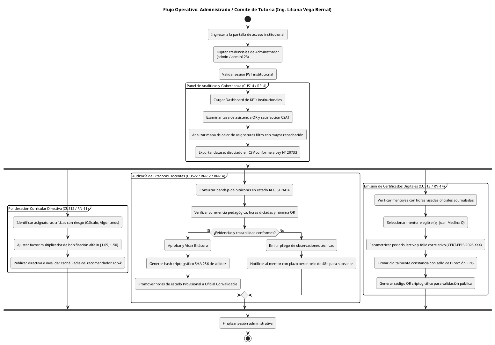
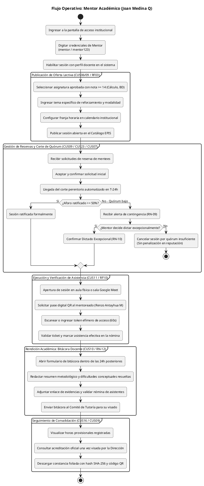
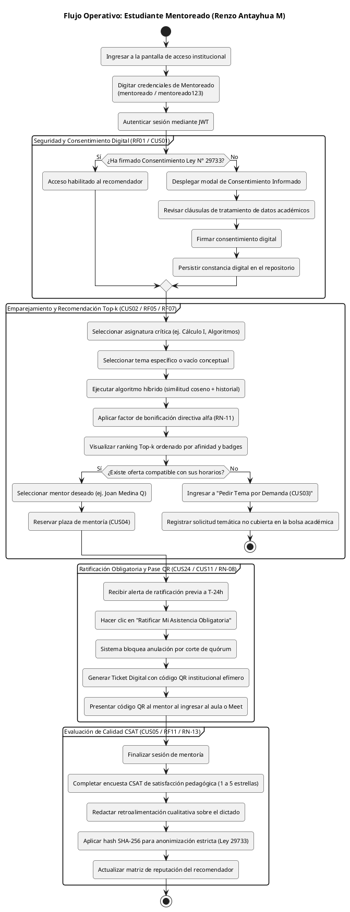
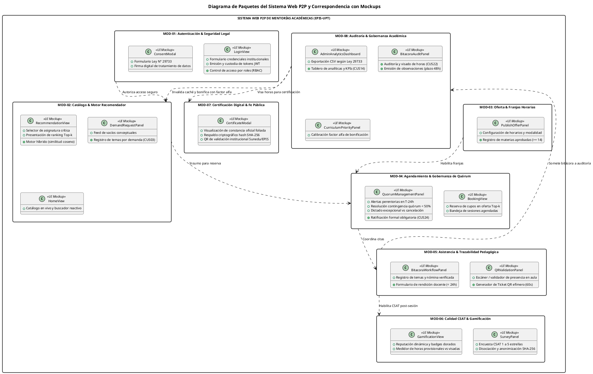

# Especificación de Flujos Operativos por Perfil y Diagrama de Paquetes de Maquetación

**Proyecto:** Sistema Web P2P con algoritmo de recomendación para la personalización de mentorías académicas en la EPIS-UPT 
**Curso:** Construcción de Software I 
**Institución:** Universidad Privada de Tacna – Escuela Profesional de Ingeniería de Sistemas 
**Vigencia:** Semestre 2026-II 
**Fecha:** Octubre 2026 

---

## Control de Versiones

| Versión | Responsable | Revisada por | Aprobada por | Fecha | Descripción del Documento |
| :---: | :--- | :--- | :--- | :---: | :--- |
| **1.0** | Joan Medina Q / Renzo Antayhua M | Ing. Liliana Vega Bernal | Dirección EPIS-UPT | 05/10/2026 | Documentación canónica de los diagramas de flujo por actor humano (Administrador, Mentor y Mentoreado) y diagrama de paquetes arquitectónico en correspondencia biunívoca con las opciones de maquetación del frontend. |

---

## 1. Contexto y Mapeo de Actores del Sistema

En concordancia con el marco formativo de la EPIS-UPT y la arquitectura modular del sistema de mentorías P2P, la plataforma establece tres perfiles de usuario con responsabilidades operativas bien delimitadas para mitigar la reprobación en asignaturas filtro (*Cálculo I, Algoritmos, Programación Orientada a Objetos, Cálculo II y Base de Datos I*):

A continuación, se define formalmente la asignación de credenciales y perfiles representados en la suite de maquetación funcional del sistema:

### Cuadro 1.1: Matriz Canónica de Usuarios y Roles Institucionales

| Rol en el Sistema | Nombre del Usuario Representado | Usuario Institucional | Clave de Acceso | Código / Matrícula | Unidad Académica |
| :--- | :--- | :---: | :---: | :---: | :--- |
| **Administrado (Tutoría)** | **Ing. Liliana Vega Bernal** | `admin` | `admin123` | `DOC-EPIS-018` | Comité de Tutoría y Calidad EPIS |
| **Mentor Académico** | **Joan Medina Q** | `mentor` | `mentor123` | `2022074255` | Estudiante VIII Ciclo EPIS |
| **Estudiante Mentoreado** | **Renzo Antayhua M** | `mentoreado` | `mentoreado123` | `2025018341` | Estudiante II Ciclo EPIS |

Fuente: Elaboración propia según especificación funcional SRS FD03.

Como se evidencia en la tabla anterior, el acceso se encuentra protegido mediante credenciales institucionales de dominio corporativo `@upt.pe`, garantizando el cumplimiento de las políticas de seguridad y autenticación (RF02 / RN-01) en concordancia con la Ley N° 29733 de Protección de Datos Personales.

---

## 2. Diagramas de Flujo de Operación por Perfil

A continuación, se detallan los diagramas de flujo de actividades para cada uno de los tres perfiles del sistema, modelados bajo el estándar PlantUML formal.

### 2.1 Perfil 1: Administrado / Comité de Tutoría (Ing. Liliana Vega Bernal)

El Comité de Tutoría y Dirección EPIS es responsable de la gobernanza académica, la supervisión de indicadores de riesgo estudiantil, la fiscalización de las bitácoras docentes y la certificación formal de horas extracurriculares con valor legal.

A continuación, se presenta la correspondencia operativa entre las etapas del flujo administrativo y las opciones de maquetación disponibles en la interfaz:

### Cuadro 2.1: Mapeo de Etapas del Perfil Administrador en la Maquetación

| Etapa del Flujo | Módulo de Negocio | Opción en la Maquetación (UI) | Caso de Uso | Regla de Negocio |
| :--- | :--- | :--- | :--- | :--- |
| Autenticación | MOD-01: Seguridad | Formulario Central de Login | CUS01 / RF02 | RN-01 (Credenciales @upt.pe) |
| Supervisión KPI | MOD-08: Gobernanza | Pestaña "Analíticas (CUS14)" | CUS14 / RF14 | RN-13 (Anonimización de datos) |
| Calibración Algorítmica | MOD-08: Gobernanza | Pestaña "Bonificación α (CUS12)" | CUS12 / RF24 | RN-11 (Factor $\alpha \in [1.05, 1.50]$) |
| Auditoría Académica | MOD-08: Gobernanza | Pestaña "Auditoría Horas (CUS22)" | CUS22 / RF26 | RN-12 / RN-14 (Horas Visadas) |
| Certificación Oficial | MOD-07: Certificación | Pestaña "Certificados (CUS13)" | CUS13 / RF13 | RNF09 (Criptografía SHA-256) |

Fuente: Elaboración propia a partir de la implementación en `AdminView.tsx`.

La estructura del cuadro demuestra que la totalidad de acciones directivas cuenta con soporte reactivo en la maqueta, permitiendo al Comité de Tutoría auditar bitácoras en tiempo real y emitir los diplomas foliados.

---

### 2.2 Perfil 2: Mentor Académico (Joan Medina Q)

El Estudiante Mentor (ciclos VII–X) lidera la asesoría académica entre pares, publicando su disponibilidad, gestionando el quórum ante el corte perentorio en $T-24\text{ h}$, verificando la asistencia en aula mediante escaneo de código QR efímero y registrando su bitácora docente para convalidación de horas formativas.

A continuación, se detalla la vinculación de cada fase del ciclo de mentoría con las opciones de maquetación del componente de mentor:

### Cuadro 2.2: Mapeo de Etapas del Perfil Mentor en la Maquetación

| Etapa del Flujo | Módulo de Negocio | Opción en la Maquetación (UI) | Caso de Uso | Regla de Negocio |
| :--- | :--- | :--- | :--- | :--- |
| Publicar Disponibilidad | MOD-03: Oferta | Pestaña "Publicar Oferta (CUS06)" | CUS06/09 / RF03 | RN-02 / RN-03 (Nota $\ge 14$) |
| Gestión de Citas y Quórum | MOD-04: Agendamiento | Pestaña "Mis Citas & Quórum" | CUS09 / CUS07 | RN-08, RN-09, RN-10 |
| Verificación en Aula | MOD-05: Asistencia | Pestaña "Escanear QR Asistencia" | CUS11 / RF10 | RNF04 (Tokens dinámicos de 60s) |
| Redacción de Bitácora | MOD-05: Asistencia | Pestaña "Bitácora Docente (CUS10)" | CUS10 / RF10 | RN-12 (Plazo improrrogable 24h) |
| Horas y Certificación | MOD-06 / MOD-07 | Pestaña "Horas & Constancia (CUS16)"| CUS16 / CUS09 | RN-14 (Visado previo obligatorio) |

Fuente: Elaboración propia a partir de la implementación en `MentorFlowView.tsx`.

El cuadro constata cómo el mentor dispone de controles específicos para interactuar con la gobernanza de quórum en $T-24\text{ h}$, el escaneo de tickets QR y la rendición de cuentas mediante bitácoras pedagógicas.

---

### 2.3 Perfil 3: Estudiante Mentoreado (Renzo Antayhua M)

El Estudiante Mentoreado (ciclos I–IV) demanda refuerzo personalizado en materias formativas críticas. Su flujo abarca el consentimiento digital informado, la búsqueda semántica en el recomendador *Top-k*, la ratificación obligatoria en $T-24\text{ h}$, la obtención del pase QR de acceso y la retroalimentación de calidad CSAT.

A continuación, se describe la relación entre las fases de demanda estudiantil y las vistas disponibles en el panel del mentoreado:

### Cuadro 2.3: Mapeo de Etapas del Perfil Mentoreado en la Maquetación

| Etapa del Flujo | Módulo de Negocio | Opción en la Maquetación (UI) | Caso de Uso | Regla de Negocio |
| :--- | :--- | :--- | :--- | :--- |
| Consentimiento Legal | MOD-01: Seguridad | Modal `ConsentModal` y Alerta Superior | CUS01 / RF01 | Ley N° 29733 (Datos académicos) |
| Recomendador Inteligente | MOD-02: Recomendación | Pestaña "Recomendador Top-k (CUS02)" | CUS02 / RF07 | RF06 / RN-11 (Afinidad & Factor $\alpha$) |
| Demanda no Cubierta | MOD-02: Recomendación | Pestaña "Pedir Tema por Demanda" | CUS03 / RF04 | RN-04 (Bolsa de vacíos conceptuales) |
| Ratificación en $T-24\text{ h}$ | MOD-04: Agendamiento | Pestaña "Mis Reservas & Pase QR" | CUS24 / RF13 | RN-08 (Ratificación perentoria) |
| Ticket QR en Aula | MOD-05: Asistencia | Botón "Ver Mi Pase Digital / QR" | CUS11 / RF10 | RNF04 (Token efímero de acceso) |
| Encuesta de Calidad | MOD-06: Calidad | Pestaña "Evaluar Mentor CSAT (CUS05)"| CUS05 / RF11 | RN-13 (Disociación y anonimato) |

Fuente: Elaboración propia a partir de la implementación en `MenteeFlowView.tsx`.

La tabla evidencia que el estudiante de ciclos iniciales dispone de un recorrido intuitivo que salvaguarda sus derechos de protección de datos, facilita el emparejamiento con mentores de ciclos avanzados y garantiza su plaza mediante la ratificación perentoria.

---

## 3. Diagrama de Paquetes Arquitectónico y su Correspondencia con los Mockups

El **Diagrama de Paquetes** representa la distribución lógica de la plataforma en subsistemas desacoplados (*MOD-01* al *MOD-08*), evidenciando la **relación directa y biunívoca** entre cada componente de software, los casos de uso implementados y las interfaces visuales provistas para los diferentes perfiles.

A continuación, se presenta la matriz detallada de correspondencia entre los paquetes de software, las vistas maquetadas y los perfiles con permisos de interacción:

### Cuadro 3.1: Matriz de Correspondencia entre Paquetes, Mockups y Perfiles de Usuario

| Paquete del Sistema | Módulo SRS | Componentes de Maquetación (Mockups) | Perfiles Autorizados | Opciones Brindadas en la Interfaz |
| :--- | :---: | :--- | :--- | :--- |
| **Autenticación & Seguridad** | `MOD-01` | [LoginView.tsx](file:///c:/Users/HP/Desktop/sistema%20P2P/frontend/src/components/LoginView.tsx) [ConsentModal.tsx](file:///c:/Users/HP/Desktop/sistema%20P2P/frontend/src/components/ConsentModal.tsx) | Todos los perfiles | • Inicio de sesión institucional por usuario/clave. • Formulario digital Ley N° 29733 de tratamiento de datos. |
| **Catálogo & Recomendación** | `MOD-02` | [RecommendationView.tsx](file:///c:/Users/HP/Desktop/sistema%20P2P/frontend/src/components/RecommendationView.tsx) [MenteeFlowView.tsx](file:///c:/Users/HP/Desktop/sistema%20P2P/frontend/src/components/MenteeFlowView.tsx) [HomeView.tsx](file:///c:/Users/HP/Desktop/sistema%20P2P/frontend/src/components/HomeView.tsx) | Mentoreado (`mentoreado`) Público general | • Búsqueda reactiva por temas y asignaturas. • Motor Top-k con similitud coseno y afinidad %. • Solicitud temática por demanda no cubierta. |
| **Oferta de Mentorías** | `MOD-03` | [MentorFlowView.tsx](file:///c:/Users/HP/Desktop/sistema%20P2P/frontend/src/components/MentorFlowView.tsx) (Sub-pestaña Ofertas) | Mentor (`mentor`) | • Selección de materias aprobadas con nota $\ge 14$. • Registro de temas, franjas horarias y aforos. |
| **Agendamiento & Quórum** | `MOD-04` | [BookingView.tsx](file:///c:/Users/HP/Desktop/sistema%20P2P/frontend/src/components/BookingView.tsx) [MentorFlowView.tsx](file:///c:/Users/HP/Desktop/sistema%20P2P/frontend/src/components/MentorFlowView.tsx) (Sub-pestaña Citas) | Mentoreado (`mentoreado`) Mentor (`mentor`) | • Reserva de cupos en franjas disponibles. • Ratificación obligatoria del mentee en $T-24\text{ h}$. • Gestión de contingencia ante quórum $<50\%$. • Aceptación de dictado excepcional sin penalización. |
| **Asistencia & Bitácoras** | `MOD-05` | [MentorFlowView.tsx](file:///c:/Users/HP/Desktop/sistema%20P2P/frontend/src/components/MentorFlowView.tsx) (QR & Bitácora) [MenteeFlowView.tsx](file:///c:/Users/HP/Desktop/sistema%20P2P/frontend/src/components/MenteeFlowView.tsx) (Pase QR) | Mentor (`mentor`) Mentoreado (`mentoreado`) | • Pase digital del mentee con código QR institucional. • Escaneo y verificación de asistencia en aula. • Redacción de bitácora pedagógica docente ($< 24\text{ h}$). |
| **Calidad & Gamificación** | `MOD-06` | [GamificationView.tsx](file:///c:/Users/HP/Desktop/sistema%20P2P/frontend/src/components/GamificationView.tsx) [MenteeFlowView.tsx](file:///c:/Users/HP/Desktop/sistema%20P2P/frontend/src/components/MenteeFlowView.tsx) (CSAT) | Mentoreado (`mentoreado`) Mentor (`mentor`) | • Encuesta CSAT con disociación anónima SHA-256. • Visualización de insignias ganadas (Oro, Plata). • Historial de horas provisionales vs. visadas. |
| **Certificación Digital** | `MOD-07` | [CertificateModal.tsx](file:///c:/Users/HP/Desktop/sistema%20P2P/frontend/src/components/CertificateModal.tsx) | Mentor (`mentor`) Administrador (`admin`) | • Emisión foliada de constancia oficial con QR. • Verificación criptográfica con hash SHA-256. • Descarga e impresión de constancia de horas. |
| **Auditoría & Gobernanza** | `MOD-08` | [AdminView.tsx](file:///c:/Users/HP/Desktop/sistema%20P2P/frontend/src/components/AdminView.tsx) | Administrador (`admin`) | • Tablero analítico institucional de KPIs y deserción. • Auditoría y visado oficial de horas docentes. • Observación de bitácoras con plazo de 48h. • Calibración del factor $\alpha$ para cursos filtro. |

Fuente: Elaboración propia a partir de la correlación entre el SAD y la implementación en código fuente React/Vite.

Como se desprende de la matriz, la modularización arquitectónica no solo preserva la separación de responsabilidades a nivel de diseño conceptual, sino que rige de manera estricta el acceso a cada pantalla, botón y formulario dentro de la maquetación web desplegada.

---

## 4. Conclusiones de Trazabilidad e Integración

1. **Alineación con el Marco Legal:** La implementación de la pantalla de acceso con credenciales individuales y sin atajos de un solo clic, junto al módulo de consentimiento informado ([ConsentModal.tsx](file:///c:/Users/HP/Desktop/sistema%20P2P/frontend/src/components/ConsentModal.tsx)), materializa la estricta sujeción a la Ley N° 29733 de Protección de Datos Personales y a los requerimientos RF01 y RF02 del proyecto.
2. **Coherencia Transaccional del Ciclo Formativo:** Los tres perfiles modelados (`admin`, `mentor`, `mentoreado`) se acoplan ordenadamente a lo largo de las 5 fases del ciclo de mentoría: oferta lectiva $\rightarrow$ emparejamiento *Top-k* $\rightarrow$ ratificación en $T-24\text{ h}$ $\rightarrow$ trazabilidad en aula con código QR $\rightarrow$ auditoría y emisión de constancias foliadas con hash SHA-256.
3. **Validación Operativa en la Maquetación:** Cada paquete arquitectónico se encuentra implementado y operable en el servidor frontend local (`http://localhost:5173/`), facilitando al equipo de desarrollo y a los evaluadores institucionales de la EPIS-UPT la validación directa de la experiencia de usuario y de las reglas de negocio críticas antes del pase a la fase de construcción de backend.
