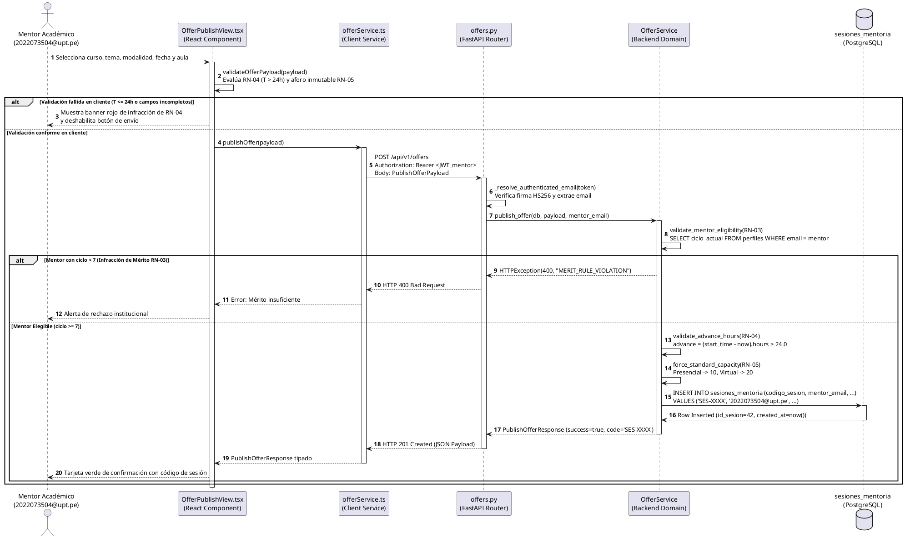

# Documento de Trazabilidad Técnica y Arquitectónica: Publicación de Ofertas de Mentoría

**Sistema Web P2P de Mentorías Académicas — EPIS UPT**  
**Curso:** Construcción de Software I — Ciclo 2026-II  
**Documento Técnico Oficial:** `INF-TRZ-01`  
**Fecha de Emisión:** 26/10/2026 | **Versión:** 1.0.0 (Línea Base Congelada)  
**Autores:** Joan Manuel Medina Medina (Backend & Base de Datos) / Renzo Anthony Valles Ramos (Frontend & UI)  
**Revisión y Conformidad:** Dr. Ricardo V. Albarracín (Docente Titular) / Dirección EPIS-UPT  

---

## Control de Versiones del Documento

| Versión | Fecha | Responsable | Aprobación | Resumen de Contenido y Cambios |
| :---: | :---: | :--- | :--- | :--- |
| **1.0.0** | 26/10/2026 | J. Medina / R. Valles | R. Albarracín | Emisión oficial del informe de trazabilidad técnica para el proceso nuclear de Publicación de Ofertas de Mentoría (CUS06 / RF08). Articulación con SRS (FD03 v2.0/v2.1), SAD (FD04 v1.1/v2.0), Sprint 03, Modelo ECB y Catálogo de Pruebas. |

---

## 1. Propósito y Contexto del Documento

El presente documento formaliza la **trazabilidad integral, multidireccional y verificable** del proceso nuclear de **«Publicación de Ofertas de Mentoría Académica»** en el *Sistema Web P2P de Mentorías Académicas para la Escuela Profesional de Ingeniería de Sistemas (EPIS-UPT)*.

Dentro de la arquitectura de la plataforma, la publicación de ofertas constituye el **evento disparador y catalizador fundamental del ecosistema**:
1. **Generación de la Oferta Formativa:** Transforma la disponibilidad horaria y el dominio temático de los estudiantes de ciclos avanzados (VII al X) en eventos pedagógicos estructurados.
2. **Insumo Vital para el Motor de Recomendación (*EdRecSys*):** Sin ofertas publicadas en el catálogo de base de datos, los algoritmos de similitud coseno vectorial y filtrado colaborativo ponderado carecen de candidatos para emparejar la demanda.
3. **Punto de Partida del Ciclo de Quórum y Reservas:** Desencadena la posibilidad de reserva individual de cupos con control estricto de aforo (10 presencial / 20 virtual) y activa el reloj de antelación hacia el corte perentorio de 24 horas previas ($T-24\text{ h}$).
4. **Garantía Institucional de Mérito y Espacios:** Aplica en tiempo de compilación y ejecución las reglas de mérito académico (RN-03), antelación obligatoria (RN-04), control de capacidad (RN-05) y asignación validada de recintos (RN-06 y RN-07).

Este informe articula la especificación canónica de requisitos del **SRS (FD03)**, las vistas arquitectónicas del **SAD (FD04)**, las tareas ejecutadas en el **Sprint 03 (T-14, T-15, T-16)**, el código fuente real implementado y las evidencias empíricas del catálogo de pruebas automatizadas.

```
       ┌────────────────────────────────────────────────────────┐
       │     SRS (FD03): Requerimientos y Reglas de Negocio      │
       │  [RF08, RF09, RF05, RF04, RN-03, RN-04, RN-05, RN-06]  │
       └───────────────────────────┬────────────────────────────┘
                                   │
                                   ▼
       ┌────────────────────────────────────────────────────────┐
       │   SAD (FD04): Vistas Arquitectónicas 4+1 (Kruchten)    │
       │    [Escenarios 2.1, Lógica 2.2, Procesos 2.3, DDL 10.1] │
       └───────────────────────────┬────────────────────────────┘
                                   │
                                   ▼
       ┌────────────────────────────────────────────────────────┐
       │   Diagrama 3.2: Secuencia Técnica de Publicación        │
       │   [OfferPublishView -> Router -> OfferService -> BD]    │
       └───────────────────────────┬────────────────────────────┘
                                   │
                                   ▼
       ┌────────────────────────────────────────────────────────┐
       │   Implementación y Pruebas Automatizadas (Sprint 03)   │
       │    [T-14, T-15, T-16 | Pytest: 92.15% | Vitest: 92.52%] │
       └────────────────────────────────────────────────────────┘
```

---

## 2. Diagrama Principal: Secuencia Técnica de Publicación de Ofertas

El siguiente diagrama de secuencia representa la interacción técnica end-to-end implementada durante el **Sprint 03** (Tareas `T-14`, `T-15` y `T-16`). Modela la interacción entre la interfaz de usuario en React, el servicio cliente HTTP, el router REST de FastAPI, la capa de dominio `OfferService` y el motor de persistencia PostgreSQL en Supabase.


*Figura 2.1: Diagrama de secuencia técnica para la publicación de ofertas de mentoría (Diagrama 3.2 del Informe de Sprint 03).*  
*(Nota: Para visualización vectorial escalable de alta definición, consultar [04_secuencia_tecnica_publicacion_ofertas.svg](imagenes/04_secuencia_tecnica_publicacion_ofertas.svg)).*

<details>
<summary><b>Haga clic aquí para ver el código fuente canónico en PlantUML</b></summary>


</details>

---

## 3. Desglose Paso a Paso de la Secuencia y Componentes de Software

La interacción técnica transcurre en 15 pasos cronológicos que articulan la arquitectura desacoplada del sistema:

| Paso | Emisor | Receptor | Operación Técnica / Mensaje | Regla / Estándar | Componente de Código Fuente |
| :---: | :--- | :--- | :--- | :---: | :--- |
| **1** | Mentor Académico | `OfferPublishView.tsx` | Selecciona asignatura, tema silábico, modalidad pedagógica, fecha/hora y recinto/enlace. | RF08, CUS06 | `src/features/offers/OfferPublishView.tsx` |
| **2-3** | `OfferPublishView.tsx` | Auto-invocación | `validateOfferPayload(payload)`: Comprobación reactiva en tiempo real. Evalúa que la fecha de inicio supere las 24 horas respecto a la hora local ($T > 24\text{ h}$) y asigna aforo inmutable. Si es inválido, renderiza banner rojo `AlertaAntelacion` y deshabilita el botón de envío. | RN-04, RN-05, RNF04 | `src/features/offers/offerValidation.ts` |
| **4** | `OfferPublishView.tsx` | `offerService.ts` | `publishOffer(payload)`: Invocación del servicio cliente pasándole el payload validado. | RNF09 | `src/features/offers/offerService.ts` |
| **5** | `offerService.ts` | `offers.py` | `POST /api/v1/offers`: Solicitud HTTP con cabecera `Authorization: Bearer <JWT_mentor>` y cuerpo JSON conforme al esquema `PublishOfferPayload`. | RNF01, RNF09 | `aplicacion/api/v1/endpoints/offers.py` |
| **6** | `offers.py` | Auto-invocación | `_resolve_authenticated_email(token)`: Validación de firma HMAC-SHA256, verificación de tiempo de expiración y extracción del claim `email` institucional (`2022073504@upt.pe`). | RNF01, RN-01 | `aplicacion/core/seguridad.py` |
| **7** | `offers.py` | `OfferService` | `publish_offer(db, payload, mentor_email)`: Delegación del control a la capa de dominio de negocio. | RF08, RNF09 | `aplicacion/servicios/offer_service.py` |
| **8-9** | `OfferService` | Auto-invocación | `validate_mentor_eligibility(RN-03)`: Consulta `perfiles.ciclo_actual`. Si `ciclo_actual < 7`, levanta `HTTPException(400, "MERIT_RULE_VIOLATION")`, abortando la transacción y notificando al cliente error 400. | RN-03, RF03 | `aplicacion/servicios/offer_service.py` (`_check_merit`) |
| **10** | `OfferService` | Auto-invocación | `validate_advance_hours(RN-04)`: Validación defensiva en servidor: $(t_{\text{inicio}} - t_{\text{actual}}) > 24.0\text{ h}$. Si es $\le 24.0$, levanta `HTTPException(400, "ADVANCE_TIME_VIOLATION")`. | RN-04, RNF03 | `aplicacion/servicios/offer_service.py` (`_check_advance`) |
| **11** | `OfferService` | Auto-invocación | `force_standard_capacity(RN-05)`: Asignación forzosa en servidor: 10 cupos para `PRESENCIAL` y 20 cupos para `VIRTUAL`, sobrescribiendo cualquier manipulación del cliente. | RN-05, RNF07 | `aplicacion/servicios/offer_service.py` (`_enforce_capacity`) |
| **12-13**| `OfferService` | `sesiones_mentoria` | `INSERT INTO sesiones_mentoria`: Ejecución transaccional ACID en PostgreSQL. Generación de clave `codigo_sesion` ('SES-XXXX'), estado inicial `PUBLICADA`, persistiendo cupos y recinto. Retorno de tupla persistida (`id_sesion=42`). | RNF02, RNF07 | PostgreSQL / Supabase Client (`aplicacion/db/`) |
| **14** | `OfferService` | `offers.py` | Retorno de modelo Pydantic `PublishOfferResponse(success=True, code='SES-XXXX', session_id=42)`. | RNF09 | `aplicacion/esquemas/offer.py` |
| **15** | `offers.py` | `OfferPublishView.tsx` | Respuesta HTTP 201 Created con cabecera de ubicación y cuerpo JSON tipado. La interfaz React renderiza la tarjeta verde de confirmación con el código asignado y enlace al catálogo. | RNF04, RNF08 | `src/features/offers/OfferPublishView.tsx` |

---

## 4. Matriz de Requerimientos Relacionados (RF y RNF)

El proceso de publicación de ofertas satisface directamente y se apoya en una red de requerimientos funcionales y no funcionales definidos formalmente en el **SRS (FD03)** y garantizados en el **SAD (FD04)**:

### 4.1. Requerimientos Funcionales (RF)

| Código RF | Nombre del Requerimiento | Módulo SRS | Rol en la Secuencia de Publicación | Criterio de Aceptación y Verificación | Documento de Origen |
| :---: | :--- | :---: | :--- | :--- | :---: |
| **RF08** | **Publicación y parametrización de ofertas de mentoría académica** | **MOD-04** | **Requerimiento Nuclear:** Permite al mentor seleccionar asignatura aprobada, unidad temática silábica, fecha, horario, modalidad y espacio físico/virtual. | Genera registro en `sesiones_mentoria` con código unívoco `SES-XXXX` y estado `PUBLICADA`. Verificado por prueba `CUS06-F02`. | SRS §5.3, Cuadro 5.3; SAD §5.1 |
| **RF09** | Aprovisionamiento automatizado de infraestructura y espacios | MOD-04 | **Soporte de Espacios:** En modalidad presencial, valida aulas/laboratorios libres de conflicto de clase; en virtual, provisiona enlaces institucionales de Google Meet / Discord. | No permite colisión de horarios en laboratorios EPIS. Verificado por reglas RN-06 y RN-07. | SRS §5.3; SAD §7.2 |
| **RF05** | Gestión del catálogo de asignaturas críticas y temarios silábicos | MOD-02 | **Precondición Curricular:** Provee el catálogo maestro de materias críticas (I al IV ciclo) y temarios jerárquicos que alimentan los comboboxes en `OfferPublishView`. | La UI solo despliega unidades temáticas oficiales validadas contra la tabla `temas_silabicos`. | SRS §5.3; SAD §2.2 |
| **RF04** | Configuración de perfil formativo y matriz de disponibilidad horaria | MOD-02 | **Precondición de Agenda:** El mentor programa la oferta dentro de los bloques de su disponibilidad declarada previamente en su perfil formativo. | Coherencia entre la franja de la oferta y la disponibilidad semanal del mentor. | SRS §5.3; SAD §2.1 |
| **RF06** | Inferencia de recomendaciones personalizadas y ranking Top-k | MOD-03 | **Sucesor Algorítmico:** El motor *EdRecSys* indexa la oferta recién publicada en su espacio vectorial para emparejarla con las solicitudes de los alumnos. | Latencia de cálculo de similitud coseno $\le 500$ ms sobre las ofertas publicadas activas. | SRS §5.3; SAD §8.1 |
| **RF12** | Reserva de cupos de mentoría con control de aforo | MOD-05 | **Sucesor Operativo:** Permite a los estudiantes mentoreados inscribirse en la oferta publicada hasta agotar las vacantes delimitadas (10 o 20). | Bloqueo concurrente con transacciones ACID; tasa de sobreasignación estrictamente 0%. | SRS §5.3; SAD §2.3 |

### 4.2. Requerimientos No Funcionales (RNF)

| Código RNF | Dimensión de Calidad | Especificación Técnica Aplicada en la Secuencia | Métrica / Umbral Verificado | Trazabilidad Arquitectónica |
| :---: | :--- | :--- | :--- | :---: |
| **RNF01** | **Seguridad y Control de Acceso** | Autenticación basada en JSON Web Tokens (JWT) con algoritmo HMAC-SHA256. El endpoint `/api/v1/offers` exige cabecera `Authorization: Bearer <token>` y extrae la identidad del mentor de forma criptográfica sin confiar en campos del cuerpo. | Expiración del token: 8 horas.<br>Validación en 100% de peticiones. | SRS §5.3; SAD §2.2 (Capa Seguridad) |
| **RNF02** | **Privacidad y Aislamiento (Ley 29733)** | Políticas de Row Level Security (RLS) en PostgreSQL que impiden a un mentor alterar ofertas ajenas o acceder a datos sensibles de otros usuarios. Uso de identificadores UUID v4. | 100% de tablas protegidas por RLS.<br>0% de exposición de datos personales no autorizados. | SRS §5.3; SAD §10.1 (PostgreSQL DDL) |
| **RNF03** | **Rendimiento del Backend** | Tiempo de validación de reglas de negocio (RN-03, RN-04, RN-05) y procesamiento de la inserción en base de datos. | Tiempo total de respuesta API $\le 500$ ms bajo concurrencia normal. | SRS §5.3; SAD §2.3 (Procesos) |
| **RNF04** | **Rendimiento y Usabilidad Frontend** | Renderizado reactivo inmediato de mensajes de error de antelación sin requerir recarga ni petición al servidor; retroalimentación instantánea al usuario. | Tiempo de primera pintura con contenido (FCP) $< 2.0$ s; latencia visual de validación $< 50$ ms. | SRS §5.3; SAD §2.4 (React SPA) |
| **RNF08** | **Compatibilidad Multiplataforma** | Formulario de publicación responsivo y operativo en navegadores modernos de escritorio (Google Chrome, Mozilla Firefox, Microsoft Edge, Safari). | 100% de paridad funcional en resoluciones $\ge 1366 \times 768$ px. | SRS §5.3; SAD §2.5 (Topología) |
| **RNF09** | **Arquitectura Desacoplada y Calidad de Código** | Separación estricta entre cliente (React + TypeScript) y backend (FastAPI + Python), contratos Pydantic fuertemente tipados, documentación OpenAPI/Swagger interactiva al 100% y cobertura $\ge 70\%$. | **Backend Coverage: 92.15%** (122 pruebas).<br>**Frontend Coverage: 92.52%** (87 pruebas). | SRS §5.3; SAD §2.4, §9.1 |
| **RNF10** | **Resiliencia e Interoperabilidad** | Aprovisionamiento controlado de enlaces de Google Meet o Discord con políticas de reintento exponencial (*exponential backoff*) y manejo defensivo de fallos. | Timeout controlado $\le 5$ s con degradación elegante. | SRS §5.3; SAD §2.3 |

---

## 5. Gobernanza de Reglas de Negocio Institucionales (RN)

La secuencia técnica implementa un **modelo de validación en dos niveles (Defensa en Profundidad)** para las Reglas de Negocio institucionales:

```
[Usuario / Formulario React]
         │
         ▼  (Nivel 1: Validación Reactiva en Cliente)
  ┌────────────────────────────────────────────────────────┐
  │ validateOfferPayload(payload)                          │
  │ • Comprueba T > 24.0h respecto al reloj local          │
  │ • Fija selector de aforo según modalidad (10 / 20)     │
  │ • Si falla: Bloquea botón y despliega banner de alerta │
  └────────────────────────┬───────────────────────────────┘
                           │ Petición HTTP POST /api/v1/offers
                           ▼  (Nivel 2: Validación Coercitiva en Backend)
  ┌────────────────────────────────────────────────────────┐
  │ OfferService.publish_offer()                           │
  │ • RN-03: Verifica ciclo >= 7 en tabla perfiles         │
  │ • RN-04: Re-calcula (start_time - now()) > 24.0h       │
  │ • RN-05: Sobrescribe forzosamente aforo a 10 o 20      │
  │ • DDL: Restricción CHECK (aforo_maximo IN (10, 20))    │
  └────────────────────────────────────────────────────────┘
```

### 5.1. Matriz Detallada de Reglas de Negocio en la Publicación

| Código RN | Nombre de la Regla | Enunciado Normativo Institucional | Implementación en la Secuencia Técnica | Excepción / Código HTTP |
| :---: | :--- | :--- | :--- | :---: |
| **RN-03** | **Jerarquía de Roles y Verificación de Mérito** | Solo los estudiantes pertenecientes a los ciclos formativos superiores (VII al X) y con rendimiento académico sobresaliente en la materia pueden ejercer el rol de Mentor y publicar ofertas. | `OfferService` ejecuta `SELECT ciclo_actual FROM perfiles WHERE email = :mentor`. Si `ciclo_actual < 7`, interrumpe el flujo. | `HTTP 400 Bad Request`<br>`detail: "MERIT_RULE_VIOLATION"` |
| **RN-04** | **Dinámica de Oferta y Antelación de Publicación** | Toda oferta de mentoría debe publicarse obligatoriamente con una antelación mínima superior a las 24 horas ($T > 24\text{ h}$) respecto a la fecha y hora de inicio de la sesión, recomendándose institucionalmente 48 horas ($T \ge 48\text{ h}$). | **Cliente:** `validateOfferPayload()` calcula diferencia horaria y alerta.<br>**Servidor:** `validate_advance_hours()` evalúa `(start_time - utcnow()).total_seconds() > 86400`. | `HTTP 400 Bad Request`<br>`detail: "ADVANCE_TIME_VIOLATION"` |
| **RN-05** | **Control Estricto e Inmutable de Aforos Estándar** | El aforo máximo admitido está estrictamente determinado por la modalidad pedagógica elegida: **exactamente 10 vacantes para modalidad Presencial** (aulas/laboratorios) y **exactamente 20 vacantes para modalidad Virtual**. | `OfferService.force_standard_capacity()` asigna `aforo_maximo = 10 if modalidad == 'PRESENCIAL' else 20`. Además, la base de datos cuenta con restricción `CHECK (aforo_maximo IN (10, 20))`. | Imposición forzosa en backend; error de integridad si se altera la BD. |
| **RN-06** | **Asignación Validada de Espacios Físicos (Parser)** | Las sesiones presenciales solo se programan en aulas y laboratorios de la EPIS validados como libres en el cronograma académico oficial para evitar colisiones con clases regulares. | `OfferService` comprueba disponibilidad contra los bloques libres procesados por el parser de horarios (RF10). | `HTTP 409 Conflict`<br>`detail: "ROOM_SCHEDULE_CONFLICT"` |
| **RN-07** | **Aprovisionamiento Virtual Automatizado** | En modalidad virtual, el sistema genera de forma desatendida el enlace de teleconferencia institucional (Google Meet `@upt.pe` o canal de Discord supervisado). | Enlace generado automáticamente e inyectado en el campo `enlace_reunion` de la sesión creada. | Tolerancia a fallos con degradación según RNF10. |
| **RN-08** | **Ventana de Confirmación de Asistencia hasta $T-24\text{ h}$** | La ratificación de cupos reservados por los estudiantes se cierra 24 horas antes del inicio de la sesión. | **Justificación temporal:** Es la causa directa por la cual la RN-04 exige que la oferta se publique con más de 24 horas de antelación; de lo contrario, la ventana de confirmación nacería cerrada. | N/A (Regla sucesora en quórum) |

---

## 6. Mapeo Canónico con el Documento SRS (FD03 - v2.0 / v2.1)

En el documento canónico de **Especificación de Requerimientos de Software (SRS - FD03)**, el proceso de publicación de ofertas se encuentra formalizado en las siguientes secciones maestras:

### 6.1. Ubicación Estructural en el SRS
- **Sección 4.4 (Módulos del Sistema):** Registrado bajo **MOD-04: Planificación, Espacios y Agendamiento**, encargado de la calendarización de sesiones y aprovisionamiento de infraestructura.
- **Sección 5.3 (Matriz Consolidada de Requerimientos):** Detallado como **RF08** (*Publicación y parametrización de ofertas de mentoría académica*) y **RF09** (*Aprovisionamiento automatizado de infraestructura y espacios*).
- **Sección 5.4 (Reglas de Negocio):** Gobernado por las reglas **RN-03**, **RN-04**, **RN-05**, **RN-06** y **RN-07**.
- **Sección 5.5 (Matriz de Trazabilidad Cruzada):** Mapeo biunívoco de trazabilidad:
  $$\mathbf{RF08} \longleftrightarrow \mathbf{MOD-04} \longleftrightarrow \mathbf{RN-04, RN-05} \longleftrightarrow \mathbf{CUS06} \longleftrightarrow \mathbf{RNF04, RNF09}$$

### 6.2. Modelo de Análisis ECB (Entity-Control-Boundary) del SRS
El SRS formaliza la separación de análisis mediante el patrón ECB para aislar responsabilidades:

```
    ┌─────────────────────────────────┐
    │     <<Boundary / Frontera>>     │
    │  • OfferPublishView (React UI)  │
    │  • POST /api/v1/offers (FastAPI)│
    └────────────────┬────────────────┘
                     │ Invocación HTTP / Contrato REST
                     ▼
    ┌─────────────────────────────────┐
    │      <<Control / Gestor>>       │
    │  • offerService.ts (Cliente)    │
    │  • OfferService (Dominio Python)│
    └────────────────┬────────────────┘
                     │ Persistencia ORM / SQL Engine
                     ▼
    ┌─────────────────────────────────┐
    │       <<Entity / Entidad>>      │
    │  • SesionMentoria (PostgreSQL)  │
    │  • PerfilUsuario (Mentor)       │
    │  • TemaSilabico / Asignatura    │
    └─────────────────────────────────┘
```

1. **Clases de Frontera (*Boundary*):**
   - `OfferPublishView`: Componente de interfaz React que captura los datos del formulario, gestiona el estado visual y presenta las alertas reactivas.
   - `OffersRouter`: Controlador REST en FastAPI que expone la ruta `/api/v1/offers`, autentica mediante token Bearer y valida el esquema JSON.
2. **Clases de Control (*Control*):**
   - `offerService.ts`: Módulo cliente en TypeScript que serializa las llamadas HTTP mediante `fetch` o `axios`.
   - `OfferService`: Gestor del dominio en Python que orquesta las reglas de negocio (mérito, antelación, aforo) y coordina la persistencia transaccional.
3. **Clases de Entidad (*Entity*):**
   - `SesionMentoria`: Entidad relacional que almacena el estado, fechas, aforo, modalidad y código de sesión.
   - `PerfilMentor`: Entidad que valida el ciclo y condición académica del usuario emisor.
   - `TemaSilabico` / `AsignaturaCritica`: Entidades del catálogo curricular institucional.

---

## 7. Mapeo Canónico con el Documento SAD (FD04 - v1.1 / v2.0)

En el documento de **Descripción de la Arquitectura de Software (SAD - FD04)**, la publicación de ofertas se mapea en las **4+1 Vistas Arquitectónicas de Kruchten** y en los diagramas de integración:

### 7.1. Articulación en las 4+1 Vistas de Kruchten

| Vista de Arquitectura | Diagrama SAD Asociado | Rol e Impacto del Proceso de Publicación de Ofertas |
| :--- | :---: | :--- |
| **Vista de Escenarios (+1)** | **Diagrama 2.1** | El caso de uso `CUS06: Publicar oferta de mentoría` figura como uno de los **escenarios nucleares** de la arquitectura, conectando al actor Mentor con los subsistemas de Planificación y Recomendación. |
| **Vista Lógica (Capas y ECB)** | **Diagrama 2.2** | Modela el flujo vertical: la petición nace en la *Capa de Presentación Web*, atraviesa la *Capa de API Gateway / Routing*, se valida en la *Capa de Dominio (OfferService)* y se asienta en la *Capa de Persistencia (PostgreSQL)*. |
| **Vista de Procesos (Concurrencia)**| **Diagrama 2.3** | Modela la gestión de transacciones asíncronas en FastAPI, garantizando que la inserción de la oferta en `sesiones_mentoria` sea atómica y previniendo colisiones de reservas tempranas mediante bloqueos transaccionales. |
| **Vista de Desarrollo (Paquetes)** | **Diagrama 2.4** | Establece la correspondencia de paquetes: `src/features/offers/` en frontend y `aplicacion/servicios/offer_service.py` con `aplicacion/api/v1/endpoints/offers.py` en backend. |
| **Vista Física (Despliegue)** | **Diagrama 2.5** | Modela la topología de red: Frontend servido desde CDN Vercel/Vite, Backend alojado en contenedor Linux Uvicorn/FastAPI, y Persistencia en clúster gestionado PostgreSQL (Supabase) con cifrado TLS 1.3. |

### 7.2. Articulación con Diagramas de Comportamiento e Integración del SAD
- **Diagrama 5.1 (Casos de uso canónicos agrupados por módulo):** Ubica formalmente a `CUS06: Publicar oferta de mentoría` dentro del paquete `MOD-04: Planificación, Espacios y Agendamiento`.
- **Diagrama 7.2 (Proceso Propuesto To-Be de Mentorías P2P):** En la Fase 1 (*Configuración y Publicación de Oferta*), el mentor parametriza los temas y la infraestructura, validándose la antelación antes de permitir la indexación en el catálogo.
- **Diagrama 8.1 (Contenedores C4 Nivel 2):** Detalla la comunicación entre el contenedor *Single Page Application (React)* y el *API Backend (FastAPI)* mediante llamadas HTTPS/REST JSON autenticadas.
- **Diagrama 9.1 (Componentes y Dependencias):** Refleja que el componente `OffersController` depende directamente de `AuthMiddleware` (para resolver identidad) y de `OfferService` (para ejecutar la lógica de dominio).
- **Diagrama 10.1 (Modelo Relacional DDL):** Define la estructura física de la tabla `sesiones_mentoria` en PostgreSQL con restricciones `CHECK` para modalidad (`PRESENCIAL`, `VIRTUAL`) y aforo (`10`, `20`).

---

## 8. Matriz de Casos de Uso Relacionados y Precedencia Operativa

| Caso de Uso | Denominación Canónica | Módulo | Tipo de Relación | Explicación de la Articulación con CUS06 |
| :---: | :--- | :---: | :---: | :--- |
| **CUS01** | Iniciar sesión institucional con 2FA | MOD-01 | Precondición Obligatoria | Genera el JSON Web Token (JWT) necesario para autenticar la petición `POST /api/v1/offers`. Sin token válido, el endpoint retorna HTTP 401 Unauthorized. |
| **CUS10** | Gestión y asignación de roles (Mérito) | MOD-01 | Precondición de Elegibilidad | Otorga formalmente el rol de Mentor y verifica que pertenezca al ciclo $\ge 7$ (RN-03). Si el usuario es solo Mentoreado o ciclo $< 7$, el sistema rechaza la publicación. |
| **CUS21** | Gestión del catálogo curricular crítico | MOD-02 | Insumo Maestro de Datos | Provee la lista de asignaturas críticas y la taxonomía jerárquica de temas silábicos oficiales desplegados en el selector del formulario. |
| **CUS15** | Configuración de disponibilidad horaria | MOD-02 | Precondición Operativa | Permite registrar los bloques de horas libres del mentor, garantizando que no se publiquen ofertas que colisionen con su propia agenda lectiva. |
| **CUS06** | **Publicar oferta de mentoría académica** | **MOD-04** | **NÚCLEO DEL FLUJO** | **Caso de uso central modelado en el Diagrama 3.2.** Crea la oferta, asigna aforo inmutable (10 o 20) y programa la sesión. |
| **CUS02** | Consultar recomendaciones Top-k (*EdRecSys*) | MOD-03 | Sucesor por Consumo de Datos | El recomendador ingesta las ofertas activas generadas por `CUS06` y las clasifica según el perfil de necesidades y asignaturas del mentoreado. |
| **CUS04** | Reservar cupo de mentoría | MOD-05 | Sucesor Funcional Inmediato | Permite a los estudiantes mentoreados inscribirse en la oferta creada por `CUS06`, bloqueando un cupo individual hasta completar el aforo asignado. |
| **CUS24** | Confirmar asistencia anticipada ($T-24\text{ h}$) | MOD-05 | Sucesor en Ciclo de Quórum | Habilita a los alumnos con reserva ratificar su asistencia formal antes del corte temporal de 24 horas previas al inicio de la sesión (RN-08). |
| **CUS23** | Monitoreo desatendido y corte de quórum | MOD-05 | Sucesor Automatizado (Cron) | El servicio cron evalúa la sesión a las 24 horas previas. Si los confirmados en la oferta publicada no alcanzan el 50%, transiciona a `QUORUM_INSUFICIENTE`. |
| **CUS07** | Gestión de sesión ante quórum insuficiente | MOD-04 | Extensión de Contingencia | Permite al mentor decidir si dicta la sesión de forma extraordinaria o la cancela si la oferta no alcanzó el quórum reglamentario al corte de $T-24\text{ h}$. |
| **CUS18** | Modificar o cancelar oferta por imprevisto | MOD-04 | Extensión de Contingencia | Permite al mentor reprogramar o anular una oferta publicada previamente en caso de causas de fuerza mayor debidamente justificadas. |

---

## 9. Evidencias Experimentales y Pruebas Automatizadas (Sprint 03)

| Código de Prueba | Tipo de Prueba | Nivel de Ejecución | Descripción del Caso y Escenario Evaluado | Resultado Verificado |
| :---: | :---: | :---: | :--- | :---: |
| **`CUS06-U01`** | Unitaria | Backend (`pytest`) | Intento de publicación con antelación menor o igual a 24 horas ($T \le 24.0\text{ h}$). Verifica rechazo con `HTTP 400 Bad Request` y detalle `ADVANCE_TIME_VIOLATION`. | **APROBADO (PASSED)** |
| **`CUS06-U02`** | Unitaria | Backend (`pytest`) | Forzado automático e inmutable de aforos según modalidad (10 presencial / 20 virtual). Comprueba que cualquier payload manipulado sea sobrescrito. | **APROBADO (PASSED)** |
| **`CUS06-F01`** | Funcional | Backend (`pytest`) | Intento de publicación por un estudiante con ciclo formativo VI (infracción de mérito RN-03). Verifica rechazo con `HTTP 400` y `MERIT_RULE_VIOLATION`. | **APROBADO (PASSED)** |
| **`CUS06-F02`** | Funcional / Integración | Backend (`pytest`) | Flujo completo de publicación exitosa con mentor elegible (ciclo VIII) y antelación de 48 horas. Verifica respuesta `HTTP 201 Created` y generación de código `SES-XXXX`. | **APROBADO (PASSED)** |
| **`OFF-01`** | Unitaria / Componente | Frontend (`vitest`) | Renderizado de `OfferPublishView.tsx` ante selección de fecha inválida ($T \le 24\text{ h}$). Verifica aparición del banner de alerta rojo y deshabilitación del botón de envío. | **APROBADO (PASSED)** |
| **`OFF-02`** | Integración UI | Frontend (`vitest`) | Despacho de formulario conforme y captura de respuesta `PublishOfferResponse`. Verifica despliegue de tarjeta verde de confirmación con el código de sesión. | **APROBADO (PASSED)** |

- **Cobertura de Backend (Pytest + Pytest-Cov):** **92.15%** (122 pruebas pasadas).
- **Cobertura de Frontend (Vitest + @vitest/coverage-v8):** **92.52%** (87 pruebas pasadas).

---

## 10. Guía Pedagógica y Argumental para la Exposición Académica

```
1. ORIGEN ANALÍTICO (El Problema y la Regla)
   "En la EPIS-UPT, las asesorías informales carecían de planificación de espacios y verificación de mérito. 
    Por ello, en el SRS establecimos el RF08 y las reglas RN-03 (ciclo >= 7) y RN-04 (antelación > 24h)."

2. ESTRUCTURACIÓN ARQUITECTÓNICA (El Diseño)
   "En el SAD, diseñamos la solución bajo el modelo 4+1 de Kruchten. Modelamos CUS06 como escenario nuclear (+1),
    desacoplamos la frontera, control y entidad bajo el patrón ECB en la Vista Lógica 2.2, y modelamos la
    concurrencia transaccional en la Vista de Procesos 2.3."

3. COMPORTAMIENTO DINÁMICO (La Secuencia Técnica)
   "En el Diagrama 3.2 implementamos una estrategia de Defensa en Profundidad:
    - Primero, el cliente React (OfferPublishView) evalúa reactivamente la antelación de 24h y bloquea el envío.
    - Segundo, el backend FastAPI valida criptográficamente el JWT, verifica el ciclo académico en base de datos,
      y fuerza inmutablemente el aforo estricto (10 presencial / 20 virtual).
    - Tercero, se ejecuta la transacción en PostgreSQL generando el código institucional SES-XXXX."

4. VERIFICACIÓN Y EVIDENCIA EMPÍRICA (La Calidad)
   "Demostramos la calidad técnica mediante nuestro Catálogo de Pruebas: ejecutamos casos unitarios y de integración 
    (CUS06-U01, CUS06-U02, CUS06-F01, OFF-01), alcanzando una cobertura real del 92.15% en backend y 92.52% en frontend."
```

---
*Documento emitido y versionado bajo el estándar de documentación técnica del Sistema Web P2P EPIS-UPT (2026).*
