# Bóveda Centralizada de Diagramas de Diseño Técnico (PlantUML)

**Proyecto:** Sistema Web P2P con algoritmo de recomendación para la personalización de mentorías académicas en la EPIS-UPT  
**Curso:** Construcción de Software I (2026-II)  
**Institución:** Universidad Privada de Tacna — Escuela Profesional de Ingeniería de Sistemas  
**Equipo:** Grupo 03 / C-SharkTeam (Joan Cristian Medina Quispe y Renzo Antonio Antayhua Mamani)  
**Normativa de Diseño:** `reglas_documentacion_diseño.md` (Regla D-5: Sincronización continua de diagramas)  
**Estado:** Sincronizado y Homologado con los Diagramas Técnicos del Sprint 4 (Recomendación Top-k, Reservas Transaccionales y Quórum)

---

## 1. Diagramas de Diseño Técnico — Sprint 1

### 1.1. Arquitectura y Despliegue Físico de Componentes (Sprint 1)
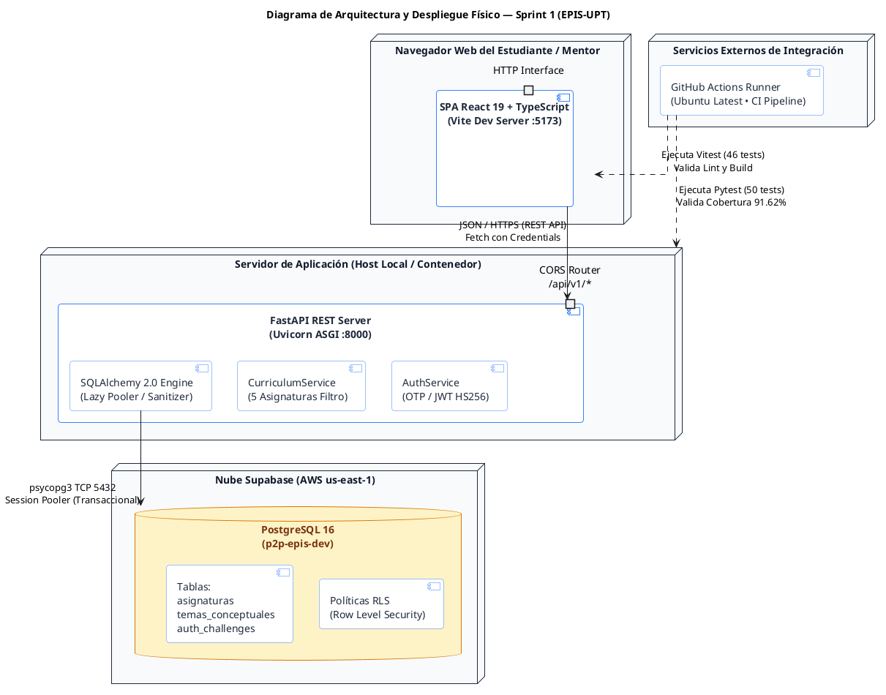

### 1.2. Diagrama de Paquetes y Capas de Software Desacopladas (Sprint 1)
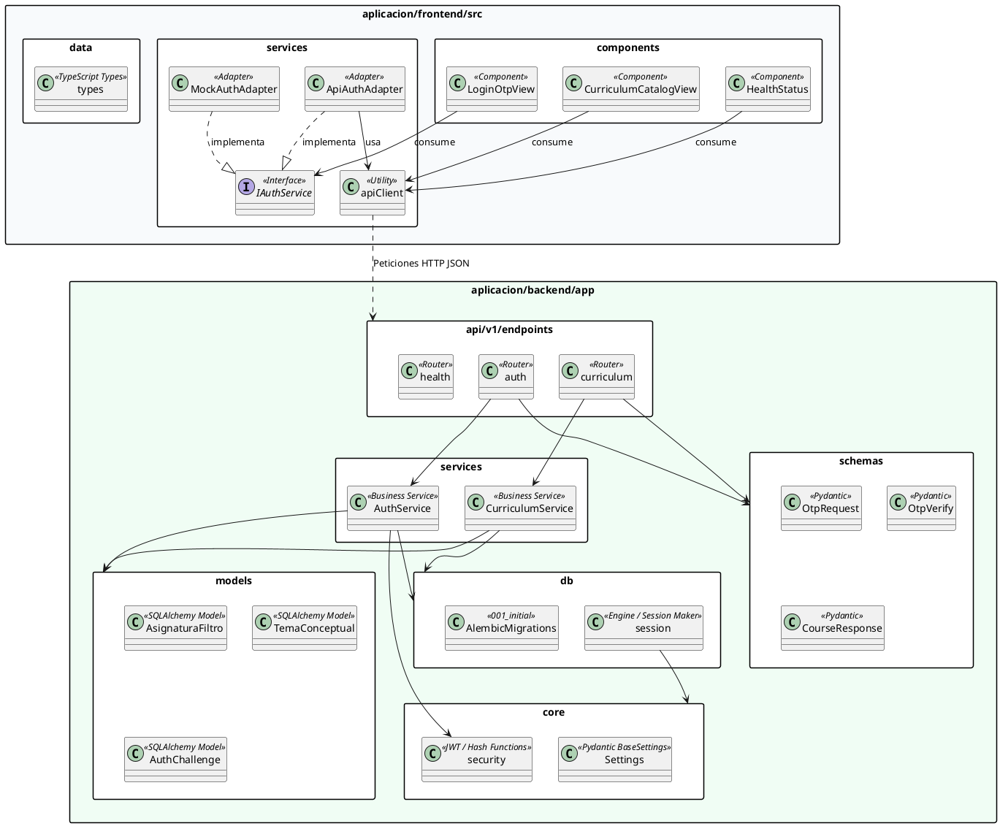

### 1.3. Diagrama Entidad-Relación Físico de Base de Datos (Sprint 1)
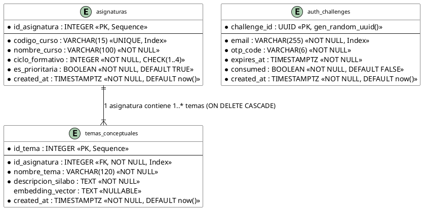

### 1.4. Secuencia Técnica: Monitoreo de Salud y Conexión de Base de Datos
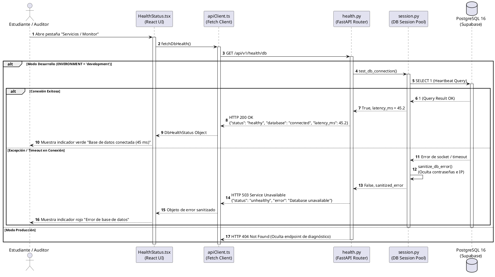

### 1.5. Secuencia Técnica: Solicitud de Desafío OTP Institucional
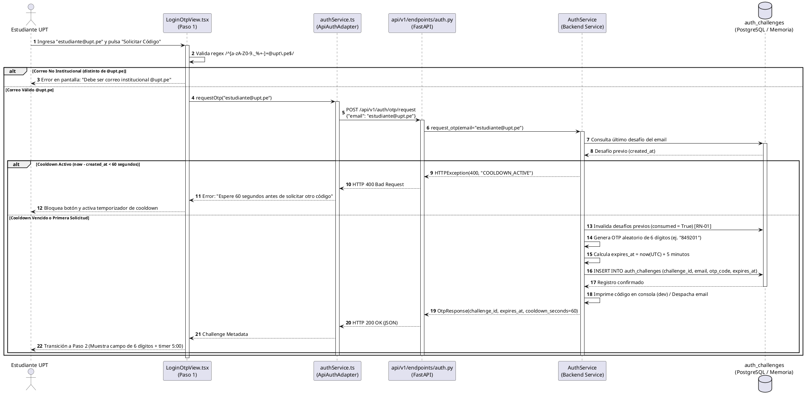

### 1.6. Secuencia Técnica: Verificación OTP y Emisión de Sesión JWT
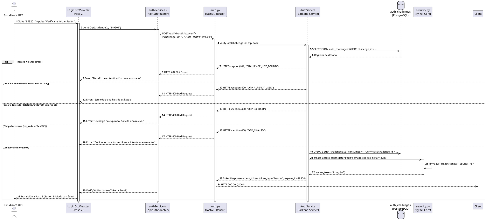

### 1.7. Secuencia Técnica: Consulta y Filtrado del Catálogo Curricular
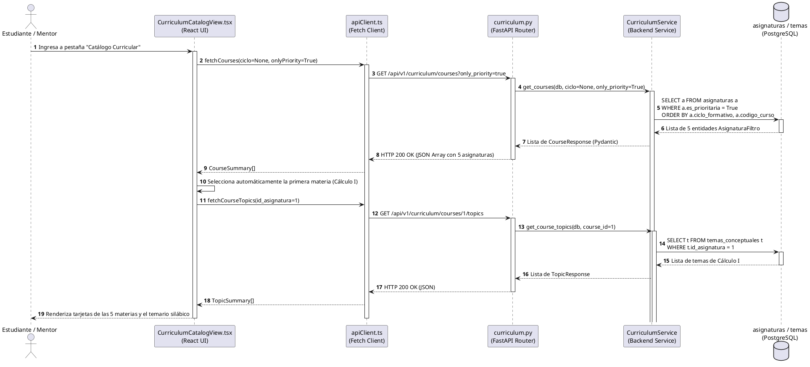

### 1.8. Máquina de Estados del Desafío OTP (Sprint 1)
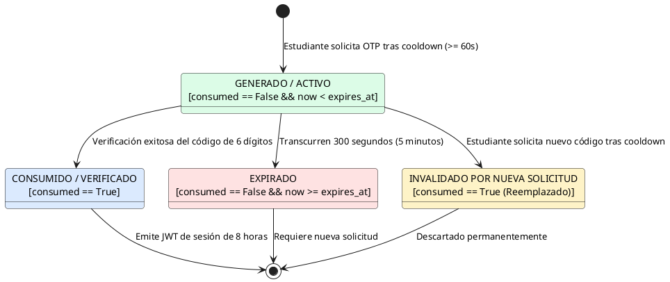

---

## 2. Diagramas de Diseño Técnico — Sprint 2

### 2.1. Arquitectura de Despliegue Físico y Comunicación Multi-Capa (Sprint 2)
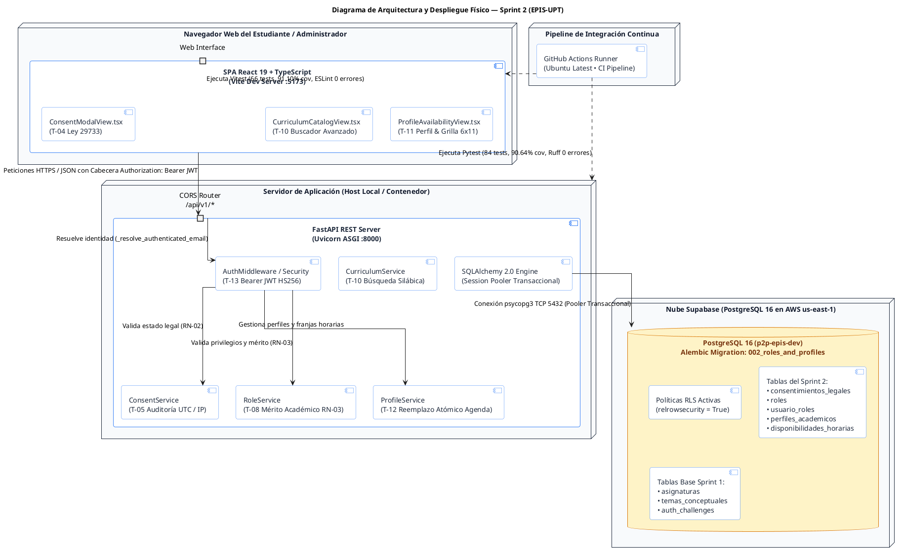

### 2.2. Diagrama de Paquetes y Capas de Software Desacopladas (Sprint 2)
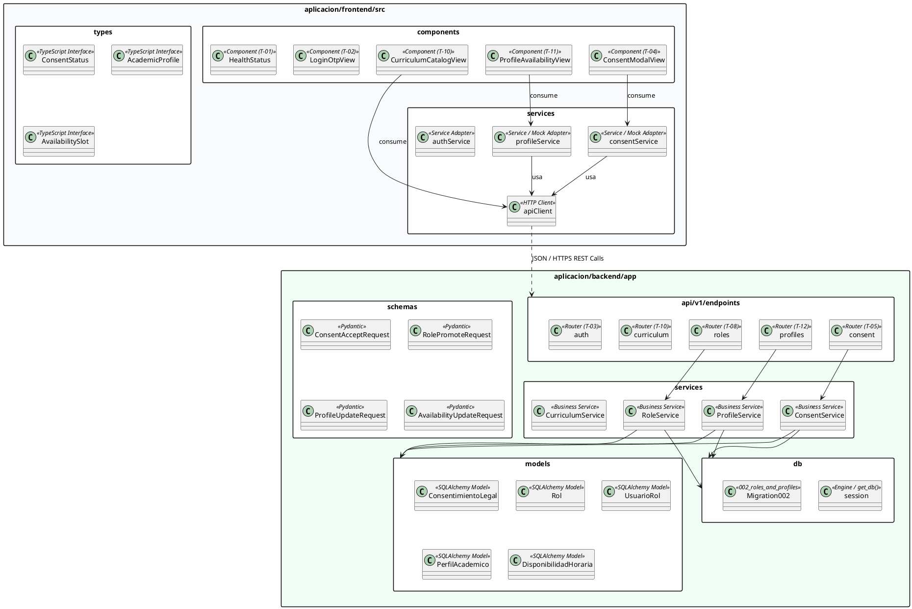

### 2.3. Diagrama Entidad-Relación Físico de Base de Datos (Sprint 2)
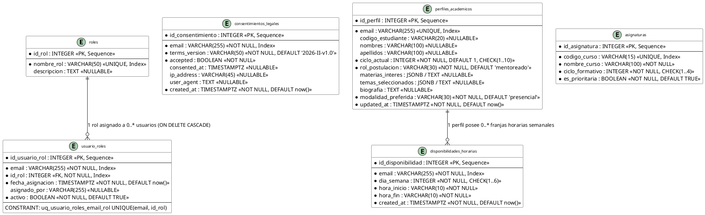

### 2.4. Diagrama de Casos de Uso del Sprint 2
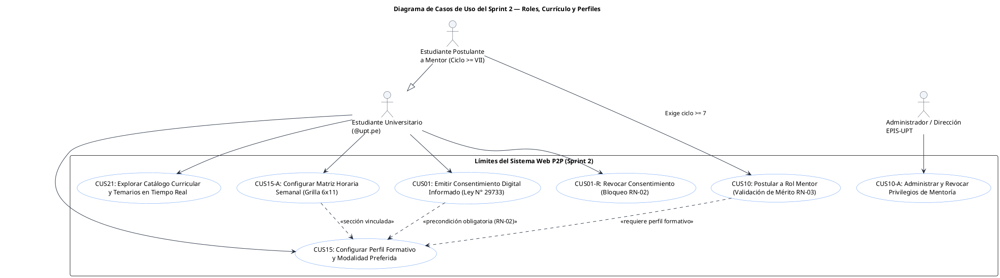

### 2.5. Secuencia Técnica: Registro y Validación de Consentimiento Informado (T-04 / T-05)
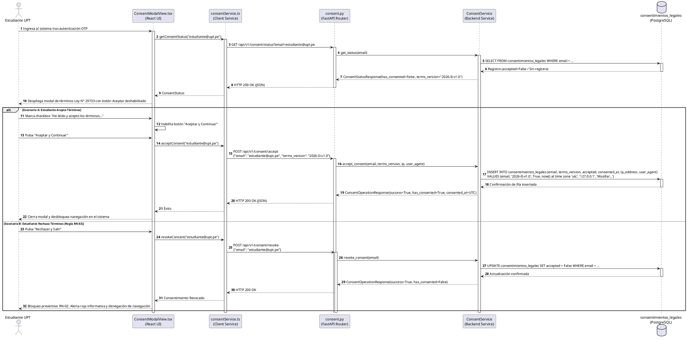

### 2.6. Secuencia Técnica: Asignación de Roles y Verificación de Mérito Académico (T-08 / RN-03)
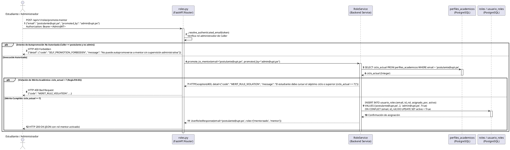

### 2.7. Secuencia Técnica: Configuración de Perfil Formativo y Reemplazo Atómico de Matriz Horaria (T-11 / T-12)
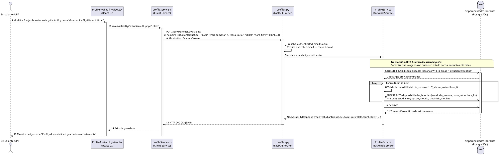

### 2.8. Secuencia Técnica: Aislamiento Criptográfico y Seguridad Multi-Usuario RLS (T-13 / RNF02)
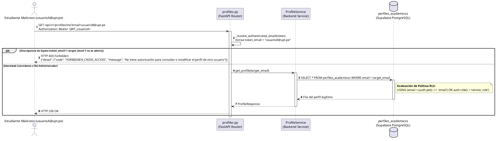

### 2.9. Máquinas de Estado del Ciclo de Vida del Consentimiento Legal y del Rol de Usuario
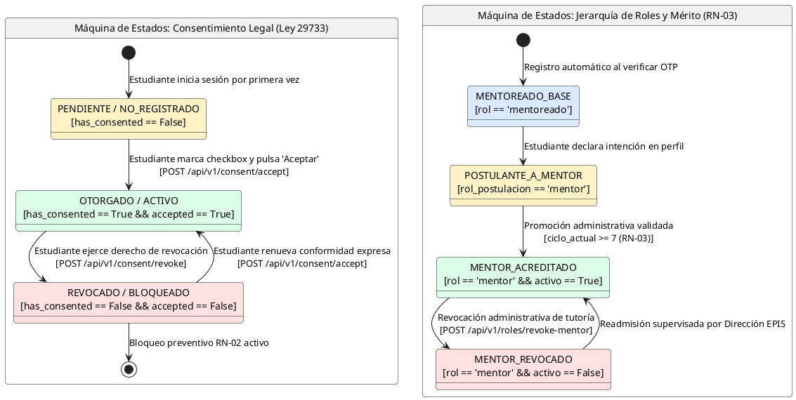

---

## 3. Diagramas de Diseño Técnico — Sprint 3

### 3.1. Arquitectura y Despliegue Físico de Componentes (Sprint 3)
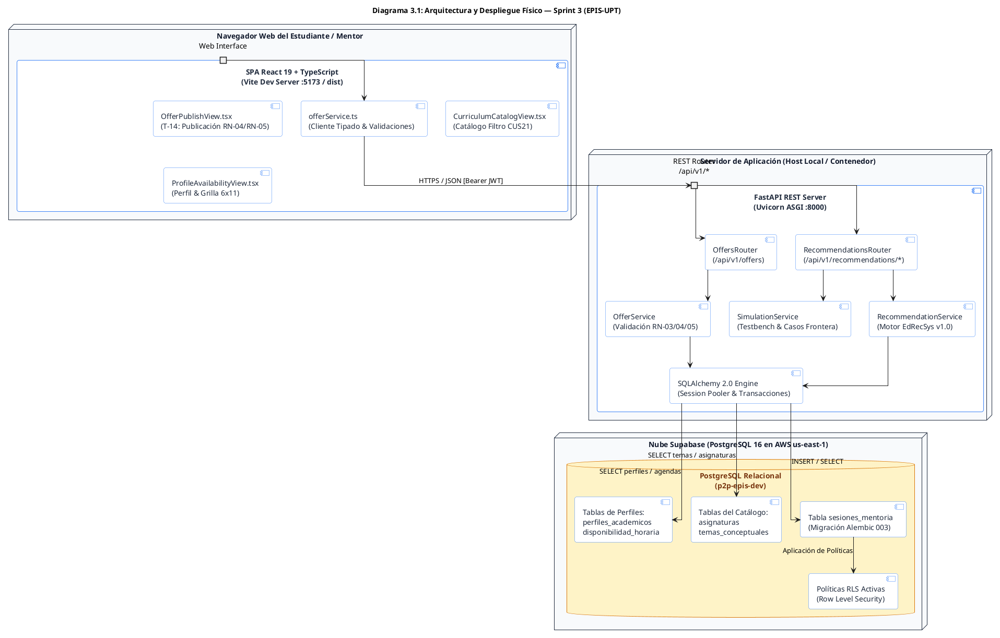

### 3.2. Secuencia Técnica: Publicación de Oferta de Mentoría (T-14 / T-15 / T-16)
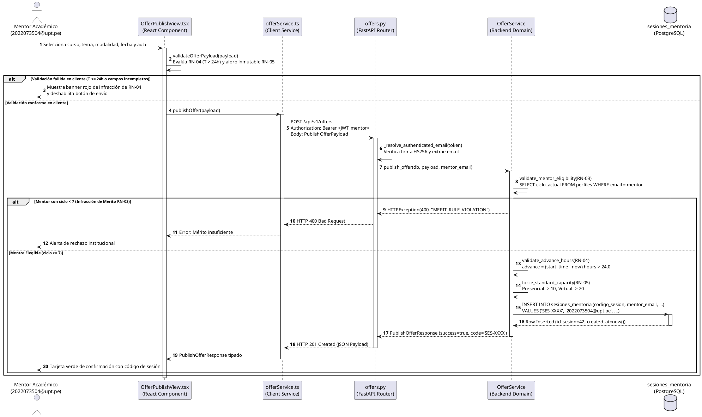

### 3.3. Secuencia Técnica: Recomendación Top-k de Mentores y Ofertas (EdRecSys v1.0)
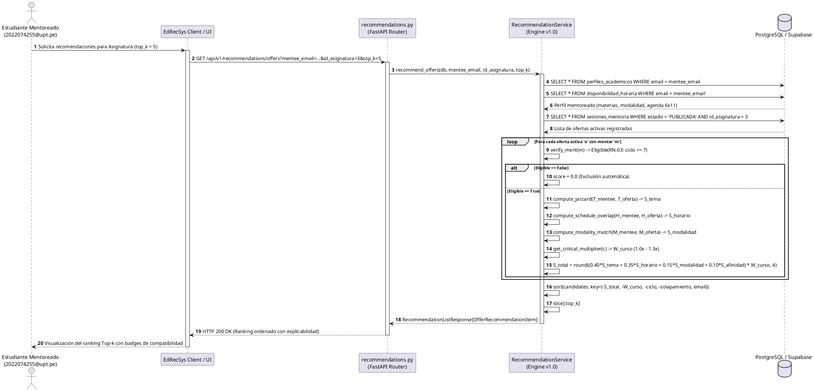

### 3.4. Diagrama de Clases del Dominio de Ofertas y Recomendación
```plantuml
@startuml
skinparam shadowing false
skinparam defaultFontName Arial
skinparam classAttributeIconSize 0

class SesionMentoria {
    + id_sesion : int <<PK>>
    + codigo_sesion : str <<Unique>>
    + mentor_email : str <<FK>>
    + id_asignatura : int <<FK>>
    + id_tema : int <<FK>>
    + fecha_inicio : datetime
    + duracion_minutos : int (60, 90)
    + modalidad : str ('presencial', 'virtual')
    + aforo_maximo : int (10, 20)
    + espacio_asignado : str
    + notas_adicionales : str
    + estado : str
    + created_at : datetime
}

class OfferService {
    + publish_offer(db, payload, caller_email) : PublishOfferResponse
    + list_active_offers(db, filters) : List[OfferResponse]
    + get_offer_by_code(db, codigo_sesion) : OfferResponse
    - _validate_mentor_merit(db, mentor_email) : bool
    - _compute_advance_hours(start_time) : float
}

class RecommendationService {
    + recommend_mentors(db, mentee_email, top_k) : RecommendationListResponse
    + recommend_offers(db, mentee_email, id_asignatura, top_k) : RecommendationListResponse
    + explain_recommendation(db, req) : RecommendationExplainResponse
    + compute_jaccard(set_a, set_b) : float
    + compute_dice(set_a, set_b) : float
    + compute_schedule_overlap(grid_a, grid_b) : float
    + get_course_multiplier(course_id) : float
}

class SimulationService {
    + generate_synthetic_cohorts(size) : List[SyntheticStudent]
    + evaluate_edge_cases() : EdgeCaseEvaluationReport
    + evaluate_determinism(iterations) : DeterminismReport
    + run_latency_benchmark() : BenchmarkMetrics
}

SesionMentoria <-- OfferService : gestiona y persiste
OfferService ..> RecommendationService : provee ofertas activas
RecommendationService ..> SimulationService : sometido a testbench
@enduml
```

### 3.5. Máquina de Estados del Ciclo de Vida de la Sesión de Mentoría (sesiones_mentoria)
```plantuml
@startuml
skinparam shadowing false
skinparam defaultFontName Arial
skinparam roundCorner 8

state "Máquina de Estados: Ciclo de Vida de Sesión de Mentoría (sesiones_mentoria)" as SM_Oferta {
    state "PUBLICADA\n[Visible en recomendador y catálogo]" as S_Publicada #DBEAFE
    state "PENDIENTE_CONFIRMACION\n[Ventana T-24h con quórum insuficiente]" as S_Pendiente #FEF3C7
    state "CONFIRMADA\n[Quórum alcanzado o ratificado por mentor]" as S_Confirmada #DCFCE7
    state "CANCELADA_SISTEMA\n[Corte T-24h sin quórum mínimo (RN-09)]" as S_CancSistema #FEE2E2
    state "CANCELADA_MENTOR\n[Cancelada voluntariamente por mentor]" as S_CancMentor #FEE2E2
    state "FINALIZADA\n[Sesión impartida y asistencia registrada]" as S_Finalizada #E2E8F0

    [*] --> S_Publicada : Mentor publica oferta con antelación > 24h (RN-04)
    
    S_Publicada --> S_Confirmada : Inscripciones alcanzan quórum mínimo (CUS24)
    S_Publicada --> S_Pendiente : Arribo a ventana T-24h con quórum insuficiente (CUS23)
    S_Publicada --> S_CancMentor : Mentor cancela clase con antelación debida (CUS07)

    S_Pendiente --> S_Confirmada : Mentor decide ratificar clase con quórum reducido
    S_Pendiente --> S_CancSistema : Expiración de ventana de gracia sin ratificación (RN-09)

    S_Confirmada --> S_Finalizada : Clase ejecutada y bitácora docente firmada (CUS08)
    S_Confirmada --> S_CancMentor : Fuerza mayor con notificación a inscritos

    S_CancSistema --> [*] : Cupos liberados y notificación automática
    S_CancMentor --> [*] : Cupos liberados y notificación automática
    S_Finalizada --> [*] : Horas computadas para certificación de servicio
}
@enduml
```

### 3.6. Componentes del Motor EdRecSys v1.0 y Pipeline de Scoring
```plantuml
@startuml
skinparam shadowing false
skinparam defaultFontName Arial
skinparam componentStyle rectangle

package "Pipeline EdRecSys v1.0" {
    component "Filtro de Mérito (RN-03)\nciclo_actual >= 7" as C_Merit
    component "Similitud Temática\nJaccard / Dice (40%)" as C_Tema
    component "Compatibilidad Horaria\nGrilla Semanal 6x11 (35%)" as C_Hora
    component "Alineación Modalidad\nPresencial / Virtual / Híbrida (15%)" as C_Mod
    component "Afinidad Curricular\nIntereses Formativos (10%)" as C_Afin
    component "Multiplicador Crítico\nW_curso (1.0x - 1.3x)" as C_Mult
    component "Ranker & Tie-Breaker\nDeterminista" as C_Rank
}

[Candidato / Oferta] --> C_Merit
C_Merit --> C_Tema : Elegible == True
C_Merit --> [Exclusión Score 0.0] : Elegible == False
C_Tema --> C_Rank
C_Hora --> C_Rank
C_Mod --> C_Rank
C_Afin --> C_Rank
C_Rank --> C_Mult
C_Mult --> [Top-k Lista Ordenada]
@enduml
```

### 3.7. Flujo del Testbench Algorítmico y Casos Frontera (T-18)
```plantuml
@startuml
skinparam shadowing false
skinparam defaultFontName Arial
skinparam roundCorner 8

start
:Generar cohorte sintética (10 ciclos EPIS-UPT);
partition "Evaluación de Casos Frontera" {
    :Caso 1: Solapamiento horario = 0 (|Hm ∩ Hk| = 0);
    note right: S_horario = 0.0000 (sin colapso)
    :Caso 2: Temas silábicos disjuntos;
    note right: Jaccard = 0.0000, Dice = 0.0000
    :Caso 3: Asignatura sin ofertas en catálogo;
    note right: items: [] con HTTP 200 OK
    :Caso 4: Exclusión de mérito RN-03 (ciclo < 7);
    note right: Score = 0.0, Fuga = 0.00%
}
partition "Test de Determinismo" {
    :Ejecutar 5 iteraciones barajando candidatos;
    :Comparar tuplas Top-k resultantes;
    note right: 100% idénticas byte a byte
}
partition "Benchmark de Latencia (RNF03)" {
    :Evaluar latencia sobre 24 pares;
    note right: Latencia media = 35.8 µs / candidato\nTotal = 0.86 ms (< 50 ms)
}
:Emitir reporte formal en /simulation/testbench;
stop
@enduml
```

### 3.8. Diagrama Entidad-Relación Físico de Base de Datos (Sprint 3)
```plantuml
@startuml
skinparam shadowing false
skinparam defaultFontName Arial
skinparam roundCorner 8
skinparam linetype ortho

skinparam class {
    BackgroundColor #FFFFFF
    BorderColor #1E293B
    HeaderBackgroundColor #F1F5F9
}

entity "asignaturas" as ASIG {
    * id_asignatura : INTEGER <<PK>>
    --
    codigo_curso : VARCHAR(20) <<Unique>>
    nombre_curso : VARCHAR(150)
    ciclo_plan : INTEGER
    creditos : INTEGER
    factor_ponderacion : NUMERIC(3,1)
}

entity "temas_conceptuales" as TEMA {
    * id_tema : INTEGER <<PK>>
    --
    * id_asignatura : INTEGER <<FK>>
    nombre_tema : VARCHAR(150)
    unidad_silabica : INTEGER
}

entity "sesiones_mentoria" as SES {
    * id_sesion : INTEGER <<PK, autoincrement>>
    --
    * codigo_sesion : VARCHAR(20) <<Unique, B-Tree>>
    * mentor_email : VARCHAR(255) <<B-Tree>>
    * id_asignatura : INTEGER <<FK, B-Tree>>
    * id_tema : INTEGER <<FK, B-Tree>>
    * fecha_inicio : TIMESTAMPTZ <<B-Tree>>
    * duracion_minutos : INTEGER <<CHECK (60, 90)>>
    * modalidad : VARCHAR(20) <<CHECK ('presencial', 'virtual')>>
    * aforo_maximo : INTEGER <<CHECK (10, 20)>>
    * espacio_asignado : VARCHAR(255)
    notas_adicionales : TEXT
    * estado : VARCHAR(30) <<CHECK ('PUBLICADA', 'CONFIRMADA', ...)>>
    * created_at : TIMESTAMPTZ <<DEFAULT now()>>
}

entity "perfiles_academicos" as PERF {
    * id_perfil : INTEGER <<PK>>
    --
    * email : VARCHAR(255) <<Unique, B-Tree>>
    codigo_estudiante : VARCHAR(20)
    nombres : VARCHAR(100)
    apellidos : VARCHAR(100)
    * ciclo_actual : INTEGER <<CHECK (1..10)>>
    rol_postulacion : VARCHAR(20)
    materias_interes : JSONB
    temas_seleccionados : JSONB
    modalidad_preferida : VARCHAR(20)
}

entity "disponibilidad_horaria" as DISP {
    * id_disponibilidad : INTEGER <<PK>>
    --
    * email : VARCHAR(255) <<FK, B-Tree>>
    * dia_semana : INTEGER <<CHECK (1..6)>>
    * hora_inicio : VARCHAR(5)
    * hora_fin : VARCHAR(5)
}

ASIG ||..o{ TEMA : "1 a N (temario)"
ASIG ||..o{ SES : "id_asignatura [RESTRICT]"
TEMA ||..o{ SES : "id_tema [RESTRICT]"
PERF ||..o{ DISP : "email [CASCADE]"
PERF ||..o{ SES : "mentor_email (RN-03: ciclo >= 7)"
@enduml
```

### 3.9. Diagrama de Casos de Uso del Sprint 3
```plantuml
@startuml
skinparam shadowing false
skinparam defaultFontName Arial
left to right direction

actor "Mentor Académico\n(Ciclo VII-X)" as Mentor #DBEAFE
actor "Estudiante Mentoreado\n(Ciclo I-IV)" as Mentee #DCFCE7
actor "Sistema P2P\n(Cron Job T-24h)" as System #FEE2E2

rectangle "Sistema Web P2P — Casos de Uso Sprint 3" {
    usecase "CUS06: Publicar Oferta de Mentoría\n(RN-04 >24h, RN-05 Aforo)" as UC_Publish
    usecase "CUS02: Recomendación Top-k de Mentores y Ofertas\n(EdRecSys v1.0)" as UC_Rec
    usecase "CUS21: Consulta Silábica Avanzada\n(Filtro de Materias I-IV)" as UC_Catalog
    usecase "CUS23: Corte de Antelación y Quórum T-24h\n(Evaluación Automática RN-08/RN-09)" as UC_Cron
    usecase "Validar Mérito Académico\n(RN-03: ciclo >= 7)" as UC_Merit
    usecase "Asignar Recinto Físico o Meet\n(RN-06 Lab EPIS / RN-07 Google Meet)" as UC_Infra
}

Mentor --> UC_Publish
Mentor --> UC_Catalog
Mentee --> UC_Rec
Mentee --> UC_Catalog
System --> UC_Cron

UC_Publish ..> UC_Merit : <<include>>
UC_Publish ..> UC_Infra : <<include>>
UC_Publish ..> UC_Catalog : <<include>>
UC_Rec ..> UC_Merit : <<include>> (Score 0.0 si ciclo < 7)
UC_Cron ..> UC_Publish : <<extends>> (Transición de estado)
@enduml
```

---

## 4. Diagramas de Diseño Técnico — Sprint 4

### 4.1. Diagrama de Casos de Uso del Sprint 4
```plantuml
@startuml
skinparam shadowing false
skinparam defaultFontName Arial
left to right direction

actor "Estudiante Mentoreado\n(Ciclo I-IV)" as Mentee #DCFCE7
actor "Estudiante Mentor\n(Ciclo VII-X)" as Mentor #DBEAFE
actor "Sistema P2P\n(Demonio Cron T-24h)" as System #FEE2E2

rectangle "Sistema Web P2P — Casos de Uso Sprint 4" {
    usecase "CUS02: Explorar Feed de Recomendaciones Top-k\n(EdRecSys v1.0 + XAI)" as UC_Feed
    usecase "CUS04: Reservar Cupo con Control de Aforo\n(Bloqueo Pesimista ACID)" as UC_Booking
    usecase "CUS03: Registrar Solicitud Temática por Demanda\n(Empty-State en Catálogo)" as UC_Demand
    usecase "CUS12: Visualizar Prioridad Curricular EPIS\n(Multiplicador 1.0x-1.3x)" as UC_Priority
    usecase "CUS24: Confirmar Asistencia Anticipada\n(Ventana T-24h / Pre-Sprint 5)" as UC_Confirm
    usecase "CUS23: Evaluar Corte de Antelación y Quórum\n(Mínimo 50% / Pre-Sprint 6)" as UC_Quorum
}

Mentee --> UC_Feed
Mentee --> UC_Booking
Mentee --> UC_Demand
Mentee --> UC_Confirm
Mentor --> UC_Demand : atiende demanda
System --> UC_Quorum

UC_Feed ..> UC_Priority : <<include>>
UC_Booking ..> UC_Feed : <<extends>>
UC_Demand ..> UC_Feed : <<extends>> (anteposterior lista vacía)
UC_Confirm ..> UC_Booking : <<precede>> (estado PENDIENTE_CONFIRMACION)
UC_Quorum ..> UC_Confirm : <<evalúa>> (cómputo de ratificados)
@enduml
```

### 4.2. Modelo Entidad-Relación Físico — Reservas y Sesiones de Mentoría (Sprint 4)
```plantuml
@startuml
skinparam shadowing false
skinparam defaultFontName Arial
skinparam roundCorner 8
skinparam linetype ortho

title Modelo Entidad-Relación — Sprint 4: Reservas y Quórum (EPIS-UPT)

entity "usuarios" as USR {
    * email : VARCHAR(255) <<PK>>
    --
    rol_principal : VARCHAR(20)
    created_at : TIMESTAMPTZ
}

entity "sesiones_mentoria" as SES {
    * id_sesion : INTEGER <<PK>>
    --
    * codigo_sesion : VARCHAR(20) <<Unique>>
    * mentor_email : VARCHAR(255) <<FK>>
    * id_asignatura : INTEGER <<FK>>
    * id_tema : INTEGER <<FK>>
    * fecha_inicio : TIMESTAMPTZ
    * duracion_minutos : INTEGER
    * modalidad : VARCHAR(20)
    * aforo_maximo : INTEGER <<10 o 20 (RN-05)>>
    * espacio_asignado : VARCHAR(255)
    * estado : VARCHAR(30)
}

entity "reservas_cupo" as RES {
    * id_reserva : INTEGER <<PK>>
    --
    * codigo_reserva : VARCHAR(20) <<Unique>>
    * id_sesion : INTEGER <<FK, B-Tree>>
    * estudiante_email : VARCHAR(255) <<FK, B-Tree>>
    * estado : VARCHAR(30) <<CHECK>>
    * fecha_reserva : TIMESTAMPTZ
    fecha_ratificacion : TIMESTAMPTZ
    motivo_cancelacion : TEXT
    ticket_hash : VARCHAR(64)
}

entity "solicitudes_demanda" as DEM {
    * id_demanda : INTEGER <<PK>>
    --
    * estudiante_email : VARCHAR(255) <<FK>>
    * id_asignatura : INTEGER <<FK>>
    * id_tema : INTEGER <<FK>>
    observaciones : TEXT
    * estado : VARCHAR(20)
    * created_at : TIMESTAMPTZ
}

USR ||..o{ SES : "dicta como mentor (RN-03)"
USR ||..o{ RES : "inscribe cupo como mentoreado"
USR ||..o{ DEM : "registra necesidad formativa (CUS03)"
SES ||..o{ RES : "aloja hasta aforo_maximo (RN-05 / RNF07)"
@enduml
```

### 4.3. Diagrama de Ciclo de Vida y Máquina de Estados — Entidad `reservas_cupo` (Sprint 4)
```plantuml
@startuml
title Ciclo de Vida y Transiciones de la Entidad ReservaCupo (Sistema Web P2P EPIS-UPT)
skinparam shadowing false
skinparam defaultFontName Arial
skinparam roundcorner 8

[*] --> PENDIENTE_CONFIRMACION : 1. Reserva formalizada\n[Cupo libre en aforo RN-05]

PENDIENTE_CONFIRMACION --> CONFIRMADA : 2. Ratificación voluntaria\n[now() < fecha_inicio - 24h (RN-08)]
PENDIENTE_CONFIRMACION --> CANCELADA_USUARIO : 3. Desistimiento voluntario\n[now() < fecha_inicio - 24h (RN-10)]
PENDIENTE_CONFIRMACION --> NO_CONFIRMADA : 4. Corte automático T-24h\n[now() >= fecha_inicio - 24h sin ratificar]

CONFIRMADA --> CANCELADA_USUARIO : 5. Desistimiento extraordinario\n[Antes del inicio de la sesión]
CONFIRMADA --> CANCELADA_SISTEMA : 6. Sesión cancelada por falta de quórum\n[Mentor resuelve cancelar (CUS07/RN-10)]
CONFIRMADA --> ASISTIDA : 7. Asistencia presencial/virtual registrada\n[Mentor cierra bitácora CUS08]
CONFIRMADA --> INASISTENCIA : 8. Inasistencia constatada\n[Mentor marca falta en CUS08/RN-12]

CANCELADA_USUARIO --> [*]
NO_CONFIRMADA --> [*]
CANCELADA_SISTEMA --> [*]
ASISTIDA --> [*]
INASISTENCIA --> [*]
@enduml
```

### 4.4. Diagrama de Secuencia Técnica entre Capas — Reserva Transaccional Concurrente (Sprint 4)
```plantuml
@startuml
autonumber
skinparam style strictuml
skinparam BoxPadding 10
skinparam ParticipantPadding 10
skinparam defaultFontName Arial

box "Capa de Presentación (React SPA)" #E8EEF5
participant "BookingModalView\n(React Component)" as UI
participant "bookingService\n(TypeScript API Client)" as FEService
end box

box "Capa de API & Dominio (FastAPI)" #FAF5E8
participant "BookingsRouter\n(/api/v1/bookings)" as Router
participant "BookingService\n(Transaction Coordinator)" as BEService
end box

box "Persistencia (PostgreSQL / Supabase)" #F5E8E8
database "sesiones_mentoria\n(PostgreSQL Table)" as DBSesion
database "reservas_cupo\n(PostgreSQL Table)" as DBReserva
end box

== Flujo de Reserva Transaccional Concurrente (T-21 a T-24 / CUS04 / RF12) ==
UI -> FEService : reserveSeat(sessionId, studentEmail)
FEService -> Router : POST /api/v1/bookings/reserve [Bearer JWT]
Router -> BEService : reserve_seat(db, payload, caller_email)

group Transacción ACID Aislada (session.begin())
    BEService -> DBSesion : SELECT * FROM sesiones_mentoria WHERE id_sesion = :id FOR UPDATE
    note right: Candado pesimista de fila.\nEncola peticiones concurrentes.
    DBSesion --> BEService : Fila de sesión bloqueada (aforo_maximo: 10 o 20)
    
    BEService -> BEService : Validar reglas de guarda\n- estado == 'PUBLICADA'\n- fecha_inicio > now() + 24h (RN-04)\n- studentEmail != mentor_email
    
    BEService -> DBReserva : SELECT COUNT(*) FROM reservas_cupo\nWHERE id_sesion = :id AND estado IN ('PENDIENTE_CONFIRMACION', 'CONFIRMADA')
    DBReserva --> BEService : n_ocupados
    
    alt n_ocupados < aforo_maximo (Vacante Disponible)
        BEService -> DBReserva : INSERT INTO reservas_cupo (codigo, id_sesion, email, estado='PENDIENTE_CONFIRMACION')
        DBReserva --> BEService : Inserción exitosa (id_reserva, codigo='RES-XXXX')
        BEService -> DBSesion : Commit de transacción (libera candado FOR UPDATE)
        BEService --> Router : BookingResponse (HTTP 201 Created)
        Router --> FEService : 201 Created JSON
        FEService --> UI : Desplegar ticket de confirmación provisional y advertencia T-24h
    else n_ocupados >= aforo_maximo (Sobrecupo Evitado)
        BEService -> DBSesion : Rollback de transacción (libera candado)
        BEService --> Router : HTTP 409 Conflict (CAPACITY_EXCEEDED)
        Router --> FEService : 409 Conflict JSON
        FEService --> UI : Notificar aforo completo y sugerir registrar demanda (CUS03)
    end
end
@enduml
```

---
*Fin del repositorio — Bóveda Centralizada de Diagramas de Diseño Técnico.*
