# DIAGRAMAS DE SECUENCIA CONSOLIDADOS - FASE DE DISEÑO

**Sistema Web P2P de Mentorías Universitarias - EPIS UPT**
**Versión:** 2.0 (Fase de Diseño / Arquitectura y Construcción)
**Autores:** Antayhua Mamani, Renzo Antonio / Medina Quispe, Joan Carlos

---

## 6.3.3. Diagramas de Secuencia del Sistema (Fase de Diseño)

### Presentación de los Diagramas de Secuencia en Fase de Diseño

En la presente **Fase de Diseño de Software**, los diagramas de secuencia formalizan el comportamiento dinámico, la sincronización de procesos y el orden cronológico estricto de los mensajes entre componentes para los **24 casos de uso canónicos** (`CUS-001` a `CUS-024`) del Sistema Web P2P de Mentorías Universitarias de la EPIS-UPT, distribuidos a través de sus **8 módulos arquitectónicos** (`MOD-01` a `MOD-08`).

Cada diagrama desglosa de manera exhaustiva las responsabilidades y mensajes a través de las capas técnicas del sistema:
1. **Actores del Sistema:** Estudiante Mentoreado (`UserRole.mentoreado`), Estudiante Mentor (`UserRole.mentor`), Administrador Institucional (`UserRole.administrador`), Director de Escuela EPIS, Coordinador Académico/Curricular, Comisión de Acreditación ICACIT, y Procesos en Segundo Plano (`SchedulerWorker` / Celery / APScheduler).
2. **Componente de Presentación / Vista React (`.tsx`):** Vistas SPA construidas con React 18, TypeScript y Tailwind CSS (`LoginOtpView.tsx`, `ConsentModalView.tsx`, `AdminDashboardView.tsx`, `OfferPublishView.tsx`, `ProfileAvailabilityView.tsx`, `CurriculumCatalogView.tsx`, `RecommendationFeedView.tsx`, `BookingModalView.tsx`, `StudentBookingsView.tsx`, `MentorSessionsView.tsx`, `SessionAttendanceView.tsx`, `BitacoraFormView.tsx`, `HistorySessionsView.tsx`, `CertificateView.tsx`, `GamificationView.tsx`, `NotificationBell.tsx`, `AnalyticsDashboardView.tsx`, `RetentionDashboardView.tsx`, `AuditLogView.tsx`, `SystemSettingsView.tsx`, `AdminCurriculumView.tsx`).
3. **Servicio y Adaptador Cliente (`.ts`):** Clientes HTTP tipados basados en Axios/Fetch (`authService.ts`, `consentService.ts`, `roleService.ts`, `offerService.ts`, `profileService.ts`, `curriculumService.ts`, `recommendationService.ts`, `bookingService.ts`, `attendanceService.ts`, `bitacoraService.ts`, `historyService.ts`, `certificateService.ts`, `gamificationService.ts`, `notificationService.ts`, `analyticsService.ts`, `auditService.ts`, `configService.ts`).
4. **Controlador y Rutas FastAPI (`.py`):** Endpoints RESTful en `app/api/v1/endpoints/` (`auth.py`, `consent.py`, `roles.py`, `offers.py`, `profiles.py`, `curriculum.py`, `recommendations.py`, `bookings.py`, `quorum.py`, `attendance.py`, `bitacora.py`, `history.py`, `certificates.py`, `gamification.py`, `notifications.py`, `analytics.py`, `audit.py`, `config.py`), con validación de esquemas Pydantic y autorización RBAC vía tokens JWT criptográficos (HS256).
5. **Servicio de Lógica de Negocio Backend (`.py`):** Capa de servicios (`auth_service.py`, `consent_service.py`, `role_service.py`, `offer_service.py`, `profile_service.py`, `curriculum_service.py`, `recommendation_service.py`, `booking_service.py`, `simulation_service.py`, `attendance_service.py`, `bitacora_service.py`, `history_service.py`, `certificate_service.py`, `reputation_service.py`, `notification_service.py`, `analytics_service.py`, `audit_service.py`, `config_service.py`).
6. **Persistencia Relacional PostgreSQL / Repositorio (SQLAlchemy ORM / Cerrojos):** Modelos de datos en Supabase/PostgreSQL con control estricto de concurrencia (`SELECT ... FOR UPDATE`, `SET LOCAL lock_timeout = '5.0s'`, transacciones ACID `db.begin()` / `db.commit()` / `db.rollback()`, políticas RLS e integridad referencial).
7. **Servicios Externos:** Servidor SMTP institucional de la Universidad Privada de Tacna (`EmailService`), generación de documentos PDF oficiales y canales WebSockets / Server-Sent Events (SSE).

### Diagrama 6.15: Diagrama de Secuencia General del Ciclo Transaccional de Mentorías

El diagrama general de secuencia formaliza la visión holística de los flujos temporales y de sincronización entre capas técnicas para el proceso transaccional neurálgico de la plataforma: la orquestación concurrente de Reserva de Cupos (`CUS-004`), Ratificación de Asistencia antes de $T-24	ext{ h}$ (`CUS-024`), y Corte Automatizado de Quórum en $T-24	ext{ h}$ (`CUS-023`) con resolución de contingencia del mentor (`CUS-007`).

```plantuml
@startuml
title Diagrama 6.15: Diagrama de Secuencia General del Ciclo de Reserva, Ratificación y Quórum
Sistema Web P2P - EPIS UPT

autonumber
skinparam shadowing false
skinparam roundcorner 8
skinparam defaultFontName Arial
skinparam fontSize 11
skinparam sequenceBoxBorderColor #1E3A8A
skinparam sequenceBoxBackgroundColor #F0F4F8

actor "Estudiante Mentoreado" as User
participant "Vista React (SPA)
(BookingModal / StudentBookings)" as UI
participant "Adaptador Cliente
(bookingService.ts)" as Client
participant "Controlador FastAPI
(endpoints/bookings.py)" as API
participant "Servicio Backend
(booking_service.py)" as Service
database "PostgreSQL DB
(SQLAlchemy / Supabase)" as DB
participant "Planificador Cron
(Celery / SchedulerWorker)" as Cron
participant "Servicio Email
(SMTP UPT)" as Mail
actor "Estudiante Mentor" as Mentor

== 1. Reserva Concurrente de Cupo (CUS-004) ==
User -> UI: Clic en "Reservar Cupo" (idSesion)
activate UI
UI -> Client: reserveSeat(idSesion)
activate Client
Client -> API: POST /api/v1/bookings/reserve {"id_sesion": idSesion} [Bearer JWT]
activate API
API -> Service: reserve_seat(idSesion, user_email)
activate Service
Service -> DB: BEGIN TRANSACTION
activate DB
Service -> DB: SELECT * FROM sesiones_mentoria WHERE id = :idSesion FOR UPDATE OF sesiones_mentoria
DB --> Service: Registro Sesion (aforo, cupos_ocupados)
alt Cupos disponibles > 0 y Elegibilidad Validada
    Service -> DB: INSERT INTO reservas_cupo (id_usuario, id_sesion, estado='PENDIENTE_CONFIRMACION', ticket_hash=SHA256(...))
    Service -> DB: UPDATE sesiones_mentoria SET cupos_ocupados = cupos_ocupados + 1 WHERE id = :idSesion
    Service -> DB: COMMIT
    DB --> Service: Transacción confirmada
    Service --> API: BookingResponseDTO {idReserva, estado: 'PENDIENTE_CONFIRMACION'}
    API --> Client: HTTP 201 Created {idReserva, estado: 'PENDIENTE_CONFIRMACION'}
    Client --> UI: Comprobante provisional
    UI --> User: Muestra confirmación y plazo hasta T-24h
else Conflicto de aforo o estudiante no elegible
    Service -> DB: ROLLBACK
    Service --> API: Lanza HTTPException(409, "Aforo agotado o colisión concurrente")
    API --> Client: HTTP 409 Conflict {"detail": "Aforo agotado"}
    Client --> UI: Captura error 409
    UI --> User: Alerta de denegación de reserva
end
deactivate DB
deactivate Service
deactivate API
deactivate Client
deactivate UI

== 2. Ratificación de Asistencia antes de T-24h (CUS-024) ==
User -> UI: Clic en "Confirmar Asistencia" (idReserva)
activate UI
UI -> Client: confirmBooking(idReserva)
activate Client
Client -> API: POST /api/v1/bookings/{idReserva}/confirm [Bearer JWT]
activate API
API -> Service: confirm_booking(idReserva, user_email)
activate Service
Service -> DB: SELECT * FROM reservas_cupo r JOIN sesiones_mentoria s ON r.id_sesion = s.id WHERE r.id = :idReserva
activate DB
DB --> Service: Datos Reserva y Sesión
deactivate DB
alt Tiempo restante >= 24 horas (now_utc <= s.fecha_inicio - 24h)
    Service -> DB: UPDATE reservas_cupo SET estado = 'CONFIRMADA', fecha_confirmacion = NOW() WHERE id = :idReserva
    activate DB
    Service -> DB: COMMIT
    DB --> Service: Confirmado
    deactivate DB
    Service -> Mail: Despacha ticket digital con código QR de asistencia
    activate Mail
    Mail --> Service: Despacho OK
    deactivate Mail
    Service --> API: BookingConfirmDTO {estado: 'CONFIRMADA', pase_asistencia: 'PASS-8472'}
    API --> Client: HTTP 200 OK {estado: 'CONFIRMADA', pase_asistencia: 'PASS-8472'}
    Client --> UI: Pase digital confirmado
    UI --> User: Despliega ticket digital y acceso formal
else Plazo cerrado (now_utc > s.fecha_inicio - 24h)
    Service --> API: Lanza HTTPException(400, "Ventana de ratificación vencida")
    API --> Client: HTTP 400 Bad Request {"detail": "Ventana de ratificación vencida"}
    Client --> UI: Captura error 400
    UI --> User: Informa revocación reglamentaria
end
deactivate Service
deactivate API
deactivate Client
deactivate UI

== 3. Corte Automatizado y Cómputo de Quórum en T-24h (CUS-023) ==
Cron -> API: Disparo automático de corte de quórum (sesiones a T=24h)
activate API
API -> Service: evaluate_all_active_quorums()
activate Service
Service -> DB: BEGIN TRANSACTION
activate DB
Service -> DB: UPDATE reservas_cupo SET estado = 'NO_CONFIRMADA' WHERE id_sesion = :idSesion AND estado = 'PENDIENTE_CONFIRMACION'
Service -> DB: SELECT COUNT(*) FROM reservas_cupo WHERE id_sesion = :idSesion AND estado = 'CONFIRMADA'
DB --> Service: confirmed_count (ej. 4)
deactivate DB

alt confirmed_count >= 3 (Quórum Reglamentario >= 3 confirmados, RN-05)
    Service -> DB: UPDATE sesiones_mentoria SET estado = 'CONFIRMADA' WHERE id = :idSesion
    activate DB
    Service -> DB: COMMIT
    DB --> Service: Confirmada
    deactivate DB
    Service -> Mail: Notifica realización confirmada al Mentor y a Mentoreados
    activate Mail
    Mail --> Service: Correo enviado
    deactivate Mail
    Service --> API: QuorumBatchSummaryDTO
    API --> Cron: HTTP 200 OK (Quórum alcanzado)
else confirmed_count < 3 (Quórum Insuficiente)
    Service -> DB: UPDATE sesiones_mentoria SET estado = 'QUORUM_INSUFICIENTE' WHERE id = :idSesion
    activate DB
    Service -> DB: COMMIT
    DB --> Service: Estado contingencia
    deactivate DB
    Service -> Mail: Envía alerta urgente de resolución a Mentor (CUS-007)
    activate Mail
    Mail --> Mentor: Notificación de contingencia
    deactivate Mail
    Service --> API: QuorumAlertDTO
    API --> Cron: HTTP 200 OK (Alerta emitida)
    
    Mentor -> UI: Accede a panel de contingencia de sesión
    activate UI
    alt Mentor selecciona "Dictar de Todas Formas"
        Mentor -> UI: Clic "Dictar de Todas Formas"
        UI -> Client: submitQuorumDecision(idSesion, 'PROCEED')
        activate Client
        Client -> API: POST /api/v1/offers/{idSesion}/quorum-decision {"decision": 'PROCEED'}
        API -> Service: process_quorum_decision(idSesion, 'PROCEED')
        Service -> DB: UPDATE sesiones_mentoria SET estado = 'CONFIRMADA'
        activate DB
        Service -> DB: COMMIT
        DB --> Service: Sesión confirmada
        deactivate DB
        Service -> Mail: Confirma dictado a los inscritos
        activate Mail
        Mail --> Service: Mail OK
        deactivate Mail
        Service --> API: QuorumDecisionResponseDTO
        API --> Client: HTTP 200 OK
        Client --> UI: Dictado confirmado
        UI --> Mentor: Notificación de éxito
    else Mentor selecciona "Reprogramar Sesión"
        Mentor -> UI: Clic "Reprogramar Sesión" con nueva fecha (> 24h)
        UI -> Client: submitQuorumDecision(idSesion, 'RESCHEDULE', new_start)
        Client -> API: POST /api/v1/offers/{idSesion}/quorum-decision {"decision": 'RESCHEDULE', ...}
        API -> Service: process_quorum_decision(idSesion, 'RESCHEDULE', new_start)
        Service -> DB: UPDATE sesiones_mentoria SET estado = 'PUBLICADA', fecha_inicio = :new_start
        activate DB
        Service -> DB: COMMIT
        DB --> Service: Reprogramada
        deactivate DB
        Service -> Mail: Notifica reprogramación a los inscritos
        activate Mail
        Mail --> Service: Mail OK
        deactivate Mail
        Service --> API: QuorumDecisionResponseDTO
        API --> Client: HTTP 200 OK
        Client --> UI: Reprogramación confirmada
        UI --> Mentor: Sesión reprogramada
    else Mentor selecciona "Cancelar Sesión"
        Mentor -> UI: Clic "Cancelar sin Penalización" con justificativo
        UI -> Client: submitQuorumDecision(idSesion, 'CANCEL', reason)
        Client -> API: POST /api/v1/offers/{idSesion}/quorum-decision {"decision": 'CANCEL', ...}
        API -> Service: process_quorum_decision(idSesion, 'CANCEL', reason)
        Service -> DB: UPDATE sesiones_mentoria SET estado = 'CANCELADA_QUORUM'
        activate DB
        Service -> DB: UPDATE reservas_cupo SET estado = 'CANCELADA_SISTEMA' WHERE id_sesion = :idSesion
        Service -> DB: COMMIT
        DB --> Service: Cancelada
        deactivate DB
        Service -> Mail: Informa anulación solidaria a confirmados
        activate Mail
        Mail --> Service: Mail OK
        deactivate Mail
        Service --> API: QuorumDecisionResponseDTO
        API --> Client: HTTP 200 OK
        Client --> UI: Cancelación confirmada
        UI --> Mentor: Cancelación registrada
    end
    deactivate Client
    deactivate UI
end
deactivate Service
deactivate API
@enduml
```

Fuente: Elaboración propia a partir del diseño de MOD-05.


---

### MOD-01: Seguridad, Autenticación y Gobernanza

#### Diagrama 6.15.1: Diagrama de Secuencia - CUS-001: Iniciar sesión institucional con 2FA

El diagrama de secuencia para `CUS-001` formaliza la interacción temporal y el intercambio de mensajes entre el usuario universitario, la interfaz de autenticación React, el adaptador de cliente, los controladores FastAPI, el servicio de seguridad y correo institucional, y la base de datos relacional siguiendo el estándar de modelado de secuencia (Visual Paradigm). Todas las respuestas del sistema concluyen en la capa de vista (`Vista React`), manteniéndola actualizada a la espera de las acciones directas del usuario. Modela con precisión exhaustiva las tres fases del Flujo Normal (solicitud de OTP, verificación de código temporal, y formalización de consentimiento bajo la Ley N° 29733 con emisión de JWT de 8 horas), los dos flujos alternativos (consentimiento previo `A001` y reenvío de OTP `A002`) y los seis flujos de excepción (`E001` a `E006`).

```plantuml
@startuml
title Diagrama 6.15.1: Diagrama de Secuencia - CUS-001: Iniciar sesión institucional con 2FA y formalización de consentimiento digital\nSistema Web P2P - EPIS UPT

autonumber
skinparam shadowing false
skinparam roundcorner 8
skinparam defaultFontName Arial
skinparam fontSize 11
skinparam sequenceBoxBorderColor #1E3A8A
skinparam sequenceBoxBackgroundColor #F0F4F8

actor "Usuario Institucional\n(Estudiante / Mentor / Administrador)" as User
participant "Vista React\n(LoginOtpView.tsx / ConsentModalView.tsx)" as UI
participant "Adaptador Cliente\n(authService.ts / consentService.ts)" as Client
participant "Controlador FastAPI\n(endpoints/auth.py / consent.py)" as API
participant "Servicio Backend\n(auth_service.py / consent_service.py)" as Service
database "PostgreSQL DB\n(SQLAlchemy / Supabase)" as DB
participant "Servicio SMTP UPT\n(EmailService)" as SMTP

== Fase 1: Validación de identidad institucional y solicitud de OTP ==
User -> UI: enter (email: "usuario@upt.pe")
activate UI
User -> UI: click ["Continuar"]
UI -> Client: requestOtp(email)
activate Client
Client -> API: POST /api/v1/auth/otp/request {"email": email}
activate API

API -> API: Valida sintaxis con Pydantic (EmailStr) y comprueba email.endswith("@upt.pe")

alt [E001] Dominio de correo no termina en @upt.pe
    API --> Client: HTTP 400 Bad Request {"detail": "INVALID_DOMAIN: El acceso está reservado a @upt.pe."}
    Client -> UI: displayDomainError(400, "INVALID_DOMAIN: El acceso está reservado a @upt.pe.")
    User -> UI: click ["Corregir Correo"]
    UI -> UI: resetEmailField()
else Dominio universitario válido
    API -> Service: request_otp(email)
    activate Service
    Service -> DB: SELECT * FROM usuarios WHERE email = :email AND activo = true
    activate DB
    DB --> Service: Registro de usuario (activo)
    deactivate DB
    
    alt [E002] Cuenta institucional inactiva o suspendida (activo = false)
        Service --> API: Lanza HTTPException(403, "ACCOUNT_SUSPENDED")
        API --> Client: HTTP 403 Forbidden {"detail": "ACCOUNT_SUSPENDED: Su cuenta registra suspensión administrativa."}
        Client -> UI: displayAccountSuspendedModal(403, "Cuenta inhabilitada por suspensión.")
        User -> UI: click ["Aceptar"]
        UI -> UI: resetForm()
    else Cuenta activa y habilitada
        Service --> API: Correo verificado y habilitado
        API --> Client: HTTP 200 OK {"status": "ELIGIBLE"}
        Client -> UI: displayOtpRequestForm(email, eligible=true)
    end
    deactivate Service
end
deactivate API
deactivate Client
deactivate UI

== Fase 2: Generación criptográfica, despacho SMTP y verificación de código temporal ==
User -> UI: click ["Solicitar Código de Acceso"]
activate UI
UI -> Client: requestOtp(email)
activate Client
Client -> API: POST /api/v1/auth/otp/request {"email": email}
activate API
API -> Service: generate_and_dispatch_otp(email)
activate Service

Service -> Service: Genera código seguro (secrets.randbelow(900000) + 100000)
Service -> Service: Calcula hash criptográfico SHA-256(otp_code)
Service -> DB: INSERT INTO credenciales_otp (id_usuario, hash_otp, expira_en=NOW()+5m)
activate DB
DB --> Service: Confirmación de persistencia (challenge_id)
deactivate DB

Service -> SMTP: send_otp_email(email, otp_plano)
activate SMTP
SMTP --> Service: Despacho SMTP exitoso (HTTP 200 / SMTP OK)
deactivate SMTP

Service --> API: OTP_SENT exitoso {"challenge_id": id, "expires_in": 300}
deactivate Service
API --> Client: HTTP 200 OK {"message": "OTP_SENT", "challengeId": id, "expires_in": 300}
deactivate API
Client -> UI: displayOtpModal(challengeId, expiresIn=300)
deactivate Client
deactivate UI

opt [A002] Reenvío de código temporal por retraso en buzón (> 60s) o caducidad
    User -> UI: click ["Reenviar código OTP"]
    activate UI
    UI -> Client: resendOtp(challengeId)
    activate Client
    Client -> API: POST /api/v1/auth/otp/resend {"challengeId": challengeId}
    activate API
    API -> Service: resend_otp(challenge_id)
    activate Service
    Service -> DB: UPDATE credenciales_otp SET consumido = true WHERE id = :challenge_id
    activate DB
    DB --> Service: Desafío previo invalidado
    deactivate DB
    Service -> Service: Genera nueva clave aleatoria de 6 dígitos
    Service -> SMTP: send_otp_email(email, nuevo_otp)
    activate SMTP
    SMTP --> Service: SMTP OK
    deactivate SMTP
    Service --> API: OTP_SENT
    deactivate Service
    API --> Client: HTTP 200 OK {"message": "OTP_SENT"}
    deactivate API
    Client -> UI: displayOtpResentAlert(expiresIn=300)
    deactivate Client
    deactivate UI
end

User -> UI: enter (otpCode: "123456")
activate UI
User -> UI: click ["Verificar e Ingresar"]
UI -> Client: verifyOtp(challengeId, otpCode)
activate Client
Client -> API: POST /api/v1/auth/otp/verify {"challengeId": challengeId, "otp": otpCode}
activate API
API -> Service: verify_otp(challenge_id, otpCode)
activate Service

Service -> DB: SELECT * FROM credenciales_otp WHERE id = :challenge_id AND consumido = false
activate DB
DB --> Service: Registro OTP persistido
deactivate DB

alt [E003] Código temporal OTP incorrecto
    Service -> DB: UPDATE credenciales_otp SET intentos_fallidos = intentos_fallidos + 1
    activate DB
    DB --> Service: Actualizado
    deactivate DB
    Service --> API: Lanza HTTPException(400, "INVALID_OTP")
    API --> Client: HTTP 400 Bad Request {"detail": "INVALID_OTP: El código no coincide."}
    Client -> UI: displayOtpError(400, "INVALID_OTP: Código erróneo. Le quedan X intentos")
    User -> UI: click ["Reintentar"]
    UI -> UI: clearOtpInputs()
else [E004] Código temporal OTP expirado (NOW() > expira_en)
    Service --> API: Lanza HTTPException(400, "EXPIRED_OTP")
    API --> Client: HTTP 400 Bad Request {"detail": "EXPIRED_OTP: El código ha caducado por límite de 5 min."}
    Client -> UI: displayOtpExpiredAlert(400, "EXPIRED_OTP: Código caducado.")
    User -> UI: click ["Solicitar Nuevo Código"]
    UI -> UI: resetOtpForm()
else [E005] Bloqueo temporal por exceso de intentos (intentos_fallidos >= 3)
    Service -> DB: UPDATE usuarios SET bloqueado_hasta = NOW() + INTERVAL '15 MINUTES'
    activate DB
    DB --> Service: Usuario bloqueado
    deactivate DB
    Service --> API: Lanza HTTPException(429, "MAX_ATTEMPTS_EXCEEDED")
    API --> Client: HTTP 429 Too Many Requests {"detail": "MAX_ATTEMPTS_EXCEEDED: Acceso bloqueado por 15 minutos."}
    Client -> UI: displayBlockedSecurityModal(429, "Acceso bloqueado por 15 minutos.")
    User -> UI: click ["Volver al Inicio"]
    UI -> UI: redirectToInitialLogin()
else Código válido y vigente
    Service -> DB: UPDATE credenciales_otp SET consumido = true WHERE id = :challenge_id
    activate DB
    DB --> Service: Desafío invalidado
    deactivate DB
    Service --> API: OTP validado exitosamente {"temp_token": temp_token}
    deactivate Service
    API --> Client: HTTP 200 OK {"temp_token": temp_token}
    deactivate API
    Client -> UI: displayConsentOrProceed(temp_token)
    deactivate Client
    deactivate UI
end

== Fase 3: Formalización de consentimiento legal digital y emisión de sesión ==
UI -> Client: getConsentStatus(email)
activate UI
activate Client
Client -> API: GET /api/v1/consent/status?email={email}
activate API
API -> Service: get_consent_status(email)
activate Service
Service -> DB: SELECT * FROM consentimientos_legales WHERE email = :email AND revocado = false
activate DB
DB --> Service: Registro de consentimiento
deactivate DB

alt [A001] Acceso recurrente con consentimiento formalizado previo (has_consented = true)
    Service -> Service: create_access_token(sub=email, roles=[UserRole], exp=8h)
    Service --> API: TokenJWT_Firmado + Perfil
    API --> Client: HTTP 200 OK {"access_token": token, "token_type": "Bearer", "user": user}
    Client -> UI: displaySessionDashboard(token, user)
    UI -> UI: localStorage.setItem('auth_token', token)
    UI --> User: displaySuccessSessionNotification
else Primer acceso sin consentimiento legal formalizado
    Service --> API: Requiere consentimiento {"requires_consent": true, "temp_token": temp_token}
    API --> Client: HTTP 200 OK {"requires_consent": true}
    Client -> UI: renderConsentModal(Ley 29733)
    
    alt [E006] Rechazo voluntario del consentimiento informado
        User -> UI: click ["Declinar y Salir"]
        UI -> UI: displayMandatoryConsentWarning()
        User -> UI: click ["Confirmar Salida"]
        UI -> UI: purgeSessionAndReset()
    else Aceptación de términos legales
        User -> UI: selectCheckbox ["He leído y acepto los términos..."]
        User -> UI: click ["Aceptar y Continuar"]
        UI -> Client: acceptConsent(user_id, version="2026-II-v1.0")
        activate Client
        Client -> API: POST /api/v1/consent/accept {"version": "2026-II-v1.0"}
        activate API
        API -> Service: register_consent(email, ip, user_agent)
        activate Service
        Service -> DB: INSERT INTO consentimientos_legales (usuario_id, ip, user_agent, version, fecha_registro) VALUES (...)
        activate DB
        DB --> Service: Registro inmutable persistido
        deactivate DB
        
        Service -> Service: create_access_token(sub=email, roles=[UserRole], exp=8h)
        Service --> API: TokenJWT_Firmado + Perfil
        deactivate Service
        API --> Client: HTTP 200 OK {"access_token": token, "token_type": "Bearer", "user": user}
        deactivate API
        Client -> UI: displaySessionDashboard(token, user)
        deactivate Client
        
        UI -> UI: localStorage.setItem('auth_token', token)
        UI -> UI: Actualiza estado global de autenticación en App.tsx
        UI --> User: displaySuccessSessionNotification
    end
end
deactivate Service
deactivate API
deactivate Client
deactivate UI
@enduml
```

Fuente: Elaboración propia a partir de las especificaciones de diseño de CUS-001.

---

#### Diagrama 6.15.2: Diagrama de Secuencia - CUS-010: Gestionar asignación de roles de usuario

El diagrama de secuencia para `CUS-010` modela la gestión y administración de roles de usuario por parte de la Dirección de Escuela y administradores institucionales siguiendo el estándar de modelado de secuencia (Visual Paradigm). Todas las respuestas del sistema concluyen en la capa de vista (`Vista React`). Desglosa los participantes en capas: Autoridad Administradora, `AdminDashboardView.tsx`, `roleService.ts`, `roles.py`, `role_service.py` y PostgreSQL. Abarca la consulta de nómina paginada, la búsqueda de usuarios (con flujo alternativo `A001`), la verificación de autorización RBAC (`E001`), la tolerancia a fallos de persistencia (`E002`), la prohibición de conjuntos de roles vacíos (`E003`) y la protección de gobernanza contra auto-revocación del rol Administrador (`E004`).

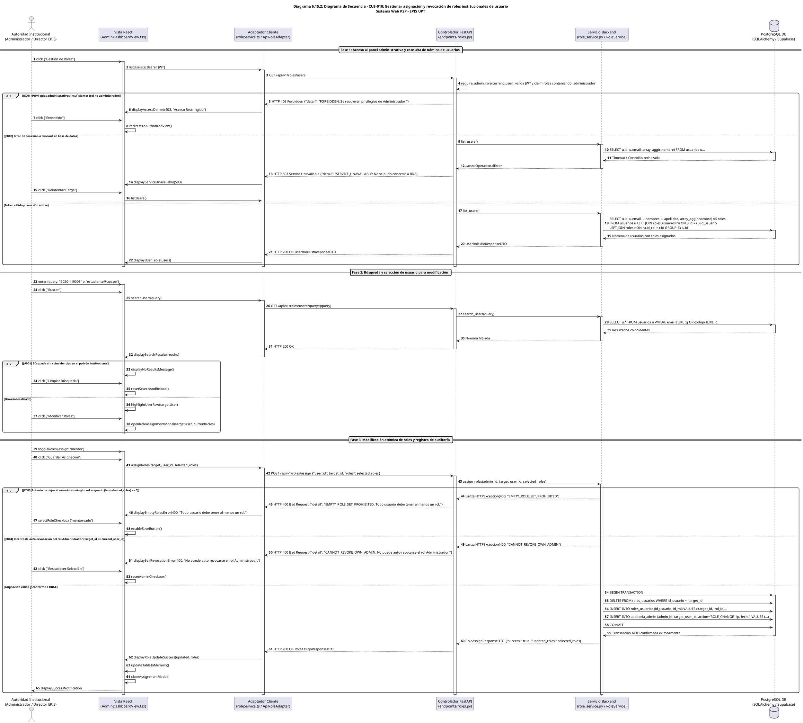

Fuente: Elaboración propia a partir de las especificaciones de diseño de CUS-010.


---

### MOD-02: Ofertas de Mentoría y Espacios

#### Diagrama 6.15.3: Diagrama de Secuencia - CUS-006: Publicar oferta de mentoría académica

El diagrama de secuencia para `CUS-006` formaliza la programación y publicación de sesiones de mentoría académica por parte de un mentor acreditado siguiendo el estándar de modelado de secuencia (Visual Paradigm). Todas las respuestas del sistema concluyen en la capa de vista (`interface : UI`), reflejando que la interfaz se actualiza y permanece a la espera de las acciones directas del estudiante mentor. Modela la interacción entre el Estudiante Mentor, la interfaz React (`OfferPublishView.tsx`), los clientes HTTP (`offerService.ts` / `apiClient.ts`), los endpoints FastAPI (`endpoints/curriculum.py` y `endpoints/offers.py`), los servicios de lógica de negocio (`CurriculumService` y `OfferService`) y PostgreSQL. Abarca la recuperación de temas curriculares silábicos, la verificación criptográfica del token JWT (`RN-01`, `E005`), la validación de mérito académico y rol habilitado (`RN-03`, `E004`), la comprobación de antelación mínima de 24 horas (`RN-04`, `E002`), el aforo reglamentario (exactamente 10 presencial o 20 virtual, `RN-05`, `E003`) y la creación transaccional atómica de la entidad `SesionMentoria` en estado `PUBLICADA`.

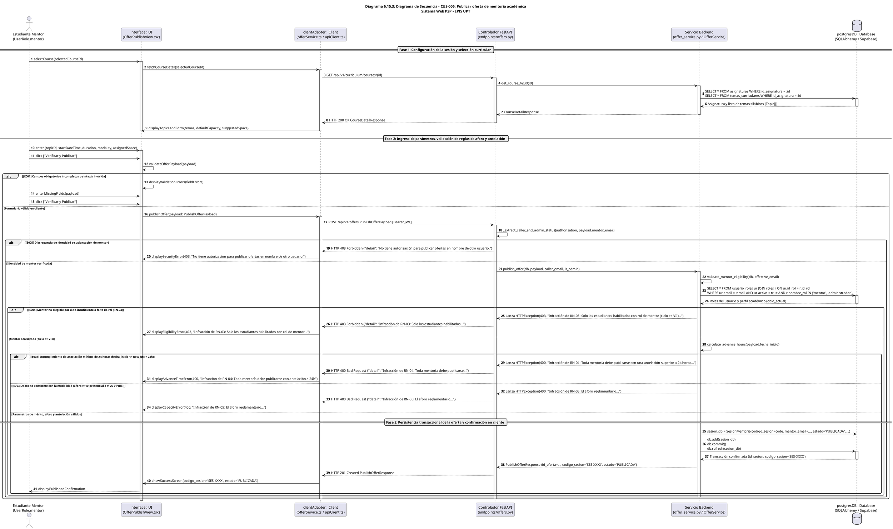

Fuente: Elaboración propia a partir de las especificaciones de diseño de CUS-006.

---

#### Diagrama 6.15.4: Diagrama de Secuencia - CUS-008: Consultar disponibilidad de espacios y recursos

El diagrama de secuencia para `CUS-008` modela la consulta de disponibilidad de infraestructura física de la EPIS (aulas, laboratorios y salas de estudio) antes de programar sesiones presenciales siguiendo el estándar de modelado de secuencia (Visual Paradigm). Todas las respuestas del sistema concluyen en la capa de vista (`Vista React`). Detalla la interacción entre el Mentor, la interfaz de usuario, `offerService.ts`, el endpoint `GET /api/v1/offers/spaces/availability`, `offer_service.py` y las tablas `aulas` y `sesiones_mentoria`. Incorpora la restricción de horario universitario de 08:00 a 20:00 (`RN-07`, `E001`), la tolerancia a fallos de persistencia (`E002`) y la conmutación guiada hacia modalidad virtual (`A001`) ante saturación de espacios físicos.

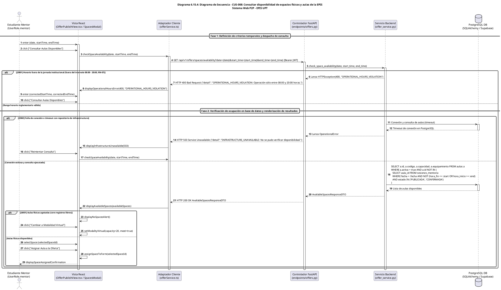

Fuente: Elaboración propia a partir de las especificaciones de diseño de CUS-008.


---

### MOD-03: Perfil del Mentor y Plan de Aprendizaje

#### Diagrama 6.15.5: Diagrama de Secuencia - CUS-005: Gestionar perfil académico y disponibilidad horaria

El diagrama de secuencia para `CUS-005` modela la configuración integral del perfil formativo del estudiante mentor y la administración atómica de su matriz semanal de disponibilidad horaria (lunes a sábado, 08:00 a 20:00) siguiendo el estándar de modelado de secuencia (Visual Paradigm). Todas las respuestas del sistema concluyen en la capa de vista (`Vista React`). Desglosa las interacciones entre el Estudiante Mentor, `ProfileAvailabilityView.tsx`, `profileService.ts`, `profiles.py`, `profile_service.py` y PostgreSQL. Modela la consulta inicial de perfil, la validación sintáctica de biografía y bloques, el reemplazo atómico transaccional (`DELETE` + `INSERT` en bloque bajo `db.begin()`), y los flujos de excepción por matriz horaria vacía (`E001`), validación de texto (`E002`) y colisión de concurrencia (`E003`).

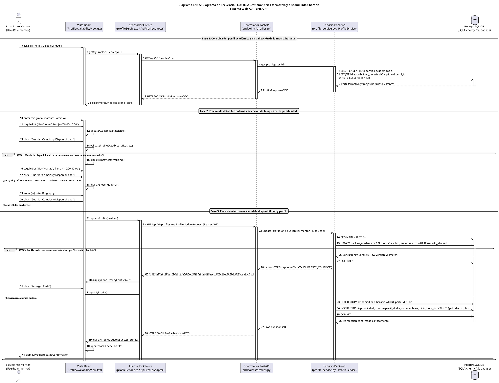

Fuente: Elaboración propia a partir de las especificaciones de diseño de CUS-005.

---

#### Diagrama 6.15.6: Diagrama de Secuencia - CUS-021: Explorar catálogo curricular de asignaturas filtro

El diagrama de secuencia para `CUS-021` modela la navegación por el catálogo curricular oficial de la EPIS-UPT, estructurado jerárquicamente por ciclo académico (I al X), asignaturas y temas silábicos con identificación destacada de materias filtro (`RN-11`) siguiendo el estándar de modelado de secuencia (Visual Paradigm). Todas las respuestas del sistema concluyen en la capa de vista (`Vista React`). Modela las interacciones entre los estudiantes (mentoreados y mentores), `CurriculumCatalogView.tsx`, `curriculumService.ts`, `curriculum.py`, `curriculum_service.py` y PostgreSQL. Describe la consulta de cursos con manejo de indisponibilidad (`E001`), el filtrado reactivo de materias con flujo alternativo sin coincidencias (`A001`) y la expansión de temarios con derivación directa hacia la reserva o demanda.

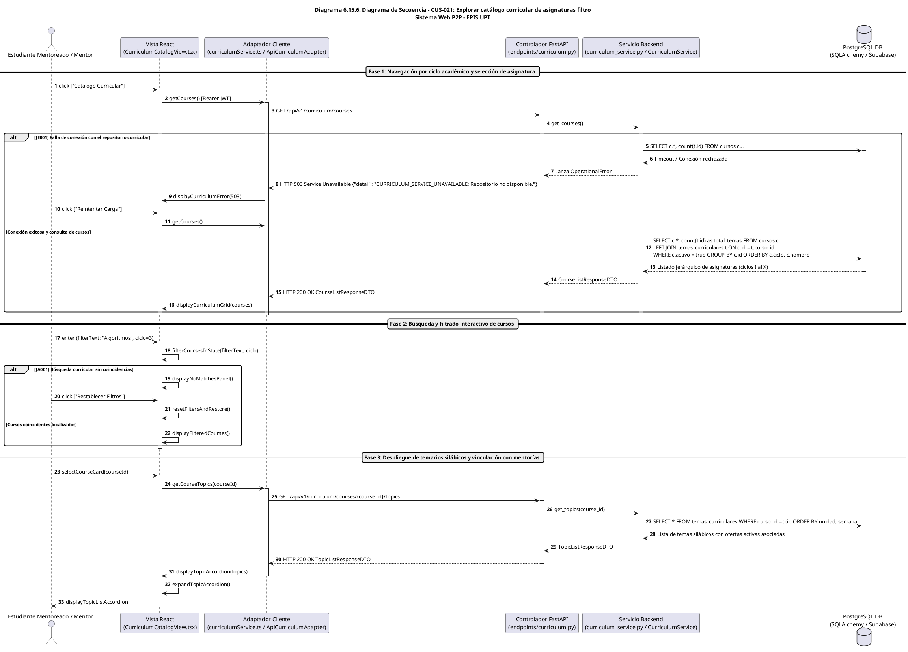

Fuente: Elaboración propia a partir de las especificaciones de diseño de CUS-021.


---

### MOD-04: Demanda y Recomendaciones Personalizadas

#### Diagrama 6.15.7: Diagrama de Secuencia - CUS-002: Explorar recomendaciones personalizadas Top-k

El diagrama de secuencia para `CUS-002` formaliza la inferencia algorítmica y la entrega de la cartelera personalizada de sesiones de mentoría Top-k siguiendo el estándar de modelado de secuencia (Visual Paradigm). Todas las respuestas del sistema concluyen en la capa de vista (`Vista React`). Modela las llamadas entre el Estudiante Mentoreado, el componente cliente `RecommendationFeedView.tsx`, el adaptador `recommendationService.ts`, el endpoint FastAPI en `recommendations.py`, el motor algorítmico `recommendation_service.py` y las tablas de PostgreSQL. Incorpora el fallback heurístico por popularidad ("Cold Start" `A001`), la contingencia ante cartelera desierta (`A002`), el tratamiento de errores de cómputo (`E001`) y la derivación transaccional hacia la reserva de cupo (`CUS-004`).

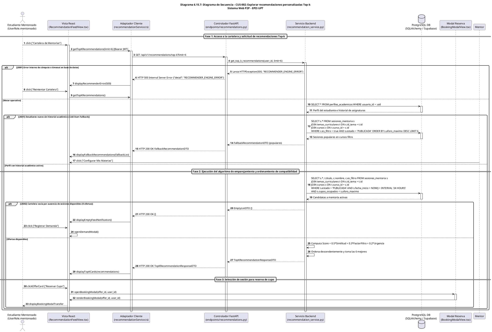

Fuente: Elaboración propia a partir de las especificaciones de diseño de CUS-002.

---

#### Diagrama 6.15.8: Diagrama de Secuencia - CUS-003: Registrar solicitud de demanda académica

El diagrama de secuencia para `CUS-003` describe el registro de necesidades pedagógicas no atendidas por parte de los estudiantes mentoreados siguiendo el estándar de modelado de secuencia (Visual Paradigm). Todas las respuestas del sistema concluyen en la capa de vista (`Vista React`). Modela la interacción temporal entre el Estudiante Mentoreado, el modal de demanda en `RecommendationFeedView.tsx`, `recommendationService.ts`, el endpoint `POST /api/v1/recommendations/demand`, el servicio `recommendation_service.py` y la tabla `demandas_academicas` en PostgreSQL. Detalla la validación de campos obligatorios (`E001`), la detección y rechazo de solicitudes duplicadas (`E002`), y la persistencia transaccional confirmada con `db.commit()` que actualiza el acumulador de demanda en caché.

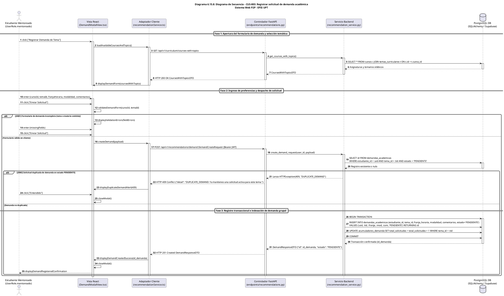

Fuente: Elaboración propia a partir de las especificaciones de diseño de CUS-003.


---

### MOD-05: Quórum, Confirmación y Cancelaciones

#### Diagrama 6.15.9: Diagrama de Secuencia - CUS-004: Reservar cupo de mentoría académica

El diagrama de secuencia para `CUS-004` formaliza el ciclo transaccional de reserva de cupos con control de aforo y concurrencia crítica bajo PostgreSQL siguiendo el estándar de modelado de secuencia (Visual Paradigm). Todas las respuestas del sistema concluyen en la capa de vista (`Vista React`). Modela detalladamente las cuatro fases de interacción entre el Estudiante Mentoreado, la interfaz React (`BookingModalView.tsx`), el adaptador `bookingService.ts`, el endpoint `POST /api/v1/bookings/reserve`, el servicio `booking_service.py` y la base de datos relacional. Incluye la adquisición del cerrojo en memoria `_booking_lock`, el bloqueo pesimista de fila `SELECT ... FOR UPDATE OF sesiones_mentoria` con timeout de 5.0s, y los diez flujos de excepción (`E001` a `E010`).

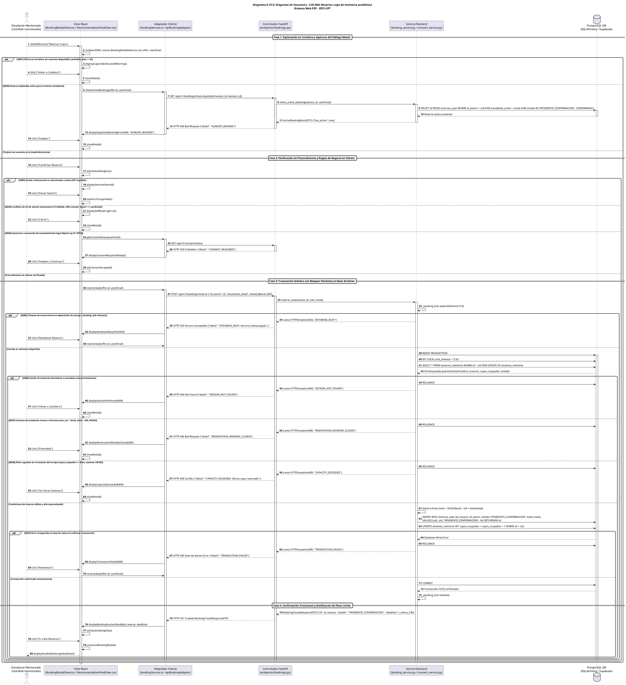

Fuente: Elaboración propia a partir de las especificaciones de diseño de CUS-004.

---

#### Diagrama 6.15.10: Diagrama de Secuencia - CUS-024: Ratificar asistencia a sesión de mentoría

El diagrama de secuencia para `CUS-024` formaliza la confirmación obligatoria de asistencia por parte de los estudiantes con reserva en la ventana reglamentaria entre 48 y 24 horas antes del inicio de la sesión (`[T-48h, T-24h]`, `RN-08`) siguiendo el estándar de modelado de secuencia (Visual Paradigm). Todas las respuestas del sistema concluyen en la capa de vista (`Vista React`). Modela la interacción entre el Estudiante Mentoreado, el panel `StudentBookingsView.tsx`, `bookingService.ts`, el endpoint `POST /api/v1/bookings/{id}/confirm`, el servicio `booking_service.py` y PostgreSQL. Modela la validación de ventana temporal, la conmutación de estado a `CONFIRMADA`, la emisión del pase digital de asistencia con código alfanumérico y los flujos de excepción por ratificación anticipada (`E001`) o extemporánea (`E002`).

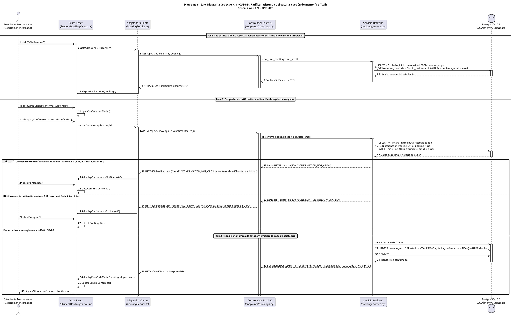

Fuente: Elaboración propia a partir de las especificaciones de diseño de CUS-024.

---

#### Diagrama 6.15.11: Diagrama de Secuencia - CUS-017: Desistir voluntariamente de reserva

El diagrama de secuencia para `CUS-017` modela la anulación voluntaria de una reserva de cupo sin penalización académica, condicionada a una antelación mayor a 24 horas (`fecha_inicio > now_utc + 24h`, `RN-04`) siguiendo el estándar de modelado de secuencia (Visual Paradigm). Todas las respuestas del sistema concluyen en la capa de vista (`Vista React`). Modela las interacciones entre el Estudiante Mentoreado, `StudentBookingsView.tsx`, `bookingService.ts`, el endpoint `POST /api/v1/bookings/{id}/cancel`, `booking_service.py` y PostgreSQL. Modela la adquisición del cerrojo pesimista de fila, la conmutación a estado `CANCELADA_ESTUDIANTE`, la reducción atómica del contador de cupos ocupados y el rechazo de cancelaciones tardías (`E001`).

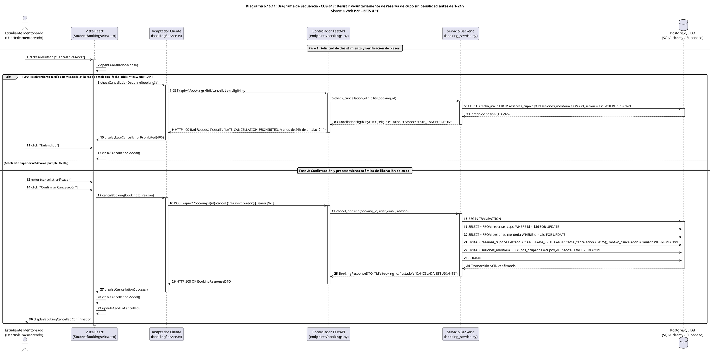

Fuente: Elaboración propia a partir de las especificaciones de diseño de CUS-017.

---

#### Diagrama 6.15.12: Diagrama de Secuencia - CUS-023: Evaluar quórum automático a T-24h

El diagrama de secuencia para `CUS-023` especifica el proceso automatizado y desatendido de evaluación de quórum reglamentario (mínimo 3 estudiantes con asistencia ratificada, `RN-05`) ejecutado exactamente 24 horas antes del inicio de cada sesión de mentoría siguiendo el estándar de modelado de secuencia (Visual Paradigm). Todas las respuestas del sistema concluyen en la capa de vista (`Vista React`). Modela la interacción entre el Proceso Demonio (`SchedulerWorker` / Celery / APScheduler), el controlador de quórum en `quorum.py`, `booking_service.py`, `simulation_service.py`, PostgreSQL y el servicio de correo SMTP. Incluye la promoción automática a `CONFIRMADA` si se cumple el quórum, y la transición a `QUORUM_INSUFICIENTE` con disparo de alertas urgentes (`A001`) si no se alcanza el umbral.

```plantuml
@startuml
title Diagrama 6.15.12: Diagrama de Secuencia - CUS-023: Evaluar automáticamente el quórum reglamentario de sesiones de mentoría a T-24h\nSistema Web P2P - EPIS UPT

autonumber
skinparam shadowing false
skinparam roundcorner 8
skinparam defaultFontName Arial
skinparam fontSize 11
skinparam sequenceBoxBorderColor #1E3A8A
skinparam sequenceBoxBackgroundColor #F0F4F8

participant "Planificador\n(SchedulerWorker / Celery)" as Cron
actor "Administrador Institucional\n(UserRole.administrador)" as Admin
participant "Vista React\n(AdminDashboardView.tsx / MentorSessionsView.tsx)" as UI
participant "Adaptador Cliente\n(quorumService.ts / apiClient)" as Client
participant "Controlador FastAPI\n(endpoints/quorum.py)" as API
participant "Servicio Backend\n(booking_service.py / simulation_service.py)" as Service
database "PostgreSQL DB\n(SQLAlchemy / Supabase)" as DB
participant "Servicio SMTP UPT\n(EmailService)" as SMTP
actor "Estudiante Mentor" as Mentor
actor "Estudiante Mentoreado" as Mentoreado

== Fase 1: Disparo de la tarea programada y localización de sesiones a T-24h ==
alt Disparo automatizado por demonio programado
    Cron -> API: Disparo automático de corte de quórum a T-24h
else Disparo administrativo o simulado desde consola
    Admin -> UI: click ["Evaluar Quórum Masivo"]
    activate UI
    UI -> Client: triggerQuorumEvaluation() [Bearer JWT]
    activate Client
    Client -> API: POST /api/v1/quorum/evaluate-all
    deactivate Client
    deactivate UI
end
activate API
API -> Service: evaluate_all_active_quorums()
activate Service

Service -> DB: SELECT * FROM sesiones_mentoria\nWHERE estado = 'PUBLICADA' AND fecha_inicio <= NOW() + INTERVAL '24 HOURS'
activate DB
DB --> Service: Lista de sesiones en ventana T-24h
deactivate DB

== Fase 2: Cuantificación de confirmaciones y verificación de umbral de quórum ==
loop Para cada sesión en ventana T-24h
    Service -> DB: SELECT count(*) FROM reservas_cupo WHERE id_sesion = :sid AND estado = 'CONFIRMADA'
    activate DB
    DB --> Service: confirmed_count (número de estudiantes ratificados)
    deactivate DB
    
    alt [A001] Quórum insuficiente a T-24h (confirmed_count < 3 estudiantes, RN-05)
        Service -> DB: BEGIN TRANSACTION
        activate DB
        Service -> DB: UPDATE sesiones_mentoria SET estado = 'QUORUM_INSUFICIENTE' WHERE id = :sid
        Service -> DB: INSERT INTO auditoria_evaluacion (sesion_id, estado_anterior='PUBLICADA', nuevo_estado='QUORUM_INSUFICIENTE', quorum_logrado=confirmed_count, fecha=NOW())
        Service -> DB: COMMIT
        DB --> Service: Transacción confirmada
        deactivate DB
        
        Service -> SMTP: send_urgent_quorum_alert(mentor_email, session_id, confirmed_count)
        activate SMTP
        SMTP --> Mentor: Alerta urgente: Sesión no alcanzó quórum de 3 alumnos
        deactivate SMTP
        
        Service -> UI: pushNotificationQuorumInsufficient(session_id)
        Service --> API: A001-1.4 Sesión en QUORUM_INSUFICIENTE
    else Quórum reglamentario alcanzado (confirmed_count >= 3 estudiantes)
        == Fase 3: Confirmación oficial de sesión y notificación de viabilidad ==
        Service -> DB: BEGIN TRANSACTION
        activate DB
        Service -> DB: UPDATE sesiones_mentoria SET estado = 'CONFIRMADA' WHERE id = :sid
        Service -> DB: INSERT INTO auditoria_evaluacion (sesion_id, estado_anterior='PUBLICADA', nuevo_estado='CONFIRMADA', quorum_logrado=confirmed_count, fecha=NOW())
        Service -> DB: COMMIT
        DB --> Service: Transacción confirmada
        deactivate DB
        
        Service -> SMTP: send_session_confirmed_email(mentor_email, session_data)
        activate SMTP
        SMTP --> Mentor: Correo oficial de dictado de sesión
        deactivate SMTP
        
        Service -> SMTP: send_confirmation_to_students(enrolled_emails, session_data)
        activate SMTP
        SMTP --> Mentoreado: Correo oficial: Sesión confirmada con quórum reglamentario
        deactivate SMTP
        
        Service -> UI: pushNotificationQuorumConfirmed(session_id)
        Service --> API: SessionQuorumResultDTO {"session_id": sid, "status": "CONFIRMADA", "confirmed_students": confirmed_count}
    end
end

Service --> API: BatchQuorumEvaluationSummaryDTO
deactivate Service
API --> Cron: HTTP 200 OK (Ciclo completado)
deactivate API
@enduml
```

Fuente: Elaboración propia a partir de las especificaciones de diseño de CUS-023.

---

#### Diagrama 6.15.13: Diagrama de Secuencia - CUS-007: Decisión del mentor ante quórum insuficiente

El diagrama de secuencia para `CUS-007` modela la gestión resolutiva que ejecuta el estudiante mentor cuando una sesión no alcanza el quórum a T-24h (estado `QUORUM_INSUFICIENTE`) siguiendo el estándar de modelado de secuencia (Visual Paradigm). Todas las respuestas del sistema concluyen en la capa de vista (`Vista React`). Modela las interacciones entre el Mentor, `MentorSessionsView.tsx`, `offerService.ts`, el endpoint `POST /api/v1/offers/{offer_id}/quorum-decision`, `offer_service.py` y PostgreSQL. Abarca las tres alternativas de resolución: dictar de todas formas (`PROCEED`), reprogramar con antelación mayor a 24 horas (`RESCHEDULE`, con validación `E001`), o cancelar definitivamente con justificación obligatoria (`CANCEL`, con validación `E002`), actualizando los estados y notificando a los estudiantes inscritos.

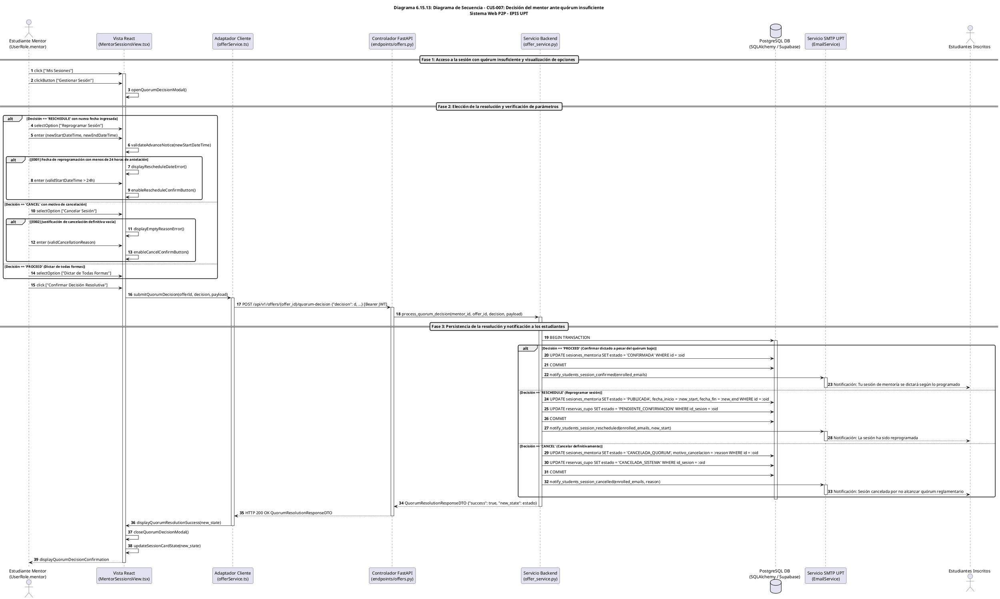

Fuente: Elaboración propia a partir de las especificaciones de diseño de CUS-007.


---

### MOD-06: Asistencia, Bitácoras y Feedback

#### Diagrama 6.15.14: Diagrama de Secuencia - CUS-012: Registrar asistencia a sesión de mentoría

El diagrama de secuencia para `CUS-012` especifica la captura y validación en tiempo real de la asistencia efectiva mediante códigos QR dinámicos basados en TOTP de 30 segundos siguiendo el estándar de modelado de secuencia (Visual Paradigm). Todas las respuestas del sistema concluyen en la capa de vista (`Vista React`). Desglosa los participantes: Estudiante Mentor, Estudiante Mentoreado, `SessionAttendanceView.tsx`, `attendanceService.ts`, `attendance.py`, `attendance_service.py`, WebSockets y PostgreSQL. Modela la rotación criptográfica del token, la verificación de reservas ratificadas y ventana de tolerancia horaria (`-15m` a `+30m`), y los flujos de excepción por caducidad de token (`E001`), ausencia de reserva (`E002`) y fuera de ventana (`E003`).

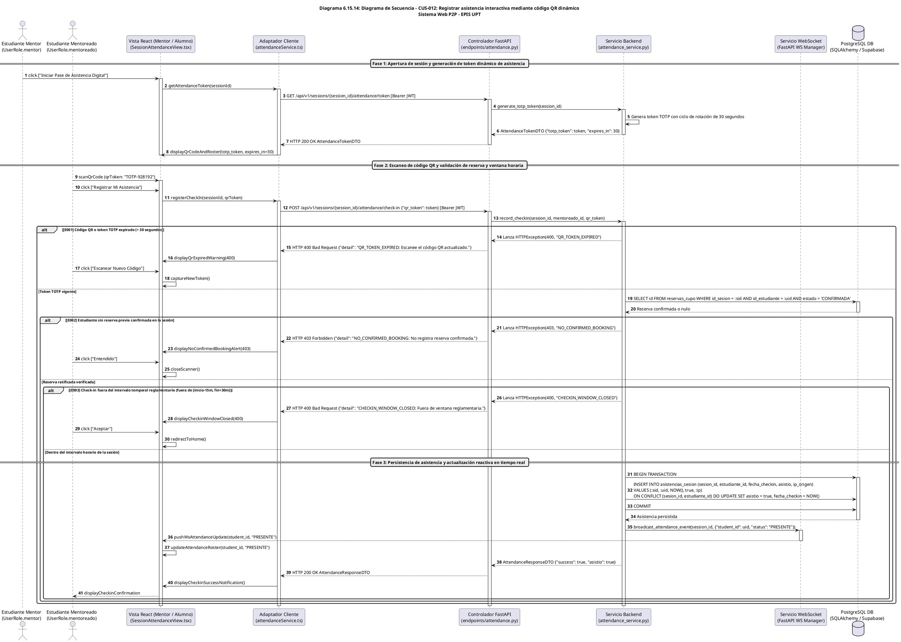

Fuente: Elaboración propia a partir de las especificaciones de diseño de CUS-012.

---

#### Diagrama 6.15.15: Diagrama de Secuencia - CUS-013: Registrar bitácora pedagógica de sesión

El diagrama de secuencia para `CUS-013` modela el registro del reporte formativo post-sesión por parte del estudiante mentor siguiendo el estándar de modelado de secuencia (Visual Paradigm). Todas las respuestas del sistema concluyen en la capa de vista (`Vista React`). Modela la interacción entre el Mentor, `BitacoraFormView.tsx`, `bitacoraService.ts`, `bitacora.py`, `bitacora_service.py` y PostgreSQL. Especifica la validación del plazo reglamentario de 48 horas (`RN-12`, `E001`), la exigencia de al menos 50 caracteres pedagógicos (`E002`), el cómputo de la firma digital criptográfica SHA-256 sobre el contenido pedagógico y la promoción de la sesión a estado `BITACORA_REGISTRADA`.

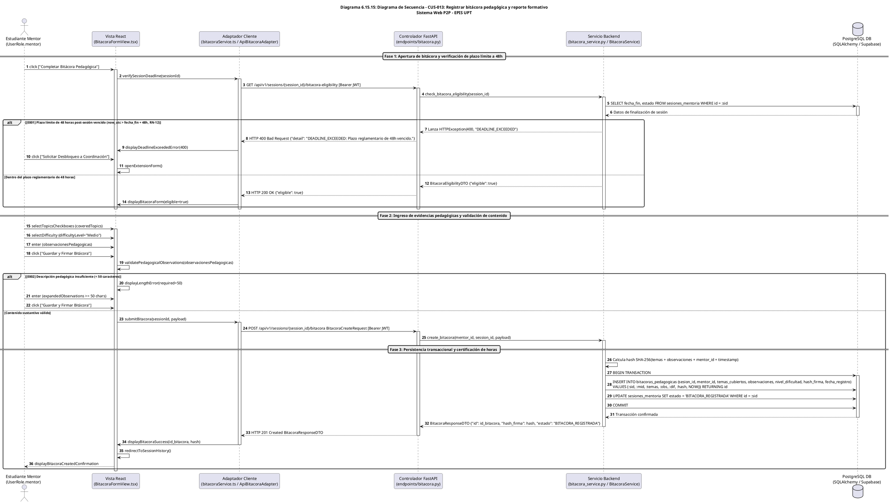

Fuente: Elaboración propia a partir de las especificaciones de diseño de CUS-013.

---

#### Diagrama 6.15.16: Diagrama de Secuencia - CUS-014: Visualizar historial y bitácoras académicas

El diagrama de secuencia para `CUS-014` formaliza la consulta histórica unificada del itinerario de mentorías para estudiantes y mentores siguiendo el estándar de modelado de secuencia (Visual Paradigm). Todas las respuestas del sistema concluyen en la capa de vista (`Vista React`). Modela la interacción entre el usuario universitario, `HistorySessionsView.tsx`, `historyService.ts`, `history.py`, `history_service.py` y las tablas de sesiones, bitácoras y asistencias en PostgreSQL. Detalla la renderización de la línea de tiempo interactiva, el filtrado cronológico por ciclo y materia, el tratamiento de usuarios nuevos con historial vacío (`A001`), y la inspección modal de bitácoras pedagógicas con comprobación de firmas criptográficas.

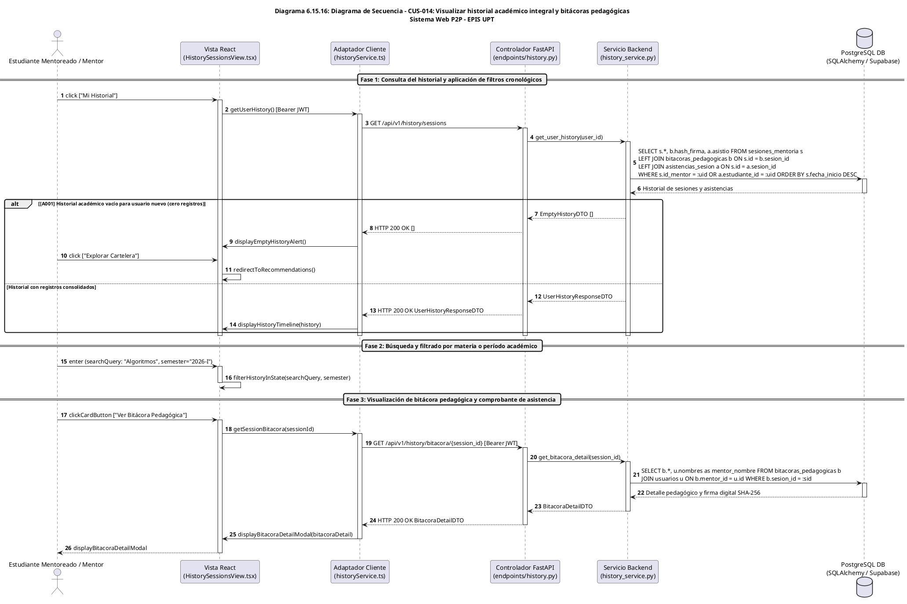

Fuente: Elaboración propia a partir de las especificaciones de diseño de CUS-014.


---

### MOD-07: Gamificación e Incentivos

#### Diagrama 6.15.17: Diagrama de Secuencia - CUS-018: Emitir constancia institucional de horas de mentoría

El diagrama de secuencia para `CUS-018` especifica la emisión institucional y descarga de la constancia de horas de mentoría con validación del umbral reglamentario de 20 horas (`RN-14`) siguiendo el estándar de modelado de secuencia (Visual Paradigm). Todas las respuestas del sistema concluyen en la capa de vista (`Vista React`). Modela las llamadas entre el Estudiante Mentor, `CertificateView.tsx`, `certificateService.ts`, `certificates.py`, `certificate_service.py`, el compilador PDF/QR y PostgreSQL. Incorpora el control de umbral con manejo de horas insuficientes (`E001`), la previsualización modal, la generación del documento oficial foliado con sello SHA-256 y código QR institucional, y la descarga binaria segura en formato PDF.

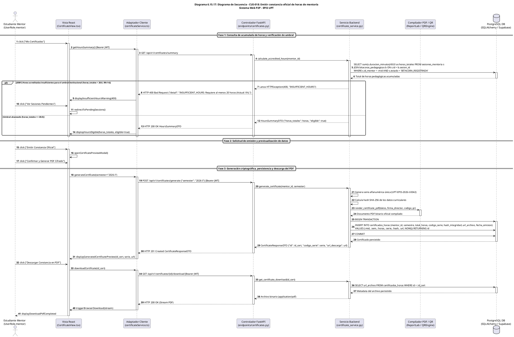

Fuente: Elaboración propia a partir de las especificaciones de diseño de CUS-018.

---

#### Diagrama 6.15.18: Diagrama de Secuencia - CUS-019: Gestionar insignias y reputación gamificada

El diagrama de secuencia para `CUS-019` describe el cálculo de la reputación institucional gamificada y la consulta interactiva de insignias de honor alcanzadas por los mentores siguiendo el estándar de modelado de secuencia (Visual Paradigm). Todas las respuestas del sistema concluyen en la capa de vista (`Vista React`). Modela la interacción entre el Estudiante Mentor, el Estudiante Mentoreado, `GamificationView.tsx`, `gamificationService.ts`, `gamification.py`, `reputation_service.py` y PostgreSQL. Abarca la consulta de la vitrina virtual de insignias (conquistadas y bloqueadas), la inspección lateral de requisitos de logro y el despliegue del Cuadro de Honor (Leaderboard) con soporte de visualización anónima para privacidad (`A001`).

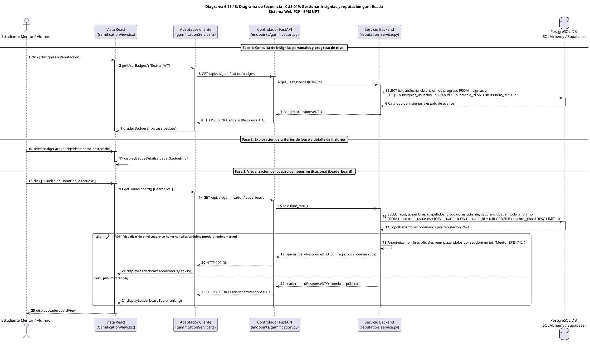

Fuente: Elaboración propia a partir de las especificaciones de diseño de CUS-019.


---

### MOD-08: Analítica, Notificaciones y Configuración

#### Diagrama 6.15.19: Diagrama de Secuencia - CUS-009: Notificar eventos críticos y alertas temporales

El diagrama de secuencia para `CUS-009` formaliza el despacho multicanal de notificaciones reactivas (Server-Sent Events y correo electrónico SMTP) ante eventos críticos del ciclo de vida de las mentorías siguiendo el estándar de modelado de secuencia (Visual Paradigm). Todas las respuestas del sistema concluyen en la capa de vista (`Vista React`). Modela la interacción entre el Planificador desatendido (`SchedulerWorker`), los usuarios institucionales, el componente `NotificationBell.tsx`, `notificationService.ts`, `notifications.py`, `notification_service.py`, `EmailService` y PostgreSQL. Modela la inicialización del flujo SSE, la persistencia de alertas, la degradación controlada ante fallos del servidor SMTP (`E001`) y la lectura interactiva de notificaciones.

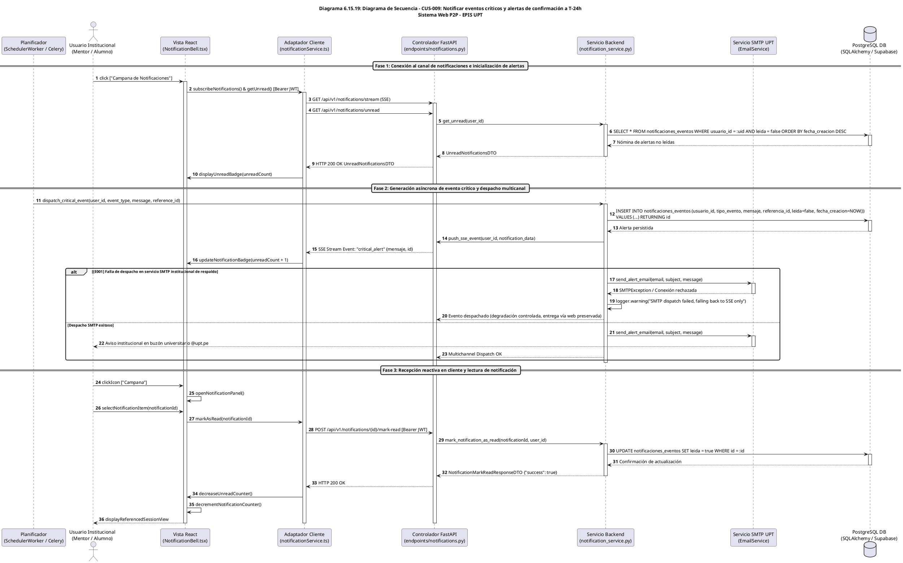

Fuente: Elaboración propia a partir de las especificaciones de diseño de CUS-009.

---

#### Diagrama 6.15.20: Diagrama de Secuencia - CUS-011: Generar reportes e indicadores analíticos

El diagrama de secuencia para `CUS-011` especifica la agregación analítica de indicadores de mentoría y la exportación de dossiers ejecutivos para la Dirección de Escuela y comités de calidad ICACIT siguiendo el estándar de modelado de secuencia (Visual Paradigm). Todas las respuestas del sistema concluyen en la capa de vista (`Vista React`). Modela la interacción entre el Administrador, `AnalyticsDashboardView.tsx`, `analyticsService.ts`, `analytics.py`, `analytics_service.py`, el compilador de hojas de cálculo y PostgreSQL. Describe la consulta de métricas generales, la validación de intervalos temporales con rechazo de fechas inconsistentes (`E001`), y la serialización y descarga del informe binario consolidado (`.xlsx` o `.csv`).

```plantuml
@startuml
title Diagrama 6.15.20: Diagrama de Secuencia - CUS-011: Generar reportes consolidados e indicadores analíticos de gestión\nSistema Web P2P - EPIS UPT

autonumber
skinparam shadowing false
skinparam roundcorner 8
skinparam defaultFontName Arial
skinparam fontSize 11
skinparam sequenceBoxBorderColor #1E3A8A
skinparam sequenceBoxBackgroundColor #F0F4F8

actor "Administrador / Calidad ICACIT" as Admin
participant "Vista React\n(AnalyticsDashboardView.tsx)" as UI
participant "Adaptador Cliente\n(analyticsService.ts)" as Client
participant "Controlador FastAPI\n(endpoints/analytics.py)" as API
participant "Servicio Backend\n(analytics_service.py)" as Service
participant "Generador de Hojas de Cálculo\n(Excel / OpenPyXL Engine)" as Excel
database "PostgreSQL DB\n(SQLAlchemy / Supabase)" as DB

== Fase 1: Acceso al panel analítico y configuración de parámetros ==
Admin -> UI: click ["Reportes y Analítica"]
activate UI
UI -> Client: getKpiSummary(semester="2026-I") [Bearer JWT]
activate Client
Client -> API: GET /api/v1/analytics/reports/kpis?semester=2026-I
activate API
API -> Service: calculate_kpis(semester="2026-I")
activate Service
Service -> DB: SELECT count(s.id) as total_sesiones, sum(s.duracion_minutos)/60.0 as total_horas,\n       avg(CASE WHEN s.estado = 'CONFIRMADA' THEN 1 ELSE 0 END)*100 as tasa_quorum,\n       avg(CASE WHEN a.asistio = true THEN 1 ELSE 0 END)*100 as tasa_asistencia\nFROM sesiones_mentoria s LEFT JOIN asistencias_sesion a ON s.id = a.sesion_id WHERE s.semestre = '2026-I'
activate DB
DB --> Service: Métricas agregadas
deactivate DB
Service --> API: KpiSummaryDTO
deactivate Service
API --> Client: HTTP 200 OK KpiSummaryDTO
deactivate API
Client -> UI: displayKpiCardsAndCharts(kpis)
deactivate Client

== Fase 2: Ajuste de filtros temporales y selección de formato de exportación ==
Admin -> UI: enter (startDate, endDate, courseId, format="xlsx")
UI -> UI: validateDateConsistency(startDate, endDate)

alt [E001] Rango de fechas inconsistente o fechas futuras
    UI -> UI: displayDateRangeError()
    Admin -> UI: enter (validStartDate, validEndDate)
    UI -> UI: updateDateSelector()
else Rango temporal válido
    Admin -> UI: click ["Exportar Informe Consolidado"]
    UI -> Client: exportReport(format="xlsx", startDate, endDate, courseId)
    activate Client
    Client -> API: GET /api/v1/analytics/export?format=xlsx&start_date={start_date}&end_date={end_date}&course_id={course_id} [Bearer JWT]
    activate API
    API -> Service: export_report(format, start_date, end_date, course_id)
    activate Service
    
    == Fase 3: Generación del documento analítico y descarga segura ==
    Service -> DB: SELECT * FROM sesiones_mentoria s JOIN bitacoras_pedagogicas b ON s.id = b.sesion_id...
    activate DB
    DB --> Service: Registros consolidados
    deactivate DB
    
    Service -> Excel: compile_workbook(resumen_kpi, sesiones, asistencias, materias_criticas)
    activate Excel
    Excel --> Service: StreamBinarioXLSX (Libro con 4 pestañas estructuradas)
    deactivate Excel
    
    Service -> DB: INSERT INTO auditoria_admin (admin_id, accion='EXPORT_REPORT', entidad='analytics', fecha=NOW())
    
    Service --> API: StreamingResponse(content=stream, media_type="application/vnd.openxmlformats-officedocument.spreadsheetml.sheet")
    deactivate Service
    API --> Client: HTTP 200 OK (Stream Binario XLSX)
    deactivate API
    Client -> UI: triggerExcelDownload()
    deactivate Client
    
    UI --> Admin: displayExcelDownloadedConfirmation
end
deactivate UI
@enduml
```

Fuente: Elaboración propia a partir de las especificaciones de diseño de CUS-011.

---

#### Diagrama 6.15.21: Diagrama de Secuencia - CUS-015: Consultar métricas de retención y desempeño

El diagrama de secuencia para `CUS-015` formaliza la inferencia estadística del impacto del programa de mentorías en la retención estudiantil y disminución de reprobación en asignaturas filtro, respaldando los criterios de mejora continua de ICACIT siguiendo el estándar de modelado de secuencia (Visual Paradigm). Todas las respuestas del sistema concluyen en la capa de vista (`Vista React`). Modela las llamadas entre la Comisión de Calidad, `RetentionDashboardView.tsx`, `analyticsService.ts`, `analytics.py`, `analytics_service.py` y PostgreSQL. Modela la comparación entre grupos de control y participantes, la verificación de tamaño muestral mínimo (`A001`), y la generación y exportación del expediente probatorio en formato PDF oficial.

```plantuml
@startuml
title Diagrama 6.15.21: Diagrama de Secuencia - CUS-015: Consultar métricas de correlación de retención estudiantil y desempeño\nSistema Web P2P - EPIS UPT

autonumber
skinparam shadowing false
skinparam roundcorner 8
skinparam defaultFontName Arial
skinparam fontSize 11
skinparam sequenceBoxBorderColor #1E3A8A
skinparam sequenceBoxBackgroundColor #F0F4F8

actor "Comisión de Calidad ICACIT / Admin" as Evaluador
participant "Vista React\n(RetentionDashboardView.tsx)" as UI
participant "Adaptador Cliente\n(analyticsService.ts)" as Client
participant "Controlador FastAPI\n(endpoints/analytics.py)" as API
participant "Servicio Backend\n(analytics_service.py)" as Service
participant "Compilador PDF ICACIT\n(ReportEngine)" as PDF
database "PostgreSQL DB\n(SQLAlchemy / Supabase)" as DB

== Fase 1: Acceso al módulo de impacto y selección de cohorte ==
Evaluador -> UI: click ["Impacto y Retención Académica"]
activate UI
UI -> Client: getRetentionMetrics() [Bearer JWT]
activate Client
Client -> API: GET /api/v1/analytics/retention/impact
activate API
API -> Service: analyze_retention_correlation()
activate Service
Service -> DB: SELECT count(DISTINCT estudiante_id) as total_alumnos,\n       avg(CASE WHEN asistencia_count >= 3 THEN tasa_aprobacion ELSE NULL END) as aprobacion_mentoreados,\n       avg(CASE WHEN asistencia_count = 0 THEN tasa_aprobacion ELSE NULL END) as aprobacion_control\nFROM cohortes_academicas
activate DB
DB --> Service: Comparativa estadística de cohortes
deactivate DB
Service --> API: RetentionImpactDTO
deactivate Service
API --> Client: HTTP 200 OK RetentionImpactDTO
deactivate API
Client -> UI: displayRetentionChart(metrics)
deactivate Client

== Fase 2: Segmentación por asignatura filtro y período lectivo ==
Evaluador -> UI: selectCourseFilter (courseId="algoritmos-epis")
Evaluador -> UI: click ["Calcular Índice de Impacto"]
UI -> Client: getCourseRetentionImpact(courseId)
activate Client
Client -> API: GET /api/v1/analytics/retention/cohorts?course_id={course_id}
activate API
API -> Service: get_course_cohort_stats(course_id)
activate Service
Service -> DB: SELECT count(*) as n_muestra, corr(asistencias, nota_final) as r_pearson\nFROM actas_semestrales a JOIN asistencias_sesion s ON a.estudiante_id = s.estudiante_id\nWHERE a.curso_id = :cid
activate DB
DB --> Service: Muestra y correlación calculada
deactivate DB

alt [A001] Muestra insuficiente para inferencia estadística (< 10 registros)
    Service --> API: RetentionCohortDTO {"n_muestra": n, "significancia": false, "solo_descriptivo": true}
    API --> Client: HTTP 200 OK
    Client -> UI: displayInsufficientSampleAlert()
    Evaluador -> UI: click ["Ampliar Rango a Semestres Anteriores"]
    UI -> UI: offerExpandedRange()
else Tamaño muestral suficiente (>= 10 registros)
    Service --> API: RetentionCohortDTO {"n_muestra": n, "significancia": true, "r_pearson": r}
    API --> Client: HTTP 200 OK RetentionCohortDTO
    Client -> UI: displayCorrelationResults(stats)
end
deactivate Service
deactivate API
deactivate Client

== Fase 3: Visualización de indicadores ICACIT y exportación ==
Evaluador -> UI: click ["Exportar Evidencia ICACIT"]
UI -> Client: exportIcacitEvidence(courseId)
activate Client
Client -> API: POST /api/v1/analytics/retention/export-evidence {"course_id": cid} [Bearer JWT]
activate API
API -> Service: generate_icacit_report(course_id)
activate Service
Service -> PDF: compile_icacit_dossier(datos_retencion, tablas_frecuencia, firmas_integridad)
activate PDF
PDF --> Service: Documento PDF formal de acreditación
deactivate PDF
Service --> API: StreamingResponse(content=pdf_stream, media_type="application/pdf")
deactivate Service
API --> Client: HTTP 200 OK (Stream Binario PDF)
deactivate API
Client -> UI: triggerPdfDownload()
deactivate Client
UI --> Evaluador: displayIcacitDossierDownloadedConfirmation
deactivate UI
@enduml
```

Fuente: Elaboración propia a partir de las especificaciones de diseño de CUS-015.

---

#### Diagrama 6.15.22: Diagrama de Secuencia - CUS-016: Auditar trazas de seguridad y consentimiento

El diagrama de secuencia para `CUS-016` modela la auditoría forense inmutable y la verificación de integridad de la cadena criptográfica de logs (Hash Chain) bajo los mandatos de la Ley Nº 29733 y el estándar ISO/IEC 27001 siguiendo el estándar de modelado de secuencia (Visual Paradigm). Todas las respuestas del sistema concluyen en la capa de vista (`Vista React`). Desglosa los participantes: Oficial de Seguridad, `AuditLogView.tsx`, `auditService.ts`, `audit.py`, `audit_service.py` y PostgreSQL. Especifica la restricción RBAC (`E001`), la verificación de trazas de consentimiento, el cálculo iterativo recursivo `SHA256(prev_hash + data)` con detección de manipulaciones (`E002`), y la acreditación de integridad con 0 alteraciones.

```plantuml
@startuml
title Diagrama 6.15.22: Diagrama de Secuencia - CUS-016: Auditar trazas inmutables de seguridad y consentimientos legales\nSistema Web P2P - EPIS UPT

autonumber
skinparam shadowing false
skinparam roundcorner 8
skinparam defaultFontName Arial
skinparam fontSize 11
skinparam sequenceBoxBorderColor #1E3A8A
skinparam sequenceBoxBackgroundColor #F0F4F8

actor "Oficial de Seguridad / Delegado DPO\n(UserRole.administrador)" as SecOfficer
participant "Vista React\n(AuditLogView.tsx)" as UI
participant "Adaptador Cliente\n(auditService.ts / ApiAuditAdapter)" as Client
participant "Controlador FastAPI\n(endpoints/audit.py)" as API
participant "Servicio Backend\n(audit_service.py / AuditService)" as Service
database "PostgreSQL DB\n(SQLAlchemy / Supabase)" as DB

== Fase 1: Consulta del registro forense de auditoría ==
SecOfficer -> UI: click ["Auditoría de Seguridad y Ley 29733"]
activate UI
UI -> Client: getAuditLogs(limit=50) [Bearer JWT]
activate Client
Client -> API: GET /api/v1/audit/logs?limit=50
activate API

API -> API: require_security_officer_role(current_user)

alt [E001] Permisos insuficientes para auditoría de seguridad
    API --> Client: HTTP 403 Forbidden {"detail": "FORBIDDEN_AUDIT: Acceso reservado a Oficial de Seguridad."}
    Client -> UI: displayAccessDeniedModal(403)
    SecOfficer -> UI: click ["Aceptar"]
    UI -> UI: redirectToAuthorizedDashboard()
else Privilegios de seguridad verificados
    API -> Service: get_logs(limit=50)
    activate Service
    Service -> DB: SELECT l.*, u.email FROM log_auditoria_seguridad l\nJOIN usuarios u ON l.usuario_id = u.id ORDER BY l.id DESC LIMIT 50
    activate DB
    DB --> Service: Trazas de auditoría forense
    deactivate DB
    Service --> API: AuditLogListResponseDTO
    deactivate Service
    API --> Client: HTTP 200 OK AuditLogListResponseDTO
    Client -> UI: displayAuditLogTable(logs)
end
deactivate API
deactivate Client

== Fase 2: Filtrado por usuario y verificación de traza legal de consentimiento ==
SecOfficer -> UI: enter (email: "usuario@upt.pe")
SecOfficer -> UI: click ["Buscar Consentimiento"]
UI -> Client: getConsentTraces(email)
activate Client
Client -> API: GET /api/v1/audit/consent-traces?email={email} [Bearer JWT]
activate API
API -> Service: get_consent_traces(email)
activate Service
Service -> DB: SELECT * FROM consentimientos_legales WHERE email = :email ORDER BY fecha_registro ASC
activate DB
DB --> Service: Trazas de formalización (UUID, versión, IP, User-Agent, UTC, revocado)
deactivate DB
Service --> API: ConsentTraceListDTO
deactivate Service
API --> Client: HTTP 200 OK ConsentTraceListDTO
deactivate API
Client -> UI: displayConsentTraceModal(traces)
deactivate Client

== Fase 3: Verificación criptográfica de la cadena de auditoría (Hash Chain) ==
SecOfficer -> UI: click ["Verificar Integridad de Cadena de Logs"]
UI -> Client: verifyLogChain()
activate Client
Client -> API: POST /api/v1/audit/verify-chain [Bearer JWT]
activate API
API -> Service: verify_chain_integrity()
activate Service

Service -> DB: SELECT id, hash_bloque, hash_anterior, datos_evento FROM log_auditoria_seguridad ORDER BY id ASC
activate DB
DB --> Service: Todos los registros de auditoría
deactivate DB

Service -> Service: Itera recursivamente recomputando SHA256(hash_anterior + datos_evento)

alt [E002] Inconsistencia detectada en la cadena criptográfica de logs (discrepancia de hash)
    Service --> API: Lanza HTTPException(409, "AUDIT_TAMPERING_DETECTED: Discrepancia en ID {broken_id}")
    API --> Client: HTTP 409 Conflict {"detail": "AUDIT_TAMPERING_DETECTED"}
    Client -> UI: displayTamperingAlert(409, broken_id)
    SecOfficer -> UI: click ["Descargar Informe Forense"]
    UI -> UI: exportForensicDump()
else Cadena 100% íntegra (0 discrepancias)
    Service --> API: VerifyChainResponseDTO {"status": "VALID", "records_verified": count, "tampering_detected": false}
    API --> Client: HTTP 200 OK VerifyChainResponseDTO
    Client -> UI: displayIntegrityVerifiedBadge()
    UI --> SecOfficer: displayChainIntegrityConfirmation
end
deactivate Service
deactivate API
deactivate Client
deactivate UI
@enduml
```

Fuente: Elaboración propia a partir de las especificaciones de diseño de CUS-016.

---

#### Diagrama 6.15.23: Diagrama de Secuencia - CUS-020: Configurar parámetros institucionales y umbrales

El diagrama de secuencia para `CUS-020` describe la calibración dinámica de reglas institucionales y umbrales operacionales sin modificación del código fuente siguiendo el estándar de modelado de secuencia (Visual Paradigm). Todas las respuestas del sistema concluyen en la capa de vista (`Vista React`). Modela las llamadas entre el Administrador Institucional, `SystemSettingsView.tsx`, `configService.ts`, `config.py`, `config_service.py` y PostgreSQL. Modela la consulta de parámetros vigentes, la validación de límites operacionales (`E001`), la exigencia de reautenticación para cambios críticos (`E002`), y la persistencia transaccional con purga inmediata de la memoria caché para aplicación en caliente.

```plantuml
@startuml
title Diagrama 6.15.23: Diagrama de Secuencia - CUS-020: Configurar parámetros operativos institucionales y umbrales\nSistema Web P2P - EPIS UPT

autonumber
skinparam shadowing false
skinparam roundcorner 8
skinparam defaultFontName Arial
skinparam fontSize 11
skinparam sequenceBoxBorderColor #1E3A8A
skinparam sequenceBoxBackgroundColor #F0F4F8

actor "Administrador Institucional\n(UserRole.administrador)" as Admin
participant "Vista React\n(SystemSettingsView.tsx)" as UI
participant "Adaptador Cliente\n(configService.ts)" as Client
participant "Controlador FastAPI\n(endpoints/config.py)" as API
participant "Servicio Backend\n(config_service.py)" as Service
participant "Caché de Aplicación\n(Redis / MemoryCache)" as Cache
database "PostgreSQL DB\n(SQLAlchemy / Supabase)" as DB

== Fase 1: Consulta de parámetros vigentes y despliegue del panel ==
Admin -> UI: click ["Configuración del Sistema"]
activate UI
UI -> Client: getParameters() [Bearer JWT]
activate Client
Client -> API: GET /api/v1/config/parameters
activate API
API -> Service: get_parameters()
activate Service
Service -> DB: SELECT clave, valor, descripcion, valor_min, valor_max FROM parametros_institucionales WHERE activo = true
activate DB
DB --> Service: Catálogo de parámetros base
deactivate DB
Service --> API: ParameterListResponseDTO
deactivate Service
API --> Client: HTTP 200 OK ParameterListResponseDTO
deactivate API
Client -> UI: displayParametersForm(parameters)
deactivate Client

== Fase 2: Edición de umbrales y validación de rangos permitidos ==
Admin -> UI: enter (quorumMinimo=4, aforoPresencial=10)
Admin -> UI: click ["Guardar Parámetros Institucionales"]
UI -> UI: validateValueRanges(parameters)

alt [E001] Parámetro fuera de los rangos institucionales permitidos
    UI -> UI: displayOutOfRangeError()
    Admin -> UI: enter (correctedParameterValue)
    UI -> UI: enableSaveButton()
else Valores en rangos admisibles
    UI -> Client: updateParameters(payload)
    activate Client
    Client -> API: PUT /api/v1/config/parameters ParameterUpdatePayload [Bearer JWT]
    activate API
    
    alt [E002] Reautenticación de seguridad requerida (cambios críticos sin contraseña secundaria)
        API --> Client: HTTP 401 Unauthorized {"detail": "REAUTH_REQUIRED: Confirmación de credenciales requerida."}
        Client -> UI: displayReauthModal()
        Admin -> UI: enter (adminSecondaryPassword)
        Admin -> UI: click ["Verificar"]
        UI -> Client: reauthenticateAdmin(credentials)
        Client -> API: POST /api/v1/auth/reauth
        API --> Client: HTTP 200 OK {"reauth_token": token}
        Client -> UI: setReauthToken(token)
    else Autorización confirmada
        API -> Service: update_parameters(admin_id, payload)
        activate Service
        
        == Fase 3: Persistencia transaccional, purga de caché y aplicación en caliente ==
        Service -> DB: BEGIN TRANSACTION
        activate DB
        Service -> DB: UPDATE parametros_institucionales SET valor = :val, fecha_modificacion = NOW(), modificado_por = :uid WHERE clave = :key
        Service -> DB: INSERT INTO log_auditoria_seguridad (usuario_id, evento='PARAM_UPDATE', detalle=:key, fecha=NOW())
        Service -> DB: COMMIT
        DB --> Service: Transacción confirmada
        deactivate DB
        
        Service -> Cache: purge_system_config_cache()
        activate Cache
        Cache --> Service: Caché invalidada en caliente
        deactivate Cache
        
        Service --> API: ParameterUpdateResponseDTO {"success": true, "updated_keys": keys}
        deactivate Service
        API --> Client: HTTP 200 OK ParameterUpdateResponseDTO
        Client -> UI: displayParametersUpdatedSuccess(updated_keys)
        UI --> Admin: displayParametersUpdatedConfirmation
    end
    deactivate API
    deactivate Client
end
deactivate UI
@enduml
```

Fuente: Elaboración propia a partir de las especificaciones de diseño de CUS-020.

---

#### Diagrama 6.15.24: Diagrama de Secuencia - CUS-022: Gestionar catálogo de temas y materias críticas

El diagrama de secuencia para `CUS-022` formaliza la actualización de la malla curricular y el catálogo silábico de materias críticas por parte de la Dirección de Escuela y administradores siguiendo el estándar de modelado de secuencia (Visual Paradigm). Todas las respuestas del sistema concluyen en la capa de vista (`Vista React`). Modela las llamadas entre el Administrador, `AdminCurriculumView.tsx`, `curriculumService.ts`, `curriculum.py`, `curriculum_service.py` y PostgreSQL. Describe la navegación por el árbol curricular, el alta de nuevos temas silábicos con validación de unicidad (`E001`) y rango semestral de semanas 1 a 17 (`E002`), y la confirmación transaccional con actualización reactiva en la interfaz administrativa.

```plantuml
@startuml
title Diagrama 6.15.24: Diagrama de Secuencia - CUS-022: Gestionar catálogo de temas curriculares, asignaturas filtro y malla oficial\nSistema Web P2P - EPIS UPT

autonumber
skinparam shadowing false
skinparam roundcorner 8
skinparam defaultFontName Arial
skinparam fontSize 11
skinparam sequenceBoxBorderColor #1E3A8A
skinparam sequenceBoxBackgroundColor #F0F4F8

actor "Administrador Institucional\n(UserRole.administrador)" as Admin
participant "Vista React\n(AdminCurriculumView.tsx)" as UI
participant "Adaptador Cliente\n(curriculumService.ts)" as Client
participant "Controlador FastAPI\n(endpoints/curriculum.py)" as API
participant "Servicio Backend\n(curriculum_service.py)" as Service
database "PostgreSQL DB\n(SQLAlchemy / Supabase)" as DB

== Fase 1: Consulta del árbol curricular y selección de asignatura ==
Admin -> UI: click ["Gestión de Malla y Temarios"]
activate UI
UI -> Client: getCoursesFullTree() [Bearer JWT]
activate Client
Client -> API: GET /api/v1/curriculum/courses
activate API
API -> Service: get_courses_tree()
activate Service
Service -> DB: SELECT * FROM cursos ORDER BY ciclo, nombre
activate DB
DB --> Service: Malla curricular ordenada por ciclo
deactivate DB
Service --> API: CourseTreeResponseDTO
deactivate Service
API --> Client: HTTP 200 OK CourseTreeResponseDTO
deactivate API
Client -> UI: displayCourseTree(coursesTree)
deactivate Client

== Fase 2: Ingreso de datos del nuevo tema curricular silábico ==
Admin -> UI: clickCourse ["Ver Asignatura"]
Admin -> UI: click ["Agregar Nuevo Tema Curricular"]
UI -> UI: openNewTopicModal()
Admin -> UI: enter (unidad=2, titulo="Grafos y Dijkstra", semana=7, descripcion="Teoría y algoritmos")
Admin -> UI: click ["Registrar Tema Curricular"]
UI -> UI: validateWeekNumber(semana)

alt [E002] Número de semana académica fuera de rango semestral (semana < 1 o > 17)
    UI -> UI: displayWeekOutOfRangeError()
    Admin -> UI: enter (validWeekNumber)
    UI -> UI: updateFormWeek()
else Semana lectiva válida
    UI -> Client: createTopic(courseId, payload)
    activate Client
    Client -> API: POST /api/v1/curriculum/courses/{course_id}/topics TopicCreateRequest [Bearer JWT]
    activate API
    API -> Service: create_topic(course_id, payload)
    activate Service
    
    Service -> DB: SELECT id FROM temas_curriculares WHERE curso_id = :cid AND unidad = :u AND titulo = :t
    activate DB
    DB --> Service: Tema existente o nulo
    deactivate DB
    
    alt [E001] Tema curricular duplicado en la misma unidad didáctica
        Service --> API: Lanza HTTPException(409, "DUPLICATE_TOPIC")
        API --> Client: HTTP 409 Conflict {"detail": "DUPLICATE_TOPIC: Ya existe un tema con ese título en la unidad."}
        Client -> UI: displayDuplicateTopicError(409)
        Admin -> UI: enter (adjustedTitle)
        UI -> UI: enableSaveButton()
    else Tema nuevo y válido
        == Fase 3: Persistencia transaccional y actualización del catálogo ==
        Service -> DB: BEGIN TRANSACTION
        activate DB
        Service -> DB: INSERT INTO temas_curriculares (curso_id, unidad, semana, titulo, descripcion, activo=true)\nVALUES (:cid, :u, :sem, :t, :desc, true) RETURNING id
        Service -> DB: COMMIT
        DB --> Service: Transacción confirmada (id_tema)
        deactivate DB
        
        Service --> API: TopicResponseDTO {"id": id_tema, "titulo": t, "semana": sem}
        API --> Client: HTTP 201 Created TopicResponseDTO
        Client -> UI: displayTopicCreatedSuccess(id_tema)
        
        UI -> UI: closeNewTopicModal()
        UI -> UI: appendTopicToTree(id_tema)
        UI --> Admin: displayTopicRegisteredConfirmation
    end
    deactivate Service
    deactivate API
    deactivate Client
end
deactivate UI
@enduml
```

Fuente: Elaboración propia a partir de las especificaciones de diseño de CUS-022.


