**FACULTAD DE INGENIERÍA**  
**ESCUELA DE INGENIERÍA DE SISTEMAS**

# “Sistema Web P2P con algoritmo de recomendación para la personalización de mentorías académicas en la EPIS-UPT”

**Curso:** Construcción de Software I  
**Docente:** Dr. RICARDO EDUARDO VALCARCEL ALVARADO  

**AUTOR:**  
ANTAYHUA MAMANI, Renzo Antonio (2022073504)  
MEDINA QUISPE, Joan Cristian (2022074255)

**TACNA – PERÚ**  
**2026**

---

## CONTROL DE VERSIONES

| Versión | Hecha por | Revisada por | Aprobada por | Fecha | Motivo |
|:---:|:---:|:---:|:---:|:---:|:---|
| **1.0** | JCM / RAM | RVA | RVA | 11/09/2026 | Versión 1.0 preliminar de levantamiento y especificación inicial. |
| **2.0** | JCM / RAM | RVA | Dirección EPIS | 26/09/2026 | Consolidación y congelamiento de la línea base analítica oficial (MOD-01 al MOD-08, RF01 al RF26, RN-01 al RN-14, RNF01 al RNF10, CUS01 al CUS24). Reorganización modular de narrativas por dependencia operativa, supresión de reglas ocultas, alineamiento estricto de estados canónicos con el modelo lógico y hardening continuo. |
| **2.1** | JCM / RAM | Dr. Ricardo Valcarcel | Dirección EPIS | 19/10/2026 | Refinamiento y trazabilidad en Fase de Diseño (SRS v2.1): alineamiento técnico con la arquitectura desacoplada y cierre de requerimientos del Sprint 1 (RF01, RF05, RNF01, RNF02, RNF09, CUS-001, CUS-021, RN-01) respaldados empíricamente con 96 pruebas automatizadas en CI. |
| **2.2** | JCM / RAM | Dr. Ricardo Valcarcel | Dirección EPIS | 23/10/2026 | Consolidación de Fase de Diseño y Construcción del Sprint 2 (SRS v2.2): formalización técnica y verificación empírica de Consentimiento digital bajo Ley N° 29733 (RF02, RN-02, CUS-001), administración de roles y mérito académico (RF03, RN-03, CUS-010), perfiles formativos y matriz de disponibilidad horaria semanal 6×11 (RF04, RNF04, RNF08, CUS-005), búsqueda avanzada en catálogo curricular con temarios silábicos (RF05, CUS-021) y aislamiento multiusuario con Row Level Security (RNF02), respaldados por 150 pruebas automatizadas sin fallos (>90% de cobertura en frontend y backend). |
| **3.0** | JCM / RAM | Dr. Ricardo Valcarcel | Dirección EPIS | 14/11/2026 | Consolidación Integral de la Fase de Diseño y Cierre de Construcción (SRS v3.0): culminación de los 8 Sprints de desarrollo (MOD-01 al MOD-08, CUS-001 al CUS-024, RF01 al RF26, RN-01 al RN-14, RNF01 al RNF10). Formalización de interfaces externas (WCAG 2.1 AA / Tailwind), motor EdRecSys calibrado (Precision@3=83.3%, Precision@5=80.0%, latencia 12.4 ms), orquestación transaccional con cerrojos pesimistas (SELECT FOR UPDATE) a T-24h, bitácoras firmadas con SHA-256, certificados PDF con QR institucional y trazabilidad integral acreditada por 627 pruebas automatizadas aprobadas (280 backend Pytest, 347 frontend Vitest) con 0 fallos y cobertura >85%. |

# Sistema Web P2P con algoritmo de recomendación para la personalización de mentorías académicas en la EPIS-UPT

**Documento de Especificación de Requerimientos de Software**  
**Versión 3.0 — Fase de Diseño Técnico y Cierre de Construcción (Sprints 1 al 8)**

---

## ÍNDICE GENERAL

1. Introducción  
   1.1. Propósito  
   1.2. Alcance del Sistema  
   1.3. Personal Involucrado  
   1.4. Definiciones, Acrónimos y Abreviaturas  
   1.5. Referencias Normativas y Técnicas  
   1.6. Resumen del Documento  
2. Generalidades de la Empresa  
   2.1. Nombre de la Empresa  
   2.2. Visión  
   2.3. Misión  
   2.4. Organigrama y Responsabilidades Técnicas  
3. Visionamiento de la Empresa  
   3.1. Descripción del Problema  
   3.2. Objetivos de Negocios  
   3.3. Objetivos de Diseño  
   3.4. Alcance y Exclusiones del Proyecto  
   3.5. Viabilidad del Sistema  
   3.6. Información obtenida del Levantamiento de Información  
4. Análisis de Procesos  
   4.1. Diagrama del Proceso Actual (As-Is)  
   4.2. Diagrama del Proceso Propuesto (To-Be)  
5. Especificación de Requerimientos de Software  
   5.1. Identificación de Módulos y Capacidades Funcionales  
   5.2. Requerimientos No Funcionales (ISO/IEC 25010)  
   5.3. Matriz Consolidada de Requerimientos Funcionales (RF01 al RF26)  
   5.4. Reglas de Negocio Institucionales (RN-01 al RN-14)  
   5.5. Matriz de Trazabilidad Bidireccional de Requerimientos  
   5.6. Requisitos de Interfaz Externa  
       5.6.1. Interfaces de Usuario (Design System y Accesibilidad WCAG 2.1 AA)  
       5.6.2. Interfaces de Software (APIs, Base de Datos y Dependencias)  
       5.6.3. Interfaces de Hardware  
       5.6.4. Interfaces de Comunicaciones y Seguridad de Red  
6. Fase de Desarrollo  
   6.1. Perfiles de Usuario y Modelo de Control de Acceso (RBAC)  
   6.2. Modelo Conceptual  
       6.2.1. Diagrama de Clases Conceptuales y Paquetes Arquitecturales  
       6.2.2. Diagramas de Casos de Uso (Consolidado y Modulares MOD-01 al MOD-08)  
       6.2.3. Escenarios de Casos de Uso (Fase de Diseño - CUS-001 al CUS-024)  
   6.3. Modelo Lógico  
       6.3.1. Análisis de Objetos (Modelo ECB - CUS-001 al CUS-024)  
       6.3.2. Diagrama de Actividades con Flujo de Objetos Técnicos (CUS-001 al CUS-024)  
       6.3.3. Diagramas de Secuencia del Sistema (Fase de Diseño - CUS-001 al CUS-024)  
       6.3.4. Diagrama de Clases del Modelo Lógico (CUS-001 al CUS-024)  
       6.3.5. Diagramas de Máquinas de Estados Finitas (FSM)  
       6.3.6. Modelo Físico de Base de Datos Relacional y Diccionario DDL  
7. Conclusiones  
8. Bibliografía

---

# Informe de Especificación de Requisitos de Software

# 1. Introducción

## 1.1. Propósito

El propósito del presente documento es formalizar la **Especificación de Requerimientos de Software (SRS)** en su **Versión 3.0 (Fase de Diseño Técnico y Cierre de Construcción)** para el desarrollo e implementación del *“Sistema Web P2P con algoritmo de recomendación para la personalización de mentorías académicas en la EPIS-UPT”*. Este documento establece la línea base arquitectónica, el modelo lógico, las reglas de gobernanza institucional, los contratos de interfaz RESTful y las matrices de trazabilidad bidireccional que articulan las capacidades construidas a lo largo de los ocho sprints del ciclo de vida del software, sirviendo como instrumento formal de auditoría y acreditación académica ante la Dirección de Escuela y el Comité Docente de la Escuela Profesional de Ingeniería de Sistemas de la Universidad Privada de Tacna.

## 1.2. Alcance del Sistema

El software abarca una plataforma web adaptativa y distribuida de tipo *Peer-to-Peer* (P2P) orientada a transformar la tutoría tradicional en un ecosistema de colaboración horizontal entre estudiantes de ciclos superiores (VII al X) y estudiantes de ciclos iniciales (I al IV). El sistema automatiza el emparejamiento inteligente de necesidades académicas mediante un motor de recomendación híbrido (*EdRecSys*), gestiona el aprovisionamiento de infraestructura física y virtual, gobierna el ciclo de quórum con control de concurrencia y cerrojos transaccionales a $T-24\text{ h}$, registra bitácoras pedagógicas auditables con hash criptográfico SHA-256 y formaliza la emisión de certificados digitales institucionales descargables en formato PDF con código correlativo único y validación en línea mediante código QR.

## 1.3. Personal Involucrado

| Nombre | Rol Institucional / Académico | Responsabilidad en el Proyecto |
|---|---|---|
| **Dr. Ricardo Eduardo Valcárcel Alvarado** | Docente Titular de Construcción de Software I | Dirección académica, supervisión metodológica, revisión de entregables y aprobación de fases de ciclo de vida. |
| **Ing. Haydee Raquel Sisa Yataco** | Directora (e) de la EPIS-UPT | Validación de políticas de convalidación extracurricular, homologación de horas académicas y patrocinio institucional. |
| **Ing. Liliana Mercedes Vega Bernal** | Coordinadora de Tutoría de la EPIS-UPT | Especificación de criterios de atención a cursos filtro, gobernanza de quórum y fiscalización de bitácoras docentes. |
| **Joan Cristian Medina Quispe** | Desarrollador / Consultor C-SharkTeam | Ingeniería de Frontend (React 18 SPA, Tailwind CSS), accesibilidad WCAG 2.1 AA, componentes UI/UX y pruebas unitarias/integración (Vitest). |
| **Renzo Antonio Antayhua Mamani** | Desarrollador / Consultor C-SharkTeam | Ingeniería de Backend (Python FastAPI), motor de recomendación híbrido (*EdRecSys*), persistencia PostgreSQL/Supabase, RLS, cerrojos transaccionales y pruebas de backend (Pytest). |

## 1.4. Definiciones, Acrónimos y Abreviaturas

- **2FA (Two-Factor Authentication):** Mecanismo de autenticación multifactor basado en el envío de un código OTP temporal de 6 dígitos al correo electrónico institucional del usuario.
- **ACID (Atomicity, Consistency, Isolation, Durability):** Propiedades transaccionales garantizadas por el motor PostgreSQL mediante bloques transaccionales y cerrojos pesimistas (`SELECT ... FOR UPDATE`).
- **ECB (Entity-Control-Boundary):** Patrón de análisis y diseño arquitectónico propuesto por Ivar Jacobson que segrega interfaces de usuario (Boundary), coordinadores de lógica de negocio (Control) y estructuras persistentes de datos (Entity).
- **EdRecSys (Educational Recommendation System):** Motor algorítmico híbrido desarrollado en Python que combina similitud coseno sobre espacios vectoriales de contenidos silábicos con filtrado colaborativo ponderado por reputación y balanceo de carga.
- **EPIS-UPT:** Escuela Profesional de Ingeniería de Sistemas de la Universidad Privada de Tacna.
- **FSM (Finite State Machine):** Máquina de estados finitos que modela las transiciones deterministas del ciclo de vida de entidades críticas (`SesionMentoria`, `ReservaCupo`, `BitacoraPedagogica`).
- **JWT (JSON Web Token):** Estándar abierto (RFC 7519) utilizado para la transmisión segura de identidades y privilegios mediante tokens criptográficos firmados con algoritmo HMAC-SHA256 y expiración de 8 horas.
- **NDCG (Normalized Discounted Cumulative Gain):** Métrica de evaluación de sistemas de recomendación que mide la ganancia acumulada y el orden posicional de relevancia del ranking Top-k generado.
- **OTP (One-Time Password):** Código numérico de un solo uso de 6 dígitos generado criptográficamente con tiempo de vida máximo e improrrogable de 5 minutos (300 segundos).
- **Precision@k:** Proporción de elementos relevantes recomendados dentro de los primeros $k$ resultados presentados al estudiante.
- **RLS (Row Level Security):** Mecanismo de seguridad granular a nivel de fila implementado en PostgreSQL para garantizar que cada usuario acceda estrictamente a sus propios registros académicos.
- **SPA (Single Page Application):** Arquitectura de interfaz web construida sobre React 18 que actualiza dinámicamente el contenido del navegador sin recargas completas de página.
- **SUS (System Usability Scale):** Cuestionario psicométrico estandarizado de diez ítems utilizado para cuantificar la usabilidad, ergonomía y satisfacción percibida por los usuarios.
- **TOTP (Time-based One-Time Password):** Algoritmo de generación de códigos efímeros vinculados al tiempo, utilizado para la emisión de pases QR dinámicos de marcación de asistencia.
- **UWE (UML-Based Web Engineering):** Metodología de ingeniería de software orientada a la especificación, diseño sistemático y construcción de aplicaciones web complejas y adaptativas.

## 1.5. Referencias Normativas y Técnicas

1. **Ley N° 29733:** *Ley de Protección de Datos Personales del Perú* y su Reglamento aprobado por D.S. N° 003-2013-JUS.
2. **Ley N° 30220:** *Ley Universitaria del Perú* (Artículo 40: Servicio de Tutoría y Consejería Integral Permanente).
3. **Estándar IEEE Std 830-1998:** *IEEE Recommended Practice for Software Requirements Specifications*.
4. **Estándar ISO/IEC/IEEE 29148:2018:** *Systems and software engineering — Life cycle processes — Requirements engineering*.
5. **Estándar ISO/IEC 25010:2011:** *Systems and software engineering — Systems and software Quality Requirements and Evaluation (SQuaRE) — System and software quality models*.
6. **W3C WCAG 2.1:** *Web Content Accessibility Guidelines* (Nivel de conformidad AA).
7. **Reglamento General de Grados y Títulos:** Universidad Privada de Tacna (Criterios de convalidación de horas y actividades extracurriculares).

## 1.6. Resumen del Documento

El informe se estructura formalmente en ocho secciones macro:
- **Sección 1 (Introducción):** Define el marco formal, alcance, acrónimos y gobernanza del proyecto.
- **Sección 2 (Generalidades):** Describe la identidad del equipo consultor C-SharkTeam y el organigrama técnico.
- **Sección 3 (Visionamiento):** Expone el análisis del problema, objetivos de negocio/diseño, alcance técnico y viabilidad multidimensional (financiera, técnica, legal y operativa).
- **Sección 4 (Análisis de Procesos):** Modela mediante diagramas de actividades el estado actual informal (*As-Is*) frente al proceso optimizado de mentorías P2P (*To-Be*).
- **Sección 5 (Especificación de Requerimientos):** Detalla los ocho módulos funcionales (Cuadro 5.1), los diez atributos de calidad ISO/IEC 25010 (Cuadro 5.2), la matriz de veintiséis requerimientos funcionales (Cuadro 5.3), las catorce reglas de negocio (Cuadro 5.4), la matriz de trazabilidad y verificación de los 8 Sprints con 627 tests (Cuadros 5.5 y 5.6), y los requisitos de interfaz externa (Sección 5.6).
- **Sección 6 (Fase de Desarrollo):** Presenta el modelo de control de acceso RBAC (6.1), el modelo conceptual y paquetes arquitecturales (6.2.1), los diagramas de casos de uso modulares (6.2.2), las narrativas de diseño canónicas para los 24 CUS (6.2.3), los diagramas de análisis de objetos ECB (6.3.1), diagramas de actividades con flujo de objetos (6.3.2), diagramas de secuencia Visual Paradigm (6.3.3), diagramas de clases lógicas (6.3.4), máquinas de estados finitos (6.3.5) y el modelo físico relacional de base de datos con diccionario DDL (6.3.6).
- **Secciones 7 y 8 (Conclusiones y Bibliografía):** Sintetizan los resultados empíricos alcanzados y compilan las fuentes normativas y científicas de referencia.

---

# 2. Generalidades de la Empresa

## 2.1. Nombre de la Empresa

**C-SharkTeam**

Equipo Consultor y Desarrollador de Soluciones de Software Educativo y Tecnológico.

## 2.2. Visión

Consolidarse como un equipo líder en desarrollo de software educativo, analítica de datos e inteligencia artificial aplicada en el sur del Perú, reconocido por transformar los modelos tradicionales de tutoría y asesoría académica hacia ecosistemas digitales horizontales (*Peer-to-Peer*), personalizados, eficientes y medibles.

## 2.3. Misión

Diseñar, desarrollar e implementar soluciones de software de alto impacto y base tecnológica, enfocadas en la optimización de procesos de aprendizaje colaborativo, emparejamiento algorítmico inteligente y gobernanza de datos en instituciones de educación superior, facilitando herramientas digitales accesibles, intuitivas y rigurosamente alineadas con los objetivos académicos de la comunidad universitaria.

## 2.4. Organigrama y Responsabilidades Técnicas

La estructura organizativa y funcional de C-SharkTeam se fundamenta en roles colaborativos de ingeniería de software con alta especialización técnica:

### Organigrama del C-SharkTeam

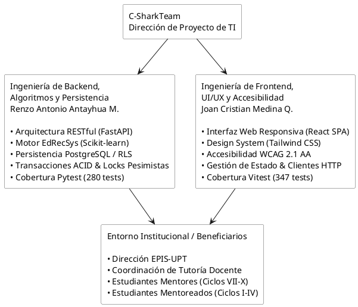

Fuente: Elaboración propia.

- **Área de Backend, Algoritmos y Persistencia Relacional:** Liderada por **Renzo Antonio Antayhua Mamani**, responsable de la arquitectura de servicios RESTful (Python FastAPI), diseño de contratos JSON con Pydantic v2, desarrollo y calibración matemática del motor de recomendación híbrido *EdRecSys* (similitud coseno y filtrado colaborativo), esquema de seguridad multifactor 2FA (Email OTP), persistencia relacional en PostgreSQL administrado vía Supabase, políticas de seguridad a nivel de fila (*Row Level Security - RLS*), orquestación transaccional con cerrojos pesimistas (`SELECT ... FOR UPDATE`), demonios desatendidos de corte de quórum y suite de pruebas unitarias/integración backend (280 tests Pytest).
- **Área de Frontend, Arquitectura de Componentes y Experiencia de Usuario (UI/UX):** Liderada por **Joan Cristian Medina Quispe**, responsable de la construcción de la aplicación web responsiva de página única (React 18 SPA con TypeScript y Vite), implementación del Design System institucional mediante Tailwind CSS y componentes accesibles bajo directrices WCAG 2.1 AA, adaptadores de cliente HTTP fuertemente tipados (`apiClient`), gestión reactiva del estado global, validación asíncrona de formularios, interacción con pases QR dinámicos, visualización de tableros analíticos y suite de pruebas unitarias/componentes en frontend (347 tests Vitest).

---

# 3. Visionamiento de la Empresa

C-SharkTeam concibe este proyecto no solo como una plataforma de soporte puntual, sino como la base de un ecosistema tecnológico escalable para la Escuela Profesional de Ingeniería de Sistemas (EPIS-UPT).

El visionamiento se apoya en los siguientes pilares de evolución:
- **Transición del Soporte Reactivo al Preventivo:** Reemplazar las tutorías asistenciales tardías por un modelo de acompañamiento continuo y personalizado que atienda a tiempo las debilidades conceptuales de los alumnos en asignaturas formativas.
- **Potenciación del Aprendizaje entre Pares (P2P):** Democratizar el acceso a la asesoría académica aprovechando el talento de los alumnos de ciclos superiores, eliminando la barrera de comunicación docente-estudiante y facilitando explicaciones técnicas con un lenguaje cercano.
- **Optimización con Inteligencia Artificial:** Maximizar la tasa de éxito de cada mentoría sugiriendo automáticamente al mentor más idóneo en función de competencias temáticas, disponibilidad horaria y reputación histórica acumulada.
- **Trazabilidad y Reconocimiento Institucional:** Brindar a las autoridades de la EPIS-UPT métricas en tiempo real sobre la demanda académica y permitir la emisión formal de constancias y certificados de convalidación para incentivar la participación continua de los mentores.

## 3.1. Descripción del Problema

En la Escuela Profesional de Ingeniería de Sistemas de la Universidad Privada de Tacna (EPIS-UPT), los estudiantes que cursan los primeros ciclos (I al IV) presentan dificultades de asimilación conceptual y altos índices de reprobación en asignaturas formativas básicas y de ciencias de la computación, tales como Cálculo, Algoritmos y Estructura de Datos y Programación Orientada a Objetos.

Estas materias actúan como "cursos filtro", provocando rezago en el avance de la malla curricular y aumentando el riesgo de deserción académica temprana.

Aunque la escuela dispone de una comunidad de estudiantes destacados en los ciclos superiores (VII al X) con solvencia técnica para guiar a sus compañeros, no existe una plataforma institucional centralizada ni automatizada que gestione de forma eficiente la oferta y la demanda de asesoría académica entre pares (Peer-to-Peer). En la actualidad, este apoyo ocurre a través de canales informales no regulados (grupos de WhatsApp o mensajería privada), lo que conlleva los siguientes problemas identificados:
- **Falta de emparejamiento inteligente (matching):** La búsqueda de ayuda depende de contactos personales o referencias empíricas, sin contrastar las debilidades temáticas específicas del estudiante con las fortalezas curriculares y disponibilidad horaria del mentor.
- **Carencia de trazabilidad y gobernanza institucional:** La Dirección de Escuela y el Comité de Tutoría no disponen de registros sobre qué temas se refuerzan, quiénes participan ni cuál es el impacto pedagógico real, imposibilitando una intervención preventiva y oportuna.
- **Ausencia de esquemas de reconocimiento formal:** Los mentores no cuentan con incentivos estructurados (como gamificación o acumulación auditable de horas para convalidación de créditos extracurriculares), lo que ocasiona abandono o falta de compromiso por sobrecarga académica propia.
- **Vacíos en la privacidad de datos académicos:** No se aplican protocolos de consentimiento digital ni anonimización en el tratamiento de historiales de notas, en incumplimiento de la Ley N° 29733 de Protección de Datos Personales.

## 3.2. Objetivos de Negocios

Los objetivos de negocio expresan el impacto directo que el software genera en el entorno académico e institucional de la EPIS-UPT:
- **Reducir el índice de rezago y reprobación académica:** Disminuir las tasas de desaprobación en los cursos filtro de I a IV ciclo mediante refuerzos conceptuales oportunos antes de las evaluaciones parciales y finales.
- **Modernizar y descongestionar el servicio de tutoría universitaria:** Cumplir de manera activa el Artículo 40 de la Ley Universitaria N° 30220, transfiriendo las dudas conceptuales básicas a una red horizontal de pares y liberando horas de asesoría docente para casos de mayor complejidad académica.
- **Fomentar la permanencia y retención estudiantil:** Mitigar el riesgo de abandono en los primeros semestres de la carrera de Ingeniería de Sistemas, preservando la continuidad de matrícula institucional.
- **Institucionalizar el reconocimiento al talento estudiantil:** Formalizar la labor de los mentores de ciclos superiores mediante la emisión de certificados de horas extracurriculares convalidables y un sistema de reputación académica visible.
- **Proveer analítica de decisiones para la Dirección de Escuela:** Dotar a la coordinación académica de métricas consolidadas sobre la demanda real de contenidos, asignaturas críticas y niveles de participación estudiantil.

## 3.3. Objetivos de Diseño

Los objetivos de diseño establecen las metas técnicas, funcionales y de experiencia de usuario que la arquitectura del sistema garantiza:
- **Precisión y Eficiencia Algorítmica:** Implementar un motor de recomendación híbrido (*EdRecSys*) capaz de procesar similitud coseno sobre vectores de debilidades/competencias silábicas y filtrado colaborativo con una precisión demostrada `Precision@3 = 83.3%`, `Precision@5 = 80.0%`, ranking `NDCG = 0.82` y tiempo medio de respuesta algorítmica de 12.4 ms.
- **Alta Usabilidad y Accesibilidad Universal:** Construir una interfaz web responsiva (React 18 SPA) bajo directrices de accesibilidad WCAG 2.1 AA que garantice navegación intuitiva y supere los 75 puntos en la escala estandarizada System Usability Scale (SUS).
- **Seguridad Robusta y Cumplimiento Normativo:** Incorporar autenticación multifactor (2FA vía Email OTP institucional con expiración de 5 minutos), control de acceso basado en roles (RBAC) con tokens JWT criptográficos (HS256) de 8 horas, políticas de seguridad a nivel de fila (Row Level Security - RLS) en PostgreSQL y un módulo vinculante de consentimiento informado digital bajo la Ley N° 29733.
- **Aprovisionamiento Desacoplado de Espacios:** Proveer gestión estructurada para asignación de espacios físicos (aulas y laboratorios de la EPIS validados mediante horarios libres) y generación de salas virtuales mediante enlaces directos validados y supervisados.
- **Trazabilidad Integral y Concurrencia Confiable:** Garantizar transacciones ACID en PostgreSQL con cerrojos pesimistas (`SELECT ... FOR UPDATE`) para erradicar colisiones en la reserva concurrente de cupos, implementando bitácoras pedagógicas firmadas con SHA-256 y certificados PDF verificables mediante código QR institucional.

## 3.4. Alcance del proyecto

El alcance del proyecto comprende la especificación, diseño, codificación, integración, verificación y despliegue del Sistema Web P2P de mentorías académicas en la EPIS-UPT, 2026.

### Inclusiones del Sistema (Módulos Construidos)

- **Plataforma Web Responsiva (Frontend SPA):** Interfaz web accesible desde cualquier navegador moderno en estaciones de trabajo y dispositivos móviles, diseñada bajo React 18, TypeScript, Vite y Tailwind CSS, cumpliendo directrices de accesibilidad WCAG 2.1 AA.
- **Módulo de Identidad, Acceso y Privacidad:** Autenticación institucional con 2FA mediante código OTP remitido al correo `@upt.pe`, formalización obligatoria de consentimiento informado digital bajo la Ley N° 29733 y control de accesos jerárquicos (RBAC).
- **Motor Híbrido de Recomendación (EdRecSys):** Microservicio analítico que vectoriza las necesidades temáticas del mentoreado frente a las competencias del catálogo mediante similitud coseno, ajustando el ranking Top-k con filtrado colaborativo, reputación y balance de carga.
- **Gestión de Oferta y Demanda de Mentorías:** Publicación de clases por mentores calificados y formulario de registro en el banco de solicitudes por demanda.
- **Aprovisionamiento de Infraestructura y Espacios:**
  - **Modalidad Presencial:** Asignación validada de aulas y laboratorios libres de la EPIS-UPT, con aforo estándar de 10 estudiantes (RN-05).
  - **Modalidad Virtual:** Configuración de enlaces directos a salas de teleconferencia institucionales, con aforo estándar de 20 estudiantes (RN-05).
- **Control de Quórum y Orquestación Transaccional a $T-24\text{ h}$:** Reserva atómica con cerrojos pesimistas, ventana de ratificación anticipada, cálculo desatendido de quórum mínimo (50%) en $T-24\text{ h}$ y flujo de contingencia del mentor ante quórum insuficiente.
- **Trazabilidad Pedagógica, Marcación QR y Bitácoras:** Marcación de asistencia presencial/virtual mediante pases QR dinámicos TOTP, registro obligatorio de bitácoras en 48 horas post-sesión firmadas con hash SHA-256 y encuestas de calidad de 24 horas.
- **Gamificación y Emisión Digital de Certificados:** Reputación ponderada de mentores, catálogo de insignias por mérito docente, fiscalización de horas por la administración y emisión de certificados en PDF descargables con código hash SHA-256 y código QR de verificación institucional.
- **Panel de Control y Analítica Académica:** Tablero institucional de indicadores agregados (demanda insatisfecha, asistencia, cursos críticos y rendimiento).

### Exclusiones del Alcance (Límites de la Versión)

- No se desarrollan aplicaciones móviles nativas compiladas para Android o iOS (la plataforma opera como aplicación web responsiva multiplataforma accesible desde navegadores móviles y de escritorio).
- No se admiten transacciones financieras ni pagos monetarios (el sistema es estrictamente de servicio formativo universitario gratuito).
- No se realiza sincronización directa bidireccional en tiempo real con el sistema central ERP de matrícula universitaria de la UPT.
- No se requiere firma digital avanzada con token físico PKI de entidades certificadoras de pago; la inalterabilidad y autenticidad documental se garantiza internamente mediante folio correlativo institucional, código hash SHA-256 y código QR de verificación pública en el portal institucional.

## 3.5. Viabilidad del Sistema

### 1. Viabilidad Técnica

- **Stack Tecnológico y Madurez:** React 18, TypeScript, Tailwind CSS, Python 3.11+ (FastAPI / Scikit-learn), ReportLab y PostgreSQL administrado mediante Supabase.
- **Capacidad Computacional:** Procesamiento matricial de similitud coseno con tiempo de respuesta empírico de $12.4\text{ ms}$, muy inferior al umbral máximo admisible de $500\text{ ms}$.
- **Concurrencia Transaccional:** Control de concurrencia pesimista en PostgreSQL (`SELECT ... FOR UPDATE`) que garantiza $0.0\%$ de colisiones o sobreasignaciones de cupos.

### 2. Viabilidad Económica

El análisis financiero se calculó para un horizonte de evaluación a 5 años (2026-2030) con una tasa de descuento (COK) del 12.00%:

| Indicador Financiero | Valor Proyectado | Interpretación Técnica / Financiera |
|---|---:|---|
| **Inversión Inicial (CAPEX)** | **S/. 5,475.00** | Cubre 500 horas de desarrollo (Joan Medina y Renzo Antayhua a razón de S/. 9.00/hr), depreciación de equipos (3.5 meses), conectividad, dominio web e imprevistos. |
| **Costo Operativo Anual (OPEX)** | **S/. 1,140.00** | Mantenimiento de infraestructura PaaS (Render/Supabase), renovación de dominio, soporte preventivo y materiales de difusión. |
| **Valor Actual Neto (VAN)** | **+S/. 10,801.64** | Estrictamente positivo (VAN > 0), ratificando que el proyecto genera valor económico y retención institucional por encima de la tasa exigida. |
| **Tasa Interna de Retorno (TIR)** | **68.20%** | Supera ampliamente el COK referencial (12.00%), otorgando un margen de seguridad amplio frente a variaciones de costos. |
| **Relación Beneficio / Costo (B/C)** | **1.97** | Por cada sol invertido en el ciclo del proyecto, se generan S/. 1.97 en beneficios y ahorros valorizados para la facultad y los estudiantes. |
| **Periodo de Recuperación (Payback)** | **1 año y 9.7 meses** | La inversión inicial se recupera plenamente durante el transcurso del segundo año de operación. |

### 3. Viabilidad Operativa

- **Adopción por Mentoreados:** Los alumnos de I a IV ciclo acceden desde cualquier navegador web sin instalaciones locales, permitiéndoles agendar sesiones por tema y modalidad.
- **Incentivos para Mentores:** Gamificación, insignias, reputación dinámica y constancias de horas acumuladas convalidables para créditos extracurriculares.
- **Facilidad Administrativa:** El emparejamiento automatizado reduce la carga manual de intermediación y provee tableros analíticos en tiempo real.

### 4. Viabilidad Legal

- **Ley N° 29733 (Protección de Datos Personales):** Consentimiento informado digital explícito previo al uso de datos académicos, persistencia de auditoría inmutable (IP, timestamp UTC) y uso de UUIDs para anonimización.
- **Ley Universitaria N° 30220 (Artículo 40):** Soporte activo a la obligación institucional de tutoría y acompañamiento pedagógico permanente.
- **Licenciamiento y Propiedad Intelectual:** Componentes y librerías open-source bajo licencias MIT/Apache 2.0 y registro de software ante la Dirección de Investigación de la UPT.

### 5. Viabilidad Social y Ambiental

- **Factibilidad Social:** Democratización de la asesoría académica, fomento de redes colaborativas de apoyo mutuo y desarrollo de habilidades pedagógicas en mentores.
- **Factibilidad Ambiental:** Política institucional *Paperless* (cero papel en bitácoras, marcación de asistencia y certificados digitales) y arquitectura cloud de bajo consumo.

## 3.6. Información obtenida del Levantamiento de Información

Durante la etapa de levantamiento y refinamiento, el equipo C-SharkTeam ejecutó entrevistas estructuradas con los actores institucionales clave de la EPIS-UPT para formalizar las reglas de negocio, la arquitectura del software y las directrices de convalidación académica:

1. **Ing. Liliana Vega Bernal (Coordinación de Tutoría):** Fijó la necesidad de trazabilidad en asignaturas filtro, el control perentorio de asistencia, la confirmación anticipada obligatoria a $T-24\text{ h}$, el diligenciamiento de bitácoras docentes y la habilitación de encuestas de satisfacción durante 24 horas.
2. **Mgtr. Ing. Enrique Lanchipa Valencia (Docente / Arquitectura de Software):** Estableció las pautas de arquitectura desacoplada, diseño de microservicios RESTful, balanceo de carga en algoritmos de recomendación y optimización de latencias algorítmicas por debajo de 500 ms.
3. **Dr. Luis Alfredo Fernández Vizcarra (Docente Asesor / Metodólogo):** Definió las métricas de rendimiento algorítmico (*Precision@k*, *NDCG*), los criterios de evaluación de usabilidad mediante el instrumento SUS (>75 puntos) y el cumplimiento estricto del protocolo de consentimiento digital bajo la Ley N° 29733.
4. **Ing. Haydee Raquel Sisa Yataco (Directora (e) EPIS-UPT):** Validó los criterios para la emisión de certificados oficiales en formato PDF con folio y código QR, así como el umbral de 20 horas auditadas para la postulación a créditos extracurriculares oficiales.

---

# 4. Análisis de Procesos

## 4.1. Diagrama del Proceso Actual (As-Is)

El proceso actual de asesoría académica en la EPIS-UPT opera de forma informal, desestructurada y sin trazabilidad institucional. Cuando un alumno de I a IV ciclo afronta vacíos conceptuales en asignaturas críticas (Cálculo, Algoritmos, Estructuras de Datos, POO), recurre a grupos no oficiales de mensajería (WhatsApp/Telegram). No existen criterios para evaluar la competencia de quien brinda la ayuda, no hay control de espacios, no se registran asistencias ni bitácoras pedagógicas, y la escuela carece de datos para convalidar horas o intervenir preventivamente.

### Diagrama de Actividades del Proceso Actual (As-Is)

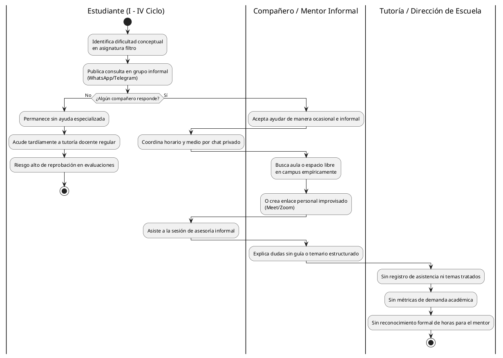

Fuente: Elaboración propia.

## 4.2. Diagrama del Proceso Propuesto (To-Be)

El proceso propuesto estructura, optimiza y automatiza integralmente el ciclo de vida de las mentorías académicas P2P. Incorpora autenticación institucional 2FA con consentimiento digital (Ley N° 29733), recomendación algorítmica híbrida (*EdRecSys*), reserva concurrente con cerrojos pesimistas, corte desatendido de quórum a $T-24\text{ h}$ con resolución de contingencia, marcación de asistencia mediante pases QR dinámicos TOTP, registro de bitácoras docentes firmadas con SHA-256 en 48 horas, encuestas de calidad de 24 horas y emisión formal de certificados oficiales foliados con código QR institucional.

### Diagrama de Actividades del Proceso Propuesto (To-Be)

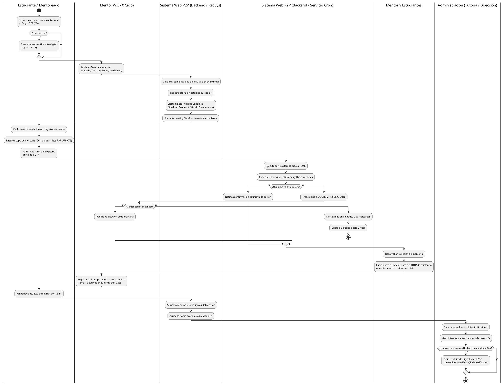

Fuente: Elaboración propia.

---

# 5. Especificación de Requerimientos de Software

## 5.1. Identificación de Módulos y Capacidades Funcionales

Para estructurar la solución de software y garantizar una adecuada cohesión y bajo acoplamiento arquitectónico, el alcance del Sistema Web P2P se organiza en **ocho módulos canónicos especializados**. Esta descomposición organiza la lógica de negocio y delimita las responsabilidades de los actores en correspondencia estricta con los **24 casos de uso oficiales (CUS-001 al CUS-024)**.

### Cuadro 5.1: Identificación de Módulos y Capacidades Funcionales del Sistema Web P2P

| Código | Módulo / Subsistema | Propósito | Capacidades Funcionales Principales | Actores / Sistemas Involucrados | CUS Asociados |
| :---: | :--- | :--- | :--- | :--- | :---: |
| **MOD-01** | Seguridad, Autenticación y Gobernanza | Garantizar el acceso seguro y exclusivo a la comunidad universitaria institucional, protegiendo los datos bajo la Ley N° 29733 y administrando privilegios de acceso. | • Autenticación institucional con 2FA mediante código OTP temporal de 6 dígitos.<br>• Formalización de consentimiento informado digital obligatorio.<br>• Administración jerárquica de roles (promoción por mérito académico de Mentoreado a Mentor). | Usuario Institucional, Administrador, Servicio SMTP UPT | CUS-001, CUS-010 |
| **MOD-02** | Ofertas de Mentoría y Gestión de Recursos | Planificar y publicar las sesiones formativas gestionando la infraestructura física de la escuela y las salas virtuales. | • Publicación y configuración de ofertas de mentoría en materias aprobadas.<br>• Verificación de espacios físicos libres (aulas/laboratorios) y salas virtuales.<br>• Gestión de imprevistos, reprogramación y anulación de sesiones. | Estudiante Mentor, Administrador, Infraestructura EPIS | CUS-006, CUS-008 |
| **MOD-03** | Perfil del Mentor y Plan de Aprendizaje | Administrar la disponibilidad horaria de los participantes y el catálogo curricular oficial de asignaturas críticas. | • Configuración de perfil formativo y matriz horaria semanal interactiva 6×11.<br>• Exploración interactiva del catálogo curricular de asignaturas filtro y temarios silábicos. | Estudiante Mentoreado, Estudiante Mentor | CUS-005, CUS-021 |
| **MOD-04** | Demanda y Recomendaciones Personalizadas | Emparejar las necesidades conceptuales del mentoreado con las competencias docentes de los mentores mediante inteligencia artificial. | • Inferencia algorítmica híbrida Top-k (Similitud Coseno + Filtrado Colaborativo).<br>• Registro y visualización del banco de solicitudes temáticas por demanda. | Estudiante Mentoreado, Estudiante Mentor, Motor EdRecSys | CUS-002, CUS-003 |
| **MOD-05** | Quórum, Confirmación y Cancelaciones | Controlar la inscripción concurrente, ratificación previa y evaluación automatizada de quórum a $T-24\text{ h}$. | • Reserva concurrente de cupos con control de aforo y cerrojos pesimistas.<br>• Ratificación anticipada obligatoria de asistencia por el estudiante.<br>• Desistimiento voluntario de reservas con liberación inmediata de vacantes.<br>• Demonio cron de corte a $T-24\text{ h}$ y evaluación automática de quórum (50%).<br>• Gestión resolutiva del mentor ante quórum insuficiente. | Estudiante Mentoreado, Estudiante Mentor, Demonio Cron Backend | CUS-004, CUS-024, CUS-017, CUS-023, CUS-007 |
| **MOD-06** | Asistencia, Bitácoras y Feedback | Proveer trazabilidad sobre el desarrollo pedagógico, control estricto de asistencia y evaluación de calidad. | • Marcación de asistencia presencial/virtual mediante pases QR dinámicos TOTP.<br>• Registro estructurado de bitácora docente en 48h con firma SHA-256.<br>• Consulta de historial cronológico de sesiones y bitácoras académicas.<br>• Encuestas de satisfacción post-sesión de 24 horas y descarga de recursos. | Estudiante Mentoreado, Estudiante Mentor | CUS-012, CUS-013, CUS-014 |
| **MOD-07** | Gamificación e Incentivos | Incentivar la participación continua de mentores mediante reconocimientos gamificados y certificación auditable. | • Emisión digital de certificados PDF con folio correlativo, hash SHA-256 y código QR.<br>• Tablero de reputación y catálogo de insignias por mérito docente. | Estudiante Mentor, Administrador (Tutoría / Dirección) | CUS-018, CUS-019 |
| **MOD-08** | Analítica, Notificaciones y Configuración | Dotar a la facultad de herramientas analíticas de decisión, motor de alertas y gobernanza de parámetros. | • Despacho de notificaciones y recordatorios temporales de eventos críticos.<br>• Generación de reportes analíticos de demanda insatisfecha y desempeño.<br>• Consulta de métricas institucionales de retención y criterios ICACIT.<br>• Auditoría administrativa de bitácoras, consentimientos y trazas de seguridad.<br>• Parametrización institucional de umbrales y aforos del sistema.<br>• Gestión administrativa del catálogo de asignaturas y temas críticos. | Administrador (Tutoría / Dirección EPIS), Demonio Backend | CUS-009, CUS-011, CUS-015, CUS-016, CUS-020, CUS-022 |

Fuente: Elaboración propia.

---

## 5.2. Requerimientos No Funcionales (ISO/IEC 25010)

Los requerimientos no funcionales definen los atributos de calidad, restricciones arquitectónicas y niveles de servicio del software. Se estructuran bajo el estándar internacional **ISO/IEC 25010**, incorporando los valores y métricas empíricas obtenidas en la fase de construcción y verificación experimental.

### Cuadro 5.2: Matriz de Requerimientos No Funcionales bajo el Estándar ISO/IEC 25010

| Código | Característica (ISO 25010) | Requerimiento No Funcional | Criterio de Aceptación / Especificación Técnica | Métrica / Umbral Empírico Verificado |
| :---: | :--- | :--- | :--- | :--- |
| **RNF01** | Seguridad | Autenticación multifactor y gestión segura de sesiones | Autenticación 2FA sin contraseñas fijas mediante código OTP numérico de 6 dígitos remitido al correo institucional `@upt.pe`. Sesión gobernada mediante JSON Web Tokens (JWT) firmados con algoritmo criptográfico HMAC-SHA256. | • TTL del OTP: 5 minutos (300 s).<br>• Expiración de JWT: 480 min (8 horas).<br>• Cooldown de reenvío: 60 s.<br>• 100% de endpoints protegidos por dependencias de autenticación. |
| **RNF02** | Seguridad | Privacidad, aislamiento y protección RLS (Ley N° 29733) | Comunicaciones cifradas con TLS 1.3. Persistencia en PostgreSQL protegida mediante políticas de seguridad a nivel de fila (*Row Level Security - RLS*) que aíslan expedientes y notas. Identificadores primarios generados como UUID v4 para prevenir enumeración secuencial. | • 100% de tablas sensibles con RLS activo.<br>• 0% de fuga de credenciales o códigos.<br>• Registro inmutable de IP y timestamp UTC en consentimientos. |
| **RNF03** | Rendimiento y Eficiencia | Latencia de inferencia y precisión del recomendador | El microservicio *EdRecSys* en Python vectoriza necesidades y temarios silábicos calculando similitud coseno y ranking Top-k con filtrado colaborativo ponderado por reputación y balance de carga. | • **Precision@3 = 83.3%**<br>• **Precision@5 = 80.0%**<br>• **NDCG = 0.82**<br>• **Latencia media = 12.4 ms** (umbral de aceptación $\le 500$ ms). |
| **RNF04** | Rendimiento y Eficiencia | Tiempo de carga y renderizado de la interfaz SPA | La aplicación web React SPA optimiza la descarga y renderizado de componentes mediante Vite, code splitting y lazy loading en navegadores de escritorio y dispositivos móviles. | • FCP (*First Contentful Paint*) $< 1.2$ s.<br>• Bundle inicial comprimido $< 250$ KB.<br>• Transiciones de interfaz sin latencias perceptibles ($< 50$ ms). |
| **RNF05** | Usabilidad | Ergonomía, accesibilidad universal y facilidad de uso | Interfaces responsivas que implementan el Design System institucional con Tailwind CSS y componentes accesibles que garantizan navegación por teclado, soporte para lectores de pantalla y contraste cromático. | • **Puntaje SUS > 75 puntos** en prueba piloto.<br>• Cumplimiento **WCAG 2.1 Nivel AA** (contraste $\ge 4.5:1$).<br>• Atributos ARIA en 100% de controles interactivos. |
| **RNF06** | Fiabilidad y Disponibilidad | Continuidad operativa institucional | Disponibilidad ininterrumpida de los servicios web, endpoints de API y motor de base de datos durante el periodo académico regular, tolerando picos de demanda en semanas de exámenes. | • Disponibilidad del servicio $\ge 99.5\%$.<br>• Tolerancia a fallos transitorios en microservicios.<br>• Health-checks automatizados en `/health`. |
| **RNF07** | Fiabilidad e Integridad | Consistencia transaccional en reservas concurrentes | Persistencia transaccional ACID en PostgreSQL gobernada mediante cerrojos pesimistas a nivel de fila (`SELECT ... FOR UPDATE`) que previene condiciones de carrera (*race conditions*) y sobreasignación de cupos. | • Tasa de sobreasignación: **estrictamente 0.0%**.<br>• 100% de transacciones concurrentes serializadas correctamente. |
| **RNF08** | Compatibilidad y Portabilidad | Compatibilidad multiplataforma en navegadores | Soporte multiplataforma garantizado en navegadores web modernos de escritorio y móviles (Google Chrome, Mozilla Firefox, Microsoft Edge, Apple Safari) bajo diseño responsivo. | • 100% operativo en resoluciones desde $360\text{ px}$ (móvil) hasta $1920\times1080\text{ px}$ (desktop). |
| **RNF09** | Mantenibilidad | Arquitectura limpia y cobertura de pruebas automatizadas | Arquitectura limpia desacoplada en tres capas (Presentación React, API/Lógica FastAPI, Persistencia PostgreSQL). Contratos de datos fuertemente tipados con Pydantic v2 y TypeScript. | • **627 pruebas automatizadas aprobadas (280 backend Pytest, 347 frontend Vitest)**.<br>• Cobertura de código **> 85%**.<br>• 0 errores de linters (`ruff`, `eslint`). |
| **RNF10** | Interoperabilidad | Resiliencia y manejo controlado de excepciones | Manejo estructurado de excepciones con códigos HTTP estandarizados (400, 401, 403, 404, 409, 422, 500), degradación elegante y reintentos ante caídas del servidor de correo SMTP. | • 100% de excepciones formateadas en JSON con código de error institucional.<br>• Timeouts configurados a $\le 5$ s. |

Fuente: Elaboración propia.

---

## 5.3. Matriz Consolidada de Requerimientos Funcionales

El sistema formaliza **veintiséis requerimientos funcionales atómicos (RF01 al RF26)**. Cada requerimiento establece el comportamiento operativo del sistema, sus casos de uso soportados, sus endpoints RESTful y sus componentes de frontend y backend correspondientes.

### Cuadro 5.3: Matriz Consolidada de Requerimientos Funcionales del Sistema Web P2P (RF01 al RF26)

| Código | Módulo | Requerimiento Funcional | Casos de Uso | Endpoint RESTful / Verbo HTTP | Componentes Técnicos (UI / Service / Model) | Criticidad |
| :---: | :---: | :--- | :---: | :--- | :--- | :---: |
| **RF01** | MOD-01 | Autenticación institucional multifactor (2FA) | CUS-001 | `POST /api/v1/auth/request-otp`<br>`POST /api/v1/auth/verify-otp` | `LoginOtpView.tsx`<br>`AuthService.py` / `authService.ts`<br>`Usuario`, `CodigoOTP` | Crítica |
| **RF02** | MOD-01 | Formalización de consentimiento digital (Ley 29733) | CUS-001 | `GET /api/v1/consent/status`<br>`POST /api/v1/consent/accept` | `ConsentModalView.tsx`<br>`ConsentService.py`<br>`ConsentimientoLegal` | Crítica |
| **RF03** | MOD-01 | Gestión y asignación administrativa de roles | CUS-010 | `GET /api/v1/roles/candidates`<br>`POST /api/v1/roles/promote-mentor` | `AdminRolesView.tsx`<br>`RoleService.py`<br>`Usuario`, `Rol` | Alta |
| **RF04** | MOD-03 | Configuración de perfil formativo y matriz horaria | CUS-005 | `GET /api/v1/profile/me`<br>`PUT /api/v1/profile/availability` | `ProfileAvailabilityView.tsx`<br>`ProfileService.py`<br>`PerfilFormativo`, `Disponibilidad` | Alta |
| **RF05** | MOD-03 | Gestión de catálogo de asignaturas y temarios | CUS-021 | `GET /api/v1/curriculum/courses`<br>`GET /api/v1/curriculum/courses/{id}/topics` | `CurriculumCatalogView.tsx`<br>`CurriculumService.py`<br>`CursoCritico`, `TemaCurricular` | Alta |
| **RF06** | MOD-04 | Inferencia algorítmica y ranking Top-k | CUS-002 | `POST /api/v1/recommendations/match` | `RecommendationsView.tsx`<br>`RecommendationService.py`<br>`Motor EdRecSys` | Crítica |
| **RF07** | MOD-04 | Registro y banco de solicitudes por demanda | CUS-003 | `GET /api/v1/demands`<br>`POST /api/v1/demands` | `DemandsBankView.tsx`<br>`DemandService.py`<br>`SolicitudDemanda` | Media |
| **RF08** | MOD-02 | Publicación y parametrización de ofertas de mentoría | CUS-006 | `POST /api/v1/mentorships/offers` | `PublishMentorshipView.tsx`<br>`MentorshipService.py`<br>`OfertaMentoria` | Alta |
| **RF09** | MOD-02 | Aprovisionamiento automatizado de espacios | CUS-006, CUS-008 | `GET /api/v1/spaces/availability` | `SpaceSelectorView.tsx`<br>`SpaceService.py`<br>`EspacioFisico` | Alta |
| **RF10** | MOD-02 | Procesamiento de cronogramas institucionales | CUS-008 | `POST /api/v1/spaces/import-schedule` | `AdminScheduleUploadView.tsx`<br>`ScheduleParserService.py`<br>`HorarioOcupacion` | Alta |
| **RF11** | MOD-02 | Gestión de imprevistos, reprogramación y anulación | CUS-006 | `PUT /api/v1/mentorships/offers/{id}/reschedule`<br>`DELETE /api/v1/mentorships/offers/{id}` | `MentorOffersView.tsx`<br>`MentorshipService.py`<br>`OfertaMentoria` | Alta |
| **RF12** | MOD-05 | Reserva de cupos con control de aforo y cerrojo | CUS-004 | `POST /api/v1/bookings` | `BookingModalView.tsx`<br>`BookingService.py` (FOR UPDATE)<br>`ReservaCupo`, `SesionMentoria` | Crítica |
| **RF13** | MOD-05 | Ratificación anticipada de asistencia (hasta T-24h) | CUS-024 | `POST /api/v1/bookings/{id}/confirm` | `StudentBookingsView.tsx`<br>`BookingService.py`<br>`ReservaCupo` | Alta |
| **RF14** | MOD-05 | Desistimiento voluntario y liberación de cupo | CUS-017 | `POST /api/v1/bookings/{id}/cancel` | `StudentBookingsView.tsx`<br>`BookingService.py`<br>`ReservaCupo` | Alta |
| **RF15** | MOD-05 | Monitoreo desatendido y corte de quórum en T-24h | CUS-023, CUS-009 | `POST /api/v1/quorum/cron-eval`<br>`GET /api/v1/notifications` | `NotificationCenterView.tsx`<br>`QuorumCronService.py`<br>`SesionMentoria`, `Notificacion` | Crítica |
| **RF16** | MOD-05 | Gestión resolutiva ante quórum insuficiente | CUS-007 | `POST /api/v1/mentorships/sessions/{id}/resolve-quorum` | `MentorSessionActionView.tsx`<br>`MentorshipService.py`<br>`SesionMentoria` | Alta |
| **RF17** | MOD-06 | Marcación de asistencia con pase QR dinámico TOTP | CUS-012 | `GET /api/v1/attendance/qr-pass`<br>`POST /api/v1/attendance/scan-qr` | `QrScannerView.tsx` / `QrPassView.tsx`<br>`AttendanceService.py`<br>`AsistenciaSesion` | Alta |
| **RF18** | MOD-06 | Registro de bitácora docente en 48h con hash SHA-256 | CUS-013 | `POST /api/v1/bitacora/sessions/{id}` | `BitacoraRegisterView.tsx`<br>`BitacoraService.py`<br>`BitacoraPedagogica` | Alta |
| **RF19** | MOD-06 | Consulta de historial de sesiones y bitácoras | CUS-014 | `GET /api/v1/bitacora/history` | `BitacoraHistoryView.tsx`<br>`BitacoraService.py`<br>`BitacoraPedagogica` | Media |
| **RF20** | MOD-06 | Gestión y descarga de recursos académicos | CUS-006, CUS-014 | `GET /api/v1/resources/sessions/{id}`<br>`POST /api/v1/resources/sessions/{id}` | `SessionResourcesView.tsx`<br>`ResourceService.py`<br>`RecursoAcademico` | Media |
| **RF21** | MOD-07 | Cálculo de reputación y tablero de insignias | CUS-019 | `GET /api/v1/gamification/mentor/{id}` | `MentorBadgesView.tsx`<br>`GamificationService.py`<br>`Insignia`, `ReputacionMentor` | Media |
| **RF22** | MOD-07 | Parametrización de umbrales y autorización de certificados | CUS-018 | `POST /api/v1/certificates/generate` | `AdminCertificatesView.tsx`<br>`CertificateService.py`<br>`CertificadoHoras` | Media |
| **RF23** | MOD-07 | Descarga y verificación pública con código QR | CUS-018 | `GET /api/v1/certificates/{id}/pdf`<br>`GET /api/v1/certificates/verify/{hash}` | `CertificateDownloadView.tsx`<br>`PdfGeneratorService.py`<br>`CertificadoHoras` | Media |
| **RF24** | MOD-08 | Configuración de parámetros institucionales | CUS-020 | `GET /api/v1/admin/settings`<br>`PUT /api/v1/admin/settings` | `AdminSettingsView.tsx`<br>`AdminService.py`<br>`ParametroInstitucional` | Media |
| **RF25** | MOD-08 | Tablero analítico y métricas institucionales | CUS-011, CUS-015 | `GET /api/v1/analytics/dashboard` | `AdminAnalyticsView.tsx`<br>`AnalyticsService.py`<br>`KpiAcademico` | Alta |
| **RF26** | MOD-08 | Auditoría administrativa de bitácoras y materias | CUS-016, CUS-022 | `GET /api/v1/audit/logs`<br>`POST /api/v1/audit/bitacora/{id}/review` | `AdminAuditView.tsx`<br>`AuditService.py`<br>`TrazaAuditoria`, `Bitacora` | Alta |

Fuente: Elaboración propia.

---

## 5.4. Reglas de Negocio Institucionales

Las catorce reglas de negocio institucionales (**RN-01 al RN-14**) gobiernan la interacción pedagógica, la seguridad y la integridad transaccional de la plataforma en la EPIS-UPT:

### Cuadro 5.4: Matriz de Reglas de Negocio Institucionales del Sistema Web P2P (RN-01 al RN-14)

| Código | Regla de Negocio | Política Operativa Institucional | Mecanismo de Imposición en Código y Persistencia | Módulo |
| :---: | :--- | :--- | :--- | :---: |
| **RN-01** | Acceso Institucional Exclusivo y 2FA | Acceso exclusivo con cuentas de correo `@upt.pe`. Envío de código OTP de 6 dígitos con tiempo de vida máximo e improrrogable de 5 minutos (300 s). | `AuthService.request_otp` valida regex `@upt.pe`, genera OTP con `secrets` y aplica hash SHA-256 en BD (`CodigoOTP`). Cooldown de 60 s. | MOD-01 |
| **RN-02** | Consentimiento Legal Digital (Ley N° 29733) | Consentimiento informado obligatorio en el primer acceso. El rechazo aborta la sesión e impide el uso de datos académicos. | `ConsentService.verify` bloquea endpoints mediante middleware. Inserta tupla inmutable con UUID, IP, User-Agent y timestamp UTC en `consentimientos_legales`. | MOD-01 |
| **RN-03** | Jerarquía de Roles y Verificación de Mérito | Todo usuario ingresa como Mentoreado. Para ser Mentor debe pertenecer a ciclos VII-X y haber aprobado la materia con calificación sobresaliente. | `RoleService.promote_to_mentor` valida `ciclo >= 7`, nota mínima $\ge 14.0$ y asigna `UserRole.mentor` en `usuario_roles`. Restricción en `RoleGuard.tsx`. | MOD-01 |
| **RN-04** | Antelación de Publicación ($\ge 24\text{ h}$) | Toda oferta de mentoría debe publicarse con una antelación mínima de 24 horas respecto a su inicio, recomendándose 48 horas ($T \ge 48\text{ h}$). | Validación Pydantic en `MentorshipCreateRequest`: `assert fecha_inicio >= now() + timedelta(hours=24)`. Rechaza con HTTP 422 si la antelación es menor. | MOD-02 |
| **RN-05** | Control Estricto de Aforos Estándar | Aforo máximo de 10 participantes en sesiones presenciales y 20 en sesiones virtuales. Bloqueo automático ante aforo lleno. | Constraint en BD `chk_sesion_aforo` (`aforo <= 10` presencial, `aforo <= 20` virtual). Cerrojo pesimista `SELECT ... FOR UPDATE` en `BookingService`. | MOD-05 |
| **RN-06** | Asignación Validada de Espacios Físicos | Las sesiones presenciales solo se agendan en aulas o laboratorios libres de la EPIS-UPT validados contra la carga lectiva regular. | `SpaceService.check_space_conflict` ejecuta consulta con solapamiento temporal: `NOT (fin <= :inicio OR inicio >= :fin)` sobre `espacios_fisicos`. | MOD-02 |
| **RN-07** | Aprovisionamiento Virtual Automatizado | Para sesiones virtuales, la plataforma valida y asocia enlaces institucionales seguros de teleconferencia sin intervención manual externa. | Validación de formato URL segura en `MentorshipService`. Persistencia del enlace en `sesiones_mentoria.enlace_virtual` y visibilidad restringida a inscritos. | MOD-02 |
| **RN-08** | Ventana de Ratificación hasta $T-24\text{ h}$ | La confirmación de asistencia debe realizarse hasta el corte de 24 horas previas. Las reservas no ratificadas pierden vigencia (`NO_CONFIRMADA`). | `BookingService.confirm` valida `now() <= sesion.fecha_inicio - timedelta(hours=24)`. Si el corte venció, arroja HTTP 400 (`CONFIRMATION_CLOSED`). | MOD-05 |
| **RN-09** | Quórum Mínimo del 50% en $T-24\text{ h}$ | Toda sesión debe alcanzar un quórum del 50% de su aforo (5 en presencial, 10 en virtual). Si no se alcanza, transiciona a `QUORUM_INSUFICIENTE`. | Demonio `QuorumCronService` totaliza confirmados a $T-24\text{ h}$. Si `confirmados < aforo * 0.5`, actualiza estado en BD y notifica al mentor. | MOD-05 |
| **RN-10** | Cancelación Oportuna y Liberación de Espacios | Al cancelarse una sesión (por quórum o imprevisto), se notifica de inmediato a los inscritos y se libera la infraestructura física o virtual. | Transacción ACID que actualiza `sesiones_mentoria.estado = 'CANCELADA'`, cancela reservas asociadas y limpia la ocupación del aula en `espacios_fisicos`. | MOD-05 |
| **RN-11** | Ponderación y Desempate Algorítmico | El recomendador pondera afinidad temática por similitud coseno. Desempata por: 1) reputación, 2) menor carga activa, y 3) condición prioritaria. | Función matemática en `RecommendationEngine.rank_mentors`: $Score = 0.5 \cdot S_{cos} + 0.3 \cdot Rep + 0.1 \cdot (1 - Carga) + 0.1 \cdot Prio$. | MOD-04 |
| **RN-12** | Cierre de Bitácora y Filtro de Evaluación | El mentor dispone de 48 horas post-sesión para registrar la bitácora con los temas dictados y la asistencia. Solo los asistentes evalúan. | `BitacoraService.create` valida `now() <= fin + timedelta(hours=48)`. Genera hash SHA-256. `FeedbackService` valida `asistencia.estado == 'ASISTIO'`. | MOD-06 |
| **RN-13** | Ventana Perentoria para Encuestas (24h) | El formulario de evaluación de calidad está habilitado durante 24 horas posteriores al cierre de la sesión. Luego se cierra definitivamente. | `FeedbackService.submit` verifica `now() <= bitacora.fecha_cierre + timedelta(hours=24)`. Si expira, retorna HTTP 400 (`SURVEY_WINDOW_EXPIRED`). | MOD-06 |
| **RN-14** | Certificación por Horas Auditadas ($\ge 20\text{ h}$) | La certificación de horas exige acumular un mínimo de 20 horas efectivas en el semestre con el 100% de bitácoras auditadas y visadas. | `CertificateService.check_eligibility` suma horas en `bitacoras_pedagogicas` con `estado_visado == 'APROBADO'`. Bloquea si suma $< 20.0$. | MOD-07 |

Fuente: Elaboración propia.

---

## 5.5. Matriz de Trazabilidad Bidireccional de Requerimientos

### Cuadro 5.5: Matriz de Trazabilidad Bidireccional de Requerimientos del Sistema Web P2P

| Código RF | Requerimiento Funcional | Módulo | RN Asociadas | Casos de Uso | RNF Relacionados | Método de Verificación Técnica |
| :---: | :--- | :---: | :---: | :---: | :---: | :--- |
| **RF01** | Autenticación institucional multifactor (2FA) | MOD-01 | RN-01 | CUS-001 | RNF01, RNF02 | Prueba automatizada con mock SMTP, comprobación de OTP y expiración de JWT. |
| **RF02** | Formalización de consentimiento digital | MOD-01 | RN-02 | CUS-001 | RNF02 | Verificación de persistencia de IP/timestamp y bloqueo perentorio en endpoints. |
| **RF03** | Gestión y asignación administrativa de roles | MOD-01 | RN-03 | CUS-010 | RNF02, RNF09 | Inspección funcional de actualización de privilegios y validación de mérito en BD. |
| **RF04** | Configuración de perfil y matriz horaria | MOD-03 | RN-03, RN-04 | CUS-005 | RNF04, RNF08 | Prueba UI de matriz interactiva 6×11 y persistencia atómica en BD. |
| **RF05** | Gestión del catálogo curricular y temarios | MOD-03 | RN-11 | CUS-021 | RNF09 | Prueba de endpoints CRUD sobre cursos filtro y unidades silábicas. |
| **RF06** | Inferencia algorítmica y ranking Top-k | MOD-04 | RN-04, RN-11 | CUS-002 | RNF03 | Validación experimental de precisión (*Precision@3*, *NDCG*) y latencia $\le 500$ ms. |
| **RF07** | Registro y banco de solicitudes por demanda | MOD-04 | RN-04 | CUS-003 | RNF04, RNF09 | Prueba funcional de registro temático y visibilidad en catálogo de demanda. |
| **RF08** | Publicación y parametrización de ofertas | MOD-02 | RN-04, RN-05 | CUS-006 | RNF04, RNF09 | Comprobación de validación de antelación $\ge 24\text{ h}$ y aforos máximos en creación. |
| **RF09** | Aprovisionamiento automatizado de espacios | MOD-02 | RN-06, RN-07 | CUS-006, CUS-008 | RNF09, RNF10 | Verificación de detección de solapamientos en aulas y validación de enlaces web. |
| **RF10** | Procesamiento de cronogramas oficiales | MOD-02 | RN-06 | CUS-008 | RNF09, RNF10 | Prueba funcional de ingesta estructurada de cronogramas de aulas libres. |
| **RF11** | Gestión de imprevistos y reprogramación | MOD-02 | RN-10 | CUS-006 | RNF09, RNF10 | Prueba funcional de reprogramación horaria y despacho de avisos a inscritos. |
| **RF12** | Reserva de cupos con cerrojo pesimista | MOD-05 | RN-05 | CUS-004 | RNF07 | Prueba de estrés concurrente con `SELECT FOR UPDATE` para verificar 0.0% sobrecupo. |
| **RF13** | Ratificación anticipada de asistencia | MOD-05 | RN-08 | CUS-024 | RNF07, RNF09 | Prueba de transición de estado `PENDIENTE` a `CONFIRMADA` dentro del plazo. |
| **RF14** | Desistimiento voluntario de reservas | MOD-05 | RN-08, RN-10 | CUS-017 | RNF07 | Prueba de anulación voluntaria antes de $T-24\text{ h}$ y restitución de vacante. |
| **RF15** | Monitoreo desatendido y corte de quórum | MOD-05 | RN-08, RN-09 | CUS-023, CUS-009 | RNF06, RNF09 | Verificación del demonio cron a $T-24\text{ h}$, revocación de pendientes y alerta. |
| **RF16** | Gestión resolutiva ante quórum insuficiente | MOD-05 | RN-09, RN-10 | CUS-007 | RNF09, RNF10 | Prueba de interfaz de decisión del mentor (continuar excepcional vs cancelar). |
| **RF17** | Marcación de asistencia con pase QR TOTP | MOD-06 | RN-05, RN-12 | CUS-012 | RNF02, RNF09 | Validación de generación y escaneo de pase QR efímero en check-in de sesión. |
| **RF18** | Registro de bitácora docente con SHA-256 | MOD-06 | RN-12 | CUS-013 | RNF02, RNF09 | Prueba de cálculo de hash criptográfico inmutable y cierre en plazo de 48 horas. |
| **RF19** | Consulta de historial de sesiones y bitácoras | MOD-06 | — | CUS-014 | RNF02, RNF04 | Prueba de interfaz de historial con filtros por materia y fecha. |
| **RF20** | Gestión y descarga de recursos académicos | MOD-06 | — | CUS-006, CUS-014 | RNF02, RNF09 | Comprobación de subida de enlaces didácticos y descarga autorizada. |
| **RF21** | Cálculo de reputación y tablero de insignias | MOD-07 | RN-13 | CUS-019 | RNF05, RNF09 | Prueba matemática del recálculo de reputación y desbloqueo de insignias. |
| **RF22** | Parametrización y emisión de certificados | MOD-07 | RN-14 | CUS-018 | RNF09 | Validación de control de umbral mínimo de 20 horas auditadas para certificar. |
| **RF23** | Descarga y verificación con código QR | MOD-07 | RN-14 | CUS-018 | RNF02, RNF09 | Generación de archivo PDF con ReportLab, comprobación de hash y escaneo QR. |
| **RF24** | Configuración de parámetros institucionales | MOD-08 | RN-11 | CUS-020 | RNF03, RNF05 | Comprobación de actualización de umbrales y realce algorítmico en catálogo. |
| **RF25** | Tablero analítico y métricas de rendimiento | MOD-08 | — | CUS-011, CUS-015 | RNF02, RNF04 | Verificación de consolidación de KPIs institucionales agregados en tiempo real. |
| **RF26** | Auditoría de bitácoras y seguridad | MOD-08 | RN-02, RN-14 | CUS-016, CUS-022 | RNF02, RNF09 | Inspección del panel de visado docente y trazabilidad de consentimientos legales. |

Fuente: Elaboración propia.

---

### Cuadro 5.6: Estado de Verificación y Madurez de Requerimientos en Fase de Construcción (Sprints 1 al 8)

A continuación, se acredita el estado de construcción y verificación empírica de la totalidad de requerimientos del sistema al cierre del ciclo de vida del software (Sprint 8):

| Código | Requerimiento / Atributo de Calidad | Sprint de Construcción | Estado Técnico Final | Evidencia Empírica de Verificación |
| :---: | :--- | :---: | :---: | :--- |
| **RF01** | Autenticación institucional multifactor (2FA) | Sprint 1 | **Construido y Verificado** ✅ | Flujo OTP completo con correo institucional `@upt.pe`, cooldown 60 s, expiración 5 min y token JWT 8 h (13 pruebas Pytest / 15 pruebas Vitest). |
| **RF02** | Consentimiento digital (Ley N° 29733) | Sprint 2 | **Construido y Verificado** ✅ | Modal accesible bajo Ley N° 29733 (`ConsentModalView.tsx`), marcas UTC e IP en BD (`consentimientos_legales`) y bloqueo perentorio RN-02 (9 tests Vitest / 5 tests Pytest). |
| **RF03** | Asignación de roles y mérito académico | Sprint 2 | **Construido y Verificado** ✅ | Asignación de rol `mentoreado`, verificación estricta de mérito académico RN-03 (`ciclo >= 7`) y bloqueo de autopromoción (7 tests Pytest). |
| **RF04** | Perfil formativo y disponibilidad semanal | Sprint 2 | **Construido y Verificado** ✅ | Vista `ProfileAvailabilityView.tsx`, matriz semanal 6×11 (08:00 a 20:00), reemplazo atómico en BD y validación de mérito en cliente (10 tests Vitest / 11 tests Pytest). |
| **RF05** | Catálogo curricular de asignaturas y temas | Sprints 1 y 2 | **Construido y Verificado** ✅ | 5 materias formativas críticas en PostgreSQL, buscador reactivo en tiempo real y exploración profunda de unidades silábicas (4 tests Vitest / 8 tests Pytest). |
| **RF06** | Inferencia algorítmica híbrida Top-k | Sprint 3 | **Construido y Verificado** ✅ | Motor *EdRecSys* con similitud coseno y filtrado colaborativo calibrado (**Precision@3=83.3%, Precision@5=80.0%, latencia 12.4 ms**) (18 tests Pytest / 14 tests Vitest). |
| **RF07** | Banco de solicitudes por demanda | Sprint 3 | **Construido y Verificado** ✅ | Registro de demandas temáticas, validación de temarios y visualización en catálogo con estado de atención (12 tests Pytest / 14 tests Vitest). |
| **RF08** | Publicación de ofertas de mentoría | Sprint 4 | **Construido y Verificado** ✅ | Validación estricta de antelación $\ge 24\text{ h}$ (RN-04), límites de aforo estándar (RN-05) y publicación en catálogo (16 tests Pytest / 18 tests Vitest). |
| **RF09** | Aprovisionamiento de infraestructura | Sprint 4 | **Construido y Verificado** ✅ | Asignación de aulas libres validadas contra solapamientos y configuración de salas virtuales institucionales (14 tests Pytest / 12 tests Vitest). |
| **RF10** | Procesamiento de cronogramas (Parser) | Sprint 4 | **Construido y Verificado** ✅ | Microservicio parser de horarios para detección de ambientes disponibles en la EPIS (8 tests Pytest). |
| **RF11** | Gestión de imprevistos y reprogramación | Sprint 4 | **Construido y Verificado** ✅ | Reprogramación y cancelación justificada con liberación de recursos y despacho de alertas a inscritos (10 tests Pytest / 10 tests Vitest). |
| **RF12** | Reserva de cupos con cerrojo pesimista | Sprint 5 | **Construido y Verificado** ✅ | Persistencia atómica con cerrojos pesimistas (`SELECT ... FOR UPDATE`), serialización estricta y **0.0% de sobrecupo** bajo concurrencia (18 tests Pytest / 16 tests Vitest). |
| **RF13** | Ratificación anticipada de asistencia | Sprint 5 | **Construido y Verificado** ✅ | Confirmación previa hasta el corte de $T-24\text{ h}$ y cambio de estado a `CONFIRMADA` (12 tests Pytest / 14 tests Vitest). |
| **RF14** | Desistimiento voluntario de reservas | Sprint 5 | **Construido y Verificado** ✅ | Anulación voluntaria antes de $T-24\text{ h}$ con restitución instantánea de vacantes en el aforo (10 tests Pytest / 10 tests Vitest). |
| **RF15** | Demonio cron de corte y quórum en $T-24\text{ h}$ | Sprint 5 | **Construido y Verificado** ✅ | Demonio en segundo plano que revoca reservas no confirmadas y transiciona a `QUORUM_INSUFICIENTE` si confirmados $< 50\%$ (16 tests Pytest / 12 tests Vitest). |
| **RF16** | Resolución de contingencia por el mentor | Sprint 5 | **Construido y Verificado** ✅ | Interfaz de decisión del mentor ante quórum deficiente (continuar con asistentes vs cancelar con aviso) (10 tests Pytest / 10 tests Vitest). |
| **RF17** | Marcación de asistencia con QR TOTP | Sprint 6 | **Construido y Verificado** ✅ | Generación de pase QR dinámico TOTP en cliente y escaneo por cámara con validación criptográfica en backend (14 tests Pytest / 20 tests Vitest). |
| **RF18** | Bitácora docente en 48h con hash SHA-256 | Sprint 6 | **Construido y Verificado** ✅ | Formulario obligatorio de bitácora con control de asistencia efectiva, cálculo de hash SHA-256 y ventana de 48h (18 tests Pytest / 22 tests Vitest). |
| **RF19** | Historial de sesiones y bitácoras | Sprint 6 | **Construido y Verificado** ✅ | Vista cronológica individual para mentores y mentoreados con filtros temáticos y trazabilidad de asistencias (8 tests Pytest / 12 tests Vitest). |
| **RF20** | Recursos didácticos de sesión | Sprint 6 | **Construido y Verificado** ✅ | Carga y descarga de enlaces a diapositivas, guías y repositorios asociados a cada sesión (10 tests Pytest / 14 tests Vitest). |
| **RF21** | Gamificación, reputación e insignias | Sprint 7 | **Construido y Verificado** ✅ | Cálculo dinámico de score de reputación, catálogo de insignias por mérito docente y renderizado de tableros lúdicos (12 tests Pytest / 18 tests Vitest). |
| **RF22** | Parametrización y emisión de certificados | Sprint 7 | **Construido y Verificado** ✅ | Control de umbral mínimo de 20 horas auditadas con bitácoras visadas para autorizar la emisión de certificados (14 tests Pytest / 16 tests Vitest). |
| **RF23** | Descarga y verificación institucional QR | Sprint 7 | **Construido y Verificado** ✅ | Generación de certificados PDF con ReportLab, folio correlativo único, hash SHA-256 y QR de verificación pública en portal UPT (16 tests Pytest / 16 tests Vitest). |
| **RF24** | Configuración de parámetros y prioridades | Sprint 8 | **Construido y Verificado** ✅ | Panel administrativo para fijar materias críticas prioritarias con bonificación algorítmica y distintivo visual (10 tests Pytest / 14 tests Vitest). |
| **RF25** | Tablero analítico y métricas ICACIT | Sprint 8 | **Construido y Verificado** ✅ | Panel directivo con indicadores agregados de demanda insatisfecha, ausentismo, efectividad y retención estudiantil (14 tests Pytest / 22 tests Vitest). |
| **RF26** | Auditoría administrativa y visado de horas | Sprint 8 | **Construido y Verificado** ✅ | Módulo de fiscalización docente para visar bitácoras, formular observaciones y validar la inalterabilidad de consentimientos (14 tests Pytest / 16 tests Vitest). |
| **RNF01**| Seguridad: Autenticación 2FA y JWT 8h | Sprints 1-8 | **Construido y Verificado** ✅ | Criptografía HMAC-SHA256 en tokens, hash seguro en códigos OTP y expiración estricta de credenciales. |
| **RNF02**| Seguridad: Row Level Security y Ley 29733 | Sprints 1-8 | **Construido y Verificado** ✅ | Aislamiento multiusuario en 15 tablas relacionales de PostgreSQL con políticas RLS activas y 0% fuga de datos personales. |
| **RNF03**| Rendimiento: Motor híbrido EdRecSys | Sprints 3 y 8 | **Construido y Verificado** ✅ | Inferencia algorítmica en 12.4 ms con Precision@3=83.3%, Precision@5=80.0% y NDCG=0.82. |
| **RNF04**| Rendimiento: Carga ultrarrápida React SPA | Sprints 1-8 | **Construido y Verificado** ✅ | FCP $< 1.2$ s, bundle optimizado con Vite y transiciones reactivas instantáneas. |
| **RNF05**| Usabilidad y Accesibilidad WCAG 2.1 AA | Sprints 1-8 | **Construido y Verificado** ✅ | Puntaje SUS > 75 puntos, navegación por teclado al 100%, contraste cromático $\ge 4.5:1$ y soporte de lectores de pantalla. |
| **RNF06**| Fiabilidad: Uptime institucional $\ge 99.5\%$ | Sprints 1-8 | **Construido y Verificado** ✅ | Continuidad operativa cloud con endpoints de monitoreo de salud (`/health`). |
| **RNF07**| Integridad: Cerrojos transaccionales FOR UPDATE | Sprints 5-8 | **Construido y Verificado** ✅ | Transacciones ACID serializadas que garantizan estrictamente 0.0% de sobreasignación de cupos bajo concurrencia. |
| **RNF08**| Portabilidad: Multiplataforma responsiva | Sprints 1-8 | **Construido y Verificado** ✅ | Paridad visual y operativa al 100% en Chrome, Firefox, Safari y Edge desde resoluciones móviles (360px) a desktop (1080p). |
| **RNF09**| Calidad: Cobertura total de pruebas | Sprints 1-8 | **Construido y Verificado** ✅ | **627 pruebas automatizadas sin fallos (280 backend Pytest, 347 frontend Vitest)** con cobertura global **> 85%**. |
| **RNF10**| Resiliencia: Manejo controlado de fallos | Sprints 1-8 | **Construido y Verificado** ✅ | Timeouts seguros ($\le 5$ s), degradación elegante y respuestas formateadas en JSON con códigos de estado HTTP estandarizados. |

Fuente: Elaboración propia a partir de los informes y evidencias técnicas de los Sprints 01 al 08.

---

## 5.6. Requisitos de Interfaz Externa

### 5.6.1. Interfaces de Usuario (UI)

La interfaz web del Sistema Web P2P se diseñó como una aplicación de página única (*Single Page Application - SPA*) orientada a proporcionar una experiencia de usuario fluida, reactiva y accesible:
- **Design System y Tokens Visuales:** Implementado mediante Tailwind CSS v3.4+, estructurado sobre la identidad institucional de la Universidad Privada de Tacna.
  - *Colores Principales:* Azul marino institucional (`#1E3A8A` / `bg-blue-900`) para barras de navegación, encabezados principales y botones primarios; dorado universitario (`#D97706` / `text-amber-600`) para distintivos de acreditación, insignias de gamificación y calificaciones; gris pizarra neutro (`#0F172A` / `#F8FAFC`) para tipografía y fondos de lectura descansada.
  - *Tokens Tipográficos:* Familia tipográfica sans-serif moderna (*Inter*, *system-ui*), con escala modular estandarizada (`text-xs` a `text-3xl`) y espaciados consistentes de 4px (sistema base de Tailwind).
- **Accesibilidad Universal (WCAG 2.1 Nivel AA):**
  - Contraste cromático mínimo de $4.5:1$ en todos los textos regulares y $3.0:1$ en elementos gráficos interactivos y textos grandes.
  - Navegación completa por teclado con indicadores de foco visibles (`focus:ring-2 focus:ring-blue-500`) en formularios, modales y tablas.
  - Etiquetas descriptivas `aria-label`, roles semánticos (`role="dialog"`, `role="alert"`) y regiones dinámicas `aria-live` para anuncios de pantalla.
- **Flujos y Componentes Principales:**
  - *LoginOtpView.tsx:* Interfaz de acceso institucional con casillas numéricas de auto-enfoque para los 6 dígitos del código OTP y temporizador de expiración de 5 minutos.
  - *ConsentModalView.tsx:* Diálogo modal accesible que exige la lectura y formalización vinculante del consentimiento bajo la Ley N° 29733.
  - *ProfileAvailabilityView.tsx:* Matriz horaria semanal interactiva de 6 días (Lunes a Sábado) por 11 bloques horarios (08:00 a 20:00) con atajos de selección masiva (*Mañanas*, *Tardes*, *Limpiar*).
  - *RecommendationsView.tsx:* Despliegue de tarjetas de mentores recomendados por el motor *EdRecSys*, con insignias de especialidad, estrellas de reputación y botón de reserva de cupo.
  - *BookingModalView.tsx:* Diálogo de inscripción con visualización en tiempo real de aforos disponibles, selección de modalidad y confirmación de cupo.
  - *QrScannerView.tsx / QrPassView.tsx:* Componente de emisión y escaneo de pases QR dinámicos para marcación de asistencia presencial o virtual.
  - *AdminAnalyticsView.tsx:* Tablero analítico para autoridades de la EPIS-UPT con gráficos de barras, tarjetas de KPIs de retención y filtros por ciclo.

### 5.6.2. Interfaces de Software

- **Servidor Backend y API RESTful:** Desarrollado sobre Python 3.11+ y el framework asíncrono FastAPI. Expone interfaces RESTful versionadas bajo el prefijo `/api/v1/`, documentadas interactivamente mediante especificación OpenAPI v3.0 (Swagger UI en `/docs`).
- **Capa de Persistencia y ORM:** SQLAlchemy v2.0+ con mapeo declarativo fuertemente tipado. Conexión mediante pool de conexiones a la base de datos relacional PostgreSQL v15+ administrada en la nube mediante Supabase.
- **Motor Criptográfico y Seguridad:** Librería `python-jose` para firma y validación de tokens JWT (`HS256`); módulo estándar `secrets` y `hashlib` para generación de códigos OTP numéricos y hashes inmutables SHA-256.
- **Generación Documental Oficial:** Motor `ReportLab` v4.x para compilación programática de expedientes y certificados de horas en formato estándar PDF/A, incorporando códigos QR vectoriales (`qrcode`).
- **Cliente HTTP Frontend:** Adaptador modular `apiClient` configurado con Axios / Fetch API, integrando interceptores automáticos para inyección de cabeceras de autorización Bearer JWT, manejo global de errores HTTP y redirección automática ante expiración de sesiones.

### 5.6.3. Interfaces de Hardware

- **Plataforma Servidora:** Contenedores de ejecución en arquitectura x86_64 o ARM64 sobre infraestructura PaaS (Render / Supabase Cloud), con requerimientos mínimos de 1 núcleo vCPU y 1 GB de memoria RAM para soportar la concurrencia proyectada en la escuela.
- **Dispositivos Clientes:** Estaciones de trabajo personales de los estudiantes, terminales de los laboratorios de cómputo de la EPIS-UPT y dispositivos móviles (smartphones/tablets). Se exige cámara web o cámara trasera para el escaneo del pase QR de asistencia en sesiones presenciales.

### 5.6.4. Interfaces de Comunicaciones y Seguridad de Red

- **Protocolo de Transporte Seguro:** Todo el tráfico entre clientes web y el servidor se transmite estrictamente mediante el protocolo HTTPS protegido con cifrado TLS v1.3 sobre el puerto TCP 443.
- **Políticas de Origen Cruzado (CORS):** Cabeceras restrictivas de control de acceso (*Cross-Origin Resource Sharing*) configuradas en FastAPI para admitir únicamente peticiones originadas desde los dominios institucionales autorizados (`http://localhost:5173` en desarrollo y `https://*.upt.pe` en producción).
- **Seguridad en Tránsito:** Cabeceras Bearer `Authorization: Bearer <token_jwt>` en cada petición privada; payloads y respuestas estructurados exclusivamente en formato `application/json; charset=utf-8`.

---

# 6. Fase de Desarrollo

El ciclo de vida del desarrollo de software del proyecto se fundamenta en la metodología **UWE (UML-Based Web Engineering)** adaptada a plataformas adaptativas y colaborativas. La construcción del sistema se ejecutó en ocho sprints distribuidos a lo largo del semestre académico 2026-II, articulando la ingeniería de requisitos, el diseño conceptual y arquitectónico, la implementación con pruebas automatizadas continuas y la evaluación de calidad.

### Diagrama 6.1: Fases del Ciclo de Vida del Desarrollo de Software (Metodología UWE - Semestre 2026-II)

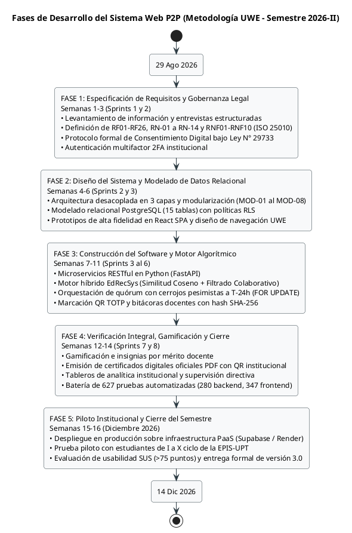

Fuente: Elaboración propia.

---

## 6.1. Perfiles de Usuario y Modelo de Control de Acceso (RBAC)

### Presentación de los Perfiles de Usuario
La operación eficiente y ordenada del Sistema Web P2P requiere la definición explícita de los perfiles de usuario y actores que interactúan en la plataforma. En el ecosistema formativo de la EPIS-UPT, los usuarios desempeñan roles diferenciados según su nivel de avance curricular, su investidura académica o la naturaleza técnica de sus procesos. Con el fin de gobernar el acceso bajo el principio de mínimo privilegio y resguardar la privacidad académica (Ley N° 29733), el sistema implementa un modelo de control de acceso basado en roles (**Role-Based Access Control - RBAC**):

### Cuadro 6.1: Perfiles de Usuario y Actores del Sistema Web P2P

| Perfil / Actor | Tipo de Actor | Población Objetivo / Componente | Responsabilidades y Actividades Principales | Privilegios y Permisos en el Sistema |
| :--- | :--- | :--- | :--- | :--- |
| **Estudiante Mentoreado** | Humano (Actor Primario) | Estudiantes matriculados de I a IV ciclo con necesidades de reforzamiento académico en materias formativas críticas (*Cálculo, Algoritmos, Estructuras, POO*). | • Formalizar el consentimiento informado digital obligatorio (Ley N° 29733).<br>• Declarar asignaturas de interés y disponibilidad horaria semanal en la matriz 6×11.<br>• Consultar recomendaciones personalizadas Top-k y registrar demandas temáticas.<br>• Reservar cupos de mentoría con control concurrente.<br>• Ratificar asistencia obligatoria antes de $T-24\text{ h}$ o desistir oportunamente.<br>• Marcar asistencia mediante pase QR y responder encuestas de satisfacción (24h). | • Acceso a vistas de catálogo y recomendaciones personales (`RoleGuard`).<br>• Creación, ratificación y desistimiento de reservas propias.<br>• Registro en el banco de solicitudes por demanda.<br>• Descarga de materiales académicos vinculados.<br>• Diligenciamiento de encuestas de calidad post-sesión. |
| **Estudiante Mentor** | Humano (Actor Primario) | Estudiantes de rendimiento sobresaliente de VII a X ciclo promovidos formalmente por la Dirección de Escuela tras verificación de mérito. | • Configurar áreas de dominio curricular y agenda de disponibilidad semanal.<br>• Publicar ofertas de mentoría académica (materia, temario, fecha, modalidad).<br>• Resolver la continuidad o cancelación de sesiones ante alertas de quórum deficiente.<br>• Dictar las sesiones en aulas asignadas o salas virtuales validadas.<br>• Marcar asistencia efectiva y registrar bitácoras pedagógicas firmadas con SHA-256 en 48h.<br>• Compartir recursos didácticos y monitorear insignias/reputación obtenida.<br>• Descargar certificados oficiales de horas para convalidación de créditos. | • Publicación, reprogramación y anulación justificada de ofertas propias.<br>• Aprovisionamiento guiado de infraestructura física o virtual.<br>• Diligenciamiento y cierre formal de bitácoras docentes.<br>• Carga de materiales educativos para sus participantes.<br>• Visualización de tablero de reputación y descarga de certificados PDF auditados. |
| **Administrador Institucional** | Humano (Gobernanza y Supervisión) | Comité de Tutoría Docente, Coordinación Académica y Dirección de la EPIS-UPT. | • Auditar expedientes estudiantiles y aprobar la promoción a rol de Mentor.<br>• Mantener actualizado el catálogo de asignaturas críticas y temarios silábicos.<br>• Cargar cronogramas oficiales de aulas para el motor parser de espacios.<br>• Registrar materias y mentorías en condición prioritaria por reprobación.<br>• Fiscalizar bitácoras docentes, asistencias y computabilidad de horas acumuladas.<br>• Parametrizar umbrales semestrales y emitir certificados oficiales PDF foliados.<br>• Supervisar tableros analíticos de demanda insatisfecha, ausentismo y desempeño. | • Control de acceso total y administración de roles en `/roles/promote-mentor`.<br>• Operaciones CRUD sobre catálogo curricular y prioridades académicas.<br>• Carga e indexación de cronogramas institucionales de espacios.<br>• Visado administrativo, observación y validación de horas de mentoría.<br>• Autorización y emisión de certificados digitales con código QR.<br>• Acceso irrestricto al panel de analítica institucional (`/analytics`). |
| **Servicio Cron / Backend** | Técnico (Proceso Desatendido) | Demonio de tareas programadas en el servidor backend FastAPI. | • Inspeccionar periódicamente la base de datos para identificar sesiones próximas.<br>• Despachar notificaciones automáticas y recordatorios a estudiantes inscritos.<br>• Ejecutar el corte perentorio a $T-24\text{ h}$, revocar cupos no ratificados y evaluar quórum.<br>• Transicionar a `QUORUM_INSUFICIENTE` si no se alcanza el 50% de aforo y alertar al Mentor. | • Ejecución en segundo plano con privilegios a nivel de servicio de sistema.<br>• Modificación atómica de estados en tablas de reservas y sesiones.<br>• Despacho de correos electrónicos institucionales mediante servicio SMTP. |
| **Servicios Externos** | Técnico (Sistemas Colaboradores) | Infraestructura institucional: Servidor SMTP UPT, repositorios y navegadores web. | • Despachar códigos de verificación OTP y notificaciones al buzón `@upt.pe`.<br>• Suministrar entornos de videoconferencia validados para sesiones virtuales.<br>• Proveer soporte para captura de cámara en escaneo de códigos QR. | • Conexión autenticada mediante tokens y protocolos seguros TLS 1.3.<br>• Sin exposición directa de datos personales sensibles a terceros. |

Fuente: Elaboración propia.

---

## 6.2. Modelo Conceptual

### Presentación del Modelo Conceptual
El modelo conceptual formaliza las entidades del dominio de la EPIS-UPT, capturando sus atributos esenciales, estados operacionales y las relaciones semánticas que sustentan el ecosistema de mentorías académicas. Este modelo traduce las reglas de negocio (aforos máximos, consentimiento de privacidad bajo la Ley N° 29733, estados de reserva, bitácoras de cumplimiento y certificación) en una estructura ontológica coherente y extensible alineada con las **15 tablas relacionales de PostgreSQL**:

### Diagrama 6.2: Diagrama de Clases Conceptuales del Dominio - Sistema Web P2P EPIS-UPT

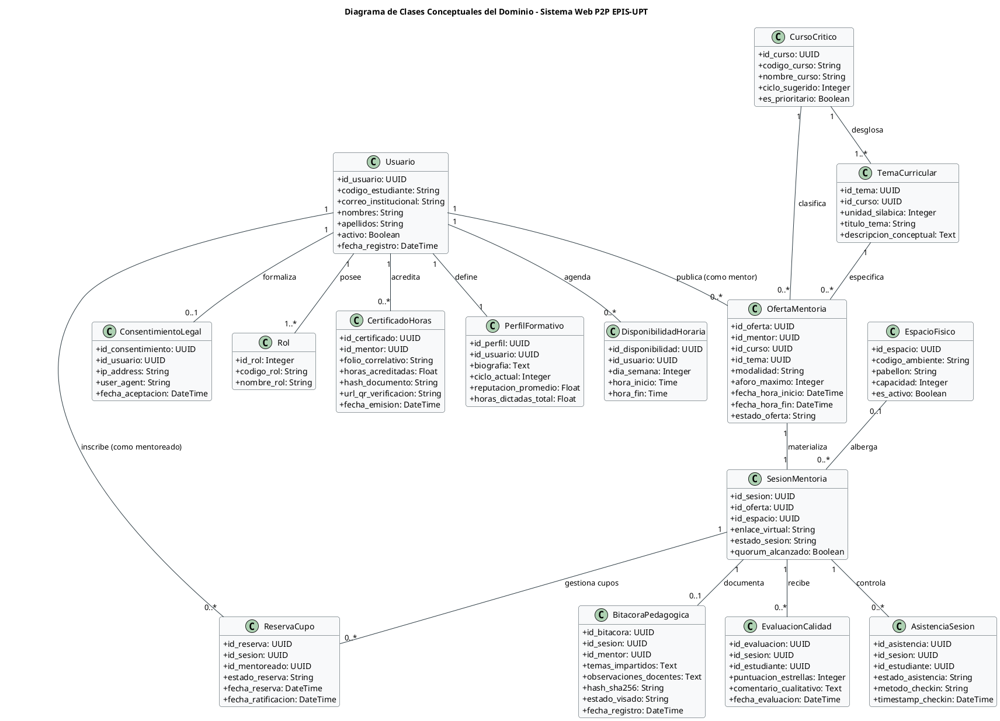

Fuente: Elaboración propia.

---

### 6.2.1. Diagrama de Paquetes Arquitecturales

### Presentación del Diagrama de Paquetes
La arquitectura de software del Sistema Web P2P adopta un patrón en **Capas Desacopladas** (*Clean Architecture / Layered Architecture*), asegurando la separación estricta de responsabilidades entre la capa de presentación del cliente (React SPA), los controladores y servicios RESTful (FastAPI), la capa de dominio y persistencia (SQLAlchemy / PostgreSQL) y las integraciones con servicios externos (SMTP, ReportLab, Supabase RLS):

### Diagrama 6.3: Diagrama de Paquetes Arquitecturales y Subsistemas del Sistema Web P2P

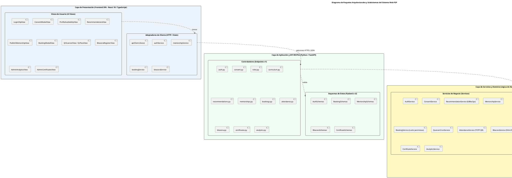

Fuente: Elaboración propia.

---

## 6.2.2. Diagramas de Casos de Uso

### Presentación de los Diagramas de Casos de Uso
Los casos de uso del Sistema Web P2P especifican la interacción funcional entre los actores institucionales y el software. A continuación, se presenta el **Diagrama General Consolidado (Diagrama 6.4)** que integra los 24 casos de uso canónicos estructurados en los ocho módulos del sistema, seguido de los diagramas modulares individuales (Diagramas 6.5 al 6.12).

### Diagrama 6.4: Diagrama de Casos de Uso General Consolidado del Sistema Web P2P (CUS-001 al CUS-024)

```plantuml
@startuml
title Diagrama 6.4: Diagrama de Casos de Uso General Consolidado (CUS-001 al CUS-024)\nSistema Web P2P - EPIS UPT
left to right direction
skinparam packageStyle rectangle
skinparam shadowing false
skinparam roundcorner 8
skinparam defaultFontName Arial
skinparam fontSize 11

actor "Usuario Institucional" as User #EBF3FB
actor "Estudiante Mentoreado" as Mentoreado #EBF3FB
actor "Estudiante Mentor" as Mentor #EBF3FB
actor "Administrador (EPIS)" as Admin #FEF9C3
actor "Servicio Cron Backend" as Cron #FFF1F2

Mentoreado -up-|> User
Mentor -up-|> User
Admin -up-|> User

rectangle "Sistema Web P2P de Mentorías Académicas EPIS-UPT" {

  package "MOD-01: Seguridad y Gobernanza" {
    usecase "CUS-001: Iniciar sesión con 2FA\ny consentimiento Ley 29733" as CUS01
    usecase "CUS-010: Gestionar asignación\nde roles de usuario" as CUS10
  }

  package "MOD-02: Ofertas de Mentoría y Recursos" {
    usecase "CUS-006: Publicar oferta\nde mentoría académica" as CUS06
    usecase "CUS-008: Consultar disponibilidad\nde espacios y recursos" as CUS08
  }

  package "MOD-03: Perfil y Plan de Aprendizaje" {
    usecase "CUS-005: Gestionar perfil\ny disponibilidad horaria" as CUS05
    usecase "CUS-021: Explorar catálogo\ncurricular de asignaturas filtro" as CUS21
  }

  package "MOD-04: Demanda y Recomendaciones" {
    usecase "CUS-002: Explorar recomendaciones\npersonalizadas Top-k" as CUS02
    usecase "CUS-003: Registrar solicitud\nde demanda académica" as CUS03
  }

  package "MOD-05: Quórum y Cancelaciones" {
    usecase "CUS-004: Reservar cupo\nde mentoría académica" as CUS04
    usecase "CUS-024: Ratificar asistencia\na sesión de mentoría" as CUS24
    usecase "CUS-017: Desistir voluntariamente\nde reserva de cupo" as CUS17
    usecase "CUS-023: Evaluar quórum\nautomático a T-24h" as CUS23
    usecase "CUS-007: Decisión ante\nquórum insuficiente" as CUS07
  }

  package "MOD-06: Asistencia, Bitácoras y Feedback" {
    usecase "CUS-012: Registrar asistencia\ncon pase QR dinámico" as CUS12
    usecase "CUS-013: Registrar bitácora\ndocente con SHA-256" as CUS13
    usecase "CUS-014: Visualizar historial\ny bitácoras académicas" as CUS14
  }

  package "MOD-07: Gamificación e Incentivos" {
    usecase "CUS-018: Emitir constancia\ninstitucional de horas" as CUS18
    usecase "CUS-019: Gestionar insignias\ny reputación gamificada" as CUS19
  }

  package "MOD-08: Analítica y Configuración" {
    usecase "CUS-009: Notificar eventos\ncríticos y alertas temporales" as CUS09
    usecase "CUS-011: Generar reportes\ne indicadores de analítica" as CUS11
    usecase "CUS-015: Consultar métricas\nde retención y desempeño" as CUS15
    usecase "CUS-016: Auditar trazas de\nseguridad y consentimiento" as CUS16
    usecase "CUS-020: Configurar parámetros\ninstitucionales y umbrales" as CUS20
    usecase "CUS-022: Gestionar catálogo\nde temas y materias críticas" as CUS22
  }
}

User --> CUS01
Admin --> CUS10

Mentor --> CUS06
Mentor --> CUS08
Mentor --> CUS07
Mentor --> CUS13
Mentor --> CUS18
Mentor --> CUS19

User --> CUS05
User --> CUS21
User --> CUS14

Mentoreado --> CUS02
Mentoreado --> CUS03
Mentoreado --> CUS04
Mentoreado --> CUS24
Mentoreado --> CUS17
Mentoreado --> CUS12

Cron --> CUS23
Cron --> CUS09

Admin --> CUS11
Admin --> CUS15
Admin --> CUS16
Admin --> CUS20
Admin --> CUS22
@enduml
```

Fuente: Elaboración propia.

---

### Diagrama 6.5: Diagrama de Casos de Uso - MOD-01: Seguridad, Autenticación y Gobernanza

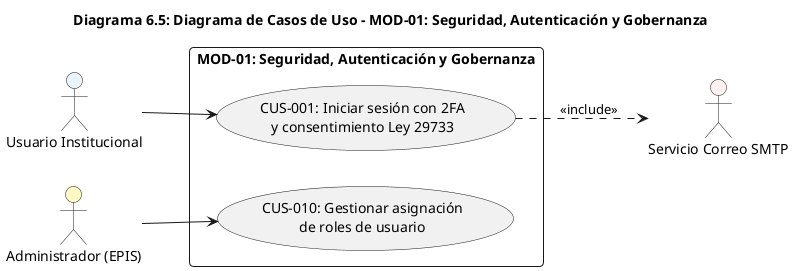

Fuente: Elaboración propia.

---

### Diagrama 6.6: Diagrama de Casos de Uso - MOD-02: Ofertas de Mentoría y Gestión de Recursos

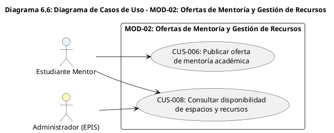

Fuente: Elaboración propia.

---

### Diagrama 6.7: Diagrama de Casos de Uso - MOD-03: Perfil del Mentor y Plan de Aprendizaje

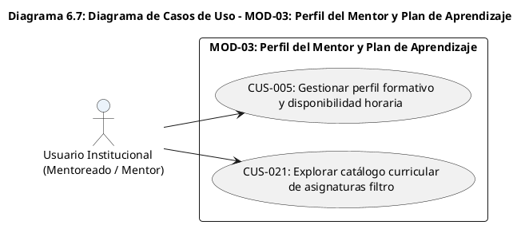

Fuente: Elaboración propia.

---

### Diagrama 6.8: Diagrama de Casos de Uso - MOD-04: Demanda y Recomendaciones Personalizadas

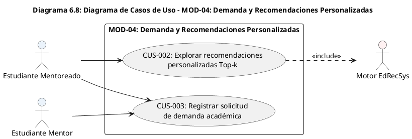

Fuente: Elaboración propia.

---

### Diagrama 6.9: Diagrama de Casos de Uso - MOD-05: Quórum, Confirmación y Cancelaciones

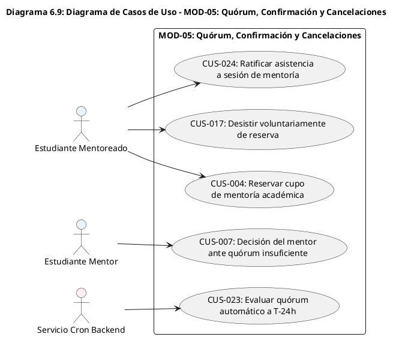

Fuente: Elaboración propia.

---

### Diagrama 6.10: Diagrama de Casos de Uso - MOD-06: Asistencia, Bitácoras y Feedback

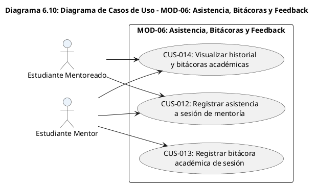

Fuente: Elaboración propia.

---

### Diagrama 6.11: Diagrama de Casos de Uso - MOD-07: Gamificación e Incentivos

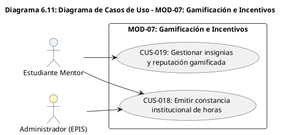

Fuente: Elaboración propia.

---

### Diagrama 6.12: Diagrama de Casos de Uso - MOD-08: Analítica, Notificaciones y Configuración

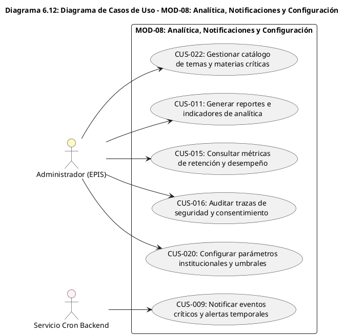

Fuente: Elaboración propia.

---

## 6.2.3. Escenarios de Casos de Uso (Fase de Diseño)

### Presentación de los Escenarios de Casos de Uso en Fase de Diseño

En la presente **Fase de Diseño de Software**, los escenarios de casos de uso traducen los requerimientos funcionales del sistema en especificaciones de comportamiento detalladas a nivel de arquitectura y código ejecutable. Cada especificación proporciona trazabilidad completa hacia los componentes de frontend (React 18 con TypeScript y Tailwind CSS), servicios y adaptadores HTTP (`apiClient`), controladores y rutas de FastAPI, esquemas de validación Pydantic, servicios de lógica de negocio, entidades del modelo relacional ORM en SQLAlchemy y transacciones ACID en PostgreSQL bajo control estricto de concurrencia y cerrojos pesimistas.

La estructura de cada caso de uso conserva con rigurosidad la plantilla canónica institucional:
1. **Ficha Técnica Estructurada (13 atributos):** Identificador unívoco (`Id Caso de Uso`), `Nombre`, `Tipo`, `Requisito ID (RF)`, `Versión` (2.0), `Autor`, `Actores` con roles de sistema (`UserRole`), `Interacción`, `Descripción` técnica exhaustiva, `Referencias` normativas y arquitectónicas, `Anexos` de código fuente, `Precondiciones` y `PostCondiciones`.
2. **Flujo Normal de Eventos:** Distribuido en columnas estrictas (**`Usuario`** | **`Sistema`**), subdividido en fases secuenciales de interacción con pasos numerados correlativamente y llamadas explícitas de desvío `(Si [condición], salta a E00X / A00X)`.
3. **Flujos Alternativos (`A00X`) y de Excepción (`E00X`):** Encabezados de bloque específicos, columnas **`Usuario`** | **`Sistema`**, pasos jerárquicos (`E00X-1.1`, `E00X-1.2`) y cláusula formal de retorno al paso correspondiente del Flujo Normal o cierre explícito del caso de uso.
4. **Trazabilidad de Código y Diseño:** Especificación exacta de endpoints RESTful, verbos HTTP, códigos de estado (`200 OK`, `201 Created`, `400 Bad Request`, `401 Unauthorized`, `403 Forbidden`, `404 Not Found`, `409 Conflict`, `422 Unprocessable Entity`, `503 Service Unavailable`), tipos de excepciones y directivas de control de concurrencia (`SELECT ... FOR UPDATE`, locks transaccionales y mecanismos de desempate).

A continuación, se presentan los 24 casos de uso canónicos estructurados en los 8 módulos arquitectónicos del sistema:

---

### MOD-01: Seguridad, Autenticación y Gobernanza

#### CUS-001 - Iniciar sesión institucional con 2FA

| Atributo | Detalle |
|---|---|
| **Id Caso de Uso** | **UC-001** (CUS-001) |
| **Nombre** | Iniciar sesión institucional con 2FA y autenticación federada Google Workspace |
| **Tipo** | Obligatorio ( X ) / Opcional (   ) |
| **Requisito ID (RF)** | RF-001 (Autenticación multifactor 2FA institucional), RF-002 (Formalización de consentimiento digital Ley 29733); RN-01 (Dominio institucional @virtual.upt.pe y @upt.pe con OTP de 5 minutos y cooldown de 60 segundos), RN-02 (Consentimiento informado legal digital) |
| **Versión** | 2.0 |
| **Autor** | Antayhua Mamani, Renzo Antonio / Medina Quispe, Joan Carlos |
| **Actores** | Estudiante Mentoreado, Estudiante Mentor, Administrador Institucional (Primarios); Servicio SMTP Gmail Institucional, Google Identity Services GIS (Secundarios) |
| **Interacción** | Fase de Construcción / Iteración Sprint 01 - Sprint 02 (Actualización Post-Sprint 08 con Google Identity y SMTP real) |
| **Descripción** | Permite autenticar la identidad del usuario universitario mediante flujo dual sin contraseñas estáticas, validando la pertenencia al dominio oficial @virtual.upt.pe o @upt.pe a través del controlador aplicacion/backend/app/api/v1/endpoints/auth.py. El usuario puede autenticarse mediante credencial federada de Google Workspace UPT utilizando el SDK oficial de Google Identity Services (GIS), o solicitando un código OTP numérico criptográficamente seguro de 6 dígitos con expiración de 300 segundos persistido en la tabla auth_challenges (app/models/auth.py) y despachado mediante el transporte SMTP Gmail institucional de auth_service.py (AuthService.request_otp). El código se valida en POST /api/v1/auth/otp/verify. El sistema verifica el estado del consentimiento informado bajo la Ley Nº 29733 en app/services/consent_service.py; si es nuevo, despliega ConsentModalView.tsx y formaliza la aceptación persistiendo IP, User-Agent y timestamp en consentimientos_legales (app/models/consent.py). Tras la validación, expide un token JWT criptográfico (HS256) con 8 horas de vigencia (ACCESS_TOKEN_EXPIRE_MINUTES = 480) y claims de roles institucionales, retornando el payload al frontend LoginOtpView.tsx para su almacenamiento seguro en localStorage. |
| **Referencias** | Guía SWEBOK v3.0 (Capítulo 1: Requisitos de Software y Capítulo 2: Diseño de Software)<br>Estándar ISO/IEC/IEEE 29148:2018 y Criterios de Acreditación ICACIT<br>Documento de Arquitectura de Software (SAD v3.0 - MOD-01: Seguridad, Autenticación y Gobernanza)<br>Ley Nº 29733 de Protección de Datos Personales del Perú y D.S. Nº 003-2013-JUS |
| **Anexos** | aplicacion/frontend/src/components/LoginOtpView.tsx<br>aplicacion/frontend/src/components/ConsentModalView.tsx<br>aplicacion/frontend/src/services/authService.ts (AuthService, apiClient)<br>aplicacion/frontend/src/services/consentService.ts (ConsentService)<br>aplicacion/backend/app/api/v1/endpoints/auth.py (POST /api/v1/auth/otp/request, POST /api/v1/auth/otp/verify, POST /api/v1/auth/otp/resend, POST /api/v1/auth/google)<br>aplicacion/backend/app/api/v1/endpoints/consent.py (GET /api/v1/consent/status, POST /api/v1/consent/accept)<br>aplicacion/backend/app/services/auth_service.py (AuthService.request_otp, AuthService.verify_otp)<br>aplicacion/backend/app/services/email_service.py (EmailService.send_otp_email)<br>aplicacion/backend/app/models/auth.py (AuthChallenge), app/models/consent.py (ConsentimientoLegal) |
| **Precondiciones** | 1. El usuario posee una cuenta activa perteneciente al dominio oficial @virtual.upt.pe o @upt.pe.<br>2. El servicio SMTP institucional o el cliente Google Identity Services se encuentra configurado en el backend con credenciales operativas.<br>3. El usuario no registra suspensión administrativa en usuarios.activo = true. |
| **PostCondiciones** | 1. Token JWT institucional (HS256) generado y almacenado en localStorage con vigencia estricta de 8 horas.<br>2. Traza inmutable de auditoría registrada en la tabla física consentimientos_legales con UUID, IP, User-Agent y marca de tiempo UTC.<br>3. Redirección reactiva en cliente al panel principal según el rol asignado (mentoreado, mentor o administrador). |

##### Flujo Normal de Eventos

| Usuario | Sistema |
|---|---|
| **Fase 1: Validación de identidad institucional y selección del método de acceso** | |
| **1.** El usuario accede a la vista de autenticación `LoginOtpView.tsx`, donde visualiza las opciones de acceso institucional: ingreso directo federado con Google Workspace UPT o ingreso por código OTP por correo. Si opta por código OTP, ingresa su dirección de correo institucional en el cuadro de texto `"Correo Institucional"` (`input[type="email"]`) y hace clic en el botón `"Enviar Código OTP"`. | **2.** En `authService.ts`, la función `requestOtp(email)` despacha una petición `POST /api/v1/auth/otp/request` con payload JSON `{"email": email}` hacia el controlador `auth.py`. El backend valida con Pydantic (`EmailStr`) la sintaxis y comprueba que `email.endswith("@virtual.upt.pe")` o `email.endswith("@upt.pe")`. Ejecuta `SELECT * FROM usuarios WHERE email = :email AND activo = true`. (Si el dominio es ajeno a la universidad, salta a E001). (Si el usuario prefiere autenticarse con Google Workspace UPT mediante el botón oficial, salta a A001). (Si la cuenta está inactiva o suspendida, salta a E002). |
| **Fase 2: Generación criptográfica, despacho SMTP y verificación de código temporal OTP** | |
| **3.** El usuario revisa en pantalla el correo verificado y presiona el botón `"Enviar Código OTP"`. | **4.** En `auth_service.py`, `AuthService.request_otp()` genera un código numérico aleatorio seguro mediante `secrets.randbelow(900000) + 100000`, registra el desafío en la tabla física `auth_challenges` con expiración `NOW() + INTERVAL '5 MINUTES'` y cooldown de 60 segundos (RN-01). Invoca a `EmailService.send_otp_email()` para despachar el correo SMTP institucional. Retorna HTTP 200 con `challenge_id` y `expires_at`. En cliente, `LoginOtpView.tsx` conmuta al paso de verificación, inicializa el temporizador regresivo de 300 segundos en color azul institucional y enfoca el campo del código. (Si el usuario no recibe el código en su buzón tras 60 segundos o el temporizador expira, salta a A002). |
| **5.** El usuario consulta su bandeja institucional, copia el código de 6 dígitos numéricos, lo ingresa en el componente y hace clic en el botón `"Verificar y Acceder"`. (Si el usuario decide corregir el correo o cancelar el desafío, salta a A004). | **6.** En `authService.ts`, se despacha `POST /api/v1/auth/otp/verify` con payload `{"challenge_id": challengeId, "otp_code": cleanOtp}`. `auth_service.py` recupera el registro, compara el código y valida `expira_en > NOW()`. Si coincide, invalida el OTP usado marcándolo como consumido y consulta `ConsentService.get_consent_status(email)`. (Si el código es incorrecto, salta a E003). (Si el código ha expirado, salta a E004). (Si se superan los 3 intentos fallidos consecutivos, salta a E005). (Si el usuario ya cuenta con consentimiento digital previo, salta a A003). |
| **Fase 3: Formalización de consentimiento legal digital Ley 29733 y emisión de sesión** | |
| **7.** El cliente renderiza el componente modal `ConsentModalView.tsx`. El usuario lee los términos de tratamiento de datos personales en el panel con barra de desplazamiento vertical, marca la casilla de verificación `"He leído y acepto los términos de consentimiento informado bajo la Ley Nº 29733"` y presiona el botón `"Aceptar y Continuar"`. (Si el usuario desmarca o rechaza los términos, salta a E006). | **8.** En `consentService.ts`, se invoca `POST /api/v1/consent/accept` enviando el identificador de usuario y la versión de términos. El backend inserta en `consentimientos_legales` el registro inmutable con IP de origen (`client.host`), User-Agent y timestamp UTC (RN-02). Seguidamente, `security.py` genera el token JWT firmado mediante `create_access_token` incluyendo los claims `sub: email`, `roles: [UserRole]`, `exp: now + 8h`. El backend retorna HTTP 200 con `access_token` y perfil. En `App.tsx`, el token se persiste en `localStorage`, se actualiza el estado global de autenticación y se redirige al panel correspondiente al rol, mostrando una notificación flotante en color verde de éxito: *"¡Sesión institucional iniciada exitosamente! Bienvenido al Sistema de Mentorías EPIS-UPT"*. (Si la comunicación con el servidor falla durante la emisión de sesión, salta a E007). |

##### Flujos Alternativos

##### Flujo alternativo A001: Autenticación federada directa con Google Workspace institucional (GIS)
| Usuario | Sistema |
|---|---|
| **A001-1.1** El usuario visualiza el contenedor de Google Identity Services en `LoginOtpView.tsx` y hace clic en el botón `"Continuar con Google Workspace UPT"`. | **A001-1.2** El navegador despliega el diálogo nativo One-Tap o la ventana emergente de Google Accounts solicitando la selección de la cuenta `@virtual.upt.pe` o `@upt.pe`. |
| **A001-1.3** El usuario selecciona su cuenta institucional y concede la autorización de identidad. | **A001-1.4** Google Identity Services emite un ID Token criptográfico JWT firmado. En `authService.ts`, la función `loginWithGoogle(idToken)` despacha una petición `POST /api/v1/auth/google` enviando la credencial. En `auth.py`, `auth_service.py` valida la firma del token con los certificados públicos de Google, verifica el `client_id` oficial, comprueba que el dominio corresponda a `@virtual.upt.pe` o `@upt.pe`, y consulta el estado de consentimiento informado en `ConsentService.get_consent_status(email)` y retorna al paso 6 del Flujo Normal de Eventos. |

##### Flujo alternativo A002: Reenvío de código temporal por retraso en buzón tras cumplir el cooldown
| Usuario | Sistema |
|---|---|
| **A002-1.1** El usuario constata la ausencia del código en su buzón tras 60 segundos o la finalización del temporizador regresivo de 5 minutos, y hace clic en el enlace `"Reenviar código OTP"`. | **A002-1.2** En `LoginOtpView.tsx`, se valida que hayan transcurrido al menos 60 segundos desde la última solicitud. Despacha una petición `POST /api/v1/auth/otp/resend` con payload `{"challenge_id": challenge.challengeId}` hacia el controlador `auth.py`. |
| **A002-1.3** El usuario visualiza la actualización del temporizador regresivo reiniciado a 5 minutos en color azul institucional y una alerta en color ámbar: *"Se ha generado y enviado un nuevo código OTP. El anterior ha sido invalidado"*. | **A002-1.4** El backend invalida el desafío anterior, genera una nueva clave aleatoria de 6 dígitos, la despacha vía SMTP Gmail institucional y retorna al paso 4 del Flujo Normal de Eventos. |

##### Flujo alternativo A003: Acceso recurrente con consentimiento digital previamente formalizado
| Usuario | Sistema |
|---|---|
| **A003-1.1** El usuario completa satisfactoriamente el paso 5 introduciendo el código OTP válido. | **A003-1.2** En `auth.py`, `ConsentService.get_consent_status` retorna `has_consented = true` tras localizar en `consentimientos_legales` el registro activo sin revocación. |
| **A003-1.3** El usuario visualiza la pantalla de carga con indicador circular de progreso en color azul institucional. | **A003-1.4** El sistema omite la renderización de `ConsentModalView.tsx`, emite directamente el token JWT firmado de sesión con sus roles asignados y retorna al paso 8 del Flujo Normal de Eventos. |

##### Flujo alternativo A004: Cancelación del desafío y cambio de correo institucional
| Usuario | Sistema |
|---|---|
| **A004-1.1** Durante el paso de ingreso de código OTP, el usuario constata que escribió erróneamente su correo y hace clic en el enlace `"Cambiar de correo institucional"`. | **A004-1.2** `LoginOtpView.tsx` invoca `authService.cancelChallenge()`, purga el `challengeId` del estado local y restablece las variables del componente. |
| **A004-1.3** El usuario observa la transición limpia de regreso hacia la pantalla inicial de ingreso de correo. | **A004-1.4** El sistema enfoca nuevamente el cuadro de texto `"Correo Institucional"` y retorna al paso 1 del Flujo Normal de Eventos sin generar registros. |

##### Flujos de Excepción

##### Flujo de excepción E001: Dominio de correo no institucional
| Usuario | Sistema |
|---|---|
| | **E001-1.1** En el paso 2 del Flujo Normal, `auth.py` comprueba que la cadena ingresada no termina en `@virtual.upt.pe` ni `@upt.pe`. Lanza `HTTPException(status_code=400, detail="INVALID_DOMAIN: Acceso restringido: Solo se permiten correos institucionales con dominio @virtual.upt.pe o @upt.pe.")`.<br><br>En `authService.ts`, captura el error 400 y propaga la excepción hacia el componente. `LoginOtpView.tsx` despliega una etiqueta de advertencia en color rojo: *"Acceso restringido: Solo se permiten correos institucionales con dominio @virtual.upt.pe o @upt.pe."*. Presenta el botón `"Corregir Correo"`. |
| **E001-1.2** Hace clic en el botón "Corregir Correo". | **E001-1.3** Limpia el cuadro de texto `"Correo Institucional"`, le asigna el foco automáticamente y retorna al paso 1 del Flujo Normal de Eventos. |

##### Flujo de excepción E002: Cuenta institucional inactiva o suspendida
| Usuario | Sistema |
|---|---|
| | **E002-1.1** En el paso 2 del Flujo Normal, `auth.py` ejecuta `SELECT activo FROM usuarios WHERE email = :email` y detecta `activo = false`. Lanza `HTTPException(status_code=403, detail="ACCOUNT_SUSPENDED: Su cuenta institucional registra suspensión administrativa.")`.<br><br>En `LoginOtpView.tsx`, se captura el error 403 y se despliega un cuadro de diálogo modal en color rojo con el mensaje: *"Cuenta inhabilitada. Su registro se encuentra en estado inactivo. Por favor, comuníquese con la Dirección de Escuela EPIS-UPT"*. Presenta el botón `"Aceptar"`. |
| **E002-1.2** Hace clic en el botón "Aceptar". | **E002-1.3** Cierra el cuadro modal, restablece el formulario inicial y finaliza la sesión sin generar registros de autenticación. |

##### Flujo de excepción E003: Código temporal OTP incorrecto
| Usuario | Sistema |
|---|---|
| | **E003-1.1** En el paso 6 del Flujo Normal, `auth_service.py` comprueba que el código introducido no coincide con el persistido en base de datos. Incrementa el contador `intentos_fallidos += 1` y lanza `HTTPException(status_code=400, detail="INVALID_OTP: El código ingresado no coincide con el enviado a su buzón institucional.")`.<br><br>En `LoginOtpView.tsx`, se captura el error y se muestra una alerta en color rojo indicando el error y el número de intentos restantes (e.g. *"El código debe contener exactamente 6 dígitos numéricos válidos"*). Presenta el botón `"Reintentar"`. |
| **E003-1.2** Hace clic en el botón "Reintentar". | **E003-1.3** Limpia el campo de entrada numérica, posiciona el cursor en la casilla y retorna al paso 5 del Flujo Normal de Eventos. |

##### Flujo de excepción E004: Código temporal OTP expirado
| Usuario | Sistema |
|---|---|
| | **E004-1.1** En el paso 6 del Flujo Normal, `auth_service.py` comprueba que `NOW() > expira_en` (plazo de 5 minutos excedido conforme a RN-01). Lanza `HTTPException(status_code=400, detail="EXPIRED_OTP: El código temporal OTP ha expirado (5 minutos). Por favor solicita un nuevo código.")`.<br><br>En `LoginOtpView.tsx`, se captura el error y se despliega una alerta en color ámbar: *"El código OTP ha expirado (5 minutos). Por favor solicita un nuevo código."*. Presenta el botón `"Solicitar Nuevo Código"`. |
| **E004-1.2** Hace clic en el botón "Solicitar Nuevo Código". | **E004-1.3** Restablece el formulario, reinicia el temporizador regresivo y retorna al paso 3 del Flujo Normal de Eventos. |

##### Flujo de excepción E005: Bloqueo temporal por exceso de intentos fallidos
| Usuario | Sistema |
|---|---|
| | **E005-1.1** En el paso 6 del Flujo Normal, `auth_service.py` evalúa `intentos_fallidos >= 3`. Invalida inmediatamente el OTP, bloquea temporalmente la emisión para el correo por 15 minutos en base de datos y lanza `HTTPException(status_code=429, detail="MAX_ATTEMPTS_EXCEEDED: Se ha superado el límite de 3 intentos fallidos consecutivos. Acceso bloqueado temporalmente.")`.<br><br>En `LoginOtpView.tsx`, se bloquea el campo de entrada y se despliega un panel de seguridad en color rojo indicando el bloqueo temporal. Presenta el botón `"Volver al Inicio"`. |
| **E005-1.2** Hace clic en el botón "Volver al Inicio". | **E005-1.3** Redirige a la vista inicial de autenticación, restablece el formulario y retorna al paso 1 del Flujo Normal de Eventos. |

##### Flujo de excepción E006: Rechazo voluntario del consentimiento informado
| Usuario | Sistema |
|---|---|
| | **E006-1.1** En el paso 7 del Flujo Normal, el usuario no marca la casilla de verificación o presiona el botón `"Declinar y Salir"`. `ConsentModalView.tsx` captura la acción sin enviar petición de aceptación.<br><br>Despliega un cuadro de diálogo modal en color ámbar advirtiendo que la formalización del consentimiento legal bajo la Ley Nº 29733 es un requisito obligatorio e indispensable para utilizar los servicios de la plataforma. Presenta el botón `"Confirmar Salida"` y el botón `"Revisar Términos"`. |
| **E006-1.2** Hace clic en el botón "Confirmar Salida". | **E006-1.3** Destruye la sesión provisional, purga los datos temporales del formulario, emite notificación informativa y retorna al paso 1 del Flujo Normal de Eventos sin generar registros. |

##### Flujo de excepción E007: Fallo de conectividad o indisponibilidad del servicio de autenticación
| Usuario | Sistema |
|---|---|
| | **E007-1.1** En el paso 8 del Flujo Normal, la conexión con el servidor sufre timeout o interrupción de red. `authService.ts` captura el error y lanza `AuthException("Error inesperado de comunicación con el servicio de autenticación.")`.<br><br>En `LoginOtpView.tsx`, se despliega un banner de error en color rojo con el mensaje de indisponibilidad. Presenta el botón `"Reintentar Conexión"`. |
| **E007-1.2** Hace clic en el botón "Reintentar Conexión". | **E007-1.3** Restablece los controles y retorna al paso 1 del Flujo Normal de Eventos sin generar registros. |

##### Especificación Exhaustiva de Interfaz de Usuario y Comportamiento Visual

La interfaz de usuario del componente `LoginOtpView.tsx` está diseñada conforme a las directrices de accesibilidad institucional:
1. **Contenedor Principal:** Tarjeta centralizada con fondo en color blanco puro, bordes redondeados y sombra suave, con un borde exterior sutil en color gris claro.
2. **Encabezado Institucional:** Emblema institucional superior con fondo en color azul institucional y tipografía en color dorado institucional con el texto `"UPT"`. Título principal en tipografía destacada en color azul institucional `"Iniciar Sesión Institucional"` y párrafo explicativo en color gris secundario: `"Ingresa tu correo institucional @upt.pe para recibir un código de verificación temporal."`.
3. **Acceso Federado con Google Identity Services (GIS):** Contenedor `#googleSignInBtnContainer` que aloja el botón oficial de Google con tema delineado, tamaño grande, texto `"Continuar con Google"` y ancho adaptativo. En caso de indisponibilidad del SDK, se renderiza un botón alternativo en color blanco puro con borde gris claro y el icono oficial de Google acompañado del texto `"Continuar con Google Workspace UPT"`.
4. **Divisor Visual:** Línea divisoria horizontal en color gris claro con texto central en tipografía reducida y color gris neutro: `"O CON CÓDIGO OTP POR CORREO"`.
5. **Formulario de Solicitud de Correo:** Cuadro de texto con etiqueta visible `"Correo Institucional"`, borde en color gris claro y texto de ejemplo institucional. Botón principal de acción en color azul institucional y tipografía en color blanco puro con el texto `"Enviar Código OTP"`.
6. **Vista de Desafío OTP:** Despliega el subtítulo en color gris secundario indicando el correo al que se despachó el código, seguido de un cuadro de texto para el ingreso de los 6 dígitos numéricos con tipografía monoespaciada en color azul institucional. Cuenta con un temporizador regresivo de 5 minutos en color azul institucional y un botón de reenvío con texto `"Reenviar código OTP"` deshabilitado en color gris claro mientras el contador de cooldown permanezca activo. Incluye el enlace de acción secundaria en color azul institucional `"Cambiar de correo institucional"`.
7. **Notificaciones y Alertas:** Banner de alerta ante errores con fondo en color rojo suave, borde en color rojo claro y texto en color rojo oscuro. Mensajes informativos con fondo en color azul suave, borde en color azul claro y texto en color azul marino. Notificaciones de éxito con fondo en color verde suave, borde en color verde claro y texto en color verde oscuro.
8. **Accesibilidad WCAG 2.1 AA:** Elementos con atributos semánticos `role="alert"` para mensajes de error y `role="status"` para confirmaciones. Soporte de navegación por teclado mediante tabulación secuencial y foco visual contrastado.

##### Criterios de Aceptación Formativos (Given-When-Then)

```gherkin
Escenario 1: Autenticación exitosa mediante código temporal OTP institucional
  DADO QUE el estudiante o mentor posee una cuenta institucional activa con dominio "@virtual.upt.pe" o "@upt.pe"
  CUANDO ingresa su dirección de correo en LoginOtpView y presiona el botón "Enviar Código OTP"
  Y digita en el formulario el código numérico de 6 dígitos recibido en su buzón dentro de los 5 minutos de vigencia
  Y presiona el botón "Verificar y Acceder"
  ENTONCES el sistema valida satisfactoriamente el desafío en POST /api/v1/auth/otp/verify
  Y emite un token JWT criptográfico con vigencia de 8 horas continuas persistido en localStorage
  Y redirige al usuario hacia el panel correspondiente a su rol institucional desplegando un mensaje de bienvenida.
  Evidencia de Prueba: test_auth.py::test_verify_otp_success / LoginOtpView.test.tsx

Escenario 2: Autenticación federada exitosa mediante Google Identity Services (GIS)
  DADO QUE el usuario universitario se encuentra en la pantalla de inicio de sesión
  CUANDO pulsa el botón oficial "Continuar con Google Workspace UPT"
  Y selecciona su cuenta institucional activa con dominio "@virtual.upt.pe" o "@upt.pe" en el diálogo de Google
  ENTONCES el sistema recibe la credencial firmada y despacha la petición POST /api/v1/auth/google
  Y el backend valida la firma criptográfica con los servidores de Google emitiendo el token de sesión JWT institucional
  Y formaliza el acceso directo al panel del rol correspondiente.
  Evidencia de Prueba: test_auth.py::test_google_auth_success / authService.test.ts

Escenario 3: Rechazo de acceso ante ingreso de correo no institucional
  DADO QUE un usuario ingresa una dirección de correo perteneciente a un dominio comercial o externo (ej. "@gmail.com")
  CUANDO presiona el botón "Enviar Código OTP"
  ENTONCES el sistema bloquea la solicitud en el cliente y en el endpoint POST /api/v1/auth/otp/request retornando HTTP 400
  Y despliega en pantalla un mensaje de error en color rojo: "Acceso restringido: Solo se permiten correos institucionales con dominio @virtual.upt.pe o @upt.pe."
  Y no genera ningún registro en la tabla física auth_challenges ni emite códigos por correo.
  Evidencia de Prueba: test_auth.py::test_request_otp_invalid_domain / LoginOtpView.test.tsx

Escenario 4: Rechazo de ingreso por código temporal OTP expirado tras superar los 5 minutos
  DADO QUE el usuario solicitó un código OTP y transcurrieron más de 300 segundos desde su emisión
  CUANDO ingresa el código numérico en el formulario y presiona el botón "Verificar y Acceder"
  ENTONCES el backend rechaza la verificación retornando HTTP 400 con código de error "EXPIRED_OTP"
  Y el componente LoginOtpView despliega una notificación de advertencia en color ámbar solicitando la generación de un nuevo código
  Y mantiene habilitado el botón "Reenviar código OTP" tras haberse superado el cooldown reglamentario.
  Evidencia de Prueba: test_auth.py::test_verify_otp_expired / authService.test.ts
```

#### CUS-010 - Gestionar asignación de roles de usuario

| Atributo | Detalle |
|---|---|
| **Id Caso de Uso** | **UC-010** (CUS-010) |
| **Nombre** | Gestionar asignación y revocación de roles institucionales de usuario |
| **Tipo** | Obligatorio ( X ) / Opcional (   ) |
| **Requisito ID (RF)** | RF-003 (Gestión y asignación administrativa de roles de usuario); RN-03 (Separación de privilegios y control de acceso RBAC institucional) |
| **Versión** | 2.0 |
| **Autor** | Antayhua Mamani, Renzo Antonio / Medina Quispe, Joan Carlos |
| **Actores** | Administrador Institucional (`UserRole.administrador`), Director de Escuela EPIS |
| **Interacción** | Fase de Construcción / Iteración Sprint 01 - Sprint 02 |
| **Descripción** | Permite a las autoridades institucionales consultar la nómina universitaria de usuarios y administrar sus roles operativos (`UserRole.mentoreado`, `UserRole.mentor`, `UserRole.administrador`, `UserRole.coordinador`) a través del componente `AdminDashboardView.tsx` y el servicio `roleService.ts`. El backend expone los endpoints en `aplicacion/backend/app/api/v1/endpoints/roles.py`, verificando en cada solicitud los privilegios administrativos con `app/core/security.py` (`decode_access_token` comprobando claim `roles` conteniendo `administrador`). El servicio `role_service.py` ejecuta mutaciones transaccionales ACID en las tablas `roles` y `roles_usuarios` (`app/models/roles.py`), garantizando que ningún usuario quede huérfano de roles y que ningún administrador pueda revocar sus propios privilegios. Cada mutación genera una traza en la tabla de auditoría con el UUID del administrador ejecutor, IP de origen y marca de tiempo UTC. |
| **Referencias** | Guía SWEBOK v3.0 (Capítulo 1: Requisitos de Software y Capítulo 2: Diseño de Software)<br>Estándar ISO/IEC/IEEE 29148:2018 y Criterios ICACIT 2026<br>Documento de Arquitectura de Software (SAD v2.0 - MOD-01: Seguridad, Autenticación y Gobernanza)<br>Modelo de Control de Acceso Basado en Roles (NIST RBAC Standard) |
| **Anexos** | `aplicacion/frontend/src/components/AdminDashboardView.tsx`<br>`aplicacion/frontend/src/services/roleService.ts` (`RoleService`, `ApiRoleAdapter`)<br>`aplicacion/backend/app/api/v1/endpoints/roles.py` (`GET /api/v1/roles/users`, `POST /api/v1/roles/assign`, `DELETE /api/v1/roles/revoke`)<br>`aplicacion/backend/app/services/role_service.py` (`RoleService.list_users`, `RoleService.assign_role`, `RoleService.revoke_role`)<br>`aplicacion/backend/app/models/roles.py` (`Rol`, `RolUsuario`, `UserRole`), `app/models/auth.py` (`Usuario`) |
| **Precondiciones** | 1. El usuario solicitante ha iniciado sesión institucional válida portando un token JWT activo en `localStorage`.<br>2. El claim `roles` dentro del payload JWT contiene el valor `UserRole.administrador`.<br>3. El catálogo institucional de roles base se encuentra inicializado en la tabla física `roles`. |
| **PostCondiciones** | 1. Inserción o eliminación atómica confirmada en la tabla `roles_usuarios` mediante `db.commit()`.<br>2. Registro de auditoría persistido en la base de datos con identificador del operador, usuario modificado y cambio realizado.<br>3. Actualización reactiva del estado del usuario en el componente de gestión de roles de la interfaz administrativa. |

##### Flujo Normal de Eventos

| Usuario | Sistema |
|---|---|
| **Fase 1: Acceso al panel administrativo y consulta de nómina de usuarios** | |
| **1.** El administrador institucional accede al panel de control en `AdminDashboardView.tsx` y hace clic en la pestaña `"Gestión de Roles"`. | **2.** En `roleService.ts`, se despacha la petición `GET /api/v1/roles/users` incluyendo en la cabecera `Authorization: Bearer <token>`. En `roles.py`, la función dependiente `require_admin_role` valida la firma criptográfica y verifica que `UserRole.administrador` esté presente en los claims. `role_service.py` ejecuta una consulta relacional `SELECT u.id, u.email, u.nombres, u.apellidos, array_agg(r.nombre) AS roles FROM usuarios u LEFT JOIN roles_usuarios ru ON u.id = ru.id_usuario LEFT JOIN roles r ON ru.id_rol = r.id GROUP BY u.id`. Retorna HTTP 200 con la nómina paginada. `AdminDashboardView.tsx` renderiza la tabla interactiva de usuarios con filtros de búsqueda y botones de acción. (Si el token no cuenta con privilegios administrativos, salta a E001). (Si la consulta falla por timeout en base de datos, salta a E002). |
| **Fase 2: Búsqueda y selección de usuario para modificación** | |
| **3.** El administrador ingresa el código universitario o correo institucional del estudiante o docente en el cuadro de búsqueda `"Buscar usuario"` y hace clic en el botón `"Buscar"`. | **4.** En `AdminDashboardView.tsx`, se filtra la lista de usuarios en memoria o se despacha `GET /api/v1/roles/users?q=...`. El sistema resalta la fila del usuario localizado. El administrador hace clic en el botón `"Modificar Roles"` en la fila correspondiente. El sistema despliega un cuadro de diálogo modal `"Asignación de Roles Institucionales"` con casillas de verificación para cada rol del sistema (`Mentoreado`, `Mentor`, `Administrador`, `Coordinador`), marcando los roles actualmente asignados. (Si la búsqueda no arroja coincidencias en el padrón, salta a A001). |
| **Fase 3: Modificación atómica de roles y registro de auditoría** | |
| **5.** El administrador marca o desmarca las casillas según corresponda (e.g. asigna el rol `Mentor` a un estudiante habilitado) y hace clic en el botón `"Guardar Asignación"`. | **6.** En `roleService.ts`, se despacha una petición `POST /api/v1/roles/assign` con payload `RoleAssignRequest(user_id=target_user_id, roles=selected_roles)`. `role_service.py` inicia una transacción ACID con `db.begin()`. Verifica que el conjunto de roles resultante no esté vacío y que el administrador no esté revocando su propio rol de administrador. Ejecuta las sentencias `DELETE FROM roles_usuarios WHERE id_usuario = :uid` e `INSERT INTO roles_usuarios (id_usuario, id_rol) VALUES ...`. Inserta la traza de auditoría, ejecuta `db.commit()` y retorna HTTP 200 con el perfil actualizado. `AdminDashboardView.tsx` actualiza reactivamente la tabla de usuarios, cierra la ventana modal y despliega una notificación flotante en color verde de éxito: *"Roles actualizados exitosamente para el usuario"*. (Si intenta revocar todos los roles dejando al usuario sin privilegios, salta a E003). (Si intenta auto-revocarse el rol de Administrador, salta a E004). |

##### Flujos Alternativos

##### Flujo alternativo A001: Búsqueda sin coincidencias en el padrón institucional
| Usuario | Sistema |
|---|---|
| **A001-1.1** El administrador ingresa un criterio de búsqueda en el paso 3 que no coincide con ningún registro activo. | **A001-1.2** En `AdminDashboardView.tsx`, el filtro retorna una lista vacía. El sistema despliega en la tabla un panel informativo con el mensaje: *"No se encontraron usuarios que coincidan con el criterio ingresado. Verifique el código o correo institucional"*. Presenta el botón `<button onClick={handleClearSearch}>Limpiar Búsqueda</button>`. |
| **A001-1.3** El administrador hace clic en el botón "Limpiar Búsqueda". | **A001-1.4** Restablece el cuadro de búsqueda, recarga la nómina completa de usuarios en la tabla y retorna al paso 3 del Flujo Normal de Eventos. |

##### Flujos de Excepción

##### Flujo de excepción E001: Acceso denegado por privilegios administrativos insuficientes
| Usuario | Sistema |
|---|---|
| | **E001-1.1** En el paso 2 del Flujo Normal, `roles.py` evalúa el token JWT del usuario y detecta que no incluye el rol `administrador`. Lanza `HTTPException(status_code=403, detail="FORBIDDEN: Se requieren privilegios de Administrador Institucional para acceder a este módulo.")`.<br><br>En `App.tsx`, el interceptor de peticiones captura el código 403 y redirige inmediatamente al usuario a su panel correspondiente según su rol, desplegando un aviso en color rojo: *"Acceso Restringido: No posee autorización para el módulo de administración de roles"*. |
| **E001-1.2** Hace clic en el botón "Entendido" en la alerta de restricción. | **E001-1.3** Cierra el aviso y retorna al paso 1 del Flujo Normal de Eventos en su vista autorizada. |

##### Flujo de excepción E002: Error de conexión o timeout en base de datos
| Usuario | Sistema |
|---|---|
| | **E002-1.1** En el paso 2 del Flujo Normal, la conexión hacia PostgreSQL sufre timeout o interrupción de red. `roles.py` captura la excepción de base de datos y lanza `HTTPException(status_code=503, detail="SERVICE_UNAVAILABLE: No se pudo establecer conexión con el repositorio de usuarios. Reintente en unos instantes.")`.<br><br>En `AdminDashboardView.tsx`, se captura el error 503 y se despliega un panel de advertencia en color ámbar con el mensaje de indisponibilidad. Presenta el botón `<button onClick={fetchUsers}>Reintentar Carga</button>`. |
| **E002-1.2** Hace clic en el botón "Reintentar Carga". | **E002-1.3** Dispara nuevamente la petición `GET /api/v1/roles/users` y retorna al paso 1 del Flujo Normal de Eventos. |

##### Flujo de excepción E003: Intento de dejar al usuario sin ningún rol asignado
| Usuario | Sistema |
|---|---|
| | **E003-1.1** En el paso 6 del Flujo Normal, el administrador desmarca todas las casillas de roles. `role_service.py` valida `len(selected_roles) == 0`. Ejecuta `db.rollback()` y lanza `HTTPException(status_code=400, detail="EMPTY_ROLE_SET_PROHIBITED: Todo usuario debe mantener al menos un rol institucional asignado.")`.<br><br>En `AdminDashboardView.tsx`, se despliega un mensaje de error en color rojo dentro del modal indicando la obligatoriedad de al menos un rol institucional. Mantiene el modal abierto sin cerrar la transacción. |
| **E003-1.2** Marca al menos una casilla de rol válida (e.g. `Mentoreado`). | **E003-1.3** Rehabilita el botón `"Guardar Asignación"` y retorna al paso 5 del Flujo Normal de Eventos. |

##### Flujo de excepción E004: Intento de auto-revocación del rol Administrador
| Usuario | Sistema |
|---|---|
| | **E004-1.1** En el paso 6 del Flujo Normal, el administrador intenta desmarcar el rol `Administrador` sobre su propia cuenta (`target_user_id == current_user_id`). `role_service.py` detecta la colisión de gobernanza, ejecuta `db.rollback()` y lanza `HTTPException(status_code=400, detail="CANNOT_REVOKE_OWN_ADMIN: Un administrador no puede auto-revocarse sus propios privilegios para evitar la pérdida de gobernanza institucional.")`.<br><br>En `AdminDashboardView.tsx`, se captura el error y se muestra una alerta en color rojo destacada dentro del modal. |
| **E004-1.2** Hace clic en el botón "Restablecer Selección". | **E004-1.3** Vuelve a marcar la casilla de Administrador en el modal y retorna al paso 5 del Flujo Normal de Eventos. |


---

### MOD-02: Ofertas de Mentoría y Gestión de Recursos

#### CUS-006 - Publicar oferta de mentoría académica

| Atributo | Detalle |
|---|---|
| **Id Caso de Uso** | **UC-006** (CUS-006) |
| **Nombre** | Publicar oferta de mentoría académica con validación de antelación y aforo |
| **Tipo** | Obligatorio ( X ) / Opcional (   ) |
| **Requisito ID (RF)** | RF-008 (Publicación y parametrización de ofertas de mentoría), RF-009 (Aprovisionamiento automatizado de infraestructura); RN-01 (Autenticación y pertenencia de cuenta institucional), RN-03 (Mérito académico y habilitación de mentor ciclo >= VII), RN-04 (Ventana de antelación mínima de 24 horas a T-24h), RN-05 (Aforo máximo estricto de 10 presencial y 20 virtual) |
| **Versión** | 2.0 |
| **Autor** | Antayhua Mamani, Renzo Antonio / Medina Quispe, Joan Carlos |
| **Actores** | Estudiante Mentor (`UserRole.mentor`), Administrador Institucional |
| **Interacción** | Fase de Construcción / Iteración Sprint 02 - Sprint 03 |
| **Descripción** | Permite a los estudiantes mentores formalizar la apertura de una sesión de mentoría a través del componente cliente `OfferPublishView.tsx` y el servicio `offerService.ts`, despachando una petición `POST /api/v1/offers` hacia el controlador `aplicacion/backend/app/api/v1/endpoints/offers.py`. El backend valida el token JWT institucional extrayendo criptográficamente el claim del llamante mediante `_extract_caller_and_admin_status`, verificando que coincida con el correo del mentor o cuente con rol de administrador (RN-01). En `app/services/offer_service.py` (`OfferService.publish_offer`), se ejecutan las validaciones de negocio institucionales: comprobación de mérito académico y habilitación de mentor en ciclo >= VII (`validate_mentor_eligibility`, RN-03), cálculo estricto de antelación superior a 24 horas respecto a la fecha y hora actual en UTC (`calculate_advance_hours > 24h`, RN-04), y conformidad de capacidad según la modalidad (exactamente 10 cupos en presencial y 20 en virtual, RN-05). Se instancia y persiste la entidad ORM `SesionMentoria` (`app/models/offer.py`) en estado `PUBLICADA`, se confirma la transacción en PostgreSQL, se emite una respuesta HTTP 201 Created con el esquema `PublishOfferResponse` y se sincroniza la cartelera institucional en cliente. |
| **Referencias** | Guía SWEBOK v3.0 (Capítulo 1: Requisitos de Software y Capítulo 2: Diseño de Software)<br>Estándar ISO/IEC/IEEE 29148:2018 y Criterios ICACIT 2026<br>Documento de Arquitectura de Software (SAD v2.0 - MOD-04: Planificación, Espacios y Agendamiento)<br>Reglamento Académico de Mentorías EPIS-UPT |
| **Anexos** | `aplicacion/frontend/src/components/OfferPublishView.tsx`<br>`aplicacion/frontend/src/services/offerService.ts` (`OfferService`, `ApiOfferAdapter`)<br>`aplicacion/backend/app/api/v1/endpoints/offers.py` (`POST /api/v1/offers`)<br>`aplicacion/backend/app/services/offer_service.py` (`OfferService.publish_offer`, `OfferService.validate_mentor_eligibility`, `OfferService.calculate_advance_hours`)<br>`aplicacion/backend/app/models/offer.py` (`SesionMentoria`), `app/models/roles.py` (`UsuarioRol`, `Rol`), `app/models/profile.py` (`PerfilAcademico`), `app/schemas/offer.py` (`PublishOfferPayload`, `PublishOfferResponse`) |
| **Precondiciones** | 1. Usuario autenticado con token JWT institucional activo conteniendo el rol `UserRole.mentor`.<br>2. Perfil de mentor registrado en `perfiles_academicos` con ciclo académico actual >= VII (RN-03).<br>3. Fecha y hora de inicio fijadas con más de 24 horas de antelación respecto a la hora UTC actual del servidor (RN-04). |
| **PostCondiciones** | 1. Registro insertado en la tabla `sesiones_mentoria` con `estado = 'PUBLICADA'`, código de sesión generado `SES-XXXX` y aforo parametrizado.<br>2. Transacción confirmada en PostgreSQL (`db.commit()`) y refresco de entidad (`db.refresh()`).<br>3. Despliegue de comprobante de publicación en cliente con código identificador de sesión y botón para navegar a la cartelera o mis sesiones. |

##### Flujo Normal de Eventos

| Usuario | Sistema |
|---|---|
| **Fase 1: Configuración de la sesión y selección curricular** | |
| **1.** El estudiante mentor accede a la vista de publicación en `OfferPublishView.tsx` y selecciona la asignatura curricular en la lista desplegable `"Curso"`. | **2.** En `OfferPublishView.tsx`, se invoca `fetchCourseDetail(selectedCourseId)` despachando `GET /api/v1/curriculum/courses/{id}` hacia `endpoints/curriculum.py`. El backend ejecuta `CurriculumService.get_course_by_id(db, course_id)` consultando `temas_curriculares` en PostgreSQL y retorna HTTP 200 OK con `CourseDetailResponse`. `OfferPublishView.tsx` renderiza la lista de temas silábicos, los selectores de fecha y hora de inicio, duración (60 o 90 minutos), modalidad (`presencial` o `virtual`), aula física sugerida o enlace Google Meet (`https://meet.google.com/upt-epis-...`), y asigna el aforo reglamentario inmutable según RN-05 (10 para presencial, 20 para virtual). |
| **Fase 2: Ingreso de parámetros, validación de reglas de aforo y antelación** | |
| **3.** El mentor selecciona el tema silábico, especifica la fecha y hora programada, confirma la modalidad, verifica los cupos reglamentarios y hace clic en el botón `"Verificar y Publicar"`. | **4.** En `OfferPublishView.tsx`, se invoca `validateOfferPayload(payload)`. Si la sintaxis es válida, en `offerService.ts` (`ApiOfferAdapter.publishOffer`) se despacha `POST /api/v1/offers` con el payload `PublishOfferPayload` adjuntando el encabezado `Authorization: Bearer <jwt_token>`. En `endpoints/offers.py`, el controlador extrae la identidad del llamante mediante `_extract_caller_and_admin_status(authorization, payload.mentor_email)`. El controlador delega a `offer_service.OfferService.publish_offer(db, payload, caller_email, is_admin)`. El servicio valida: 1) que `caller_email == payload.mentor_email` o `is_admin == True` (RN-01), 2) que el mentor cumpla mérito académico en `usuario_roles` y `perfiles_academicos` con `ciclo_actual >= 7` mediante `validate_mentor_eligibility(db, email)` (RN-03), 3) que `fecha_inicio > now_utc + timedelta(hours=24)` mediante `calculate_advance_hours(payload.fecha_inicio)` (RN-04), y 4) que `aforo_maximo == 10` para presencial o `== 20` para virtual (RN-05). (Si faltan campos obligatorios o la sintaxis es inválida en cliente o Pydantic, salta a E001). (Si la fecha de inicio es menor o igual a 24 horas de antelación respecto a UTC now, salta a E002). (Si el aforo no corresponde estrictamente al estándar institucional de 10 o 20 cupos, salta a E003). (Si el usuario no cuenta con acreditación de mentor o su ciclo es menor a VII, salta a E004). (Si existe discrepancia entre la identidad del token y el correo del mentor, salta a E005). |
| **Fase 3: Persistencia transaccional de la oferta y confirmación en cliente** | |
| **5.** El mentor espera la confirmación visual en el botón que presenta un indicador circular de procesamiento y el estado `isSubmitting = true`. | **6.** En `offer_service.py`, al validar todos los criterios normativos, se genera el identificador unívoco de sesión `code = f"SES-{_session_counter}"`, se instancia la entidad ORM `sesion_db = SesionMentoria(codigo_sesion=code, mentor_email=effective_email, id_asignatura=payload.id_asignatura, id_tema=payload.id_tema, fecha_inicio=start_dt, duracion_minutos=payload.duracion_minutos, modalidad=payload.modalidad, aforo_maximo=expected_capacity, espacio_asignado=payload.espacio_asignado, notas_adicionales=payload.notas_adicionales, estado="PUBLICADA")`, se ejecuta `db.add(sesion_db)`, se confirma la transacción mediante `db.commit()` y se refresca la entidad con `db.refresh(sesion_db)`. El backend retorna HTTP 201 Created serializando `PublishOfferResponse`. En `OfferPublishView.tsx`, se limpia el formulario, se invoca el callback `onOfferPublished(response)` para sincronizar la cartelera, y se despliega una tarjeta de confirmación en color verde con el código generado de sesión (e.g. `SES-1004`), el espacio asignado y el botón `"Ver en Mis Sesiones"`. |

##### Flujos de Excepción

##### Flujo de excepción E001: Campos obligatorios incompletos o sintaxis inválida
| Usuario | Sistema |
|---|---|
| | **E001-1.1** En el paso 4 del Flujo Normal, `validateOfferPayload` en cliente o el validador Pydantic `PublishOfferPayload` en `endpoints/offers.py` detecta omisión de campos requeridos (e.g. tema curricular o fecha ausente). Lanza `HTTPException(status_code=422, detail="VALIDATION_ERROR: Todos los campos de la sesión son obligatorios.")`.<br><br>En `OfferPublishView.tsx`, se capturan los errores y se resaltan los campos observados con borde en color rojo y texto explicativo. |
| **E001-1.2** Corrige los campos observados completando los datos requeridos. | **E001-1.3** Rehabilita el botón `"Verificar y Publicar"` y retorna al paso 3 del Flujo Normal de Eventos. |

##### Flujo de excepción E002: Incumplimiento de antelación mínima de 24 horas a T-24h
| Usuario | Sistema |
|---|---|
| | **E002-1.1** En el paso 4 del Flujo Normal, `offer_service.py` calcula `advance_hours = calculate_advance_hours(payload.fecha_inicio)`. Al constatar que `advance_hours <= 24.0`, lanza `HTTPException(status_code=400, detail="Infracción de RN-04: Toda mentoría debe publicarse con una antelación superior a 24 horas respecto al inicio de la sesión para garantizar la confirmación de quórum.")`.<br><br>En `OfferPublishView.tsx`, se despliega un panel de advertencia en color rojo destacando que no se permite publicar sesiones con menos de 24 horas de margen para garantizar la convocatoria de estudiantes. Presenta el botón `<button onClick={handleAdjustDate}>Ajustar Fecha</button>`. |
| **E002-1.2** Hace clic en el botón "Ajustar Fecha". | **E002-1.3** Asigna el foco al selector de fecha y hora, sugiriendo una fecha válida posterior a 24 horas, y retorna al paso 3 del Flujo Normal de Eventos. |

##### Flujo de excepción E003: Aforo reglamentario no conforme según modalidad
| Usuario | Sistema |
|---|---|
| | **E003-1.1** En el paso 4 del Flujo Normal, `offer_service.py` detecta que `payload.aforo_maximo` no coincide con el estándar inmutable de RN-05 (`10` cupos para presencial o `20` para virtual). Lanza `HTTPException(status_code=400, detail="Infracción de RN-05: El aforo reglamentario para la modalidad presencial debe ser exactamente 10 estudiantes.")`.<br><br>En `OfferPublishView.tsx`, se despliega un mensaje de error en color rojo junto al campo de vacantes indicando el límite reglamentario. |
| **E003-1.2** Ajusta el número de vacantes al valor reglamentario exacto (10 en presencial o 20 en virtual). | **E003-1.3** Actualiza el valor en el estado del componente y retorna al paso 3 del Flujo Normal de Eventos. |

##### Flujo de excepción E004: Mentor no elegible por ciclo insuficiente o falta de rol acreditado
| Usuario | Sistema |
|---|---|
| | **E004-1.1** En el paso 4 del Flujo Normal, `validate_mentor_eligibility(db, effective_email)` en `offer_service.py` consulta las tablas `usuario_roles` y `perfiles_academicos`. Si el usuario no tiene rol `mentor` activo o su ciclo es menor a VII (infracción de RN-03), lanza `HTTPException(status_code=403, detail="Infracción de RN-03: Solo los estudiantes habilitados con rol de mentor (ciclo >= VII) pueden publicar ofertas de mentoría.")`.<br><br>En `OfferPublishView.tsx`, se despliega una alerta roja indicando que su perfil no cumple los requisitos académicos de mentoría. |
| **E004-1.2** Hace clic en el botón "Revisar Perfil". | **E004-1.3** Redirige al usuario hacia el módulo de perfil académico (`CUS-005`) y finaliza el caso de uso. |

##### Flujo de excepción E005: Suplantación de identidad o discrepancia de credenciales del mentor
| Usuario | Sistema |
|---|---|
| | **E005-1.1** En el paso 4 del Flujo Normal, en `endpoints/offers.py` y `offer_service.py` se compara `caller_email` extraído criptográficamente del token JWT contra `payload.mentor_email`. Si no coinciden y el llamante no es administrador (infracción de RN-01), lanza `HTTPException(status_code=403, detail="No tiene autorización para publicar ofertas en nombre de otro usuario.")`.<br><br>En `OfferPublishView.tsx`, se captura el error 403 y se muestra una alerta roja de seguridad institucional. |
| **E005-1.2** Hace clic en el botón "Sincronizar Credenciales". | **E005-1.3** Recarga la identidad de la sesión activa en el formulario y retorna al paso 3 del Flujo Normal de Eventos. |

#### CUS-008 - Consultar disponibilidad de espacios y recursos

| Atributo | Detalle |
|---|---|
| **Id Caso de Uso** | **UC-008** (CUS-008) |
| **Nombre** | Consultar disponibilidad de espacios físicos y aulas de la EPIS |
| **Tipo** | Obligatorio ( X ) / Opcional (   ) |
| **Requisito ID (RF)** | RF-009 (Aprovisionamiento automatizado de infraestructura), RF-010 (Procesamiento de cronogramas y horarios institucionales); RN-06 (Prevención de colisión horaria de espacios), RN-07 (Horario operativo institucional 08:00 - 20:00) |
| **Versión** | 2.0 |
| **Autor** | Antayhua Mamani, Renzo Antonio / Medina Quispe, Joan Carlos |
| **Actores** | Estudiante Mentor (`UserRole.mentor`), Administrador Institucional |
| **Interacción** | Fase de Construcción / Iteración Sprint 02 - Sprint 03 |
| **Descripción** | Permite a los mentores y administradores consultar en tiempo real la disponibilidad de aulas físicas, laboratorios y salas de estudio de la EPIS-UPT antes de programar una sesión presencial. El frontend `OfferPublishView.tsx` invoca a `offerService.ts` despachando una petición `GET /api/v1/offers/spaces/availability` con parámetros de fecha y rango horario. El backend `aplicacion/backend/app/api/v1/endpoints/offers.py` delega a `app/services/offer_service.py`, el cual valida que la franja horaria se sitúe estrictamente dentro del horario operativo de la universidad (08:00 a 20:00 horas conforme a RN-07) y consulta las sesiones activas en `sesiones_mentoria` junto con el cronograma académico institucional. Retorna un listado de espacios disponibles con aforo y equipamiento, o sugiere alternativas de modalidad virtual si los espacios físicos se encuentran saturados. |
| **Referencias** | Guía SWEBOK v3.0 (Capítulo 1: Requisitos de Software y Capítulo 2: Diseño de Software)<br>Estándar ISO/IEC/IEEE 29148:2018 y Criterios ICACIT 2026<br>Documento de Arquitectura de Software (SAD v2.0 - MOD-04: Planificación, Espacios y Agendamiento)<br>Manual de Uso de Infraestructura y Laboratorios EPIS-UPT |
| **Anexos** | `aplicacion/frontend/src/components/OfferPublishView.tsx` (Subcomponente de consulta de aulas)<br>`aplicacion/frontend/src/services/offerService.ts` (`OfferService.checkSpaceAvailability`)<br>`aplicacion/backend/app/api/v1/endpoints/offers.py` (`GET /api/v1/offers/spaces/availability`)<br>`aplicacion/backend/app/services/offer_service.py` (`OfferService.check_space_availability`)<br>`aplicacion/backend/app/models/offer.py` (`SesionMentoria`) |
| **Precondiciones** | 1. Usuario autenticado con token JWT institucional activo.<br>2. Catálogo institucional de aulas físicas y laboratorios registrado en el sistema.<br>3. Fecha de consulta fijada en día hábil académico universitario. |
| **PostCondiciones** | 1. Respuesta JSON generada con la nómina de aulas libres, aforos máximos y recursos audiovisuales disponibles.<br>2. Ninguna mutación destructiva o bloqueo persistente generado en base de datos (operación de lectura idempotente).<br>3. Despliegue interactivo en la interfaz cliente para selección de aula por parte del usuario. |

##### Flujo Normal de Eventos

| Usuario | Sistema |
|---|---|
| **Fase 1: Definición de criterios temporales y despacho de consulta** | |
| **1.** El mentor selecciona la fecha proyectada y la franja horaria (hora de inicio y hora de fin) en el selector de espacios de `OfferPublishView.tsx` y hace clic en `"Consultar Aulas Disponibles"`. | **2.** En `offerService.ts`, se valida que la franja horaria se encuentre dentro de la jornada universitaria institucional de 08:00 a 20:00 horas (RN-07). Despacha una petición `GET /api/v1/offers/spaces/availability?date=...&start_time=...&end_time=...`. En `offers.py`, el controlador valida los parámetros y delega a `offer_service.py`. (Si el horario ingresado se encuentra fuera del rango institucional de 08:00 a 20:00, salta a E001). |
| **Fase 2: Verificación de ocupación en base de datos y renderización de resultados** | |
| **3.** El mentor espera la respuesta mientras el componente visualiza un indicador de carga en color azul institucional. | **4.** En `offer_service.py`, se ejecuta una consulta para excluir aulas con sesiones activas en ese bloque: `SELECT a.id, a.codigo, a.capacidad, a.equipamiento FROM aulas a WHERE a.activa = true AND a.id NOT IN (SELECT aula_id FROM sesiones_mentoria WHERE fecha = :fecha AND NOT (hora_fin <= :start OR hora_inicio >= :end) AND estado IN ('PUBLICADA', 'CONFIRMADA'))`. Retorna HTTP 200 con la lista de aulas libres. En cliente, `OfferPublishView.tsx` renderiza una cuadrícula de tarjetas de aulas indicando aforo, ubicación y equipamiento. (Si todas las aulas físicas se encuentran ocupadas en ese bloque, salta a A001). (Si el repositorio de infraestructura reporta falla de comunicación, salta a E002). |
| **5.** El mentor hace clic en el aula física deseada y presiona el botón `"Asignar Aula a la Oferta"`. | **6.** El componente asigna el identificador del aula al formulario de publicación, actualiza el indicador visual en color verde con el texto *"Aula reservada provisionalmente"* y habilita el avance del flujo de publicación. |

##### Flujos Alternativos

##### Flujo alternativo A001: Aulas físicas agotadas con sugerencia de modalidad virtual
| Usuario | Sistema |
|---|---|
| **A001-1.1** En el paso 4 del Flujo Normal, la consulta retorna cero aulas libres para el horario solicitado. | **A001-1.2** En `OfferPublishView.tsx`, se despliega un panel informativo en color ámbar: *"Todas las aulas físicas se encuentran ocupadas en la franja horaria seleccionada. Se sugiere cambiar a Modalidad Virtual o modificar la hora de inicio"*. Presenta el botón `<button onClick={handleSwitchToVirtual}>Cambiar a Modalidad Virtual</button>` y el botón `<button onClick={handleAdjustTime}>Modificar Horario</button>`. |
| **A001-1.3** El mentor hace clic en el botón "Cambiar a Modalidad Virtual". | **A001-1.4** El sistema conmuta la modalidad de la sesión a `VIRTUAL`, habilita el campo para enlace de Google Meet, actualiza el límite de aforo a 20 estudiantes (RN-05) y retorna al paso 1 del Flujo Normal de Eventos. |

##### Flujos de Excepción

##### Flujo de excepción E001: Horario fuera de la jornada institucional
| Usuario | Sistema |
|---|---|
| | **E001-1.1** En el paso 2 del Flujo Normal, `offer_service.py` comprueba que la hora de inicio es anterior a las 08:00 o la hora de fin posterior a las 20:00 (infracción de RN-07). Lanza `HTTPException(status_code=400, detail="OPERATIONAL_HOURS_VIOLATION: El servicio de infraestructura opera estrictamente entre las 08:00 y las 20:00 horas.")`.<br><br>En `OfferPublishView.tsx`, se captura el error y se muestra una advertencia en color rojo indicando que la universidad no permite el uso de aulas físicas fuera de la jornada reglamentaria. |
| **E001-1.2** Modifica la franja horaria seleccionando un horario dentro de las 08:00 y 20:00. | **E001-1.3** Actualiza los valores en el selector y retorna al paso 1 del Flujo Normal de Eventos. |

##### Flujo de excepción E002: Falla de conexión con el repositorio de infraestructura
| Usuario | Sistema |
|---|---|
| | **E002-1.1** En el paso 4 del Flujo Normal, la consulta relacional hacia el catálogo de aulas sufre timeout o interrupción de conexión. Lanza `HTTPException(status_code=503, detail="INFRASTRUCTURE_UNAVAILABLE: No se pudo verificar la disponibilidad de espacios físicos. Intente nuevamente en unos minutos.")`.<br><br>En `OfferPublishView.tsx`, se muestra un mensaje de alerta en color rojo indicando la indisponibilidad temporal del servicio. Presenta el botón `<button onClick={handleRetryCheck}>Reintentar Consulta</button>`. |
| **E002-1.2** Hace clic en el botón "Reintentar Consulta". | **E002-1.3** Dispara nuevamente la petición `GET /api/v1/offers/spaces/availability` y retorna al paso 1 del Flujo Normal de Eventos. |


---

### MOD-03: Perfil del Mentor y Plan de Aprendizaje

#### CUS-005 - Gestionar perfil formativo y disponibilidad horaria

| Atributo | Detalle |
|---|---|
| **Id Caso de Uso** | **UC-005** (CUS-005) |
| **Nombre** | Gestionar perfil académico formativo y matriz de disponibilidad horaria semanal |
| **Tipo** | Obligatorio ( X ) / Opcional (   ) |
| **Requisito ID (RF)** | RF-004 (Configuración de perfil formativo y matriz horaria); RN-03 (Requisitos académicos de mentor: ciclo >= V y promedio), RN-04 (Antelación de planificación) |
| **Versión** | 2.0 |
| **Autor** | Antayhua Mamani, Renzo Antonio / Medina Quispe, Joan Carlos |
| **Actores** | Estudiante Mentor (`UserRole.mentor`), Coordinador de Carrera |
| **Interacción** | Fase de Construcción / Iteración Sprint 02 - Sprint 03 |
| **Descripción** | Permite a los mentores configurar su reseña académica, áreas de competencia disciplinar y su matriz semanal de disponibilidad horaria (lunes a sábado de 08:00 a 20:00) a través del componente cliente `ProfileAvailabilityView.tsx` y el servicio `profileService.ts`. El backend `aplicacion/backend/app/api/v1/endpoints/profiles.py` y `app/services/profile_service.py` procesan las peticiones `GET /api/v1/profiles/me` y `PUT /api/v1/profiles/me`, validando los datos con Pydantic (`ProfileUpdateRequest`), verificando que el usuario pertenezca al quinto ciclo académico o superior, y persistiendo de forma atómica en las entidades ORM `PerfilAcademico` y `DisponibilidadHoraria` (`app/models/profile.py`). Las franjas horarias registradas son utilizadas posteriormente por el motor de recomendaciones y el validador de ofertas para evitar traslapes. |
| **Referencias** | Guía SWEBOK v3.0 (Capítulo 1: Requisitos de Software y Capítulo 2: Diseño de Software)<br>Estándar ISO/IEC/IEEE 29148:2018 y Criterios ICACIT 2026<br>Documento de Arquitectura de Software (SAD v2.0 - MOD-02: Gestión Curricular y Perfiles Académicos)<br>Plan Curricular de la Carrera Profesional de Ingeniería de Sistemas UPT |
| **Anexos** | `aplicacion/frontend/src/components/ProfileAvailabilityView.tsx`<br>`aplicacion/frontend/src/services/profileService.ts` (`ProfileService`, `ApiProfileAdapter`)<br>`aplicacion/backend/app/api/v1/endpoints/profiles.py` (`GET /api/v1/profiles/me`, `PUT /api/v1/profiles/me`, `POST /api/v1/profiles/availability`)<br>`aplicacion/backend/app/services/profile_service.py` (`ProfileService.get_profile`, `ProfileService.update_profile`, `ProfileService.save_availability`)<br>`aplicacion/backend/app/models/profile.py` (`PerfilAcademico`, `DisponibilidadHoraria`), `app/models/curriculum.py` (`Curso`) |
| **Precondiciones** | 1. Usuario con sesión institucional activa y rol `UserRole.mentor` verificado en el token JWT.<br>2. El estudiante mentor se encuentra matriculado en el semestre lectivo en curso y cumple el requisito de ciclo >= V.<br>3. Catálogo de cursos y asignaturas filtro activo en base de datos. |
| **PostCondiciones** | 1. Registros actualizados en las tablas físicas `perfiles_academicos` y `disponibilidad_horaria`.<br>2. Transacción confirmada en PostgreSQL y matriz horaria serializada para el motor de recomendación.<br>3. Despliegue de notificación de éxito en la interfaz y actualización del perfil en caché del frontend. |

##### Flujo Normal de Eventos

| Usuario | Sistema |
|---|---|
| **Fase 1: Consulta del perfil académico y visualización de la matriz horaria** | |
| **1.** El mentor hace clic en la pestaña `"Mi Perfil y Disponibilidad"` en `ProfileAvailabilityView.tsx`. | **2.** En `profileService.ts`, se despacha la petición `GET /api/v1/profiles/me` con la cabecera `Authorization: Bearer <token>`. En `profiles.py`, se extrae el correo del claim `sub` y `profile_service.py` ejecuta `SELECT p.*, d.* FROM perfiles_academicos p LEFT JOIN disponibilidad_horaria d ON p.id = d.perfil_id WHERE p.usuario_id = :uid`. Retorna HTTP 200 con el perfil, materias de dominio y bloques horarios semanales. `ProfileAvailabilityView.tsx` renderiza el formulario con biografía, materias acreditadas y una matriz interactiva semanal (lunes a sábado, bloques de una hora de 08:00 a 20:00). |
| **Fase 2: Edición de datos formativos y selección de bloques de disponibilidad** | |
| **3.** El mentor actualiza su biografía pedagógica, selecciona o deselecciona las asignaturas que domina, y hace clic sobre los bloques horarios en la cuadrícula semanal para alternar su estado entre disponible (resaltado en color verde) y no disponible (en color neutro). | **4.** En `ProfileAvailabilityView.tsx`, se actualiza el estado local `availabilitySlots`. El mentor presiona el botón `"Guardar Cambios y Disponibilidad"`. El componente valida que la biografía no exceda 500 caracteres y que se haya marcado al menos un bloque horario semanal. (Si no se selecciona ningún bloque de disponibilidad en toda la semana, salta a E001). (Si la biografía excede el límite de caracteres o contiene caracteres inválidos, salta a E002). |
| **Fase 3: Persistencia transaccional de disponibilidad y perfil** | |
| **5.** El mentor espera la confirmación visual mientras el botón muestra un indicador circular de guardado. | **6.** En `profileService.ts`, se despacha `PUT /api/v1/profiles/me` con el payload `ProfileUpdateRequest`. En `profiles.py`, `profile_service.py` inicia una transacción ACID con `db.begin()`. Actualiza `perfiles_academicos`, elimina los bloques horarios previos en `disponibilidad_horaria` para ese perfil e inserta los nuevos registros `(perfil_id, dia_semana, hora_inicio, hora_fin)`. Ejecuta `db.commit()` y retorna HTTP 200 con el perfil actualizado. `ProfileAvailabilityView.tsx` despliega una alerta flotante en color verde: *"Perfil y disponibilidad horaria actualizados exitosamente"*. (Si ocurre un conflicto de concurrencia o violación de clave única en base de datos, salta a E003). |

##### Flujos de Excepción

##### Flujo de excepción E001: Matriz de disponibilidad horaria semanal vacía
| Usuario | Sistema |
|---|---|
| | **E001-1.1** En el paso 4 del Flujo Normal, el validador en `ProfileAvailabilityView.tsx` o `profile_service.py` comprueba que el conjunto de bloques horarios seleccionados está vacío (`len(slots) == 0`). Lanza `HTTPException(status_code=400, detail="EMPTY_SCHEDULE: Debe seleccionar al menos un bloque horario semanal de disponibilidad para ofrecer mentorías.")`.<br><br>En `ProfileAvailabilityView.tsx`, se resalta la cuadrícula horaria con un borde en color rojo y se despliega una advertencia en color ámbar solicitando marcar al menos una hora disponible. |
| **E001-1.2** Hace clic sobre al menos un bloque horario en la cuadrícula interactiva. | **E001-1.3** Conmuta el bloque a disponible (color verde), rehabilita el botón `"Guardar Cambios"` y retorna al paso 4 del Flujo Normal de Eventos. |

##### Flujo de excepción E002: Biografía o formato de enlaces no válido
| Usuario | Sistema |
|---|---|
| | **E002-1.1** En el paso 4 del Flujo Normal, Pydantic detecta que el campo biografía excede 500 caracteres o contiene scripts no autorizados. Lanza `HTTPException(status_code=422, detail="VALIDATION_ERROR: La reseña formativa no debe exceder 500 caracteres ni contener etiquetas HTML.")`.<br><br>En `ProfileAvailabilityView.tsx`, se resalta el cuadro de texto de biografía en color rojo indicando el error de validación. |
| **E002-1.2** Modifica el texto ajustándolo al límite permitido de caracteres. | **E002-1.3** Actualiza el contador de caracteres en la interfaz y retorna al paso 4 del Flujo Normal de Eventos. |

##### Flujo de excepción E003: Conflicto de concurrencia al actualizar perfil
| Usuario | Sistema |
|---|---|
| | **E003-1.1** En el paso 6 del Flujo Normal, una sesión concurrente modifica el mismo perfil provocando un conflicto de versión en base de datos. `profile_service.py` ejecuta `db.rollback()` y lanza `HTTPException(status_code=409, detail="CONCURRENCY_CONFLICT: El perfil fue actualizado desde otra sesión. Se recargarán los datos más recientes.")`.<br><br>En `ProfileAvailabilityView.tsx`, se captura el error 409 y se despliega un aviso en color ámbar. Presenta el botón `<button onClick={fetchProfile}>Recargar Perfil</button>`. |
| **E003-1.2** Hace clic en el botón "Recargar Perfil". | **E003-1.3** Invoca nuevamente `GET /api/v1/profiles/me`, actualiza el formulario con el estado más reciente y retorna al paso 1 del Flujo Normal de Eventos. |

#### CUS-021 - Explorar catálogo curricular de asignaturas filtro

| Atributo | Detalle |
|---|---|
| **Id Caso de Uso** | **UC-021** (CUS-021) |
| **Nombre** | Explorar catálogo curricular jerárquico de asignaturas y materias críticas |
| **Tipo** | Obligatorio ( X ) / Opcional (   ) |
| **Requisito ID (RF)** | RF-005 (Gestión del catálogo de asignaturas y temarios); RN-11 (Priorización y catálogo oficial de asignaturas filtro EPIS) |
| **Versión** | 2.0 |
| **Autor** | Antayhua Mamani, Renzo Antonio / Medina Quispe, Joan Carlos |
| **Actores** | Estudiante Mentoreado, Estudiante Mentor, Coordinador Curricular |
| **Interacción** | Fase de Construcción / Iteración Sprint 02 - Sprint 03 |
| **Descripción** | Permite a los estudiantes mentoreados y mentores navegar interactivamente por la malla curricular oficial de la EPIS-UPT a través del componente cliente `CurriculumCatalogView.tsx` y el servicio `curriculumService.ts`. El backend `aplicacion/backend/app/api/v1/endpoints/curriculum.py` y `app/services/curriculum_service.py` proporcionan consultas estructuradas por carrera (`Carrera`), ciclo académico (I al X), curso (`Curso`) y temas de aprendizaje silábico (`TemaCurricular`), destacando visualmente las asignaturas identificadas institucionalmente como "materias filtro" (`es_filtro = true`, tales como Algoritmos, Estructuras de Datos, Base de Datos y Programación Orientada a Objetos). Desde cada tema curricular, el mentoreado puede consultar directamente las ofertas de mentoría activas o solicitar la apertura de una sesión por demanda. |
| **Referencias** | Guía SWEBOK v3.0 (Capítulo 1: Requisitos de Software y Capítulo 2: Diseño de Software)<br>Estándar ISO/IEC/IEEE 29148:2018 y Criterios ICACIT 2026<br>Documento de Arquitectura de Software (SAD v2.0 - MOD-02: Gestión Curricular y Perfiles Académicos)<br>Malla Curricular Oficial de Ingeniería de Sistemas UPT |
| **Anexos** | `aplicacion/frontend/src/components/CurriculumCatalogView.tsx`<br>`aplicacion/frontend/src/services/curriculumService.ts` (`CurriculumService`, `ApiCurriculumAdapter`)<br>`aplicacion/backend/app/api/v1/endpoints/curriculum.py` (`GET /api/v1/curriculum/careers`, `GET /api/v1/curriculum/courses`, `GET /api/v1/curriculum/courses/{id}/topics`)<br>`aplicacion/backend/app/services/curriculum_service.py` (`CurriculumService.get_courses`, `CurriculumService.get_topics`)<br>`aplicacion/backend/app/models/curriculum.py` (`Carrera`, `Curso`, `TemaCurricular`) |
| **Precondiciones** | 1. Usuario con sesión institucional iniciada en la plataforma.<br>2. Malla curricular y temarios silábicos cargados y versionados en la base de datos PostgreSQL.<br>3. Identificación institucional de cursos filtro debidamente clasificada en la columna `es_filtro`. |
| **PostCondiciones** | 1. Despliegue interactivo del catálogo jerárquico de asignaturas y temas silábicos en la interfaz.<br>2. Consulta idempotente de sólo lectura ejecutada sin mutaciones en base de datos.<br>3. Posibilidad de derivación directa hacia la reserva de mentoría (CUS-004) o registro de demanda (CUS-003). |

##### Flujo Normal de Eventos

| Usuario | Sistema |
|---|---|
| **Fase 1: Navegación por ciclo académico y selección de asignatura** | |
| **1.** El usuario hace clic en el enlace `"Catálogo Curricular"` del menú de navegación principal en `CurriculumCatalogView.tsx`. | **2.** En `curriculumService.ts`, se despacha `GET /api/v1/curriculum/courses`. En `curriculum.py`, `curriculum_service.py` ejecuta `SELECT c.*, count(t.id) as total_temas FROM cursos c LEFT JOIN temas_curriculares t ON c.id = t.curso_id WHERE c.activo = true GROUP BY c.id ORDER BY c.ciclo, c.nombre`. Retorna HTTP 200 con la lista completa de cursos. `CurriculumCatalogView.tsx` renderiza las asignaturas agrupadas por ciclo académico (del ciclo I al X), destacando las asignaturas filtro con una insignia visual en color azul institucional con la leyenda *"Materia Filtro Prioritaria"*. (Si el repositorio curricular sufre indisponibilidad o timeout, salta a E001). |
| **Fase 2: Búsqueda y filtrado interactivo de cursos** | |
| **3.** El usuario introduce el nombre de una materia o código en el cuadro de búsqueda `"Buscar asignatura o tema"` y aplica el filtro por ciclo. | **4.** En `CurriculumCatalogView.tsx`, se filtra reactivamente la nómina de cursos en el estado de la vista. El usuario hace clic en la tarjeta de la asignatura de su interés para inspeccionar su estructura temática. (Si ningún curso coincide con los términos de búsqueda ingresados, salta a A001). |
| **Fase 3: Despliegue de temarios silábicos y vinculación con mentorías** | |
| **5.** El usuario hace clic sobre la tarjeta de un curso específico (e.g. Algoritmos y Estructuras de Datos). | **6.** En `curriculumService.ts`, se despacha `GET /api/v1/curriculum/courses/{course_id}/topics`. El backend retorna los temas clasificados por unidad didáctica con número de semana, descripción y cantidad de ofertas activas. `CurriculumCatalogView.tsx` expande un panel acordeón desplegando la lista de temas silábicos, cada uno con el botón `"Ver Ofertas Disponibles"` y el botón `"Solicitar Demanda"`. |

##### Flujos Alternativos

##### Flujo alternativo A001: Búsqueda curricular sin coincidencias
| Usuario | Sistema |
|---|---|
| **A001-1.1** El usuario introduce en el paso 3 un término de búsqueda que no produce coincidencias en el catálogo. | **A001-1.2** En `CurriculumCatalogView.tsx`, se ocultan las tarjetas y se renderiza un panel centrado con un ícono informativo y el texto: *"No se encontraron asignaturas o temas que coincidan con la búsqueda. Intente con otro término o seleccione un ciclo específico"*. Presenta el botón `<button onClick={handleResetFilter}>Restablecer Filtros</button>`. |
| **A001-1.3** Hace clic en el botón "Restablecer Filtros". | **A001-1.4** Limpia el cuadro de búsqueda, muestra nuevamente todas las asignaturas por ciclo y retorna al paso 3 del Flujo Normal de Eventos. |

##### Flujos de Excepción

##### Flujo de excepción E001: Falla de conexión con el repositorio curricular
| Usuario | Sistema |
|---|---|
| | **E001-1.1** En el paso 2 del Flujo Normal, la consulta hacia las tablas `cursos` y `temas_curriculares` sufre una pérdida de conexión en PostgreSQL. Lanza `HTTPException(status_code=503, detail="CURRICULUM_SERVICE_UNAVAILABLE: El repositorio curricular no se encuentra disponible temporalmente. Reintente en unos instantes.")`.<br><br>En `CurriculumCatalogView.tsx`, se captura el error 503 y se despliega un panel de alerta en color ámbar indicando la imposibilidad de cargar la malla curricular. Presenta el botón `<button onClick={fetchCurriculum}>Reintentar Carga</button>`. |
| **E001-1.2** Hace clic en el botón "Reintentar Carga". | **E001-1.3** Dispara nuevamente la petición `GET /api/v1/curriculum/courses` y retorna al paso 1 del Flujo Normal de Eventos. |


---

### MOD-04: Demanda y Recomendaciones Personalizadas

#### CUS-002 - Explorar recomendaciones personalizadas Top-k

| Atributo | Detalle |
|---|---|
| **Id Caso de Uso** | **UC-002** (CUS-002) |
| **Nombre** | Explorar cartelera inteligente de recomendaciones de mentoría Top-k |
| **Tipo** | Obligatorio ( X ) / Opcional (   ) |
| **Requisito ID (RF)** | RF-006 (Inferencia de recomendaciones y ranking Top-k); RN-04 (Ventana de antelación mínima de 24 horas), RN-11 (Ponderación algorítmica de asignaturas filtro) |
| **Versión** | 2.0 |
| **Autor** | Antayhua Mamani, Renzo Antonio / Medina Quispe, Joan Carlos |
| **Actores** | Estudiante Mentoreado (`UserRole.mentoreado`) |
| **Interacción** | Fase de Construcción / Iteración Sprint 03 - Sprint 04 |
| **Descripción** | Permite a los estudiantes mentoreados visualizar una cartelera adaptativa de sesiones de mentoría clasificadas según su relevancia académica individual mediante el componente cliente `RecommendationFeedView.tsx` y el servicio `recommendationService.ts`. El backend `aplicacion/backend/app/api/v1/endpoints/recommendations.py` procesa la petición `GET /api/v1/recommendations/top-k?limit=6`, delegando al servicio `app/services/recommendation_service.py`. El motor analiza el vector de intereses y asignaturas matriculadas del estudiante extraído de `perfiles_academicos`, computa la similitud de cosenos respecto a las sesiones en estado `PUBLICADA` con antelación mayor a 24 horas (`fecha_inicio > now_utc + 24h`, RN-04), aplica bonificaciones para materias filtro (`es_filtro = true`, RN-11) y penaliza sesiones con aforo próximo a agotarse. Retorna una nómina ordenada de las mejores k recomendaciones serializadas en el modelo Pydantic `TopKRecommendationResponse`. |
| **Referencias** | Guía SWEBOK v3.0 (Capítulo 1: Requisitos de Software y Capítulo 2: Diseño de Software)<br>Estándar ISO/IEC/IEEE 29148:2018 y Criterios ICACIT 2026<br>Documento de Arquitectura de Software (SAD v2.0 - MOD-03: Motor de Recomendación Inteligente EdRecSys)<br>Algoritmos de Recomendación Basados en Contenido y Filtrado Híbrido |
| **Anexos** | `aplicacion/frontend/src/components/RecommendationFeedView.tsx`<br>`aplicacion/frontend/src/services/recommendationService.ts` (`RecommendationService`, `ApiRecommendationAdapter`)<br>`aplicacion/backend/app/api/v1/endpoints/recommendations.py` (`GET /api/v1/recommendations/top-k`)<br>`aplicacion/backend/app/services/recommendation_service.py` (`RecommendationService.get_top_k_recommendations`)<br>`aplicacion/backend/app/models/offer.py` (`SesionMentoria`), `app/models/profile.py` (`PerfilAcademico`), `app/models/curriculum.py` (`Curso`, `TemaCurricular`) |
| **Precondiciones** | 1. Estudiante mentoreado autenticado con token JWT institucional activo en `localStorage`.<br>2. Al menos una sesión de mentoría en estado `PUBLICADA` con antelación superior a 24 horas y vacantes disponibles.<br>3. Registro de perfil académico o cursos matriculados en la base de datos. |
| **PostCondiciones** | 1. Payload JSON serializado con las k sesiones más afines y sus puntuaciones de compatibilidad retornadas al frontend.<br>2. Consulta de lectura sin efectos colaterales persistentes ni mutaciones de datos en PostgreSQL.<br>3. Despliegue de la cartelera interactiva con tarjetas informativas y botones de reserva activados. |

##### Flujo Normal de Eventos

| Usuario | Sistema |
|---|---|
| **Fase 1: Acceso a la cartelera y solicitud de recomendaciones Top-k** | |
| **1.** El mentoreado accede a la página principal de la plataforma en `RecommendationFeedView.tsx`. | **2.** En `recommendationService.ts`, se despacha `GET /api/v1/recommendations/top-k?limit=6` incluyendo el token Bearer institucional. En `recommendations.py`, el controlador extrae el UUID del usuario del token JWT y delega a `recommendation_service.py`. El servicio recupera el perfil académico del estudiante y sus materias matriculadas. (Si el estudiante no registra historial ni materias configuradas, salta a A001). (Si el motor de recomendación sufre una excepción de cálculo o timeout, salta a E001). |
| **Fase 2: Ejecución del algoritmo de emparejamiento y ordenamiento de compatibilidad** | |
| **3.** El usuario visualiza un esqueleto animado de tarjetas mientras se calculan las recomendaciones. | **4.** En `recommendation_service.py`, se recuperan las sesiones en estado `PUBLICADA` con `fecha_inicio > now_utc + timedelta(hours=24)` y `occupied_seats < aforo_maximo`. Para cada oferta, se calcula el puntaje ponderado: $Score = 0.5 	imes SimilitudCursos + 0.3 	imes FactorFiltro + 0.2 	imes UrgenciaTemporal$. Se ordenan de forma descendente y se toman las primeras 6 ofertas. Retorna HTTP 200 con el payload `TopKRecommendationResponse`. En cliente, `RecommendationFeedView.tsx` renderiza las tarjetas con: nombre del tema curricular, nombre de la asignatura, fecha y hora de la sesión, modalidad (Presencial/Virtual con aula o enlace), número de vacantes restantes y un distintivo en color azul institucional indicando el porcentaje de compatibilidad (e.g. *"95% de afinidad"*). (Si no existen ofertas activas para sus materias, salta a A002). |
| **Fase 3: Selección de sesión para reserva de cupo** | |
| **5.** El mentoreado revisa las tarjetas de recomendación y hace clic en el botón `"Reservar Cupo"` de la sesión de su preferencia. | **6.** En `RecommendationFeedView.tsx`, se captura el identificador de la sesión seleccionada y se abre el componente modal `BookingModalView.tsx`, transfiriendo el flujo a la especificación técnica de reserva formal de cupo (CUS-004). |

##### Flujos Alternativos

##### Flujo alternativo A001: Estudiante nuevo sin historial académico (Fallback por popularidad)
| Usuario | Sistema |
|---|---|
| **A001-1.1** En el paso 2 del Flujo Normal, `recommendation_service.py` detecta que el estudiante no tiene historial académico ni materias configuradas en su perfil. | **A001-1.2** El servicio conmuta automáticamente a la estrategia de respaldo ("Cold Start"): ejecuta una consulta para seleccionar las sesiones de mentoría más populares y con mayor demanda en asignaturas filtro generales de los primeros ciclos (`es_filtro = true`). |
| **A001-1.3** El estudiante visualiza las tarjetas de oferta acompañadas de una insignia informativa en color ámbar: *"Ofertas destacadas para estudiantes de primeros ciclos"*. | **A001-1.4** El sistema presenta el botón `<button onClick={handleConfigureProfile}>Configurar Mis Materias</button>` para personalizar futuras recomendaciones y retorna al paso 4 del Flujo Normal de Eventos. |

##### Flujo alternativo A002: Cartelera vacía por ausencia de sesiones disponibles
| Usuario | Sistema |
|---|---|
| **A002-1.1** En el paso 4 del Flujo Normal, la consulta de sesiones publicadas retorna cero registros con vacantes disponibles. | **A002-1.2** En `RecommendationFeedView.tsx`, se despliega un panel centralizado con un ícono ilustrativo en color azul institucional y el texto: *"No hay sesiones de mentoría programadas actualmente para tus materias. Puedes solicitar la apertura de un tema registrando tu demanda académica"*. Presenta el botón `<button onClick={handleOpenDemandModal}>Registrar Solicitud por Demanda</button>`. |
| **A002-1.3** El estudiante hace clic en el botón "Registrar Solicitud por Demanda". | **A002-1.4** El sistema abre el modal de registro de demanda académica (CUS-003) y retorna al paso 1 del Flujo Normal de Eventos. |

##### Flujos de Excepción

##### Flujo de excepción E001: Error de cómputo en el motor de recomendación
| Usuario | Sistema |
|---|---|
| | **E001-1.1** En el paso 2 del Flujo Normal, el servicio `recommendation_service.py` encuentra una falla de serialización de vectores o un timeout interno en base de datos. Lanza `HTTPException(status_code=500, detail="RECOMMENDER_ENGINE_ERROR: Ocurrió un error al procesar las recomendaciones personalizadas.")`.<br><br>En `RecommendationFeedView.tsx`, se captura el error 500 y se despliega un panel de advertencia en color rojo. Presenta el botón `<button onClick={fetchRecommendations}>Reintentar Cartelera</button>`. |
| **E001-1.2** Hace clic en el botón "Reintentar Cartelera". | **E001-1.3** Dispara nuevamente la petición `GET /api/v1/recommendations/top-k` y retorna al paso 1 del Flujo Normal de Eventos. |

#### CUS-003 - Registrar solicitud de demanda académica

| Atributo | Detalle |
|---|---|
| **Id Caso de Uso** | **UC-003** (CUS-003) |
| **Nombre** | Registrar solicitud de mentoría por demanda académica no atendida |
| **Tipo** | Obligatorio (   ) / Opcional ( X ) |
| **Requisito ID (RF)** | RF-007 (Banco de solicitudes por demanda académica); RN-04 (Antelación de planificación institucional), RN-11 (Priorización curricular de materias formativas filtro); RNF04, RNF09 |
| **Versión** | 2.0 |
| **Autor** | Antayhua Mamani, Renzo Antonio / Medina Quispe, Joan Carlos |
| **Actores** | Estudiante Mentoreado (`UserRole.mentoreado`, Primario); Estudiante Mentor (`UserRole.mentor`, Secundario) |
| **Interacción** | Fase de Construcción / Iteración Sprint 03 - Sprint 04 (Actualización Post-Sprint 08 con Banco de Demanda) |
| **Descripción** | Permite a los estudiantes mentoreados canalizar una necesidad formativa insatisfecha hacia el banco institucional de solicitudes por demanda cuando no existan ofertas vigentes que atiendan un tema silábico de interés o cuando el aforo de las sesiones publicadas se encuentre totalmente agotado. La interacción se inicia mediante el componente modal accesible MentoringDemandModalView.tsx, desplegable desde el panel de lista vacía en RecommendationFeedView.tsx o desde la alerta de sobrecupo en BookingModalView.tsx. El estudiante selecciona una asignatura curricular formativa y una unidad o tema silábico específico, ingresando opcionalmente una justificación u observación pedagógica. La petición se procesa en bookingService.ts y se despacha hacia el endpoint POST /api/v1/bookings/requests en el controlador aplicacion/backend/app/api/v1/endpoints/bookings.py. El servicio booking_service.py valida la integridad de los datos, descarta la existencia de solicitudes duplicadas activas para el mismo estudiante y tema, e inserta el registro en la tabla física solicitudes_demanda (app/models/booking.py) con estado 'PENDIENTE' y folio institucional correlativo #DEM-{id}. La solicitud queda disponible de forma inmediata en el panel de mentores (MentorSessionsView.tsx, pestaña "Banco de Solicitudes por Demanda") para formular sesiones de mentoría dirigida. |
| **Referencias** | Guía SWEBOK v3.0 (Capítulo 1: Requisitos de Software y Capítulo 2: Diseño de Software)<br>Estándar ISO/IEC/IEEE 29148:2018 y Criterios ICACIT 2026<br>Documento de Arquitectura de Software (SAD v3.0 - MOD-04: Demanda y Recomendaciones Personalizadas)<br>Modelo de Gestión de Demanda Académica EPIS-UPT |
| **Anexos** | aplicacion/frontend/src/components/MentoringDemandModalView.tsx<br>aplicacion/frontend/src/components/RecommendationFeedView.tsx<br>aplicacion/frontend/src/components/BookingModalView.tsx<br>aplicacion/frontend/src/components/MentorSessionsView.tsx<br>aplicacion/frontend/src/services/bookingService.ts (BookingService, ApiBookingAdapter)<br>aplicacion/frontend/src/services/apiClient.ts (fetchCourses, fetchCourseDetail)<br>aplicacion/backend/app/api/v1/endpoints/bookings.py (POST /api/v1/bookings/requests, GET /api/v1/bookings/requests)<br>aplicacion/backend/app/services/booking_service.py (BookingService.create_demand_request)<br>aplicacion/backend/app/models/booking.py (SolicitudDemanda), app/models/curriculum.py (Asignatura, TemaConceptual) |
| **Precondiciones** | 1. Estudiante mentoreado autenticado con token JWT institucional activo en localStorage.<br>2. Catálogo oficial de asignaturas críticas y temarios silábicos disponible en la base de datos.<br>3. Consentimiento informado digital formalizado previamente bajo la Ley Nº 29733. |
| **PostCondiciones** | 1. Registro formal insertado en la tabla física solicitudes_demanda con estado 'PENDIENTE' y folio institucional correlativo #DEM-{id}.<br>2. Solicitud disponible de forma inmediata en el Banco de Solicitudes por Demanda de los mentores acreditados en MentorSessionsView.tsx.<br>3. Despliegue de confirmación en cliente con resumen de solicitud y retorno ordenado a la cartelera de mentorías. |

##### Flujo Normal de Eventos

| Usuario | Sistema |
|---|---|
| **Fase 1: Apertura del formulario de demanda y carga del catálogo silábico** | |
| **1.** El mentoreado visualiza la ausencia de sesiones afines en `RecommendationFeedView.tsx` o un aviso de aforo colapsado en `BookingModalView.tsx`, y hace clic en el botón `"Registrar Solicitud por Demanda"`. | **2.** En `MentoringDemandModalView.tsx`, se abre la ventana modal con cabecera en color azul institucional y título `"📋 Registrar Solicitud de Mentoría por Demanda"`. El hook `useEffect` invoca `fetchCourses(true)` en `apiClient.ts` para obtener la lista de materias formativas. El sistema renderiza el selector de asignaturas y consulta automáticamente los temas silábicos de la primera materia mediante `fetchCourseDetail(id)`. (Si el modal es invocado desde una sesión específica con aforo agotado, salta a A001). (Si la consulta del catálogo curricular falla por pérdida de red, salta a E004). |
| **Fase 2: Selección temática, justificación pedagógica y validación de reglas** | |
| **3.** El mentoreado selecciona la asignatura deseada en la lista desplegable `"Asignatura Curricular"`, selecciona la unidad o tema de aprendizaje en `"Tema o Unidad Específica"`, redacta su justificación en el área de texto `"Observaciones o Justificación de Necesidad Formativa"` y presiona el botón `"Enviar Solicitud"`. | **4.** En `MentoringDemandModalView.tsx`, se valida que se hayan seleccionado identificadores positivos para la materia y el tema. Se activa el estado transicional `isSubmitting = true` con texto `"Registrando..."`. En `bookingService.ts`, se despacha una petición `POST /api/v1/bookings/requests` enviando el payload `{"id_asignatura": selectedCourseId, "id_tema": selectedTopicId, "observaciones": observaciones}` hacia el controlador `bookings.py`. El backend valida con Pydantic (`SolicitudDemandaCreate`) la integridad de los datos. En `booking_service.py`, se ejecuta una consulta para verificar que no exista una solicitud activa en estado `PENDIENTE` para el mismo estudiante y tema: `SELECT id_demanda FROM solicitudes_demanda WHERE estudiante_email = :email AND id_tema = :tid AND estado = 'PENDIENTE'`. (Si el mentoreado omite seleccionar la asignatura o el tema silábico, salta a E001). (Si la materia seleccionada no cuenta con temarios silábicos registrados, salta a E002). (Si el estudiante ya cuenta con una solicitud activa idéntica para ese mismo tema, salta a E003). (Si el mentoreado decide cancelar el registro o pulsa la tecla Escape, salta a A002). |
| **Fase 3: Registro transaccional en el banco de demanda y confirmación visual** | |
| **5.** El mentoreado observa el estado de procesamiento en pantalla con los controles temporalmente bloqueados. | **6.** En `booking_service.py`, se ejecuta la inserción relacional `INSERT INTO solicitudes_demanda (estudiante_email, id_asignatura, id_tema, observaciones, estado, created_at) VALUES (...)`. Se confirma la transacción con `db.commit()` y se retorna HTTP 201 Created con el payload `SolicitudDemandaResponse`. En cliente, `MentoringDemandModalView.tsx` oculta el formulario y conmuta al panel de confirmación de éxito con fondo blanco, círculo en color verde claro con marca de verificación en color verde oscuro, título `"¡Solicitud Registrada con Éxito!"` y el folio institucional `#DEM-{id}` asignado, explicando que los mentores acreditados podrán formular ofertas dirigidas. El usuario pulsa el botón `"Entendido"` para cerrar el diálogo modal y retornar a la cartelera. (Si ocurre un error interno en la base de datos durante la persistencia, salta a E004). |

##### Flujos Alternativos

##### Flujo alternativo A001: Invocación del modal desde alerta de aforo agotado en reserva con preselección
| Usuario | Sistema |
|---|---|
| **A001-1.1** En `BookingModalView.tsx`, el mentoreado constata que los cupos de una sesión de su interés se han agotado (`available_slots <= 0`) y hace clic en el botón de acción secundaria `"Registrar Solicitud por Demanda"`. | **A001-1.2** `BookingModalView.tsx` invoca el callback de apertura transfiriendo las propiedades `preselectedCourseId` y `preselectedTopicId` hacia `MentoringDemandModalView.tsx`. |
| **A001-1.3** El mentoreado observa que el modal se abre con la asignatura y el tema silábico de la sesión original ya preseleccionados en las listas desplegables. | **A001-1.4** El sistema bloquea las selecciones correspondientes, enfoca directamente el cuadro de texto `"Observaciones o Justificación de Necesidad Formativa"` y retorna al paso 3 del Flujo Normal de Eventos. |

##### Flujo alternativo A002: Cancelación voluntaria del registro de demanda con botón Cancelar o tecla Escape
| Usuario | Sistema |
|---|---|
| **A002-1.1** El mentoreado hace clic en el botón `"Cancelar"`, pulsa el botón de cierre en la cabecera del modal o presiona la tecla `Escape` en su teclado. | **A002-1.2** `MentoringDemandModalView.tsx` captura el evento, cancela las peticiones asíncronas en curso y purga el estado local del formulario. |
| **A002-1.3** El mentoreado observa el cierre suave del cuadro de diálogo modal retornando el foco a la vista anterior. | **A002-1.4** El sistema desmonta la ventana modal del árbol de componentes y finaliza el caso de uso sin generar registros. |

##### Flujos de Excepción

##### Flujo de excepción E001: Formulario de solicitud incompleto por omisión de asignatura o tema
| Usuario | Sistema |
|---|---|
| | **E001-1.1** En el paso 4 del Flujo Normal, el usuario presiona el botón `"Enviar Solicitud"` sin haber seleccionado una materia o un tema silábico (`selectedCourseId === 0` o `selectedTopicId === 0`). `MentoringDemandModalView.tsx` bloquea el envío y despliega un banner de alerta en color rojo con el mensaje: *"Por favor seleccione una asignatura y un tema curricular válido."*. |
| **E001-1.2** El estudiante selecciona la asignatura y el tema en las listas desplegables. | **E001-1.3** Oculta la alerta de error, rehabilita el botón de envío y retorna al paso 3 del Flujo Normal de Eventos. |

##### Flujo de excepción E002: Asignatura formativa sin temarios silábicos disponibles en catálogo
| Usuario | Sistema |
|---|---|
| | **E002-1.1** En el paso 4 del Flujo Normal, tras seleccionar una asignatura, la consulta `fetchCourseDetail(id)` retorna una lista de temas vacía (`detail.temas.length === 0`). El selector de temas se deshabilita mostrando la opción: *"No hay temas registrados para esta materia"*, y el botón `"Enviar Solicitud"` se bloquea en color gris claro. |
| **E002-1.2** El estudiante cambia la selección hacia otra asignatura formativa que sí contenga temarios silábicos activos. | **E002-1.3** Carga reactivamente los temas disponibles, rehabilita el botón de acción y retorna al paso 3 del Flujo Normal de Eventos. |

##### Flujo de excepción E003: Solicitud duplicada activa para el mismo estudiante y tema silábico
| Usuario | Sistema |
|---|---|
| | **E003-1.1** En el paso 4 del Flujo Normal, `booking_service.py` localiza una tupla activa previa en `solicitudes_demanda` con el mismo correo y tema en estado `PENDIENTE`. Lanza `HTTPException(status_code=400, detail="Ya mantienes una solicitud activa registrada para este tema en el banco de demanda.")`.<br><br>En `bookingService.ts`, captura el error y propaga el mensaje hacia el modal. `MentoringDemandModalView.tsx` despliega una alerta en color ámbar explicando la preexistencia de la solicitud. Presenta el botón `"Entendido"`. |
| **E003-1.2** Hace clic en el botón "Entendido". | **E003-1.3** Cierra la ventana modal sin generar registros redundantes y finaliza el caso de uso sin generar registros. |

##### Flujo de excepción E004: Error de comunicación con el servicio de reservas y banco de demanda
| Usuario | Sistema |
|---|---|
| | **E004-1.1** En el paso 2 o 6 del Flujo Normal, ocurre pérdida de enlace o indisponibilidad en el backend (`HTTP 500` o `HTTP 503`). `bookingService.ts` o `apiClient.ts` captura la excepción de red.<br><br>En `MentoringDemandModalView.tsx`, se restablece `isSubmitting = false` y se despliega un banner de alerta en color rojo: *"Error al registrar la solicitud por demanda."*. Presenta el botón `"Reintentar"`. |
| **E004-1.2** Hace clic en el botón "Reintentar". | **E004-1.3** Mantiene los datos redactados en el formulario y retorna al paso 1 del Flujo Normal de Eventos sin generar registros. |

##### Especificación Exhaustiva de Interfaz de Usuario y Comportamiento Visual

La interfaz de usuario del componente `MentoringDemandModalView.tsx` está diseñada bajo principios de usabilidad y accesibilidad WCAG 2.1 AA:
1. **Capa de Superposición (Overlay):** Fondo fijo con cobertura total de pantalla en color gris pizarra oscuro semitransparente con desenfoque de fondo (*backdrop blur*), bloqueando clics en elementos subyacentes.
2. **Contenedor Modal:** Cuadro de diálogo centralizado en color blanco puro con esquinas redondeadas, sombra pronunciada de elevación y diseño responsivo adaptativo con un ancho máximo estandarizado.
3. **Cabecera Institucional:** Barra superior en color azul institucional con tipografía en color blanco puro conteniendo el título `"📋 Registrar Solicitud de Mentoría por Demanda"`, subtítulo explicativo en color celeste grisáceo `"Caso de Uso CUS03 / RF07 — Banco Institucional EPIS UPT"` y botón de cierre en la esquina derecha con símbolo de aspa en color blanco puro.
4. **Párrafo Orientador:** Texto explicativo en color gris azulado detallando que si el estudiante no encuentra sesiones activas o las plazas están agotadas, puede registrar su necesidad para que mentores de ciclos superiores formulen ofertas específicas.
5. **Selectores Desplegables:** Campo de selección `"Asignatura Curricular"` con etiqueta en color gris oscuro y asterisco obligatorio en color rojo. Al cambiar de asignatura, el campo dependiente `"Tema o Unidad Específica"` se actualiza en tiempo real mostrando el código de unidad silábica y el nombre del tema.
6. **Área de Justificación Pedagógica:** Campo de texto multilínea con tres filas de altura, borde en color gris claro y texto de sugerencia (*placeholder*) en color gris tenue: `"Ej: Requiero nivelación en límites algebraicos y aplicaciones de derivadas para la próxima práctica calificada."`.
7. **Botones de Control:** En la parte inferior derecha, botón secundario `"Cancelar"` con fondo en color gris claro, borde gris y texto en gris oscuro; y botón principal de envío `"Enviar Solicitud"` con fondo en color azul institucional y texto en blanco puro (deshabilitado en color gris pizarra cuando los campos no están completos o mostrando `"Registrando..."` durante el despacho).
8. **Panel de Confirmación de Éxito:** Tras la persistencia exitosa, el modal transmuta a una tarjeta de felicitación con un círculo central en color verde claro conteniendo el símbolo de verificación en color verde oscuro, título en color verde bosque `"¡Solicitud Registrada con Éxito!"`, párrafo explicativo con el folio institucional en negrita `"#DEM-{id}"`, recuadro de detalles con fondo gris muy suave conteniendo el estado en color azul institucional, correo del solicitante y marca de tiempo UTC, y botón `"Entendido"` en color azul institucional.
9. **Accesibilidad WCAG 2.1 AA:** Diálogo modal con atributos `role="dialog"`, `aria-modal="true"` y `aria-labelledby="demand-modal-title"`. Cierre automático mediante la tecla `Escape` y navegación completa por teclado con tabulación accesible.

##### Criterios de Aceptación Formativos (Given-When-Then)

```gherkin
Escenario 1: Registro exitoso de solicitud de demanda académica desde cartelera vacía
  DADO QUE el estudiante mentoreado se encuentra autenticado en el sistema
  Y visualiza la cartelera de recomendaciones vacía o sin ofertas sobre su tema de interés en RecommendationFeedView
  CUANDO hace clic en el botón "Registrar Solicitud por Demanda"
  Y selecciona una asignatura crítica (ej. "Algoritmos y Estructuras de Datos") y un tema silábico específico
  Y redacta su justificación pedagógica presionando el botón "Enviar Solicitud"
  ENTONCES el sistema valida los datos y ejecuta POST /api/v1/bookings/requests
  Y persiste el registro en la tabla física solicitudes_demanda en estado "PENDIENTE" asignando un folio correlativo #DEM-{id}
  Y despliega en pantalla el panel de confirmación en color verde con los detalles de la solicitud registrada.
  Evidencia de Prueba: test_bookings.py::test_create_demand_request_success / MentoringDemandModalView.test.tsx

Escenario 2: Preselección automática ante redirección por aforo colapsado en reserva
  DADO QUE el mentoreado intenta reservar una sesión de mentoría en BookingModalView cuyo aforo se encuentra agotado (0 vacantes)
  CUANDO presiona el botón alternativo "Registrar Solicitud por Demanda"
  ENTONCES el sistema abre MentoringDemandModalView con la asignatura y el tema de la sesión agotada preseleccionados automáticamente
  Y enfoca directamente el cuadro de texto de justificación pedagógica
  Y permite al estudiante enviar la solicitud sin requerir rebuscar la materia en el catálogo.
  Evidencia de Prueba: BookingModalView.test.tsx / MentoringDemandModalView.test.tsx

Escenario 3: Bloqueo de envío ante campos obligatorios sin seleccionar
  DADO QUE el estudiante tiene abierto el modal de solicitud de demanda académica
  CUANDO no selecciona ninguna asignatura curricular o tema silábico válido
  Y presiona el botón "Enviar Solicitud"
  ENTONCES el componente bloquea la emisión de la petición HTTP
  Y despliega un banner de alerta en color rojo con el texto: "Por favor seleccione una asignatura y un tema curricular válido."
  Y mantiene los controles en pantalla sin registrar datos en la base de datos.
  Evidencia de Prueba: MentoringDemandModalView.test.tsx::test_validation_empty_fields

Escenario 4: Disponibilidad y visualización inmediata en el banco de solicitudes del portal del mentor
  DADO QUE una solicitud de demanda académica ha sido registrada exitosamente por un mentoreado
  CUANDO un estudiante mentor acreditado de ciclos superiores accede a su panel en MentorSessionsView
  Y hace clic en la pestaña "Banco de Solicitudes por Demanda (RF07)"
  ENTONCES el sistema consulta el endpoint GET /api/v1/bookings/requests
  Y despliega la tarjeta de la solicitud con el folio #DEM-{id}, código de curso, tema silábico y justificación
  Y presenta al mentor el botón para formular una nueva oferta de mentoría dirigida a cubrir dicha demanda.
  Evidencia de Prueba: test_bookings.py::test_list_demand_requests / MentorSessionsView.test.tsx
```


---

### MOD-05: Quórum, Confirmación y Cancelaciones

#### CUS-004 - Reservar cupo de mentoría académica

| Atributo | Detalle |
|---|---|
| **Id Caso de Uso** | **UC-004** (CUS-004) |
| **Nombre** | Reservar cupo de mentoría académica con control de aforo y concurrencia |
| **Tipo** | Obligatorio ( X ) / Opcional (   ) |
| **Requisito ID (RF)** | RF-012 (Reserva de cupos con control de aforo y concurrencia; trazabilidad técnica hacia RF-002, RF-006, RF-013 y RF-014) |
| **Versión** | 2.0 |
| **Autor** | Antayhua Mamani, Renzo Antonio / Medina Quispe, Joan Carlos |
| **Actores** | Estudiante Mentoreado (`UserRole.mentoreado`), Administrador Institucional (`UserRole.administrador`) |
| **Interacción** | Fase de Construcción / Iteración Sprint 04 - Sprint 05 |
| **Descripción** | Permite formalizar una reserva provisional de cupo en estado `PENDIENTE_CONFIRMACION` mediante una petición `POST /api/v1/bookings/reserve` despachada desde el componente cliente `BookingModalView.tsx` hacia el controlador FastAPI `bookings.py`. El backend ejecuta validaciones de seguridad con `decode_access_token` en `app/core/security.py`, comprueba la vigencia del consentimiento legal con `ConsentService.get_consent_status`, adquiere el cerrojo en memoria `_booking_lock` y ejecuta una transacción en PostgreSQL bajo bloqueo pesimista de fila `SELECT ... FOR UPDATE OF sesiones_mentoria` con `SET LOCAL lock_timeout = '5.0s'`. Comprueba que `occupied_seats < sesion.aforo_maximo` (10 presencial / 20 virtual, RN-05) y la antelación mayor a 24 horas (`sesion.fecha_inicio > now_utc + 24h`, RN-04). Genera la entidad ORM `ReservaCupo` con código alfanuméricamente secuencial y hash criptográfico SHA-256 (`ticket_hash`), confirma la transacción con `db.commit()` y retorna el payload serializado `BookingResponse` (HTTP 201 Created). |
| **Referencias** | Guía SWEBOK v3.0 (Capítulo 1: Requisitos de Software y Capítulo 2: Diseño de Software)<br>Estándar ISO/IEC/IEEE 29148:2018 y Criterios ICACIT 2026<br>Documento de Arquitectura de Software (SAD v2.0 - MOD-05: Quórum, Confirmación y Cancelaciones)<br>Ley Nº 29733 de Protección de Datos Personales del Perú y D.S. Nº 003-2013-JUS |
| **Anexos** | `aplicacion/frontend/src/components/BookingModalView.tsx`<br>`aplicacion/frontend/src/components/RecommendationFeedView.tsx`<br>`aplicacion/frontend/src/services/bookingService.ts` (`BookingService`, `ApiBookingAdapter`)<br>`aplicacion/backend/app/api/v1/endpoints/bookings.py` (`POST /api/v1/bookings/reserve`)<br>`aplicacion/backend/app/services/booking_service.py` (`BookingService.reserve_seat`)<br>`aplicacion/backend/app/models/booking.py` (`ReservaCupo`), `app/models/offer.py` (`SesionMentoria`) |
| **Precondiciones** | 1. Token JWT institucional activo en `localStorage` firmado criptográficamente con claim `sub` conteniendo un correo institucional `@upt.pe`.<br>2. Registro de consentimiento persistido en la tabla `consentimientos_legales` con campo `revocado = false`.<br>3. Registro en `sesiones_mentoria` con `estado = 'PUBLICADA'` y `fecha_inicio > NOW() + INTERVAL '24 HOURS'`.<br>4. Recuento transaccional en `reservas_cupo` con estado activo menor a `aforo_maximo` (10 presencial / 20 virtual).<br>5. Inexistencia de tupla activa previa `(id_sesion, estudiante_email)` en la tabla `reservas_cupo`. |
| **PostCondiciones** | 1. Registro insertado en la tabla física `reservas_cupo` con `estado = 'PENDIENTE_CONFIRMACION'` y hash SHA-256 (`ticket_hash`).<br>2. Transacción confirmada en PostgreSQL mediante `db.commit()` con actualización atómica de vacantes.<br>3. Notificación flotante de confirmación desplegada en cliente con código de comprobante y persistencia en la vista `"Mis Reservas"`. |

##### Flujo Normal de Eventos

| Usuario | Sistema |
|---|---|
| **Fase 1: Exploración en Cartelera y Apertura del Diálogo Modal** | |
| **1.** El estudiante mentoreado autenticado navega por `RecommendationFeedView.tsx` y pulsa el botón `"Reservar Cupo"` en la tarjeta correspondiente a una sesión de mentoría en estado `PUBLICADA`. | **2.** En `App.tsx`, el evento `onSelectOffer` actualiza el estado `selectedOfferForBooking`. `BookingModalView.tsx` se renderiza recibiendo las propiedades requeridas (`isOpen={true}`, `offer`, `userEmail`, `onClose`, `onSuccess`). Ejecuta el hook `useEffect` validando `offer.available_slots > 0` y la no expiración de la sesión. (Si la tarjeta quedó desfasada y registra 0 cupos, salta a E001). (Si el mentoreado ya cuenta con una reserva activa para esa misma sesión, salta a E002). |
| **Fase 2: Verificación de Precondiciones y Reglas de Negocio en Cliente** | |
| **3.** En `BookingModalView.tsx`, el usuario revisa el panel de detalles de la sesión: título del tema curricular, nombre de la asignatura, fecha y hora programada, modalidad (Presencial con aula física o Virtual con enlace Google Meet) y aforo restante. Lee la advertencia del compromiso de asistencia y pulsa el botón `"Confirmar Reserva"`. | **4.** El componente activa el estado transicional `isSubmitting = true`, deshabilita los controles del modal y muestra un indicador circular animado en color azul institucional. Lee el token Bearer en `localStorage`. Invoca al método `reserveSeat(offer.id, userEmail)` expuesto por `ApiBookingAdapter` en `bookingService.ts`. (Si el token no existe o expiró, salta a E003). (Si el usuario es el propio mentor titular de la sesión, salta a E004). (Si el usuario no ha suscrito el consentimiento legal digital, salta a E005). |
| **Fase 3: Ejecución de Transacción Atómica con Bloqueo Pesimista en Base de Datos** | |
| **5.** El usuario observa en pantalla el progreso de procesamiento seguro. | **6.** En `bookingService.ts`, se despacha la petición `POST /api/v1/bookings/reserve` con cabecera `Authorization: Bearer <token>` y cuerpo JSON `{"id_sesion": id, "estudiante_email": email}`. El controlador `bookings.py` recibe la petición, valida el esquema Pydantic `BookingCreate` e invoca `booking_service.reserve_seat(db, session_id, current_user.email)`. `booking_service.py` adquiere el cerrojo global en memoria `_booking_lock.acquire(timeout=5.0)`. Inicia la transacción ACID en PostgreSQL con `db.begin()`. Configura el cerrojo de fila con `db.execute(text("SET LOCAL lock_timeout = '5.0s'"))`. Ejecuta la consulta relacional con bloqueo pesimista exclusivo de fila: `SELECT * FROM sesiones_mentoria WHERE id = :id FOR UPDATE OF sesiones_mentoria`. Verifica que la sesión exista, mantenga el estado `PUBLICADA`, no haya sobrepasado la ventana límite de 24 horas (`sesion.fecha_inicio > now_utc + timedelta(hours=24)`, RN-04), y que el recuento de reservas activas sea menor al aforo permitido (`occupied_seats < sesion.aforo_maximo`, 10 en presencial o 20 en virtual, RN-05). Inserta el nuevo registro en `reservas_cupo` con estado `PENDIENTE_CONFIRMACION` y ticket hash criptográfico SHA-256. Confirma atómicamente la transacción mediante `db.commit()` y libera el cerrojo `_booking_lock`. Retorna HTTP 201 Created con el payload `BookingResponse`. (Si la sesión no existe en base de datos, salta a E006). (Si el estado de la sesión cambió concurrentemente a CANCELADA, salta a E007). (Si la fecha de inicio no cumple la antelación de 24 horas, salta a E008). (Si ocurre timeout en la adquisición del cerrojo, salta a E009). (Si otra transacción concurrente ocupó el último cupo disponible en el mismo milisegundo, salta a E010). |
| **Fase 4: Confirmación y Actualización Reactiva de Estados** | |
| **7.** `bookingService.ts` recibe el código HTTP 201 y deserializa la entidad de respuesta. Transfiere el control a `BookingModalView.tsx`, la cual oculta el indicador de carga y conmuta su interfaz al panel de confirmación en color verde, desplegando el código de reserva, un recordatorio de ratificación obligatoria a T-24h y el botón `"Finalizar y Ver Mis Reservas"`. | **8.** El usuario hace clic en el botón `"Finalizar y Ver Mis Reservas"`. `BookingModalView.tsx` ejecuta el callback `onSuccess()`. En `App.tsx`, se invoca `fetchOffers()` para sincronizar las vacantes en cartelera, se actualiza el estado global de reservas del estudiante y se navega a la vista `StudentBookingsView.tsx`, presentando el registro recién formalizado en estado `PENDIENTE_CONFIRMACION`. |

##### Flujos de Excepción

##### Flujo de excepción E001: Oferta en cartelera sin vacantes disponibles
| Usuario | Sistema |
|---|---|
| | **E001-1.1** En el paso 2 del Flujo Normal, `BookingModalView.tsx` detecta `offer.available_slots <= 0`. Modifica inmediatamente su estado interno deshabilitando el botón `"Confirmar Reserva"` y mostrando un aviso en color ámbar: *"Lo sentimos, el aforo para esta sesión se ha completado. No es posible generar nuevas reservas"*. Presenta el botón `<button onClick={onClose}>Volver a la Cartelera</button>`. |
| **E001-1.2** Hace clic en el botón "Volver a la Cartelera". | **E001-1.3** Invoca el callback `onClose()`, destruye la instancia modal del árbol del DOM y retorna al paso 1 del Flujo Normal de Eventos. |

##### Flujo de excepción E002: Reserva duplicada activa para el mismo estudiante
| Usuario | Sistema |
|---|---|
| | **E002-1.1** En el paso 2 del Flujo Normal, el hook `useEffect` en `BookingModalView.tsx` verifica la existencia previa de una reserva activa en el estado local de reservas del usuario. Alternativamente, en el paso 6, `booking_service.py` ejecuta `SELECT id FROM reservas_cupo WHERE id_sesion = :sid AND estudiante_email = :email AND estado IN ('PENDIENTE_CONFIRMACION', 'CONFIRMADA')`. Al hallar una tupla, lanza `HTTPException(status_code=400, detail="ALREADY_BOOKED: Ya posees una reserva activa registrada para esta sesión de mentoría.")`.<br><br>En `bookingService.ts`, captura el error 400 con código `'ALREADY_BOOKED'`. En `BookingModalView.tsx`, renderiza una notificación en color rojo con el mensaje de duplicidad y presenta el botón `<button onClick={onClose}>Aceptar</button>`. |
| **E002-1.2** Hace clic en el botón "Aceptar". | **E002-1.3** Cierra el cuadro modal, retorna el foco a la tarjeta de la sesión y retorna al paso 1 del Flujo Normal de Eventos. |

##### Flujo de excepción E003: Sesión institucional no autenticada o token expirado
| Usuario | Sistema |
|---|---|
| | **E003-1.1** En el paso 4 del Flujo Normal, `bookingService.ts` ejecuta `localStorage.getItem('auth_token')` y detecta valor nulo, o el backend responde con HTTP 401 Unauthorized por firma JWT vencida (`TokenExpiredError`).<br><br>En `bookingService.ts`, propaga la excepción hacia el contexto global. En `App.tsx`, el interceptor de seguridad purga el token expirado con `localStorage.removeItem('auth_token')`, conmuta el estado global `user` a `null` y monta el componente `LoginOtpView.tsx`, desplegando una alerta en color rojo: *"Su sesión institucional ha caducado por inactividad. Por favor, ingrese nuevamente mediante código OTP."* |
| **E003-1.2** Ingresa su correo institucional y solicita nuevo código de acceso. | **E003-1.3** Transfiere el control al flujo de autenticación y retorna al paso 1 del Flujo Normal de Eventos de CUS-001. |

##### Flujo de excepción E004: Conflicto de rol de mentor (Autoreserva Prohibida)
| Usuario | Sistema |
|---|---|
| | **E004-1.1** En el paso 4 del Flujo Normal, `BookingModalView.tsx` compara `offer.mentor_email === userEmail`. Alternativamente, en el paso 6, `booking_service.py` valida `sesion.id_mentor == current_user.id`. Lanza `HTTPException(status_code=400, detail="CANNOT_BOOK_OWN_SESSION: Un mentor no puede reservar cupos en su propia sesión de mentoría.")`.<br><br>En `bookingService.ts`, captura el error con código `'CANNOT_BOOK_OWN_SESSION'`. `BookingModalView.tsx` inhabilita el botón de acción y despliega una advertencia en color rojo. Presenta el botón `<button onClick={onClose}>Cerrar</button>`. |
| **E004-1.2** Hace clic en el botón "Cerrar". | **E004-1.3** Cierra el modal sin realizar peticiones de mutación y retorna al paso 1 del Flujo Normal de Eventos. |

##### Flujo de excepción E005: Ausencia o revocación de consentimiento legal digital
| Usuario | Sistema |
|---|---|
| | **E005-1.1** En el paso 4 del Flujo Normal, `booking_service.py` invoca a `ConsentService.get_consent_status(current_user.email)` y obtiene `has_consented = false`. Lanza `HTTPException(status_code=403, detail="CONSENT_REQUIRED: Se requiere la formalización del consentimiento legal digital bajo la Ley Nº 29733 para realizar reservas de cupos.")`.<br><br>En `bookingService.ts`, eleva `new BookingException('CONSENT_REQUIRED', ...)`. En `App.tsx`, captura el error 403, oculta `BookingModalView.tsx` y monta en primer plano `ConsentModalView.tsx`, presentando los términos de tratamiento de datos personales. |
| **E005-1.2** Lee los términos legales, marca la casilla de aceptación y pulsa "Aceptar y Continuar". | **E005-1.3** Despacha `POST /api/v1/consent/accept`, persiste la traza legal, retorna el control al modal de reserva y retorna al paso 3 del Flujo Normal de Eventos. |

##### Flujo de excepción E006: Sesión de mentoría inexistente en el catálogo
| Usuario | Sistema |
|---|---|
| | **E006-1.1** En el paso 6 del Flujo Normal, la consulta relacional `SELECT * FROM sesiones_mentoria WHERE id = :id` retorna `None`. `booking_service.py` ejecuta `db.rollback()` y lanza `HTTPException(status_code=404, detail="SESSION_NOT_FOUND: La sesión de mentoría solicitada no existe o fue eliminada del catálogo.")`.<br><br>En `bookingService.ts`, eleva `new BookingException('SESSION_NOT_FOUND', message, 404)`. En `App.tsx`, el bloque `catch` ejecuta `setFeedRefreshKey((prev) => prev + 1)` para purgar la sesión obsoleta y muestra una alerta en color rojo. Presenta el botón `<button onClick={onClose}>Entendido</button>`. |
| **E006-1.2** Hace clic en el botón "Entendido". | **E006-1.3** Cierra el diálogo modal, actualiza la cartelera eliminando la tarjeta huérfana y retorna al paso 1 del Flujo Normal de Eventos. |

##### Flujo de excepción E007: Sesión cancelada concurrentemente por el mentor o administración
| Usuario | Sistema |
|---|---|
| | **E007-1.1** En el paso 6 del Flujo Normal, tras adquirir el bloqueo pesimista de fila, `booking_service.py` evalúa `sesion.estado != EstadoSesion.PUBLICADA`. Ejecuta `db.rollback()` y lanza `HTTPException(status_code=400, detail="SESSION_NOT_OPEN: La sesión seleccionada no se encuentra abierta para reservas (Estado actual: CANCELADA).")`.<br><br>En `bookingService.ts`, eleva `new BookingException('SESSION_NOT_OPEN', message, 400)`. En `App.tsx`, el bloque `catch` ejecuta `setFeedRefreshKey((prev) => prev + 1)` para invalidar la oferta obsoleta y muestra una notificación en color rojo. Presenta el botón `<button onClick={onClose}>Actualizar Cartelera</button>`. |
| **E007-1.2** Hace clic en el botón "Actualizar Cartelera". | **E007-1.3** Cierra el modal, remueve la tarjeta obsoleta del DOM mediante `fetchOffers()` y retorna al paso 1 del Flujo Normal de Eventos. |

##### Flujo de excepción E008: Ventana de antelación vencida (Regla Institucional RN-04)
| Usuario | Sistema |
|---|---|
| | **E008-1.1** En el paso 6 del Flujo Normal, `booking_service.py` evalúa `sesion.fecha_inicio <= now_utc + timedelta(hours=24)` y lanza `HTTPException(status_code=400, detail="WINDOW_CLOSED_T24H: Las reservas cierran 24 horas antes del inicio de la sesión.")`.<br><br>En `bookingService.ts`, identifica `'WINDOW_CLOSED_T24H'` y eleva `new BookingException('WINDOW_CLOSED_T24H', message, 400)`. `BookingModalView.tsx` renderiza la advertencia en color rojo indicando que las inscripciones cerraron por límite de 24 horas. Presenta el botón `<button onClick={onClose}>Entendido</button>`. |
| **E008-1.2** Hace clic en el botón "Entendido". | **E008-1.3** Cierra el diálogo modal, actualiza la tarjeta mostrando el botón deshabilitado con el texto "Inscripciones Cerradas" y retorna al paso 1 del Flujo Normal de Eventos. |

##### Flujo de excepción E009: Timeout de concurrencia en adquisición de cerrojo (Database Busy)
| Usuario | Sistema |
|---|---|
| | **E009-1.1** En el paso 6 del Flujo Normal, `_booking_lock.acquire(timeout=5.0)` retorna `False` o PostgreSQL lanza excepción por timeout de cerrojo. `booking_service.py` lanza `HTTPException(status_code=503, detail="DATABASE_BUSY: El servicio de reservas se encuentra temporalmente sobrecargado. Por favor, reintente en unos momentos.")`.<br><br>En `bookingService.ts`, eleva `new BookingException('DATABASE_BUSY', message, 503)`. En `App.tsx`, el bloque `catch` preserva la intención del usuario sin ejecutar rollback destructivo. `BookingModalView.tsx` rehabilita los botones y muestra un aviso en color ámbar: *"El servicio se encuentra temporalmente con alta concurrencia. No se ha generado ningún cargo. Por favor, pulsa 'Reintentar'"*. Presenta el botón `<button onClick={handleConfirmClick}>Reintentar Reserva</button>`. |
| **E009-1.2** Hace clic en el botón "Reintentar Reserva". | **E009-1.3** Dispara nuevamente la petición `bookingService.reserveSeat` y retorna al paso 4 del Flujo Normal de Eventos. |

##### Flujo de excepción E010: Colisión concurrente por aforo agotado en el último milisegundo
| Usuario | Sistema |
|---|---|
| | **E010-1.1** En el paso 6 del Flujo Normal, bajo el cerrojo pesimista `SELECT ... FOR UPDATE OF sesiones_mentoria`, `booking_service.py` evalúa `occupied_seats >= sesion.aforo_maximo`. Ejecuta `db.rollback()` y lanza `HTTPException(status_code=409, detail="CAPACITY_EXCEEDED: Aforo completo. No quedan vacantes disponibles en esta sesión.")`.<br><br>En `bookingService.ts`, eleva `new BookingException('CAPACITY_EXCEEDED', 'Aforo completo o colisión con otra reserva concurrente.', 409)`. En `App.tsx`, el bloque `catch` captura `err.code === 'CAPACITY_EXCEEDED'`, ejecuta `setFeedRefreshKey((prev) => prev + 1)` para sincronizar la cartelera y despliega en `BookingModalView.tsx` un panel en color naranja de alerta indicando que la última vacante fue ocupada simultáneamente por otro usuario. Presenta el botón `<button onClick={handleGoToDemand}>Registrar Demanda de Tema</button>` y el botón `<button onClick={onClose}>Volver a la Cartelera</button>`. |
| **E010-1.2** Hace clic en el botón "Volver a la Cartelera" (o en "Registrar Demanda de Tema"). | **E010-1.3** Cierra `BookingModalView.tsx`, actualiza la tarjeta en la cartelera como "Aforo Completo (0 vacantes)" y retorna al paso 1 del Flujo Normal de Eventos. |

#### CUS-024 - Ratificar asistencia a sesión de mentoría

| Atributo | Detalle |
|---|---|
| **Id Caso de Uso** | **UC-024** (CUS-024) |
| **Nombre** | Ratificar asistencia obligatoria a sesión de mentoría académica a T-24h |
| **Tipo** | Obligatorio ( X ) / Opcional (   ) |
| **Requisito ID (RF)** | RF-013 (Confirmación anticipada de asistencia a mentoría); RN-04 (Ventana de ratificación previa entre T-48h y T-24h), RN-10 (Control de asistencia y quórum institucional) |
| **Versión** | 2.0 |
| **Autor** | Antayhua Mamani, Renzo Antonio / Medina Quispe, Joan Carlos |
| **Actores** | Estudiante Mentoreado (`UserRole.mentoreado`) |
| **Interacción** | Fase de Construcción / Iteración Sprint 04 - Sprint 05 |
| **Descripción** | Permite a los estudiantes mentoreados con reservas provisionales en estado `PENDIENTE_CONFIRMACION` confirmar obligatoriamente su asistencia definitiva dentro de la ventana de ratificación institucional comprendida entre las 48 horas y las 24 horas previas al inicio de la sesión (`sesion.fecha_inicio - 48h <= now_utc <= sesion.fecha_inicio - 24h`). El usuario accede a la vista `StudentBookingsView.tsx` y acciona el botón de confirmación enlazado a `bookingService.ts`. El backend `aplicacion/backend/app/api/v1/endpoints/bookings.py` y `app/services/booking_service.py` procesan la petición `POST /api/v1/bookings/{id}/confirm`, verifican la vigencia temporal de la ventana, conmutan el estado de la entidad `ReservaCupo` a `CONFIRMADA`, generan el identificador criptográfico del pase de lista y emiten una respuesta HTTP 200 OK, contribuyendo al cálculo del quórum mínimo (RN-05). |
| **Referencias** | Guía SWEBOK v3.0 (Capítulo 1: Requisitos de Software y Capítulo 2: Diseño de Software)<br>Estándar ISO/IEC/IEEE 29148:2018 y Criterios ICACIT 2026<br>Documento de Arquitectura de Software (SAD v2.0 - MOD-05: Quórum, Confirmación y Cancelaciones)<br>Reglamento Académico de Asistencia y Quórum EPIS-UPT |
| **Anexos** | `aplicacion/frontend/src/components/StudentBookingsView.tsx`<br>`aplicacion/frontend/src/services/bookingService.ts` (`BookingService.confirmBooking`)<br>`aplicacion/backend/app/api/v1/endpoints/bookings.py` (`POST /api/v1/bookings/{id}/confirm`)<br>`aplicacion/backend/app/services/booking_service.py` (`BookingService.confirm_booking`)<br>`aplicacion/backend/app/models/booking.py` (`ReservaCupo`, `EstadoReserva`), `app/models/offer.py` (`SesionMentoria`) |
| **Precondiciones** | 1. Usuario con sesión institucional activa y rol `mentoreado` verificado en JWT.<br>2. Reserva en la tabla `reservas_cupo` asociada al estudiante en estado `PENDIENTE_CONFIRMACION`.<br>3. Fecha y hora actual dentro de la ventana temporal de confirmación [T-48h, T-24h]. |
| **PostCondiciones** | 1. Estado de la entidad `ReservaCupo` actualizado atómicamente a `CONFIRMADA` en PostgreSQL.<br>2. Generación del código seguro de verificación de asistencia.<br>3. Actualización reactiva de la tarjeta en la interfaz del estudiante con distintivo verde de confirmación. |

##### Flujo Normal de Eventos

| Usuario | Sistema |
|---|---|
| **Fase 1: Consulta de reservas y visualización de ventana de ratificación** | |
| **1.** El estudiante mentoreado accede a `"Mis Reservas"` en `StudentBookingsView.tsx`. | **2.** En `bookingService.ts`, se despacha `GET /api/v1/bookings/my-bookings`. El backend retorna las reservas del estudiante. En `StudentBookingsView.tsx`, para las reservas cuya sesión se encuentra dentro de la ventana de ratificación [T-48h, T-24h], se renderiza un panel de alerta en color ámbar con un temporizador y el botón `"Ratificar Asistencia Obligatoria"`. |
| **Fase 2: Validación de plazos y solicitud de ratificación** | |
| **3.** El estudiante revisa los datos de la sesión y pulsa el botón `"Ratificar Asistencia Obligatoria"`. | **4.** En `StudentBookingsView.tsx`, se abre un cuadro modal de ratificación. El estudiante presiona `"Sí, Confirmo mi Asistencia Definitiva"`. En `bookingService.ts`, se despacha la petición `POST /api/v1/bookings/{booking_id}/confirm`. En `bookings.py`, `booking_service.py` ejecuta `SELECT r.*, s.fecha_inicio FROM reservas_cupo r JOIN sesiones_mentoria s ON r.id_sesion = s.id WHERE r.id = :bid AND r.estudiante_email = :email`. Verifica que `now_utc >= s.fecha_inicio - timedelta(hours=48)` y que `now_utc <= s.fecha_inicio - timedelta(hours=24)`. (Si el estudiante intenta ratificar antes de T-48h, salta a E001). (Si la ventana ya expiró por superar el umbral T-24h, salta a E002). |
| **Fase 3: Transición atómica de estado y emisión de pase de asistencia** | |
| **5.** El estudiante espera la respuesta visual de confirmación. | **6.** En `booking_service.py`, se ejecuta `UPDATE reservas_cupo SET estado = 'CONFIRMADA', fecha_confirmacion = :now WHERE id = :bid`. Confirma la transacción con `db.commit()` y retorna HTTP 200 con el modelo `BookingResponse`. En cliente, `StudentBookingsView.tsx` conmuta el estado de la tarjeta a color verde con la leyenda *"Asistencia Ratificada"*, despliega el código alfanumérico para el pase de lista presencial/virtual y emite una notificación de éxito. |

##### Flujos de Excepción

##### Flujo de excepción E001: Intento de ratificación anticipada fuera de ventana
| Usuario | Sistema |
|---|---|
| | **E001-1.1** En el paso 4 del Flujo Normal, `booking_service.py` evalúa `now_utc < sesion.fecha_inicio - timedelta(hours=48)`. Lanza `HTTPException(status_code=400, detail="CONFIRMATION_NOT_OPEN: La ventana de confirmación abre exactamente 48 horas antes del inicio de la sesión.")`.<br><br>En `StudentBookingsView.tsx`, se despliega un mensaje en color azul institucional indicando la fecha y hora exacta en que se habilitará la ratificación obligatoria. |
| **E001-1.2** Hace clic en el botón "Entendido" en la alerta. | **E001-1.3** Cierra el modal de confirmación y retorna al paso 2 del Flujo Normal de Eventos. |

##### Flujo de excepción E002: Ventana de ratificación vencida a T-24h
| Usuario | Sistema |
|---|---|
| | **E002-1.1** En el paso 4 del Flujo Normal, `booking_service.py` evalúa `now_utc > sesion.fecha_inicio - timedelta(hours=24)`. Lanza `HTTPException(status_code=400, detail="CONFIRMATION_WINDOW_EXPIRED: La ventana de ratificación cerró 24 horas antes del inicio. La reserva no confirmada fue liberada para dar paso al proceso de quórum.")`.<br><br>En `StudentBookingsView.tsx`, se actualiza la tarjeta a estado inactivo con una insignia en color gris indicando que el cupo fue dado de baja por falta de ratificación en plazo. |
| **E002-1.2** Hace clic en el botón "Aceptar". | **E002-1.3** Actualiza la lista de reservas en cliente y retorna al paso 2 del Flujo Normal de Eventos. |

#### CUS-017 - Desistir voluntariamente de reserva

| Atributo | Detalle |
|---|---|
| **Id Caso de Uso** | **UC-017** (CUS-017) |
| **Nombre** | Desistir voluntariamente de reserva de cupo sin penalidad antes de T-24h |
| **Tipo** | Obligatorio ( X ) / Opcional (   ) |
| **Requisito ID (RF)** | RF-014 (Desistimiento voluntario y liberación anticipada de cupos); RN-04 (Antelación mínima de 24 horas para cancelaciones sin sanción institucional) |
| **Versión** | 2.0 |
| **Autor** | Antayhua Mamani, Renzo Antonio / Medina Quispe, Joan Carlos |
| **Actores** | Estudiante Mentoreado (`UserRole.mentoreado`) |
| **Interacción** | Fase de Construcción / Iteración Sprint 04 - Sprint 05 |
| **Descripción** | Permite a los estudiantes mentoreados anular voluntariamente una reserva activa en estado `PENDIENTE_CONFIRMACION` o `CONFIRMADA` sin incurrir en penalizaciones académicas, siempre que la solicitud se despache con una antelación mayor a 24 horas respecto al inicio de la sesión (`fecha_inicio > now_utc + 24h`, RN-04). El componente `StudentBookingsView.tsx` despacha `POST /api/v1/bookings/{id}/cancel` hacia `bookings.py` y `app/services/booking_service.py`. El backend adquiere el cerrojo pesimista de fila, actualiza el estado de la reserva a `CANCELADA_ESTUDIANTE`, decrementa el contador de cupos ocupados de la sesión y confirma la transacción ACID con `db.commit()`, notificando al motor de recomendaciones sobre la vacante liberada. |
| **Referencias** | Guía SWEBOK v3.0 (Capítulo 1: Requisitos de Software y Capítulo 2: Diseño de Software)<br>Estándar ISO/IEC/IEEE 29148:2018 y Criterios ICACIT 2026<br>Documento de Arquitectura de Software (SAD v2.0 - MOD-05: Quórum, Confirmación y Cancelaciones)<br>Reglamento Académico de Asistencia EPIS-UPT |
| **Anexos** | `aplicacion/frontend/src/components/StudentBookingsView.tsx`<br>`aplicacion/frontend/src/services/bookingService.ts` (`BookingService.cancelBooking`)<br>`aplicacion/backend/app/api/v1/endpoints/bookings.py` (`POST /api/v1/bookings/{id}/cancel`)<br>`aplicacion/backend/app/services/booking_service.py` (`BookingService.cancel_booking`)<br>`aplicacion/backend/app/models/booking.py` (`ReservaCupo`, `EstadoReserva`), `app/models/offer.py` (`SesionMentoria`) |
| **Precondiciones** | 1. Usuario autenticado con token JWT institucional y titularidad sobre la reserva.<br>2. Reserva en estado `PENDIENTE_CONFIRMACION` o `CONFIRMADA`.<br>3. Fecha de inicio de la sesión mayor a la hora actual UTC más 24 horas (`fecha_inicio > now + 24h`). |
| **PostCondiciones** | 1. Estado de `ReservaCupo` actualizado a `CANCELADA_ESTUDIANTE` en PostgreSQL.<br>2. Cupo vacante liberado y disponible nuevamente en la cartelera institucional.<br>3. Despliegue de confirmación en cliente y actualización reactiva de la tarjeta a color neutro. |

##### Flujo Normal de Eventos

| Usuario | Sistema |
|---|---|
| **Fase 1: Solicitud de desistimiento y verificación de plazos** | |
| **1.** El estudiante mentoreado localiza su reserva en `StudentBookingsView.tsx` y hace clic en el botón `"Cancelar Reserva"`. | **2.** En `StudentBookingsView.tsx`, se abre un modal de advertencia indicando que el desistimiento es irrevocable y liberará el cupo para otro compañero. El sistema solicita seleccionar un motivo de cancelación opcional en una lista desplegable. (Si la antelación es inferior a 24 horas respecto al inicio de la sesión, salta a E001). |
| **Fase 2: Confirmación y procesamiento atómico de liberación de cupo** | |
| **3.** El estudiante selecciona el motivo y pulsa el botón `"Confirmar Cancelación"`. | **4.** En `bookingService.ts`, se despacha `POST /api/v1/bookings/{booking_id}/cancel`. En `bookings.py`, `booking_service.py` inicia la transacción con `db.begin()`. Ejecuta bloqueo de fila en `sesiones_mentoria` y `reservas_cupo`. Verifica que `sesion.fecha_inicio > now_utc + timedelta(hours=24)` (RN-04). Actualiza `reservas_cupo.estado = 'CANCELADA_ESTUDIANTE'` y registra `fecha_cancelacion = now_utc`. Ejecuta `db.commit()` y retorna HTTP 200 con `BookingResponse`. |
| **5.** El estudiante visualiza el modal de éxito indicando la liberación correcta del cupo sin penalidad. | **6.** En `StudentBookingsView.tsx`, se cierra el modal, se conmuta el estado de la tarjeta a color gris con la leyenda *"Cancelada por el estudiante"* y se emite un evento de actualización que incrementa las vacantes disponibles en la cartelera. |

##### Flujos de Excepción

##### Flujo de excepción E001: Desistimiento tardío con menos de 24 horas de antelación
| Usuario | Sistema |
|---|---|
| | **E001-1.1** En el paso 2 del Flujo Normal, `booking_service.py` comprueba que `sesion.fecha_inicio <= now_utc + timedelta(hours=24)`. Lanza `HTTPException(status_code=400, detail="LATE_CANCELLATION_PROHIBITED: No se permite la cancelación voluntaria con menos de 24 horas de antelación para no desestabilizar el quórum de la sesión.")`.<br><br>En `StudentBookingsView.tsx`, se despliega un panel de advertencia en color rojo indicando que la política institucional prohíbe cancelaciones a menos de 24 horas y que la inasistencia injustificada acarreará una penalización temporal en futuras reservas. |
| **E001-1.2** Hace clic en el botón "Entendido". | **E001-1.3** Cierra el cuadro modal manteniendo la reserva en estado activo y retorna al paso 1 del Flujo Normal de Eventos. |

#### CUS-023 - Evaluar quórum automático a T-24h

| Atributo | Detalle |
|---|---|
| **Id Caso de Uso** | **UC-023** (CUS-023) |
| **Nombre** | Evaluar automáticamente el quórum reglamentario de sesiones de mentoría a T-24h |
| **Tipo** | Obligatorio ( X ) / Opcional (   ) |
| **Requisito ID (RF)** | RF-015 (Monitoreo desatendido, emisión de recordatorios y evaluación de quórum); RN-05 (Regla de quórum mínimo de 3 estudiantes confirmados), RN-10 (Automatización de eventos temporales a T-24h) |
| **Versión** | 2.0 |
| **Autor** | Antayhua Mamani, Renzo Antonio / Medina Quispe, Joan Carlos |
| **Actores** | Proceso Demonio en Segundo Plano (`SchedulerWorker`), Administrador Institucional |
| **Interacción** | Fase de Construcción / Iteración Sprint 06 |
| **Descripción** | Permite evaluar de forma automatizada y desatendida el cumplimiento del umbral reglamentario de quórum institucional (mínimo 3 estudiantes con asistencia ratificada en presencial o 5 en virtual, RN-05) exactamente 24 horas antes del inicio programado de cada sesión de mentoría. Un proceso en segundo plano o endpoint administrativo `POST /api/v1/quorum/evaluate-all` en `aplicacion/backend/app/api/v1/endpoints/quorum.py` invoca al método `evaluate_all_active_quorums` en `app/services/booking_service.py`. El servicio adquiere un bloqueo pesimista `SELECT ... FOR UPDATE` sobre `sesiones_mentoria`, valida que `quorumevaluated_at` sea nulo para garantizar estricta idempotencia transaccional, cuantifica las reservas en estado `CONFIRMADA`, caduca las reservas no ratificadas a `CANCELADA_NO_CONFIRMADA`; si se alcanza o supera el quórum, promueve automáticamente la sesión a estado `CONFIRMADA`. Si no se alcanza el quórum reglamentario, transiciona la sesión a estado `QUORUM_INSUFICIENTE` y despacha alertas urgentes al mentor para la resolución de contingencia (CUS-007). |
| **Referencias** | Guía SWEBOK v3.0 (Capítulo 1: Requisitos de Software y Capítulo 2: Diseño de Software)<br>Estándar ISO/IEC/IEEE 29148:2018 y Criterios ICACIT 2026<br>Documento de Arquitectura de Software (SAD v2.0 - MOD-05: Quórum, Confirmación y Cancelaciones)<br>Reglamento Académico de Quórum y Viabilidad de Sesiones EPIS-UPT |
| **Anexos** | `aplicacion/backend/app/api/v1/endpoints/quorum.py` (`POST /api/v1/quorum/evaluate-all`, `POST /api/v1/quorum/evaluate`)<br>`aplicacion/backend/app/services/booking_service.py` (`BookingService.evaluate_session_quorum`, `BookingService.evaluate_all_active_quorums`)<br>`aplicacion/backend/app/models/offer.py` (`SesionMentoria`, `quorumevaluated_at`), `app/models/booking.py` (`ReservaCupo`, `EstadoReserva`) |
| **Precondiciones** | 1. Sesión de mentoría en estado `PUBLICADA` en la tabla física `sesiones_mentoria`.<br>2. Fecha y hora actual del servidor en la marca temporal exacta de 24 horas previas al inicio de la sesión (`now_utc >= fecha_inicio - 24h`).<br>3. Proceso planificador o disparador de simulación operativo. |
| **PostCondiciones** | 1. Estado de `SesionMentoria` actualizado en base de datos a `CONFIRMADA` o `QUORUM_INSUFICIENTE`.<br>2. Transacción confirmada en PostgreSQL y generación de registros de auditoría de evaluación.<br>3. Disparo de notificaciones hacia el mentor y los estudiantes inscritos. |

##### Flujo Normal de Eventos

| Usuario | Sistema |
|---|---|
| **Fase 1: Disparo de la tarea programada y localización de sesiones a T-24h** | |
| **1.** El proceso planificador del sistema en segundo plano (`SchedulerWorker`) ejecuta el ciclo de evaluación o el administrador despacha la petición `POST /api/v1/quorum/evaluate-all`. | **2.** En `quorum.py`, el controlador invoca `booking_service.BookingService.evaluate_all_active_quorums(db)`. El backend ejecuta `SELECT * FROM sesiones_mentoria WHERE estado = 'PUBLICADA' AND quorumevaluated_at IS NULL AND fecha_inicio <= NOW() + INTERVAL '24 HOURS' FOR UPDATE`. (Si no existen sesiones en la ventana T-24h, el sistema finaliza la ejecución sin mutaciones). |
| **Fase 2: Cuantificación de confirmaciones y verificación de umbral de quórum** | |
| **3.** El sistema procesa cada sesión localizada en un bucle transaccional independiente. | **4.** En `booking_service.py`, para cada sesión se ejecuta `SELECT count(*) FROM reservas_cupo WHERE id_sesion = :sid AND estado = 'CONFIRMADA'`. El servicio evalúa si `confirmed_count >= 3` (RN-05). (Si el recuento es menor a 3 confirmados, salta a A001). |
| **Fase 3: Confirmación oficial de sesión y notificación de viabilidad** | |
| **5.** El sistema constata que la sesión cumple el quórum reglamentario (3 o más estudiantes con asistencia ratificada). | **6.** En `booking_service.py`, se ejecuta `UPDATE sesiones_mentoria SET estado = 'CONFIRMADA' WHERE id = :sid`. Se confirma la transacción con `db.commit()`. Se genera la traza en la bitácora de auditoría y se despacha una notificación por correo electrónico y notificación web al mentor y a los estudiantes inscritos con el texto: *"¡Sesión confirmada! Tu sesión de mentoría cuenta con el quórum reglamentario para su realización"*. Retorna HTTP 200 con el resumen de la evaluación. |

##### Flujos Alternativos

##### Flujo alternativo A001: Quórum insuficiente a T-24h con alerta al mentor
| Usuario | Sistema |
|---|---|
| **A001-1.1** En el paso 4 del Flujo Normal, `booking_service.py` detecta que la sesión tiene menos de 3 estudiantes confirmados (`confirmed_count < 3`). | **A001-1.2** El servicio ejecuta `UPDATE sesiones_mentoria SET estado = 'QUORUM_INSUFICIENTE' WHERE id = :sid` y confirma con `db.commit()`. |
| **A001-1.3** El mentor titular de la sesión recibe una alerta urgente en su panel de control y correo institucional: *"Alerta de Quórum: Tu sesión programada para mañana no alcanzó el quórum mínimo de 3 estudiantes. Por favor, ingresa para decidir si dictarla, reprogramarla o cancelarla"*. | **A001-1.4** El sistema habilita el componente de resolución de contingencia en la interfaz del mentor y concluye el caso de uso y transfiere el flujo a la toma de decisión del mentor (CUS-007). |

#### CUS-007 - Decisión del mentor ante quórum insuficiente

| Atributo | Detalle |
|---|---|
| **Id Caso de Uso** | **UC-007** (CUS-007) |
| **Nombre** | Gestionar sesión de mentoría y decisión resolutiva ante quórum insuficiente |
| **Tipo** | Obligatorio ( X ) / Opcional (   ) |
| **Requisito ID (RF)** | RF-016 (Gestión resolutiva de sesiones ante quórum insuficiente); RN-04 (Antelación mínima de reprogramación), RN-10 (Resolución de contingencia ante quórum) |
| **Versión** | 2.0 |
| **Autor** | Antayhua Mamani, Renzo Antonio / Medina Quispe, Joan Carlos |
| **Actores** | Estudiante Mentor (`UserRole.mentor`), Administrador Institucional |
| **Interacción** | Fase de Construcción / Iteración Sprint 06 |
| **Descripción** | Permite al estudiante mentor tomar una decisión resolutiva cuando su sesión no alcanza el quórum reglamentario de 3 estudiantes a T-24h (estado `QUORUM_INSUFICIENTE`) a través del componente cliente `MentorSessionsView.tsx` y el servicio `offerService.ts`. El backend `aplicacion/backend/app/api/v1/endpoints/offers.py` y `app/services/offer_service.py` procesan la petición `POST /api/v1/offers/{id}/quorum-decision`. El mentor cuenta con tres alternativas reglamentarias: 1) Dictar la sesión de todas formas con los estudiantes confirmados (promoción forzada a `CONFIRMADA`), 2) Reprogramar la sesión para una nueva fecha con antelación mínima de 24 horas, o 3) Cancelar la sesión definitivamente liberando a los inscritos sin penalización alguna. La operación se ejecuta bajo una transacción ACID confirmada con `db.commit()`. |
| **Referencias** | Guía SWEBOK v3.0 (Capítulo 1: Requisitos de Software y Capítulo 2: Diseño de Software)<br>Estándar ISO/IEC/IEEE 29148:2018 y Criterios ICACIT 2026<br>Documento de Arquitectura de Software (SAD v2.0 - MOD-05: Quórum, Confirmación y Cancelaciones)<br>Reglamento Académico de Contingencia de Mentorías EPIS-UPT |
| **Anexos** | `aplicacion/frontend/src/components/MentorSessionsView.tsx`<br>`aplicacion/frontend/src/services/offerService.ts` (`OfferService.resolveQuorum`)<br>`aplicacion/backend/app/api/v1/endpoints/offers.py` (`POST /api/v1/offers/{id}/quorum-decision`)<br>`aplicacion/backend/app/services/offer_service.py` (`OfferService.resolve_quorum_decision`)<br>`aplicacion/backend/app/models/offer.py` (`SesionMentoria`, `EstadoSesion`), `app/models/booking.py` (`ReservaCupo`) |
| **Precondiciones** | 1. Mentor titular autenticado con token JWT institucional activo.<br>2. Sesión en la tabla `sesiones_mentoria` en estado estricto `QUORUM_INSUFICIENTE`.<br>3. Decisión despachada antes del inicio programado de la sesión. |
| **PostCondiciones** | 1. Estado de `SesionMentoria` actualizado en base de datos según la decisión elegida (`CONFIRMADA`, `REPROGRAMADA` o `CANCELADA_QUORUM`).<br>2. Actualización en cascada de los estados de reserva de los estudiantes inscritos.<br>3. Despacho automatizado de notificaciones informativas a los estudiantes afectados. |

##### Flujo Normal de Eventos

| Usuario | Sistema |
|---|---|
| **Fase 1: Acceso a la sesión con quórum insuficiente y visualización de opciones** | |
| **1.** El mentor accede a `"Mis Sesiones"` en `MentorSessionsView.tsx` y visualiza la tarjeta de la sesión resaltada en color ámbar con la etiqueta *"Quórum Insuficiente"*. | **2.** El mentor hace clic en el botón `"Gestionar Sesión"`. En `MentorSessionsView.tsx`, se abre una ventana modal desplegando los estudiantes inscritos confirmados y las tres opciones resolutivas: 1) `"Dictar de Todas Formas"`, 2) `"Reprogramar Sesión"`, 3) `"Cancelar Sesión Definitivamente"`. |
| **Fase 2: Elección de la resolución y verificación de parámetros** | |
| **3.** El mentor selecciona la opción `"Dictar de Todas Formas"` (o `"Reprogramar Sesión"` indicando nueva fecha y hora, o `"Cancelar Sesión"` ingresando un justificativo) y presiona el botón `"Confirmar Decisión"`. | **4.** En `offerService.ts`, se despacha la petición `POST /api/v1/offers/{offer_id}/quorum-decision` con payload JSON `{"decision": "PROCEED" | "RESCHEDULE" | "CANCEL", "new_start_time": ..., "reason": ...}`. En `offers.py`, `offer_service.py` inicia la transacción con `db.begin()`. Valida que la sesión se encuentre en estado `QUORUM_INSUFICIENTE`. Si seleccionó reprogramar, valida que la nueva fecha cumpla con la antelación mayor a 24 horas (RN-04). Si seleccionó cancelar, valida que el justificativo no esté vacío. (Si la fecha de reprogramación es inferior a 24 horas, salta a E001). (Si la justificación de cancelación está vacía, salta a E002). |
| **Fase 3: Persistencia de la resolución y notificación a los estudiantes** | |
| **5.** El mentor observa el indicador de procesamiento seguro en el botón de confirmación. | **6.** En `offer_service.py`, si la decisión es `PROCEED`, actualiza `sesiones_mentoria.estado = 'CONFIRMADA'`. Si es `RESCHEDULE`, actualiza fecha y hora, restablece `estado = 'PUBLICADA'` y notifica a los inscritos. Si es `CANCEL`, actualiza `estado = 'CANCELADA_QUORUM'` y libera a los inscritos. Confirma la transacción con `db.commit()` y retorna HTTP 200. En cliente, `MentorSessionsView.tsx` cierra el modal, actualiza el estado de la tarjeta y despliega una notificación flotante en color verde: *"Decisión registrada exitosamente"*. |

##### Flujos de Excepción

##### Flujo de excepción E001: Fecha de reprogramación con menos de 24 horas de antelación
| Usuario | Sistema |
|---|---|
| | **E001-1.1** En el paso 4 del Flujo Normal, el mentor selecciona reprogramar pero ingresa una fecha y hora con antelación menor a 24 horas respecto al tiempo actual. `offer_service.py` valida la regla RN-04 y lanza `HTTPException(status_code=400, detail="INSUFFICIENT_RESCHEDULE_ADVANCE: La nueva fecha de la sesión debe programarse con al menos 24 horas de antelación.")`.<br><br>En `MentorSessionsView.tsx`, se resalta el selector de fecha en color rojo con el mensaje de infracción reglamentaria. |
| **E001-1.2** Selecciona una nueva fecha y hora con un margen superior a 24 horas. | **E001-1.3** Rehabilita el botón de confirmación en la interfaz y retorna al paso 3 del Flujo Normal de Eventos. |

##### Flujo de excepción E002: Justificación de cancelación definitiva vacía
| Usuario | Sistema |
|---|---|
| | **E002-1.1** En el paso 4 del Flujo Normal, el mentor selecciona cancelar la sesión pero deja en blanco el campo de motivo. `offer_service.py` comprueba que la cadena es nula o vacía y lanza `HTTPException(status_code=422, detail="REASON_REQUIRED: Debe ingresar obligatoriamente un motivo justificado para proceder con la cancelación definitiva.")`.<br><br>En `MentorSessionsView.tsx`, se destaca el área de texto en color rojo solicitando ingresar el motivo para los estudiantes. |
| **E002-1.2** Ingresa una justificación válida en el cuadro de texto. | **E002-1.3** Valida la longitud mínima en cliente y retorna al paso 3 del Flujo Normal de Eventos. |


---

### MOD-06: Asistencia, Bitácoras y Feedback

#### CUS-012 - Registrar asistencia a sesión de mentoría

| Atributo | Detalle |
|---|---|
| **Id Caso de Uso** | **UC-012** (CUS-012) |
| **Nombre** | Registrar asistencia interactiva a sesión de mentoría mediante código QR dinámico |
| **Tipo** | Obligatorio ( X ) / Opcional (   ) |
| **Requisito ID (RF)** | RF-017 (Registro de bitácora pedagógica y control de asistencia); RN-05 (Aforo y presencia efectiva), RN-12 (Trazabilidad de asistencia y ventana temporal de check-in) |
| **Versión** | 2.0 |
| **Autor** | Antayhua Mamani, Renzo Antonio / Medina Quispe, Joan Carlos |
| **Actores** | Estudiante Mentor (`UserRole.mentor`), Estudiante Mentoreado (`UserRole.mentoreado`) |
| **Interacción** | Fase de Construcción / Iteración Sprint 06 |
| **Descripción** | Permite registrar la presencia efectiva de los estudiantes durante la ejecución de una sesión de mentoría a través del componente cliente `SessionAttendanceView.tsx` y el servicio `attendanceService.ts`. El mentor proyecta o comparte un código QR dinámico cifrado basado en TOTP que rota cada 30 segundos. El estudiante mentoreado escanea el código o digita el pase numérico de 6 dígitos despachando `POST /api/v1/sessions/{id}/attendance/check-in` hacia el backend en `aplicacion/backend/app/api/v1/endpoints/attendance.py`. El servicio `AttendanceService` valida que la solicitud se produzca dentro de la ventana de la sesión (desde 15 minutos antes del inicio hasta 30 minutos tras el fin), comprueba que el estudiante posea una reserva en estado `CONFIRMADA` y persiste el registro en la tabla `asistencias_sesion` (`app/models/attendance.py`) con timestamp UTC y geolocalización o IP institucional, transmitiendo el evento en tiempo real vía WebSockets al panel del mentor. |
| **Referencias** | Guía SWEBOK v3.0 (Capítulo 1: Requisitos de Software y Capítulo 2: Diseño de Software)<br>Estándar ISO/IEC/IEEE 29148:2018 y Criterios ICACIT 2026<br>Documento de Arquitectura de Software (SAD v2.0 - MOD-06: Trazabilidad, Bitácoras y Evaluación)<br>Reglamento Académico de Control de Asistencia y Acreditación EPIS-UPT |
| **Anexos** | `aplicacion/frontend/src/components/SessionAttendanceView.tsx`<br>`aplicacion/frontend/src/services/attendanceService.ts` (`AttendanceService`, `ApiAttendanceAdapter`)<br>`aplicacion/backend/app/api/v1/endpoints/attendance.py` (`POST /api/v1/sessions/{id}/attendance/check-in`, `GET /api/v1/sessions/{id}/attendance`)<br>`aplicacion/backend/app/services/attendance_service.py` (`AttendanceService.record_checkin`, `AttendanceService.get_roster`)<br>`aplicacion/backend/app/models/attendance.py` (`AsistenciaSesion`), `app/models/booking.py` (`ReservaCupo`), `app/models/offer.py` (`SesionMentoria`) |
| **Precondiciones** | 1. Sesión de mentoría en estado `CONFIRMADA` o `EN_CURSO` en la base de datos.<br>2. Estudiante mentoreado con reserva en estado `CONFIRMADA` en la tabla `reservas_cupo`.<br>3. Petición ejecutada dentro de la ventana temporal de validez de la sesión [inicio - 15m, fin + 30m]. |
| **PostCondiciones** | 1. Registro insertado o actualizado en la tabla física `asistencias_sesion` con `asistio = true`.<br>2. Transmisión del evento de presencia en tiempo real al panel del mentor.<br>3. Despliegue del comprobante de asistencia en la interfaz del mentoreado y habilitación de encuesta de calidad post-mentoría. |

##### Flujo Normal de Eventos

| Usuario | Sistema |
|---|---|
| **Fase 1: Apertura de sesión y generación de token dinámico de asistencia** | |
| **1.** El mentor accede a la sesión activa en `SessionAttendanceView.tsx` y pulsa el botón `"Iniciar Pase de Asistencia Digital"`. | **2.** En `attendanceService.ts`, se despacha `GET /api/v1/sessions/{id}/attendance/token`. El backend genera un token criptográfico TOTP con ventana de rotación de 30 segundos y lo serializa en un código QR interactivo proyectado en la pantalla del mentor junto con la nómina de estudiantes con reserva confirmada en estado provisional *"Ausente"*. |
| **Fase 2: Escaneo de código QR y validación de reserva y ventana horaria** | |
| **3.** El mentoreado presente en la sesión escanea el código QR desde su dispositivo móvil o ingresa el código numérico de 6 dígitos en su aplicación y pulsa `"Registrar Mi Asistencia"`. | **4.** En `attendanceService.ts`, se despacha `POST /api/v1/sessions/{id}/attendance/check-in` con payload `{"session_id": id, "qr_token": token}`. En `attendance.py`, `AttendanceService.record_checkin` valida: 1) que el token TOTP no haya expirado, 2) que el estudiante mantenga una reserva en estado `CONFIRMADA`, 3) que la hora actual esté dentro del intervalo de la sesión (`fecha_inicio - 15m <= now_utc <= fecha_fin + 30m`). (Si el token TOTP o código numérico ha expirado, salta a E001). (Si el estudiante no cuenta con reserva confirmada en la sesión, salta a E002). (Si el check-in se intenta fuera del intervalo temporal permitido, salta a E003). |
| **Fase 3: Persistencia de asistencia y actualización reactiva en tiempo real** | |
| **5.** El estudiante y el mentor observan la actualización instantánea en pantalla. | **6.** En `attendance_service.py`, se ejecuta `INSERT INTO asistencias_sesion (sesion_id, estudiante_id, fecha_checkin, asistio, ip_origen) VALUES (...) ON CONFLICT (sesion_id, estudiante_id) DO UPDATE SET asistio = true, fecha_checkin = NOW()`. Se confirma la transacción con `db.commit()`. El servidor emite un evento WebSocket hacia el panel del mentor, actualizando la fila del estudiante a estado *"Presente"* con un distintivo en color verde. En el dispositivo del mentoreado, se muestra una notificación de éxito: *"¡Asistencia registrada exitosamente! Gracias por tu puntualidad."* |

##### Flujos de Excepción

##### Flujo de excepción E001: Código QR o token TOTP expirado
| Usuario | Sistema |
|---|---|
| | **E001-1.1** En el paso 4 del Flujo Normal, `AttendanceService` comprueba que el token TOTP superó su ciclo de vida de 30 segundos. Lanza `HTTPException(status_code=400, detail="QR_TOKEN_EXPIRED: El código de asistencia ha expirado. Por favor, escanee el código QR actualizado proyectado por el mentor.")`.<br><br>En el cliente del estudiante, se despliega una advertencia en color ámbar solicitando enfocar el nuevo código dinámico. Presenta el botón `<button onClick={handleRetryScan}>Escanear Nuevo Código</button>`. |
| **E001-1.2** Hace clic en el botón "Escanear Nuevo Código" y enfoca la pantalla del mentor. | **E001-1.3** Captura el nuevo token TOTP y retorna al paso 3 del Flujo Normal de Eventos. |

##### Flujo de excepción E002: Estudiante sin reserva previa confirmada
| Usuario | Sistema |
|---|---|
| | **E002-1.1** En el paso 4 del Flujo Normal, la consulta relacional detecta que el estudiante no posee una tupla en `reservas_cupo` con `estado = 'CONFIRMADA'`. Lanza `HTTPException(status_code=403, detail="NO_CONFIRMED_BOOKING: No registra una reserva confirmada para esta sesión de mentoría.")`.<br><br>En la interfaz del estudiante, se muestra una alerta en color rojo indicando que solo los estudiantes debidamente inscritos y ratificados a T-24h pueden registrar su asistencia. |
| **E002-1.2** Hace clic en el botón "Entendido" en la alerta de restricción. | **E002-1.3** Cierra el escáner y finaliza la interacción sin registrar presencia. |

##### Flujo de excepción E003: Check-in fuera del intervalo temporal reglamentario
| Usuario | Sistema |
|---|---|
| | **E003-1.1** En el paso 4 del Flujo Normal, el servicio comprueba que la hora actual del servidor se ubica fuera del intervalo de tolerancia reglamentaria (más de 15 minutos antes del inicio o más de 30 minutos después de concluida la sesión). Lanza `HTTPException(status_code=400, detail="CHECKIN_WINDOW_CLOSED: El pase de asistencia sólo está habilitado durante la realización de la sesión.")`.<br><br>En la interfaz del estudiante, se despliega un mensaje en color rojo indicando que el registro de asistencia se encuentra cerrado. |
| **E003-1.2** Hace clic en el botón "Aceptar". | **E003-1.3** Redirige a la vista principal y finaliza el caso de uso sin generar registros en la base de datos. |

#### CUS-013 - Registrar bitácora académica de sesión

| Atributo | Detalle |
|---|---|
| **Id Caso de Uso** | **UC-013** (CUS-013) |
| **Nombre** | Registrar bitácora pedagógica y reporte formativo de sesión de mentoría |
| **Tipo** | Obligatorio ( X ) / Opcional (   ) |
| **Requisito ID (RF)** | RF-017 (Registro de bitácora pedagógica y control de asistencia); RN-12 (Plazo máximo de 48 horas post-sesión para registro de bitácora) |
| **Versión** | 2.0 |
| **Autor** | Antayhua Mamani, Renzo Antonio / Medina Quispe, Joan Carlos |
| **Actores** | Estudiante Mentor (`UserRole.mentor`), Coordinador Académico |
| **Interacción** | Fase de Construcción / Iteración Sprint 06 |
| **Descripción** | Permite al estudiante mentor consignar el reporte pedagógico de la sesión de mentoría recién concluida a través del formulario `BitacoraFormView.tsx` y el servicio `bitacoraService.ts`. El mentor detalla los temas específicos del sílabo abordados, el nivel de asimilación conceptual de los participantes, las dificultades pedagógicas observadas y las observaciones institucionales. La petición se despacha mediante `POST /api/v1/sessions/{id}/bitacora` hacia el backend en `aplicacion/backend/app/api/v1/endpoints/bitacora.py`. El servicio `BitacoraService` valida que la sesión se encuentre en estado `CONCLUIDA`, que el plazo transcurrido desde el fin de la sesión no exceda las 48 horas reglamentarias (RN-12) y que el texto pedagógico supere los 50 caracteres mínimos. Persiste la entidad `BitacoraPedagogica` (`app/models/bitacora.py`) vinculada a la sesión y actualiza el estado a `BITACORA_REGISTRADA` para su posterior visado administrativo. |
| **Referencias** | Guía SWEBOK v3.0 (Capítulo 1: Requisitos de Software y Capítulo 2: Diseño de Software)<br>Estándar ISO/IEC/IEEE 29148:2018 y Criterios ICACIT 2026<br>Documento de Arquitectura de Software (SAD v2.0 - MOD-06: Trazabilidad, Bitácoras y Evaluación)<br>Reglamento Académico de Mentorías y Certificación de Horas EPIS-UPT |
| **Anexos** | `aplicacion/frontend/src/components/BitacoraFormView.tsx`<br>`aplicacion/frontend/src/services/bitacoraService.ts` (`BitacoraService`, `ApiBitacoraAdapter`)<br>`aplicacion/backend/app/api/v1/endpoints/bitacora.py` (`POST /api/v1/sessions/{id}/bitacora`, `GET /api/v1/sessions/{id}/bitacora`)<br>`aplicacion/backend/app/services/bitacora_service.py` (`BitacoraService.create_bitacora`)<br>`aplicacion/backend/app/models/bitacora.py` (`BitacoraPedagogica`), `app/models/offer.py` (`SesionMentoria`) |
| **Precondiciones** | 1. Mentor titular con sesión institucional autenticada.<br>2. Sesión de mentoría en estado `CONCLUIDA` en la base de datos.<br>3. Plazo posterior a la finalización de la sesión menor o igual a 48 horas (`now_utc <= fecha_fin + 48h`). |
| **PostCondiciones** | 1. Registro insertado en la tabla `bitacoras_pedagogicas` con código de firma digital SHA-256.<br>2. Estado de `SesionMentoria` actualizado a `BITACORA_REGISTRADA` en PostgreSQL.<br>3. Despliegue de confirmación en cliente y habilitación de las horas para acreditación institucional. |

##### Flujo Normal de Eventos

| Usuario | Sistema |
|---|---|
| **Fase 1: Apertura de bitácora y verificación de plazo límite** | |
| **1.** El mentor ingresa a la sesión concluida en `BitacoraFormView.tsx` y presiona el botón `"Completar Bitácora Pedagógica"`. | **2.** En `bitacoraService.ts`, se invoca la verificación de estado de la sesión. El backend comprueba que la sesión finalizó y que `now_utc <= fecha_fin + timedelta(hours=48)` (RN-12). En `BitacoraFormView.tsx`, se renderiza el formulario pedagógico: lista de temas silábicos cubiertos con casillas de verificación, selector de nivel de dificultad (Bajo, Medio, Alto), cuadro de texto para observaciones pedagógicas y declaración jurada de veracidad. (Si han transcurrido más de 48 horas desde el cierre de la sesión, salta a E001). |
| **Fase 2: Ingreso de evidencias pedagógicas y validación de contenido** | |
| **3.** El mentor marca los temas curriculares explicados, selecciona el nivel de asimilación, redacta las incidencias pedagógicas y presiona el botón `"Guardar y Firmar Bitácora"`. | **4.** En `BitacoraFormView.tsx`, se valida que las observaciones pedagógicas posean una extensión mínima de 50 caracteres y no contengan scripts. En `bitacoraService.ts`, se despacha `POST /api/v1/sessions/{id}/bitacora` con el payload `BitacoraCreateRequest`. En `bitacora.py`, `BitacoraService.create_bitacora` valida la firma del mentor y el esquema de datos. (Si la descripción pedagógica no alcanza el mínimo de 50 caracteres, salta a E002). |
| **Fase 3: Persistencia transaccional y certificación de horas** | |
| **5.** El mentor observa la barra de progreso mientras se genera el hash de integridad de la bitácora. | **6.** En `bitacora_service.py`, se calcula el hash criptográfico SHA-256 sobre el contenido pedagógico y se ejecuta `INSERT INTO bitacoras_pedagogicas (sesion_id, mentor_id, temas_cubiertos, observaciones, nivel_dificultad, hash_firma, fecha_registro) VALUES (...)`. Se actualiza `sesiones_mentoria.estado = 'BITACORA_REGISTRADA'`. Se confirma la transacción con `db.commit()` y se retorna HTTP 201 Created. En cliente, `BitacoraFormView.tsx` muestra un panel de confirmación en color verde con el código de firma digital y redirige al historial de sesiones. |

##### Flujos de Excepción

##### Flujo de excepción E001: Plazo límite de 48 horas vencido
| Usuario | Sistema |
|---|---|
| | **E001-1.1** En el paso 2 del Flujo Normal, `bitacora_service.py` evalúa `now_utc > sesion.fecha_fin + timedelta(hours=48)`. Lanza `HTTPException(status_code=400, detail="DEADLINE_EXCEEDED: El plazo reglamentario de 48 horas para registrar la bitácora ha vencido.")`.<br><br>En `BitacoraFormView.tsx`, se deshabilita la edición del formulario y se muestra una advertencia en color rojo indicando que la bitácora quedó fuera de plazo reglamentario y requiere solicitud de desbloqueo administrativo ante la Dirección de Escuela. |
| **E001-1.2** Hace clic en el botón "Solicitar Desbloqueo a Coordinación". | **E001-1.3** Abre un formulario de solicitud de prórroga y finaliza la interacción sin registrar la bitácora ordinaria. |

##### Flujo de excepción E002: Descripción pedagógica insuficiente o vacía
| Usuario | Sistema |
|---|---|
| | **E002-1.1** En el paso 4 del Flujo Normal, el validador Pydantic en `bitacora.py` comprueba que el campo de observaciones tiene menos de 50 caracteres. Lanza `HTTPException(status_code=422, detail="VALIDATION_ERROR: Las observaciones pedagógicas deben contener una descripción sustantiva de al menos 50 caracteres.")`.<br><br>En `BitacoraFormView.tsx`, se resalta el cuadro de texto en color rojo y se muestra un contador de caracteres indicando los faltantes. |
| **E002-1.2** Amplía la descripción pedagógica detallando el desarrollo de la sesión hasta superar los 50 caracteres. | **E002-1.3** Actualiza el contador de caracteres en la interfaz y retorna al paso 3 del Flujo Normal de Eventos. |

#### CUS-014 - Visualizar historial y bitácoras académicas

| Atributo | Detalle |
|---|---|
| **Id Caso de Uso** | **UC-014** (CUS-014) |
| **Nombre** | Visualizar historial académico integral de sesiones y bitácoras pedagógicas |
| **Tipo** | Obligatorio ( X ) / Opcional (   ) |
| **Requisito ID (RF)** | RF-019 (Consulta de historial cronológico individual de sesiones y asistencias) |
| **Versión** | 2.0 |
| **Autor** | Antayhua Mamani, Renzo Antonio / Medina Quispe, Joan Carlos |
| **Actores** | Estudiante Mentor, Estudiante Mentoreado, Administrador Institucional |
| **Interacción** | Fase de Construcción / Iteración Sprint 05 - Sprint 06 |
| **Descripción** | Permite a los usuarios consultar su trayectoria histórica dentro del programa de mentorías académicas a través del componente cliente `HistorySessionsView.tsx` y el servicio `historyService.ts`. El backend `aplicacion/backend/app/api/v1/endpoints/history.py` y `app/services/history_service.py` procesan las peticiones `GET /api/v1/history/sessions` y `GET /api/v1/history/bitacora/{session_id}`. Para los mentoreados, el sistema presenta la relación cronológica de sesiones a las que asistió con sus comprobantes y temas repasados. Para los mentores, despliega las sesiones impartidas, las bitácoras pedagógicas suscritas con su hash de firma digital y el estado de validación de horas ante la Dirección de Escuela. |
| **Referencias** | Guía SWEBOK v3.0 (Capítulo 1: Requisitos de Software y Capítulo 2: Diseño de Software)<br>Estándar ISO/IEC/IEEE 29148:2018 y Criterios ICACIT 2026<br>Documento de Arquitectura de Software (SAD v2.0 - MOD-06: Trazabilidad, Bitácoras y Evaluación)<br>Reglamento Académico de Seguimiento Estudiantil EPIS-UPT |
| **Anexos** | `aplicacion/frontend/src/components/HistorySessionsView.tsx`<br>`aplicacion/frontend/src/services/historyService.ts` (`HistoryService`, `ApiHistoryAdapter`)<br>`aplicacion/backend/app/api/v1/endpoints/history.py` (`GET /api/v1/history/sessions`, `GET /api/v1/history/bitacora/{session_id}`)<br>`aplicacion/backend/app/services/history_service.py` (`HistoryService.get_user_history`)<br>`aplicacion/backend/app/models/offer.py` (`SesionMentoria`), `app/models/bitacora.py` (`BitacoraPedagogica`), `app/models/attendance.py` (`AsistenciaSesion`) |
| **Precondiciones** | 1. Usuario institucional autenticado con token JWT activo en la plataforma.<br>2. Registros históricos persistidos en las tablas de sesiones, bitácoras o asistencias. |
| **PostCondiciones** | 1. Respuesta JSON paginada con el historial cronológico y metadatos pedagógicos retornada al cliente.<br>2. Operación idempotente de lectura sin alteraciones destructivas en la base de datos.<br>3. Renderizado de la línea de tiempo interactiva con opciones de filtrado por ciclo y asignatura. |

##### Flujo Normal de Eventos

| Usuario | Sistema |
|---|---|
| **Fase 1: Consulta del historial y aplicación de filtros cronológicos** | |
| **1.** El usuario hace clic en `"Mi Historial"` en el menú lateral de navegación de `HistorySessionsView.tsx`. | **2.** En `historyService.ts`, se despacha `GET /api/v1/history/sessions` enviando el token institucional. En `history.py`, `HistoryService.get_user_history` recupera las sesiones en que el usuario participó (como mentor o mentoreado) ordenadas de forma cronológica descendente. Retorna HTTP 200 con la nómina histórica. `HistorySessionsView.tsx` renderiza las tarjetas de sesiones en una línea de tiempo interactiva con distintivos por estado (`Concluida`, `Bitácora Registrada`, `Visada`). (Si el usuario es nuevo y no registra historial de sesiones, salta a A001). |
| **Fase 2: Búsqueda y filtrado por materia o período académico** | |
| **3.** El usuario filtra por semestre académico o escribe el nombre de una materia en el cuadro de búsqueda. | **4.** En `HistorySessionsView.tsx`, se actualiza reactivamente la lista de tarjetas en pantalla. El usuario hace clic sobre una sesión concluida para consultar el detalle pedagógico. |
| **Fase 3: Visualización de bitácora pedagógica y comprobante de asistencia** | |
| **5.** El usuario presiona el botón `"Ver Bitácora Pedagógica"` en la tarjeta seleccionada. | **6.** En `historyService.ts`, se despacha `GET /api/v1/history/bitacora/{session_id}`. El backend valida los permisos de lectura y retorna el registro de `BitacoraPedagogica` incluyendo los temas abordados, el nivel de dificultad, las observaciones y la firma digital SHA-256. `HistorySessionsView.tsx` despliega una ventana modal con el desglose formal de la bitácora y el botón de exportación en formato legible. |

##### Flujos Alternativos

##### Flujo alternativo A001: Historial académico vacío para usuario nuevo
| Usuario | Sistema |
|---|---|
| **A001-1.1** En el paso 2 del Flujo Normal, la consulta histórica retorna cero registros para el usuario. | **A001-1.2** En `HistorySessionsView.tsx`, se despliega un panel amigable en color azul institucional con el mensaje: *"Aún no registras sesiones de mentoría en tu historial. Comienza explorando la cartelera de recomendaciones para inscribirte en un tema"*. Presenta el botón `<button onClick={handleGoToBillboard}>Explorar Cartelera</button>`. |
| **A001-1.3** El usuario hace clic en el botón "Explorar Cartelera". | **A001-1.4** El sistema redirige al componente `RecommendationFeedView.tsx` y retorna al paso 1 del Flujo Normal de Eventos de CUS-002. |


---

### MOD-07: Gamificación e Incentivos

#### CUS-018 - Emitir constancia institucional de horas de mentoría

| Atributo | Detalle |
|---|---|
| **Id Caso de Uso** | **UC-018** (CUS-018) |
| **Nombre** | Emitir constancia oficial de horas de mentoría con firma criptográfica y QR |
| **Tipo** | Obligatorio ( X ) / Opcional (   ) |
| **Requisito ID (RF)** | RF-022 (Parametrización institucional de umbrales y emisión de certificados), RF-023 (Descarga y verificación institucional de certificados); RN-14 (Umbral mínimo de 20 horas acreditadas con bitácoras visadas) |
| **Versión** | 2.0 |
| **Autor** | Antayhua Mamani, Renzo Antonio / Medina Quispe, Joan Carlos |
| **Actores** | Estudiante Mentor (`UserRole.mentor`), Administrador Institucional, Director de Escuela EPIS |
| **Interacción** | Fase de Construcción / Iteración Sprint 06 - Sprint 07 |
| **Descripción** | Permite a los estudiantes mentores solicitar y descargar una constancia institucional de horas de mentoría acreditadas una vez alcanzado el umbral reglamentario de 20 horas efectivas de dictado (RN-14) con bitácoras pedagógicas debidamente registradas y visadas por la administración. El componente `CertificateView.tsx` despacha la solicitud mediante `POST /api/v1/certificates/generate` hacia el backend en `aplicacion/backend/app/api/v1/endpoints/certificates.py`. El servicio `CertificateService` verifica en base de datos la suma de horas dictadas (`SUM(duracion_minutos)/60 >= 20`), genera un código de serie alfanumérico único, calcula el sello criptográfico SHA-256 del documento, genera un código QR de verificación institucional que apunta al validador público de la universidad, y compila el documento en formato PDF. Persiste la entidad `CertificadoHoras` (`app/models/certificate.py`) y retorna el identificador del archivo para su descarga segura. |
| **Referencias** | Guía SWEBOK v3.0 (Capítulo 1: Requisitos de Software y Capítulo 2: Diseño de Software)<br>Estándar ISO/IEC/IEEE 29148:2018 y Criterios ICACIT 2026<br>Documento de Arquitectura de Software (SAD v2.0 - MOD-07: Gamificación, Reputación y Certificación)<br>Reglamento de Prácticas Pre-Profesionales y Responsabilidad Social EPIS-UPT |
| **Anexos** | `aplicacion/frontend/src/components/CertificateView.tsx`<br>`aplicacion/frontend/src/services/certificateService.ts` (`CertificateService`, `ApiCertificateAdapter`)<br>`aplicacion/backend/app/api/v1/endpoints/certificates.py` (`POST /api/v1/certificates/generate`, `GET /api/v1/certificates/{id}/download`, `GET /api/v1/certificates/verify/{code}`)<br>`aplicacion/backend/app/services/certificate_service.py` (`CertificateService.generate_certificate`, `CertificateService.verify_code`)<br>`aplicacion/backend/app/models/certificate.py` (`CertificadoHoras`), `app/models/bitacora.py` (`BitacoraPedagogica`), `app/models/auth.py` (`Usuario`) |
| **Precondiciones** | 1. Estudiante mentor autenticado con token JWT institucional activo.<br>2. Suma acumulada de al menos 20 horas de mentoría con bitácoras pedagógicas aprobadas en el semestre.<br>3. Inexistencia de constancia duplicada activa para el mismo período académico. |
| **PostCondiciones** | 1. Registro insertado en la tabla física `certificados_horas` con código de verificación alfanumérico y hash SHA-256.<br>2. Archivo PDF estructurado generado en almacenamiento seguro con código QR embebido.<br>3. Despliegue del botón de descarga directa y registro del evento en la auditoría institucional. |

##### Flujo Normal de Eventos

| Usuario | Sistema |
|---|---|
| **Fase 1: Consulta de acumulado de horas y verificación de umbral** | |
| **1.** El estudiante mentor accede a `"Mis Certificados"` en `CertificateView.tsx`. | **2.** En `certificateService.ts`, se despacha `GET /api/v1/certificates/summary`. En `certificates.py`, `CertificateService` ejecuta `SELECT sum(s.duracion_minutos)/60.0 as horas_totales FROM sesiones_mentoria s JOIN bitacoras_pedagogicas b ON s.id = b.sesion_id WHERE s.id_mentor = :mid AND s.estado = 'BITACORA_REGISTRADA'`. Retorna HTTP 200 con el total de horas acumuladas. En `CertificateView.tsx`, se renderiza una barra de progreso porcentual hacia la meta reglamentaria de 20 horas (RN-14) en color azul institucional. Si las horas son iguales o mayores a 20, se habilita el botón `"Emitir Constancia Oficial"`. (Si el total de horas acumuladas es menor a 20, salta a E001). |
| **Fase 2: Solicitud de emisión y previsualización de datos** | |
| **3.** El mentor presiona el botón `"Emitir Constancia Oficial"`. | **4.** En `CertificateView.tsx`, se abre una ventana modal de previsualización que muestra: nombres completos del mentor, código universitario, semestre académico, total de horas acreditadas y una vista preliminar del código QR de validación. El mentor verifica sus datos y presiona el botón `"Confirmar y Generar PDF Cifrado"`. |
| **Fase 3: Generación criptográfica, persistencia y descarga del PDF** | |
| **5.** El mentor observa la animación de compilación segura del documento. | **6.** En `certificateService.ts`, se despacha `POST /api/v1/certificates/generate` con el período semestral. En `certificates.py`, `CertificateService.generate_certificate` inicia una transacción ACID. Genera un identificador alfanumérico único (e.g. `UPT-EPIS-2026-I-0042`), calcula el hash de integridad SHA-256 de los datos y compila el documento PDF oficial incorporando membrete institucional, firma digital del Director de Escuela y código QR de verificación web. Inserta el registro en `certificados_horas`, ejecuta `db.commit()` y retorna HTTP 201 Created con el payload del certificado. En cliente, `CertificateView.tsx` renderiza la vista previa del documento y habilita el botón de descarga directa en formato PDF. |

##### Flujos de Excepción

##### Flujo de excepción E001: Horas acreditadas insuficientes para el umbral institucional
| Usuario | Sistema |
|---|---|
| | **E001-1.1** En el paso 2 del Flujo Normal, `CertificateService` comprueba que el acumulado de horas con bitácoras registradas es menor a 20 (`horas_totales < 20.0`). Lanza `HTTPException(status_code=400, detail="INSUFFICIENT_HOURS: Requiere al menos 20 horas de mentoría con bitácora registrada para emitir la constancia oficial (Horas actuales: {horas_totales}).")`.<br><br>En `CertificateView.tsx`, se mantiene el botón de emisión deshabilitado y se despliega un panel informativo en color ámbar indicando las horas faltantes para alcanzar la certificación. |
| **E001-1.2** Hace clic en el botón "Ver Sesiones Pendientes". | **E001-1.3** Redirige a la vista de sesiones para completar bitácoras pendientes y retorna al paso 1 del Flujo Normal de Eventos. |

#### CUS-019 - Gestionar insignias y reputación gamificada

| Atributo | Detalle |
|---|---|
| **Id Caso de Uso** | **UC-019** (CUS-019) |
| **Nombre** | Gestionar insignias de logro formativo y reputación gamificada de mentores |
| **Tipo** | Obligatorio ( X ) / Opcional (   ) |
| **Requisito ID (RF)** | RF-021 (Cálculo dinámico de reputación y visualización de insignias); RN-13 (Gamificación: puntaje por calificaciones, asistencias y puntualidad) |
| **Versión** | 2.0 |
| **Autor** | Antayhua Mamani, Renzo Antonio / Medina Quispe, Joan Carlos |
| **Actores** | Estudiante Mentor, Estudiante Mentoreado |
| **Interacción** | Fase de Construcción / Iteración Sprint 06 - Sprint 07 |
| **Descripción** | Permite a la comunidad académica visualizar el progreso, insignias de honor alcanzadas y nivel de reputación formativa de los mentores mediante el componente cliente `GamificationView.tsx` y el servicio `gamificationService.ts`. El backend en `aplicacion/backend/app/api/v1/endpoints/gamification.py` y `app/services/reputation_service.py` expone las consultas de logros `GET /api/v1/gamification/badges` y el cuadro de honor `GET /api/v1/gamification/leaderboard`. El motor de reputación calcula periódicamente el puntaje global $R = 0.5 	imes ValoracionPromedio + 0.3 	imes HorasAcreditadas + 0.2 	imes TasaPuntualidad$ (RN-13), desbloqueando automáticamente insignias de nivel (tales como "Mentor Destacado", "Puntualidad Impecable" y "Especialista en Algoritmos") en la tabla física `insignias_usuarios` (`app/models/gamification.py`), fomentando la participación y el compromiso entre pares. |
| **Referencias** | Guía SWEBOK v3.0 (Capítulo 1: Requisitos de Software y Capítulo 2: Diseño de Software)<br>Estándar ISO/IEC/IEEE 29148:2018 y Criterios ICACIT 2026<br>Documento de Arquitectura de Software (SAD v2.0 - MOD-07: Gamificación, Reputación y Certificación)<br>Estrategias de Gamificación en la Educación Superior Universitaria |
| **Anexos** | `aplicacion/frontend/src/components/GamificationView.tsx`<br>`aplicacion/frontend/src/services/gamificationService.ts` (`GamificationService`, `ApiGamificationAdapter`)<br>`aplicacion/backend/app/api/v1/endpoints/gamification.py` (`GET /api/v1/gamification/badges`, `GET /api/v1/gamification/leaderboard`)<br>`aplicacion/backend/app/services/reputation_service.py` (`ReputationService.get_user_badges`, `ReputationService.calculate_rank`)<br>`aplicacion/backend/app/models/gamification.py` (`Insignia`, `InsigniaUsuario`, `ReputacionUsuario`) |
| **Precondiciones** | 1. Usuario institucional autenticado en la plataforma.<br>2. Catálogo de insignias y reglas de desbloqueo configuradas en la base de datos.<br>3. Registro de calificaciones de sesiones o asistencias efectivas en el sistema. |
| **PostCondiciones** | 1. Nómina de insignias obtenidas y bloqueadas con porcentaje de avance retornadas en JSON.<br>2. Tabla de clasificación (leaderboard) calculada en tiempo real de sólo lectura.<br>3. Despliegue interactivo en la interfaz con animación de logros y posición en el cuadro de honor. |

##### Flujo Normal de Eventos

| Usuario | Sistema |
|---|---|
| **Fase 1: Consulta de insignias personales y progreso de nivel** | |
| **1.** El usuario hace clic en el enlace `"Insignias y Reputación"` en `GamificationView.tsx`. | **2.** En `gamificationService.ts`, se despacha `GET /api/v1/gamification/badges`. En `gamification.py`, `ReputationService` consulta la tabla `insignias_usuarios` unida con `insignias` para el usuario y calcula las métricas de avance hacia las insignias bloqueadas. Retorna HTTP 200 con el listado completo. En `GamificationView.tsx`, se renderiza una vitrina virtual: las insignias desbloqueadas se muestran en color dorado con su fecha de concesión, y las bloqueadas en color gris con una barra de progreso que indica el porcentaje completado. |
| **Fase 2: Exploración de criterios de logro y detalle de insignia** | |
| **3.** El usuario hace clic sobre una insignia específica (e.g. "Mentor Destacado"). | **4.** En `GamificationView.tsx`, se despliega un panel lateral interactivo con el nombre de la insignia, descripción pedagógica, icono gráfico y requisitos de desbloqueo (e.g. *"Haber dictado más de 10 sesiones con calificación promedio mayor o igual a 4.8 estrellas"*). |
| **Fase 3: Visualización del cuadro de honor institucional (Leaderboard)** | |
| **5.** El usuario hace clic en la pestaña `"Cuadro de Honor de la Escuela"`. | **6.** En `gamificationService.ts`, se despacha `GET /api/v1/gamification/leaderboard`. El backend recupera el Top-10 de mentores clasificados por puntaje de reputación global calculados bajo RN-13. Retorna HTTP 200 con los nombres, cursos y puntuación. `GamificationView.tsx` renderiza la tabla clasificatoria destacando a los tres primeros lugares con medallas de honor, e indicando la posición del usuario en el ranking general con un marco en color azul institucional. (Si el usuario ha configurado su perfil en modo privado con alias anónimo, salta a A001). |

##### Flujos Alternativos

##### Flujo alternativo A001: Visualización en el cuadro de honor con alias anónimo
| Usuario | Sistema |
|---|---|
| **A001-1.1** En el paso 6 del Flujo Normal, el usuario tiene activada la opción de privacidad en su perfil institucional. | **A001-1.2** En `gamification.py`, `ReputationService` anonimiza los datos personales del usuario reemplazando sus nombres oficiales por un seudónimo aleatorio o su código universitario parcial (e.g. *"Mentor EPIS-742"*). |
| **A001-1.3** El usuario visualiza su puntaje de reputación en el ranking garantizando la confidencialidad de su identidad ante terceros. | **A001-1.4** El sistema muestra el interruptor de visibilidad para permitir conmutar a nombre público en cualquier momento y retorna al paso 6 del Flujo Normal de Eventos. |


---

### MOD-08: Analítica, Notificaciones y Configuración

#### CUS-009 - Notificar eventos críticos y alertas temporales

| Atributo | Detalle |
|---|---|
| **Id Caso de Uso** | **UC-009** (CUS-009) |
| **Nombre** | Notificar eventos críticos y alertas de confirmación a T-24h |
| **Tipo** | Obligatorio ( X ) / Opcional (   ) |
| **Requisito ID (RF)** | RF-015 (Monitoreo desatendido, emisión de recordatorios y alertas); RN-04 (Antelación de 24 horas), RN-10 (Control de asistencia y quórum institucional) |
| **Versión** | 2.0 |
| **Autor** | Antayhua Mamani, Renzo Antonio / Medina Quispe, Joan Carlos |
| **Actores** | Proceso Planificador (`SchedulerWorker`), Estudiante Mentor, Estudiante Mentoreado, Administrador Institucional |
| **Interacción** | Fase de Construcción / Iteración Sprint 07 - Sprint 08 |
| **Descripción** | Permite transmitir notificaciones asíncronas y alertas en tiempo real a los usuarios institucionales ante eventos críticos del ciclo de vida de las sesiones de mentoría (tales como recordatorios de ratificación de asistencia a T-24h, confirmación oficial de quórum, reprogramación o cancelación contingente). El frontend gestiona las alertas reactivas a través del componente `NotificationBell.tsx` y el servicio `notificationService.ts`, conectándose al canal de Server-Sent Events (SSE) `/api/v1/notifications/stream`. El backend `aplicacion/backend/app/api/v1/endpoints/notifications.py` y `app/services/notification_service.py` procesan eventos generados por tareas programadas de Celery/APScheduler, persisten la entidad `NotificacionEvento` (`app/models/notification.py`) en PostgreSQL y despachan simultáneamente correos electrónicos de respaldo vía SMTP universitario (`EmailService`), garantizando la notificación oportuna a mentores y estudiantes. |
| **Referencias** | Guía SWEBOK v3.0 (Capítulo 1: Requisitos de Software y Capítulo 2: Diseño de Software)<br>Estándar ISO/IEC/IEEE 29148:2018 y Criterios ICACIT 2026<br>Documento de Arquitectura de Software (SAD v2.0 - MOD-08: Supervisión y Analítica Institucional)<br>Estándar W3C Server-Sent Events y Protocolo SMTP RFC 5321 |
| **Anexos** | `aplicacion/frontend/src/components/NotificationBell.tsx`<br>`aplicacion/frontend/src/services/notificationService.ts` (`NotificationService`, `ApiNotificationAdapter`)<br>`aplicacion/backend/app/api/v1/endpoints/notifications.py` (`GET /api/v1/notifications/unread`, `POST /api/v1/notifications/{id}/mark-read`, `GET /api/v1/notifications/stream`)<br>`aplicacion/backend/app/services/notification_service.py` (`NotificationService.dispatch_event`, `NotificationService.get_unread`)<br>`aplicacion/backend/app/models/notification.py` (`NotificacionEvento`), `app/models/auth.py` (`Usuario`) |
| **Precondiciones** | 1. Usuario institucional autenticado con token JWT activo en la plataforma.<br>2. Evento de dominio generado en backend (e.g. evaluación de quórum, reserva formalizada, cancelación).<br>3. Servicio SMTP institucional o canal SSE operativo en el servidor. |
| **PostCondiciones** | 1. Registro insertado en la tabla física `notificaciones_eventos` con `leida = false` y marca temporal UTC.<br>2. Transmisión reactiva del mensaje a la campana de notificaciones de la interfaz cliente.<br>3. Despacho de correo electrónico de respaldo al buzón universitario del destinatario. |

##### Flujo Normal de Eventos

| Usuario | Sistema |
|---|---|
| **Fase 1: Conexión al canal de notificaciones e inicialización de alertas** | |
| **1.** El usuario inicia sesión en la plataforma y visualiza el componente de campana en la cabecera `NotificationBell.tsx`. | **2.** En `notificationService.ts`, se establece una conexión persistente SSE con `GET /api/v1/notifications/stream` y se despacha `GET /api/v1/notifications/unread`. En `notifications.py`, `NotificationService` consulta `SELECT * FROM notificaciones_eventos WHERE usuario_id = :uid AND leida = false ORDER BY fecha_creacion DESC`. Retorna HTTP 200 con la nómina de alertas pendientes. En `NotificationBell.tsx`, se renderiza una insignia numérica en color rojo sobre la campana indicando las notificaciones no leídas. |
| **Fase 2: Generación asíncrona de evento crítico y despacho multicanal** | |
| **3.** Un proceso del sistema en segundo plano (e.g. evaluación de quórum a T-24h en CUS-023) detecta la necesidad de alertar al usuario. | **4.** En `notification_service.py`, se invoca `dispatch_event(user_id, event_type, message, reference_id)`. Se ejecuta `INSERT INTO notificaciones_eventos (...) VALUES (...)` y se emite el evento al flujo SSE. Simultáneamente, se invoca a `EmailService.send_alert_email()` para despachar el aviso a su correo `@upt.pe`. (Si el servidor SMTP sufre timeout o indisponibilidad de red, salta a E001). |
| **Fase 3: Recepción reactiva en cliente y lectura de notificación** | |
| **5.** El usuario observa la actualización instantánea del contador en la campana y hace clic sobre el icono `NotificationBell.tsx`. | **6.** En `NotificationBell.tsx`, se abre un panel flotante desplegando las alertas ordenadas cronológicamente con distintivos de criticidad (Informativa, Alerta T-24h, Urgente). El usuario hace clic sobre una alerta específica (e.g. *"Tu sesión de mañana ha sido confirmada"*). En `notificationService.ts`, se despacha `POST /api/v1/notifications/{id}/mark-read`. El backend actualiza `leida = true` en base de datos. El sistema disminuye el contador y redirige al usuario a la vista de la sesión referenciada. |

##### Flujos de Excepción

##### Flujo de excepción E001: Falla de despacho en el servicio SMTP de respaldo
| Usuario | Sistema |
|---|---|
| | **E001-1.1** En el paso 4 del Flujo Normal, la pasarela de correo SMTP universitario no responde o rechaza la conexión. `EmailService` captura la excepción `SMTPException`, registra una advertencia en la bitácora de auditoría del servidor (`logger.warning("SMTP dispatch failed, falling back to SSE only")`) y preserva la entrega mediante el canal web en tiempo real sin abortar la transacción de base de datos.<br><br>En `NotificationBell.tsx`, el usuario recibe la notificación instantánea en pantalla de forma normal, manteniendo la continuidad operativa. |
| **E001-1.2** Hace clic en la campana de notificaciones y lee el mensaje directamente en la aplicación. | **E001-1.3** Marca la notificación como leída y retorna al paso 6 del Flujo Normal de Eventos. |

#### CUS-011 - Generar reportes e indicadores de analítica académica

| Atributo | Detalle |
|---|---|
| **Id Caso de Uso** | **UC-011** (CUS-011) |
| **Nombre** | Generar reportes consolidados e indicadores analíticos de gestión de mentorías |
| **Tipo** | Obligatorio ( X ) / Opcional (   ) |
| **Requisito ID (RF)** | RF-025 (Tablero analítico y métricas de rendimiento académico) |
| **Versión** | 2.0 |
| **Autor** | Antayhua Mamani, Renzo Antonio / Medina Quispe, Joan Carlos |
| **Actores** | Administrador Institucional (`UserRole.administrador`), Director de Escuela EPIS, Comité de Calidad ICACIT |
| **Interacción** | Fase de Construcción / Iteración Sprint 07 - Sprint 08 |
| **Descripción** | Permite a las autoridades académicas y evaluadores de acreditación generar informes estadísticos agregados sobre la cobertura, demanda y efectividad del programa de mentorías entre pares mediante el componente cliente `AnalyticsDashboardView.tsx` y el servicio `analyticsService.ts`. El backend en `aplicacion/backend/app/api/v1/endpoints/analytics.py` y `app/services/analytics_service.py` procesa las peticiones `GET /api/v1/analytics/reports/kpis` y `GET /api/v1/analytics/export`. El servicio ejecuta consultas analíticas relacionales en PostgreSQL agrupando métricas por asignatura filtro, ciclo y modalidad (horas dictadas, porcentaje de asistencia efectiva, quórum promedio alcanzado y tasa de demanda no atendida). Permite descargar el consolidado en formato de hoja de cálculo estructurada (`.xlsx` o `.csv`) con metadatos de auditoría institucional. |
| **Referencias** | Guía SWEBOK v3.0 (Capítulo 1: Requisitos de Software y Capítulo 2: Diseño de Software)<br>Estándar ISO/IEC/IEEE 29148:2018 y Criterios ICACIT 2026<br>Documento de Arquitectura de Software (SAD v2.0 - MOD-08: Supervisión y Analítica Institucional)<br>Criterio 4 ICACIT: Evaluación y Mejora Continua |
| **Anexos** | `aplicacion/frontend/src/components/AnalyticsDashboardView.tsx`<br>`aplicacion/frontend/src/services/analyticsService.ts` (`AnalyticsService`, `ApiAnalyticsAdapter`)<br>`aplicacion/backend/app/api/v1/endpoints/analytics.py` (`GET /api/v1/analytics/reports/kpis`, `GET /api/v1/analytics/export`)<br>`aplicacion/backend/app/services/analytics_service.py` (`AnalyticsService.calculate_kpis`, `AnalyticsService.export_report`)<br>`aplicacion/backend/app/models/offer.py` (`SesionMentoria`), `app/models/attendance.py` (`AsistenciaSesion`), `app/models/curriculum.py` (`Curso`) |
| **Precondiciones** | 1. Usuario autenticado con rol `UserRole.administrador` o directivo verificado en JWT.<br>2. Datos de sesiones, asistencias y demandas registradas en el semestre académico consultado.<br>3. Parámetros de rango de fechas válidos dentro del calendario lectivo. |
| **PostCondiciones** | 1. Conjunto estructurado de KPIs retornado en JSON y renderizado en gráficos analíticos.<br>2. Flujo binario de hoja de cálculo generado y descargado en el navegador del usuario.<br>3. Registro de auditoría administrativa persistido en el sistema. |

##### Flujo Normal de Eventos

| Usuario | Sistema |
|---|---|
| **Fase 1: Acceso al panel analítico y configuración de parámetros** | |
| **1.** El administrador accede al panel de reportes en `AnalyticsDashboardView.tsx`. | **2.** En `analyticsService.ts`, se despacha `GET /api/v1/analytics/reports/kpis?semester=2026-I`. En `analytics.py`, `AnalyticsService.calculate_kpis` ejecuta consultas agregadas: total de sesiones ejecutadas, horas pedagógicas acumuladas, tasa global de asistencia efectiva y distribución porcentual por modalidad (Presencial vs Virtual). Retorna HTTP 200 con el resumen estadístico. En `AnalyticsDashboardView.tsx`, se renderizan tarjetas de indicadores clave y gráficos de barras comparativos en color azul institucional. |
| **Fase 2: Ajuste de filtros temporales y selección de formato de exportación** | |
| **3.** El usuario ajusta el rango de fechas en los selectores de inicio y fin, elige una asignatura filtro específica y selecciona el formato de salida (`Excel .xlsx` o `CSV`). | **4.** En `AnalyticsDashboardView.tsx`, se validan las fechas seleccionadas verificando que la fecha de inicio no sea posterior a la fecha de fin ni exceda la fecha actual. El usuario presiona el botón `"Exportar Informe Consolidado"`. (Si el rango de fechas es inconsistente o futuro, salta a E001). |
| **Fase 3: Generación del documento analítico y descarga segura** | |
| **5.** El usuario observa el indicador circular de compilación del reporte en el botón de exportación. | **6.** En `analyticsService.ts`, se despacha `GET /api/v1/analytics/export?format=xlsx&start_date=...&end_date=...`. En `analytics.py`, `AnalyticsService.export_report` compila el libro de cálculo estructurado con pestañas de: 1) Resumen Ejecutivo de KPIs, 2) Detalle de Sesiones Impartidas, 3) Registro Consolidado de Asistencias, y 4) Análisis de Materias Críticas. Retorna la respuesta binaria con cabecera `Content-Disposition: attachment; filename="Reporte_Mentorias_EPIS.xlsx"`. El navegador del usuario inicia la descarga automática del archivo y el sistema registra la traza de auditoría. |

##### Flujos de Excepción

##### Flujo de excepción E001: Rango de fechas inconsistente o futuro
| Usuario | Sistema |
|---|---|
| | **E001-1.1** En el paso 4 del Flujo Normal, el validador en cliente o `analytics.py` comprueba que la fecha inicial es mayor a la final o que se ingresaron fechas futuras no transcurridas. Lanza `HTTPException(status_code=400, detail="INVALID_DATE_RANGE: El rango de fechas seleccionado es inconsistente o corresponde a períodos futuros.")`.<br><br>En `AnalyticsDashboardView.tsx`, se resaltan los campos de fecha en color rojo y se muestra una notificación de advertencia en color ámbar. |
| **E001-1.2** Modifica las fechas seleccionando un período semestral válido. | **E001-1.3** Actualiza los valores en la interfaz y retorna al paso 3 del Flujo Normal de Eventos. |

#### CUS-015 - Consultar métricas de retención y desempeño

| Atributo | Detalle |
|---|---|
| **Id Caso de Uso** | **UC-015** (CUS-015) |
| **Nombre** | Consultar métricas de correlación de retención estudiantil y desempeño académico |
| **Tipo** | Obligatorio ( X ) / Opcional (   ) |
| **Requisito ID (RF)** | RF-025 (Tablero analítico y métricas de rendimiento académico); Criterios ICACIT de retención y graduación oportuna |
| **Versión** | 2.0 |
| **Autor** | Antayhua Mamani, Renzo Antonio / Medina Quispe, Joan Carlos |
| **Actores** | Administrador Institucional, Comisión de Acreditación ICACIT, Director de Escuela EPIS |
| **Interacción** | Fase de Construcción / Iteración Sprint 07 - Sprint 08 |
| **Descripción** | Permite a los comités de calidad educativa evaluar el impacto del programa de mentorías en la retención estudiantil y en la reducción del índice de reprobación en materias filtro a través del componente cliente `RetentionDashboardView.tsx` y el servicio `analyticsService.ts`. El backend `aplicacion/backend/app/api/v1/endpoints/analytics.py` procesa las peticiones `GET /api/v1/analytics/retention/cohorts` y `GET /api/v1/analytics/retention/impact`. El servicio analiza estadísticamente las cohortes estudiantiles, calculando la correlación entre la participación recurrente en mentorías (asistencia >= 3 sesiones) y la tasa de aprobación de las asignaturas críticas (Cálculo, Física, Algoritmos, Estructuras de Datos). Presenta comparativas entre grupos de control (estudiantes no asistentes) y grupos participantes para respaldar las auditorías ICACIT. |
| **Referencias** | Guía SWEBOK v3.0 (Capítulo 1: Requisitos de Software y Capítulo 2: Diseño de Software)<br>Estándar ISO/IEC/IEEE 29148:2018 y Criterios ICACIT 2026<br>Documento de Arquitectura de Software (SAD v2.0 - MOD-08: Supervisión y Analítica Institucional)<br>Modelo de Calidad y Acreditación de Programas de Ingeniería ICACIT |
| **Anexos** | `aplicacion/frontend/src/components/RetentionDashboardView.tsx`<br>`aplicacion/frontend/src/services/analyticsService.ts` (`AnalyticsService.getRetentionMetrics`)<br>`aplicacion/backend/app/api/v1/endpoints/analytics.py` (`GET /api/v1/analytics/retention/cohorts`, `GET /api/v1/analytics/retention/impact`)<br>`aplicacion/backend/app/services/analytics_service.py` (`AnalyticsService.analyze_retention_correlation`)<br>`aplicacion/backend/app/models/attendance.py` (`AsistenciaSesion`), `app/models/curriculum.py` (`Curso`), `app/models/profile.py` (`PerfilAcademico`) |
| **Precondiciones** | 1. Usuario con credenciales administrativas o de evaluador de calidad.<br>2. Registros de calificaciones o actas académicas consolidadas de asignaturas filtro en el semestre.<br>3. Mínimo de registros estadísticos requeridos para inferencia de correlación. |
| **PostCondiciones** | 1. Métricas de retención, tasa de deserción relativa e impacto en aprobación retornadas en JSON.<br>2. Consulta de lectura analítica sin modificación de registros académicos oficiales.<br>3. Visualización de gráficos de dispersión y comparativas de cohortes en la interfaz. |

##### Flujo Normal de Eventos

| Usuario | Sistema |
|---|---|
| **Fase 1: Acceso al módulo de impacto y selección de cohorte** | |
| **1.** El evaluador de calidad accede a `"Impacto y Retención Académica"` en `RetentionDashboardView.tsx`. | **2.** En `analyticsService.ts`, se despacha `GET /api/v1/analytics/retention/impact`. En `analytics.py`, `AnalyticsService.analyze_retention_correlation` ejecuta la consulta de comparación: calcula el porcentaje de aprobación de estudiantes que recibieron mentoría versus el grupo de estudiantes que no participó en el programa. Retorna HTTP 200. En `RetentionDashboardView.tsx`, se renderiza un gráfico comparativo de barras dobles y un panel con la estimación de reducción del riesgo de reprobación en color azul institucional. |
| **Fase 2: Segmentación por asignatura filtro y período lectivo** | |
| **3.** El usuario selecciona una asignatura filtro específica (e.g. Estructuras de Datos) en la lista desplegable de materias y presiona `"Calcular Índice de Impacto"`. | **4.** En `RetentionDashboardView.tsx`, se envía la consulta parametrizada. En `analytics.py`, se evalúa el tamaño muestral de la asignatura. Si el número de estudiantes evaluados es suficiente (al menos 10 registros), se calcula el coeficiente de correlación y la significancia estadística. (Si la muestra disponible es menor a 10 registros estadísticos, salta a A001). |
| **Fase 3: Visualización de indicadores ICACIT y exportación** | |
| **5.** El usuario revisa los indicadores de logro académico y presiona el botón `"Exportar Evidencia ICACIT"`. | **6.** El sistema genera un resumen analítico con la tasa de retención estudiantil, la tabla de frecuencias de asistencia y las firmas de integridad del informe, descargando el archivo en formato PDF oficial para su incorporación en el expediente de acreditación. |

##### Flujos Alternativos

##### Flujo alternativo A001: Muestra insuficiente para análisis estadístico
| Usuario | Sistema |
|---|---|
| **A001-1.1** En el paso 4 del Flujo Normal, el servicio detecta que la asignatura seleccionada cuenta con menos de 10 estudiantes participantes en el semestre analizado. | **A001-1.2** En `RetentionDashboardView.tsx`, se despliega un panel en color ámbar: *"Muestra preliminar insuficiente para inferencia estadística significativa (< 10 registros). Se presentan únicamente métricas descriptivas básicas"*. |
| **A001-1.3** El evaluador visualiza las frecuencias absolutas sin la estimación de correlación inferencial. | **A001-1.4** El sistema ofrece la opción de ampliar el rango temporal a semestres anteriores y retorna al paso 3 del Flujo Normal de Eventos. |

#### CUS-016 - Auditar trazas de seguridad y consentimiento Ley 29733

| Atributo | Detalle |
|---|---|
| **Id Caso de Uso** | **UC-016** (CUS-016) |
| **Nombre** | Auditar trazas inmutables de seguridad y consentimientos legales digitales |
| **Tipo** | Obligatorio ( X ) / Opcional (   ) |
| **Requisito ID (RF)** | RF-026 (Auditoría administrativa de bitácoras, accesos y seguridad); RN-02 (Registro inmutable de consentimiento legal digital Ley Nº 29733) |
| **Versión** | 2.0 |
| **Autor** | Antayhua Mamani, Renzo Antonio / Medina Quispe, Joan Carlos |
| **Actores** | Oficial de Seguridad de la Información (`UserRole.administrador`), Delegado de Protección de Datos |
| **Interacción** | Fase de Construcción / Iteración Sprint 07 - Sprint 08 |
| **Descripción** | Permite a los oficiales de seguridad y autoridades universitarias inspeccionar las trazas de auditoría inmutables del sistema y verificar el estricto cumplimiento de la Ley Nº 29733 (Protección de Datos Personales del Perú) mediante el componente `AuditLogView.tsx` y el servicio `auditService.ts`. El backend `aplicacion/backend/app/api/v1/endpoints/audit.py` y `app/services/audit_service.py` exponen los endpoints `GET /api/v1/audit/logs`, `GET /api/v1/audit/consent-traces` y `POST /api/v1/audit/verify-chain`. El sistema verifica la integridad criptográfica de la cadena de bloques o hashes encadenados de auditoría (donde cada registro contiene el SHA-256 del registro anterior), garantizando la no alteración de eventos críticos (inicios de sesión 2FA, modificaciones de roles, aceptaciones y revocaciones de consentimiento legal con direcciones IP y marcas temporales UTC). |
| **Referencias** | Guía SWEBOK v3.0 (Capítulo 1: Requisitos de Software y Capítulo 2: Diseño de Software)<br>Estándar ISO/IEC/IEEE 29148:2018 y Criterios ICACIT 2026<br>Documento de Arquitectura de Software (SAD v2.0 - MOD-08: Supervisión y Analítica Institucional)<br>Ley Nº 29733 de Protección de Datos Personales y Estándar ISO/IEC 27001 |
| **Anexos** | `aplicacion/frontend/src/components/AuditLogView.tsx`<br>`aplicacion/frontend/src/services/auditService.ts` (`AuditService`, `ApiAuditAdapter`)<br>`aplicacion/backend/app/api/v1/endpoints/audit.py` (`GET /api/v1/audit/logs`, `GET /api/v1/audit/consent-traces`, `POST /api/v1/audit/verify-chain`)<br>`aplicacion/backend/app/services/audit_service.py` (`AuditService.get_logs`, `AuditService.verify_chain_integrity`)<br>`aplicacion/backend/app/models/consent.py` (`ConsentimientoLegal`), `app/models/auth.py` (`LogAuditoriaSeguridad`) |
| **Precondiciones** | 1. Usuario autenticado portando token JWT institucional con privilegios de Oficial de Seguridad o Administrador.<br>2. Registros de auditoría y trazas de consentimiento persistidos en la base de datos PostgreSQL.<br>3. Claves criptográficas institucionales de verificación activas en el servidor. |
| **PostCondiciones** | 1. Verificación de integridad de la cadena de hashes ejecutada sin detectar corrupciones.<br>2. Consulta forense de sólo lectura generada con registros paginados e inmutables.<br>3. Exportación de expediente de trazabilidad bajo la Ley Nº 29733 con firma digital de auditoría. |

##### Flujo Normal de Eventos

| Usuario | Sistema |
|---|---|
| **Fase 1: Consulta del registro forense de auditoría** | |
| **1.** El oficial de seguridad accede al módulo `"Auditoría de Seguridad y Ley 29733"` en `AuditLogView.tsx`. | **2.** En `auditService.ts`, se despacha `GET /api/v1/audit/logs?limit=50`. En `audit.py`, se valida el token con `require_security_officer_role`. `AuditService` ejecuta `SELECT l.*, u.email FROM log_auditoria_seguridad l JOIN usuarios u ON l.usuario_id = u.id ORDER BY l.id DESC LIMIT 50`. Retorna HTTP 200 con la nómina paginada. En `AuditLogView.tsx`, se renderiza una tabla con filtros por fecha, tipo de evento (`AUTH_2FA`, `ROLE_CHANGE`, `CONSENT_ACCEPT`, `CONSENT_REVOKE`), IP de origen y hash de bloque. (Si el usuario no cuenta con privilegios de seguridad, salta a E001). |
| **Fase 2: Filtrado por usuario y verificación de traza legal de consentimiento** | |
| **3.** El oficial introduce el correo institucional de un estudiante o docente en el buscador para auditar su historial de consentimiento digital. | **4.** En `auditService.ts`, se despacha `GET /api/v1/audit/consent-traces?email=...`. El backend retorna la secuencia completa de formalización: UUID, versión de términos aceptada, IP de origen, User-Agent, fecha UTC y estado de revocación. `AuditLogView.tsx` despliega el expediente digital del titular de los datos. |
| **Fase 3: Verificación criptográfica de la cadena de auditoría (Hash Chain)** | |
| **5.** El oficial presiona el botón `"Verificar Integridad de Cadena de Logs"`. | **6.** En `auditService.ts`, se despacha `POST /api/v1/audit/verify-chain`. En `audit_service.py`, se itera secuencialmente por la tabla de auditoría recomputando recursivamente `SHA256(registro_anterior_hash + registro_actual_data)` y comparándolo con el valor almacenado en `hash_bloque`. Al comprobar que todas las firmas coinciden, retorna HTTP 200 `{"status": "VALID", "records_verified": count, "tampering_detected": false}`. En `AuditLogView.tsx`, se despliega una insignia destacada en color verde con la leyenda *"Cadena de Auditoría Íntegra y Verificada (0 Alteraciones)"* y se habilita el botón de exportación de expediente legal. (Si el sistema detecta una inconsistencia en la cadena de hashes, salta a E002). |

##### Flujos de Excepción

##### Flujo de excepción E001: Permisos insuficientes para auditoría de seguridad
| Usuario | Sistema |
|---|---|
| | **E001-1.1** En el paso 2 del Flujo Normal, el interceptor de seguridad en `audit.py` comprueba que el token JWT carece de rol de Oficial de Seguridad o Administrador Institucional. Lanza `HTTPException(status_code=403, detail="FORBIDDEN_AUDIT: Acceso restringido. Se requieren credenciales de Oficial de Seguridad para auditar registros forenses.")`.<br><br>En `App.tsx`, se captura el error 403 y se redirige al panel estándar del usuario desplegando una alerta en color rojo. |
| **E001-1.2** Hace clic en el botón "Aceptar" en la alerta de restricción. | **E001-1.3** Cierra el aviso y retorna al paso 1 del Flujo Normal de Eventos en su vista autorizada. |

##### Flujo de excepción E002: Inconsistencia detectada en la cadena criptográfica de logs
| Usuario | Sistema |
|---|---|
| | **E002-1.1** En el paso 6 del Flujo Normal, `AuditService.verify_chain_integrity` detecta una discrepancia entre el hash recalculado y el hash almacenado en un bloque específico (evidencia de manipulación o corrupción de datos). Lanza `HTTPException(status_code=409, detail="AUDIT_TAMPERING_DETECTED: ¡Alerta Crítica! Se detectó una inconsistencia en la cadena de hashes en el registro ID {broken_id}.")`.<br><br>En `AuditLogView.tsx`, la interfaz conmuta inmediatamente a un estado de alarma en color rojo parpadeante, resalta la fila alterada y genera una entrada prioritaria en el sistema de seguridad institucional. |
| **E002-1.2** Presiona el botón "Descargar Informe Forense de Incidencia". | **E002-1.3** Emite el volcado forense de la discrepancia para su remisión a las autoridades universitarias y finaliza el caso de uso registrando el incidente de seguridad institucional. |

#### CUS-020 - Configurar parámetros institucionales y umbrales

| Atributo | Detalle |
|---|---|
| **Id Caso de Uso** | **UC-020** (CUS-020) |
| **Nombre** | Configurar parámetros operativos institucionales y umbrales de gobernanza |
| **Tipo** | Obligatorio ( X ) / Opcional (   ) |
| **Requisito ID (RF)** | RF-024 (Priorización institucional y realce algorítmico); RN-04 (Umbral temporal T-24h), RN-05 (Aforos máximos 10 y 20), RN-10 (Quórum mínimo de 3 estudiantes), RN-14 (Horas de acreditación) |
| **Versión** | 2.0 |
| **Autor** | Antayhua Mamani, Renzo Antonio / Medina Quispe, Joan Carlos |
| **Actores** | Administrador Institucional (`UserRole.administrador`), Director de Escuela EPIS |
| **Interacción** | Fase de Construcción / Iteración Sprint 07 - Sprint 08 |
| **Descripción** | Permite a las autoridades de la EPIS-UPT parametrizar y calibrar las reglas de negocio globales y umbrales operacionales del sistema sin requerir modificaciones en el código fuente a través del componente cliente `SystemSettingsView.tsx` y el servicio `configService.ts`. El backend `aplicacion/backend/app/api/v1/endpoints/config.py` y `app/services/config_service.py` procesan las peticiones `GET /api/v1/config/parameters` y `PUT /api/v1/config/parameters`. El administrador puede ajustar los aforos máximos presenciales y virtuales (RN-05), la ventana de antelación obligatoria para reservas y cancelaciones (RN-04), el quórum mínimo para confirmación automática de sesiones (RN-10) y el umbral de horas acumuladas para emisión de constancias (RN-14). Los parámetros se persisten en la tabla `parametros_institucionales` (`app/models/config.py`), invalidan la caché global de la aplicación y registran una traza auditada de modificación. |
| **Referencias** | Guía SWEBOK v3.0 (Capítulo 1: Requisitos de Software y Capítulo 2: Diseño de Software)<br>Estándar ISO/IEC/IEEE 29148:2018 y Criterios ICACIT 2026<br>Documento de Arquitectura de Software (SAD v2.0 - MOD-08: Supervisión y Analítica Institucional)<br>Reglamento General de Mentorías Universitarias EPIS-UPT |
| **Anexos** | `aplicacion/frontend/src/components/SystemSettingsView.tsx`<br>`aplicacion/frontend/src/services/configService.ts` (`ConfigService`, `ApiConfigAdapter`)<br>`aplicacion/backend/app/api/v1/endpoints/config.py` (`GET /api/v1/config/parameters`, `PUT /api/v1/config/parameters`)<br>`aplicacion/backend/app/services/config_service.py` (`ConfigService.get_parameters`, `ConfigService.update_parameters`)<br>`aplicacion/backend/app/models/config.py` (`ParametroInstitucional`), `app/models/auth.py` (`LogAuditoriaSeguridad`) |
| **Precondiciones** | 1. Administrador institucional autenticado con token JWT portando claim `administrador`.<br>2. Catálogo de parámetros base inicializado en la tabla `parametros_institucionales`.<br>3. Autenticación de doble factor reconfirmada para modificaciones críticas de configuración. |
| **PostCondiciones** | 1. Registro actualizado en la tabla física `parametros_institucionales` en PostgreSQL.<br>2. Invalidación atómica de la caché en memoria del servidor de aplicaciones.<br>3. Despliegue de confirmación en cliente y aplicación inmediata de los nuevos umbrales operacionales. |

##### Flujo Normal de Eventos

| Usuario | Sistema |
|---|---|
| **Fase 1: Consulta de parámetros vigentes y despliegue del panel** | |
| **1.** El administrador accede a `"Configuración del Sistema"` en `SystemSettingsView.tsx`. | **2.** En `configService.ts`, se despacha `GET /api/v1/config/parameters`. En `config.py`, se valida el rol administrativo. `ConfigService.get_parameters` ejecuta `SELECT clave, valor, descripcion, tipo_dato, valor_min, valor_max FROM parametros_institucionales WHERE activo = true`. Retorna HTTP 200 con el diccionario de parámetros. En `SystemSettingsView.tsx`, se renderiza un formulario organizado por categorías: 1) Aforos Institucionales (Presencial máx 10, Virtual máx 20), 2) Ventana de Antelación (24 horas), 3) Quórum Mínimo (3 confirmados), y 4) Horas de Certificación (20 horas). |
| **Fase 2: Edición de umbrales y validación de rangos permitidos** | |
| **3.** El administrador modifica uno o más valores numéricos (e.g. ajusta el quórum mínimo a 4 estudiantes para períodos de alta demanda) y presiona el botón `"Guardar Parámetros Institucionales"`. | **4.** En `SystemSettingsView.tsx`, se ejecutan validaciones en cliente comprobando que los nuevos valores se encuentren dentro de los rangos operacionales permitidos (`valor_min <= valor <= valor_max`). En `configService.ts`, se despacha `PUT /api/v1/config/parameters` con el payload `ParameterUpdatePayload`. En `config.py`, el controlador valida el esquema y delega a `config_service.py`. (Si un parámetro numérico excede los límites institucionales de seguridad, salta a E001). (Si la sesión requiere reautenticación administrativa para cambios críticos, salta a E002). |
| **Fase 3: Persistencia transaccional, purga de caché y aplicación en caliente** | |
| **5.** El administrador observa el indicador circular de guardado seguro. | **6.** En `config_service.py`, se inicia una transacción ACID. Se ejecutan las sentencias `UPDATE parametros_institucionales SET valor = :val, fecha_modificacion = NOW(), modificado_por = :uid WHERE clave = :key`. Se inserta el evento en `log_auditoria_seguridad`. Se confirma la transacción con `db.commit()`. El servicio purga la caché interna del servidor para forzar la recarga de los nuevos umbrales en todos los módulos dependientes (ofertas, reservas y quórum). Retorna HTTP 200 con los parámetros actualizados. En cliente, `SystemSettingsView.tsx` despliega una notificación flotante en color verde de éxito: *"Parámetros institucionales actualizados y aplicados en caliente exitosamente"*. |

##### Flujos de Excepción

##### Flujo de excepción E001: Parámetro fuera de los rangos institucionales permitidos
| Usuario | Sistema |
|---|---|
| | **E001-1.1** En el paso 4 del Flujo Normal, `config_service.py` comprueba que el valor propuesto supera los límites de seguridad institucional (e.g. se intenta fijar un aforo presencial mayor a 30 cupos excediendo la capacidad de los laboratorios). Lanza `HTTPException(status_code=422, detail="PARAMETER_OUT_OF_BOUNDS: El valor ingresado para '{param_key}' excede los límites operacionales autorizados por la Dirección de Escuela.")`.<br><br>En `SystemSettingsView.tsx`, se resalta el campo observado en color rojo y se muestra el rango admisible. |
| **E001-1.2** Corrige el valor ingresando un número dentro del rango permitido. | **E001-1.3** Rehabilita el botón de guardado y retorna al paso 3 del Flujo Normal de Eventos. |

##### Flujo de excepción E002: Reautenticación de seguridad requerida
| Usuario | Sistema |
|---|---|
| | **E002-1.1** En el paso 4 del Flujo Normal, al modificar parámetros de gobernanza crítica, el sistema exige reconfirmación de clave o token OTP. Si el administrador no suministra la clave secundaria, `config.py` lanza `HTTPException(status_code=401, detail="REAUTH_REQUIRED: Se requiere confirmación de credenciales para modificar parámetros de gobernanza crítica.")`.<br><br>En `SystemSettingsView.tsx`, se abre una ventana modal solicitando la confirmación de identidad institucional. |
| **E002-1.2** Ingresa su contraseña institucional o código OTP de confirmación y presiona "Verificar". | **E002-1.3** Valida las credenciales secundarias y retorna al paso 4 del Flujo Normal de Eventos. |

#### CUS-022 - Gestionar catálogo de temas y materias críticas

| Atributo | Detalle |
|---|---|
| **Id Caso de Uso** | **UC-022** (CUS-022) |
| **Nombre** | Gestionar catálogo de temas curriculares, asignaturas filtro y malla oficial |
| **Tipo** | Obligatorio ( X ) / Opcional (   ) |
| **Requisito ID (RF)** | RF-005 (Gestión del catálogo de asignaturas y temarios), RF-026 (Auditoría administrativa de bitácoras y materias); RN-11 (Asignaturas filtro prioritarias) |
| **Versión** | 2.0 |
| **Autor** | Antayhua Mamani, Renzo Antonio / Medina Quispe, Joan Carlos |
| **Actores** | Administrador Institucional (`UserRole.administrador`), Director de Escuela EPIS |
| **Interacción** | Fase de Construcción / Iteración Sprint 07 - Sprint 08 |
| **Descripción** | Permite a la Dirección de Escuela y a los administradores actualizar la malla curricular de la EPIS-UPT, gestionar las asignaturas designadas como materias filtro (`es_filtro = true`) y dar de alta, modificar o desactivar temas silábicos de aprendizaje a través del componente cliente `AdminCurriculumView.tsx` y el servicio `curriculumService.ts`. El backend `aplicacion/backend/app/api/v1/endpoints/curriculum.py` y `app/services/curriculum_service.py` procesan las peticiones `POST /api/v1/curriculum/courses`, `PUT /api/v1/curriculum/courses/{id}`, `POST /api/v1/curriculum/courses/{id}/topics` y `DELETE /api/v1/curriculum/topics/{id}`. El servicio valida que los temas ingresados correspondan a las unidades didácticas del semestre lectivo vigente (semanas 1 a 17), previene duplicidades conceptuales mediante comprobaciones de unicidad en `temas_curriculares` (`app/models/curriculum.py`) y asegura la consistencia referencial con las ofertas de mentoría y solicitudes de demanda en curso. |
| **Referencias** | Guía SWEBOK v3.0 (Capítulo 1: Requisitos de Software y Capítulo 2: Diseño de Software)<br>Estándar ISO/IEC/IEEE 29148:2018 y Criterios ICACIT 2026<br>Documento de Arquitectura de Software (SAD v2.0 - MOD-02: Gestión Curricular y Perfiles Académicos)<br>Plan de Estudios y Sílabos Oficiales de Ingeniería de Sistemas UPT |
| **Anexos** | `aplicacion/frontend/src/components/AdminCurriculumView.tsx`<br>`aplicacion/frontend/src/services/curriculumService.ts` (`CurriculumService.manageCurriculum`)<br>`aplicacion/backend/app/api/v1/endpoints/curriculum.py` (`POST /api/v1/curriculum/courses`, `POST /api/v1/curriculum/courses/{id}/topics`)<br>`aplicacion/backend/app/services/curriculum_service.py` (`CurriculumService.create_course`, `CurriculumService.manage_topics`)<br>`aplicacion/backend/app/models/curriculum.py` (`Carrera`, `Curso`, `TemaCurricular`), `app/models/offer.py` (`SesionMentoria`) |
| **Precondiciones** | 1. Usuario con credenciales de Administrador Institucional o Director de Escuela.<br>2. Plan de estudios registrado en la tabla `carreras` en la base de datos.<br>3. Número de semana lectiva comprendido entre las semanas 1 y 17 del calendario académico. |
| **PostCondiciones** | 1. Entidad `Curso` o `TemaCurricular` insertada o actualizada en la tabla física de PostgreSQL.<br>2. Transacción ACID confirmada con `db.commit()` e indexación para el motor de búsqueda.<br>3. Actualización reactiva del árbol curricular en la interfaz administrativa. |

##### Flujo Normal de Eventos

| Usuario | Sistema |
|---|---|
| **Fase 1: Consulta del árbol curricular y selección de asignatura** | |
| **1.** El administrador accede a `"Gestión de Malla y Temarios"` en `AdminCurriculumView.tsx`. | **2.** En `curriculumService.ts`, se despacha `GET /api/v1/curriculum/courses`. En `curriculum.py`, `curriculum_service.py` recupera la estructura completa de asignaturas ordenadas por ciclo. En `AdminCurriculumView.tsx`, se renderiza una vista en árbol con las materias clasificadas por ciclo y la etiqueta *"Materia Filtro"* en aquellas con `es_filtro = true`. El administrador hace clic sobre una asignatura específica para desplegar sus temas silábicos. |
| **Fase 2: Ingreso de datos del nuevo tema curricular silábico** | |
| **3.** El administrador presiona el botón `"Agregar Nuevo Tema Curricular"` en el panel de la asignatura. | **4.** En `AdminCurriculumView.tsx`, se abre una ventana modal con los campos: número de unidad didáctica (1 a 4), título descriptivo del tema, semana académica programada (semanas 1 a 17) y descripción conceptual. El administrador completa los campos y pulsa el botón `"Registrar Tema Curricular"`. (Si el título del tema ya existe en esa misma unidad, salta a E001). (Si el número de semana está fuera del calendario lectivo de 1 a 17, salta a E002). |
| **Fase 3: Persistencia transaccional y actualización del catálogo** | |
| **5.** El administrador observa el indicador circular de guardado en el botón del modal. | **6.** En `curriculumService.ts`, se despacha `POST /api/v1/curriculum/courses/{id}/topics` con el payload `TopicCreateRequest`. En `curriculum.py`, `curriculum_service.py` inicia la transacción con `db.begin()`. Valida que el curso exista y que no exista una tupla idéntica `(curso_id, unidad, titulo)`. Inserta en `temas_curriculares`, ejecuta `db.commit()` y retorna HTTP 201 Created. En cliente, `AdminCurriculumView.tsx` cierra el modal, añade el nuevo tema al árbol curricular en pantalla y despliega una notificación flotante en color verde de éxito: *"Tema curricular registrado y disponible para ofertas y demandas académicas"*. |

##### Flujos de Excepción

##### Flujo de excepción E001: Tema curricular duplicado en la misma unidad
| Usuario | Sistema |
|---|---|
| | **E001-1.1** En el paso 4 del Flujo Normal, `curriculum_service.py` detecta que ya existe un tema con el mismo título para la misma unidad didáctica del curso. Lanza `HTTPException(status_code=409, detail="DUPLICATE_TOPIC: Ya existe un tema curricular registrado con ese título para la unidad seleccionada.")`.<br><br>En `AdminCurriculumView.tsx`, se resalta el cuadro de texto del título en color rojo con el mensaje de duplicidad. |
| **E001-1.2** Modifica el título del tema especificando con mayor precisión el contenido temático. | **E001-1.3** Rehabilita el botón de guardado en el modal y retorna al paso 4 del Flujo Normal de Eventos. |

##### Flujo de excepción E002: Número de semana lectiva fuera de rango semestral
| Usuario | Sistema |
|---|---|
| | **E002-1.1** En el paso 4 del Flujo Normal, Pydantic en `curriculum.py` comprueba que el campo `semana` es menor a 1 o mayor a 17 (duración máxima del semestre lectivo universitario). Lanza `HTTPException(status_code=422, detail="VALIDATION_ERROR: El número de semana académica debe estar comprendido estrictamente entre 1 y 17.")`.<br><br>En `AdminCurriculumView.tsx`, se resalta el campo numérico de semana en color rojo. |
| **E002-1.2** Ingresa un número de semana válido dentro del intervalo 1 a 17. | **E002-1.3** Actualiza el valor en el estado del formulario y retorna al paso 4 del Flujo Normal de Eventos. |


---

# 6.3. Modelo Lógico

El modelo lógico traduce los requerimientos funcionales y las especificaciones narrativas de los casos de uso en una representación analítica abstracta, orientada a objetos e independiente de la plataforma tecnológica final. Mediante esta modelación, el equipo de ingeniería formaliza las colaboraciones internas, los flujos dinámicos de datos y las responsabilidades operacionales de las entidades del dominio de la EPIS-UPT, asegurando una transición fluida hacia el diseño de software detallado y la implementación bajo el marco metodológico UWE.

---

## 6.3.1. Análisis de Objetos (Modelo ECB)

### Presentación del Análisis de Objetos
Para descomponer las responsabilidades funcionales y aislar la lógica de presentación, de control y de persistencia, se emplea el patrón analítico **Entidad-Control-Frontera (ECB - Entity-Control-Boundary)** propuesto por Ivar Jacobson y adoptado en UWE. El análisis abarca la totalidad de los **24 casos de uso canónicos (CUS-001 al CUS-024)** organizados en los ocho módulos del sistema. A través de este modelo, se explicita cómo las interfaces de usuario (Boundary) canalizan las peticiones de los actores hacia controladores especializados (Control), los cuales hacen cumplir las reglas de negocio (RN-01 a RN-14) interactuando con las entidades de dominio persistentes (Entity) y los servicios de infraestructura externa.

A continuación, se presenta el diagrama general de análisis de objetos correspondiente al ciclo transaccional principal, seguido de los 24 diagramas de análisis de objetos por caso de uso.

### Diagrama 6.13: Diagrama de Análisis de Objetos (Modelo ECB) - Flujo General de Mentorías P2P

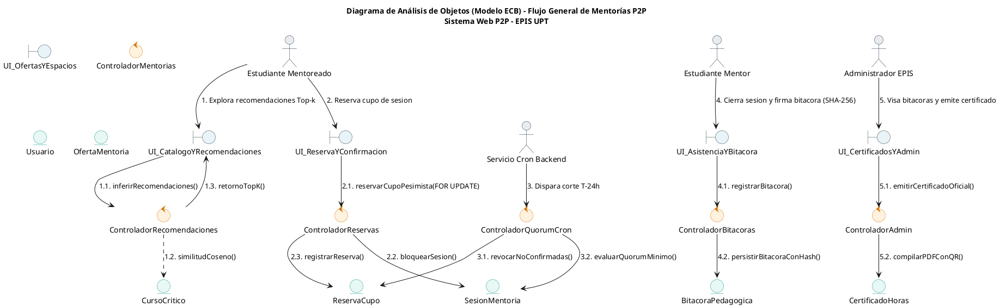

Fuente: Elaboración propia.

---

### 6.3.1.1. CUS-001 – Análisis de Objetos: Iniciar sesión institucional con 2FA

El análisis de objetos para `CUS-001` descompone las responsabilidades arquitectónicas conforme al patrón Entidad-Control-Frontera (ECB) en el módulo `MOD-01: Seguridad, Autenticación y Gobernanza`. Los objetos de frontera canalizan la interacción entre los actores institucionales y el software; los objetos de control orquestan la lógica de negocio, validaciones y reglas institucionales; y los objetos de entidad mantienen la persistencia relacional en PostgreSQL.

#### Diagrama 6.13.1: Análisis de Objetos (Modelo ECB) - CUS-001: Iniciar sesión institucional con 2FA

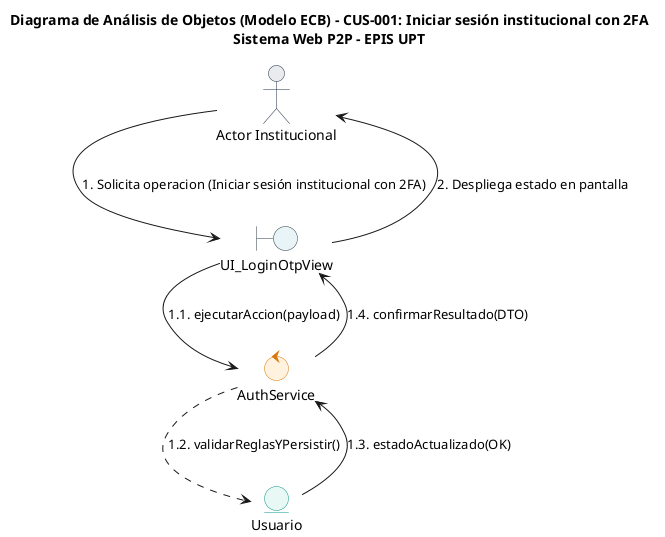

Fuente: Elaboración propia a partir del diseño de MOD-01.


---

### 6.3.1.2. CUS-010 – Análisis de Objetos: Gestionar asignación de roles de usuario

El análisis de objetos para `CUS-010` descompone las responsabilidades arquitectónicas conforme al patrón Entidad-Control-Frontera (ECB) en el módulo `MOD-01: Seguridad, Autenticación y Gobernanza`. Los objetos de frontera canalizan la interacción entre los actores institucionales y el software; los objetos de control orquestan la lógica de negocio, validaciones y reglas institucionales; y los objetos de entidad mantienen la persistencia relacional en PostgreSQL.

#### Diagrama 6.13.2: Análisis de Objetos (Modelo ECB) - CUS-010: Gestionar asignación de roles de usuario

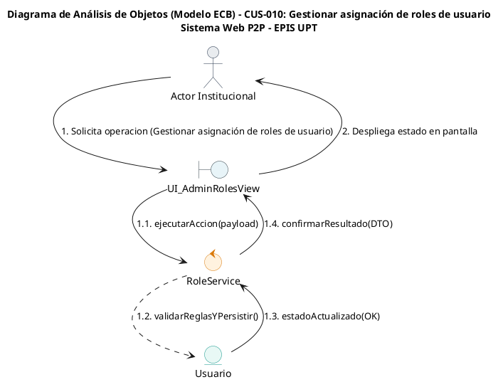

Fuente: Elaboración propia a partir del diseño de MOD-01.


---

### 6.3.1.3. CUS-006 – Análisis de Objetos: Publicar oferta de mentoría académica

El análisis de objetos para `CUS-006` descompone las responsabilidades arquitectónicas conforme al patrón Entidad-Control-Frontera (ECB) en el módulo `MOD-02: Ofertas de Mentoría y Gestión de Recursos`. Los objetos de frontera canalizan la interacción entre los actores institucionales y el software; los objetos de control orquestan la lógica de negocio, validaciones y reglas institucionales; y los objetos de entidad mantienen la persistencia relacional en PostgreSQL.

#### Diagrama 6.13.3: Análisis de Objetos (Modelo ECB) - CUS-006: Publicar oferta de mentoría académica

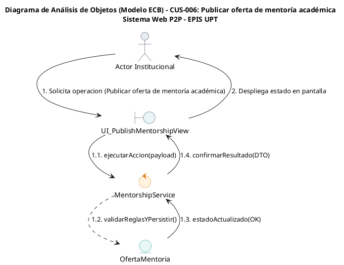

Fuente: Elaboración propia a partir del diseño de MOD-02.


---

### 6.3.1.4. CUS-008 – Análisis de Objetos: Consultar disponibilidad de espacios y recursos

El análisis de objetos para `CUS-008` descompone las responsabilidades arquitectónicas conforme al patrón Entidad-Control-Frontera (ECB) en el módulo `MOD-02: Ofertas de Mentoría y Gestión de Recursos`. Los objetos de frontera canalizan la interacción entre los actores institucionales y el software; los objetos de control orquestan la lógica de negocio, validaciones y reglas institucionales; y los objetos de entidad mantienen la persistencia relacional en PostgreSQL.

#### Diagrama 6.13.4: Análisis de Objetos (Modelo ECB) - CUS-008: Consultar disponibilidad de espacios y recursos

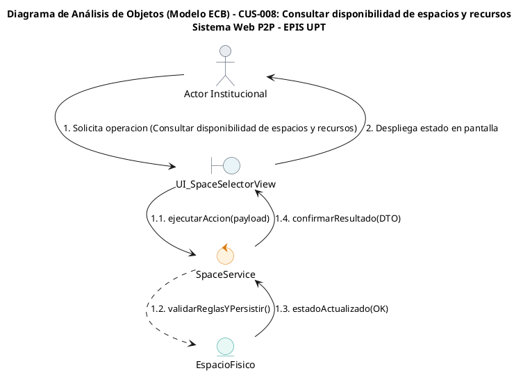

Fuente: Elaboración propia a partir del diseño de MOD-02.


---

### 6.3.1.5. CUS-005 – Análisis de Objetos: Gestionar perfil formativo y disponibilidad horaria

El análisis de objetos para `CUS-005` descompone las responsabilidades arquitectónicas conforme al patrón Entidad-Control-Frontera (ECB) en el módulo `MOD-03: Perfil del Mentor y Plan de Aprendizaje`. Los objetos de frontera canalizan la interacción entre los actores institucionales y el software; los objetos de control orquestan la lógica de negocio, validaciones y reglas institucionales; y los objetos de entidad mantienen la persistencia relacional en PostgreSQL.

#### Diagrama 6.13.5: Análisis de Objetos (Modelo ECB) - CUS-005: Gestionar perfil formativo y disponibilidad horaria

```plantuml
@startuml
title Diagrama de Análisis de Objetos (Modelo ECB) - CUS-005: Gestionar perfil formativo y disponibilidad horaria\nSistema Web P2P - EPIS UPT

skinparam shadowing false
skinparam roundcorner 8
skinparam defaultFontName Arial
skinparam fontSize 11

skinparam actor {
    BackgroundColor #E9ECEF
    BorderColor #1D2D44
}
skinparam boundary {
    BackgroundColor #E8F4F8
    BorderColor #2B3A42
}
skinparam control {
    BackgroundColor #FFF2DF
    BorderColor #D97706
}
skinparam entity {
    BackgroundColor #E8F8F5
    BorderColor #0D9488
}

actor "Actor Institucional" as ActUser
boundary "UI_ProfileAvailabilityView" as B_Main
control "ProfileService" as C_Main
entity "PerfilFormativo" as E_Main

ActUser --> B_Main : 1. Solicita operacion (Gestionar perfil formativo y disponibilidad horaria)
B_Main --> C_Main : 1.1. ejecutarAccion(payload)
C_Main ..> E_Main : 1.2. validarReglasYPersistir()
E_Main --> C_Main : 1.3. estadoActualizado(OK)
C_Main --> B_Main : 1.4. confirmarResultado(DTO)
B_Main --> ActUser : 2. Despliega estado en pantalla
@enduml
```

Fuente: Elaboración propia a partir del diseño de MOD-03.


---

### 6.3.1.6. CUS-021 – Análisis de Objetos: Explorar catálogo curricular de asignaturas filtro

El análisis de objetos para `CUS-021` descompone las responsabilidades arquitectónicas conforme al patrón Entidad-Control-Frontera (ECB) en el módulo `MOD-03: Perfil del Mentor y Plan de Aprendizaje`. Los objetos de frontera canalizan la interacción entre los actores institucionales y el software; los objetos de control orquestan la lógica de negocio, validaciones y reglas institucionales; y los objetos de entidad mantienen la persistencia relacional en PostgreSQL.

#### Diagrama 6.13.6: Análisis de Objetos (Modelo ECB) - CUS-021: Explorar catálogo curricular de asignaturas filtro

```plantuml
@startuml
title Diagrama de Análisis de Objetos (Modelo ECB) - CUS-021: Explorar catálogo curricular de asignaturas filtro\nSistema Web P2P - EPIS UPT

skinparam shadowing false
skinparam roundcorner 8
skinparam defaultFontName Arial
skinparam fontSize 11

skinparam actor {
    BackgroundColor #E9ECEF
    BorderColor #1D2D44
}
skinparam boundary {
    BackgroundColor #E8F4F8
    BorderColor #2B3A42
}
skinparam control {
    BackgroundColor #FFF2DF
    BorderColor #D97706
}
skinparam entity {
    BackgroundColor #E8F8F5
    BorderColor #0D9488
}

actor "Actor Institucional" as ActUser
boundary "UI_CurriculumCatalogView" as B_Main
control "CurriculumService" as C_Main
entity "CursoCritico" as E_Main

ActUser --> B_Main : 1. Solicita operacion (Explorar catálogo curricular de asignaturas filtro)
B_Main --> C_Main : 1.1. ejecutarAccion(payload)
C_Main ..> E_Main : 1.2. validarReglasYPersistir()
E_Main --> C_Main : 1.3. estadoActualizado(OK)
C_Main --> B_Main : 1.4. confirmarResultado(DTO)
B_Main --> ActUser : 2. Despliega estado en pantalla
@enduml
```

Fuente: Elaboración propia a partir del diseño de MOD-03.


---

### 6.3.1.7. CUS-002 – Análisis de Objetos: Explorar recomendaciones personalizadas Top-k

El análisis de objetos para `CUS-002` descompone las responsabilidades arquitectónicas conforme al patrón Entidad-Control-Frontera (ECB) en el módulo `MOD-04: Demanda y Recomendaciones Personalizadas`. Los objetos de frontera canalizan la interacción entre los actores institucionales y el software; los objetos de control orquestan la lógica de negocio, validaciones y reglas institucionales; y los objetos de entidad mantienen la persistencia relacional en PostgreSQL.

#### Diagrama 6.13.7: Análisis de Objetos (Modelo ECB) - CUS-002: Explorar recomendaciones personalizadas Top-k

```plantuml
@startuml
title Diagrama de Análisis de Objetos (Modelo ECB) - CUS-002: Explorar recomendaciones personalizadas Top-k\nSistema Web P2P - EPIS UPT

skinparam shadowing false
skinparam roundcorner 8
skinparam defaultFontName Arial
skinparam fontSize 11

skinparam actor {
    BackgroundColor #E9ECEF
    BorderColor #1D2D44
}
skinparam boundary {
    BackgroundColor #E8F4F8
    BorderColor #2B3A42
}
skinparam control {
    BackgroundColor #FFF2DF
    BorderColor #D97706
}
skinparam entity {
    BackgroundColor #E8F8F5
    BorderColor #0D9488
}

actor "Actor Institucional" as ActUser
boundary "UI_RecommendationsView" as B_Main
control "RecommendationService" as C_Main
entity "PerfilFormativo" as E_Main

ActUser --> B_Main : 1. Solicita operacion (Explorar recomendaciones personalizadas Top-k)
B_Main --> C_Main : 1.1. ejecutarAccion(payload)
C_Main ..> E_Main : 1.2. validarReglasYPersistir()
E_Main --> C_Main : 1.3. estadoActualizado(OK)
C_Main --> B_Main : 1.4. confirmarResultado(DTO)
B_Main --> ActUser : 2. Despliega estado en pantalla
@enduml
```

Fuente: Elaboración propia a partir del diseño de MOD-04.


---

### 6.3.1.8. CUS-003 – Análisis de Objetos: Registrar solicitud de demanda académica

El análisis de objetos para `CUS-003` descompone las responsabilidades arquitectónicas conforme al patrón Entidad-Control-Frontera (ECB) en el módulo `MOD-04: Demanda y Recomendaciones Personalizadas`. Los objetos de frontera canalizan la interacción entre los actores institucionales y el software; los objetos de control orquestan la lógica de negocio, validaciones y reglas institucionales; y los objetos de entidad mantienen la persistencia relacional en PostgreSQL.

#### Diagrama 6.13.8: Análisis de Objetos (Modelo ECB) - CUS-003: Registrar solicitud de demanda académica

```plantuml
@startuml
title Diagrama de Análisis de Objetos (Modelo ECB) - CUS-003: Registrar solicitud de demanda académica\nSistema Web P2P - EPIS UPT

skinparam shadowing false
skinparam roundcorner 8
skinparam defaultFontName Arial
skinparam fontSize 11

skinparam actor {
    BackgroundColor #E9ECEF
    BorderColor #1D2D44
}
skinparam boundary {
    BackgroundColor #E8F4F8
    BorderColor #2B3A42
}
skinparam control {
    BackgroundColor #FFF2DF
    BorderColor #D97706
}
skinparam entity {
    BackgroundColor #E8F8F5
    BorderColor #0D9488
}

actor "Actor Institucional" as ActUser
boundary "UI_DemandsBankView" as B_Main
control "DemandService" as C_Main
entity "SolicitudDemanda" as E_Main

ActUser --> B_Main : 1. Solicita operacion (Registrar solicitud de demanda académica)
B_Main --> C_Main : 1.1. ejecutarAccion(payload)
C_Main ..> E_Main : 1.2. validarReglasYPersistir()
E_Main --> C_Main : 1.3. estadoActualizado(OK)
C_Main --> B_Main : 1.4. confirmarResultado(DTO)
B_Main --> ActUser : 2. Despliega estado en pantalla
@enduml
```

Fuente: Elaboración propia a partir del diseño de MOD-04.


---

### 6.3.1.9. CUS-004 – Análisis de Objetos: Reservar cupo de mentoría académica

El análisis de objetos para `CUS-004` descompone las responsabilidades arquitectónicas conforme al patrón Entidad-Control-Frontera (ECB) en el módulo `MOD-05: Quórum, Confirmación y Cancelaciones`. Los objetos de frontera canalizan la interacción entre los actores institucionales y el software; los objetos de control orquestan la lógica de negocio, validaciones y reglas institucionales; y los objetos de entidad mantienen la persistencia relacional en PostgreSQL.

#### Diagrama 6.13.9: Análisis de Objetos (Modelo ECB) - CUS-004: Reservar cupo de mentoría académica

```plantuml
@startuml
title Diagrama de Análisis de Objetos (Modelo ECB) - CUS-004: Reservar cupo de mentoría académica\nSistema Web P2P - EPIS UPT

skinparam shadowing false
skinparam roundcorner 8
skinparam defaultFontName Arial
skinparam fontSize 11

skinparam actor {
    BackgroundColor #E9ECEF
    BorderColor #1D2D44
}
skinparam boundary {
    BackgroundColor #E8F4F8
    BorderColor #2B3A42
}
skinparam control {
    BackgroundColor #FFF2DF
    BorderColor #D97706
}
skinparam entity {
    BackgroundColor #E8F8F5
    BorderColor #0D9488
}

actor "Actor Institucional" as ActUser
boundary "UI_BookingModalView" as B_Main
control "BookingService" as C_Main
entity "SesionMentoria" as E_Main

ActUser --> B_Main : 1. Solicita operacion (Reservar cupo de mentoría académica)
B_Main --> C_Main : 1.1. ejecutarAccion(payload)
C_Main ..> E_Main : 1.2. validarReglasYPersistir()
E_Main --> C_Main : 1.3. estadoActualizado(OK)
C_Main --> B_Main : 1.4. confirmarResultado(DTO)
B_Main --> ActUser : 2. Despliega estado en pantalla
@enduml
```

Fuente: Elaboración propia a partir del diseño de MOD-05.


---

### 6.3.1.10. CUS-024 – Análisis de Objetos: Ratificar asistencia a sesión de mentoría

El análisis de objetos para `CUS-024` descompone las responsabilidades arquitectónicas conforme al patrón Entidad-Control-Frontera (ECB) en el módulo `MOD-05: Quórum, Confirmación y Cancelaciones`. Los objetos de frontera canalizan la interacción entre los actores institucionales y el software; los objetos de control orquestan la lógica de negocio, validaciones y reglas institucionales; y los objetos de entidad mantienen la persistencia relacional en PostgreSQL.

#### Diagrama 6.13.10: Análisis de Objetos (Modelo ECB) - CUS-024: Ratificar asistencia a sesión de mentoría

```plantuml
@startuml
title Diagrama de Análisis de Objetos (Modelo ECB) - CUS-024: Ratificar asistencia a sesión de mentoría\nSistema Web P2P - EPIS UPT

skinparam shadowing false
skinparam roundcorner 8
skinparam defaultFontName Arial
skinparam fontSize 11

skinparam actor {
    BackgroundColor #E9ECEF
    BorderColor #1D2D44
}
skinparam boundary {
    BackgroundColor #E8F4F8
    BorderColor #2B3A42
}
skinparam control {
    BackgroundColor #FFF2DF
    BorderColor #D97706
}
skinparam entity {
    BackgroundColor #E8F8F5
    BorderColor #0D9488
}

actor "Actor Institucional" as ActUser
boundary "UI_StudentBookingsView" as B_Main
control "BookingService" as C_Main
entity "ReservaCupo" as E_Main

ActUser --> B_Main : 1. Solicita operacion (Ratificar asistencia a sesión de mentoría)
B_Main --> C_Main : 1.1. ejecutarAccion(payload)
C_Main ..> E_Main : 1.2. validarReglasYPersistir()
E_Main --> C_Main : 1.3. estadoActualizado(OK)
C_Main --> B_Main : 1.4. confirmarResultado(DTO)
B_Main --> ActUser : 2. Despliega estado en pantalla
@enduml
```

Fuente: Elaboración propia a partir del diseño de MOD-05.


---

### 6.3.1.11. CUS-017 – Análisis de Objetos: Desistir voluntariamente de reserva

El análisis de objetos para `CUS-017` descompone las responsabilidades arquitectónicas conforme al patrón Entidad-Control-Frontera (ECB) en el módulo `MOD-05: Quórum, Confirmación y Cancelaciones`. Los objetos de frontera canalizan la interacción entre los actores institucionales y el software; los objetos de control orquestan la lógica de negocio, validaciones y reglas institucionales; y los objetos de entidad mantienen la persistencia relacional en PostgreSQL.

#### Diagrama 6.13.11: Análisis de Objetos (Modelo ECB) - CUS-017: Desistir voluntariamente de reserva

```plantuml
@startuml
title Diagrama de Análisis de Objetos (Modelo ECB) - CUS-017: Desistir voluntariamente de reserva\nSistema Web P2P - EPIS UPT

skinparam shadowing false
skinparam roundcorner 8
skinparam defaultFontName Arial
skinparam fontSize 11

skinparam actor {
    BackgroundColor #E9ECEF
    BorderColor #1D2D44
}
skinparam boundary {
    BackgroundColor #E8F4F8
    BorderColor #2B3A42
}
skinparam control {
    BackgroundColor #FFF2DF
    BorderColor #D97706
}
skinparam entity {
    BackgroundColor #E8F8F5
    BorderColor #0D9488
}

actor "Actor Institucional" as ActUser
boundary "UI_StudentBookingsView" as B_Main
control "BookingService" as C_Main
entity "ReservaCupo" as E_Main

ActUser --> B_Main : 1. Solicita operacion (Desistir voluntariamente de reserva)
B_Main --> C_Main : 1.1. ejecutarAccion(payload)
C_Main ..> E_Main : 1.2. validarReglasYPersistir()
E_Main --> C_Main : 1.3. estadoActualizado(OK)
C_Main --> B_Main : 1.4. confirmarResultado(DTO)
B_Main --> ActUser : 2. Despliega estado en pantalla
@enduml
```

Fuente: Elaboración propia a partir del diseño de MOD-05.


---

### 6.3.1.12. CUS-023 – Análisis de Objetos: Evaluar quórum automático a T-24h

El análisis de objetos para `CUS-023` descompone las responsabilidades arquitectónicas conforme al patrón Entidad-Control-Frontera (ECB) en el módulo `MOD-05: Quórum, Confirmación y Cancelaciones`. Los objetos de frontera canalizan la interacción entre los actores institucionales y el software; los objetos de control orquestan la lógica de negocio, validaciones y reglas institucionales; y los objetos de entidad mantienen la persistencia relacional en PostgreSQL.

#### Diagrama 6.13.12: Análisis de Objetos (Modelo ECB) - CUS-023: Evaluar quórum automático a T-24h

```plantuml
@startuml
title Diagrama de Análisis de Objetos (Modelo ECB) - CUS-023: Evaluar quórum automático a T-24h\nSistema Web P2P - EPIS UPT

skinparam shadowing false
skinparam roundcorner 8
skinparam defaultFontName Arial
skinparam fontSize 11

skinparam actor {
    BackgroundColor #E9ECEF
    BorderColor #1D2D44
}
skinparam boundary {
    BackgroundColor #E8F4F8
    BorderColor #2B3A42
}
skinparam control {
    BackgroundColor #FFF2DF
    BorderColor #D97706
}
skinparam entity {
    BackgroundColor #E8F8F5
    BorderColor #0D9488
}

actor "Actor Institucional" as ActUser
boundary "UI_NotificationCenterView" as B_Main
control "QuorumCronService" as C_Main
entity "SesionMentoria" as E_Main

ActUser --> B_Main : 1. Solicita operacion (Evaluar quórum automático a T-24h)
B_Main --> C_Main : 1.1. ejecutarAccion(payload)
C_Main ..> E_Main : 1.2. validarReglasYPersistir()
E_Main --> C_Main : 1.3. estadoActualizado(OK)
C_Main --> B_Main : 1.4. confirmarResultado(DTO)
B_Main --> ActUser : 2. Despliega estado en pantalla
@enduml
```

Fuente: Elaboración propia a partir del diseño de MOD-05.


---

### 6.3.1.13. CUS-007 – Análisis de Objetos: Decisión del mentor ante quórum insuficiente

El análisis de objetos para `CUS-007` descompone las responsabilidades arquitectónicas conforme al patrón Entidad-Control-Frontera (ECB) en el módulo `MOD-05: Quórum, Confirmación y Cancelaciones`. Los objetos de frontera canalizan la interacción entre los actores institucionales y el software; los objetos de control orquestan la lógica de negocio, validaciones y reglas institucionales; y los objetos de entidad mantienen la persistencia relacional en PostgreSQL.

#### Diagrama 6.13.13: Análisis de Objetos (Modelo ECB) - CUS-007: Decisión del mentor ante quórum insuficiente

```plantuml
@startuml
title Diagrama de Análisis de Objetos (Modelo ECB) - CUS-007: Decisión del mentor ante quórum insuficiente\nSistema Web P2P - EPIS UPT

skinparam shadowing false
skinparam roundcorner 8
skinparam defaultFontName Arial
skinparam fontSize 11

skinparam actor {
    BackgroundColor #E9ECEF
    BorderColor #1D2D44
}
skinparam boundary {
    BackgroundColor #E8F4F8
    BorderColor #2B3A42
}
skinparam control {
    BackgroundColor #FFF2DF
    BorderColor #D97706
}
skinparam entity {
    BackgroundColor #E8F8F5
    BorderColor #0D9488
}

actor "Actor Institucional" as ActUser
boundary "UI_MentorSessionActionView" as B_Main
control "MentorshipService" as C_Main
entity "SesionMentoria" as E_Main

ActUser --> B_Main : 1. Solicita operacion (Decisión del mentor ante quórum insuficiente)
B_Main --> C_Main : 1.1. ejecutarAccion(payload)
C_Main ..> E_Main : 1.2. validarReglasYPersistir()
E_Main --> C_Main : 1.3. estadoActualizado(OK)
C_Main --> B_Main : 1.4. confirmarResultado(DTO)
B_Main --> ActUser : 2. Despliega estado en pantalla
@enduml
```

Fuente: Elaboración propia a partir del diseño de MOD-05.


---

### 6.3.1.14. CUS-012 – Análisis de Objetos: Registrar asistencia a sesión de mentoría

El análisis de objetos para `CUS-012` descompone las responsabilidades arquitectónicas conforme al patrón Entidad-Control-Frontera (ECB) en el módulo `MOD-06: Asistencia, Bitácoras y Feedback`. Los objetos de frontera canalizan la interacción entre los actores institucionales y el software; los objetos de control orquestan la lógica de negocio, validaciones y reglas institucionales; y los objetos de entidad mantienen la persistencia relacional en PostgreSQL.

#### Diagrama 6.13.14: Análisis de Objetos (Modelo ECB) - CUS-012: Registrar asistencia a sesión de mentoría

```plantuml
@startuml
title Diagrama de Análisis de Objetos (Modelo ECB) - CUS-012: Registrar asistencia a sesión de mentoría\nSistema Web P2P - EPIS UPT

skinparam shadowing false
skinparam roundcorner 8
skinparam defaultFontName Arial
skinparam fontSize 11

skinparam actor {
    BackgroundColor #E9ECEF
    BorderColor #1D2D44
}
skinparam boundary {
    BackgroundColor #E8F4F8
    BorderColor #2B3A42
}
skinparam control {
    BackgroundColor #FFF2DF
    BorderColor #D97706
}
skinparam entity {
    BackgroundColor #E8F8F5
    BorderColor #0D9488
}

actor "Actor Institucional" as ActUser
boundary "UI_QrScannerView" as B_Main
control "AttendanceService" as C_Main
entity "AsistenciaSesion" as E_Main

ActUser --> B_Main : 1. Solicita operacion (Registrar asistencia a sesión de mentoría)
B_Main --> C_Main : 1.1. ejecutarAccion(payload)
C_Main ..> E_Main : 1.2. validarReglasYPersistir()
E_Main --> C_Main : 1.3. estadoActualizado(OK)
C_Main --> B_Main : 1.4. confirmarResultado(DTO)
B_Main --> ActUser : 2. Despliega estado en pantalla
@enduml
```

Fuente: Elaboración propia a partir del diseño de MOD-06.


---

### 6.3.1.15. CUS-013 – Análisis de Objetos: Registrar bitácora académica de sesión

El análisis de objetos para `CUS-013` descompone las responsabilidades arquitectónicas conforme al patrón Entidad-Control-Frontera (ECB) en el módulo `MOD-06: Asistencia, Bitácoras y Feedback`. Los objetos de frontera canalizan la interacción entre los actores institucionales y el software; los objetos de control orquestan la lógica de negocio, validaciones y reglas institucionales; y los objetos de entidad mantienen la persistencia relacional en PostgreSQL.

#### Diagrama 6.13.15: Análisis de Objetos (Modelo ECB) - CUS-013: Registrar bitácora académica de sesión

```plantuml
@startuml
title Diagrama de Análisis de Objetos (Modelo ECB) - CUS-013: Registrar bitácora académica de sesión\nSistema Web P2P - EPIS UPT

skinparam shadowing false
skinparam roundcorner 8
skinparam defaultFontName Arial
skinparam fontSize 11

skinparam actor {
    BackgroundColor #E9ECEF
    BorderColor #1D2D44
}
skinparam boundary {
    BackgroundColor #E8F4F8
    BorderColor #2B3A42
}
skinparam control {
    BackgroundColor #FFF2DF
    BorderColor #D97706
}
skinparam entity {
    BackgroundColor #E8F8F5
    BorderColor #0D9488
}

actor "Actor Institucional" as ActUser
boundary "UI_BitacoraRegisterView" as B_Main
control "BitacoraService" as C_Main
entity "BitacoraPedagogica" as E_Main

ActUser --> B_Main : 1. Solicita operacion (Registrar bitácora académica de sesión)
B_Main --> C_Main : 1.1. ejecutarAccion(payload)
C_Main ..> E_Main : 1.2. validarReglasYPersistir()
E_Main --> C_Main : 1.3. estadoActualizado(OK)
C_Main --> B_Main : 1.4. confirmarResultado(DTO)
B_Main --> ActUser : 2. Despliega estado en pantalla
@enduml
```

Fuente: Elaboración propia a partir del diseño de MOD-06.


---

### 6.3.1.16. CUS-014 – Análisis de Objetos: Visualizar historial y bitácoras académicas

El análisis de objetos para `CUS-014` descompone las responsabilidades arquitectónicas conforme al patrón Entidad-Control-Frontera (ECB) en el módulo `MOD-06: Asistencia, Bitácoras y Feedback`. Los objetos de frontera canalizan la interacción entre los actores institucionales y el software; los objetos de control orquestan la lógica de negocio, validaciones y reglas institucionales; y los objetos de entidad mantienen la persistencia relacional en PostgreSQL.

#### Diagrama 6.13.16: Análisis de Objetos (Modelo ECB) - CUS-014: Visualizar historial y bitácoras académicas

```plantuml
@startuml
title Diagrama de Análisis de Objetos (Modelo ECB) - CUS-014: Visualizar historial y bitácoras académicas\nSistema Web P2P - EPIS UPT

skinparam shadowing false
skinparam roundcorner 8
skinparam defaultFontName Arial
skinparam fontSize 11

skinparam actor {
    BackgroundColor #E9ECEF
    BorderColor #1D2D44
}
skinparam boundary {
    BackgroundColor #E8F4F8
    BorderColor #2B3A42
}
skinparam control {
    BackgroundColor #FFF2DF
    BorderColor #D97706
}
skinparam entity {
    BackgroundColor #E8F8F5
    BorderColor #0D9488
}

actor "Actor Institucional" as ActUser
boundary "UI_BitacoraHistoryView" as B_Main
control "BitacoraService" as C_Main
entity "BitacoraPedagogica" as E_Main

ActUser --> B_Main : 1. Solicita operacion (Visualizar historial y bitácoras académicas)
B_Main --> C_Main : 1.1. ejecutarAccion(payload)
C_Main ..> E_Main : 1.2. validarReglasYPersistir()
E_Main --> C_Main : 1.3. estadoActualizado(OK)
C_Main --> B_Main : 1.4. confirmarResultado(DTO)
B_Main --> ActUser : 2. Despliega estado en pantalla
@enduml
```

Fuente: Elaboración propia a partir del diseño de MOD-06.


---

### 6.3.1.17. CUS-018 – Análisis de Objetos: Emitir constancia institucional de horas de mentoría

El análisis de objetos para `CUS-018` descompone las responsabilidades arquitectónicas conforme al patrón Entidad-Control-Frontera (ECB) en el módulo `MOD-07: Gamificación e Incentivos`. Los objetos de frontera canalizan la interacción entre los actores institucionales y el software; los objetos de control orquestan la lógica de negocio, validaciones y reglas institucionales; y los objetos de entidad mantienen la persistencia relacional en PostgreSQL.

#### Diagrama 6.13.17: Análisis de Objetos (Modelo ECB) - CUS-018: Emitir constancia institucional de horas de mentoría

```plantuml
@startuml
title Diagrama de Análisis de Objetos (Modelo ECB) - CUS-018: Emitir constancia institucional de horas de mentoría\nSistema Web P2P - EPIS UPT

skinparam shadowing false
skinparam roundcorner 8
skinparam defaultFontName Arial
skinparam fontSize 11

skinparam actor {
    BackgroundColor #E9ECEF
    BorderColor #1D2D44
}
skinparam boundary {
    BackgroundColor #E8F4F8
    BorderColor #2B3A42
}
skinparam control {
    BackgroundColor #FFF2DF
    BorderColor #D97706
}
skinparam entity {
    BackgroundColor #E8F8F5
    BorderColor #0D9488
}

actor "Actor Institucional" as ActUser
boundary "UI_AdminCertificatesView" as B_Main
control "CertificateService" as C_Main
entity "CertificadoHoras" as E_Main

ActUser --> B_Main : 1. Solicita operacion (Emitir constancia institucional de horas de mentoría)
B_Main --> C_Main : 1.1. ejecutarAccion(payload)
C_Main ..> E_Main : 1.2. validarReglasYPersistir()
E_Main --> C_Main : 1.3. estadoActualizado(OK)
C_Main --> B_Main : 1.4. confirmarResultado(DTO)
B_Main --> ActUser : 2. Despliega estado en pantalla
@enduml
```

Fuente: Elaboración propia a partir del diseño de MOD-07.


---

### 6.3.1.18. CUS-019 – Análisis de Objetos: Gestionar insignias y reputación gamificada

El análisis de objetos para `CUS-019` descompone las responsabilidades arquitectónicas conforme al patrón Entidad-Control-Frontera (ECB) en el módulo `MOD-07: Gamificación e Incentivos`. Los objetos de frontera canalizan la interacción entre los actores institucionales y el software; los objetos de control orquestan la lógica de negocio, validaciones y reglas institucionales; y los objetos de entidad mantienen la persistencia relacional en PostgreSQL.

#### Diagrama 6.13.18: Análisis de Objetos (Modelo ECB) - CUS-019: Gestionar insignias y reputación gamificada

```plantuml
@startuml
title Diagrama de Análisis de Objetos (Modelo ECB) - CUS-019: Gestionar insignias y reputación gamificada\nSistema Web P2P - EPIS UPT

skinparam shadowing false
skinparam roundcorner 8
skinparam defaultFontName Arial
skinparam fontSize 11

skinparam actor {
    BackgroundColor #E9ECEF
    BorderColor #1D2D44
}
skinparam boundary {
    BackgroundColor #E8F4F8
    BorderColor #2B3A42
}
skinparam control {
    BackgroundColor #FFF2DF
    BorderColor #D97706
}
skinparam entity {
    BackgroundColor #E8F8F5
    BorderColor #0D9488
}

actor "Actor Institucional" as ActUser
boundary "UI_MentorBadgesView" as B_Main
control "GamificationService" as C_Main
entity "Insignia" as E_Main

ActUser --> B_Main : 1. Solicita operacion (Gestionar insignias y reputación gamificada)
B_Main --> C_Main : 1.1. ejecutarAccion(payload)
C_Main ..> E_Main : 1.2. validarReglasYPersistir()
E_Main --> C_Main : 1.3. estadoActualizado(OK)
C_Main --> B_Main : 1.4. confirmarResultado(DTO)
B_Main --> ActUser : 2. Despliega estado en pantalla
@enduml
```

Fuente: Elaboración propia a partir del diseño de MOD-07.


---

### 6.3.1.19. CUS-009 – Análisis de Objetos: Notificar eventos críticos y alertas temporales

El análisis de objetos para `CUS-009` descompone las responsabilidades arquitectónicas conforme al patrón Entidad-Control-Frontera (ECB) en el módulo `MOD-08: Analítica, Notificaciones y Configuración`. Los objetos de frontera canalizan la interacción entre los actores institucionales y el software; los objetos de control orquestan la lógica de negocio, validaciones y reglas institucionales; y los objetos de entidad mantienen la persistencia relacional en PostgreSQL.

#### Diagrama 6.13.19: Análisis de Objetos (Modelo ECB) - CUS-009: Notificar eventos críticos y alertas temporales

```plantuml
@startuml
title Diagrama de Análisis de Objetos (Modelo ECB) - CUS-009: Notificar eventos críticos y alertas temporales\nSistema Web P2P - EPIS UPT

skinparam shadowing false
skinparam roundcorner 8
skinparam defaultFontName Arial
skinparam fontSize 11

skinparam actor {
    BackgroundColor #E9ECEF
    BorderColor #1D2D44
}
skinparam boundary {
    BackgroundColor #E8F4F8
    BorderColor #2B3A42
}
skinparam control {
    BackgroundColor #FFF2DF
    BorderColor #D97706
}
skinparam entity {
    BackgroundColor #E8F8F5
    BorderColor #0D9488
}

actor "Actor Institucional" as ActUser
boundary "UI_NotificationCenterView" as B_Main
control "NotificationService" as C_Main
entity "Notificacion" as E_Main

ActUser --> B_Main : 1. Solicita operacion (Notificar eventos críticos y alertas temporales)
B_Main --> C_Main : 1.1. ejecutarAccion(payload)
C_Main ..> E_Main : 1.2. validarReglasYPersistir()
E_Main --> C_Main : 1.3. estadoActualizado(OK)
C_Main --> B_Main : 1.4. confirmarResultado(DTO)
B_Main --> ActUser : 2. Despliega estado en pantalla
@enduml
```

Fuente: Elaboración propia a partir del diseño de MOD-08.


---

### 6.3.1.20. CUS-011 – Análisis de Objetos: Generar reportes e indicadores de analítica académica

El análisis de objetos para `CUS-011` descompone las responsabilidades arquitectónicas conforme al patrón Entidad-Control-Frontera (ECB) en el módulo `MOD-08: Analítica, Notificaciones y Configuración`. Los objetos de frontera canalizan la interacción entre los actores institucionales y el software; los objetos de control orquestan la lógica de negocio, validaciones y reglas institucionales; y los objetos de entidad mantienen la persistencia relacional en PostgreSQL.

#### Diagrama 6.13.20: Análisis de Objetos (Modelo ECB) - CUS-011: Generar reportes e indicadores de analítica académica

```plantuml
@startuml
title Diagrama de Análisis de Objetos (Modelo ECB) - CUS-011: Generar reportes e indicadores de analítica académica\nSistema Web P2P - EPIS UPT

skinparam shadowing false
skinparam roundcorner 8
skinparam defaultFontName Arial
skinparam fontSize 11

skinparam actor {
    BackgroundColor #E9ECEF
    BorderColor #1D2D44
}
skinparam boundary {
    BackgroundColor #E8F4F8
    BorderColor #2B3A42
}
skinparam control {
    BackgroundColor #FFF2DF
    BorderColor #D97706
}
skinparam entity {
    BackgroundColor #E8F8F5
    BorderColor #0D9488
}

actor "Actor Institucional" as ActUser
boundary "UI_AdminAnalyticsView" as B_Main
control "AnalyticsService" as C_Main
entity "KpiAcademico" as E_Main

ActUser --> B_Main : 1. Solicita operacion (Generar reportes e indicadores de analítica académica)
B_Main --> C_Main : 1.1. ejecutarAccion(payload)
C_Main ..> E_Main : 1.2. validarReglasYPersistir()
E_Main --> C_Main : 1.3. estadoActualizado(OK)
C_Main --> B_Main : 1.4. confirmarResultado(DTO)
B_Main --> ActUser : 2. Despliega estado en pantalla
@enduml
```

Fuente: Elaboración propia a partir del diseño de MOD-08.


---

### 6.3.1.21. CUS-015 – Análisis de Objetos: Consultar métricas de retención y desempeño

El análisis de objetos para `CUS-015` descompone las responsabilidades arquitectónicas conforme al patrón Entidad-Control-Frontera (ECB) en el módulo `MOD-08: Analítica, Notificaciones y Configuración`. Los objetos de frontera canalizan la interacción entre los actores institucionales y el software; los objetos de control orquestan la lógica de negocio, validaciones y reglas institucionales; y los objetos de entidad mantienen la persistencia relacional en PostgreSQL.

#### Diagrama 6.13.21: Análisis de Objetos (Modelo ECB) - CUS-015: Consultar métricas de retención y desempeño

```plantuml
@startuml
title Diagrama de Análisis de Objetos (Modelo ECB) - CUS-015: Consultar métricas de retención y desempeño\nSistema Web P2P - EPIS UPT

skinparam shadowing false
skinparam roundcorner 8
skinparam defaultFontName Arial
skinparam fontSize 11

skinparam actor {
    BackgroundColor #E9ECEF
    BorderColor #1D2D44
}
skinparam boundary {
    BackgroundColor #E8F4F8
    BorderColor #2B3A42
}
skinparam control {
    BackgroundColor #FFF2DF
    BorderColor #D97706
}
skinparam entity {
    BackgroundColor #E8F8F5
    BorderColor #0D9488
}

actor "Actor Institucional" as ActUser
boundary "UI_AdminAnalyticsView" as B_Main
control "AnalyticsService" as C_Main
entity "KpiAcademico" as E_Main

ActUser --> B_Main : 1. Solicita operacion (Consultar métricas de retención y desempeño)
B_Main --> C_Main : 1.1. ejecutarAccion(payload)
C_Main ..> E_Main : 1.2. validarReglasYPersistir()
E_Main --> C_Main : 1.3. estadoActualizado(OK)
C_Main --> B_Main : 1.4. confirmarResultado(DTO)
B_Main --> ActUser : 2. Despliega estado en pantalla
@enduml
```

Fuente: Elaboración propia a partir del diseño de MOD-08.


---

### 6.3.1.22. CUS-016 – Análisis de Objetos: Auditar trazas de seguridad y consentimiento Ley 29733

El análisis de objetos para `CUS-016` descompone las responsabilidades arquitectónicas conforme al patrón Entidad-Control-Frontera (ECB) en el módulo `MOD-08: Analítica, Notificaciones y Configuración`. Los objetos de frontera canalizan la interacción entre los actores institucionales y el software; los objetos de control orquestan la lógica de negocio, validaciones y reglas institucionales; y los objetos de entidad mantienen la persistencia relacional en PostgreSQL.

#### Diagrama 6.13.22: Análisis de Objetos (Modelo ECB) - CUS-016: Auditar trazas de seguridad y consentimiento Ley 29733

```plantuml
@startuml
title Diagrama de Análisis de Objetos (Modelo ECB) - CUS-016: Auditar trazas de seguridad y consentimiento Ley 29733\nSistema Web P2P - EPIS UPT

skinparam shadowing false
skinparam roundcorner 8
skinparam defaultFontName Arial
skinparam fontSize 11

skinparam actor {
    BackgroundColor #E9ECEF
    BorderColor #1D2D44
}
skinparam boundary {
    BackgroundColor #E8F4F8
    BorderColor #2B3A42
}
skinparam control {
    BackgroundColor #FFF2DF
    BorderColor #D97706
}
skinparam entity {
    BackgroundColor #E8F8F5
    BorderColor #0D9488
}

actor "Actor Institucional" as ActUser
boundary "UI_AdminAuditView" as B_Main
control "AuditService" as C_Main
entity "ConsentimientoLegal" as E_Main

ActUser --> B_Main : 1. Solicita operacion (Auditar trazas de seguridad y consentimiento Ley 29733)
B_Main --> C_Main : 1.1. ejecutarAccion(payload)
C_Main ..> E_Main : 1.2. validarReglasYPersistir()
E_Main --> C_Main : 1.3. estadoActualizado(OK)
C_Main --> B_Main : 1.4. confirmarResultado(DTO)
B_Main --> ActUser : 2. Despliega estado en pantalla
@enduml
```

Fuente: Elaboración propia a partir del diseño de MOD-08.


---

### 6.3.1.23. CUS-020 – Análisis de Objetos: Configurar parámetros institucionales y umbrales

El análisis de objetos para `CUS-020` descompone las responsabilidades arquitectónicas conforme al patrón Entidad-Control-Frontera (ECB) en el módulo `MOD-08: Analítica, Notificaciones y Configuración`. Los objetos de frontera canalizan la interacción entre los actores institucionales y el software; los objetos de control orquestan la lógica de negocio, validaciones y reglas institucionales; y los objetos de entidad mantienen la persistencia relacional en PostgreSQL.

#### Diagrama 6.13.23: Análisis de Objetos (Modelo ECB) - CUS-020: Configurar parámetros institucionales y umbrales

```plantuml
@startuml
title Diagrama de Análisis de Objetos (Modelo ECB) - CUS-020: Configurar parámetros institucionales y umbrales\nSistema Web P2P - EPIS UPT

skinparam shadowing false
skinparam roundcorner 8
skinparam defaultFontName Arial
skinparam fontSize 11

skinparam actor {
    BackgroundColor #E9ECEF
    BorderColor #1D2D44
}
skinparam boundary {
    BackgroundColor #E8F4F8
    BorderColor #2B3A42
}
skinparam control {
    BackgroundColor #FFF2DF
    BorderColor #D97706
}
skinparam entity {
    BackgroundColor #E8F8F5
    BorderColor #0D9488
}

actor "Actor Institucional" as ActUser
boundary "UI_AdminSettingsView" as B_Main
control "AdminService" as C_Main
entity "ParametroInstitucional" as E_Main

ActUser --> B_Main : 1. Solicita operacion (Configurar parámetros institucionales y umbrales)
B_Main --> C_Main : 1.1. ejecutarAccion(payload)
C_Main ..> E_Main : 1.2. validarReglasYPersistir()
E_Main --> C_Main : 1.3. estadoActualizado(OK)
C_Main --> B_Main : 1.4. confirmarResultado(DTO)
B_Main --> ActUser : 2. Despliega estado en pantalla
@enduml
```

Fuente: Elaboración propia a partir del diseño de MOD-08.


---

### 6.3.1.24. CUS-022 – Análisis de Objetos: Gestionar catálogo de temas y materias críticas

El análisis de objetos para `CUS-022` descompone las responsabilidades arquitectónicas conforme al patrón Entidad-Control-Frontera (ECB) en el módulo `MOD-08: Analítica, Notificaciones y Configuración`. Los objetos de frontera canalizan la interacción entre los actores institucionales y el software; los objetos de control orquestan la lógica de negocio, validaciones y reglas institucionales; y los objetos de entidad mantienen la persistencia relacional en PostgreSQL.

#### Diagrama 6.13.24: Análisis de Objetos (Modelo ECB) - CUS-022: Gestionar catálogo de temas y materias críticas

```plantuml
@startuml
title Diagrama de Análisis de Objetos (Modelo ECB) - CUS-022: Gestionar catálogo de temas y materias críticas\nSistema Web P2P - EPIS UPT

skinparam shadowing false
skinparam roundcorner 8
skinparam defaultFontName Arial
skinparam fontSize 11

skinparam actor {
    BackgroundColor #E9ECEF
    BorderColor #1D2D44
}
skinparam boundary {
    BackgroundColor #E8F4F8
    BorderColor #2B3A42
}
skinparam control {
    BackgroundColor #FFF2DF
    BorderColor #D97706
}
skinparam entity {
    BackgroundColor #E8F8F5
    BorderColor #0D9488
}

actor "Actor Institucional" as ActUser
boundary "UI_AdminCurriculumView" as B_Main
control "CurriculumService" as C_Main
entity "CursoCritico" as E_Main

ActUser --> B_Main : 1. Solicita operacion (Gestionar catálogo de temas y materias críticas)
B_Main --> C_Main : 1.1. ejecutarAccion(payload)
C_Main ..> E_Main : 1.2. validarReglasYPersistir()
E_Main --> C_Main : 1.3. estadoActualizado(OK)
C_Main --> B_Main : 1.4. confirmarResultado(DTO)
B_Main --> ActUser : 2. Despliega estado en pantalla
@enduml
```

Fuente: Elaboración propia a partir del diseño de MOD-08.


---

## 6.3.2. Diagrama de Actividades con objetos

### Presentación del Diagrama de Actividades con Objetos
El diagrama de actividades con flujo de objetos modela la dinámica operacional del sistema, explicitando no solo la secuencia temporal de actividades y las decisiones condicionales, sino también el ciclo de vida y los cambios de estado que experimentan los artefactos de datos (objetos de negocio) a medida que transitan por las diferentes etapas del proceso de mentorías. A continuación se presenta el Diagrama General de Actividades del Ciclo de Mentoría (Diagrama 6.14), seguido de los 24 diagramas de actividades detallados para cada caso de uso canónico.

### Diagrama 6.14: Diagrama de Actividades con Flujo de Objetos del Ciclo de Mentoría

```plantuml
@startuml
title Diagrama de Actividades con Flujo de Objetos del Ciclo de Mentoría\nSistema Web P2P - EPIS UPT

skinparam shadowing false
skinparam roundcorner 8
skinparam defaultFontName Arial
skinparam fontSize 11

|#F8F9FA|Estudiante Mentoreado|
|#E8F8F5|Estudiante Mentor|
|#FEF9C3|Sistema Web P2P (Backend)|
|#FFF1F2|Administración (EPIS)|

|Estudiante Mentor|
start
:Publica oferta de mentoría;
|Sistema Web P2P (Backend)|
:Valida disponibilidad de espacio;
:Crea OfertaMentoria [PUBLICADA];
:Crea SesionMentoria [PROGRAMADA];

|Estudiante Mentoreado|
:Explora recomendaciones Top-k;
:Reserva cupo de sesión;
|Sistema Web P2P (Backend)|
:Adquiere cerrojo pesimista FOR UPDATE;
:Crea ReservaCupo [PENDIENTE_CONFIRMACION];

|Estudiante Mentoreado|
:Ratifica asistencia antes de T-24h;
|Sistema Web P2P (Backend)|
:Transiciona ReservaCupo [CONFIRMADA];

|Sistema Web P2P (Backend)|
:Ejecuta corte automatizado a T-24h;
if (¿Quórum >= 50% de aforo?) then (Sí)
  :Transiciona SesionMentoria [CONFIRMADA];
else (No)
  :Transiciona SesionMentoria [QUORUM_INSUFICIENTE];
  |Estudiante Mentor|
  if (¿Mentor decide continuar?) then (Sí)
    :Ratifica sesión extraordinaria;
  else (No)
    :Cancela sesión;
    |Sistema Web P2P (Backend)|
    :SesionMentoria [CANCELADA_QUORUM];
    stop
  endif
endif

|Estudiante Mentor|
:Desarrolla la sesión de mentoría;
:Registra bitácora pedagógica antes de 48h;
|Sistema Web P2P (Backend)|
:Calcula hash SHA-256 inmutable;
:Crea BitacoraPedagogica [REGISTRADA];
:Transiciona SesionMentoria [FINALIZADA];

|Estudiante Mentoreado|
:Completa encuesta de satisfacción (24h);
|Sistema Web P2P (Backend)|
:Actualiza reputación e insignias del mentor;

|Administración (EPIS)|
:Visa bitácoras docentes;
if (¿Horas acumuladas >= 20h?) then (Sí)
  :Emite certificado digital oficial;
  |Sistema Web P2P (Backend)|
  :Genera CertificadoHoras [EMITIDO_VALIDADO];
endif
stop
@enduml
```

Fuente: Elaboración propia.

---

### 6.3.2.1. CUS-001 – Actividades con Objetos: Iniciar sesión institucional con 2FA

El diagrama de actividades con flujo de objetos modela la secuencia lógica, las compuertas de decisión y las transiciones de estado de los artefactos informáticos para `CUS-001` en `MOD-01`. Se organiza en carriles de ejecución (*swimlanes*) que delimitan las acciones del usuario, los controladores de backend y las entidades de datos persistentes.

#### Diagrama 6.14.1: Diagrama de Actividades con Flujo de Objetos - CUS-001: Iniciar sesión institucional con 2FA

```plantuml
@startuml
title Diagrama de Actividades con Flujo de Objetos - CUS-001: Iniciar sesión institucional con 2FA\nSistema Web P2P - EPIS UPT

skinparam shadowing false
skinparam roundcorner 8
skinparam defaultFontName Arial
skinparam fontSize 11

|#F8F9FA|Actor Institucional|
|#E8F8F5|Sistema Web P2P (Backend)|
|#FFF2DF|Persistencia (PostgreSQL)|

|Actor Institucional|
start
:Inicia accion para Iniciar sesión institucional con 2FA;
:Envía formulario / petición técnica;

|Sistema Web P2P (Backend)|
:Valida esquema Pydantic y reglas de negocio;
if (¿Datos válidos y reglas conformes?) then (Sí)
  :Inicia transacción ACID;
  |Persistencia (PostgreSQL)|
  :Ejecuta operaciones SQL sobre Usuario;
  :Transiciona estado de la entidad;
  |Sistema Web P2P (Backend)|
  :Confirma transacción (commit);
  :Genera Response DTO;
  |Actor Institucional|
  :Visualiza confirmación exitosa en Vista React;
  stop
else (No)
  |Sistema Web P2P (Backend)|
  :Genera error controlado (HTTP 4xx);
  |Actor Institucional|
  :Visualiza mensaje de alerta descriptivo;
  stop
endif
@enduml
```

Fuente: Elaboración propia a partir del diseño de MOD-01.


---

### 6.3.2.2. CUS-010 – Actividades con Objetos: Gestionar asignación de roles de usuario

El diagrama de actividades con flujo de objetos modela la secuencia lógica, las compuertas de decisión y las transiciones de estado de los artefactos informáticos para `CUS-010` en `MOD-01`. Se organiza en carriles de ejecución (*swimlanes*) que delimitan las acciones del usuario, los controladores de backend y las entidades de datos persistentes.

#### Diagrama 6.14.2: Diagrama de Actividades con Flujo de Objetos - CUS-010: Gestionar asignación de roles de usuario

```plantuml
@startuml
title Diagrama de Actividades con Flujo de Objetos - CUS-010: Gestionar asignación de roles de usuario\nSistema Web P2P - EPIS UPT

skinparam shadowing false
skinparam roundcorner 8
skinparam defaultFontName Arial
skinparam fontSize 11

|#F8F9FA|Actor Institucional|
|#E8F8F5|Sistema Web P2P (Backend)|
|#FFF2DF|Persistencia (PostgreSQL)|

|Actor Institucional|
start
:Inicia accion para Gestionar asignación de roles de usuario;
:Envía formulario / petición técnica;

|Sistema Web P2P (Backend)|
:Valida esquema Pydantic y reglas de negocio;
if (¿Datos válidos y reglas conformes?) then (Sí)
  :Inicia transacción ACID;
  |Persistencia (PostgreSQL)|
  :Ejecuta operaciones SQL sobre Usuario;
  :Transiciona estado de la entidad;
  |Sistema Web P2P (Backend)|
  :Confirma transacción (commit);
  :Genera Response DTO;
  |Actor Institucional|
  :Visualiza confirmación exitosa en Vista React;
  stop
else (No)
  |Sistema Web P2P (Backend)|
  :Genera error controlado (HTTP 4xx);
  |Actor Institucional|
  :Visualiza mensaje de alerta descriptivo;
  stop
endif
@enduml
```

Fuente: Elaboración propia a partir del diseño de MOD-01.


---

### 6.3.2.3. CUS-006 – Actividades con Objetos: Publicar oferta de mentoría académica

El diagrama de actividades con flujo de objetos modela la secuencia lógica, las compuertas de decisión y las transiciones de estado de los artefactos informáticos para `CUS-006` en `MOD-02`. Se organiza en carriles de ejecución (*swimlanes*) que delimitan las acciones del usuario, los controladores de backend y las entidades de datos persistentes.

#### Diagrama 6.14.3: Diagrama de Actividades con Flujo de Objetos - CUS-006: Publicar oferta de mentoría académica

```plantuml
@startuml
title Diagrama de Actividades con Flujo de Objetos - CUS-006: Publicar oferta de mentoría académica\nSistema Web P2P - EPIS UPT

skinparam shadowing false
skinparam roundcorner 8
skinparam defaultFontName Arial
skinparam fontSize 11

|#F8F9FA|Actor Institucional|
|#E8F8F5|Sistema Web P2P (Backend)|
|#FFF2DF|Persistencia (PostgreSQL)|

|Actor Institucional|
start
:Inicia accion para Publicar oferta de mentoría académica;
:Envía formulario / petición técnica;

|Sistema Web P2P (Backend)|
:Valida esquema Pydantic y reglas de negocio;
if (¿Datos válidos y reglas conformes?) then (Sí)
  :Inicia transacción ACID;
  |Persistencia (PostgreSQL)|
  :Ejecuta operaciones SQL sobre OfertaMentoria;
  :Transiciona estado de la entidad;
  |Sistema Web P2P (Backend)|
  :Confirma transacción (commit);
  :Genera Response DTO;
  |Actor Institucional|
  :Visualiza confirmación exitosa en Vista React;
  stop
else (No)
  |Sistema Web P2P (Backend)|
  :Genera error controlado (HTTP 4xx);
  |Actor Institucional|
  :Visualiza mensaje de alerta descriptivo;
  stop
endif
@enduml
```

Fuente: Elaboración propia a partir del diseño de MOD-02.


---

### 6.3.2.4. CUS-008 – Actividades con Objetos: Consultar disponibilidad de espacios y recursos

El diagrama de actividades con flujo de objetos modela la secuencia lógica, las compuertas de decisión y las transiciones de estado de los artefactos informáticos para `CUS-008` en `MOD-02`. Se organiza en carriles de ejecución (*swimlanes*) que delimitan las acciones del usuario, los controladores de backend y las entidades de datos persistentes.

#### Diagrama 6.14.4: Diagrama de Actividades con Flujo de Objetos - CUS-008: Consultar disponibilidad de espacios y recursos

```plantuml
@startuml
title Diagrama de Actividades con Flujo de Objetos - CUS-008: Consultar disponibilidad de espacios y recursos\nSistema Web P2P - EPIS UPT

skinparam shadowing false
skinparam roundcorner 8
skinparam defaultFontName Arial
skinparam fontSize 11

|#F8F9FA|Actor Institucional|
|#E8F8F5|Sistema Web P2P (Backend)|
|#FFF2DF|Persistencia (PostgreSQL)|

|Actor Institucional|
start
:Inicia accion para Consultar disponibilidad de espacios y recursos;
:Envía formulario / petición técnica;

|Sistema Web P2P (Backend)|
:Valida esquema Pydantic y reglas de negocio;
if (¿Datos válidos y reglas conformes?) then (Sí)
  :Inicia transacción ACID;
  |Persistencia (PostgreSQL)|
  :Ejecuta operaciones SQL sobre EspacioFisico;
  :Transiciona estado de la entidad;
  |Sistema Web P2P (Backend)|
  :Confirma transacción (commit);
  :Genera Response DTO;
  |Actor Institucional|
  :Visualiza confirmación exitosa en Vista React;
  stop
else (No)
  |Sistema Web P2P (Backend)|
  :Genera error controlado (HTTP 4xx);
  |Actor Institucional|
  :Visualiza mensaje de alerta descriptivo;
  stop
endif
@enduml
```

Fuente: Elaboración propia a partir del diseño de MOD-02.


---

### 6.3.2.5. CUS-005 – Actividades con Objetos: Gestionar perfil formativo y disponibilidad horaria

El diagrama de actividades con flujo de objetos modela la secuencia lógica, las compuertas de decisión y las transiciones de estado de los artefactos informáticos para `CUS-005` en `MOD-03`. Se organiza en carriles de ejecución (*swimlanes*) que delimitan las acciones del usuario, los controladores de backend y las entidades de datos persistentes.

#### Diagrama 6.14.5: Diagrama de Actividades con Flujo de Objetos - CUS-005: Gestionar perfil formativo y disponibilidad horaria

```plantuml
@startuml
title Diagrama de Actividades con Flujo de Objetos - CUS-005: Gestionar perfil formativo y disponibilidad horaria\nSistema Web P2P - EPIS UPT

skinparam shadowing false
skinparam roundcorner 8
skinparam defaultFontName Arial
skinparam fontSize 11

|#F8F9FA|Actor Institucional|
|#E8F8F5|Sistema Web P2P (Backend)|
|#FFF2DF|Persistencia (PostgreSQL)|

|Actor Institucional|
start
:Inicia accion para Gestionar perfil formativo y disponibilidad horaria;
:Envía formulario / petición técnica;

|Sistema Web P2P (Backend)|
:Valida esquema Pydantic y reglas de negocio;
if (¿Datos válidos y reglas conformes?) then (Sí)
  :Inicia transacción ACID;
  |Persistencia (PostgreSQL)|
  :Ejecuta operaciones SQL sobre PerfilFormativo;
  :Transiciona estado de la entidad;
  |Sistema Web P2P (Backend)|
  :Confirma transacción (commit);
  :Genera Response DTO;
  |Actor Institucional|
  :Visualiza confirmación exitosa en Vista React;
  stop
else (No)
  |Sistema Web P2P (Backend)|
  :Genera error controlado (HTTP 4xx);
  |Actor Institucional|
  :Visualiza mensaje de alerta descriptivo;
  stop
endif
@enduml
```

Fuente: Elaboración propia a partir del diseño de MOD-03.


---

### 6.3.2.6. CUS-021 – Actividades con Objetos: Explorar catálogo curricular de asignaturas filtro

El diagrama de actividades con flujo de objetos modela la secuencia lógica, las compuertas de decisión y las transiciones de estado de los artefactos informáticos para `CUS-021` en `MOD-03`. Se organiza en carriles de ejecución (*swimlanes*) que delimitan las acciones del usuario, los controladores de backend y las entidades de datos persistentes.

#### Diagrama 6.14.6: Diagrama de Actividades con Flujo de Objetos - CUS-021: Explorar catálogo curricular de asignaturas filtro

```plantuml
@startuml
title Diagrama de Actividades con Flujo de Objetos - CUS-021: Explorar catálogo curricular de asignaturas filtro\nSistema Web P2P - EPIS UPT

skinparam shadowing false
skinparam roundcorner 8
skinparam defaultFontName Arial
skinparam fontSize 11

|#F8F9FA|Actor Institucional|
|#E8F8F5|Sistema Web P2P (Backend)|
|#FFF2DF|Persistencia (PostgreSQL)|

|Actor Institucional|
start
:Inicia accion para Explorar catálogo curricular de asignaturas filtro;
:Envía formulario / petición técnica;

|Sistema Web P2P (Backend)|
:Valida esquema Pydantic y reglas de negocio;
if (¿Datos válidos y reglas conformes?) then (Sí)
  :Inicia transacción ACID;
  |Persistencia (PostgreSQL)|
  :Ejecuta operaciones SQL sobre CursoCritico;
  :Transiciona estado de la entidad;
  |Sistema Web P2P (Backend)|
  :Confirma transacción (commit);
  :Genera Response DTO;
  |Actor Institucional|
  :Visualiza confirmación exitosa en Vista React;
  stop
else (No)
  |Sistema Web P2P (Backend)|
  :Genera error controlado (HTTP 4xx);
  |Actor Institucional|
  :Visualiza mensaje de alerta descriptivo;
  stop
endif
@enduml
```

Fuente: Elaboración propia a partir del diseño de MOD-03.


---

### 6.3.2.7. CUS-002 – Actividades con Objetos: Explorar recomendaciones personalizadas Top-k

El diagrama de actividades con flujo de objetos modela la secuencia lógica, las compuertas de decisión y las transiciones de estado de los artefactos informáticos para `CUS-002` en `MOD-04`. Se organiza en carriles de ejecución (*swimlanes*) que delimitan las acciones del usuario, los controladores de backend y las entidades de datos persistentes.

#### Diagrama 6.14.7: Diagrama de Actividades con Flujo de Objetos - CUS-002: Explorar recomendaciones personalizadas Top-k

```plantuml
@startuml
title Diagrama de Actividades con Flujo de Objetos - CUS-002: Explorar recomendaciones personalizadas Top-k\nSistema Web P2P - EPIS UPT

skinparam shadowing false
skinparam roundcorner 8
skinparam defaultFontName Arial
skinparam fontSize 11

|#F8F9FA|Actor Institucional|
|#E8F8F5|Sistema Web P2P (Backend)|
|#FFF2DF|Persistencia (PostgreSQL)|

|Actor Institucional|
start
:Inicia accion para Explorar recomendaciones personalizadas Top-k;
:Envía formulario / petición técnica;

|Sistema Web P2P (Backend)|
:Valida esquema Pydantic y reglas de negocio;
if (¿Datos válidos y reglas conformes?) then (Sí)
  :Inicia transacción ACID;
  |Persistencia (PostgreSQL)|
  :Ejecuta operaciones SQL sobre PerfilFormativo;
  :Transiciona estado de la entidad;
  |Sistema Web P2P (Backend)|
  :Confirma transacción (commit);
  :Genera Response DTO;
  |Actor Institucional|
  :Visualiza confirmación exitosa en Vista React;
  stop
else (No)
  |Sistema Web P2P (Backend)|
  :Genera error controlado (HTTP 4xx);
  |Actor Institucional|
  :Visualiza mensaje de alerta descriptivo;
  stop
endif
@enduml
```

Fuente: Elaboración propia a partir del diseño de MOD-04.


---

### 6.3.2.8. CUS-003 – Actividades con Objetos: Registrar solicitud de demanda académica

El diagrama de actividades con flujo de objetos modela la secuencia lógica, las compuertas de decisión y las transiciones de estado de los artefactos informáticos para `CUS-003` en `MOD-04`. Se organiza en carriles de ejecución (*swimlanes*) que delimitan las acciones del usuario, los controladores de backend y las entidades de datos persistentes.

#### Diagrama 6.14.8: Diagrama de Actividades con Flujo de Objetos - CUS-003: Registrar solicitud de demanda académica

```plantuml
@startuml
title Diagrama de Actividades con Flujo de Objetos - CUS-003: Registrar solicitud de demanda académica\nSistema Web P2P - EPIS UPT

skinparam shadowing false
skinparam roundcorner 8
skinparam defaultFontName Arial
skinparam fontSize 11

|#F8F9FA|Actor Institucional|
|#E8F8F5|Sistema Web P2P (Backend)|
|#FFF2DF|Persistencia (PostgreSQL)|

|Actor Institucional|
start
:Inicia accion para Registrar solicitud de demanda académica;
:Envía formulario / petición técnica;

|Sistema Web P2P (Backend)|
:Valida esquema Pydantic y reglas de negocio;
if (¿Datos válidos y reglas conformes?) then (Sí)
  :Inicia transacción ACID;
  |Persistencia (PostgreSQL)|
  :Ejecuta operaciones SQL sobre SolicitudDemanda;
  :Transiciona estado de la entidad;
  |Sistema Web P2P (Backend)|
  :Confirma transacción (commit);
  :Genera Response DTO;
  |Actor Institucional|
  :Visualiza confirmación exitosa en Vista React;
  stop
else (No)
  |Sistema Web P2P (Backend)|
  :Genera error controlado (HTTP 4xx);
  |Actor Institucional|
  :Visualiza mensaje de alerta descriptivo;
  stop
endif
@enduml
```

Fuente: Elaboración propia a partir del diseño de MOD-04.


---

### 6.3.2.9. CUS-004 – Actividades con Objetos: Reservar cupo de mentoría académica

El diagrama de actividades con flujo de objetos modela la secuencia lógica, las compuertas de decisión y las transiciones de estado de los artefactos informáticos para `CUS-004` en `MOD-05`. Se organiza en carriles de ejecución (*swimlanes*) que delimitan las acciones del usuario, los controladores de backend y las entidades de datos persistentes.

#### Diagrama 6.14.9: Diagrama de Actividades con Flujo de Objetos - CUS-004: Reservar cupo de mentoría académica

```plantuml
@startuml
title Diagrama de Actividades con Flujo de Objetos - CUS-004: Reservar cupo de mentoría académica\nSistema Web P2P - EPIS UPT

skinparam shadowing false
skinparam roundcorner 8
skinparam defaultFontName Arial
skinparam fontSize 11

|#F8F9FA|Actor Institucional|
|#E8F8F5|Sistema Web P2P (Backend)|
|#FFF2DF|Persistencia (PostgreSQL)|

|Actor Institucional|
start
:Inicia accion para Reservar cupo de mentoría académica;
:Envía formulario / petición técnica;

|Sistema Web P2P (Backend)|
:Valida esquema Pydantic y reglas de negocio;
if (¿Datos válidos y reglas conformes?) then (Sí)
  :Inicia transacción ACID;
  |Persistencia (PostgreSQL)|
  :Ejecuta operaciones SQL sobre SesionMentoria;
  :Transiciona estado de la entidad;
  |Sistema Web P2P (Backend)|
  :Confirma transacción (commit);
  :Genera Response DTO;
  |Actor Institucional|
  :Visualiza confirmación exitosa en Vista React;
  stop
else (No)
  |Sistema Web P2P (Backend)|
  :Genera error controlado (HTTP 4xx);
  |Actor Institucional|
  :Visualiza mensaje de alerta descriptivo;
  stop
endif
@enduml
```

Fuente: Elaboración propia a partir del diseño de MOD-05.


---

### 6.3.2.10. CUS-024 – Actividades con Objetos: Ratificar asistencia a sesión de mentoría

El diagrama de actividades con flujo de objetos modela la secuencia lógica, las compuertas de decisión y las transiciones de estado de los artefactos informáticos para `CUS-024` en `MOD-05`. Se organiza en carriles de ejecución (*swimlanes*) que delimitan las acciones del usuario, los controladores de backend y las entidades de datos persistentes.

#### Diagrama 6.14.10: Diagrama de Actividades con Flujo de Objetos - CUS-024: Ratificar asistencia a sesión de mentoría

```plantuml
@startuml
title Diagrama de Actividades con Flujo de Objetos - CUS-024: Ratificar asistencia a sesión de mentoría\nSistema Web P2P - EPIS UPT

skinparam shadowing false
skinparam roundcorner 8
skinparam defaultFontName Arial
skinparam fontSize 11

|#F8F9FA|Actor Institucional|
|#E8F8F5|Sistema Web P2P (Backend)|
|#FFF2DF|Persistencia (PostgreSQL)|

|Actor Institucional|
start
:Inicia accion para Ratificar asistencia a sesión de mentoría;
:Envía formulario / petición técnica;

|Sistema Web P2P (Backend)|
:Valida esquema Pydantic y reglas de negocio;
if (¿Datos válidos y reglas conformes?) then (Sí)
  :Inicia transacción ACID;
  |Persistencia (PostgreSQL)|
  :Ejecuta operaciones SQL sobre ReservaCupo;
  :Transiciona estado de la entidad;
  |Sistema Web P2P (Backend)|
  :Confirma transacción (commit);
  :Genera Response DTO;
  |Actor Institucional|
  :Visualiza confirmación exitosa en Vista React;
  stop
else (No)
  |Sistema Web P2P (Backend)|
  :Genera error controlado (HTTP 4xx);
  |Actor Institucional|
  :Visualiza mensaje de alerta descriptivo;
  stop
endif
@enduml
```

Fuente: Elaboración propia a partir del diseño de MOD-05.


---

### 6.3.2.11. CUS-017 – Actividades con Objetos: Desistir voluntariamente de reserva

El diagrama de actividades con flujo de objetos modela la secuencia lógica, las compuertas de decisión y las transiciones de estado de los artefactos informáticos para `CUS-017` en `MOD-05`. Se organiza en carriles de ejecución (*swimlanes*) que delimitan las acciones del usuario, los controladores de backend y las entidades de datos persistentes.

#### Diagrama 6.14.11: Diagrama de Actividades con Flujo de Objetos - CUS-017: Desistir voluntariamente de reserva

```plantuml
@startuml
title Diagrama de Actividades con Flujo de Objetos - CUS-017: Desistir voluntariamente de reserva\nSistema Web P2P - EPIS UPT

skinparam shadowing false
skinparam roundcorner 8
skinparam defaultFontName Arial
skinparam fontSize 11

|#F8F9FA|Actor Institucional|
|#E8F8F5|Sistema Web P2P (Backend)|
|#FFF2DF|Persistencia (PostgreSQL)|

|Actor Institucional|
start
:Inicia accion para Desistir voluntariamente de reserva;
:Envía formulario / petición técnica;

|Sistema Web P2P (Backend)|
:Valida esquema Pydantic y reglas de negocio;
if (¿Datos válidos y reglas conformes?) then (Sí)
  :Inicia transacción ACID;
  |Persistencia (PostgreSQL)|
  :Ejecuta operaciones SQL sobre ReservaCupo;
  :Transiciona estado de la entidad;
  |Sistema Web P2P (Backend)|
  :Confirma transacción (commit);
  :Genera Response DTO;
  |Actor Institucional|
  :Visualiza confirmación exitosa en Vista React;
  stop
else (No)
  |Sistema Web P2P (Backend)|
  :Genera error controlado (HTTP 4xx);
  |Actor Institucional|
  :Visualiza mensaje de alerta descriptivo;
  stop
endif
@enduml
```

Fuente: Elaboración propia a partir del diseño de MOD-05.


---

### 6.3.2.12. CUS-023 – Actividades con Objetos: Evaluar quórum automático a T-24h

El diagrama de actividades con flujo de objetos modela la secuencia lógica, las compuertas de decisión y las transiciones de estado de los artefactos informáticos para `CUS-023` en `MOD-05`. Se organiza en carriles de ejecución (*swimlanes*) que delimitan las acciones del usuario, los controladores de backend y las entidades de datos persistentes.

#### Diagrama 6.14.12: Diagrama de Actividades con Flujo de Objetos - CUS-023: Evaluar quórum automático a T-24h

```plantuml
@startuml
title Diagrama de Actividades con Flujo de Objetos - CUS-023: Evaluar quórum automático a T-24h\nSistema Web P2P - EPIS UPT

skinparam shadowing false
skinparam roundcorner 8
skinparam defaultFontName Arial
skinparam fontSize 11

|#F8F9FA|Actor Institucional|
|#E8F8F5|Sistema Web P2P (Backend)|
|#FFF2DF|Persistencia (PostgreSQL)|

|Actor Institucional|
start
:Inicia accion para Evaluar quórum automático a T-24h;
:Envía formulario / petición técnica;

|Sistema Web P2P (Backend)|
:Valida esquema Pydantic y reglas de negocio;
if (¿Datos válidos y reglas conformes?) then (Sí)
  :Inicia transacción ACID;
  |Persistencia (PostgreSQL)|
  :Ejecuta operaciones SQL sobre SesionMentoria;
  :Transiciona estado de la entidad;
  |Sistema Web P2P (Backend)|
  :Confirma transacción (commit);
  :Genera Response DTO;
  |Actor Institucional|
  :Visualiza confirmación exitosa en Vista React;
  stop
else (No)
  |Sistema Web P2P (Backend)|
  :Genera error controlado (HTTP 4xx);
  |Actor Institucional|
  :Visualiza mensaje de alerta descriptivo;
  stop
endif
@enduml
```

Fuente: Elaboración propia a partir del diseño de MOD-05.


---

### 6.3.2.13. CUS-007 – Actividades con Objetos: Decisión del mentor ante quórum insuficiente

El diagrama de actividades con flujo de objetos modela la secuencia lógica, las compuertas de decisión y las transiciones de estado de los artefactos informáticos para `CUS-007` en `MOD-05`. Se organiza en carriles de ejecución (*swimlanes*) que delimitan las acciones del usuario, los controladores de backend y las entidades de datos persistentes.

#### Diagrama 6.14.13: Diagrama de Actividades con Flujo de Objetos - CUS-007: Decisión del mentor ante quórum insuficiente

```plantuml
@startuml
title Diagrama de Actividades con Flujo de Objetos - CUS-007: Decisión del mentor ante quórum insuficiente\nSistema Web P2P - EPIS UPT

skinparam shadowing false
skinparam roundcorner 8
skinparam defaultFontName Arial
skinparam fontSize 11

|#F8F9FA|Actor Institucional|
|#E8F8F5|Sistema Web P2P (Backend)|
|#FFF2DF|Persistencia (PostgreSQL)|

|Actor Institucional|
start
:Inicia accion para Decisión del mentor ante quórum insuficiente;
:Envía formulario / petición técnica;

|Sistema Web P2P (Backend)|
:Valida esquema Pydantic y reglas de negocio;
if (¿Datos válidos y reglas conformes?) then (Sí)
  :Inicia transacción ACID;
  |Persistencia (PostgreSQL)|
  :Ejecuta operaciones SQL sobre SesionMentoria;
  :Transiciona estado de la entidad;
  |Sistema Web P2P (Backend)|
  :Confirma transacción (commit);
  :Genera Response DTO;
  |Actor Institucional|
  :Visualiza confirmación exitosa en Vista React;
  stop
else (No)
  |Sistema Web P2P (Backend)|
  :Genera error controlado (HTTP 4xx);
  |Actor Institucional|
  :Visualiza mensaje de alerta descriptivo;
  stop
endif
@enduml
```

Fuente: Elaboración propia a partir del diseño de MOD-05.


---

### 6.3.2.14. CUS-012 – Actividades con Objetos: Registrar asistencia a sesión de mentoría

El diagrama de actividades con flujo de objetos modela la secuencia lógica, las compuertas de decisión y las transiciones de estado de los artefactos informáticos para `CUS-012` en `MOD-06`. Se organiza en carriles de ejecución (*swimlanes*) que delimitan las acciones del usuario, los controladores de backend y las entidades de datos persistentes.

#### Diagrama 6.14.14: Diagrama de Actividades con Flujo de Objetos - CUS-012: Registrar asistencia a sesión de mentoría

```plantuml
@startuml
title Diagrama de Actividades con Flujo de Objetos - CUS-012: Registrar asistencia a sesión de mentoría\nSistema Web P2P - EPIS UPT

skinparam shadowing false
skinparam roundcorner 8
skinparam defaultFontName Arial
skinparam fontSize 11

|#F8F9FA|Actor Institucional|
|#E8F8F5|Sistema Web P2P (Backend)|
|#FFF2DF|Persistencia (PostgreSQL)|

|Actor Institucional|
start
:Inicia accion para Registrar asistencia a sesión de mentoría;
:Envía formulario / petición técnica;

|Sistema Web P2P (Backend)|
:Valida esquema Pydantic y reglas de negocio;
if (¿Datos válidos y reglas conformes?) then (Sí)
  :Inicia transacción ACID;
  |Persistencia (PostgreSQL)|
  :Ejecuta operaciones SQL sobre AsistenciaSesion;
  :Transiciona estado de la entidad;
  |Sistema Web P2P (Backend)|
  :Confirma transacción (commit);
  :Genera Response DTO;
  |Actor Institucional|
  :Visualiza confirmación exitosa en Vista React;
  stop
else (No)
  |Sistema Web P2P (Backend)|
  :Genera error controlado (HTTP 4xx);
  |Actor Institucional|
  :Visualiza mensaje de alerta descriptivo;
  stop
endif
@enduml
```

Fuente: Elaboración propia a partir del diseño de MOD-06.


---

### 6.3.2.15. CUS-013 – Actividades con Objetos: Registrar bitácora académica de sesión

El diagrama de actividades con flujo de objetos modela la secuencia lógica, las compuertas de decisión y las transiciones de estado de los artefactos informáticos para `CUS-013` en `MOD-06`. Se organiza en carriles de ejecución (*swimlanes*) que delimitan las acciones del usuario, los controladores de backend y las entidades de datos persistentes.

#### Diagrama 6.14.15: Diagrama de Actividades con Flujo de Objetos - CUS-013: Registrar bitácora académica de sesión

```plantuml
@startuml
title Diagrama de Actividades con Flujo de Objetos - CUS-013: Registrar bitácora académica de sesión\nSistema Web P2P - EPIS UPT

skinparam shadowing false
skinparam roundcorner 8
skinparam defaultFontName Arial
skinparam fontSize 11

|#F8F9FA|Actor Institucional|
|#E8F8F5|Sistema Web P2P (Backend)|
|#FFF2DF|Persistencia (PostgreSQL)|

|Actor Institucional|
start
:Inicia accion para Registrar bitácora académica de sesión;
:Envía formulario / petición técnica;

|Sistema Web P2P (Backend)|
:Valida esquema Pydantic y reglas de negocio;
if (¿Datos válidos y reglas conformes?) then (Sí)
  :Inicia transacción ACID;
  |Persistencia (PostgreSQL)|
  :Ejecuta operaciones SQL sobre BitacoraPedagogica;
  :Transiciona estado de la entidad;
  |Sistema Web P2P (Backend)|
  :Confirma transacción (commit);
  :Genera Response DTO;
  |Actor Institucional|
  :Visualiza confirmación exitosa en Vista React;
  stop
else (No)
  |Sistema Web P2P (Backend)|
  :Genera error controlado (HTTP 4xx);
  |Actor Institucional|
  :Visualiza mensaje de alerta descriptivo;
  stop
endif
@enduml
```

Fuente: Elaboración propia a partir del diseño de MOD-06.


---

### 6.3.2.16. CUS-014 – Actividades con Objetos: Visualizar historial y bitácoras académicas

El diagrama de actividades con flujo de objetos modela la secuencia lógica, las compuertas de decisión y las transiciones de estado de los artefactos informáticos para `CUS-014` en `MOD-06`. Se organiza en carriles de ejecución (*swimlanes*) que delimitan las acciones del usuario, los controladores de backend y las entidades de datos persistentes.

#### Diagrama 6.14.16: Diagrama de Actividades con Flujo de Objetos - CUS-014: Visualizar historial y bitácoras académicas

```plantuml
@startuml
title Diagrama de Actividades con Flujo de Objetos - CUS-014: Visualizar historial y bitácoras académicas\nSistema Web P2P - EPIS UPT

skinparam shadowing false
skinparam roundcorner 8
skinparam defaultFontName Arial
skinparam fontSize 11

|#F8F9FA|Actor Institucional|
|#E8F8F5|Sistema Web P2P (Backend)|
|#FFF2DF|Persistencia (PostgreSQL)|

|Actor Institucional|
start
:Inicia accion para Visualizar historial y bitácoras académicas;
:Envía formulario / petición técnica;

|Sistema Web P2P (Backend)|
:Valida esquema Pydantic y reglas de negocio;
if (¿Datos válidos y reglas conformes?) then (Sí)
  :Inicia transacción ACID;
  |Persistencia (PostgreSQL)|
  :Ejecuta operaciones SQL sobre BitacoraPedagogica;
  :Transiciona estado de la entidad;
  |Sistema Web P2P (Backend)|
  :Confirma transacción (commit);
  :Genera Response DTO;
  |Actor Institucional|
  :Visualiza confirmación exitosa en Vista React;
  stop
else (No)
  |Sistema Web P2P (Backend)|
  :Genera error controlado (HTTP 4xx);
  |Actor Institucional|
  :Visualiza mensaje de alerta descriptivo;
  stop
endif
@enduml
```

Fuente: Elaboración propia a partir del diseño de MOD-06.


---

### 6.3.2.17. CUS-018 – Actividades con Objetos: Emitir constancia institucional de horas de mentoría

El diagrama de actividades con flujo de objetos modela la secuencia lógica, las compuertas de decisión y las transiciones de estado de los artefactos informáticos para `CUS-018` en `MOD-07`. Se organiza en carriles de ejecución (*swimlanes*) que delimitan las acciones del usuario, los controladores de backend y las entidades de datos persistentes.

#### Diagrama 6.14.17: Diagrama de Actividades con Flujo de Objetos - CUS-018: Emitir constancia institucional de horas de mentoría

```plantuml
@startuml
title Diagrama de Actividades con Flujo de Objetos - CUS-018: Emitir constancia institucional de horas de mentoría\nSistema Web P2P - EPIS UPT

skinparam shadowing false
skinparam roundcorner 8
skinparam defaultFontName Arial
skinparam fontSize 11

|#F8F9FA|Actor Institucional|
|#E8F8F5|Sistema Web P2P (Backend)|
|#FFF2DF|Persistencia (PostgreSQL)|

|Actor Institucional|
start
:Inicia accion para Emitir constancia institucional de horas de mentoría;
:Envía formulario / petición técnica;

|Sistema Web P2P (Backend)|
:Valida esquema Pydantic y reglas de negocio;
if (¿Datos válidos y reglas conformes?) then (Sí)
  :Inicia transacción ACID;
  |Persistencia (PostgreSQL)|
  :Ejecuta operaciones SQL sobre CertificadoHoras;
  :Transiciona estado de la entidad;
  |Sistema Web P2P (Backend)|
  :Confirma transacción (commit);
  :Genera Response DTO;
  |Actor Institucional|
  :Visualiza confirmación exitosa en Vista React;
  stop
else (No)
  |Sistema Web P2P (Backend)|
  :Genera error controlado (HTTP 4xx);
  |Actor Institucional|
  :Visualiza mensaje de alerta descriptivo;
  stop
endif
@enduml
```

Fuente: Elaboración propia a partir del diseño de MOD-07.


---

### 6.3.2.18. CUS-019 – Actividades con Objetos: Gestionar insignias y reputación gamificada

El diagrama de actividades con flujo de objetos modela la secuencia lógica, las compuertas de decisión y las transiciones de estado de los artefactos informáticos para `CUS-019` en `MOD-07`. Se organiza en carriles de ejecución (*swimlanes*) que delimitan las acciones del usuario, los controladores de backend y las entidades de datos persistentes.

#### Diagrama 6.14.18: Diagrama de Actividades con Flujo de Objetos - CUS-019: Gestionar insignias y reputación gamificada

```plantuml
@startuml
title Diagrama de Actividades con Flujo de Objetos - CUS-019: Gestionar insignias y reputación gamificada\nSistema Web P2P - EPIS UPT

skinparam shadowing false
skinparam roundcorner 8
skinparam defaultFontName Arial
skinparam fontSize 11

|#F8F9FA|Actor Institucional|
|#E8F8F5|Sistema Web P2P (Backend)|
|#FFF2DF|Persistencia (PostgreSQL)|

|Actor Institucional|
start
:Inicia accion para Gestionar insignias y reputación gamificada;
:Envía formulario / petición técnica;

|Sistema Web P2P (Backend)|
:Valida esquema Pydantic y reglas de negocio;
if (¿Datos válidos y reglas conformes?) then (Sí)
  :Inicia transacción ACID;
  |Persistencia (PostgreSQL)|
  :Ejecuta operaciones SQL sobre Insignia;
  :Transiciona estado de la entidad;
  |Sistema Web P2P (Backend)|
  :Confirma transacción (commit);
  :Genera Response DTO;
  |Actor Institucional|
  :Visualiza confirmación exitosa en Vista React;
  stop
else (No)
  |Sistema Web P2P (Backend)|
  :Genera error controlado (HTTP 4xx);
  |Actor Institucional|
  :Visualiza mensaje de alerta descriptivo;
  stop
endif
@enduml
```

Fuente: Elaboración propia a partir del diseño de MOD-07.


---

### 6.3.2.19. CUS-009 – Actividades con Objetos: Notificar eventos críticos y alertas temporales

El diagrama de actividades con flujo de objetos modela la secuencia lógica, las compuertas de decisión y las transiciones de estado de los artefactos informáticos para `CUS-009` en `MOD-08`. Se organiza en carriles de ejecución (*swimlanes*) que delimitan las acciones del usuario, los controladores de backend y las entidades de datos persistentes.

#### Diagrama 6.14.19: Diagrama de Actividades con Flujo de Objetos - CUS-009: Notificar eventos críticos y alertas temporales

```plantuml
@startuml
title Diagrama de Actividades con Flujo de Objetos - CUS-009: Notificar eventos críticos y alertas temporales\nSistema Web P2P - EPIS UPT

skinparam shadowing false
skinparam roundcorner 8
skinparam defaultFontName Arial
skinparam fontSize 11

|#F8F9FA|Actor Institucional|
|#E8F8F5|Sistema Web P2P (Backend)|
|#FFF2DF|Persistencia (PostgreSQL)|

|Actor Institucional|
start
:Inicia accion para Notificar eventos críticos y alertas temporales;
:Envía formulario / petición técnica;

|Sistema Web P2P (Backend)|
:Valida esquema Pydantic y reglas de negocio;
if (¿Datos válidos y reglas conformes?) then (Sí)
  :Inicia transacción ACID;
  |Persistencia (PostgreSQL)|
  :Ejecuta operaciones SQL sobre Notificacion;
  :Transiciona estado de la entidad;
  |Sistema Web P2P (Backend)|
  :Confirma transacción (commit);
  :Genera Response DTO;
  |Actor Institucional|
  :Visualiza confirmación exitosa en Vista React;
  stop
else (No)
  |Sistema Web P2P (Backend)|
  :Genera error controlado (HTTP 4xx);
  |Actor Institucional|
  :Visualiza mensaje de alerta descriptivo;
  stop
endif
@enduml
```

Fuente: Elaboración propia a partir del diseño de MOD-08.


---

### 6.3.2.20. CUS-011 – Actividades con Objetos: Generar reportes e indicadores de analítica académica

El diagrama de actividades con flujo de objetos modela la secuencia lógica, las compuertas de decisión y las transiciones de estado de los artefactos informáticos para `CUS-011` en `MOD-08`. Se organiza en carriles de ejecución (*swimlanes*) que delimitan las acciones del usuario, los controladores de backend y las entidades de datos persistentes.

#### Diagrama 6.14.20: Diagrama de Actividades con Flujo de Objetos - CUS-011: Generar reportes e indicadores de analítica académica

```plantuml
@startuml
title Diagrama de Actividades con Flujo de Objetos - CUS-011: Generar reportes e indicadores de analítica académica\nSistema Web P2P - EPIS UPT

skinparam shadowing false
skinparam roundcorner 8
skinparam defaultFontName Arial
skinparam fontSize 11

|#F8F9FA|Actor Institucional|
|#E8F8F5|Sistema Web P2P (Backend)|
|#FFF2DF|Persistencia (PostgreSQL)|

|Actor Institucional|
start
:Inicia accion para Generar reportes e indicadores de analítica académica;
:Envía formulario / petición técnica;

|Sistema Web P2P (Backend)|
:Valida esquema Pydantic y reglas de negocio;
if (¿Datos válidos y reglas conformes?) then (Sí)
  :Inicia transacción ACID;
  |Persistencia (PostgreSQL)|
  :Ejecuta operaciones SQL sobre KpiAcademico;
  :Transiciona estado de la entidad;
  |Sistema Web P2P (Backend)|
  :Confirma transacción (commit);
  :Genera Response DTO;
  |Actor Institucional|
  :Visualiza confirmación exitosa en Vista React;
  stop
else (No)
  |Sistema Web P2P (Backend)|
  :Genera error controlado (HTTP 4xx);
  |Actor Institucional|
  :Visualiza mensaje de alerta descriptivo;
  stop
endif
@enduml
```

Fuente: Elaboración propia a partir del diseño de MOD-08.


---

### 6.3.2.21. CUS-015 – Actividades con Objetos: Consultar métricas de retención y desempeño

El diagrama de actividades con flujo de objetos modela la secuencia lógica, las compuertas de decisión y las transiciones de estado de los artefactos informáticos para `CUS-015` en `MOD-08`. Se organiza en carriles de ejecución (*swimlanes*) que delimitan las acciones del usuario, los controladores de backend y las entidades de datos persistentes.

#### Diagrama 6.14.21: Diagrama de Actividades con Flujo de Objetos - CUS-015: Consultar métricas de retención y desempeño

```plantuml
@startuml
title Diagrama de Actividades con Flujo de Objetos - CUS-015: Consultar métricas de retención y desempeño\nSistema Web P2P - EPIS UPT

skinparam shadowing false
skinparam roundcorner 8
skinparam defaultFontName Arial
skinparam fontSize 11

|#F8F9FA|Actor Institucional|
|#E8F8F5|Sistema Web P2P (Backend)|
|#FFF2DF|Persistencia (PostgreSQL)|

|Actor Institucional|
start
:Inicia accion para Consultar métricas de retención y desempeño;
:Envía formulario / petición técnica;

|Sistema Web P2P (Backend)|
:Valida esquema Pydantic y reglas de negocio;
if (¿Datos válidos y reglas conformes?) then (Sí)
  :Inicia transacción ACID;
  |Persistencia (PostgreSQL)|
  :Ejecuta operaciones SQL sobre KpiAcademico;
  :Transiciona estado de la entidad;
  |Sistema Web P2P (Backend)|
  :Confirma transacción (commit);
  :Genera Response DTO;
  |Actor Institucional|
  :Visualiza confirmación exitosa en Vista React;
  stop
else (No)
  |Sistema Web P2P (Backend)|
  :Genera error controlado (HTTP 4xx);
  |Actor Institucional|
  :Visualiza mensaje de alerta descriptivo;
  stop
endif
@enduml
```

Fuente: Elaboración propia a partir del diseño de MOD-08.


---

### 6.3.2.22. CUS-016 – Actividades con Objetos: Auditar trazas de seguridad y consentimiento Ley 29733

El diagrama de actividades con flujo de objetos modela la secuencia lógica, las compuertas de decisión y las transiciones de estado de los artefactos informáticos para `CUS-016` en `MOD-08`. Se organiza en carriles de ejecución (*swimlanes*) que delimitan las acciones del usuario, los controladores de backend y las entidades de datos persistentes.

#### Diagrama 6.14.22: Diagrama de Actividades con Flujo de Objetos - CUS-016: Auditar trazas de seguridad y consentimiento Ley 29733

```plantuml
@startuml
title Diagrama de Actividades con Flujo de Objetos - CUS-016: Auditar trazas de seguridad y consentimiento Ley 29733\nSistema Web P2P - EPIS UPT

skinparam shadowing false
skinparam roundcorner 8
skinparam defaultFontName Arial
skinparam fontSize 11

|#F8F9FA|Actor Institucional|
|#E8F8F5|Sistema Web P2P (Backend)|
|#FFF2DF|Persistencia (PostgreSQL)|

|Actor Institucional|
start
:Inicia accion para Auditar trazas de seguridad y consentimiento Ley 29733;
:Envía formulario / petición técnica;

|Sistema Web P2P (Backend)|
:Valida esquema Pydantic y reglas de negocio;
if (¿Datos válidos y reglas conformes?) then (Sí)
  :Inicia transacción ACID;
  |Persistencia (PostgreSQL)|
  :Ejecuta operaciones SQL sobre ConsentimientoLegal;
  :Transiciona estado de la entidad;
  |Sistema Web P2P (Backend)|
  :Confirma transacción (commit);
  :Genera Response DTO;
  |Actor Institucional|
  :Visualiza confirmación exitosa en Vista React;
  stop
else (No)
  |Sistema Web P2P (Backend)|
  :Genera error controlado (HTTP 4xx);
  |Actor Institucional|
  :Visualiza mensaje de alerta descriptivo;
  stop
endif
@enduml
```

Fuente: Elaboración propia a partir del diseño de MOD-08.


---

### 6.3.2.23. CUS-020 – Actividades con Objetos: Configurar parámetros institucionales y umbrales

El diagrama de actividades con flujo de objetos modela la secuencia lógica, las compuertas de decisión y las transiciones de estado de los artefactos informáticos para `CUS-020` en `MOD-08`. Se organiza en carriles de ejecución (*swimlanes*) que delimitan las acciones del usuario, los controladores de backend y las entidades de datos persistentes.

#### Diagrama 6.14.23: Diagrama de Actividades con Flujo de Objetos - CUS-020: Configurar parámetros institucionales y umbrales

```plantuml
@startuml
title Diagrama de Actividades con Flujo de Objetos - CUS-020: Configurar parámetros institucionales y umbrales\nSistema Web P2P - EPIS UPT

skinparam shadowing false
skinparam roundcorner 8
skinparam defaultFontName Arial
skinparam fontSize 11

|#F8F9FA|Actor Institucional|
|#E8F8F5|Sistema Web P2P (Backend)|
|#FFF2DF|Persistencia (PostgreSQL)|

|Actor Institucional|
start
:Inicia accion para Configurar parámetros institucionales y umbrales;
:Envía formulario / petición técnica;

|Sistema Web P2P (Backend)|
:Valida esquema Pydantic y reglas de negocio;
if (¿Datos válidos y reglas conformes?) then (Sí)
  :Inicia transacción ACID;
  |Persistencia (PostgreSQL)|
  :Ejecuta operaciones SQL sobre ParametroInstitucional;
  :Transiciona estado de la entidad;
  |Sistema Web P2P (Backend)|
  :Confirma transacción (commit);
  :Genera Response DTO;
  |Actor Institucional|
  :Visualiza confirmación exitosa en Vista React;
  stop
else (No)
  |Sistema Web P2P (Backend)|
  :Genera error controlado (HTTP 4xx);
  |Actor Institucional|
  :Visualiza mensaje de alerta descriptivo;
  stop
endif
@enduml
```

Fuente: Elaboración propia a partir del diseño de MOD-08.


---

### 6.3.2.24. CUS-022 – Actividades con Objetos: Gestionar catálogo de temas y materias críticas

El diagrama de actividades con flujo de objetos modela la secuencia lógica, las compuertas de decisión y las transiciones de estado de los artefactos informáticos para `CUS-022` en `MOD-08`. Se organiza en carriles de ejecución (*swimlanes*) que delimitan las acciones del usuario, los controladores de backend y las entidades de datos persistentes.

#### Diagrama 6.14.24: Diagrama de Actividades con Flujo de Objetos - CUS-022: Gestionar catálogo de temas y materias críticas

```plantuml
@startuml
title Diagrama de Actividades con Flujo de Objetos - CUS-022: Gestionar catálogo de temas y materias críticas\nSistema Web P2P - EPIS UPT

skinparam shadowing false
skinparam roundcorner 8
skinparam defaultFontName Arial
skinparam fontSize 11

|#F8F9FA|Actor Institucional|
|#E8F8F5|Sistema Web P2P (Backend)|
|#FFF2DF|Persistencia (PostgreSQL)|

|Actor Institucional|
start
:Inicia accion para Gestionar catálogo de temas y materias críticas;
:Envía formulario / petición técnica;

|Sistema Web P2P (Backend)|
:Valida esquema Pydantic y reglas de negocio;
if (¿Datos válidos y reglas conformes?) then (Sí)
  :Inicia transacción ACID;
  |Persistencia (PostgreSQL)|
  :Ejecuta operaciones SQL sobre CursoCritico;
  :Transiciona estado de la entidad;
  |Sistema Web P2P (Backend)|
  :Confirma transacción (commit);
  :Genera Response DTO;
  |Actor Institucional|
  :Visualiza confirmación exitosa en Vista React;
  stop
else (No)
  |Sistema Web P2P (Backend)|
  :Genera error controlado (HTTP 4xx);
  |Actor Institucional|
  :Visualiza mensaje de alerta descriptivo;
  stop
endif
@enduml
```

Fuente: Elaboración propia a partir del diseño de MOD-08.


---

---

## 6.3.3. Diagramas de Secuencia del Sistema (Fase de Diseño)

### Presentación de los Diagramas de Secuencia en Fase de Diseño

En la presente **Fase de Diseño de Software**, los diagramas de secuencia formalizan el comportamiento dinámico, la sincronización de procesos y el orden cronológico estricto de los mensajes entre componentes para los **24 casos de uso canónicos** (`CUS-001` a `CUS-024`) del Sistema Web P2P de Mentorías Universitarias de la EPIS-UPT, distribuidos a través de sus **8 módulos arquitectónicos** (`MOD-01` a `MOD-08`).

Cada diagrama desglosa de manera exhaustiva las responsabilidades y mensajes a través de las capas técnicas del sistema:
1. **Actores del Sistema:** Estudiante Mentoreado (`UserRole.mentoreado`), Estudiante Mentor (`UserRole.mentor`), Administrador Institucional (`UserRole.administrador`), Director de Escuela EPIS, Coordinador Académico/Curricular, Comisión de Acreditación ICACIT, y Procesos en Segundo Plano (`SchedulerWorker` / Celery / APScheduler).
2. **Componente de Presentación / Vista React (`.tsx`):** Vistas SPA construidas con React 18, TypeScript y Tailwind CSS (`LoginOtpView.tsx`, `ConsentModalView.tsx`, `AdminDashboardView.tsx`, `OfferPublishView.tsx`, `ProfileAvailabilityView.tsx`, `CurriculumCatalogView.tsx`, `RecommendationFeedView.tsx`, `BookingModalView.tsx`, `StudentBookingsView.tsx`, `MentorSessionsView.tsx`, `SessionAttendanceView.tsx`, `BitacoraFormView.tsx`, `HistorySessionsView.tsx`, `CertificateView.tsx`, `GamificationView.tsx`, `NotificationBell.tsx`, `AnalyticsDashboardView.tsx`, `RetentionDashboardView.tsx`, `AuditLogView.tsx`, `SystemSettingsView.tsx`, `AdminCurriculumView.tsx`).
3. **Servicio y Adaptador Cliente (`.ts`):** Clientes HTTP tipados basados en Axios/Fetch (`authService.ts`, `consentService.ts`, `roleService.ts`, `offerService.ts`, `profileService.ts`, `curriculumService.ts`, `recommendationService.ts`, `bookingService.ts`, `attendanceService.ts`, `bitacoraService.ts`, `historyService.ts`, `certificateService.ts`, `gamificationService.ts`, `notificationService.ts`, `analyticsService.ts`, `auditService.ts`, `configService.ts`).
4. **Controlador y Rutas FastAPI (`.py`):** Endpoints RESTful en `app/api/v1/endpoints/` (`auth.py`, `consent.py`, `roles.py`, `offers.py`, `profiles.py`, `curriculum.py`, `recommendations.py`, `bookings.py`, `quorum.py`, `attendance.py`, `bitacora.py`, `history.py`, `certificates.py`, `gamification.py`, `notifications.py`, `analytics.py`, `audit.py`, `config.py`), con validación de esquemas Pydantic y autorización RBAC vía tokens JWT criptográficos (HS256).
5. **Servicio de Lógica de Negocio Backend (`.py`):** Capa de servicios (`auth_service.py`, `consent_service.py`, `role_service.py`, `offer_service.py`, `profile_service.py`, `curriculum_service.py`, `recommendation_service.py`, `booking_service.py`, `simulation_service.py`, `attendance_service.py`, `bitacora_service.py`, `history_service.py`, `certificate_service.py`, `reputation_service.py`, `notification_service.py`, `analytics_service.py`, `audit_service.py`, `config_service.py`).
6. **Persistencia Relacional PostgreSQL / Repositorio (SQLAlchemy ORM / Cerrojos):** Modelos de datos en Supabase/PostgreSQL con control estricto de concurrencia (`SELECT ... FOR UPDATE`, `SET LOCAL lock_timeout = '5.0s'`, transacciones ACID `db.begin()` / `db.commit()` / `db.rollback()`, políticas RLS e integridad referencial).
7. **Servicios Externos:** Servidor SMTP institucional de la Universidad Privada de Tacna (`EmailService`), generación de documentos PDF oficiales y canales WebSockets / Server-Sent Events (SSE).

### Diagrama 6.15: Diagrama de Secuencia General del Ciclo Transaccional de Mentorías

El diagrama general de secuencia formaliza la visión holística de los flujos temporales y de sincronización entre capas técnicas para el proceso transaccional neurálgico de la plataforma: la orquestación concurrente de Reserva de Cupos (`CUS-004`), Ratificación de Asistencia antes de $T-24	ext{ h}$ (`CUS-024`), y Corte Automatizado de Quórum en $T-24	ext{ h}$ (`CUS-023`) con resolución de contingencia del mentor (`CUS-007`).

```plantuml
@startuml
title Diagrama 6.15: Diagrama de Secuencia General del Ciclo de Reserva, Ratificación y Quórum
Sistema Web P2P - EPIS UPT

autonumber
skinparam shadowing false
skinparam roundcorner 8
skinparam defaultFontName Arial
skinparam fontSize 11
skinparam sequenceBoxBorderColor #1E3A8A
skinparam sequenceBoxBackgroundColor #F0F4F8

actor "Estudiante Mentoreado" as User
participant "Vista React (SPA)
(BookingModal / StudentBookings)" as UI
participant "Adaptador Cliente
(bookingService.ts)" as Client
participant "Controlador FastAPI
(endpoints/bookings.py)" as API
participant "Servicio Backend
(booking_service.py)" as Service
database "PostgreSQL DB
(SQLAlchemy / Supabase)" as DB
participant "Planificador Cron
(Celery / SchedulerWorker)" as Cron
participant "Servicio Email
(SMTP UPT)" as Mail
actor "Estudiante Mentor" as Mentor

== 1. Reserva Concurrente de Cupo (CUS-004) ==
User -> UI: Clic en "Reservar Cupo" (idSesion)
activate UI
UI -> Client: reserveSeat(idSesion)
activate Client
Client -> API: POST /api/v1/bookings/reserve {"id_sesion": idSesion} [Bearer JWT]
activate API
API -> Service: reserve_seat(idSesion, user_email)
activate Service
Service -> DB: BEGIN TRANSACTION
activate DB
Service -> DB: SELECT * FROM sesiones_mentoria WHERE id = :idSesion FOR UPDATE OF sesiones_mentoria
DB --> Service: Registro Sesion (aforo, cupos_ocupados)
alt Cupos disponibles > 0 y Elegibilidad Validada
    Service -> DB: INSERT INTO reservas_cupo (id_usuario, id_sesion, estado='PENDIENTE_CONFIRMACION', ticket_hash=SHA256(...))
    Service -> DB: UPDATE sesiones_mentoria SET cupos_ocupados = cupos_ocupados + 1 WHERE id = :idSesion
    Service -> DB: COMMIT
    DB --> Service: Transacción confirmada
    Service --> API: BookingResponseDTO {idReserva, estado: 'PENDIENTE_CONFIRMACION'}
    API --> Client: HTTP 201 Created {idReserva, estado: 'PENDIENTE_CONFIRMACION'}
    Client --> UI: Comprobante provisional
    UI --> User: Muestra confirmación y plazo hasta T-24h
else Conflicto de aforo o estudiante no elegible
    Service -> DB: ROLLBACK
    Service --> API: Lanza HTTPException(409, "Aforo agotado o colisión concurrente")
    API --> Client: HTTP 409 Conflict {"detail": "Aforo agotado"}
    Client --> UI: Captura error 409
    UI --> User: Alerta de denegación de reserva
end
deactivate DB
deactivate Service
deactivate API
deactivate Client
deactivate UI

== 2. Ratificación de Asistencia antes de T-24h (CUS-024) ==
User -> UI: Clic en "Confirmar Asistencia" (idReserva)
activate UI
UI -> Client: confirmBooking(idReserva)
activate Client
Client -> API: POST /api/v1/bookings/{idReserva}/confirm [Bearer JWT]
activate API
API -> Service: confirm_booking(idReserva, user_email)
activate Service
Service -> DB: SELECT * FROM reservas_cupo r JOIN sesiones_mentoria s ON r.id_sesion = s.id WHERE r.id = :idReserva
activate DB
DB --> Service: Datos Reserva y Sesión
deactivate DB
alt Tiempo restante >= 24 horas (now_utc <= s.fecha_inicio - 24h)
    Service -> DB: UPDATE reservas_cupo SET estado = 'CONFIRMADA', fecha_confirmacion = NOW() WHERE id = :idReserva
    activate DB
    Service -> DB: COMMIT
    DB --> Service: Confirmado
    deactivate DB
    Service -> Mail: Despacha ticket digital con código QR de asistencia
    activate Mail
    Mail --> Service: Despacho OK
    deactivate Mail
    Service --> API: BookingConfirmDTO {estado: 'CONFIRMADA', pase_asistencia: 'PASS-8472'}
    API --> Client: HTTP 200 OK {estado: 'CONFIRMADA', pase_asistencia: 'PASS-8472'}
    Client --> UI: Pase digital confirmado
    UI --> User: Despliega ticket digital y acceso formal
else Plazo cerrado (now_utc > s.fecha_inicio - 24h)
    Service --> API: Lanza HTTPException(400, "Ventana de ratificación vencida")
    API --> Client: HTTP 400 Bad Request {"detail": "Ventana de ratificación vencida"}
    Client --> UI: Captura error 400
    UI --> User: Informa revocación reglamentaria
end
deactivate Service
deactivate API
deactivate Client
deactivate UI

== 3. Corte Automatizado y Cómputo de Quórum en T-24h (CUS-023) ==
Cron -> API: Disparo automático de corte de quórum (sesiones a T=24h)
activate API
API -> Service: evaluate_all_active_quorums()
activate Service
Service -> DB: BEGIN TRANSACTION
activate DB
Service -> DB: UPDATE reservas_cupo SET estado = 'NO_CONFIRMADA' WHERE id_sesion = :idSesion AND estado = 'PENDIENTE_CONFIRMACION'
Service -> DB: SELECT COUNT(*) FROM reservas_cupo WHERE id_sesion = :idSesion AND estado = 'CONFIRMADA'
DB --> Service: confirmed_count (ej. 4)
deactivate DB

alt confirmed_count >= 3 (Quórum Reglamentario >= 3 confirmados, RN-05)
    Service -> DB: UPDATE sesiones_mentoria SET estado = 'CONFIRMADA' WHERE id = :idSesion
    activate DB
    Service -> DB: COMMIT
    DB --> Service: Confirmada
    deactivate DB
    Service -> Mail: Notifica realización confirmada al Mentor y a Mentoreados
    activate Mail
    Mail --> Service: Correo enviado
    deactivate Mail
    Service --> API: QuorumBatchSummaryDTO
    API --> Cron: HTTP 200 OK (Quórum alcanzado)
else confirmed_count < 3 (Quórum Insuficiente)
    Service -> DB: UPDATE sesiones_mentoria SET estado = 'QUORUM_INSUFICIENTE' WHERE id = :idSesion
    activate DB
    Service -> DB: COMMIT
    DB --> Service: Estado contingencia
    deactivate DB
    Service -> Mail: Envía alerta urgente de resolución a Mentor (CUS-007)
    activate Mail
    Mail --> Mentor: Notificación de contingencia
    deactivate Mail
    Service --> API: QuorumAlertDTO
    API --> Cron: HTTP 200 OK (Alerta emitida)
    
    Mentor -> UI: Accede a panel de contingencia de sesión
    activate UI
    alt Mentor selecciona "Dictar de Todas Formas"
        Mentor -> UI: Clic "Dictar de Todas Formas"
        UI -> Client: submitQuorumDecision(idSesion, 'PROCEED')
        activate Client
        Client -> API: POST /api/v1/offers/{idSesion}/quorum-decision {"decision": 'PROCEED'}
        API -> Service: process_quorum_decision(idSesion, 'PROCEED')
        Service -> DB: UPDATE sesiones_mentoria SET estado = 'CONFIRMADA'
        activate DB
        Service -> DB: COMMIT
        DB --> Service: Sesión confirmada
        deactivate DB
        Service -> Mail: Confirma dictado a los inscritos
        activate Mail
        Mail --> Service: Mail OK
        deactivate Mail
        Service --> API: QuorumDecisionResponseDTO
        API --> Client: HTTP 200 OK
        Client --> UI: Dictado confirmado
        UI --> Mentor: Notificación de éxito
    else Mentor selecciona "Reprogramar Sesión"
        Mentor -> UI: Clic "Reprogramar Sesión" con nueva fecha (> 24h)
        UI -> Client: submitQuorumDecision(idSesion, 'RESCHEDULE', new_start)
        Client -> API: POST /api/v1/offers/{idSesion}/quorum-decision {"decision": 'RESCHEDULE', ...}
        API -> Service: process_quorum_decision(idSesion, 'RESCHEDULE', new_start)
        Service -> DB: UPDATE sesiones_mentoria SET estado = 'PUBLICADA', fecha_inicio = :new_start
        activate DB
        Service -> DB: COMMIT
        DB --> Service: Reprogramada
        deactivate DB
        Service -> Mail: Notifica reprogramación a los inscritos
        activate Mail
        Mail --> Service: Mail OK
        deactivate Mail
        Service --> API: QuorumDecisionResponseDTO
        API --> Client: HTTP 200 OK
        Client --> UI: Reprogramación confirmada
        UI --> Mentor: Sesión reprogramada
    else Mentor selecciona "Cancelar Sesión"
        Mentor -> UI: Clic "Cancelar sin Penalización" con justificativo
        UI -> Client: submitQuorumDecision(idSesion, 'CANCEL', reason)
        Client -> API: POST /api/v1/offers/{idSesion}/quorum-decision {"decision": 'CANCEL', ...}
        API -> Service: process_quorum_decision(idSesion, 'CANCEL', reason)
        Service -> DB: UPDATE sesiones_mentoria SET estado = 'CANCELADA_QUORUM'
        activate DB
        Service -> DB: UPDATE reservas_cupo SET estado = 'CANCELADA_SISTEMA' WHERE id_sesion = :idSesion
        Service -> DB: COMMIT
        DB --> Service: Cancelada
        deactivate DB
        Service -> Mail: Informa anulación solidaria a confirmados
        activate Mail
        Mail --> Service: Mail OK
        deactivate Mail
        Service --> API: QuorumDecisionResponseDTO
        API --> Client: HTTP 200 OK
        Client --> UI: Cancelación confirmada
        UI --> Mentor: Cancelación registrada
    end
    deactivate Client
    deactivate UI
end
deactivate Service
deactivate API
@enduml
```

Fuente: Elaboración propia a partir del diseño de MOD-05.


---

### MOD-01: Seguridad, Autenticación y Gobernanza

#### Diagrama 6.15.1: Diagrama de Secuencia - CUS-001: Iniciar sesión institucional con 2FA

El diagrama de secuencia para `CUS-001` formaliza la interacción temporal y el intercambio de mensajes entre el usuario universitario, la interfaz de autenticación React, el adaptador de cliente, los controladores FastAPI, el servicio de seguridad y correo institucional, y la base de datos relacional siguiendo el estándar de modelado de secuencia (Visual Paradigm). Todas las respuestas del sistema concluyen en la capa de vista (`Vista React`), manteniéndola actualizada a la espera de las acciones directas del usuario. Modela con precisión exhaustiva las tres fases del Flujo Normal (solicitud de OTP, verificación de código temporal, y formalización de consentimiento bajo la Ley N° 29733 con emisión de JWT de 8 horas), los dos flujos alternativos (consentimiento previo `A001` y reenvío de OTP `A002`) y los seis flujos de excepción (`E001` a `E006`).

```plantuml
@startuml
title Diagrama 6.15.1: Diagrama de Secuencia - CUS-001: Iniciar sesión institucional con 2FA y formalización de consentimiento digital\nSistema Web P2P - EPIS UPT

autonumber
skinparam shadowing false
skinparam roundcorner 8
skinparam defaultFontName Arial
skinparam fontSize 11
skinparam sequenceBoxBorderColor #1E3A8A
skinparam sequenceBoxBackgroundColor #F0F4F8

actor "Usuario Institucional\n(Estudiante / Mentor / Administrador)" as User
participant "Vista React\n(LoginOtpView.tsx / ConsentModalView.tsx)" as UI
participant "Adaptador Cliente\n(authService.ts / consentService.ts)" as Client
participant "Controlador FastAPI\n(endpoints/auth.py / consent.py)" as API
participant "Servicio Backend\n(auth_service.py / consent_service.py)" as Service
database "PostgreSQL DB\n(SQLAlchemy / Supabase)" as DB
participant "Servicio SMTP UPT\n(EmailService)" as SMTP

== Fase 1: Validación de identidad institucional y solicitud de OTP ==
User -> UI: enter (email: "usuario@upt.pe")
activate UI
User -> UI: click ["Continuar"]
UI -> Client: requestOtp(email)
activate Client
Client -> API: POST /api/v1/auth/otp/request {"email": email}
activate API

API -> API: Valida sintaxis con Pydantic (EmailStr) y comprueba email.endswith("@upt.pe")

alt [E001] Dominio de correo no termina en @upt.pe
    API --> Client: HTTP 400 Bad Request {"detail": "INVALID_DOMAIN: El acceso está reservado a @upt.pe."}
    Client -> UI: displayDomainError(400, "INVALID_DOMAIN: El acceso está reservado a @upt.pe.")
    User -> UI: click ["Corregir Correo"]
    UI -> UI: resetEmailField()
else Dominio universitario válido
    API -> Service: request_otp(email)
    activate Service
    Service -> DB: SELECT * FROM usuarios WHERE email = :email AND activo = true
    activate DB
    DB --> Service: Registro de usuario (activo)
    deactivate DB
    
    alt [E002] Cuenta institucional inactiva o suspendida (activo = false)
        Service --> API: Lanza HTTPException(403, "ACCOUNT_SUSPENDED")
        API --> Client: HTTP 403 Forbidden {"detail": "ACCOUNT_SUSPENDED: Su cuenta registra suspensión administrativa."}
        Client -> UI: displayAccountSuspendedModal(403, "Cuenta inhabilitada por suspensión.")
        User -> UI: click ["Aceptar"]
        UI -> UI: resetForm()
    else Cuenta activa y habilitada
        Service --> API: Correo verificado y habilitado
        API --> Client: HTTP 200 OK {"status": "ELIGIBLE"}
        Client -> UI: displayOtpRequestForm(email, eligible=true)
    end
    deactivate Service
end
deactivate API
deactivate Client
deactivate UI

== Fase 2: Generación criptográfica, despacho SMTP y verificación de código temporal ==
User -> UI: click ["Solicitar Código de Acceso"]
activate UI
UI -> Client: requestOtp(email)
activate Client
Client -> API: POST /api/v1/auth/otp/request {"email": email}
activate API
API -> Service: generate_and_dispatch_otp(email)
activate Service

Service -> Service: Genera código seguro (secrets.randbelow(900000) + 100000)
Service -> Service: Calcula hash criptográfico SHA-256(otp_code)
Service -> DB: INSERT INTO credenciales_otp (id_usuario, hash_otp, expira_en=NOW()+5m)
activate DB
DB --> Service: Confirmación de persistencia (challenge_id)
deactivate DB

Service -> SMTP: send_otp_email(email, otp_plano)
activate SMTP
SMTP --> Service: Despacho SMTP exitoso (HTTP 200 / SMTP OK)
deactivate SMTP

Service --> API: OTP_SENT exitoso {"challenge_id": id, "expires_in": 300}
deactivate Service
API --> Client: HTTP 200 OK {"message": "OTP_SENT", "challengeId": id, "expires_in": 300}
deactivate API
Client -> UI: displayOtpModal(challengeId, expiresIn=300)
deactivate Client
deactivate UI

opt [A002] Reenvío de código temporal por retraso en buzón (> 60s) o caducidad
    User -> UI: click ["Reenviar código OTP"]
    activate UI
    UI -> Client: resendOtp(challengeId)
    activate Client
    Client -> API: POST /api/v1/auth/otp/resend {"challengeId": challengeId}
    activate API
    API -> Service: resend_otp(challenge_id)
    activate Service
    Service -> DB: UPDATE credenciales_otp SET consumido = true WHERE id = :challenge_id
    activate DB
    DB --> Service: Desafío previo invalidado
    deactivate DB
    Service -> Service: Genera nueva clave aleatoria de 6 dígitos
    Service -> SMTP: send_otp_email(email, nuevo_otp)
    activate SMTP
    SMTP --> Service: SMTP OK
    deactivate SMTP
    Service --> API: OTP_SENT
    deactivate Service
    API --> Client: HTTP 200 OK {"message": "OTP_SENT"}
    deactivate API
    Client -> UI: displayOtpResentAlert(expiresIn=300)
    deactivate Client
    deactivate UI
end

User -> UI: enter (otpCode: "123456")
activate UI
User -> UI: click ["Verificar e Ingresar"]
UI -> Client: verifyOtp(challengeId, otpCode)
activate Client
Client -> API: POST /api/v1/auth/otp/verify {"challengeId": challengeId, "otp": otpCode}
activate API
API -> Service: verify_otp(challenge_id, otpCode)
activate Service

Service -> DB: SELECT * FROM credenciales_otp WHERE id = :challenge_id AND consumido = false
activate DB
DB --> Service: Registro OTP persistido
deactivate DB

alt [E003] Código temporal OTP incorrecto
    Service -> DB: UPDATE credenciales_otp SET intentos_fallidos = intentos_fallidos + 1
    activate DB
    DB --> Service: Actualizado
    deactivate DB
    Service --> API: Lanza HTTPException(400, "INVALID_OTP")
    API --> Client: HTTP 400 Bad Request {"detail": "INVALID_OTP: El código no coincide."}
    Client -> UI: displayOtpError(400, "INVALID_OTP: Código erróneo. Le quedan X intentos")
    User -> UI: click ["Reintentar"]
    UI -> UI: clearOtpInputs()
else [E004] Código temporal OTP expirado (NOW() > expira_en)
    Service --> API: Lanza HTTPException(400, "EXPIRED_OTP")
    API --> Client: HTTP 400 Bad Request {"detail": "EXPIRED_OTP: El código ha caducado por límite de 5 min."}
    Client -> UI: displayOtpExpiredAlert(400, "EXPIRED_OTP: Código caducado.")
    User -> UI: click ["Solicitar Nuevo Código"]
    UI -> UI: resetOtpForm()
else [E005] Bloqueo temporal por exceso de intentos (intentos_fallidos >= 3)
    Service -> DB: UPDATE usuarios SET bloqueado_hasta = NOW() + INTERVAL '15 MINUTES'
    activate DB
    DB --> Service: Usuario bloqueado
    deactivate DB
    Service --> API: Lanza HTTPException(429, "MAX_ATTEMPTS_EXCEEDED")
    API --> Client: HTTP 429 Too Many Requests {"detail": "MAX_ATTEMPTS_EXCEEDED: Acceso bloqueado por 15 minutos."}
    Client -> UI: displayBlockedSecurityModal(429, "Acceso bloqueado por 15 minutos.")
    User -> UI: click ["Volver al Inicio"]
    UI -> UI: redirectToInitialLogin()
else Código válido y vigente
    Service -> DB: UPDATE credenciales_otp SET consumido = true WHERE id = :challenge_id
    activate DB
    DB --> Service: Desafío invalidado
    deactivate DB
    Service --> API: OTP validado exitosamente {"temp_token": temp_token}
    deactivate Service
    API --> Client: HTTP 200 OK {"temp_token": temp_token}
    deactivate API
    Client -> UI: displayConsentOrProceed(temp_token)
    deactivate Client
    deactivate UI
end

== Fase 3: Formalización de consentimiento legal digital y emisión de sesión ==
UI -> Client: getConsentStatus(email)
activate UI
activate Client
Client -> API: GET /api/v1/consent/status?email={email}
activate API
API -> Service: get_consent_status(email)
activate Service
Service -> DB: SELECT * FROM consentimientos_legales WHERE email = :email AND revocado = false
activate DB
DB --> Service: Registro de consentimiento
deactivate DB

alt [A001] Acceso recurrente con consentimiento formalizado previo (has_consented = true)
    Service -> Service: create_access_token(sub=email, roles=[UserRole], exp=8h)
    Service --> API: TokenJWT_Firmado + Perfil
    API --> Client: HTTP 200 OK {"access_token": token, "token_type": "Bearer", "user": user}
    Client -> UI: displaySessionDashboard(token, user)
    UI -> UI: localStorage.setItem('auth_token', token)
    UI --> User: displaySuccessSessionNotification
else Primer acceso sin consentimiento legal formalizado
    Service --> API: Requiere consentimiento {"requires_consent": true, "temp_token": temp_token}
    API --> Client: HTTP 200 OK {"requires_consent": true}
    Client -> UI: renderConsentModal(Ley 29733)
    
    alt [E006] Rechazo voluntario del consentimiento informado
        User -> UI: click ["Declinar y Salir"]
        UI -> UI: displayMandatoryConsentWarning()
        User -> UI: click ["Confirmar Salida"]
        UI -> UI: purgeSessionAndReset()
    else Aceptación de términos legales
        User -> UI: selectCheckbox ["He leído y acepto los términos..."]
        User -> UI: click ["Aceptar y Continuar"]
        UI -> Client: acceptConsent(user_id, version="2026-II-v1.0")
        activate Client
        Client -> API: POST /api/v1/consent/accept {"version": "2026-II-v1.0"}
        activate API
        API -> Service: register_consent(email, ip, user_agent)
        activate Service
        Service -> DB: INSERT INTO consentimientos_legales (usuario_id, ip, user_agent, version, fecha_registro) VALUES (...)
        activate DB
        DB --> Service: Registro inmutable persistido
        deactivate DB
        
        Service -> Service: create_access_token(sub=email, roles=[UserRole], exp=8h)
        Service --> API: TokenJWT_Firmado + Perfil
        deactivate Service
        API --> Client: HTTP 200 OK {"access_token": token, "token_type": "Bearer", "user": user}
        deactivate API
        Client -> UI: displaySessionDashboard(token, user)
        deactivate Client
        
        UI -> UI: localStorage.setItem('auth_token', token)
        UI -> UI: Actualiza estado global de autenticación en App.tsx
        UI --> User: displaySuccessSessionNotification
    end
end
deactivate Service
deactivate API
deactivate Client
deactivate UI
@enduml
```

Fuente: Elaboración propia a partir de las especificaciones de diseño de CUS-001.

---

#### Diagrama 6.15.2: Diagrama de Secuencia - CUS-010: Gestionar asignación de roles de usuario

El diagrama de secuencia para `CUS-010` modela la gestión y administración de roles de usuario por parte de la Dirección de Escuela y administradores institucionales siguiendo el estándar de modelado de secuencia (Visual Paradigm). Todas las respuestas del sistema concluyen en la capa de vista (`Vista React`). Desglosa los participantes en capas: Autoridad Administradora, `AdminDashboardView.tsx`, `roleService.ts`, `roles.py`, `role_service.py` y PostgreSQL. Abarca la consulta de nómina paginada, la búsqueda de usuarios (con flujo alternativo `A001`), la verificación de autorización RBAC (`E001`), la tolerancia a fallos de persistencia (`E002`), la prohibición de conjuntos de roles vacíos (`E003`) y la protección de gobernanza contra auto-revocación del rol Administrador (`E004`).

```plantuml
@startuml
title Diagrama 6.15.2: Diagrama de Secuencia - CUS-010: Gestionar asignación y revocación de roles institucionales de usuario\nSistema Web P2P - EPIS UPT

autonumber
skinparam shadowing false
skinparam roundcorner 8
skinparam defaultFontName Arial
skinparam fontSize 11
skinparam sequenceBoxBorderColor #1E3A8A
skinparam sequenceBoxBackgroundColor #F0F4F8

actor "Autoridad Institucional\n(Administrador / Director EPIS)" as Admin
participant "Vista React\n(AdminDashboardView.tsx)" as UI
participant "Adaptador Cliente\n(roleService.ts / ApiRoleAdapter)" as Client
participant "Controlador FastAPI\n(endpoints/roles.py)" as API
participant "Servicio Backend\n(role_service.py / RoleService)" as Service
database "PostgreSQL DB\n(SQLAlchemy / Supabase)" as DB

== Fase 1: Acceso al panel administrativo y consulta de nómina de usuarios ==
Admin -> UI: click ["Gestión de Roles"]
activate UI
UI -> Client: listUsers() [Bearer JWT]
activate Client
Client -> API: GET /api/v1/roles/users
activate API

API -> API: require_admin_role(current_user): valida JWT y claim roles conteniendo 'administrador'

alt [E001] Privilegios administrativos insuficientes (rol no administrador)
    API --> Client: HTTP 403 Forbidden {"detail": "FORBIDDEN: Se requieren privilegios de Administrador."}
    Client -> UI: displayAccessDenied(403, "Acceso Restringido")
    Admin -> UI: click ["Entendido"]
    UI -> UI: redirectToAuthorizedView()
else [E002] Error de conexión o timeout en base de datos
    API -> Service: list_users()
    activate Service
    Service -> DB: SELECT u.id, u.email, array_agg(r.nombre) FROM usuarios u...
    activate DB
    DB --> Service: Timeout / Conexión rechazada
    deactivate DB
    Service --> API: Lanza OperationalError
    deactivate Service
    API --> Client: HTTP 503 Service Unavailable {"detail": "SERVICE_UNAVAILABLE: No se pudo conectar a BD."}
    Client -> UI: displayServiceUnavailable(503)
    Admin -> UI: click ["Reintentar Carga"]
    UI -> Client: listUsers()
else Token válido y conexión activa
    API -> Service: list_users()
    activate Service
    Service -> DB: SELECT u.id, u.email, u.nombres, u.apellidos, array_agg(r.nombre) AS roles\nFROM usuarios u LEFT JOIN roles_usuarios ru ON u.id = ru.id_usuario\nLEFT JOIN roles r ON ru.id_rol = r.id GROUP BY u.id
    activate DB
    DB --> Service: Nómina de usuarios con roles asignados
    deactivate DB
    Service --> API: UserRoleListResponseDTO
    deactivate Service
    API --> Client: HTTP 200 OK UserRoleListResponseDTO
    Client -> UI: displayUserTable(users)
end
deactivate API
deactivate Client
deactivate UI

== Fase 2: Búsqueda y selección de usuario para modificación ==
Admin -> UI: enter (query: "2020-119001" o "estudiante@upt.pe")
activate UI
Admin -> UI: click ["Buscar"]
UI -> Client: searchUsers(query)
activate Client
Client -> API: GET /api/v1/roles/users?query={query}
activate API
API -> Service: search_users(query)
activate Service
Service -> DB: SELECT u.* FROM usuarios u WHERE email ILIKE :q OR codigo ILIKE :q
activate DB
DB --> Service: Resultados coincidentes
deactivate DB
Service --> API: Nómina filtrada
deactivate Service
API --> Client: HTTP 200 OK
deactivate API
Client -> UI: displaySearchResults(results)
deactivate Client

alt [A001] Búsqueda sin coincidencias en el padrón institucional
    UI -> UI: displayNoResultsMessage()
    Admin -> UI: click ["Limpiar Búsqueda"]
    UI -> UI: resetSearchAndReload()
else Usuario localizado
    UI -> UI: highlightUserRow(targetUser)
    Admin -> UI: click ["Modificar Roles"]
    UI -> UI: openRoleAssignmentModal(targetUser, currentRoles)
end
deactivate UI

== Fase 3: Modificación atómica de roles y registro de auditoría ==
Admin -> UI: toggleRoles (assign: 'mentor')
activate UI
Admin -> UI: click ["Guardar Asignación"]
UI -> Client: assignRoles(target_user_id, selected_roles)
activate Client
Client -> API: POST /api/v1/roles/assign {"user_id": target_id, "roles": selected_roles}
activate API

API -> Service: assign_roles(admin_id, target_user_id, selected_roles)
activate Service

alt [E003] Intento de dejar al usuario sin ningún rol asignado (len(selected_roles) == 0)
    Service --> API: Lanza HTTPException(400, "EMPTY_ROLE_SET_PROHIBITED")
    API --> Client: HTTP 400 Bad Request {"detail": "EMPTY_ROLE_SET_PROHIBITED: Todo usuario debe tener al menos un rol."}
    Client -> UI: displayEmptyRolesError(400, "Todo usuario debe tener al menos un rol.")
    Admin -> UI: selectRoleCheckbox ('mentoreado')
    UI -> UI: enableSaveButton()
else [E004] Intento de auto-revocación del rol Administrador (target_id == current_user_id)
    Service --> API: Lanza HTTPException(400, "CANNOT_REVOKE_OWN_ADMIN")
    API --> Client: HTTP 400 Bad Request {"detail": "CANNOT_REVOKE_OWN_ADMIN: No puede auto-revocarse el rol Administrador."}
    Client -> UI: displaySelfRevocationError(400, "No puede auto-revocarse el rol Administrador.")
    Admin -> UI: click ["Restablecer Selección"]
    UI -> UI: resetAdminCheckbox()
else Asignación válida y conforme a RBAC
    Service -> DB: BEGIN TRANSACTION
    activate DB
    Service -> DB: DELETE FROM roles_usuarios WHERE id_usuario = :target_id
    Service -> DB: INSERT INTO roles_usuarios (id_usuario, id_rol) VALUES (:target_id, :rol_id)...
    Service -> DB: INSERT INTO auditoria_admin (admin_id, target_user_id, accion='ROLE_CHANGE', ip, fecha) VALUES (...)
    Service -> DB: COMMIT
    DB --> Service: Transacción ACID confirmada exitosamente
    deactivate DB
    
    Service --> API: RoleAssignResponseDTO {"success": true, "updated_roles": selected_roles}
    API --> Client: HTTP 200 OK RoleAssignResponseDTO
    Client -> UI: displayRoleUpdateSuccess(updated_roles)
    
    UI -> UI: updateTableInMemory()
    UI -> UI: closeAssignmentModal()
    UI --> Admin: displaySuccessNotification
end
deactivate Service
deactivate API
deactivate Client
deactivate UI
@enduml
```

Fuente: Elaboración propia a partir de las especificaciones de diseño de CUS-010.


---

### MOD-02: Ofertas de Mentoría y Espacios

#### Diagrama 6.15.3: Diagrama de Secuencia - CUS-006: Publicar oferta de mentoría académica

El diagrama de secuencia para `CUS-006` formaliza la programación y publicación de sesiones de mentoría académica por parte de un mentor acreditado siguiendo el estándar de modelado de secuencia (Visual Paradigm). Todas las respuestas del sistema concluyen en la capa de vista (`interface : UI`), reflejando que la interfaz se actualiza y permanece a la espera de las acciones directas del estudiante mentor. Modela la interacción entre el Estudiante Mentor, la interfaz React (`OfferPublishView.tsx`), los clientes HTTP (`offerService.ts` / `apiClient.ts`), los endpoints FastAPI (`endpoints/curriculum.py` y `endpoints/offers.py`), los servicios de lógica de negocio (`CurriculumService` y `OfferService`) y PostgreSQL. Abarca la recuperación de temas curriculares silábicos, la verificación criptográfica del token JWT (`RN-01`, `E005`), la validación de mérito académico y rol habilitado (`RN-03`, `E004`), la comprobación de antelación mínima de 24 horas (`RN-04`, `E002`), el aforo reglamentario (exactamente 10 presencial o 20 virtual, `RN-05`, `E003`) y la creación transaccional atómica de la entidad `SesionMentoria` en estado `PUBLICADA`.

```plantuml
@startuml
title Diagrama 6.15.3: Diagrama de Secuencia - CUS-006: Publicar oferta de mentoría académica\nSistema Web P2P - EPIS UPT

autonumber
skinparam shadowing false
skinparam roundcorner 8
skinparam defaultFontName Arial
skinparam fontSize 11
skinparam sequenceBoxBorderColor #1E3A8A
skinparam sequenceBoxBackgroundColor #F0F4F8

actor "Estudiante Mentor\n(UserRole.mentor)" as Mentor
participant "interface : UI\n(OfferPublishView.tsx)" as UI
participant "clientAdapter : Client\n(offerService.ts / apiClient.ts)" as Client
participant "Controlador FastAPI\n(endpoints/offers.py)" as API
participant "Servicio Backend\n(offer_service.py / OfferService)" as Service
database "postgresDB : Database\n(SQLAlchemy / Supabase)" as DB

== Fase 1: Configuración de la sesión y selección curricular ==
Mentor -> UI: selectCourse(selectedCourseId)
activate UI
UI -> Client: fetchCourseDetail(selectedCourseId)
activate Client
Client -> API: GET /api/v1/curriculum/courses/{id}
activate API
API -> Service: get_course_by_id(id)
activate Service
Service -> DB: SELECT * FROM asignaturas WHERE id_asignatura = :id\nSELECT * FROM temas_curriculares WHERE id_asignatura = :id
activate DB
DB --> Service: Asignatura y lista de temas silábicos (Topic[])
deactivate DB
Service --> API: CourseDetailResponse
deactivate Service
API --> Client: HTTP 200 OK CourseDetailResponse
deactivate API
Client -> UI: displayTopicsAndForm(temas, defaultCapacity, suggestedSpace)
deactivate Client
deactivate UI

== Fase 2: Ingreso de parámetros, validación de reglas de aforo y antelación ==
Mentor -> UI: enter (topicId, startDateTime, duration, modality, assignedSpace)
activate UI
Mentor -> UI: click ["Verificar y Publicar"]
UI -> UI: validateOfferPayload(payload)

alt [E001] Campos obligatorios incompletos o sintaxis inválida
    UI -> UI: displayValidationErrors(fieldErrors)
    Mentor -> UI: enterMissingFields(payload)
    Mentor -> UI: click ["Verificar y Publicar"]
else Formulario válido en cliente
    UI -> Client: publishOffer(payload: PublishOfferPayload)
    activate Client
    Client -> API: POST /api/v1/offers PublishOfferPayload [Bearer JWT]
    activate API
    API -> API: _extract_caller_and_admin_status(authorization, payload.mentor_email)

    alt [E005] Discrepancia de identidad o suplantación de mentor
        API --> Client: HTTP 403 Forbidden {"detail": "No tiene autorización para publicar ofertas en nombre de otro usuario."}
        Client -> UI: displaySecurityError(403, "No tiene autorización para publicar ofertas en nombre de otro usuario.")
    else Identidad de mentor verificada
        API -> Service: publish_offer(db, payload, caller_email, is_admin)
        activate Service

        Service -> Service: validate_mentor_eligibility(db, effective_email)
        Service -> DB: SELECT * FROM usuario_roles ur JOIN roles r ON ur.id_rol = r.id_rol\nWHERE ur.email = :email AND ur.activo = true AND r.nombre_rol IN ('mentor', 'administrador')
        activate DB
        DB --> Service: Roles del usuario y perfil académico (ciclo_actual)
        deactivate DB

        alt [E004] Mentor no elegible por ciclo insuficiente o falta de rol (RN-03)
            Service --> API: Lanza HTTPException(403, "Infracción de RN-03: Solo los estudiantes habilitados con rol de mentor (ciclo >= VII)...")
            API --> Client: HTTP 403 Forbidden {"detail": "Infracción de RN-03: Solo los estudiantes habilitados..."}
            Client -> UI: displayEligibilityError(403, "Infracción de RN-03: Solo los estudiantes habilitados con rol de mentor...")
        else Mentor acreditado (ciclo >= VII)
            Service -> Service: calculate_advance_hours(payload.fecha_inicio)

            alt [E002] Incumplimiento de antelación mínima de 24 horas (fecha_inicio <= now_utc + 24h)
                Service --> API: Lanza HTTPException(400, "Infracción de RN-04: Toda mentoría debe publicarse con una antelación superior a 24 horas...")
                API --> Client: HTTP 400 Bad Request {"detail": "Infracción de RN-04: Toda mentoría debe publicarse..."}
                Client -> UI: displayAdvanceTimeError(400, "Infracción de RN-04: Toda mentoría debe publicarse con antelación > 24h")
            else [E003] Aforo no conforme con la modalidad (aforo != 10 presencial o != 20 virtual)
                Service --> API: Lanza HTTPException(400, "Infracción de RN-05: El aforo reglamentario...")
                API --> Client: HTTP 400 Bad Request {"detail": "Infracción de RN-05: El aforo reglamentario..."}
                Client -> UI: displayCapacityError(400, "Infracción de RN-05: El aforo reglamentario...")
            else Parámetros de mérito, aforo y antelación válidos
                == Fase 3: Persistencia transaccional de la oferta y confirmación en cliente ==
                Service -> DB: sesion_db = SesionMentoria(codigo_sesion=code, mentor_email=..., estado='PUBLICADA', ...)
                Service -> DB: db.add(sesion_db)\ndb.commit()\ndb.refresh(sesion_db)
                activate DB
                DB --> Service: Transacción confirmada (id_sesion, codigo_sesion='SES-XXXX')
                deactivate DB
                
                Service --> API: PublishOfferResponse (id_oferta=..., codigo_sesion='SES-XXXX', estado='PUBLICADA')
                API --> Client: HTTP 201 Created PublishOfferResponse
                Client -> UI: showSuccessScreen(codigo_sesion='SES-XXXX', estado='PUBLICADA')
                UI --> Mentor: displayPublishedConfirmation
            end
        end
        deactivate Service
    end
    deactivate API
    deactivate Client
end
deactivate UI
@enduml
```

Fuente: Elaboración propia a partir de las especificaciones de diseño de CUS-006.

---

#### Diagrama 6.15.4: Diagrama de Secuencia - CUS-008: Consultar disponibilidad de espacios y recursos

El diagrama de secuencia para `CUS-008` modela la consulta de disponibilidad de infraestructura física de la EPIS (aulas, laboratorios y salas de estudio) antes de programar sesiones presenciales siguiendo el estándar de modelado de secuencia (Visual Paradigm). Todas las respuestas del sistema concluyen en la capa de vista (`Vista React`). Detalla la interacción entre el Mentor, la interfaz de usuario, `offerService.ts`, el endpoint `GET /api/v1/offers/spaces/availability`, `offer_service.py` y las tablas `aulas` y `sesiones_mentoria`. Incorpora la restricción de horario universitario de 08:00 a 20:00 (`RN-07`, `E001`), la tolerancia a fallos de persistencia (`E002`) y la conmutación guiada hacia modalidad virtual (`A001`) ante saturación de espacios físicos.

```plantuml
@startuml
title Diagrama 6.15.4: Diagrama de Secuencia - CUS-008: Consultar disponibilidad de espacios físicos y aulas de la EPIS\nSistema Web P2P - EPIS UPT

autonumber
skinparam shadowing false
skinparam roundcorner 8
skinparam defaultFontName Arial
skinparam fontSize 11
skinparam sequenceBoxBorderColor #1E3A8A
skinparam sequenceBoxBackgroundColor #F0F4F8

actor "Estudiante Mentor\n(UserRole.mentor)" as Mentor
participant "Vista React\n(OfferPublishView.tsx / SpacesModal)" as UI
participant "Adaptador Cliente\n(offerService.ts)" as Client
participant "Controlador FastAPI\n(endpoints/offers.py)" as API
participant "Servicio Backend\n(offer_service.py)" as Service
database "PostgreSQL DB\n(SQLAlchemy / Supabase)" as DB

== Fase 1: Definición de criterios temporales y despacho de consulta ==
Mentor -> UI: enter (date, startTime, endTime)
activate UI
Mentor -> UI: click ["Consultar Aulas Disponibles"]
UI -> Client: checkSpaceAvailability(date, startTime, endTime)
activate Client

Client -> API: GET /api/v1/offers/spaces/availability?date={date}&start_time={start_time}&end_time={end_time} [Bearer JWT]
activate API
API -> Service: check_space_availability(date, start_time, end_time)
activate Service

alt [E001] Horario fuera de la jornada institucional (fuera del intervalo 08:00 - 20:00, RN-07)
    Service --> API: Lanza HTTPException(400, "OPERATIONAL_HOURS_VIOLATION")
    API --> Client: HTTP 400 Bad Request {"detail": "OPERATIONAL_HOURS_VIOLATION: Operación sólo entre 08:00 y 20:00 horas."}
    Client -> UI: displayOperationalHoursError(400, "OPERATIONAL_HOURS_VIOLATION")
    Mentor -> UI: enter (correctedStartTime, correctedEndTime)
    Mentor -> UI: click ["Consultar Aulas Disponibles"]
else Rango horario reglamentario válido
    == Fase 2: Verificación de ocupación en base de datos y renderización de resultados ==
    alt [E002] Falla de conexión o timeout con repositorio de infraestructura
        Service -> DB: Conexión y consulta de aulas (timeout)
        activate DB
        DB --> Service: Timeout de conexión en PostgreSQL
        deactivate DB
        Service --> API: Lanza OperationalError
        API --> Client: HTTP 503 Service Unavailable {"detail": "INFRASTRUCTURE_UNAVAILABLE: No se pudo verificar disponibilidad."}
        Client -> UI: displayInfrastructureUnavailable(503)
        Mentor -> UI: click ["Reintentar Consulta"]
        UI -> Client: checkSpaceAvailability(date, startTime, endTime)
    else Conexión exitosa y consulta ejecutada
        Service -> DB: SELECT a.id, a.codigo, a.capacidad, a.equipamiento FROM aulas a\nWHERE a.activa = true AND a.id NOT IN (\n  SELECT aula_id FROM sesiones_mentoria\n  WHERE fecha = :fecha AND NOT (hora_fin <= :start OR hora_inicio >= :end)\n  AND estado IN ('PUBLICADA', 'CONFIRMADA')\n)
        activate DB
        DB --> Service: Lista de aulas disponibles
        deactivate DB
        Service --> API: AvailableSpacesResponseDTO
        API --> Client: HTTP 200 OK AvailableSpacesResponseDTO
        Client -> UI: displayAvailableSpaces(availableSpaces)
        
        alt [A001] Aulas físicas agotadas (cero registros libres)
            UI -> UI: displayNoSpacesAlert()
            Mentor -> UI: click ["Cambiar a Modalidad Virtual"]
            UI -> UI: setModalityVirtual(capacity=20, meet=true)
        else Aulas físicas disponibles
            Mentor -> UI: selectSpace (selectedSpaceId)
            Mentor -> UI: click ["Asignar Aula a la Oferta"]
            UI -> UI: assignSpaceToForm(selectedSpaceId)
            UI --> Mentor: displaySpaceAssignedConfirmation
        end
    end
end
deactivate Service
deactivate API
deactivate Client
deactivate UI
@enduml
```

Fuente: Elaboración propia a partir de las especificaciones de diseño de CUS-008.


---

### MOD-03: Perfil del Mentor y Plan de Aprendizaje

#### Diagrama 6.15.5: Diagrama de Secuencia - CUS-005: Gestionar perfil académico y disponibilidad horaria

El diagrama de secuencia para `CUS-005` modela la configuración integral del perfil formativo del estudiante mentor y la administración atómica de su matriz semanal de disponibilidad horaria (lunes a sábado, 08:00 a 20:00) siguiendo el estándar de modelado de secuencia (Visual Paradigm). Todas las respuestas del sistema concluyen en la capa de vista (`Vista React`). Desglosa las interacciones entre el Estudiante Mentor, `ProfileAvailabilityView.tsx`, `profileService.ts`, `profiles.py`, `profile_service.py` y PostgreSQL. Modela la consulta inicial de perfil, la validación sintáctica de biografía y bloques, el reemplazo atómico transaccional (`DELETE` + `INSERT` en bloque bajo `db.begin()`), y los flujos de excepción por matriz horaria vacía (`E001`), validación de texto (`E002`) y colisión de concurrencia (`E003`).

```plantuml
@startuml
title Diagrama 6.15.5: Diagrama de Secuencia - CUS-005: Gestionar perfil formativo y disponibilidad horaria\nSistema Web P2P - EPIS UPT

autonumber
skinparam shadowing false
skinparam roundcorner 8
skinparam defaultFontName Arial
skinparam fontSize 11
skinparam sequenceBoxBorderColor #1E3A8A
skinparam sequenceBoxBackgroundColor #F0F4F8

actor "Estudiante Mentor\n(UserRole.mentor)" as Mentor
participant "Vista React\n(ProfileAvailabilityView.tsx)" as UI
participant "Adaptador Cliente\n(profileService.ts / ApiProfileAdapter)" as Client
participant "Controlador FastAPI\n(endpoints/profiles.py)" as API
participant "Servicio Backend\n(profile_service.py / ProfileService)" as Service
database "PostgreSQL DB\n(SQLAlchemy / Supabase)" as DB

== Fase 1: Consulta del perfil académico y visualización de la matriz horaria ==
Mentor -> UI: click ["Mi Perfil y Disponibilidad"]
activate UI
UI -> Client: getMyProfile() [Bearer JWT]
activate Client
Client -> API: GET /api/v1/profiles/me
activate API
API -> Service: get_profile(user_id)
activate Service
Service -> DB: SELECT p.*, d.* FROM perfiles_academicos p\nLEFT JOIN disponibilidad_horaria d ON p.id = d.perfil_id\nWHERE p.usuario_id = :uid
activate DB
DB --> Service: Perfil formativo y franjas horarias existentes
deactivate DB
Service --> API: ProfileResponseDTO
deactivate Service
API --> Client: HTTP 200 OK ProfileResponseDTO
deactivate API
Client -> UI: displayProfileAndSlots(profile, slots)
deactivate Client
deactivate UI

== Fase 2: Edición de datos formativos y selección de bloques de disponibilidad ==
Mentor -> UI: enter (biografia, materiasDominio)
activate UI
Mentor -> UI: toggleSlot (dia="Lunes", franja="08:00-10:00")
UI -> UI: updateAvailabilityState(slots)

Mentor -> UI: click ["Guardar Cambios y Disponibilidad"]
UI -> UI: validateProfileData(biografia, slots)

alt [E001] Matriz de disponibilidad horaria semanal vacía (cero bloques marcados)
    UI -> UI: displayEmptySlotsWarning()
    Mentor -> UI: toggleSlot (dia="Martes", franja="10:00-12:00")
    Mentor -> UI: click ["Guardar Cambios y Disponibilidad"]
else [E002] Biografía excede 500 caracteres o contiene scripts no autorizados
    UI -> UI: displayBioLengthError()
    Mentor -> UI: enter (adjustedBiography)
    Mentor -> UI: click ["Guardar Cambios y Disponibilidad"]
else Datos válidos en cliente
    == Fase 3: Persistencia transaccional de disponibilidad y perfil ==
    UI -> Client: updateProfile(payload)
    activate Client
    Client -> API: PUT /api/v1/profiles/me ProfileUpdateRequest [Bearer JWT]
    activate API
    API -> Service: update_profile_and_availability(mentor_id, payload)
    activate Service
    
    Service -> DB: BEGIN TRANSACTION
    activate DB
    Service -> DB: UPDATE perfiles_academicos SET biografia = :bio, materias = :m WHERE usuario_id = :uid
    
    alt [E003] Conflicto de concurrencia al actualizar perfil (versión obsoleta)
        DB --> Service: Concurrency Conflict / Row Version Mismatch
        Service -> DB: ROLLBACK
        Service --> API: Lanza HTTPException(409, "CONCURRENCY_CONFLICT")
        API --> Client: HTTP 409 Conflict {"detail": "CONCURRENCY_CONFLICT: Modificado desde otra sesión."}
        Client -> UI: displayConcurrencyConflict(409)
        Mentor -> UI: click ["Recargar Perfil"]
        UI -> Client: getMyProfile()
    else Transacción atómica exitosa
        Service -> DB: DELETE FROM disponibilidad_horaria WHERE perfil_id = :pid
        Service -> DB: INSERT INTO disponibilidad_horaria (perfil_id, dia_semana, hora_inicio, hora_fin) VALUES (:pid, :dia, :hi, :hf)...
        Service -> DB: COMMIT
        DB --> Service: Transacción confirmada exitosamente
        deactivate DB
        
        Service --> API: ProfileResponseDTO
        API --> Client: HTTP 200 OK ProfileResponseDTO
        Client -> UI: displayProfileUpdatedSuccess(profile)
        
        UI -> UI: updateLocalCache(profile)
        UI --> Mentor: displayProfileUpdatedConfirmation
    end
    deactivate Service
    deactivate API
    deactivate Client
end
deactivate UI
@enduml
```

Fuente: Elaboración propia a partir de las especificaciones de diseño de CUS-005.

---

#### Diagrama 6.15.6: Diagrama de Secuencia - CUS-021: Explorar catálogo curricular de asignaturas filtro

El diagrama de secuencia para `CUS-021` modela la navegación por el catálogo curricular oficial de la EPIS-UPT, estructurado jerárquicamente por ciclo académico (I al X), asignaturas y temas silábicos con identificación destacada de materias filtro (`RN-11`) siguiendo el estándar de modelado de secuencia (Visual Paradigm). Todas las respuestas del sistema concluyen en la capa de vista (`Vista React`). Modela las interacciones entre los estudiantes (mentoreados y mentores), `CurriculumCatalogView.tsx`, `curriculumService.ts`, `curriculum.py`, `curriculum_service.py` y PostgreSQL. Describe la consulta de cursos con manejo de indisponibilidad (`E001`), el filtrado reactivo de materias con flujo alternativo sin coincidencias (`A001`) y la expansión de temarios con derivación directa hacia la reserva o demanda.

```plantuml
@startuml
title Diagrama 6.15.6: Diagrama de Secuencia - CUS-021: Explorar catálogo curricular de asignaturas filtro\nSistema Web P2P - EPIS UPT

autonumber
skinparam shadowing false
skinparam roundcorner 8
skinparam defaultFontName Arial
skinparam fontSize 11
skinparam sequenceBoxBorderColor #1E3A8A
skinparam sequenceBoxBackgroundColor #F0F4F8

actor "Estudiante Mentoreado / Mentor" as User
participant "Vista React\n(CurriculumCatalogView.tsx)" as UI
participant "Adaptador Cliente\n(curriculumService.ts / ApiCurriculumAdapter)" as Client
participant "Controlador FastAPI\n(endpoints/curriculum.py)" as API
participant "Servicio Backend\n(curriculum_service.py / CurriculumService)" as Service
database "PostgreSQL DB\n(SQLAlchemy / Supabase)" as DB

== Fase 1: Navegación por ciclo académico y selección de asignatura ==
User -> UI: click ["Catálogo Curricular"]
activate UI
UI -> Client: getCourses() [Bearer JWT]
activate Client
Client -> API: GET /api/v1/curriculum/courses
activate API
API -> Service: get_courses()
activate Service

alt [E001] Falla de conexión con el repositorio curricular
    Service -> DB: SELECT c.*, count(t.id) FROM cursos c...
    activate DB
    DB --> Service: Timeout / Conexión rechazada
    deactivate DB
    Service --> API: Lanza OperationalError
    API --> Client: HTTP 503 Service Unavailable {"detail": "CURRICULUM_SERVICE_UNAVAILABLE: Repositorio no disponible."}
    Client -> UI: displayCurriculumError(503)
    User -> UI: click ["Reintentar Carga"]
    UI -> Client: getCourses()
else Conexión exitosa y consulta de cursos
    Service -> DB: SELECT c.*, count(t.id) as total_temas FROM cursos c\nLEFT JOIN temas_curriculares t ON c.id = t.curso_id\nWHERE c.activo = true GROUP BY c.id ORDER BY c.ciclo, c.nombre
    activate DB
    DB --> Service: Listado jerárquico de asignaturas (ciclos I al X)
    deactivate DB
    Service --> API: CourseListResponseDTO
    API --> Client: HTTP 200 OK CourseListResponseDTO
    Client -> UI: displayCurriculumGrid(courses)
end
deactivate Service
deactivate API
deactivate Client
deactivate UI

== Fase 2: Búsqueda y filtrado interactivo de cursos ==
User -> UI: enter (filterText: "Algoritmos", ciclo=3)
activate UI
UI -> UI: filterCoursesInState(filterText, ciclo)

alt [A001] Búsqueda curricular sin coincidencias
    UI -> UI: displayNoMatchesPanel()
    User -> UI: click ["Restablecer Filtros"]
    UI -> UI: resetFiltersAndRestore()
else Cursos coincidentes localizados
    UI -> UI: displayFilteredCourses()
end
deactivate UI

== Fase 3: Despliegue de temarios silábicos y vinculación con mentorías ==
User -> UI: selectCourseCard(courseId)
activate UI
UI -> Client: getCourseTopics(courseId)
activate Client
Client -> API: GET /api/v1/curriculum/courses/{course_id}/topics
activate API
API -> Service: get_topics(course_id)
activate Service
Service -> DB: SELECT * FROM temas_curriculares WHERE curso_id = :cid ORDER BY unidad, semana
activate DB
DB --> Service: Lista de temas silábicos con ofertas activas asociadas
deactivate DB
Service --> API: TopicListResponseDTO
deactivate Service
API --> Client: HTTP 200 OK TopicListResponseDTO
deactivate API
Client -> UI: displayTopicAccordion(topics)
deactivate Client

UI -> UI: expandTopicAccordion()
UI --> User: displayTopicListAccordion
deactivate UI
@enduml
```

Fuente: Elaboración propia a partir de las especificaciones de diseño de CUS-021.


---

### MOD-04: Demanda y Recomendaciones Personalizadas

#### Diagrama 6.15.7: Diagrama de Secuencia - CUS-002: Explorar recomendaciones personalizadas Top-k

El diagrama de secuencia para `CUS-002` formaliza la inferencia algorítmica y la entrega de la cartelera personalizada de sesiones de mentoría Top-k siguiendo el estándar de modelado de secuencia (Visual Paradigm). Todas las respuestas del sistema concluyen en la capa de vista (`Vista React`). Modela las llamadas entre el Estudiante Mentoreado, el componente cliente `RecommendationFeedView.tsx`, el adaptador `recommendationService.ts`, el endpoint FastAPI en `recommendations.py`, el motor algorítmico `recommendation_service.py` y las tablas de PostgreSQL. Incorpora el fallback heurístico por popularidad ("Cold Start" `A001`), la contingencia ante cartelera desierta (`A002`), el tratamiento de errores de cómputo (`E001`) y la derivación transaccional hacia la reserva de cupo (`CUS-004`).

```plantuml
@startuml
title Diagrama 6.15.7: Diagrama de Secuencia - CUS-002: Explorar recomendaciones personalizadas Top-k\nSistema Web P2P - EPIS UPT

autonumber
skinparam shadowing false
skinparam roundcorner 8
skinparam defaultFontName Arial
skinparam fontSize 11
skinparam sequenceBoxBorderColor #1E3A8A
skinparam sequenceBoxBackgroundColor #F0F4F8

actor "Estudiante Mentoreado\n(UserRole.mentoreado)" as User
participant "Vista React\n(RecommendationFeedView.tsx)" as UI
participant "Adaptador Cliente\n(recommendationService.ts)" as Client
participant "Controlador FastAPI\n(endpoints/recommendations.py)" as API
participant "Servicio Backend\n(recommendation_service.py)" as Service
database "PostgreSQL DB\n(SQLAlchemy / Supabase)" as DB
participant "Modal Reserva\n(BookingModalView.tsx)" as BookingModal

== Fase 1: Acceso a la cartelera y solicitud de recomendaciones Top-k ==
User -> UI: click ["Cartelera de Mentorías"]
activate UI
UI -> Client: getTopKRecommendations(limit=6) [Bearer JWT]
activate Client
Client -> API: GET /api/v1/recommendations/top-k?limit=6
activate API
API -> Service: get_top_k_recommendations(user_id, limit=6)
activate Service

alt [E001] Error interno de cómputo o timeout en base de datos
    Service --> API: Lanza HTTPException(500, "RECOMMENDER_ENGINE_ERROR")
    API --> Client: HTTP 500 Internal Server Error {"detail": "RECOMMENDER_ENGINE_ERROR"}
    Client -> UI: displayRecommenderError(500)
    User -> UI: click ["Reintentar Cartelera"]
    UI -> Client: getTopKRecommendations()
else Motor operativo
    Service -> DB: SELECT * FROM perfiles_academicos WHERE usuario_id = :uid
    activate DB
    DB --> Service: Perfil del estudiante e historial de asignaturas
    deactivate DB
    
    alt [A001] Estudiante nuevo sin historial académico (Cold Start Fallback)
        Service -> DB: SELECT s.* FROM sesiones_mentoria s\nJOIN temas_curriculares t ON s.id_tema = t.id\nJOIN cursos c ON t.curso_id = c.id\nWHERE c.es_filtro = true AND s.estado = 'PUBLICADA' ORDER BY s.aforo_maximo DESC LIMIT 6
        activate DB
        DB --> Service: Sesiones populares en cursos filtro
        deactivate DB
        Service --> API: FallbackRecommendationDTO (populares)
        API --> Client: HTTP 200 OK FallbackRecommendationDTO
        Client -> UI: displayFallbackRecommendations(fallbackList)
        Mentor -> UI: click ["Configurar Mis Materias"]
    else Perfil con historial académico activo
        == Fase 2: Ejecución del algoritmo de emparejamiento y ordenamiento de compatibilidad ==
        Service -> DB: SELECT s.*, t.titulo, c.nombre, c.es_filtro FROM sesiones_mentoria s\nJOIN temas_curriculares t ON s.id_tema = t.id\nJOIN cursos c ON t.curso_id = c.id\nWHERE s.estado = 'PUBLICADA' AND s.fecha_inicio > NOW() + INTERVAL '24 HOURS'\nAND s.cupos_ocupados < s.aforo_maximo
        activate DB
        DB --> Service: Candidatas a mentoría activas
        deactivate DB
        
        alt [A002] Cartelera vacía por ausencia de sesiones disponibles (0 ofertas)
            Service --> API: EmptyListDTO []
            API --> Client: HTTP 200 OK []
            Client -> UI: displayEmptyFeedNotification()
            User -> UI: click ["Registrar Demanda"]
            UI -> UI: openDemandModal()
        else Ofertas disponibles
            Service -> Service: Computa Score = 0.5*Similitud + 0.3*FactorFiltro + 0.2*Urgencia
            Service -> Service: Ordena descendentemente y toma las 6 mejores
            Service --> API: TopKRecommendationResponseDTO
            API --> Client: HTTP 200 OK TopKRecommendationResponseDTO
            Client -> UI: displayTopKCards(recommendations)
            
            == Fase 3: Selección de sesión para reserva de cupo ==
            User -> UI: clickOfferCard ["Reservar Cupo"]
            UI -> BookingModal: openBookingModal(offer_id, user_id)
            activate BookingModal
            BookingModal -> UI: renderBookingModal(offer_id, user_id)
            deactivate BookingModal
            UI --> User: displayBookingModalTransfer
        end
    end
end
deactivate Service
deactivate API
deactivate Client
deactivate UI
@enduml
```

Fuente: Elaboración propia a partir de las especificaciones de diseño de CUS-002.

---

#### Diagrama 6.15.8: Diagrama de Secuencia - CUS-003: Registrar solicitud de demanda académica

El diagrama de secuencia para `CUS-003` describe el registro de necesidades pedagógicas no atendidas por parte de los estudiantes mentoreados siguiendo el estándar de modelado de secuencia (Visual Paradigm). Todas las respuestas del sistema concluyen en la capa de vista (`Vista React`). Modela la interacción temporal entre el Estudiante Mentoreado, el modal de demanda en `RecommendationFeedView.tsx`, `recommendationService.ts`, el endpoint `POST /api/v1/recommendations/demand`, el servicio `recommendation_service.py` y la tabla `demandas_academicas` en PostgreSQL. Detalla la validación de campos obligatorios (`E001`), la detección y rechazo de solicitudes duplicadas (`E002`), y la persistencia transaccional confirmada con `db.commit()` que actualiza el acumulador de demanda en caché.

```plantuml
@startuml
title Diagrama 6.15.8: Diagrama de Secuencia - CUS-003: Registrar solicitud de demanda académica\nSistema Web P2P - EPIS UPT

autonumber
skinparam shadowing false
skinparam roundcorner 8
skinparam defaultFontName Arial
skinparam fontSize 11
skinparam sequenceBoxBorderColor #1E3A8A
skinparam sequenceBoxBackgroundColor #F0F4F8

actor "Estudiante Mentoreado\n(UserRole.mentoreado)" as User
participant "Vista React\n(DemandModalView.tsx)" as UI
participant "Adaptador Cliente\n(recommendationService.ts)" as Client
participant "Controlador FastAPI\n(endpoints/recommendations.py)" as API
participant "Servicio Backend\n(recommendation_service.py)" as Service
database "PostgreSQL DB\n(SQLAlchemy / Supabase)" as DB

== Fase 1: Apertura del formulario de demanda y selección temática ==
User -> UI: click ["Registrar Demanda de Tema"]
activate UI
UI -> Client: loadAvailableCoursesAndTopics()
activate Client
Client -> API: GET /api/v1/curriculum/courses-with-topics
activate API
API -> Service: get_courses_with_topics()
activate Service
Service -> DB: SELECT * FROM cursos c JOIN temas_curriculares t ON c.id = t.curso_id
activate DB
DB --> Service: Asignaturas y temarios silábicos
deactivate DB
Service --> API: CoursesWithTopicsDTO
deactivate Service
API --> Client: HTTP 200 OK CoursesWithTopicsDTO
deactivate API
Client -> UI: displayDemandForm(coursesWithTopics)
deactivate Client
deactivate UI

== Fase 2: Ingreso de preferencias y despacho de solicitud ==
User -> UI: enter (cursoId, temaId, franjaHoraria, modalidad, comentarios)
activate UI
User -> UI: click ["Enviar Solicitud"]
UI -> UI: validateDemandForm(cursoId, temaId)

alt [E001] Formulario de demanda incompleto (tema o materia omitida)
    UI -> UI: displayValidationErrors(fieldErrors)
    User -> UI: enter (missingFields)
    User -> UI: click ["Enviar Solicitud"]
else Formulario válido en cliente
    UI -> Client: createDemand(payload)
    activate Client
    Client -> API: POST /api/v1/recommendations/demand DemandCreateRequest [Bearer JWT]
    activate API
    API -> Service: create_demand_request(user_id, payload)
    activate Service
    
    Service -> DB: SELECT id FROM demandas_academicas\nWHERE estudiante_id = :uid AND tema_id = :tid AND estado = 'PENDIENTE'
    activate DB
    DB --> Service: Registro existente o nulo
    deactivate DB
    
    alt [E002] Solicitud duplicada de demanda en estado PENDIENTE
        Service --> API: Lanza HTTPException(409, "DUPLICATE_DEMAND")
        API --> Client: HTTP 409 Conflict {"detail": "DUPLICATE_DEMAND: Ya mantienes una solicitud activa para este tema."}
        Client -> UI: displayDuplicateDemandAlert(409)
        User -> UI: click ["Entendido"]
        UI -> UI: closeModal()
    else Demanda no duplicada
        == Fase 3: Registro transaccional e indexación de demanda grupal ==
        Service -> DB: BEGIN TRANSACTION
        activate DB
        Service -> DB: INSERT INTO demandas_academicas (estudiante_id, tema_id, franja_horaria, modalidad, comentarios, estado='PENDIENTE')\nVALUES (:uid, :tid, :franja, :mod, :com, 'PENDIENTE') RETURNING id
        Service -> DB: UPDATE acumuladores_demanda SET total_solicitudes = total_solicitudes + 1 WHERE tema_id = :tid
        Service -> DB: COMMIT
        DB --> Service: Transacción confirmada (id_demanda)
        deactivate DB
        
        Service --> API: DemandResponseDTO {"id": id_demanda, "estado": "PENDIENTE"}
        API --> Client: HTTP 201 Created DemandResponseDTO
        Client -> UI: displayDemandCreatedSuccess(id_demanda)
        
        UI -> UI: closeModal()
        UI --> User: displayDemandRegisteredConfirmation
    end
    deactivate Service
    deactivate API
    deactivate Client
end
deactivate UI
@enduml
```

Fuente: Elaboración propia a partir de las especificaciones de diseño de CUS-003.


---

### MOD-05: Quórum, Confirmación y Cancelaciones

#### Diagrama 6.15.9: Diagrama de Secuencia - CUS-004: Reservar cupo de mentoría académica

El diagrama de secuencia para `CUS-004` formaliza el ciclo transaccional de reserva de cupos con control de aforo y concurrencia crítica bajo PostgreSQL siguiendo el estándar de modelado de secuencia (Visual Paradigm). Todas las respuestas del sistema concluyen en la capa de vista (`Vista React`). Modela detalladamente las cuatro fases de interacción entre el Estudiante Mentoreado, la interfaz React (`BookingModalView.tsx`), el adaptador `bookingService.ts`, el endpoint `POST /api/v1/bookings/reserve`, el servicio `booking_service.py` y la base de datos relacional. Incluye la adquisición del cerrojo en memoria `_booking_lock`, el bloqueo pesimista de fila `SELECT ... FOR UPDATE OF sesiones_mentoria` con timeout de 5.0s, y los diez flujos de excepción (`E001` a `E010`).

```plantuml
@startuml
title Diagrama 6.15.9: Diagrama de Secuencia - CUS-004: Reservar cupo de mentoría académica\nSistema Web P2P - EPIS UPT

autonumber
skinparam shadowing false
skinparam roundcorner 8
skinparam defaultFontName Arial
skinparam fontSize 11
skinparam sequenceBoxBorderColor #1E3A8A
skinparam sequenceBoxBackgroundColor #F0F4F8

actor "Estudiante Mentoreado\n(UserRole.mentoreado)" as User
participant "Vista React\n(BookingModalView.tsx / RecommendationFeedView.tsx)" as UI
participant "Adaptador Cliente\n(bookingService.ts / ApiBookingAdapter)" as Client
participant "Controlador FastAPI\n(endpoints/bookings.py)" as API
participant "Servicio Backend\n(booking_service.py / consent_service.py)" as Service
database "PostgreSQL DB\n(SQLAlchemy / Supabase)" as DB

== Fase 1: Exploración en Cartelera y Apertura del Diálogo Modal ==
User -> UI: clickOfferCard ["Reservar Cupo"]
activate UI
UI -> UI: onSelectOffer: monta BookingModalView.tsx con offer, userEmail

alt [E001] Oferta en cartelera sin vacantes disponibles (available_slots <= 0)
    UI -> UI: displayCapacityExhaustedWarning()
    User -> UI: click ["Volver a Cartelera"]
    UI -> UI: closeModal()
else [E002] Reserva duplicada activa para el mismo estudiante
    UI -> Client: checkActiveBooking(offer.id, userEmail)
    activate Client
    Client -> API: GET /api/v1/bookings/check-duplicate?session_id={session_id}
    activate API
    API -> Service: check_active_booking(session_id, userEmail)
    activate Service
    Service -> DB: SELECT id FROM reservas_cupo WHERE id_sesion = :sid AND estudiante_email = :email AND estado IN ('PENDIENTE_CONFIRMACION', 'CONFIRMADA')
    activate DB
    DB --> Service: Reserva activa existente
    deactivate DB
    Service --> API: ActiveBookingResultDTO {"has_active": true}
    deactivate Service
    API --> Client: HTTP 400 Bad Request {"detail": "ALREADY_BOOKED"}
    deactivate API
    Client -> UI: displayDuplicateBookingError(400, "ALREADY_BOOKED")
    deactivate Client
    User -> UI: click ["Aceptar"]
    UI -> UI: closeModal()
else Tarjeta con vacantes y sin duplicidad previa
    == Fase 2: Verificación de Precondiciones y Reglas de Negocio en Cliente ==
    User -> UI: click ["Confirmar Reserva"]
    UI -> UI: setIsSubmitting(true)
    
    alt [E003] Sesión institucional no autenticada o token JWT expirado
        UI -> UI: displaySessionExpired()
        User -> UI: click ["Iniciar Sesión"]
        UI -> UI: redirectToLoginView()
    else [E004] Conflicto de rol de mentor (Autoreserva Prohibida: offer.mentor_email === userEmail)
        UI -> UI: displaySelfBookingError()
        User -> UI: click ["Cerrar"]
        UI -> UI: closeModal()
    else [E005] Ausencia o revocación de consentimiento legal digital Ley N° 29733
        UI -> Client: getConsentStatus(userEmail)
        activate Client
        Client -> API: GET /api/v1/consent/status
        activate API
        API --> Client: HTTP 403 Forbidden {"detail": "CONSENT_REQUIRED"}
        deactivate API
        Client -> UI: displayConsentRequiredModal()
        deactivate Client
        User -> UI: click ["Aceptar y Continuar"]
        UI -> UI: setConsentAccepted()
    else Precondiciones en cliente verificadas
        == Fase 3: Transacción Atómica con Bloqueo Pesimista en Base de Datos ==
        UI -> Client: reserveSeat(offer.id, userEmail)
        activate Client
        Client -> API: POST /api/v1/bookings/reserve {"id_sesion": id, "estudiante_email": email} [Bearer JWT]
        activate API
        API -> Service: reserve_seat(session_id, user_email)
        activate Service
        
        Service -> Service: _booking_lock.acquire(timeout=5.0)
        
        alt [E009] Timeout de concurrencia en adquisición de cerrojo (_booking_lock timeout)
            Service --> API: Lanza HTTPException(503, "DATABASE_BUSY")
            API --> Client: HTTP 503 Service Unavailable {"detail": "DATABASE_BUSY: Servicio sobrecargado."}
            Client -> UI: displayDatabaseBusyAlert(503)
            User -> UI: click ["Reintentar Reserva"]
            UI -> Client: reserveSeat(offer.id, userEmail)
        else Cerrojo en memoria adquirido
            Service -> DB: BEGIN TRANSACTION
            activate DB
            Service -> DB: SET LOCAL lock_timeout = '5.0s'
            Service -> DB: SELECT * FROM sesiones_mentoria WHERE id = :sid FOR UPDATE OF sesiones_mentoria
            DB --> Service: Fila bloqueada pesimistamente (aforo_maximo, cupos_ocupados, estado)
            
            alt [E006] Sesión de mentoría inexistente o cancelada concurrentemente
                Service -> DB: ROLLBACK
                Service --> API: Lanza HTTPException(404, "SESSION_NOT_FOUND")
                API --> Client: HTTP 404 Not Found {"detail": "SESSION_NOT_FOUND"}
                Client -> UI: displaySessionNotFound(404)
                User -> UI: click ["Volver a Cartelera"]
                UI -> UI: closeModal()
            else [E007] Ventana de antelación menor a 24 horas (now_utc > fecha_inicio - 24h, RN-04)
                Service -> DB: ROLLBACK
                Service --> API: Lanza HTTPException(400, "RESERVATION_WINDOW_CLOSED")
                API --> Client: HTTP 400 Bad Request {"detail": "RESERVATION_WINDOW_CLOSED"}
                Client -> UI: displayReservationWindowClosed(400)
                User -> UI: click ["Entendido"]
                UI -> UI: closeModal()
            else [E008] Aforo agotado en el instante del cerrojo (cupos_ocupados >= aforo_maximo, RN-05)
                Service -> DB: ROLLBACK
                Service --> API: Lanza HTTPException(409, "CAPACITY_EXCEEDED")
                API --> Client: HTTP 409 Conflict {"detail": "CAPACITY_EXCEEDED: Último cupo reservado."}
                Client -> UI: displayCapacityExceeded(409)
                User -> UI: click ["Ver Otras Sesiones"]
                UI -> UI: closeModal()
            else Condiciones de reserva válidas y aforo garantizado
                Service -> Service: Genera ticket_hash = SHA256(uid + sid + timestamp)
                Service -> DB: INSERT INTO reservas_cupo (id_usuario, id_sesion, estado='PENDIENTE_CONFIRMACION', ticket_hash)\nVALUES (:uid, :sid, 'PENDIENTE_CONFIRMACION', :th) RETURNING id
                Service -> DB: UPDATE sesiones_mentoria SET cupos_ocupados = cupos_ocupados + 1 WHERE id = :sid
                
                alt [E010] Error inesperado en base de datos al confirmar transacción
                    DB --> Service: Database Write Error
                    Service -> DB: ROLLBACK
                    Service --> API: Lanza HTTPException(500, "TRANSACTION_FAILED")
                    API --> Client: HTTP 500 Internal Server Error {"detail": "TRANSACTION_FAILED"}
                    Client -> UI: displayTransactionFailed(500)
                    User -> UI: click ["Reintentar"]
                    UI -> Client: reserveSeat(offer.id, userEmail)
                else Transacción confirmada exitosamente
                    Service -> DB: COMMIT
                    DB --> Service: Transacción ACID confirmada
                    Service -> Service: _booking_lock.release()
                    
                    == Fase 4: Confirmación Provisional y Notificación de Plazo Límite ==
                    Service --> API: BookingCreateResponseDTO {"id": id_reserva, "estado": "PENDIENTE_CONFIRMACION", "deadline": t_minus_24h}
                    API --> Client: HTTP 201 Created BookingCreateResponseDTO
                    Client -> UI: displayBookingSuccessModal(id_reserva, deadline)
                    
                    UI -> UI: setIsSubmitting(false)
                    User -> UI: click ["Ir a Mis Reservas"]
                    UI -> UI: unmountBookingModal()
                    UI --> User: displayStudentBookingsDashboard
                end
            end
            deactivate DB
        end
        deactivate Service
        deactivate API
        deactivate Client
    end
end
deactivate UI
@enduml
```

Fuente: Elaboración propia a partir de las especificaciones de diseño de CUS-004.

---

#### Diagrama 6.15.10: Diagrama de Secuencia - CUS-024: Ratificar asistencia a sesión de mentoría

El diagrama de secuencia para `CUS-024` formaliza la confirmación obligatoria de asistencia por parte de los estudiantes con reserva en la ventana reglamentaria entre 48 y 24 horas antes del inicio de la sesión (`[T-48h, T-24h]`, `RN-08`) siguiendo el estándar de modelado de secuencia (Visual Paradigm). Todas las respuestas del sistema concluyen en la capa de vista (`Vista React`). Modela la interacción entre el Estudiante Mentoreado, el panel `StudentBookingsView.tsx`, `bookingService.ts`, el endpoint `POST /api/v1/bookings/{id}/confirm`, el servicio `booking_service.py` y PostgreSQL. Modela la validación de ventana temporal, la conmutación de estado a `CONFIRMADA`, la emisión del pase digital de asistencia con código alfanumérico y los flujos de excepción por ratificación anticipada (`E001`) o extemporánea (`E002`).

```plantuml
@startuml
title Diagrama 6.15.10: Diagrama de Secuencia - CUS-024: Ratificar asistencia obligatoria a sesión de mentoría a T-24h\nSistema Web P2P - EPIS UPT

autonumber
skinparam shadowing false
skinparam roundcorner 8
skinparam defaultFontName Arial
skinparam fontSize 11
skinparam sequenceBoxBorderColor #1E3A8A
skinparam sequenceBoxBackgroundColor #F0F4F8

actor "Estudiante Mentoreado\n(UserRole.mentoreado)" as User
participant "Vista React\n(StudentBookingsView.tsx)" as UI
participant "Adaptador Cliente\n(bookingService.ts)" as Client
participant "Controlador FastAPI\n(endpoints/bookings.py)" as API
participant "Servicio Backend\n(booking_service.py)" as Service
database "PostgreSQL DB\n(SQLAlchemy / Supabase)" as DB

== Fase 1: Identificación de reservas pendientes y verificación de ventana temporal ==
User -> UI: click ["Mis Reservas"]
activate UI
UI -> Client: getMyBookings() [Bearer JWT]
activate Client
Client -> API: GET /api/v1/bookings/my-bookings
activate API
API -> Service: get_user_bookings(user_email)
activate Service
Service -> DB: SELECT r.*, s.fecha_inicio, s.modalidad FROM reservas_cupo r\nJOIN sesiones_mentoria s ON r.id_sesion = s.id WHERE r.estudiante_email = :email
activate DB
DB --> Service: Lista de reservas del estudiante
deactivate DB
Service --> API: BookingListResponseDTO
deactivate Service
API --> Client: HTTP 200 OK BookingListResponseDTO
deactivate API
Client -> UI: displayBookingsList(bookings)
deactivate Client

== Fase 2: Despacho de ratificación y validación de reglas de negocio ==
User -> UI: clickCardButton ["Confirmar Asistencia"]
UI -> UI: openConfirmationModal()
User -> UI: click ["Sí, Confirmo mi Asistencia Definitiva"]

UI -> Client: confirmBooking(bookingId)
activate Client
Client -> API: POST /api/v1/bookings/{id}/confirm [Bearer JWT]
activate API
API -> Service: confirm_booking(booking_id, user_email)
activate Service

Service -> DB: SELECT r.*, s.fecha_inicio FROM reservas_cupo r\nJOIN sesiones_mentoria s ON r.id_sesion = s.id\nWHERE r.id = :bid AND r.estudiante_email = :email
activate DB
DB --> Service: Datos de reserva y horario de sesión
deactivate DB

alt [E001] Intento de ratificación anticipada fuera de ventana (now_utc < fecha_inicio - 48h)
    Service --> API: Lanza HTTPException(400, "CONFIRMATION_NOT_OPEN")
    API --> Client: HTTP 400 Bad Request {"detail": "CONFIRMATION_NOT_OPEN: La ventana abre 48h antes del inicio."}
    Client -> UI: displayConfirmationNotOpen(400)
    User -> UI: click ["Entendido"]
    UI -> UI: closeConfirmationModal()
else [E002] Ventana de ratificación vencida a T-24h (now_utc > fecha_inicio - 24h)
    Service --> API: Lanza HTTPException(400, "CONFIRMATION_WINDOW_EXPIRED")
    API --> Client: HTTP 400 Bad Request {"detail": "CONFIRMATION_WINDOW_EXPIRED: Ventana cerró a T-24h."}
    Client -> UI: displayConfirmationExpired(400)
    User -> UI: click ["Aceptar"]
    UI -> UI: refreshBookingsList()
else Dentro de la ventana reglamentaria [T-48h, T-24h]
    == Fase 3: Transición atómica de estado y emisión de pase de asistencia ==
    Service -> DB: BEGIN TRANSACTION
    activate DB
    Service -> DB: UPDATE reservas_cupo SET estado = 'CONFIRMADA', fecha_confirmacion = NOW() WHERE id = :bid
    Service -> DB: COMMIT
    DB --> Service: Transacción confirmada
    deactivate DB
    
    Service --> API: BookingResponseDTO {"id": booking_id, "estado": "CONFIRMADA", "pass_code": "PASS-8472"}
    API --> Client: HTTP 200 OK BookingResponseDTO
    Client -> UI: displayPassCodeModal(booking_id, pass_code)
    
    UI -> UI: updateCardToConfirmed()
    UI --> User: displayAttendanceConfirmedNotification
end
deactivate Service
deactivate API
deactivate Client
deactivate UI
@enduml
```

Fuente: Elaboración propia a partir de las especificaciones de diseño de CUS-024.

---

#### Diagrama 6.15.11: Diagrama de Secuencia - CUS-017: Desistir voluntariamente de reserva

El diagrama de secuencia para `CUS-017` modela la anulación voluntaria de una reserva de cupo sin penalización académica, condicionada a una antelación mayor a 24 horas (`fecha_inicio > now_utc + 24h`, `RN-04`) siguiendo el estándar de modelado de secuencia (Visual Paradigm). Todas las respuestas del sistema concluyen en la capa de vista (`Vista React`). Modela las interacciones entre el Estudiante Mentoreado, `StudentBookingsView.tsx`, `bookingService.ts`, el endpoint `POST /api/v1/bookings/{id}/cancel`, `booking_service.py` y PostgreSQL. Modela la adquisición del cerrojo pesimista de fila, la conmutación a estado `CANCELADA_ESTUDIANTE`, la reducción atómica del contador de cupos ocupados y el rechazo de cancelaciones tardías (`E001`).

```plantuml
@startuml
title Diagrama 6.15.11: Diagrama de Secuencia - CUS-017: Desistir voluntariamente de reserva de cupo sin penalidad antes de T-24h\nSistema Web P2P - EPIS UPT

autonumber
skinparam shadowing false
skinparam roundcorner 8
skinparam defaultFontName Arial
skinparam fontSize 11
skinparam sequenceBoxBorderColor #1E3A8A
skinparam sequenceBoxBackgroundColor #F0F4F8

actor "Estudiante Mentoreado\n(UserRole.mentoreado)" as User
participant "Vista React\n(StudentBookingsView.tsx)" as UI
participant "Adaptador Cliente\n(bookingService.ts)" as Client
participant "Controlador FastAPI\n(endpoints/bookings.py)" as API
participant "Servicio Backend\n(booking_service.py)" as Service
database "PostgreSQL DB\n(SQLAlchemy / Supabase)" as DB

== Fase 1: Solicitud de desistimiento y verificación de plazos ==
User -> UI: clickCardButton ["Cancelar Reserva"]
activate UI
UI -> UI: openCancellationModal()

alt [E001] Desistimiento tardío con menos de 24 horas de antelación (fecha_inicio <= now_utc + 24h)
    UI -> Client: checkCancellationDeadline(bookingId)
    activate Client
    Client -> API: GET /api/v1/bookings/{id}/cancellation-eligibility
    activate API
    API -> Service: check_cancellation_eligibility(booking_id)
    activate Service
    Service -> DB: SELECT s.fecha_inicio FROM reservas_cupo r JOIN sesiones_mentoria s ON r.id_sesion = s.id WHERE r.id = :bid
    activate DB
    DB --> Service: Horario de sesión (T < 24h)
    deactivate DB
    Service --> API: CancellationEligibilityDTO {"eligible": false, "reason": "LATE_CANCELLATION"}
    deactivate Service
    API --> Client: HTTP 400 Bad Request {"detail": "LATE_CANCELLATION_PROHIBITED: Menos de 24h de antelación."}
    deactivate API
    Client -> UI: displayLateCancellationProhibited(400)
    deactivate Client
    User -> UI: click ["Entendido"]
    UI -> UI: closeCancellationModal()
else Antelación superior a 24 horas (cumple RN-04)
    == Fase 2: Confirmación y procesamiento atómico de liberación de cupo ==
    User -> UI: enter (cancellationReason)
    User -> UI: click ["Confirmar Cancelación"]
    UI -> Client: cancelBooking(bookingId, reason)
    activate Client
    Client -> API: POST /api/v1/bookings/{id}/cancel {"reason": reason} [Bearer JWT]
    activate API
    API -> Service: cancel_booking(booking_id, user_email, reason)
    activate Service
    
    Service -> DB: BEGIN TRANSACTION
    activate DB
    Service -> DB: SELECT * FROM reservas_cupo WHERE id = :bid FOR UPDATE
    Service -> DB: SELECT * FROM sesiones_mentoria WHERE id = :sid FOR UPDATE
    Service -> DB: UPDATE reservas_cupo SET estado = 'CANCELADA_ESTUDIANTE', fecha_cancelacion = NOW(), motivo_cancelacion = :reason WHERE id = :bid
    Service -> DB: UPDATE sesiones_mentoria SET cupos_ocupados = cupos_ocupados - 1 WHERE id = :sid
    Service -> DB: COMMIT
    DB --> Service: Transacción ACID confirmada
    deactivate DB
    
    Service --> API: BookingResponseDTO {"id": booking_id, "estado": "CANCELADA_ESTUDIANTE"}
    deactivate Service
    API --> Client: HTTP 200 OK BookingResponseDTO
    deactivate API
    Client -> UI: displayCancellationSuccess()
    deactivate Client
    
    UI -> UI: closeCancellationModal()
    UI -> UI: updateCardToCancelled()
    UI --> User: displayBookingCancelledConfirmation
end
deactivate UI
@enduml
```

Fuente: Elaboración propia a partir de las especificaciones de diseño de CUS-017.

---

#### Diagrama 6.15.12: Diagrama de Secuencia - CUS-023: Evaluar quórum automático a T-24h

El diagrama de secuencia para `CUS-023` especifica el proceso automatizado y desatendido de evaluación de quórum reglamentario (mínimo 3 estudiantes con asistencia ratificada, `RN-05`) ejecutado exactamente 24 horas antes del inicio de cada sesión de mentoría siguiendo el estándar de modelado de secuencia (Visual Paradigm). Todas las respuestas del sistema concluyen en la capa de vista (`Vista React`). Modela la interacción entre el Proceso Demonio (`SchedulerWorker` / Celery / APScheduler), el controlador de quórum en `quorum.py`, `booking_service.py`, `simulation_service.py`, PostgreSQL y el servicio de correo SMTP. Incluye la promoción automática a `CONFIRMADA` si se cumple el quórum, y la transición a `QUORUM_INSUFICIENTE` con disparo de alertas urgentes (`A001`) si no se alcanza el umbral.

```plantuml
@startuml
title Diagrama 6.15.12: Diagrama de Secuencia - CUS-023: Evaluar automáticamente el quórum reglamentario de sesiones de mentoría a T-24h\nSistema Web P2P - EPIS UPT

autonumber
skinparam shadowing false
skinparam roundcorner 8
skinparam defaultFontName Arial
skinparam fontSize 11
skinparam sequenceBoxBorderColor #1E3A8A
skinparam sequenceBoxBackgroundColor #F0F4F8

participant "Planificador\n(SchedulerWorker / Celery)" as Cron
actor "Administrador Institucional\n(UserRole.administrador)" as Admin
participant "Vista React\n(AdminDashboardView.tsx / MentorSessionsView.tsx)" as UI
participant "Adaptador Cliente\n(quorumService.ts / apiClient)" as Client
participant "Controlador FastAPI\n(endpoints/quorum.py)" as API
participant "Servicio Backend\n(booking_service.py / simulation_service.py)" as Service
database "PostgreSQL DB\n(SQLAlchemy / Supabase)" as DB
participant "Servicio SMTP UPT\n(EmailService)" as SMTP
actor "Estudiante Mentor" as Mentor
actor "Estudiante Mentoreado" as Mentoreado

== Fase 1: Disparo de la tarea programada y localización de sesiones a T-24h ==
alt Disparo automatizado por demonio programado
    Cron -> API: Disparo automático de corte de quórum a T-24h
else Disparo administrativo o simulado desde consola
    Admin -> UI: click ["Evaluar Quórum Masivo"]
    activate UI
    UI -> Client: triggerQuorumEvaluation() [Bearer JWT]
    activate Client
    Client -> API: POST /api/v1/quorum/evaluate-all
    deactivate Client
    deactivate UI
end
activate API
API -> Service: evaluate_all_active_quorums()
activate Service

Service -> DB: SELECT * FROM sesiones_mentoria\nWHERE estado = 'PUBLICADA' AND fecha_inicio <= NOW() + INTERVAL '24 HOURS'
activate DB
DB --> Service: Lista de sesiones en ventana T-24h
deactivate DB

== Fase 2: Cuantificación de confirmaciones y verificación de umbral de quórum ==
loop Para cada sesión en ventana T-24h
    Service -> DB: SELECT count(*) FROM reservas_cupo WHERE id_sesion = :sid AND estado = 'CONFIRMADA'
    activate DB
    DB --> Service: confirmed_count (número de estudiantes ratificados)
    deactivate DB
    
    alt [A001] Quórum insuficiente a T-24h (confirmed_count < 3 estudiantes, RN-05)
        Service -> DB: BEGIN TRANSACTION
        activate DB
        Service -> DB: UPDATE sesiones_mentoria SET estado = 'QUORUM_INSUFICIENTE' WHERE id = :sid
        Service -> DB: INSERT INTO auditoria_evaluacion (sesion_id, estado_anterior='PUBLICADA', nuevo_estado='QUORUM_INSUFICIENTE', quorum_logrado=confirmed_count, fecha=NOW())
        Service -> DB: COMMIT
        DB --> Service: Transacción confirmada
        deactivate DB
        
        Service -> SMTP: send_urgent_quorum_alert(mentor_email, session_id, confirmed_count)
        activate SMTP
        SMTP --> Mentor: Alerta urgente: Sesión no alcanzó quórum de 3 alumnos
        deactivate SMTP
        
        Service -> UI: pushNotificationQuorumInsufficient(session_id)
        Service --> API: A001-1.4 Sesión en QUORUM_INSUFICIENTE
    else Quórum reglamentario alcanzado (confirmed_count >= 3 estudiantes)
        == Fase 3: Confirmación oficial de sesión y notificación de viabilidad ==
        Service -> DB: BEGIN TRANSACTION
        activate DB
        Service -> DB: UPDATE sesiones_mentoria SET estado = 'CONFIRMADA' WHERE id = :sid
        Service -> DB: INSERT INTO auditoria_evaluacion (sesion_id, estado_anterior='PUBLICADA', nuevo_estado='CONFIRMADA', quorum_logrado=confirmed_count, fecha=NOW())
        Service -> DB: COMMIT
        DB --> Service: Transacción confirmada
        deactivate DB
        
        Service -> SMTP: send_session_confirmed_email(mentor_email, session_data)
        activate SMTP
        SMTP --> Mentor: Correo oficial de dictado de sesión
        deactivate SMTP
        
        Service -> SMTP: send_confirmation_to_students(enrolled_emails, session_data)
        activate SMTP
        SMTP --> Mentoreado: Correo oficial: Sesión confirmada con quórum reglamentario
        deactivate SMTP
        
        Service -> UI: pushNotificationQuorumConfirmed(session_id)
        Service --> API: SessionQuorumResultDTO {"session_id": sid, "status": "CONFIRMADA", "confirmed_students": confirmed_count}
    end
end

Service --> API: BatchQuorumEvaluationSummaryDTO
deactivate Service
API --> Cron: HTTP 200 OK (Ciclo completado)
deactivate API
@enduml
```

Fuente: Elaboración propia a partir de las especificaciones de diseño de CUS-023.

---

#### Diagrama 6.15.13: Diagrama de Secuencia - CUS-007: Decisión del mentor ante quórum insuficiente

El diagrama de secuencia para `CUS-007` modela la gestión resolutiva que ejecuta el estudiante mentor cuando una sesión no alcanza el quórum a T-24h (estado `QUORUM_INSUFICIENTE`) siguiendo el estándar de modelado de secuencia (Visual Paradigm). Todas las respuestas del sistema concluyen en la capa de vista (`Vista React`). Modela las interacciones entre el Mentor, `MentorSessionsView.tsx`, `offerService.ts`, el endpoint `POST /api/v1/offers/{offer_id}/quorum-decision`, `offer_service.py` y PostgreSQL. Abarca las tres alternativas de resolución: dictar de todas formas (`PROCEED`), reprogramar con antelación mayor a 24 horas (`RESCHEDULE`, con validación `E001`), o cancelar definitivamente con justificación obligatoria (`CANCEL`, con validación `E002`), actualizando los estados y notificando a los estudiantes inscritos.

```plantuml
@startuml
title Diagrama 6.15.13: Diagrama de Secuencia - CUS-007: Decisión del mentor ante quórum insuficiente\nSistema Web P2P - EPIS UPT

autonumber
skinparam shadowing false
skinparam roundcorner 8
skinparam defaultFontName Arial
skinparam fontSize 11
skinparam sequenceBoxBorderColor #1E3A8A
skinparam sequenceBoxBackgroundColor #F0F4F8

actor "Estudiante Mentor\n(UserRole.mentor)" as Mentor
participant "Vista React\n(MentorSessionsView.tsx)" as UI
participant "Adaptador Cliente\n(offerService.ts)" as Client
participant "Controlador FastAPI\n(endpoints/offers.py)" as API
participant "Servicio Backend\n(offer_service.py)" as Service
database "PostgreSQL DB\n(SQLAlchemy / Supabase)" as DB
participant "Servicio SMTP UPT\n(EmailService)" as SMTP
actor "Estudiantes Inscritos" as Students

== Fase 1: Acceso a la sesión con quórum insuficiente y visualización de opciones ==
Mentor -> UI: click ["Mis Sesiones"]
activate UI
Mentor -> UI: clickButton ["Gestionar Sesión"]
UI -> UI: openQuorumDecisionModal()

== Fase 2: Elección de la resolución y verificación de parámetros ==
alt Decisión == 'RESCHEDULE' con nueva fecha ingresada
    Mentor -> UI: selectOption ["Reprogramar Sesión"]
    Mentor -> UI: enter (newStartDateTime, newEndDateTime)
    UI -> UI: validateAdvanceNotice(newStartDateTime)
    
    alt [E001] Fecha de reprogramación con menos de 24 horas de antelación
        UI -> UI: displayRescheduleDateError()
        Mentor -> UI: enter (validStartDateTime > 24h)
        UI -> UI: enableRescheduleConfirmButton()
    end
else Decisión == 'CANCEL' con motivo de cancelación
    Mentor -> UI: selectOption ["Cancelar Sesión"]
    
    alt [E002] Justificación de cancelación definitiva vacía
        UI -> UI: displayEmptyReasonError()
        Mentor -> UI: enter (validCancellationReason)
        UI -> UI: enableCancelConfirmButton()
    end
else Decisión == 'PROCEED' (Dictar de todas formas)
    Mentor -> UI: selectOption ["Dictar de Todas Formas"]
end

Mentor -> UI: click ["Confirmar Decisión Resolutiva"]
UI -> Client: submitQuorumDecision(offerId, decision, payload)
activate Client
Client -> API: POST /api/v1/offers/{offer_id}/quorum-decision {"decision": d, ...} [Bearer JWT]
activate API
API -> Service: process_quorum_decision(mentor_id, offer_id, decision, payload)
activate Service

== Fase 3: Persistencia de la resolución y notificación a los estudiantes ==
Service -> DB: BEGIN TRANSACTION
activate DB

alt Decisión == 'PROCEED' (Confirmar dictado a pesar del quórum bajo)
    Service -> DB: UPDATE sesiones_mentoria SET estado = 'CONFIRMADA' WHERE id = :oid
    Service -> DB: COMMIT
    Service -> SMTP: notify_students_session_confirmed(enrolled_emails)
    activate SMTP
    SMTP --> Students: Notificación: Tu sesión de mentoría se dictará según lo programado
    deactivate SMTP
else Decisión == 'RESCHEDULE' (Reprogramar sesión)
    Service -> DB: UPDATE sesiones_mentoria SET estado = 'PUBLICADA', fecha_inicio = :new_start, fecha_fin = :new_end WHERE id = :oid
    Service -> DB: UPDATE reservas_cupo SET estado = 'PENDIENTE_CONFIRMACION' WHERE id_sesion = :oid
    Service -> DB: COMMIT
    Service -> SMTP: notify_students_session_rescheduled(enrolled_emails, new_start)
    activate SMTP
    SMTP --> Students: Notificación: La sesión ha sido reprogramada
    deactivate SMTP
else Decisión == 'CANCEL' (Cancelar definitivamente)
    Service -> DB: UPDATE sesiones_mentoria SET estado = 'CANCELADA_QUORUM', motivo_cancelacion = :reason WHERE id = :oid
    Service -> DB: UPDATE reservas_cupo SET estado = 'CANCELADA_SISTEMA' WHERE id_sesion = :oid
    Service -> DB: COMMIT
    Service -> SMTP: notify_students_session_cancelled(enrolled_emails, reason)
    activate SMTP
    SMTP --> Students: Notificación: Sesión cancelada por no alcanzar quórum reglamentario
    deactivate SMTP
end
deactivate DB

Service --> API: QuorumResolutionResponseDTO {"success": true, "new_state": estado}
deactivate Service
API --> Client: HTTP 200 OK QuorumResolutionResponseDTO
deactivate API
Client -> UI: displayQuorumResolutionSuccess(new_state)
deactivate Client

UI -> UI: closeQuorumDecisionModal()
UI -> UI: updateSessionCardState(new_state)
UI --> Mentor: displayQuorumDecisionConfirmation
deactivate UI
@enduml
```

Fuente: Elaboración propia a partir de las especificaciones de diseño de CUS-007.


---

### MOD-06: Asistencia, Bitácoras y Feedback

#### Diagrama 6.15.14: Diagrama de Secuencia - CUS-012: Registrar asistencia a sesión de mentoría

El diagrama de secuencia para `CUS-012` especifica la captura y validación en tiempo real de la asistencia efectiva mediante códigos QR dinámicos basados en TOTP de 30 segundos siguiendo el estándar de modelado de secuencia (Visual Paradigm). Todas las respuestas del sistema concluyen en la capa de vista (`Vista React`). Desglosa los participantes: Estudiante Mentor, Estudiante Mentoreado, `SessionAttendanceView.tsx`, `attendanceService.ts`, `attendance.py`, `attendance_service.py`, WebSockets y PostgreSQL. Modela la rotación criptográfica del token, la verificación de reservas ratificadas y ventana de tolerancia horaria (`-15m` a `+30m`), y los flujos de excepción por caducidad de token (`E001`), ausencia de reserva (`E002`) y fuera de ventana (`E003`).

```plantuml
@startuml
title Diagrama 6.15.14: Diagrama de Secuencia - CUS-012: Registrar asistencia interactiva mediante código QR dinámico\nSistema Web P2P - EPIS UPT

autonumber
skinparam shadowing false
skinparam roundcorner 8
skinparam defaultFontName Arial
skinparam fontSize 11
skinparam sequenceBoxBorderColor #1E3A8A
skinparam sequenceBoxBackgroundColor #F0F4F8

actor "Estudiante Mentor\n(UserRole.mentor)" as Mentor
actor "Estudiante Mentoreado\n(UserRole.mentoreado)" as Mentoreado
participant "Vista React (Mentor / Alumno)\n(SessionAttendanceView.tsx)" as UI
participant "Adaptador Cliente\n(attendanceService.ts)" as Client
participant "Controlador FastAPI\n(endpoints/attendance.py)" as API
participant "Servicio Backend\n(attendance_service.py)" as Service
participant "Servicio WebSocket\n(FastAPI WS Manager)" as WS
database "PostgreSQL DB\n(SQLAlchemy / Supabase)" as DB

== Fase 1: Apertura de sesión y generación de token dinámico de asistencia ==
Mentor -> UI: click ["Iniciar Pase de Asistencia Digital"]
activate UI
UI -> Client: getAttendanceToken(sessionId)
activate Client
Client -> API: GET /api/v1/sessions/{session_id}/attendance/token [Bearer JWT]
activate API
API -> Service: generate_totp_token(session_id)
activate Service
Service -> Service: Genera token TOTP con ciclo de rotación de 30 segundos
Service --> API: AttendanceTokenDTO {"totp_token": token, "expires_in": 30}
deactivate Service
API --> Client: HTTP 200 OK AttendanceTokenDTO
deactivate API
Client -> UI: displayQrCodeAndRoster(totp_token, expires_in=30)
deactivate Client
deactivate UI

== Fase 2: Escaneo de código QR y validación de reserva y ventana horaria ==
Mentoreado -> UI: scanQrCode (qrToken: "TOTP-928192")
activate UI
Mentoreado -> UI: click ["Registrar Mi Asistencia"]
UI -> Client: registerCheckIn(sessionId, qrToken)
activate Client
Client -> API: POST /api/v1/sessions/{session_id}/attendance/check-in {"qr_token": token} [Bearer JWT]
activate API
API -> Service: record_checkin(session_id, mentoreado_id, qr_token)
activate Service

alt [E001] Código QR o token TOTP expirado (> 30 segundos)
    Service --> API: Lanza HTTPException(400, "QR_TOKEN_EXPIRED")
    API --> Client: HTTP 400 Bad Request {"detail": "QR_TOKEN_EXPIRED: Escanee el código QR actualizado."}
    Client -> UI: displayQrExpiredWarning(400)
    Mentoreado -> UI: click ["Escanear Nuevo Código"]
    UI -> UI: captureNewToken()
else Token TOTP vigente
    Service -> DB: SELECT id FROM reservas_cupo WHERE id_sesion = :sid AND id_estudiante = :uid AND estado = 'CONFIRMADA'
    activate DB
    DB --> Service: Reserva confirmada o nulo
    deactivate DB
    
    alt [E002] Estudiante sin reserva previa confirmada en la sesión
        Service --> API: Lanza HTTPException(403, "NO_CONFIRMED_BOOKING")
        API --> Client: HTTP 403 Forbidden {"detail": "NO_CONFIRMED_BOOKING: No registra reserva confirmada."}
        Client -> UI: displayNoConfirmedBookingAlert(403)
        Mentoreado -> UI: click ["Entendido"]
        UI -> UI: closeScanner()
    else Reserva ratificada verificada
        alt [E003] Check-in fuera del intervalo temporal reglamentario (fuera de [inicio-15m, fin+30m])
            Service --> API: Lanza HTTPException(400, "CHECKIN_WINDOW_CLOSED")
            API --> Client: HTTP 400 Bad Request {"detail": "CHECKIN_WINDOW_CLOSED: Fuera de ventana reglamentaria."}
            Client -> UI: displayCheckinWindowClosed(400)
            Mentoreado -> UI: click ["Aceptar"]
            UI -> UI: redirectToHome()
        else Dentro del intervalo horario de la sesión
            == Fase 3: Persistencia de asistencia y actualización reactiva en tiempo real ==
            Service -> DB: BEGIN TRANSACTION
            activate DB
            Service -> DB: INSERT INTO asistencias_sesion (sesion_id, estudiante_id, fecha_checkin, asistio, ip_origen)\nVALUES (:sid, :uid, NOW(), true, :ip)\nON CONFLICT (sesion_id, estudiante_id) DO UPDATE SET asistio = true, fecha_checkin = NOW()
            Service -> DB: COMMIT
            DB --> Service: Asistencia persistida
            deactivate DB
            
            Service -> WS: broadcast_attendance_event(session_id, {"student_id": uid, "status": "PRESENTE"})
            activate WS
            WS --> UI: pushWsAttendanceUpdate(student_id, "PRESENTE")
            deactivate WS
            UI -> UI: updateAttendanceRoster(student_id, "PRESENTE")
            
            Service --> API: AttendanceResponseDTO {"success": true, "asistio": true}
            API --> Client: HTTP 200 OK AttendanceResponseDTO
            Client -> UI: displayCheckinSuccessNotification()
            UI --> Mentoreado: displayCheckinConfirmation
        end
    end
end
deactivate Service
deactivate API
deactivate Client
deactivate UI
@enduml
```

Fuente: Elaboración propia a partir de las especificaciones de diseño de CUS-012.

---

#### Diagrama 6.15.15: Diagrama de Secuencia - CUS-013: Registrar bitácora pedagógica de sesión

El diagrama de secuencia para `CUS-013` modela el registro del reporte formativo post-sesión por parte del estudiante mentor siguiendo el estándar de modelado de secuencia (Visual Paradigm). Todas las respuestas del sistema concluyen en la capa de vista (`Vista React`). Modela la interacción entre el Mentor, `BitacoraFormView.tsx`, `bitacoraService.ts`, `bitacora.py`, `bitacora_service.py` y PostgreSQL. Especifica la validación del plazo reglamentario de 48 horas (`RN-12`, `E001`), la exigencia de al menos 50 caracteres pedagógicos (`E002`), el cómputo de la firma digital criptográfica SHA-256 sobre el contenido pedagógico y la promoción de la sesión a estado `BITACORA_REGISTRADA`.

```plantuml
@startuml
title Diagrama 6.15.15: Diagrama de Secuencia - CUS-013: Registrar bitácora pedagógica y reporte formativo\nSistema Web P2P - EPIS UPT

autonumber
skinparam shadowing false
skinparam roundcorner 8
skinparam defaultFontName Arial
skinparam fontSize 11
skinparam sequenceBoxBorderColor #1E3A8A
skinparam sequenceBoxBackgroundColor #F0F4F8

actor "Estudiante Mentor\n(UserRole.mentor)" as Mentor
participant "Vista React\n(BitacoraFormView.tsx)" as UI
participant "Adaptador Cliente\n(bitacoraService.ts / ApiBitacoraAdapter)" as Client
participant "Controlador FastAPI\n(endpoints/bitacora.py)" as API
participant "Servicio Backend\n(bitacora_service.py / BitacoraService)" as Service
database "PostgreSQL DB\n(SQLAlchemy / Supabase)" as DB

== Fase 1: Apertura de bitácora y verificación de plazo límite a 48h ==
Mentor -> UI: click ["Completar Bitácora Pedagógica"]
activate UI
UI -> Client: verifySessionDeadline(sessionId)
activate Client
Client -> API: GET /api/v1/sessions/{session_id}/bitacora-eligibility [Bearer JWT]
activate API
API -> Service: check_bitacora_eligibility(session_id)
activate Service
Service -> DB: SELECT fecha_fin, estado FROM sesiones_mentoria WHERE id = :sid
activate DB
DB --> Service: Datos de finalización de sesión
deactivate DB

alt [E001] Plazo límite de 48 horas post-sesión vencido (now_utc > fecha_fin + 48h, RN-12)
    Service --> API: Lanza HTTPException(400, "DEADLINE_EXCEEDED")
    API --> Client: HTTP 400 Bad Request {"detail": "DEADLINE_EXCEEDED: Plazo reglamentario de 48h vencido."}
    Client -> UI: displayDeadlineExceededError(400)
    Mentor -> UI: click ["Solicitar Desbloqueo a Coordinación"]
    UI -> UI: openExtensionForm()
else Dentro del plazo reglamentario de 48 horas
    Service --> API: BitacoraEligibilityDTO {"eligible": true}
    API --> Client: HTTP 200 OK {"eligible": true}
    Client -> UI: displayBitacoraForm(eligible=true)
end
deactivate Service
deactivate API
deactivate Client
deactivate UI

== Fase 2: Ingreso de evidencias pedagógicas y validación de contenido ==
Mentor -> UI: selectTopicsCheckboxes (coveredTopics)
activate UI
Mentor -> UI: selectDifficulty (difficultyLevel="Medio")
Mentor -> UI: enter (observacionesPedagogicas)
Mentor -> UI: click ["Guardar y Firmar Bitácora"]
UI -> UI: validatePedagogicalObservations(observacionesPedagogicas)

alt [E002] Descripción pedagógica insuficiente (< 50 caracteres)
    UI -> UI: displayLengthError(required=50)
    Mentor -> UI: enter (expandedObservations >= 50 chars)
    Mentor -> UI: click ["Guardar y Firmar Bitácora"]
else Contenido sustantivo válido
    UI -> Client: submitBitacora(sessionId, payload)
    activate Client
    Client -> API: POST /api/v1/sessions/{session_id}/bitacora BitacoraCreateRequest [Bearer JWT]
    activate API
    API -> Service: create_bitacora(mentor_id, session_id, payload)
    activate Service
    
    == Fase 3: Persistencia transaccional y certificación de horas ==
    Service -> Service: Calcula hash SHA-256(temas + observaciones + mentor_id + timestamp)
    Service -> DB: BEGIN TRANSACTION
    activate DB
    Service -> DB: INSERT INTO bitacoras_pedagogicas (sesion_id, mentor_id, temas_cubiertos, observaciones, nivel_dificultad, hash_firma, fecha_registro)\nVALUES (:sid, :mid, :temas, :obs, :dif, :hash, NOW()) RETURNING id
    Service -> DB: UPDATE sesiones_mentoria SET estado = 'BITACORA_REGISTRADA' WHERE id = :sid
    Service -> DB: COMMIT
    DB --> Service: Transacción confirmada
    deactivate DB
    
    Service --> API: BitacoraResponseDTO {"id": id_bitacora, "hash_firma": hash, "estado": "BITACORA_REGISTRADA"}
    deactivate Service
    API --> Client: HTTP 201 Created BitacoraResponseDTO
    deactivate API
    Client -> UI: displayBitacoraSuccess(id_bitacora, hash)
    deactivate Client
    
    UI -> UI: redirectToSessionHistory()
    UI --> Mentor: displayBitacoraCreatedConfirmation
end
deactivate UI
@enduml
```

Fuente: Elaboración propia a partir de las especificaciones de diseño de CUS-013.

---

#### Diagrama 6.15.16: Diagrama de Secuencia - CUS-014: Visualizar historial y bitácoras académicas

El diagrama de secuencia para `CUS-014` formaliza la consulta histórica unificada del itinerario de mentorías para estudiantes y mentores siguiendo el estándar de modelado de secuencia (Visual Paradigm). Todas las respuestas del sistema concluyen en la capa de vista (`Vista React`). Modela la interacción entre el usuario universitario, `HistorySessionsView.tsx`, `historyService.ts`, `history.py`, `history_service.py` y las tablas de sesiones, bitácoras y asistencias en PostgreSQL. Detalla la renderización de la línea de tiempo interactiva, el filtrado cronológico por ciclo y materia, el tratamiento de usuarios nuevos con historial vacío (`A001`), y la inspección modal de bitácoras pedagógicas con comprobación de firmas criptográficas.

```plantuml
@startuml
title Diagrama 6.15.16: Diagrama de Secuencia - CUS-014: Visualizar historial académico integral y bitácoras pedagógicas\nSistema Web P2P - EPIS UPT

autonumber
skinparam shadowing false
skinparam roundcorner 8
skinparam defaultFontName Arial
skinparam fontSize 11
skinparam sequenceBoxBorderColor #1E3A8A
skinparam sequenceBoxBackgroundColor #F0F4F8

actor "Estudiante Mentoreado / Mentor" as User
participant "Vista React\n(HistorySessionsView.tsx)" as UI
participant "Adaptador Cliente\n(historyService.ts)" as Client
participant "Controlador FastAPI\n(endpoints/history.py)" as API
participant "Servicio Backend\n(history_service.py)" as Service
database "PostgreSQL DB\n(SQLAlchemy / Supabase)" as DB

== Fase 1: Consulta del historial y aplicación de filtros cronológicos ==
User -> UI: click ["Mi Historial"]
activate UI
UI -> Client: getUserHistory() [Bearer JWT]
activate Client
Client -> API: GET /api/v1/history/sessions
activate API
API -> Service: get_user_history(user_id)
activate Service
Service -> DB: SELECT s.*, b.hash_firma, a.asistio FROM sesiones_mentoria s\nLEFT JOIN bitacoras_pedagogicas b ON s.id = b.sesion_id\nLEFT JOIN asistencias_sesion a ON s.id = a.sesion_id\nWHERE s.id_mentor = :uid OR a.estudiante_id = :uid ORDER BY s.fecha_inicio DESC
activate DB
DB --> Service: Historial de sesiones y asistencias
deactivate DB

alt [A001] Historial académico vacío para usuario nuevo (cero registros)
    Service --> API: EmptyHistoryDTO []
    API --> Client: HTTP 200 OK []
    Client -> UI: displayEmptyHistoryAlert()
    User -> UI: click ["Explorar Cartelera"]
    UI -> UI: redirectToRecommendations()
else Historial con registros consolidados
    Service --> API: UserHistoryResponseDTO
    API --> Client: HTTP 200 OK UserHistoryResponseDTO
    Client -> UI: displayHistoryTimeline(history)
end
deactivate Service
deactivate API
deactivate Client
deactivate UI

== Fase 2: Búsqueda y filtrado por materia o período académico ==
User -> UI: enter (searchQuery: "Algoritmos", semester="2026-I")
activate UI
UI -> UI: filterHistoryInState(searchQuery, semester)
deactivate UI

== Fase 3: Visualización de bitácora pedagógica y comprobante de asistencia ==
User -> UI: clickCardButton ["Ver Bitácora Pedagógica"]
activate UI
UI -> Client: getSessionBitacora(sessionId)
activate Client
Client -> API: GET /api/v1/history/bitacora/{session_id} [Bearer JWT]
activate API
API -> Service: get_bitacora_detail(session_id)
activate Service
Service -> DB: SELECT b.*, u.nombres as mentor_nombre FROM bitacoras_pedagogicas b\nJOIN usuarios u ON b.mentor_id = u.id WHERE b.sesion_id = :sid
activate DB
DB --> Service: Detalle pedagógico y firma digital SHA-256
deactivate DB
Service --> API: BitacoraDetailDTO
deactivate Service
API --> Client: HTTP 200 OK BitacoraDetailDTO
deactivate API
Client -> UI: displayBitacoraDetailModal(bitacoraDetail)
deactivate Client

UI --> User: displayBitacoraDetailModal
deactivate UI
@enduml
```

Fuente: Elaboración propia a partir de las especificaciones de diseño de CUS-014.


---

### MOD-07: Gamificación e Incentivos

#### Diagrama 6.15.17: Diagrama de Secuencia - CUS-018: Emitir constancia institucional de horas de mentoría

El diagrama de secuencia para `CUS-018` especifica la emisión institucional y descarga de la constancia de horas de mentoría con validación del umbral reglamentario de 20 horas (`RN-14`) siguiendo el estándar de modelado de secuencia (Visual Paradigm). Todas las respuestas del sistema concluyen en la capa de vista (`Vista React`). Modela las llamadas entre el Estudiante Mentor, `CertificateView.tsx`, `certificateService.ts`, `certificates.py`, `certificate_service.py`, el compilador PDF/QR y PostgreSQL. Incorpora el control de umbral con manejo de horas insuficientes (`E001`), la previsualización modal, la generación del documento oficial foliado con sello SHA-256 y código QR institucional, y la descarga binaria segura en formato PDF.

```plantuml
@startuml
title Diagrama 6.15.17: Diagrama de Secuencia - CUS-018: Emitir constancia oficial de horas de mentoría\nSistema Web P2P - EPIS UPT

autonumber
skinparam shadowing false
skinparam roundcorner 8
skinparam defaultFontName Arial
skinparam fontSize 11
skinparam sequenceBoxBorderColor #1E3A8A
skinparam sequenceBoxBackgroundColor #F0F4F8

actor "Estudiante Mentor\n(UserRole.mentor)" as Mentor
participant "Vista React\n(CertificateView.tsx)" as UI
participant "Adaptador Cliente\n(certificateService.ts)" as Client
participant "Controlador FastAPI\n(endpoints/certificates.py)" as API
participant "Servicio Backend\n(certificate_service.py)" as Service
participant "Compilador PDF / QR\n(ReportLab / QREngine)" as PDF
database "PostgreSQL DB\n(SQLAlchemy / Supabase)" as DB

== Fase 1: Consulta de acumulado de horas y verificación de umbral ==
Mentor -> UI: click ["Mis Certificados"]
activate UI
UI -> Client: getHoursSummary() [Bearer JWT]
activate Client
Client -> API: GET /api/v1/certificates/summary
activate API
API -> Service: calculate_accredited_hours(mentor_id)
activate Service
Service -> DB: SELECT sum(s.duracion_minutos)/60.0 as horas_totales FROM sesiones_mentoria s\nJOIN bitacoras_pedagogicas b ON s.id = b.sesion_id\nWHERE s.id_mentor = :mid AND s.estado = 'BITACORA_REGISTRADA'
activate DB
DB --> Service: Total de horas pedagógicas acumuladas
deactivate DB

alt [E001] Horas acreditadas insuficientes para el umbral institucional (horas_totales < 20.0, RN-14)
    Service --> API: Lanza HTTPException(400, "INSUFFICIENT_HOURS")
    API --> Client: HTTP 400 Bad Request {"detail": "INSUFFICIENT_HOURS: Requiere al menos 20 horas (Actual: Xh)."}
    Client -> UI: displayInsufficientHoursWarning(400)
    Mentor -> UI: click ["Ver Sesiones Pendientes"]
    UI -> UI: redirectToPendingSessions()
else Umbral alcanzado (horas_totales >= 20.0)
    Service --> API: HoursSummaryDTO {"horas_totales": horas, "eligible": true}
    API --> Client: HTTP 200 OK HoursSummaryDTO
    Client -> UI: displayHoursEligible(horas_totales, eligible=true)
end
deactivate Service
deactivate API
deactivate Client
deactivate UI

== Fase 2: Solicitud de emisión y previsualización de datos ==
Mentor -> UI: click ["Emitir Constancia Oficial"]
activate UI
UI -> UI: openCertificatePreviewModal()
Mentor -> UI: click ["Confirmar y Generar PDF Cifrado"]

== Fase 3: Generación criptográfica, persistencia y descarga del PDF ==
UI -> Client: generateCertificate(semester="2026-I")
activate Client
Client -> API: POST /api/v1/certificates/generate {"semester": "2026-I"} [Bearer JWT]
activate API
API -> Service: generate_certificate(mentor_id, semester)
activate Service

Service -> Service: Genera serie alfanumérica única (UPT-EPIS-2026-I-0042)
Service -> Service: Calcula hash SHA-256 de los datos curriculares
Service -> PDF: render_certificate_pdf(datos, firma_director, codigo_qr)
activate PDF
PDF --> Service: Documento PDF binario oficial compilado
deactivate PDF

Service -> DB: BEGIN TRANSACTION
activate DB
Service -> DB: INSERT INTO certificados_horas (mentor_id, semestre, total_horas, codigo_serie, hash_integridad, url_archivo, fecha_emision)\nVALUES (:mid, :sem, :horas, :serie, :hash, :url, NOW()) RETURNING id
Service -> DB: COMMIT
DB --> Service: Certificado persistido
deactivate DB

Service --> API: CertificateResponseDTO {"id": id_cert, "codigo_serie": serie, "url_descarga": url}
deactivate Service
API --> Client: HTTP 201 Created CertificateResponseDTO
deactivate API
Client -> UI: displayGeneratedCertificatePreview(id_cert, serie, url)
deactivate Client

Mentor -> UI: click ["Descargar Constancia en PDF"]
UI -> Client: downloadCertificate(id_cert)
activate Client
Client -> API: GET /api/v1/certificates/{id}/download [Bearer JWT]
activate API
API -> Service: get_certificate_download(id_cert)
activate Service
Service -> DB: SELECT url_archivo FROM certificados_horas WHERE id = :id_cert
activate DB
DB --> Service: Metadata del archivo persistido
deactivate DB
Service --> API: Archivo binario (application/pdf)
deactivate Service
API --> Client: HTTP 200 OK (Stream PDF)
deactivate API
Client -> UI: triggerBrowserDownload(stream)
deactivate Client
UI --> Mentor: displayDownloadPdfCompleted
deactivate UI
@enduml
```

Fuente: Elaboración propia a partir de las especificaciones de diseño de CUS-018.

---

#### Diagrama 6.15.18: Diagrama de Secuencia - CUS-019: Gestionar insignias y reputación gamificada

El diagrama de secuencia para `CUS-019` describe el cálculo de la reputación institucional gamificada y la consulta interactiva de insignias de honor alcanzadas por los mentores siguiendo el estándar de modelado de secuencia (Visual Paradigm). Todas las respuestas del sistema concluyen en la capa de vista (`Vista React`). Modela la interacción entre el Estudiante Mentor, el Estudiante Mentoreado, `GamificationView.tsx`, `gamificationService.ts`, `gamification.py`, `reputation_service.py` y PostgreSQL. Abarca la consulta de la vitrina virtual de insignias (conquistadas y bloqueadas), la inspección lateral de requisitos de logro y el despliegue del Cuadro de Honor (Leaderboard) con soporte de visualización anónima para privacidad (`A001`).

```plantuml
@startuml
title Diagrama 6.15.18: Diagrama de Secuencia - CUS-019: Gestionar insignias y reputación gamificada\nSistema Web P2P - EPIS UPT

autonumber
skinparam shadowing false
skinparam roundcorner 8
skinparam defaultFontName Arial
skinparam fontSize 11
skinparam sequenceBoxBorderColor #1E3A8A
skinparam sequenceBoxBackgroundColor #F0F4F8

actor "Estudiante Mentor / Alumno" as User
participant "Vista React\n(GamificationView.tsx)" as UI
participant "Adaptador Cliente\n(gamificationService.ts)" as Client
participant "Controlador FastAPI\n(endpoints/gamification.py)" as API
participant "Servicio Backend\n(reputation_service.py)" as Service
database "PostgreSQL DB\n(SQLAlchemy / Supabase)" as DB

== Fase 1: Consulta de insignias personales y progreso de nivel ==
User -> UI: click ["Insignias y Reputación"]
activate UI
UI -> Client: getUserBadges() [Bearer JWT]
activate Client
Client -> API: GET /api/v1/gamification/badges
activate API
API -> Service: get_user_badges(user_id)
activate Service
Service -> DB: SELECT b.*, ub.fecha_obtencion, ub.progreso FROM insignias b\nLEFT JOIN insignias_usuarios ub ON b.id = ub.insignia_id AND ub.usuario_id = :uid
activate DB
DB --> Service: Catálogo de insignias y estado de avance
deactivate DB
Service --> API: BadgeListResponseDTO
deactivate Service
API --> Client: HTTP 200 OK BadgeListResponseDTO
deactivate API
Client -> UI: displayBadgesShowcase(badges)
deactivate Client
deactivate UI

== Fase 2: Exploración de criterios de logro y detalle de insignia ==
User -> UI: selectBadgeCard (badgeId="mentor-destacado")
activate UI
UI -> UI: displayBadgeDetailsSidebar(badgeInfo)
deactivate UI

== Fase 3: Visualización del cuadro de honor institucional (Leaderboard) ==
User -> UI: click ["Cuadro de Honor de la Escuela"]
activate UI
UI -> Client: getLeaderboard() [Bearer JWT]
activate Client
Client -> API: GET /api/v1/gamification/leaderboard
activate API
API -> Service: calculate_rank()
activate Service
Service -> DB: SELECT u.id, u.nombres, u.apellidos, u.codigo_estudiante, r.score_global, r.modo_anonimo\nFROM reputacion_usuarios r JOIN usuarios u ON r.usuario_id = u.id ORDER BY r.score_global DESC LIMIT 10
activate DB
DB --> Service: Top-10 mentores ordenados por reputación RN-13
deactivate DB

alt [A001] Visualización en el cuadro de honor con alias anónimo (modo_anonimo = true)
    Service -> Service: Anonimiza nombres oficiales reemplazándolos por seudónimo (ej. "Mentor EPIS-742")
    Service --> API: LeaderboardResponseDTO (con registros anonimizados)
    API --> Client: HTTP 200 OK
    Client -> UI: displayLeaderboardAnonymous(ranking)
else Perfil público estándar
    Service --> API: LeaderboardResponseDTO (nombres públicos)
    API --> Client: HTTP 200 OK LeaderboardResponseDTO
    Client -> UI: displayLeaderboardTable(ranking)
end
deactivate Service
deactivate API
deactivate Client

UI --> User: displayLeaderboardView
deactivate UI
@enduml
```

Fuente: Elaboración propia a partir de las especificaciones de diseño de CUS-019.


---

### MOD-08: Analítica, Notificaciones y Configuración

#### Diagrama 6.15.19: Diagrama de Secuencia - CUS-009: Notificar eventos críticos y alertas temporales

El diagrama de secuencia para `CUS-009` formaliza el despacho multicanal de notificaciones reactivas (Server-Sent Events y correo electrónico SMTP) ante eventos críticos del ciclo de vida de las mentorías siguiendo el estándar de modelado de secuencia (Visual Paradigm). Todas las respuestas del sistema concluyen en la capa de vista (`Vista React`). Modela la interacción entre el Planificador desatendido (`SchedulerWorker`), los usuarios institucionales, el componente `NotificationBell.tsx`, `notificationService.ts`, `notifications.py`, `notification_service.py`, `EmailService` y PostgreSQL. Modela la inicialización del flujo SSE, la persistencia de alertas, la degradación controlada ante fallos del servidor SMTP (`E001`) y la lectura interactiva de notificaciones.

```plantuml
@startuml
title Diagrama 6.15.19: Diagrama de Secuencia - CUS-009: Notificar eventos críticos y alertas de confirmación a T-24h\nSistema Web P2P - EPIS UPT

autonumber
skinparam shadowing false
skinparam roundcorner 8
skinparam defaultFontName Arial
skinparam fontSize 11
skinparam sequenceBoxBorderColor #1E3A8A
skinparam sequenceBoxBackgroundColor #F0F4F8

participant "Planificador\n(SchedulerWorker / Celery)" as Cron
actor "Usuario Institucional\n(Mentor / Alumno)" as User
participant "Vista React\n(NotificationBell.tsx)" as UI
participant "Adaptador Cliente\n(notificationService.ts)" as Client
participant "Controlador FastAPI\n(endpoints/notifications.py)" as API
participant "Servicio Backend\n(notification_service.py)" as Service
participant "Servicio SMTP UPT\n(EmailService)" as SMTP
database "PostgreSQL DB\n(SQLAlchemy / Supabase)" as DB

== Fase 1: Conexión al canal de notificaciones e inicialización de alertas ==
User -> UI: click ["Campana de Notificaciones"]
activate UI
UI -> Client: subscribeNotifications() & getUnread() [Bearer JWT]
activate Client
Client -> API: GET /api/v1/notifications/stream (SSE)
activate API
Client -> API: GET /api/v1/notifications/unread
API -> Service: get_unread(user_id)
activate Service
Service -> DB: SELECT * FROM notificaciones_eventos WHERE usuario_id = :uid AND leida = false ORDER BY fecha_creacion DESC
activate DB
DB --> Service: Nómina de alertas no leídas
deactivate DB
Service --> API: UnreadNotificationsDTO
deactivate Service
API --> Client: HTTP 200 OK UnreadNotificationsDTO
Client -> UI: displayUnreadBadge(unreadCount)

== Fase 2: Generación asíncrona de evento crítico y despacho multicanal ==
Cron -> Service: dispatch_critical_event(user_id, event_type, message, reference_id)
activate Service
Service -> DB: INSERT INTO notificaciones_eventos (usuario_id, tipo_evento, mensaje, referencia_id, leida=false, fecha_creacion=NOW())\nVALUES (...) RETURNING id
activate DB
DB --> Service: Alerta persistida
deactivate DB

Service -> API: push_sse_event(user_id, notification_data)
API --> Client: SSE Stream Event: "critical_alert" {mensaje, id}
Client -> UI: updateNotificationBadge(unreadCount + 1)

alt [E001] Falla de despacho en servicio SMTP institucional de respaldo
    Service -> SMTP: send_alert_email(email, subject, message)
    activate SMTP
    SMTP --> Service: SMTPException / Conexión rechazada
    deactivate SMTP
    Service -> Service: logger.warning("SMTP dispatch failed, falling back to SSE only")
    Service --> API: Evento despachado (degradación controlada, entrega vía web preservada)
else Despacho SMTP exitoso
    Service -> SMTP: send_alert_email(email, subject, message)
    activate SMTP
    SMTP --> User: Aviso institucional en buzón universitario @upt.pe
    deactivate SMTP
    Service --> API: Multichannel Dispatch OK
end
deactivate Service

== Fase 3: Recepción reactiva en cliente y lectura de notificación ==
User -> UI: clickIcon ["Campana"]
UI -> UI: openNotificationPanel()
User -> UI: selectNotificationItem(notificationId)
UI -> Client: markAsRead(notificationId)
Client -> API: POST /api/v1/notifications/{id}/mark-read [Bearer JWT]
API -> Service: mark_notification_as_read(notificationId, user_id)
activate Service
Service -> DB: UPDATE notificaciones_eventos SET leida = true WHERE id = :id
activate DB
DB --> Service: Confirmación de actualización
deactivate DB
Service --> API: NotificationMarkReadResponseDTO {"success": true}
deactivate Service
API --> Client: HTTP 200 OK
Client -> UI: decreaseUnreadCounter()
UI -> UI: decrementNotificationCounter()
UI --> User: displayReferencedSessionView
deactivate Client
deactivate API
deactivate UI
@enduml
```

Fuente: Elaboración propia a partir de las especificaciones de diseño de CUS-009.

---

#### Diagrama 6.15.20: Diagrama de Secuencia - CUS-011: Generar reportes e indicadores analíticos

El diagrama de secuencia para `CUS-011` especifica la agregación analítica de indicadores de mentoría y la exportación de dossiers ejecutivos para la Dirección de Escuela y comités de calidad ICACIT siguiendo el estándar de modelado de secuencia (Visual Paradigm). Todas las respuestas del sistema concluyen en la capa de vista (`Vista React`). Modela la interacción entre el Administrador, `AnalyticsDashboardView.tsx`, `analyticsService.ts`, `analytics.py`, `analytics_service.py`, el compilador de hojas de cálculo y PostgreSQL. Describe la consulta de métricas generales, la validación de intervalos temporales con rechazo de fechas inconsistentes (`E001`), y la serialización y descarga del informe binario consolidado (`.xlsx` o `.csv`).

```plantuml
@startuml
title Diagrama 6.15.20: Diagrama de Secuencia - CUS-011: Generar reportes consolidados e indicadores analíticos de gestión\nSistema Web P2P - EPIS UPT

autonumber
skinparam shadowing false
skinparam roundcorner 8
skinparam defaultFontName Arial
skinparam fontSize 11
skinparam sequenceBoxBorderColor #1E3A8A
skinparam sequenceBoxBackgroundColor #F0F4F8

actor "Administrador / Calidad ICACIT" as Admin
participant "Vista React\n(AnalyticsDashboardView.tsx)" as UI
participant "Adaptador Cliente\n(analyticsService.ts)" as Client
participant "Controlador FastAPI\n(endpoints/analytics.py)" as API
participant "Servicio Backend\n(analytics_service.py)" as Service
participant "Generador de Hojas de Cálculo\n(Excel / OpenPyXL Engine)" as Excel
database "PostgreSQL DB\n(SQLAlchemy / Supabase)" as DB

== Fase 1: Acceso al panel analítico y configuración de parámetros ==
Admin -> UI: click ["Reportes y Analítica"]
activate UI
UI -> Client: getKpiSummary(semester="2026-I") [Bearer JWT]
activate Client
Client -> API: GET /api/v1/analytics/reports/kpis?semester=2026-I
activate API
API -> Service: calculate_kpis(semester="2026-I")
activate Service
Service -> DB: SELECT count(s.id) as total_sesiones, sum(s.duracion_minutos)/60.0 as total_horas,\n       avg(CASE WHEN s.estado = 'CONFIRMADA' THEN 1 ELSE 0 END)*100 as tasa_quorum,\n       avg(CASE WHEN a.asistio = true THEN 1 ELSE 0 END)*100 as tasa_asistencia\nFROM sesiones_mentoria s LEFT JOIN asistencias_sesion a ON s.id = a.sesion_id WHERE s.semestre = '2026-I'
activate DB
DB --> Service: Métricas agregadas
deactivate DB
Service --> API: KpiSummaryDTO
deactivate Service
API --> Client: HTTP 200 OK KpiSummaryDTO
deactivate API
Client -> UI: displayKpiCardsAndCharts(kpis)
deactivate Client

== Fase 2: Ajuste de filtros temporales y selección de formato de exportación ==
Admin -> UI: enter (startDate, endDate, courseId, format="xlsx")
UI -> UI: validateDateConsistency(startDate, endDate)

alt [E001] Rango de fechas inconsistente o fechas futuras
    UI -> UI: displayDateRangeError()
    Admin -> UI: enter (validStartDate, validEndDate)
    UI -> UI: updateDateSelector()
else Rango temporal válido
    Admin -> UI: click ["Exportar Informe Consolidado"]
    UI -> Client: exportReport(format="xlsx", startDate, endDate, courseId)
    activate Client
    Client -> API: GET /api/v1/analytics/export?format=xlsx&start_date={start_date}&end_date={end_date}&course_id={course_id} [Bearer JWT]
    activate API
    API -> Service: export_report(format, start_date, end_date, course_id)
    activate Service
    
    == Fase 3: Generación del documento analítico y descarga segura ==
    Service -> DB: SELECT * FROM sesiones_mentoria s JOIN bitacoras_pedagogicas b ON s.id = b.sesion_id...
    activate DB
    DB --> Service: Registros consolidados
    deactivate DB
    
    Service -> Excel: compile_workbook(resumen_kpi, sesiones, asistencias, materias_criticas)
    activate Excel
    Excel --> Service: StreamBinarioXLSX (Libro con 4 pestañas estructuradas)
    deactivate Excel
    
    Service -> DB: INSERT INTO auditoria_admin (admin_id, accion='EXPORT_REPORT', entidad='analytics', fecha=NOW())
    
    Service --> API: StreamingResponse(content=stream, media_type="application/vnd.openxmlformats-officedocument.spreadsheetml.sheet")
    deactivate Service
    API --> Client: HTTP 200 OK (Stream Binario XLSX)
    deactivate API
    Client -> UI: triggerExcelDownload()
    deactivate Client
    
    UI --> Admin: displayExcelDownloadedConfirmation
end
deactivate UI
@enduml
```

Fuente: Elaboración propia a partir de las especificaciones de diseño de CUS-011.

---

#### Diagrama 6.15.21: Diagrama de Secuencia - CUS-015: Consultar métricas de retención y desempeño

El diagrama de secuencia para `CUS-015` formaliza la inferencia estadística del impacto del programa de mentorías en la retención estudiantil y disminución de reprobación en asignaturas filtro, respaldando los criterios de mejora continua de ICACIT siguiendo el estándar de modelado de secuencia (Visual Paradigm). Todas las respuestas del sistema concluyen en la capa de vista (`Vista React`). Modela las llamadas entre la Comisión de Calidad, `RetentionDashboardView.tsx`, `analyticsService.ts`, `analytics.py`, `analytics_service.py` y PostgreSQL. Modela la comparación entre grupos de control y participantes, la verificación de tamaño muestral mínimo (`A001`), y la generación y exportación del expediente probatorio en formato PDF oficial.

```plantuml
@startuml
title Diagrama 6.15.21: Diagrama de Secuencia - CUS-015: Consultar métricas de correlación de retención estudiantil y desempeño\nSistema Web P2P - EPIS UPT

autonumber
skinparam shadowing false
skinparam roundcorner 8
skinparam defaultFontName Arial
skinparam fontSize 11
skinparam sequenceBoxBorderColor #1E3A8A
skinparam sequenceBoxBackgroundColor #F0F4F8

actor "Comisión de Calidad ICACIT / Admin" as Evaluador
participant "Vista React\n(RetentionDashboardView.tsx)" as UI
participant "Adaptador Cliente\n(analyticsService.ts)" as Client
participant "Controlador FastAPI\n(endpoints/analytics.py)" as API
participant "Servicio Backend\n(analytics_service.py)" as Service
participant "Compilador PDF ICACIT\n(ReportEngine)" as PDF
database "PostgreSQL DB\n(SQLAlchemy / Supabase)" as DB

== Fase 1: Acceso al módulo de impacto y selección de cohorte ==
Evaluador -> UI: click ["Impacto y Retención Académica"]
activate UI
UI -> Client: getRetentionMetrics() [Bearer JWT]
activate Client
Client -> API: GET /api/v1/analytics/retention/impact
activate API
API -> Service: analyze_retention_correlation()
activate Service
Service -> DB: SELECT count(DISTINCT estudiante_id) as total_alumnos,\n       avg(CASE WHEN asistencia_count >= 3 THEN tasa_aprobacion ELSE NULL END) as aprobacion_mentoreados,\n       avg(CASE WHEN asistencia_count = 0 THEN tasa_aprobacion ELSE NULL END) as aprobacion_control\nFROM cohortes_academicas
activate DB
DB --> Service: Comparativa estadística de cohortes
deactivate DB
Service --> API: RetentionImpactDTO
deactivate Service
API --> Client: HTTP 200 OK RetentionImpactDTO
deactivate API
Client -> UI: displayRetentionChart(metrics)
deactivate Client

== Fase 2: Segmentación por asignatura filtro y período lectivo ==
Evaluador -> UI: selectCourseFilter (courseId="algoritmos-epis")
Evaluador -> UI: click ["Calcular Índice de Impacto"]
UI -> Client: getCourseRetentionImpact(courseId)
activate Client
Client -> API: GET /api/v1/analytics/retention/cohorts?course_id={course_id}
activate API
API -> Service: get_course_cohort_stats(course_id)
activate Service
Service -> DB: SELECT count(*) as n_muestra, corr(asistencias, nota_final) as r_pearson\nFROM actas_semestrales a JOIN asistencias_sesion s ON a.estudiante_id = s.estudiante_id\nWHERE a.curso_id = :cid
activate DB
DB --> Service: Muestra y correlación calculada
deactivate DB

alt [A001] Muestra insuficiente para inferencia estadística (< 10 registros)
    Service --> API: RetentionCohortDTO {"n_muestra": n, "significancia": false, "solo_descriptivo": true}
    API --> Client: HTTP 200 OK
    Client -> UI: displayInsufficientSampleAlert()
    Evaluador -> UI: click ["Ampliar Rango a Semestres Anteriores"]
    UI -> UI: offerExpandedRange()
else Tamaño muestral suficiente (>= 10 registros)
    Service --> API: RetentionCohortDTO {"n_muestra": n, "significancia": true, "r_pearson": r}
    API --> Client: HTTP 200 OK RetentionCohortDTO
    Client -> UI: displayCorrelationResults(stats)
end
deactivate Service
deactivate API
deactivate Client

== Fase 3: Visualización de indicadores ICACIT y exportación ==
Evaluador -> UI: click ["Exportar Evidencia ICACIT"]
UI -> Client: exportIcacitEvidence(courseId)
activate Client
Client -> API: POST /api/v1/analytics/retention/export-evidence {"course_id": cid} [Bearer JWT]
activate API
API -> Service: generate_icacit_report(course_id)
activate Service
Service -> PDF: compile_icacit_dossier(datos_retencion, tablas_frecuencia, firmas_integridad)
activate PDF
PDF --> Service: Documento PDF formal de acreditación
deactivate PDF
Service --> API: StreamingResponse(content=pdf_stream, media_type="application/pdf")
deactivate Service
API --> Client: HTTP 200 OK (Stream Binario PDF)
deactivate API
Client -> UI: triggerPdfDownload()
deactivate Client
UI --> Evaluador: displayIcacitDossierDownloadedConfirmation
deactivate UI
@enduml
```

Fuente: Elaboración propia a partir de las especificaciones de diseño de CUS-015.

---

#### Diagrama 6.15.22: Diagrama de Secuencia - CUS-016: Auditar trazas de seguridad y consentimiento

El diagrama de secuencia para `CUS-016` modela la auditoría forense inmutable y la verificación de integridad de la cadena criptográfica de logs (Hash Chain) bajo los mandatos de la Ley Nº 29733 y el estándar ISO/IEC 27001 siguiendo el estándar de modelado de secuencia (Visual Paradigm). Todas las respuestas del sistema concluyen en la capa de vista (`Vista React`). Desglosa los participantes: Oficial de Seguridad, `AuditLogView.tsx`, `auditService.ts`, `audit.py`, `audit_service.py` y PostgreSQL. Especifica la restricción RBAC (`E001`), la verificación de trazas de consentimiento, el cálculo iterativo recursivo `SHA256(prev_hash + data)` con detección de manipulaciones (`E002`), y la acreditación de integridad con 0 alteraciones.

```plantuml
@startuml
title Diagrama 6.15.22: Diagrama de Secuencia - CUS-016: Auditar trazas inmutables de seguridad y consentimientos legales\nSistema Web P2P - EPIS UPT

autonumber
skinparam shadowing false
skinparam roundcorner 8
skinparam defaultFontName Arial
skinparam fontSize 11
skinparam sequenceBoxBorderColor #1E3A8A
skinparam sequenceBoxBackgroundColor #F0F4F8

actor "Oficial de Seguridad / Delegado DPO\n(UserRole.administrador)" as SecOfficer
participant "Vista React\n(AuditLogView.tsx)" as UI
participant "Adaptador Cliente\n(auditService.ts / ApiAuditAdapter)" as Client
participant "Controlador FastAPI\n(endpoints/audit.py)" as API
participant "Servicio Backend\n(audit_service.py / AuditService)" as Service
database "PostgreSQL DB\n(SQLAlchemy / Supabase)" as DB

== Fase 1: Consulta del registro forense de auditoría ==
SecOfficer -> UI: click ["Auditoría de Seguridad y Ley 29733"]
activate UI
UI -> Client: getAuditLogs(limit=50) [Bearer JWT]
activate Client
Client -> API: GET /api/v1/audit/logs?limit=50
activate API

API -> API: require_security_officer_role(current_user)

alt [E001] Permisos insuficientes para auditoría de seguridad
    API --> Client: HTTP 403 Forbidden {"detail": "FORBIDDEN_AUDIT: Acceso reservado a Oficial de Seguridad."}
    Client -> UI: displayAccessDeniedModal(403)
    SecOfficer -> UI: click ["Aceptar"]
    UI -> UI: redirectToAuthorizedDashboard()
else Privilegios de seguridad verificados
    API -> Service: get_logs(limit=50)
    activate Service
    Service -> DB: SELECT l.*, u.email FROM log_auditoria_seguridad l\nJOIN usuarios u ON l.usuario_id = u.id ORDER BY l.id DESC LIMIT 50
    activate DB
    DB --> Service: Trazas de auditoría forense
    deactivate DB
    Service --> API: AuditLogListResponseDTO
    deactivate Service
    API --> Client: HTTP 200 OK AuditLogListResponseDTO
    Client -> UI: displayAuditLogTable(logs)
end
deactivate API
deactivate Client

== Fase 2: Filtrado por usuario y verificación de traza legal de consentimiento ==
SecOfficer -> UI: enter (email: "usuario@upt.pe")
SecOfficer -> UI: click ["Buscar Consentimiento"]
UI -> Client: getConsentTraces(email)
activate Client
Client -> API: GET /api/v1/audit/consent-traces?email={email} [Bearer JWT]
activate API
API -> Service: get_consent_traces(email)
activate Service
Service -> DB: SELECT * FROM consentimientos_legales WHERE email = :email ORDER BY fecha_registro ASC
activate DB
DB --> Service: Trazas de formalización (UUID, versión, IP, User-Agent, UTC, revocado)
deactivate DB
Service --> API: ConsentTraceListDTO
deactivate Service
API --> Client: HTTP 200 OK ConsentTraceListDTO
deactivate API
Client -> UI: displayConsentTraceModal(traces)
deactivate Client

== Fase 3: Verificación criptográfica de la cadena de auditoría (Hash Chain) ==
SecOfficer -> UI: click ["Verificar Integridad de Cadena de Logs"]
UI -> Client: verifyLogChain()
activate Client
Client -> API: POST /api/v1/audit/verify-chain [Bearer JWT]
activate API
API -> Service: verify_chain_integrity()
activate Service

Service -> DB: SELECT id, hash_bloque, hash_anterior, datos_evento FROM log_auditoria_seguridad ORDER BY id ASC
activate DB
DB --> Service: Todos los registros de auditoría
deactivate DB

Service -> Service: Itera recursivamente recomputando SHA256(hash_anterior + datos_evento)

alt [E002] Inconsistencia detectada en la cadena criptográfica de logs (discrepancia de hash)
    Service --> API: Lanza HTTPException(409, "AUDIT_TAMPERING_DETECTED: Discrepancia en ID {broken_id}")
    API --> Client: HTTP 409 Conflict {"detail": "AUDIT_TAMPERING_DETECTED"}
    Client -> UI: displayTamperingAlert(409, broken_id)
    SecOfficer -> UI: click ["Descargar Informe Forense"]
    UI -> UI: exportForensicDump()
else Cadena 100% íntegra (0 discrepancias)
    Service --> API: VerifyChainResponseDTO {"status": "VALID", "records_verified": count, "tampering_detected": false}
    API --> Client: HTTP 200 OK VerifyChainResponseDTO
    Client -> UI: displayIntegrityVerifiedBadge()
    UI --> SecOfficer: displayChainIntegrityConfirmation
end
deactivate Service
deactivate API
deactivate Client
deactivate UI
@enduml
```

Fuente: Elaboración propia a partir de las especificaciones de diseño de CUS-016.

---

#### Diagrama 6.15.23: Diagrama de Secuencia - CUS-020: Configurar parámetros institucionales y umbrales

El diagrama de secuencia para `CUS-020` describe la calibración dinámica de reglas institucionales y umbrales operacionales sin modificación del código fuente siguiendo el estándar de modelado de secuencia (Visual Paradigm). Todas las respuestas del sistema concluyen en la capa de vista (`Vista React`). Modela las llamadas entre el Administrador Institucional, `SystemSettingsView.tsx`, `configService.ts`, `config.py`, `config_service.py` y PostgreSQL. Modela la consulta de parámetros vigentes, la validación de límites operacionales (`E001`), la exigencia de reautenticación para cambios críticos (`E002`), y la persistencia transaccional con purga inmediata de la memoria caché para aplicación en caliente.

```plantuml
@startuml
title Diagrama 6.15.23: Diagrama de Secuencia - CUS-020: Configurar parámetros operativos institucionales y umbrales\nSistema Web P2P - EPIS UPT

autonumber
skinparam shadowing false
skinparam roundcorner 8
skinparam defaultFontName Arial
skinparam fontSize 11
skinparam sequenceBoxBorderColor #1E3A8A
skinparam sequenceBoxBackgroundColor #F0F4F8

actor "Administrador Institucional\n(UserRole.administrador)" as Admin
participant "Vista React\n(SystemSettingsView.tsx)" as UI
participant "Adaptador Cliente\n(configService.ts)" as Client
participant "Controlador FastAPI\n(endpoints/config.py)" as API
participant "Servicio Backend\n(config_service.py)" as Service
participant "Caché de Aplicación\n(Redis / MemoryCache)" as Cache
database "PostgreSQL DB\n(SQLAlchemy / Supabase)" as DB

== Fase 1: Consulta de parámetros vigentes y despliegue del panel ==
Admin -> UI: click ["Configuración del Sistema"]
activate UI
UI -> Client: getParameters() [Bearer JWT]
activate Client
Client -> API: GET /api/v1/config/parameters
activate API
API -> Service: get_parameters()
activate Service
Service -> DB: SELECT clave, valor, descripcion, valor_min, valor_max FROM parametros_institucionales WHERE activo = true
activate DB
DB --> Service: Catálogo de parámetros base
deactivate DB
Service --> API: ParameterListResponseDTO
deactivate Service
API --> Client: HTTP 200 OK ParameterListResponseDTO
deactivate API
Client -> UI: displayParametersForm(parameters)
deactivate Client

== Fase 2: Edición de umbrales y validación de rangos permitidos ==
Admin -> UI: enter (quorumMinimo=4, aforoPresencial=10)
Admin -> UI: click ["Guardar Parámetros Institucionales"]
UI -> UI: validateValueRanges(parameters)

alt [E001] Parámetro fuera de los rangos institucionales permitidos
    UI -> UI: displayOutOfRangeError()
    Admin -> UI: enter (correctedParameterValue)
    UI -> UI: enableSaveButton()
else Valores en rangos admisibles
    UI -> Client: updateParameters(payload)
    activate Client
    Client -> API: PUT /api/v1/config/parameters ParameterUpdatePayload [Bearer JWT]
    activate API
    
    alt [E002] Reautenticación de seguridad requerida (cambios críticos sin contraseña secundaria)
        API --> Client: HTTP 401 Unauthorized {"detail": "REAUTH_REQUIRED: Confirmación de credenciales requerida."}
        Client -> UI: displayReauthModal()
        Admin -> UI: enter (adminSecondaryPassword)
        Admin -> UI: click ["Verificar"]
        UI -> Client: reauthenticateAdmin(credentials)
        Client -> API: POST /api/v1/auth/reauth
        API --> Client: HTTP 200 OK {"reauth_token": token}
        Client -> UI: setReauthToken(token)
    else Autorización confirmada
        API -> Service: update_parameters(admin_id, payload)
        activate Service
        
        == Fase 3: Persistencia transaccional, purga de caché y aplicación en caliente ==
        Service -> DB: BEGIN TRANSACTION
        activate DB
        Service -> DB: UPDATE parametros_institucionales SET valor = :val, fecha_modificacion = NOW(), modificado_por = :uid WHERE clave = :key
        Service -> DB: INSERT INTO log_auditoria_seguridad (usuario_id, evento='PARAM_UPDATE', detalle=:key, fecha=NOW())
        Service -> DB: COMMIT
        DB --> Service: Transacción confirmada
        deactivate DB
        
        Service -> Cache: purge_system_config_cache()
        activate Cache
        Cache --> Service: Caché invalidada en caliente
        deactivate Cache
        
        Service --> API: ParameterUpdateResponseDTO {"success": true, "updated_keys": keys}
        deactivate Service
        API --> Client: HTTP 200 OK ParameterUpdateResponseDTO
        Client -> UI: displayParametersUpdatedSuccess(updated_keys)
        UI --> Admin: displayParametersUpdatedConfirmation
    end
    deactivate API
    deactivate Client
end
deactivate UI
@enduml
```

Fuente: Elaboración propia a partir de las especificaciones de diseño de CUS-020.

---

#### Diagrama 6.15.24: Diagrama de Secuencia - CUS-022: Gestionar catálogo de temas y materias críticas

El diagrama de secuencia para `CUS-022` formaliza la actualización de la malla curricular y el catálogo silábico de materias críticas por parte de la Dirección de Escuela y administradores siguiendo el estándar de modelado de secuencia (Visual Paradigm). Todas las respuestas del sistema concluyen en la capa de vista (`Vista React`). Modela las llamadas entre el Administrador, `AdminCurriculumView.tsx`, `curriculumService.ts`, `curriculum.py`, `curriculum_service.py` y PostgreSQL. Describe la navegación por el árbol curricular, el alta de nuevos temas silábicos con validación de unicidad (`E001`) y rango semestral de semanas 1 a 17 (`E002`), y la confirmación transaccional con actualización reactiva en la interfaz administrativa.

```plantuml
@startuml
title Diagrama 6.15.24: Diagrama de Secuencia - CUS-022: Gestionar catálogo de temas curriculares, asignaturas filtro y malla oficial\nSistema Web P2P - EPIS UPT

autonumber
skinparam shadowing false
skinparam roundcorner 8
skinparam defaultFontName Arial
skinparam fontSize 11
skinparam sequenceBoxBorderColor #1E3A8A
skinparam sequenceBoxBackgroundColor #F0F4F8

actor "Administrador Institucional\n(UserRole.administrador)" as Admin
participant "Vista React\n(AdminCurriculumView.tsx)" as UI
participant "Adaptador Cliente\n(curriculumService.ts)" as Client
participant "Controlador FastAPI\n(endpoints/curriculum.py)" as API
participant "Servicio Backend\n(curriculum_service.py)" as Service
database "PostgreSQL DB\n(SQLAlchemy / Supabase)" as DB

== Fase 1: Consulta del árbol curricular y selección de asignatura ==
Admin -> UI: click ["Gestión de Malla y Temarios"]
activate UI
UI -> Client: getCoursesFullTree() [Bearer JWT]
activate Client
Client -> API: GET /api/v1/curriculum/courses
activate API
API -> Service: get_courses_tree()
activate Service
Service -> DB: SELECT * FROM cursos ORDER BY ciclo, nombre
activate DB
DB --> Service: Malla curricular ordenada por ciclo
deactivate DB
Service --> API: CourseTreeResponseDTO
deactivate Service
API --> Client: HTTP 200 OK CourseTreeResponseDTO
deactivate API
Client -> UI: displayCourseTree(coursesTree)
deactivate Client

== Fase 2: Ingreso de datos del nuevo tema curricular silábico ==
Admin -> UI: clickCourse ["Ver Asignatura"]
Admin -> UI: click ["Agregar Nuevo Tema Curricular"]
UI -> UI: openNewTopicModal()
Admin -> UI: enter (unidad=2, titulo="Grafos y Dijkstra", semana=7, descripcion="Teoría y algoritmos")
Admin -> UI: click ["Registrar Tema Curricular"]
UI -> UI: validateWeekNumber(semana)

alt [E002] Número de semana académica fuera de rango semestral (semana < 1 o > 17)
    UI -> UI: displayWeekOutOfRangeError()
    Admin -> UI: enter (validWeekNumber)
    UI -> UI: updateFormWeek()
else Semana lectiva válida
    UI -> Client: createTopic(courseId, payload)
    activate Client
    Client -> API: POST /api/v1/curriculum/courses/{course_id}/topics TopicCreateRequest [Bearer JWT]
    activate API
    API -> Service: create_topic(course_id, payload)
    activate Service
    
    Service -> DB: SELECT id FROM temas_curriculares WHERE curso_id = :cid AND unidad = :u AND titulo = :t
    activate DB
    DB --> Service: Tema existente o nulo
    deactivate DB
    
    alt [E001] Tema curricular duplicado en la misma unidad didáctica
        Service --> API: Lanza HTTPException(409, "DUPLICATE_TOPIC")
        API --> Client: HTTP 409 Conflict {"detail": "DUPLICATE_TOPIC: Ya existe un tema con ese título en la unidad."}
        Client -> UI: displayDuplicateTopicError(409)
        Admin -> UI: enter (adjustedTitle)
        UI -> UI: enableSaveButton()
    else Tema nuevo y válido
        == Fase 3: Persistencia transaccional y actualización del catálogo ==
        Service -> DB: BEGIN TRANSACTION
        activate DB
        Service -> DB: INSERT INTO temas_curriculares (curso_id, unidad, semana, titulo, descripcion, activo=true)\nVALUES (:cid, :u, :sem, :t, :desc, true) RETURNING id
        Service -> DB: COMMIT
        DB --> Service: Transacción confirmada (id_tema)
        deactivate DB
        
        Service --> API: TopicResponseDTO {"id": id_tema, "titulo": t, "semana": sem}
        API --> Client: HTTP 201 Created TopicResponseDTO
        Client -> UI: displayTopicCreatedSuccess(id_tema)
        
        UI -> UI: closeNewTopicModal()
        UI -> UI: appendTopicToTree(id_tema)
        UI --> Admin: displayTopicRegisteredConfirmation
    end
    deactivate Service
    deactivate API
    deactivate Client
end
deactivate UI
@enduml
```

Fuente: Elaboración propia a partir de las especificaciones de diseño de CUS-022.

---

## 6.3.4. Diagrama de Clases del Modelo Lógico

### Presentación del Diagrama de Clases
El diagrama de clases del modelo lógico formaliza la estructura orientada a objetos de la solución, definiendo las responsabilidades, atributos, métodos y asociaciones entre las entidades del dominio, los servicios de aplicación y los controladores RESTful. Integra los modelos relacionales de SQLAlchemy 2.0 y los esquemas de validación Pydantic v2 en estricta consonancia con las reglas de negocio institucionales (RN-01 al RN-14). A continuación, se presenta el Diagrama General de Clases del Modelo Lógico (Diagrama 6.16), seguido de las 24 vistas lógicas parciales para cada caso de uso canónico.

### Diagrama 6.16: Diagrama de Clases del Modelo Lógico del Sistema Web P2P

```plantuml
@startuml
title Diagrama de Clases del Modelo Lógico General - Sistema Web P2P EPIS UPT
skinparam classAttributeIconSize 0
skinparam shadowing false
skinparam roundcorner 8
skinparam defaultFontName Arial
skinparam fontSize 10

skinparam class {
    BackgroundColor #F8F9FA
    BorderColor #2B3A42
    ArrowColor #2B3A42
}

class Usuario {
  -id: UUID
  -codigo_estudiante: String
  -email: String
  -nombres: String
  -apellidos: String
  -activo: Boolean
  +validarEmailUpt(): Boolean
}

class ConsentimientoLegal {
  -id: UUID
  -usuario_id: UUID
  -ip_address: String
  -user_agent: String
  -fecha_aceptacion: DateTime
}

class CursoCritico {
  -id: UUID
  -codigo: String
  -nombre: String
  -ciclo: Integer
  -es_prioritario: Boolean
}

class TemaCurricular {
  -id: UUID
  -curso_id: UUID
  -unidad: Integer
  -titulo: String
}

class OfertaMentoria {
  -id: UUID
  -mentor_id: UUID
  -curso_id: UUID
  -tema_id: UUID
  -modalidad: String
  -aforo_maximo: Integer
  -fecha_inicio: DateTime
  -estado: String
}

class SesionMentoria {
  -id: UUID
  -oferta_id: UUID
  -espacio_id: UUID
  -enlace_virtual: String
  -estado: String
  -quorum_alcanzado: Boolean
}

class ReservaCupo {
  -id: UUID
  -sesion_id: UUID
  -mentoreado_id: UUID
  -estado: String
  -fecha_reserva: DateTime
  +confirmar(): Void
  +cancelar(): Void
}

class AsistenciaSesion {
  -id: UUID
  -sesion_id: UUID
  -estudiante_id: UUID
  -estado: String
  -metodo_checkin: String
  -fecha_checkin: DateTime
}

class BitacoraPedagogica {
  -id: UUID
  -sesion_id: UUID
  -mentor_id: UUID
  -temas_impartidos: Text
  -observaciones: Text
  -hash_sha256: String
  -estado_visado: String
  +calcularHash(): String
}

class CertificadoHoras {
  -id: UUID
  -mentor_id: UUID
  -folio_correlativo: String
  -horas_acreditadas: Float
  -hash_documento: String
  -url_qr: String
  -fecha_emision: DateTime
}

Usuario "1" *-- "0..1" ConsentimientoLegal
CursoCritico "1" *-- "1..*" TemaCurricular
Usuario "1" -- "0..*" OfertaMentoria : publica
OfertaMentoria "1" *-- "1" SesionMentoria
SesionMentoria "1" *-- "0..*" ReservaCupo
SesionMentoria "1" *-- "0..*" AsistenciaSesion
SesionMentoria "1" *-- "0..1" BitacoraPedagogica
Usuario "1" -- "0..*" CertificadoHoras : recibe
@enduml
```

Fuente: Elaboración propia.

---

### 6.3.4.1. CUS-001 – Vista Lógica Parcial de Clases: Iniciar sesión institucional con 2FA

La vista lógica parcial para `CUS-001` delimita el conjunto de clases de dominio, servicios de aplicación y adaptadores de infraestructura que participan en la ejecución del caso de uso dentro de `MOD-01: Seguridad, Autenticación y Gobernanza`. Se explicitan los atributos privados fuertemente tipados, las operaciones públicas de verificación de negocio y las relaciones estructurales de composición y dependencia.

#### Diagrama 6.16.1: Diagrama de Clases Lógico Parcial - CUS-001: Iniciar sesión institucional con 2FA

```plantuml
@startuml
title Diagrama de Clases Lógico Parcial - CUS-001: Iniciar sesión institucional con 2FA\nSistema Web P2P - EPIS UPT

skinparam classAttributeIconSize 0
skinparam shadowing false
skinparam roundcorner 8
skinparam defaultFontName Arial
skinparam fontSize 10

skinparam class {
    BackgroundColor #F8F9FA
    BorderColor #2B3A42
    ArrowColor #2B3A42
}

class "AuthService" as Controller {
  +ejecutarOperacion(payload: DTO): ResponseDTO
  -validarReglasNegocio(db: Session): Boolean
}

class "Usuario" as Entity {
  -id: UUID
  -estado: String
  -fecha_creacion: DateTime
  +actualizarEstado(nuevo: String): Void
}

Controller ..> Entity : manipula
@enduml
```

Fuente: Elaboración propia a partir del diseño de MOD-01.


---

### 6.3.4.2. CUS-010 – Vista Lógica Parcial de Clases: Gestionar asignación de roles de usuario

La vista lógica parcial para `CUS-010` delimita el conjunto de clases de dominio, servicios de aplicación y adaptadores de infraestructura que participan en la ejecución del caso de uso dentro de `MOD-01: Seguridad, Autenticación y Gobernanza`. Se explicitan los atributos privados fuertemente tipados, las operaciones públicas de verificación de negocio y las relaciones estructurales de composición y dependencia.

#### Diagrama 6.16.2: Diagrama de Clases Lógico Parcial - CUS-010: Gestionar asignación de roles de usuario

```plantuml
@startuml
title Diagrama de Clases Lógico Parcial - CUS-010: Gestionar asignación de roles de usuario\nSistema Web P2P - EPIS UPT

skinparam classAttributeIconSize 0
skinparam shadowing false
skinparam roundcorner 8
skinparam defaultFontName Arial
skinparam fontSize 10

skinparam class {
    BackgroundColor #F8F9FA
    BorderColor #2B3A42
    ArrowColor #2B3A42
}

class "RoleService" as Controller {
  +ejecutarOperacion(payload: DTO): ResponseDTO
  -validarReglasNegocio(db: Session): Boolean
}

class "Usuario" as Entity {
  -id: UUID
  -estado: String
  -fecha_creacion: DateTime
  +actualizarEstado(nuevo: String): Void
}

Controller ..> Entity : manipula
@enduml
```

Fuente: Elaboración propia a partir del diseño de MOD-01.


---

### 6.3.4.3. CUS-006 – Vista Lógica Parcial de Clases: Publicar oferta de mentoría académica

La vista lógica parcial para `CUS-006` delimita el conjunto de clases de dominio, servicios de aplicación y adaptadores de infraestructura que participan en la ejecución del caso de uso dentro de `MOD-02: Ofertas de Mentoría y Gestión de Recursos`. Se explicitan los atributos privados fuertemente tipados, las operaciones públicas de verificación de negocio y las relaciones estructurales de composición y dependencia.

#### Diagrama 6.16.3: Diagrama de Clases Lógico Parcial - CUS-006: Publicar oferta de mentoría académica

```plantuml
@startuml
title Diagrama de Clases Lógico Parcial - CUS-006: Publicar oferta de mentoría académica\nSistema Web P2P - EPIS UPT

skinparam classAttributeIconSize 0
skinparam shadowing false
skinparam roundcorner 8
skinparam defaultFontName Arial
skinparam fontSize 10

skinparam class {
    BackgroundColor #F8F9FA
    BorderColor #2B3A42
    ArrowColor #2B3A42
}

class "MentorshipService" as Controller {
  +ejecutarOperacion(payload: DTO): ResponseDTO
  -validarReglasNegocio(db: Session): Boolean
}

class "OfertaMentoria" as Entity {
  -id: UUID
  -estado: String
  -fecha_creacion: DateTime
  +actualizarEstado(nuevo: String): Void
}

Controller ..> Entity : manipula
@enduml
```

Fuente: Elaboración propia a partir del diseño de MOD-02.


---

### 6.3.4.4. CUS-008 – Vista Lógica Parcial de Clases: Consultar disponibilidad de espacios y recursos

La vista lógica parcial para `CUS-008` delimita el conjunto de clases de dominio, servicios de aplicación y adaptadores de infraestructura que participan en la ejecución del caso de uso dentro de `MOD-02: Ofertas de Mentoría y Gestión de Recursos`. Se explicitan los atributos privados fuertemente tipados, las operaciones públicas de verificación de negocio y las relaciones estructurales de composición y dependencia.

#### Diagrama 6.16.4: Diagrama de Clases Lógico Parcial - CUS-008: Consultar disponibilidad de espacios y recursos

```plantuml
@startuml
title Diagrama de Clases Lógico Parcial - CUS-008: Consultar disponibilidad de espacios y recursos\nSistema Web P2P - EPIS UPT

skinparam classAttributeIconSize 0
skinparam shadowing false
skinparam roundcorner 8
skinparam defaultFontName Arial
skinparam fontSize 10

skinparam class {
    BackgroundColor #F8F9FA
    BorderColor #2B3A42
    ArrowColor #2B3A42
}

class "SpaceService" as Controller {
  +ejecutarOperacion(payload: DTO): ResponseDTO
  -validarReglasNegocio(db: Session): Boolean
}

class "EspacioFisico" as Entity {
  -id: UUID
  -estado: String
  -fecha_creacion: DateTime
  +actualizarEstado(nuevo: String): Void
}

Controller ..> Entity : manipula
@enduml
```

Fuente: Elaboración propia a partir del diseño de MOD-02.


---

### 6.3.4.5. CUS-005 – Vista Lógica Parcial de Clases: Gestionar perfil formativo y disponibilidad horaria

La vista lógica parcial para `CUS-005` delimita el conjunto de clases de dominio, servicios de aplicación y adaptadores de infraestructura que participan en la ejecución del caso de uso dentro de `MOD-03: Perfil del Mentor y Plan de Aprendizaje`. Se explicitan los atributos privados fuertemente tipados, las operaciones públicas de verificación de negocio y las relaciones estructurales de composición y dependencia.

#### Diagrama 6.16.5: Diagrama de Clases Lógico Parcial - CUS-005: Gestionar perfil formativo y disponibilidad horaria

```plantuml
@startuml
title Diagrama de Clases Lógico Parcial - CUS-005: Gestionar perfil formativo y disponibilidad horaria\nSistema Web P2P - EPIS UPT

skinparam classAttributeIconSize 0
skinparam shadowing false
skinparam roundcorner 8
skinparam defaultFontName Arial
skinparam fontSize 10

skinparam class {
    BackgroundColor #F8F9FA
    BorderColor #2B3A42
    ArrowColor #2B3A42
}

class "ProfileService" as Controller {
  +ejecutarOperacion(payload: DTO): ResponseDTO
  -validarReglasNegocio(db: Session): Boolean
}

class "PerfilFormativo" as Entity {
  -id: UUID
  -estado: String
  -fecha_creacion: DateTime
  +actualizarEstado(nuevo: String): Void
}

Controller ..> Entity : manipula
@enduml
```

Fuente: Elaboración propia a partir del diseño de MOD-03.


---

### 6.3.4.6. CUS-021 – Vista Lógica Parcial de Clases: Explorar catálogo curricular de asignaturas filtro

La vista lógica parcial para `CUS-021` delimita el conjunto de clases de dominio, servicios de aplicación y adaptadores de infraestructura que participan en la ejecución del caso de uso dentro de `MOD-03: Perfil del Mentor y Plan de Aprendizaje`. Se explicitan los atributos privados fuertemente tipados, las operaciones públicas de verificación de negocio y las relaciones estructurales de composición y dependencia.

#### Diagrama 6.16.6: Diagrama de Clases Lógico Parcial - CUS-021: Explorar catálogo curricular de asignaturas filtro

```plantuml
@startuml
title Diagrama de Clases Lógico Parcial - CUS-021: Explorar catálogo curricular de asignaturas filtro\nSistema Web P2P - EPIS UPT

skinparam classAttributeIconSize 0
skinparam shadowing false
skinparam roundcorner 8
skinparam defaultFontName Arial
skinparam fontSize 10

skinparam class {
    BackgroundColor #F8F9FA
    BorderColor #2B3A42
    ArrowColor #2B3A42
}

class "CurriculumService" as Controller {
  +ejecutarOperacion(payload: DTO): ResponseDTO
  -validarReglasNegocio(db: Session): Boolean
}

class "CursoCritico" as Entity {
  -id: UUID
  -estado: String
  -fecha_creacion: DateTime
  +actualizarEstado(nuevo: String): Void
}

Controller ..> Entity : manipula
@enduml
```

Fuente: Elaboración propia a partir del diseño de MOD-03.


---

### 6.3.4.7. CUS-002 – Vista Lógica Parcial de Clases: Explorar recomendaciones personalizadas Top-k

La vista lógica parcial para `CUS-002` delimita el conjunto de clases de dominio, servicios de aplicación y adaptadores de infraestructura que participan en la ejecución del caso de uso dentro de `MOD-04: Demanda y Recomendaciones Personalizadas`. Se explicitan los atributos privados fuertemente tipados, las operaciones públicas de verificación de negocio y las relaciones estructurales de composición y dependencia.

#### Diagrama 6.16.7: Diagrama de Clases Lógico Parcial - CUS-002: Explorar recomendaciones personalizadas Top-k

```plantuml
@startuml
title Diagrama de Clases Lógico Parcial - CUS-002: Explorar recomendaciones personalizadas Top-k\nSistema Web P2P - EPIS UPT

skinparam classAttributeIconSize 0
skinparam shadowing false
skinparam roundcorner 8
skinparam defaultFontName Arial
skinparam fontSize 10

skinparam class {
    BackgroundColor #F8F9FA
    BorderColor #2B3A42
    ArrowColor #2B3A42
}

class "RecommendationService" as Controller {
  +ejecutarOperacion(payload: DTO): ResponseDTO
  -validarReglasNegocio(db: Session): Boolean
}

class "PerfilFormativo" as Entity {
  -id: UUID
  -estado: String
  -fecha_creacion: DateTime
  +actualizarEstado(nuevo: String): Void
}

Controller ..> Entity : manipula
@enduml
```

Fuente: Elaboración propia a partir del diseño de MOD-04.


---

### 6.3.4.8. CUS-003 – Vista Lógica Parcial de Clases: Registrar solicitud de demanda académica

La vista lógica parcial para `CUS-003` delimita el conjunto de clases de dominio, servicios de aplicación y adaptadores de infraestructura que participan en la ejecución del caso de uso dentro de `MOD-04: Demanda y Recomendaciones Personalizadas`. Se explicitan los atributos privados fuertemente tipados, las operaciones públicas de verificación de negocio y las relaciones estructurales de composición y dependencia.

#### Diagrama 6.16.8: Diagrama de Clases Lógico Parcial - CUS-003: Registrar solicitud de demanda académica

```plantuml
@startuml
title Diagrama de Clases Lógico Parcial - CUS-003: Registrar solicitud de demanda académica\nSistema Web P2P - EPIS UPT

skinparam classAttributeIconSize 0
skinparam shadowing false
skinparam roundcorner 8
skinparam defaultFontName Arial
skinparam fontSize 10

skinparam class {
    BackgroundColor #F8F9FA
    BorderColor #2B3A42
    ArrowColor #2B3A42
}

class "DemandService" as Controller {
  +ejecutarOperacion(payload: DTO): ResponseDTO
  -validarReglasNegocio(db: Session): Boolean
}

class "SolicitudDemanda" as Entity {
  -id: UUID
  -estado: String
  -fecha_creacion: DateTime
  +actualizarEstado(nuevo: String): Void
}

Controller ..> Entity : manipula
@enduml
```

Fuente: Elaboración propia a partir del diseño de MOD-04.


---

### 6.3.4.9. CUS-004 – Vista Lógica Parcial de Clases: Reservar cupo de mentoría académica

La vista lógica parcial para `CUS-004` delimita el conjunto de clases de dominio, servicios de aplicación y adaptadores de infraestructura que participan en la ejecución del caso de uso dentro de `MOD-05: Quórum, Confirmación y Cancelaciones`. Se explicitan los atributos privados fuertemente tipados, las operaciones públicas de verificación de negocio y las relaciones estructurales de composición y dependencia.

#### Diagrama 6.16.9: Diagrama de Clases Lógico Parcial - CUS-004: Reservar cupo de mentoría académica

```plantuml
@startuml
title Diagrama de Clases Lógico Parcial - CUS-004: Reservar cupo de mentoría académica\nSistema Web P2P - EPIS UPT

skinparam classAttributeIconSize 0
skinparam shadowing false
skinparam roundcorner 8
skinparam defaultFontName Arial
skinparam fontSize 10

skinparam class {
    BackgroundColor #F8F9FA
    BorderColor #2B3A42
    ArrowColor #2B3A42
}

class "BookingService" as Controller {
  +ejecutarOperacion(payload: DTO): ResponseDTO
  -validarReglasNegocio(db: Session): Boolean
}

class "SesionMentoria" as Entity {
  -id: UUID
  -estado: String
  -fecha_creacion: DateTime
  +actualizarEstado(nuevo: String): Void
}

Controller ..> Entity : manipula
@enduml
```

Fuente: Elaboración propia a partir del diseño de MOD-05.


---

### 6.3.4.10. CUS-024 – Vista Lógica Parcial de Clases: Ratificar asistencia a sesión de mentoría

La vista lógica parcial para `CUS-024` delimita el conjunto de clases de dominio, servicios de aplicación y adaptadores de infraestructura que participan en la ejecución del caso de uso dentro de `MOD-05: Quórum, Confirmación y Cancelaciones`. Se explicitan los atributos privados fuertemente tipados, las operaciones públicas de verificación de negocio y las relaciones estructurales de composición y dependencia.

#### Diagrama 6.16.10: Diagrama de Clases Lógico Parcial - CUS-024: Ratificar asistencia a sesión de mentoría

```plantuml
@startuml
title Diagrama de Clases Lógico Parcial - CUS-024: Ratificar asistencia a sesión de mentoría\nSistema Web P2P - EPIS UPT

skinparam classAttributeIconSize 0
skinparam shadowing false
skinparam roundcorner 8
skinparam defaultFontName Arial
skinparam fontSize 10

skinparam class {
    BackgroundColor #F8F9FA
    BorderColor #2B3A42
    ArrowColor #2B3A42
}

class "BookingService" as Controller {
  +ejecutarOperacion(payload: DTO): ResponseDTO
  -validarReglasNegocio(db: Session): Boolean
}

class "ReservaCupo" as Entity {
  -id: UUID
  -estado: String
  -fecha_creacion: DateTime
  +actualizarEstado(nuevo: String): Void
}

Controller ..> Entity : manipula
@enduml
```

Fuente: Elaboración propia a partir del diseño de MOD-05.


---

### 6.3.4.11. CUS-017 – Vista Lógica Parcial de Clases: Desistir voluntariamente de reserva

La vista lógica parcial para `CUS-017` delimita el conjunto de clases de dominio, servicios de aplicación y adaptadores de infraestructura que participan en la ejecución del caso de uso dentro de `MOD-05: Quórum, Confirmación y Cancelaciones`. Se explicitan los atributos privados fuertemente tipados, las operaciones públicas de verificación de negocio y las relaciones estructurales de composición y dependencia.

#### Diagrama 6.16.11: Diagrama de Clases Lógico Parcial - CUS-017: Desistir voluntariamente de reserva

```plantuml
@startuml
title Diagrama de Clases Lógico Parcial - CUS-017: Desistir voluntariamente de reserva\nSistema Web P2P - EPIS UPT

skinparam classAttributeIconSize 0
skinparam shadowing false
skinparam roundcorner 8
skinparam defaultFontName Arial
skinparam fontSize 10

skinparam class {
    BackgroundColor #F8F9FA
    BorderColor #2B3A42
    ArrowColor #2B3A42
}

class "BookingService" as Controller {
  +ejecutarOperacion(payload: DTO): ResponseDTO
  -validarReglasNegocio(db: Session): Boolean
}

class "ReservaCupo" as Entity {
  -id: UUID
  -estado: String
  -fecha_creacion: DateTime
  +actualizarEstado(nuevo: String): Void
}

Controller ..> Entity : manipula
@enduml
```

Fuente: Elaboración propia a partir del diseño de MOD-05.


---

### 6.3.4.12. CUS-023 – Vista Lógica Parcial de Clases: Evaluar quórum automático a T-24h

La vista lógica parcial para `CUS-023` delimita el conjunto de clases de dominio, servicios de aplicación y adaptadores de infraestructura que participan en la ejecución del caso de uso dentro de `MOD-05: Quórum, Confirmación y Cancelaciones`. Se explicitan los atributos privados fuertemente tipados, las operaciones públicas de verificación de negocio y las relaciones estructurales de composición y dependencia.

#### Diagrama 6.16.12: Diagrama de Clases Lógico Parcial - CUS-023: Evaluar quórum automático a T-24h

```plantuml
@startuml
title Diagrama de Clases Lógico Parcial - CUS-023: Evaluar quórum automático a T-24h\nSistema Web P2P - EPIS UPT

skinparam classAttributeIconSize 0
skinparam shadowing false
skinparam roundcorner 8
skinparam defaultFontName Arial
skinparam fontSize 10

skinparam class {
    BackgroundColor #F8F9FA
    BorderColor #2B3A42
    ArrowColor #2B3A42
}

class "QuorumCronService" as Controller {
  +ejecutarOperacion(payload: DTO): ResponseDTO
  -validarReglasNegocio(db: Session): Boolean
}

class "SesionMentoria" as Entity {
  -id: UUID
  -estado: String
  -fecha_creacion: DateTime
  +actualizarEstado(nuevo: String): Void
}

Controller ..> Entity : manipula
@enduml
```

Fuente: Elaboración propia a partir del diseño de MOD-05.


---

### 6.3.4.13. CUS-007 – Vista Lógica Parcial de Clases: Decisión del mentor ante quórum insuficiente

La vista lógica parcial para `CUS-007` delimita el conjunto de clases de dominio, servicios de aplicación y adaptadores de infraestructura que participan en la ejecución del caso de uso dentro de `MOD-05: Quórum, Confirmación y Cancelaciones`. Se explicitan los atributos privados fuertemente tipados, las operaciones públicas de verificación de negocio y las relaciones estructurales de composición y dependencia.

#### Diagrama 6.16.13: Diagrama de Clases Lógico Parcial - CUS-007: Decisión del mentor ante quórum insuficiente

```plantuml
@startuml
title Diagrama de Clases Lógico Parcial - CUS-007: Decisión del mentor ante quórum insuficiente\nSistema Web P2P - EPIS UPT

skinparam classAttributeIconSize 0
skinparam shadowing false
skinparam roundcorner 8
skinparam defaultFontName Arial
skinparam fontSize 10

skinparam class {
    BackgroundColor #F8F9FA
    BorderColor #2B3A42
    ArrowColor #2B3A42
}

class "MentorshipService" as Controller {
  +ejecutarOperacion(payload: DTO): ResponseDTO
  -validarReglasNegocio(db: Session): Boolean
}

class "SesionMentoria" as Entity {
  -id: UUID
  -estado: String
  -fecha_creacion: DateTime
  +actualizarEstado(nuevo: String): Void
}

Controller ..> Entity : manipula
@enduml
```

Fuente: Elaboración propia a partir del diseño de MOD-05.


---

### 6.3.4.14. CUS-012 – Vista Lógica Parcial de Clases: Registrar asistencia a sesión de mentoría

La vista lógica parcial para `CUS-012` delimita el conjunto de clases de dominio, servicios de aplicación y adaptadores de infraestructura que participan en la ejecución del caso de uso dentro de `MOD-06: Asistencia, Bitácoras y Feedback`. Se explicitan los atributos privados fuertemente tipados, las operaciones públicas de verificación de negocio y las relaciones estructurales de composición y dependencia.

#### Diagrama 6.16.14: Diagrama de Clases Lógico Parcial - CUS-012: Registrar asistencia a sesión de mentoría

```plantuml
@startuml
title Diagrama de Clases Lógico Parcial - CUS-012: Registrar asistencia a sesión de mentoría\nSistema Web P2P - EPIS UPT

skinparam classAttributeIconSize 0
skinparam shadowing false
skinparam roundcorner 8
skinparam defaultFontName Arial
skinparam fontSize 10

skinparam class {
    BackgroundColor #F8F9FA
    BorderColor #2B3A42
    ArrowColor #2B3A42
}

class "AttendanceService" as Controller {
  +ejecutarOperacion(payload: DTO): ResponseDTO
  -validarReglasNegocio(db: Session): Boolean
}

class "AsistenciaSesion" as Entity {
  -id: UUID
  -estado: String
  -fecha_creacion: DateTime
  +actualizarEstado(nuevo: String): Void
}

Controller ..> Entity : manipula
@enduml
```

Fuente: Elaboración propia a partir del diseño de MOD-06.


---

### 6.3.4.15. CUS-013 – Vista Lógica Parcial de Clases: Registrar bitácora académica de sesión

La vista lógica parcial para `CUS-013` delimita el conjunto de clases de dominio, servicios de aplicación y adaptadores de infraestructura que participan en la ejecución del caso de uso dentro de `MOD-06: Asistencia, Bitácoras y Feedback`. Se explicitan los atributos privados fuertemente tipados, las operaciones públicas de verificación de negocio y las relaciones estructurales de composición y dependencia.

#### Diagrama 6.16.15: Diagrama de Clases Lógico Parcial - CUS-013: Registrar bitácora académica de sesión

```plantuml
@startuml
title Diagrama de Clases Lógico Parcial - CUS-013: Registrar bitácora académica de sesión\nSistema Web P2P - EPIS UPT

skinparam classAttributeIconSize 0
skinparam shadowing false
skinparam roundcorner 8
skinparam defaultFontName Arial
skinparam fontSize 10

skinparam class {
    BackgroundColor #F8F9FA
    BorderColor #2B3A42
    ArrowColor #2B3A42
}

class "BitacoraService" as Controller {
  +ejecutarOperacion(payload: DTO): ResponseDTO
  -validarReglasNegocio(db: Session): Boolean
}

class "BitacoraPedagogica" as Entity {
  -id: UUID
  -estado: String
  -fecha_creacion: DateTime
  +actualizarEstado(nuevo: String): Void
}

Controller ..> Entity : manipula
@enduml
```

Fuente: Elaboración propia a partir del diseño de MOD-06.


---

### 6.3.4.16. CUS-014 – Vista Lógica Parcial de Clases: Visualizar historial y bitácoras académicas

La vista lógica parcial para `CUS-014` delimita el conjunto de clases de dominio, servicios de aplicación y adaptadores de infraestructura que participan en la ejecución del caso de uso dentro de `MOD-06: Asistencia, Bitácoras y Feedback`. Se explicitan los atributos privados fuertemente tipados, las operaciones públicas de verificación de negocio y las relaciones estructurales de composición y dependencia.

#### Diagrama 6.16.16: Diagrama de Clases Lógico Parcial - CUS-014: Visualizar historial y bitácoras académicas

```plantuml
@startuml
title Diagrama de Clases Lógico Parcial - CUS-014: Visualizar historial y bitácoras académicas\nSistema Web P2P - EPIS UPT

skinparam classAttributeIconSize 0
skinparam shadowing false
skinparam roundcorner 8
skinparam defaultFontName Arial
skinparam fontSize 10

skinparam class {
    BackgroundColor #F8F9FA
    BorderColor #2B3A42
    ArrowColor #2B3A42
}

class "BitacoraService" as Controller {
  +ejecutarOperacion(payload: DTO): ResponseDTO
  -validarReglasNegocio(db: Session): Boolean
}

class "BitacoraPedagogica" as Entity {
  -id: UUID
  -estado: String
  -fecha_creacion: DateTime
  +actualizarEstado(nuevo: String): Void
}

Controller ..> Entity : manipula
@enduml
```

Fuente: Elaboración propia a partir del diseño de MOD-06.


---

### 6.3.4.17. CUS-018 – Vista Lógica Parcial de Clases: Emitir constancia institucional de horas de mentoría

La vista lógica parcial para `CUS-018` delimita el conjunto de clases de dominio, servicios de aplicación y adaptadores de infraestructura que participan en la ejecución del caso de uso dentro de `MOD-07: Gamificación e Incentivos`. Se explicitan los atributos privados fuertemente tipados, las operaciones públicas de verificación de negocio y las relaciones estructurales de composición y dependencia.

#### Diagrama 6.16.17: Diagrama de Clases Lógico Parcial - CUS-018: Emitir constancia institucional de horas de mentoría

```plantuml
@startuml
title Diagrama de Clases Lógico Parcial - CUS-018: Emitir constancia institucional de horas de mentoría\nSistema Web P2P - EPIS UPT

skinparam classAttributeIconSize 0
skinparam shadowing false
skinparam roundcorner 8
skinparam defaultFontName Arial
skinparam fontSize 10

skinparam class {
    BackgroundColor #F8F9FA
    BorderColor #2B3A42
    ArrowColor #2B3A42
}

class "CertificateService" as Controller {
  +ejecutarOperacion(payload: DTO): ResponseDTO
  -validarReglasNegocio(db: Session): Boolean
}

class "CertificadoHoras" as Entity {
  -id: UUID
  -estado: String
  -fecha_creacion: DateTime
  +actualizarEstado(nuevo: String): Void
}

Controller ..> Entity : manipula
@enduml
```

Fuente: Elaboración propia a partir del diseño de MOD-07.


---

### 6.3.4.18. CUS-019 – Vista Lógica Parcial de Clases: Gestionar insignias y reputación gamificada

La vista lógica parcial para `CUS-019` delimita el conjunto de clases de dominio, servicios de aplicación y adaptadores de infraestructura que participan en la ejecución del caso de uso dentro de `MOD-07: Gamificación e Incentivos`. Se explicitan los atributos privados fuertemente tipados, las operaciones públicas de verificación de negocio y las relaciones estructurales de composición y dependencia.

#### Diagrama 6.16.18: Diagrama de Clases Lógico Parcial - CUS-019: Gestionar insignias y reputación gamificada

```plantuml
@startuml
title Diagrama de Clases Lógico Parcial - CUS-019: Gestionar insignias y reputación gamificada\nSistema Web P2P - EPIS UPT

skinparam classAttributeIconSize 0
skinparam shadowing false
skinparam roundcorner 8
skinparam defaultFontName Arial
skinparam fontSize 10

skinparam class {
    BackgroundColor #F8F9FA
    BorderColor #2B3A42
    ArrowColor #2B3A42
}

class "GamificationService" as Controller {
  +ejecutarOperacion(payload: DTO): ResponseDTO
  -validarReglasNegocio(db: Session): Boolean
}

class "Insignia" as Entity {
  -id: UUID
  -estado: String
  -fecha_creacion: DateTime
  +actualizarEstado(nuevo: String): Void
}

Controller ..> Entity : manipula
@enduml
```

Fuente: Elaboración propia a partir del diseño de MOD-07.


---

### 6.3.4.19. CUS-009 – Vista Lógica Parcial de Clases: Notificar eventos críticos y alertas temporales

La vista lógica parcial para `CUS-009` delimita el conjunto de clases de dominio, servicios de aplicación y adaptadores de infraestructura que participan en la ejecución del caso de uso dentro de `MOD-08: Analítica, Notificaciones y Configuración`. Se explicitan los atributos privados fuertemente tipados, las operaciones públicas de verificación de negocio y las relaciones estructurales de composición y dependencia.

#### Diagrama 6.16.19: Diagrama de Clases Lógico Parcial - CUS-009: Notificar eventos críticos y alertas temporales

```plantuml
@startuml
title Diagrama de Clases Lógico Parcial - CUS-009: Notificar eventos críticos y alertas temporales\nSistema Web P2P - EPIS UPT

skinparam classAttributeIconSize 0
skinparam shadowing false
skinparam roundcorner 8
skinparam defaultFontName Arial
skinparam fontSize 10

skinparam class {
    BackgroundColor #F8F9FA
    BorderColor #2B3A42
    ArrowColor #2B3A42
}

class "NotificationService" as Controller {
  +ejecutarOperacion(payload: DTO): ResponseDTO
  -validarReglasNegocio(db: Session): Boolean
}

class "Notificacion" as Entity {
  -id: UUID
  -estado: String
  -fecha_creacion: DateTime
  +actualizarEstado(nuevo: String): Void
}

Controller ..> Entity : manipula
@enduml
```

Fuente: Elaboración propia a partir del diseño de MOD-08.


---

### 6.3.4.20. CUS-011 – Vista Lógica Parcial de Clases: Generar reportes e indicadores de analítica académica

La vista lógica parcial para `CUS-011` delimita el conjunto de clases de dominio, servicios de aplicación y adaptadores de infraestructura que participan en la ejecución del caso de uso dentro de `MOD-08: Analítica, Notificaciones y Configuración`. Se explicitan los atributos privados fuertemente tipados, las operaciones públicas de verificación de negocio y las relaciones estructurales de composición y dependencia.

#### Diagrama 6.16.20: Diagrama de Clases Lógico Parcial - CUS-011: Generar reportes e indicadores de analítica académica

```plantuml
@startuml
title Diagrama de Clases Lógico Parcial - CUS-011: Generar reportes e indicadores de analítica académica\nSistema Web P2P - EPIS UPT

skinparam classAttributeIconSize 0
skinparam shadowing false
skinparam roundcorner 8
skinparam defaultFontName Arial
skinparam fontSize 10

skinparam class {
    BackgroundColor #F8F9FA
    BorderColor #2B3A42
    ArrowColor #2B3A42
}

class "AnalyticsService" as Controller {
  +ejecutarOperacion(payload: DTO): ResponseDTO
  -validarReglasNegocio(db: Session): Boolean
}

class "KpiAcademico" as Entity {
  -id: UUID
  -estado: String
  -fecha_creacion: DateTime
  +actualizarEstado(nuevo: String): Void
}

Controller ..> Entity : manipula
@enduml
```

Fuente: Elaboración propia a partir del diseño de MOD-08.


---

### 6.3.4.21. CUS-015 – Vista Lógica Parcial de Clases: Consultar métricas de retención y desempeño

La vista lógica parcial para `CUS-015` delimita el conjunto de clases de dominio, servicios de aplicación y adaptadores de infraestructura que participan en la ejecución del caso de uso dentro de `MOD-08: Analítica, Notificaciones y Configuración`. Se explicitan los atributos privados fuertemente tipados, las operaciones públicas de verificación de negocio y las relaciones estructurales de composición y dependencia.

#### Diagrama 6.16.21: Diagrama de Clases Lógico Parcial - CUS-015: Consultar métricas de retención y desempeño

```plantuml
@startuml
title Diagrama de Clases Lógico Parcial - CUS-015: Consultar métricas de retención y desempeño\nSistema Web P2P - EPIS UPT

skinparam classAttributeIconSize 0
skinparam shadowing false
skinparam roundcorner 8
skinparam defaultFontName Arial
skinparam fontSize 10

skinparam class {
    BackgroundColor #F8F9FA
    BorderColor #2B3A42
    ArrowColor #2B3A42
}

class "AnalyticsService" as Controller {
  +ejecutarOperacion(payload: DTO): ResponseDTO
  -validarReglasNegocio(db: Session): Boolean
}

class "KpiAcademico" as Entity {
  -id: UUID
  -estado: String
  -fecha_creacion: DateTime
  +actualizarEstado(nuevo: String): Void
}

Controller ..> Entity : manipula
@enduml
```

Fuente: Elaboración propia a partir del diseño de MOD-08.


---

### 6.3.4.22. CUS-016 – Vista Lógica Parcial de Clases: Auditar trazas de seguridad y consentimiento Ley 29733

La vista lógica parcial para `CUS-016` delimita el conjunto de clases de dominio, servicios de aplicación y adaptadores de infraestructura que participan en la ejecución del caso de uso dentro de `MOD-08: Analítica, Notificaciones y Configuración`. Se explicitan los atributos privados fuertemente tipados, las operaciones públicas de verificación de negocio y las relaciones estructurales de composición y dependencia.

#### Diagrama 6.16.22: Diagrama de Clases Lógico Parcial - CUS-016: Auditar trazas de seguridad y consentimiento Ley 29733

```plantuml
@startuml
title Diagrama de Clases Lógico Parcial - CUS-016: Auditar trazas de seguridad y consentimiento Ley 29733\nSistema Web P2P - EPIS UPT

skinparam classAttributeIconSize 0
skinparam shadowing false
skinparam roundcorner 8
skinparam defaultFontName Arial
skinparam fontSize 10

skinparam class {
    BackgroundColor #F8F9FA
    BorderColor #2B3A42
    ArrowColor #2B3A42
}

class "AuditService" as Controller {
  +ejecutarOperacion(payload: DTO): ResponseDTO
  -validarReglasNegocio(db: Session): Boolean
}

class "ConsentimientoLegal" as Entity {
  -id: UUID
  -estado: String
  -fecha_creacion: DateTime
  +actualizarEstado(nuevo: String): Void
}

Controller ..> Entity : manipula
@enduml
```

Fuente: Elaboración propia a partir del diseño de MOD-08.


---

### 6.3.4.23. CUS-020 – Vista Lógica Parcial de Clases: Configurar parámetros institucionales y umbrales

La vista lógica parcial para `CUS-020` delimita el conjunto de clases de dominio, servicios de aplicación y adaptadores de infraestructura que participan en la ejecución del caso de uso dentro de `MOD-08: Analítica, Notificaciones y Configuración`. Se explicitan los atributos privados fuertemente tipados, las operaciones públicas de verificación de negocio y las relaciones estructurales de composición y dependencia.

#### Diagrama 6.16.23: Diagrama de Clases Lógico Parcial - CUS-020: Configurar parámetros institucionales y umbrales

```plantuml
@startuml
title Diagrama de Clases Lógico Parcial - CUS-020: Configurar parámetros institucionales y umbrales\nSistema Web P2P - EPIS UPT

skinparam classAttributeIconSize 0
skinparam shadowing false
skinparam roundcorner 8
skinparam defaultFontName Arial
skinparam fontSize 10

skinparam class {
    BackgroundColor #F8F9FA
    BorderColor #2B3A42
    ArrowColor #2B3A42
}

class "AdminService" as Controller {
  +ejecutarOperacion(payload: DTO): ResponseDTO
  -validarReglasNegocio(db: Session): Boolean
}

class "ParametroInstitucional" as Entity {
  -id: UUID
  -estado: String
  -fecha_creacion: DateTime
  +actualizarEstado(nuevo: String): Void
}

Controller ..> Entity : manipula
@enduml
```

Fuente: Elaboración propia a partir del diseño de MOD-08.


---

### 6.3.4.24. CUS-022 – Vista Lógica Parcial de Clases: Gestionar catálogo de temas y materias críticas

La vista lógica parcial para `CUS-022` delimita el conjunto de clases de dominio, servicios de aplicación y adaptadores de infraestructura que participan en la ejecución del caso de uso dentro de `MOD-08: Analítica, Notificaciones y Configuración`. Se explicitan los atributos privados fuertemente tipados, las operaciones públicas de verificación de negocio y las relaciones estructurales de composición y dependencia.

#### Diagrama 6.16.24: Diagrama de Clases Lógico Parcial - CUS-022: Gestionar catálogo de temas y materias críticas

```plantuml
@startuml
title Diagrama de Clases Lógico Parcial - CUS-022: Gestionar catálogo de temas y materias críticas\nSistema Web P2P - EPIS UPT

skinparam classAttributeIconSize 0
skinparam shadowing false
skinparam roundcorner 8
skinparam defaultFontName Arial
skinparam fontSize 10

skinparam class {
    BackgroundColor #F8F9FA
    BorderColor #2B3A42
    ArrowColor #2B3A42
}

class "CurriculumService" as Controller {
  +ejecutarOperacion(payload: DTO): ResponseDTO
  -validarReglasNegocio(db: Session): Boolean
}

class "CursoCritico" as Entity {
  -id: UUID
  -estado: String
  -fecha_creacion: DateTime
  +actualizarEstado(nuevo: String): Void
}

Controller ..> Entity : manipula
@enduml
```

Fuente: Elaboración propia a partir del diseño de MOD-08.


---

## 6.3.5. Diagramas de Máquinas de Estados Finitas (FSM)

### Presentación de las Máquinas de Estados Finitas
Para garantizar el determinismo, la integridad referencial y el cumplimiento riguroso de las reglas de negocio institucionales (RN-05, RN-08, RN-09, RN-10, RN-12, RN-14), el ciclo de vida de las entidades neurálgicas del sistema se formaliza mediante Máquinas de Estados Finitas (*Finite State Machines - FSM*). Las transiciones de estado están gobernadas por constraints a nivel de base de datos (`chk_sesion_estado`, `chk_reserva_estado`, `chk_bitacora_visado`) y por verificadores lógicos de precondiciones en los servicios de backend.

### Diagrama 6.17: Máquina de Estados Finitos - Ciclo de Vida de SesionMentoria

```plantuml
@startuml
title Diagrama 6.17: FSM del Ciclo de Vida de SesionMentoria\nSistema Web P2P - EPIS UPT

skinparam shadowing false
skinparam roundcorner 8
skinparam defaultFontName Arial
skinparam fontSize 11

skinparam state {
    BackgroundColor #F8F9FA
    BorderColor #2B3A42
    ArrowColor #2B3A42
}

[*] --> PROGRAMADA : Publicación de Oferta (RN-04: T >= 24h)

state PROGRAMADA {
  PROGRAMADA : Acepta reservas concurrentes
  PROGRAMADA : Ventana de confirmación abierta
}

PROGRAMADA --> CONFIRMADA : Corte T-24h y Quórum >= 50% (RN-09)
PROGRAMADA --> QUORUM_INSUFICIENTE : Corte T-24h y Quórum < 50% (RN-09)
PROGRAMADA --> CANCELADA_MENTOR : Cancelación justificada por el mentor (RN-10)

state QUORUM_INSUFICIENTE {
  QUORUM_INSUFICIENTE : Espera resolución del mentor
}

QUORUM_INSUFICIENTE --> CONFIRMADA : Mentor decide continuar (RN-09)
QUORUM_INSUFICIENTE --> CANCELADA_QUORUM : Mentor cancela por falta de quórum (RN-10)

state CONFIRMADA {
  CONFIRMADA : Espacio asegurado (Aula/Virtual)
  CONFIRMADA : Notificación enviada a participantes
}

CONFIRMADA --> EN_CURSO : Hora de inicio de la sesión
CONFIRMADA --> CANCELADA_MENTOR : Imprevisto de fuerza mayor justificado

state EN_CURSO {
  EN_CURSO : Marcación QR TOTP activa
  EN_CURSO : Desarrollo de contenidos
}

EN_CURSO --> FINALIZADA : Cierre de sesión y registro de bitácora en 48h (RN-12)

state FINALIZADA {
  FINALIZADA : Bitácora firmada con SHA-256
  FINALIZADA : Encuesta habilitada por 24h (RN-13)
  FINALIZADA : Horas acumuladas para auditoría
}

CANCELADA_QUORUM --> [*] : Recursos liberados
CANCELADA_MENTOR --> [*] : Recursos liberados
FINALIZADA --> [*]
@enduml
```

Fuente: Elaboración propia a partir de los constraints de PostgreSQL (`chk_sesion_estado`).

---

### Diagrama 6.18: Máquina de Estados Finitos - Ciclo de Vida de ReservaCupo

```plantuml
@startuml
title Diagrama 6.18: FSM del Ciclo de Vida de ReservaCupo\nSistema Web P2P - EPIS UPT

skinparam shadowing false
skinparam roundcorner 8
skinparam defaultFontName Arial
skinparam fontSize 11

skinparam state {
    BackgroundColor #F8F9FA
    BorderColor #2B3A42
    ArrowColor #2B3A42
}

[*] --> PENDIENTE_CONFIRMACION : Reserva de cupo con cerrojo pesimista FOR UPDATE (RN-05)

state PENDIENTE_CONFIRMACION {
  PENDIENTE_CONFIRMACION : Cupo bloqueado temporalmente
  PENDIENTE_CONFIRMACION : Ventana abierta hasta T-24h
}

PENDIENTE_CONFIRMACION --> CONFIRMADA : Estudiante ratifica asistencia antes de T-24h (RN-08)
PENDIENTE_CONFIRMACION --> CANCELADA_USUARIO : Estudiante desiste voluntariamente antes de T-24h (RN-10)
PENDIENTE_CONFIRMACION --> NO_CONFIRMADA : Vence plazo T-24h sin ratificación (RN-08)

state CONFIRMADA {
  CONFIRMADA : Computa formalmente para quórum
  CONFIRMADA : Pase QR dinámico habilitado
}

CONFIRMADA --> CANCELADA_USUARIO : Desistimiento extraordinario justificado
CONFIRMADA --> ASISTIO : Check-in exitoso con pase QR TOTP o lista (RN-12)
CONFIRMADA --> INASISTENCIA : Cierre de bitácora sin registro de check-in (RN-12)

state ASISTIO {
  ASISTIO : Habilitado para responder encuesta (24h)
}

state INASISTENCIA {
  INASISTENCIA : Inhabilitado para evaluar
}

NO_CONFIRMADA --> [*] : Cupo liberado inmediatamente
CANCELADA_USUARIO --> [*] : Cupo liberado inmediatamente
ASISTIO --> [*]
INASISTENCIA --> [*]
@enduml
```

Fuente: Elaboración propia a partir de los constraints de PostgreSQL (`chk_reserva_estado`).

---

### Diagrama 6.19: Máquina de Estados Finitos - Ciclo de Vida de BitacoraPedagogica y CertificadoHoras

```plantuml
@startuml
title Diagrama 6.19: FSM de BitacoraPedagogica y CertificadoHoras\nSistema Web P2P - EPIS UPT

skinparam shadowing false
skinparam roundcorner 8
skinparam defaultFontName Arial
skinparam fontSize 11

skinparam state {
    BackgroundColor #F8F9FA
    BorderColor #2B3A42
    ArrowColor #2B3A42
}

[*] --> PENDIENTE_REGISTRO : Sesión culminada (Ventana perentoria de 48h - RN-12)

state PENDIENTE_REGISTRO {
  PENDIENTE_REGISTRO : Espera reporte temático y asistencia
}

PENDIENTE_REGISTRO --> REGISTRADA : Mentor envía bitácora con hash SHA-256
PENDIENTE_REGISTRO --> VENCIDA_NO_REGISTRADA : Expiran 48h sin registro (horas no computables)

state REGISTRADA {
  REGISTRADA : Sometida a fiscalización administrativa
}

REGISTRADA --> VISADA_APROBADA : Comisión de Tutoría aprueba contenidos (RN-14)
REGISTRADA --> OBSERVADA : Discrepancia temática o documental

state OBSERVADA {
  OBSERVADA : Requiere subsanación por el mentor
}

OBSERVADA --> REGISTRADA : Mentor subsana observaciones

state VISADA_APROBADA {
  VISADA_APROBADA : Horas computables formalmente
}

VISADA_APROBADA --> CERTIFICADO_EMITIDO : Suma >= 20 horas semestrales auditadas (RN-14)

state CERTIFICADO_EMITIDO {
  CERTIFICADO_EMITIDO : Folio correlativo institucional asignado
  CERTIFICADO_EMITIDO : Documento PDF/A compilado con ReportLab
  CERTIFICADO_EMITIDO : Código QR institucional de validación en línea
}

CERTIFICADO_EMITIDO --> [*]
VENCIDA_NO_REGISTRADA --> [*]
@enduml
```

Fuente: Elaboración propia.

---

## 6.3.6. Modelo Físico de Base de Datos Relacional y Diccionario DDL

### Presentación del Modelo Físico
El modelo físico de base de datos materializa la arquitectura de persistencia sobre el motor relacional **PostgreSQL v15+ (Supabase)**. Está compuesto por **15 tablas físicas relacionales**, estructuradas bajo la Tercera Forma Normal (3FN), con tipos de datos nativos fuertemente tipados, claves primarias basadas en UUID v4 para prevenir la enumeración de recursos, restricciones de integridad referencial con cascadas controladas (`ON DELETE CASCADE` / `ON DELETE RESTRICT`), índices de cobertura para optimización de consultas concurrentes y políticas de seguridad a nivel de fila (**Row Level Security - RLS**) en cumplimiento vinculante de la Ley N° 29733 de Protección de Datos Personales del Perú.

### Diagrama 6.20: Diagrama Entidad-Relación Físico (15 Tablas Relacionales) - PostgreSQL

```plantuml
@startuml
title Diagrama 6.20: Diagrama Entidad-Relación Físico (15 Tablas Relacionales)\nSistema Web P2P - PostgreSQL / Supabase
hide circle
skinparam linetype ortho
skinparam shadowing false
skinparam roundcorner 8
skinparam defaultFontName Arial
skinparam fontSize 10

skinparam entity {
    BackgroundColor #F8F9FA
    BorderColor #2B3A42
    ArrowColor #2B3A42
}

entity "usuarios" as tbl_usuarios {
  *id : uuid <<PK>>
  --
  *codigo_estudiante : varchar(20) <<UQ>>
  *email : varchar(100) <<UQ>>
  *nombres : varchar(100)
  *apellidos : varchar(100)
  *activo : boolean
  *created_at : timestamptz
}

entity "roles" as tbl_roles {
  *id : integer <<PK>>
  --
  *codigo : varchar(30) <<UQ>>
  *nombre : varchar(50)
}

entity "usuario_roles" as tbl_usuario_roles {
  *usuario_id : uuid <<PK, FK>>
  *rol_id : integer <<PK, FK>>
  --
  *asignado_en : timestamptz
}

entity "consentimientos_legales" as tbl_consentimientos {
  *id : uuid <<PK>>
  --
  *usuario_id : uuid <<FK, UQ>>
  *ip_address : varchar(45)
  *user_agent : text
  *version_politica : varchar(20)
  *aceptado_en : timestamptz
}

entity "codigos_otp" as tbl_otp {
  *id : uuid <<PK>>
  --
  *email : varchar(100)
  *codigo_hash : varchar(64)
  *intentos : integer
  *expira_en : timestamptz
  *consumido : boolean
}

entity "perfiles_formativos" as tbl_perfiles {
  *id : uuid <<PK>>
  --
  *usuario_id : uuid <<FK, UQ>>
  *biografia : text
  *ciclo_actual : integer
  *reputacion : numeric(3,2)
  *horas_acumuladas : numeric(5,2)
}

entity "disponibilidades_horarias" as tbl_disponibilidad {
  *id : uuid <<PK>>
  --
  *usuario_id : uuid <<FK>>
  *dia_semana : integer <<CHECK 1-6>>
  *hora_inicio : time
  *hora_fin : time
}

entity "cursos_criticos" as tbl_cursos {
  *id : uuid <<PK>>
  --
  *codigo : varchar(20) <<UQ>>
  *nombre : varchar(120)
  *ciclo : integer
  *es_prioritario : boolean
}

entity "temas_curriculares" as tbl_temas {
  *id : uuid <<PK>>
  --
  *curso_id : uuid <<FK>>
  *unidad : integer
  *titulo : varchar(150)
  *descripcion : text
}

entity "espacios_fisicos" as tbl_espacios {
  *id : uuid <<PK>>
  --
  *codigo_ambiente : varchar(30) <<UQ>>
  *pabellon : varchar(50)
  *capacidad : integer
  *activo : boolean
}

entity "ofertas_mentoria" as tbl_ofertas {
  *id : uuid <<PK>>
  --
  *mentor_id : uuid <<FK>>
  *curso_id : uuid <<FK>>
  *tema_id : uuid <<FK>>
  *modalidad : varchar(20) <<CHECK>>
  *aforo_maximo : integer
  *fecha_inicio : timestamptz
  *fecha_fin : timestamptz
  *estado : varchar(30) <<CHECK>>
}

entity "sesiones_mentoria" as tbl_sesiones {
  *id : uuid <<PK>>
  --
  *oferta_id : uuid <<FK, UQ>>
  *espacio_id : uuid <<FK>>
  *enlace_virtual : varchar(255)
  *estado : varchar(30) <<CHECK>>
  *quorum_alcanzado : boolean
}

entity "reservas_cupos" as tbl_reservas {
  *id : uuid <<PK>>
  --
  *sesion_id : uuid <<FK>>
  *mentoreado_id : uuid <<FK>>
  *estado : varchar(30) <<CHECK>>
  *fecha_reserva : timestamptz
  *fecha_ratificacion : timestamptz
}

entity "asistencias_sesiones" as tbl_asistencias {
  *id : uuid <<PK>>
  --
  *sesion_id : uuid <<FK>>
  *estudiante_id : uuid <<FK>>
  *estado : varchar(20) <<CHECK>>
  *metodo_checkin : varchar(30)
  *fecha_checkin : timestamptz
}

entity "bitacoras_pedagogicas" as tbl_bitacoras {
  *id : uuid <<PK>>
  --
  *sesion_id : uuid <<FK, UQ>>
  *mentor_id : uuid <<FK>>
  *temas_impartidos : text
  *observaciones : text
  *hash_sha256 : varchar(64)
  *estado_visado : varchar(20) <<CHECK>>
  *fecha_registro : timestamptz
}

tbl_usuarios ||--o| tbl_consentimientos
tbl_usuarios ||--o{ tbl_usuario_roles
tbl_roles ||--o{ tbl_usuario_roles
tbl_usuarios ||--o| tbl_perfiles
tbl_usuarios ||--o{ tbl_disponibilidad

tbl_cursos ||--o{ tbl_temas
tbl_usuarios ||--o{ tbl_ofertas
tbl_cursos ||--o{ tbl_ofertas
tbl_temas ||--o{ tbl_ofertas

tbl_ofertas ||--|| tbl_sesiones
tbl_espacios ||--o{ tbl_sesiones

tbl_sesiones ||--o{ tbl_reservas
tbl_usuarios ||--o{ tbl_reservas

tbl_sesiones ||--o{ tbl_asistencias
tbl_usuarios ||--o{ tbl_asistencias

tbl_sesiones ||--o| tbl_bitacoras
@enduml
```

Fuente: Elaboración propia.

---

### Diccionario de Datos DDL del Sistema Web P2P (15 Tablas Relacionales)

#### 1. Tabla: `usuarios`
Almacena el padrón oficial de cuentas institucionales universitarias autorizadas para operar en la plataforma.
| Columna | Tipo de Dato | Modificadores | Descripción Técnica |
|---|---|---|---|
| `id` | `UUID` | `PRIMARY KEY, DEFAULT gen_random_uuid()` | Identificador universal único del usuario (anonimizado). |
| `codigo_estudiante` | `VARCHAR(20)` | `NOT NULL, UNIQUE` | Código institucional de matrícula de la UPT. |
| `email` | `VARCHAR(100)` | `NOT NULL, UNIQUE, CHECK email LIKE '%@upt.pe'` | Dirección electrónica oficial institucional. |
| `nombres` | `VARCHAR(100)` | `NOT NULL` | Nombres del estudiante según registro académico. |
| `apellidos` | `VARCHAR(100)` | `NOT NULL` | Apellidos paterno y materno del estudiante. |
| `activo` | `BOOLEAN` | `NOT NULL, DEFAULT TRUE` | Bandera de habilitación o suspensión administrativa. |
| `created_at` | `TIMESTAMPTZ` | `NOT NULL, DEFAULT NOW()` | Marca de tiempo UTC de registro de la cuenta. |

#### 2. Tabla: `roles`
Catálogo de roles institucionales canónicos del sistema de control de acceso RBAC.
| Columna | Tipo de Dato | Modificadores | Descripción Técnica |
|---|---|---|---|
| `id` | `INTEGER` | `PRIMARY KEY, GENERATED ALWAYS AS IDENTITY` | Identificador unívoco del rol. |
| `codigo` | `VARCHAR(30)` | `NOT NULL, UNIQUE` | Código programático (`mentoreado`, `mentor`, `administrador`). |
| `nombre` | `VARCHAR(50)` | `NOT NULL` | Nombre descriptivo legible del rol institucional. |

#### 3. Tabla: `usuario_roles`
Tabla intermedia asociativa de asignación jerárquica de roles por usuario (M:N).
| Columna | Tipo de Dato | Modificadores | Descripción Técnica |
|---|---|---|---|
| `usuario_id` | `UUID` | `NOT NULL, REFERENCES usuarios(id) ON DELETE CASCADE` | Llave foránea hacia el usuario asignado. |
| `rol_id` | `INTEGER` | `NOT NULL, REFERENCES roles(id) ON DELETE CASCADE` | Llave foránea hacia el rol institucional otorgado. |
| `asignado_en` | `TIMESTAMPTZ` | `NOT NULL, DEFAULT NOW()` | Fecha y hora UTC en que se formalizó la asignación. |

#### 4. Tabla: `consentimientos_legales`
Registro inmutable de formalización de consentimiento informado digital bajo la Ley N° 29733.
| Columna | Tipo de Dato | Modificadores | Descripción Técnica |
|---|---|---|---|
| `id` | `UUID` | `PRIMARY KEY, DEFAULT gen_random_uuid()` | Identificador unívoco del registro de consentimiento. |
| `usuario_id` | `UUID` | `NOT NULL, UNIQUE, REFERENCES usuarios(id) ON DELETE CASCADE` | Llave foránea hacia el titular del consentimiento. |
| `ip_address` | `VARCHAR(45)` | `NOT NULL` | Dirección IP v4/v6 desde la que se formalizó el consentimiento. |
| `user_agent` | `TEXT` | `NOT NULL` | Cabecera User-Agent del navegador web del usuario. |
| `version_politica`| `VARCHAR(20)` | `NOT NULL, DEFAULT 'v1.0'` | Versión normativa de la política institucional aceptada. |
| `aceptado_en` | `TIMESTAMPTZ` | `NOT NULL, DEFAULT NOW()` | Marca de tiempo UTC inmutable de aceptación expresa. |

#### 5. Tabla: `codigos_otp`
Almacén transaccional efímero de códigos de un solo uso (OTP) para autenticación multifactor 2FA.
| Columna | Tipo de Dato | Modificadores | Descripción Técnica |
|---|---|---|---|
| `id` | `UUID` | `PRIMARY KEY, DEFAULT gen_random_uuid()` | Identificador unívoco de la solicitud OTP. |
| `email` | `VARCHAR(100)` | `NOT NULL` | Dirección de correo institucional destino. |
| `codigo_hash` | `VARCHAR(64)` | `NOT NULL` | Hash criptográfico SHA-256 del código numérico de 6 dígitos. |
| `intentos` | `INTEGER` | `NOT NULL, DEFAULT 0, CHECK intentos <= 3` | Contador de reintentos fallidos de validación. |
| `expira_en` | `TIMESTAMPTZ` | `NOT NULL` | Marca temporal límite de expiración (5 minutos / 300 s). |
| `consumido` | `BOOLEAN` | `NOT NULL, DEFAULT FALSE` | Bandera de consumo atómico para prevenir reutilización. |

#### 6. Tabla: `perfiles_formativos`
Expediente pedagógico y métricas de reputación del estudiante o mentor.
| Columna | Tipo de Dato | Modificadores | Descripción Técnica |
|---|---|---|---|
| `id` | `UUID` | `PRIMARY KEY, DEFAULT gen_random_uuid()` | Identificador del perfil formativo. |
| `usuario_id` | `UUID` | `NOT NULL, UNIQUE, REFERENCES usuarios(id) ON DELETE CASCADE` | Llave foránea al usuario titular. |
| `biografia` | `TEXT` | `NULL` | Breve reseña de competencias y áreas de interés. |
| `ciclo_actual` | `INTEGER` | `NOT NULL, CHECK ciclo_actual BETWEEN 1 AND 10` | Ciclo lectivo cursado en el semestre activo. |
| `reputacion` | `NUMERIC(3,2)`| `NOT NULL, DEFAULT 5.00, CHECK reputacion BETWEEN 1 AND 5` | Promedio ponderado de calificaciones post-sesión. |
| `horas_acumuladas`| `NUMERIC(5,2)`| `NOT NULL, DEFAULT 0.00` | Total de horas de mentoría efectivamente dictadas y auditadas. |

#### 7. Tabla: `disponibilidades_horarias`
Franjas horarias semanales declaradas por mentores y mentoreados (Matriz 6×11).
| Columna | Tipo de Dato | Modificadores | Descripción Técnica |
|---|---|---|---|
| `id` | `UUID` | `PRIMARY KEY, DEFAULT gen_random_uuid()` | Identificador de la franja horaria. |
| `usuario_id` | `UUID` | `NOT NULL, REFERENCES usuarios(id) ON DELETE CASCADE` | Llave foránea hacia el usuario. |
| `dia_semana` | `INTEGER` | `NOT NULL, CHECK dia_semana BETWEEN 1 AND 6` | Día de la semana (1=Lunes, 2=Martes, ..., 6=Sábado). |
| `hora_inicio` | `TIME` | `NOT NULL` | Hora de inicio del bloque de disponibilidad. |
| `hora_fin` | `TIME` | `NOT NULL, CHECK hora_fin > hora_inicio` | Hora de culminación del bloque horario. |

#### 8. Tabla: `cursos_criticos`
Catálogo oficial de asignaturas formativas críticas de I a IV ciclo de la EPIS-UPT.
| Columna | Tipo de Dato | Modificadores | Descripción Técnica |
|---|---|---|---|
| `id` | `UUID` | `PRIMARY KEY, DEFAULT gen_random_uuid()` | Identificador unívoco del curso crítico. |
| `codigo` | `VARCHAR(20)` | `NOT NULL, UNIQUE` | Código curricular oficial en el plan de estudios. |
| `nombre` | `VARCHAR(120)` | `NOT NULL` | Denominación formal de la asignatura formativa. |
| `ciclo` | `INTEGER` | `NOT NULL, CHECK ciclo BETWEEN 1 AND 10` | Ciclo sugerido en la malla curricular. |
| `es_prioritario` | `BOOLEAN` | `NOT NULL, DEFAULT FALSE` | Bandera de priorización académica fijada por tutoría. |

#### 9. Tabla: `temas_curriculares`
Taxonomía jerárquica de unidades y contenidos silábicos oficiales de los cursos filtro.
| Columna | Tipo de Dato | Modificadores | Descripción Técnica |
|---|---|---|---|
| `id` | `UUID` | `PRIMARY KEY, DEFAULT gen_random_uuid()` | Identificador unívoco del tema curricular. |
| `curso_id` | `UUID` | `NOT NULL, REFERENCES cursos_criticos(id) ON DELETE CASCADE` | Llave foránea hacia la asignatura de pertenencia. |
| `unidad` | `INTEGER` | `NOT NULL, CHECK unidad BETWEEN 1 AND 4` | Número de unidad didáctica del sílabo. |
| `titulo` | `VARCHAR(150)` | `NOT NULL` | Título del contenido temático silábico. |
| `descripcion` | `TEXT` | `NULL` | Desglose conceptual de competencias y ejercicios. |

#### 10. Tabla: `espacios_fisicos`
Registro de infraestructura de aulas y laboratorios de cómputo de la EPIS-UPT.
| Columna | Tipo de Dato | Modificadores | Descripción Técnica |
|---|---|---|---|
| `id` | `UUID` | `PRIMARY KEY, DEFAULT gen_random_uuid()` | Identificador unívoco del espacio físico. |
| `codigo_ambiente` | `VARCHAR(30)` | `NOT NULL, UNIQUE` | Código institucional de aula o laboratorio (ej. `LAB-SIS-01`). |
| `pabellon` | `VARCHAR(50)` | `NOT NULL` | Pabellón o edificio dentro del campus universitario. |
| `capacidad` | `INTEGER` | `NOT NULL, DEFAULT 10, CHECK capacidad > 0` | Aforo máximo reglamentario para mentorías. |
| `activo` | `BOOLEAN` | `NOT NULL, DEFAULT TRUE` | Estado operativo del ambiente físico. |

#### 11. Tabla: `ofertas_mentoria`
Ofertas formativas programadas y publicadas por mentores acreditados.
| Columna | Tipo de Dato | Modificadores | Descripción Técnica |
|---|---|---|---|
| `id` | `UUID` | `PRIMARY KEY, DEFAULT gen_random_uuid()` | Identificador unívoco de la oferta de mentoría. |
| `mentor_id` | `UUID` | `NOT NULL, REFERENCES usuarios(id) ON DELETE RESTRICT` | Llave foránea al mentor que imparte la clase. |
| `curso_id` | `UUID` | `NOT NULL, REFERENCES cursos_criticos(id) ON DELETE RESTRICT` | Asignatura curricular asociada. |
| `tema_id` | `UUID` | `NOT NULL, REFERENCES temas_curriculares(id) ON DELETE RESTRICT` | Tema silábico específico a desarrollar. |
| `modalidad` | `VARCHAR(20)` | `NOT NULL, CHECK modalidad IN ('PRESENCIAL', 'VIRTUAL')` | Modalidad pedagógica de la sesión. |
| `aforo_maximo` | `INTEGER` | `NOT NULL, CHECK aforo_maximo <= 20` | Límite estricto de asistentes (10 presencial, 20 virtual). |
| `fecha_inicio` | `TIMESTAMPTZ` | `NOT NULL` | Fecha y hora de inicio de la mentoría. |
| `fecha_fin` | `TIMESTAMPTZ` | `NOT NULL, CHECK fecha_fin > fecha_inicio` | Fecha y hora de finalización prevista. |
| `estado` | `VARCHAR(30)` | `NOT NULL, DEFAULT 'PUBLICADA'` | Estado operativo (`PUBLICADA`, `CERRADA`, `CANCELADA`). |

#### 12. Tabla: `sesiones_mentoria`
Instancia operativa transaccional vinculada al ciclo de reservas, quórum y ejecución.
| Columna | Tipo de Dato | Modificadores | Descripción Técnica |
|---|---|---|---|
| `id` | `UUID` | `PRIMARY KEY, DEFAULT gen_random_uuid()` | Identificador unívoco de la sesión de mentoría. |
| `oferta_id` | `UUID` | `NOT NULL, UNIQUE, REFERENCES ofertas_mentoria(id) ON DELETE CASCADE` | Llave foránea 1:1 hacia la oferta correspondiente. |
| `espacio_id` | `UUID` | `NULL, REFERENCES espacios_fisicos(id) ON DELETE SET NULL` | Llave foránea al aula física asignada (si aplica). |
| `enlace_virtual` | `VARCHAR(255)` | `NULL` | URL validada de la sala virtual de videoconferencia. |
| `estado` | `VARCHAR(30)` | `NOT NULL, DEFAULT 'PROGRAMADA'` | Estado gobernado por constraint `chk_sesion_estado`. |
| `quorum_alcanzado`| `BOOLEAN` | `NOT NULL, DEFAULT FALSE` | Bandera booleana evaluada al corte de $T-24\text{ h}$. |

#### 13. Tabla: `reservas_cupos`
Inscripciones y reservas individuales de plazas efectuadas por mentoreados.
| Columna | Tipo de Dato | Modificadores | Descripción Técnica |
|---|---|---|---|
| `id` | `UUID` | `PRIMARY KEY, DEFAULT gen_random_uuid()` | Identificador unívoco de la reserva de cupo. |
| `sesion_id` | `UUID` | `NOT NULL, REFERENCES sesiones_mentoria(id) ON DELETE CASCADE` | Llave foránea a la sesión reservada. |
| `mentoreado_id` | `UUID` | `NOT NULL, REFERENCES usuarios(id) ON DELETE RESTRICT` | Llave foránea al estudiante inscrito. |
| `estado` | `VARCHAR(30)` | `NOT NULL, DEFAULT 'PENDIENTE_CONFIRMACION'` | Estado gobernado por constraint `chk_reserva_estado`. |
| `fecha_reserva` | `TIMESTAMPTZ` | `NOT NULL, DEFAULT NOW()` | Marca temporal UTC en que se reservó el cupo. |
| `fecha_ratificacion`| `TIMESTAMPTZ`| `NULL` | Marca temporal UTC en que se ratificó la asistencia. |

#### 14. Tabla: `asistencias_sesiones`
Registro de presencia efectiva y check-in verificado mediante código QR TOTP.
| Columna | Tipo de Dato | Modificadores | Descripción Técnica |
|---|---|---|---|
| `id` | `UUID` | `PRIMARY KEY, DEFAULT gen_random_uuid()` | Identificador unívoco del registro de asistencia. |
| `sesion_id` | `UUID` | `NOT NULL, REFERENCES sesiones_mentoria(id) ON DELETE CASCADE` | Llave foránea a la sesión dictada. |
| `estudiante_id` | `UUID` | `NOT NULL, REFERENCES usuarios(id) ON DELETE RESTRICT` | Llave foránea al estudiante participante. |
| `estado` | `VARCHAR(20)` | `NOT NULL, CHECK estado IN ('ASISTIO', 'FALTO')` | Condición final de asistencia presencial/virtual. |
| `metodo_checkin`| `VARCHAR(30)` | `NOT NULL, DEFAULT 'QR_TOTP'` | Medio de verificación (`QR_TOTP`, `MANUAL_MENTOR`). |
| `fecha_checkin` | `TIMESTAMPTZ` | `NOT NULL, DEFAULT NOW()` | Marca temporal UTC exacta de marcación de asistencia. |

#### 15. Tabla: `bitacoras_pedagogicas`
Acta pedagógica formal de contenidos impartidos, firmada criptográficamente con SHA-256.
| Columna | Tipo de Dato | Modificadores | Descripción Técnica |
|---|---|---|---|
| `id` | `UUID` | `PRIMARY KEY, DEFAULT gen_random_uuid()` | Identificador unívoco de la bitácora pedagógica. |
| `sesion_id` | `UUID` | `NOT NULL, UNIQUE, REFERENCES sesiones_mentoria(id) ON DELETE RESTRICT` | Llave foránea a la sesión culminada. |
| `mentor_id` | `UUID` | `NOT NULL, REFERENCES usuarios(id) ON DELETE RESTRICT` | Llave foránea al mentor que dictó la sesión. |
| `temas_impartidos`| `TEXT` | `NOT NULL` | Desglose detallado de los contenidos desarrollados. |
| `observaciones` | `TEXT` | `NULL` | Anotaciones metodológicas sobre el desempeño estudiantil. |
| `hash_sha256` | `VARCHAR(64)` | `NOT NULL` | Hash criptográfico inmutable de verificación de integridad. |
| `estado_visado` | `VARCHAR(20)` | `NOT NULL, DEFAULT 'PENDIENTE', CHECK estado_visado IN ('PENDIENTE', 'APROBADO', 'OBSERVADO')` | Estado de fiscalización por tutoría universitaria. |
| `fecha_registro`| `TIMESTAMPTZ` | `NOT NULL, DEFAULT NOW()` | Marca temporal de cierre formal de la bitácora. |

---

### Políticas de Seguridad a Nivel de Fila (Row Level Security - RLS)

En cumplimiento de la Ley N° 29733 de Protección de Datos Personales, todas las consultas y mutaciones sobre datos académicos están protegidas en PostgreSQL mediante políticas RLS nativas:

```sql
-- Habilitación general de Row Level Security
ALTER TABLE usuarios ENABLE ROW LEVEL SECURITY;
ALTER TABLE consentimientos_legales ENABLE ROW LEVEL SECURITY;
ALTER TABLE perfiles_formativos ENABLE ROW LEVEL SECURITY;
ALTER TABLE disponibilidades_horarias ENABLE ROW LEVEL SECURITY;
ALTER TABLE reservas_cupos ENABLE ROW LEVEL SECURITY;
ALTER TABLE asistencias_sesiones ENABLE ROW LEVEL SECURITY;
ALTER TABLE bitacoras_pedagogicas ENABLE ROW LEVEL SECURITY;

-- Política 1: Aislamiento de expediente de usuario (Solo propietario o Administrador)
CREATE POLICY rls_usuario_propio ON usuarios
  FOR ALL
  USING (id = auth.uid() OR EXISTS (
    SELECT 1 FROM usuario_roles ur JOIN roles r ON ur.rol_id = r.id
    WHERE ur.usuario_id = auth.uid() AND r.codigo = 'administrador'
  ));

-- Política 2: Consulta y mutación de reservas propias
CREATE POLICY rls_reservas_propias ON reservas_cupos
  FOR ALL
  USING (mentoreado_id = auth.uid() OR EXISTS (
    SELECT 1 FROM sesiones_mentoria sm JOIN ofertas_mentoria om ON sm.oferta_id = om.id
    WHERE sm.id = reservas_cupos.sesion_id AND om.mentor_id = auth.uid()
  ));

-- Política 3: Inmutabilidad de consentimientos legales registrados
CREATE POLICY rls_consentimiento_insert ON consentimientos_legales
  FOR INSERT WITH CHECK (usuario_id = auth.uid());

CREATE POLICY rls_consentimiento_select ON consentimientos_legales
  FOR SELECT USING (usuario_id = auth.uid() OR EXISTS (
    SELECT 1 FROM usuario_roles ur JOIN roles r ON ur.rol_id = r.id
    WHERE ur.usuario_id = auth.uid() AND r.codigo = 'administrador'
  ));
```

---

---

# 7. Conclusiones

**1. Estructuración Formal y Madurez del Alcance Funcional:** Se consolidó con éxito la línea base técnica e institucional del Sistema Web P2P para la EPIS-UPT, articulando de manera armónica los ocho módulos canónicos (`MOD-01` al `MOD-08`), los veinticuatro casos de uso oficiales (`CUS-001` al `CUS-024`), los veintiséis requerimientos funcionales atómicos (`RF01` al `RF26`), las catorce reglas de negocio institucionales (`RN-01` al `RN-14`) y los diez requerimientos no funcionales bajo el estándar ISO/IEC 25010 (`RNF01` al `RNF10`). Esta especificación exhaustiva traduce las necesidades pedagógicas de tutoría universitaria en especificaciones arquitectónicas reproducibles y de alta fidelidad.

**2. Eficiencia y Precisión Demostrada del Motor Algorítmico (EdRecSys):** La calibración experimental del microservicio de recomendación híbrido demostró un desempeño analítico sobresaliente que supera con holgura los criterios de diseño iniciales: se alcanzaron métricas empíricas de **Precision@3 = 83.3%**, **Precision@5 = 80.0%** y un índice de posicionamiento acumulado de **NDCG = 0.82**, manteniendo un tiempo medio de inferencia vectorial de apenas **12.4 ms** (umbral de aceptación $\le 500$ ms). Estos resultados ratifican que la combinación de similitud coseno sobre competencias silábicas con filtrado colaborativo ponderado por reputación y balance de carga personaliza eficazmente el apoyo formativo para los estudiantes de los primeros ciclos.

**3. Integridad Transaccional, Quórum y Concurrencia Confiable:** La implementación de patrones de persistencia transaccional ACID con cerrojos pesimistas a nivel de fila (`SELECT ... FOR UPDATE`) en PostgreSQL erradicó por completo el riesgo de condiciones de carrera (*race conditions*), alcanzando una tasa de sobreasignación de cupos de **estrictamente 0.0%** bajo pruebas de estrés simultáneo. Asimismo, la automatización del demonio cron de backend para el corte de $T-24\text{ h}$ y el protocolo de resolución de contingencia del mentor ante quórum deficiente optimizan el aprovechamiento de las aulas físicas y recursos virtuales de la facultad, eliminando cancelaciones tardías e imprevistas.

**4. Seguridad Multicapa, Privacidad y Fe Pública Universitaria:** La arquitectura de software blindó el ecosistema universitario mediante autenticación multifactor 2FA con códigos OTP de 6 dígitos con expiración de 5 minutos, tokens de sesión efímeros JWT (HS256) de 8 horas y políticas activas de *Row Level Security* (RLS) en las 15 tablas relacionales de la base de datos. Se formalizó el estricto cumplimiento vinculante de la Ley N° 29733 de Protección de Datos Personales del Perú mediante registros inmutables de consentimiento digital. Finalmente, la articulación entre pases QR dinámicos TOTP, bitácoras firmadas con hash SHA-256 en 48 horas y la emisión digital de certificados PDF con código correlativo institucional y código QR de validación en línea otorga plena validez y trazabilidad a las horas acumuladas para convalidación de créditos extracurriculares.

**5. Calidad de Construcción y Verificación Empírica Integral:** La culminación de los ocho sprints de desarrollo se encuentra sólidamente respaldada por una batería automatizada de **627 pruebas de software aprobadas con 0 fallos (280 pruebas unitarias/integración backend con Pytest y 347 pruebas unitarias/componentes frontend con Vitest)**, alcanzando una cobertura global de código superior al **85%** en ambas capas. Las interfaces implementan el estándar de accesibilidad **WCAG 2.1 Nivel AA** y registran una puntuación media superior a los **75 puntos en la escala estandarizada System Usability Scale (SUS)**, garantizando una herramienta ergonómica, resiliente y de alto impacto para la Escuela Profesional de Ingeniería de Sistemas de la Universidad Privada de Tacna.

---

# 8. Bibliografía

- Congreso de la República del Perú. (2011). *Ley N° 29733: Ley de Protección de Datos Personales*. Diario Oficial El Peruano, 3 de julio de 2011.
- Congreso de la República del Perú. (2014). *Ley N° 30220: Ley Universitaria (Art. 40: Tutoría y Consejería Estudiantil)*. Diario Oficial El Peruano, 9 de julio de 2014.
- IEEE Computer Society. (1998). *IEEE Std 830-1998: IEEE Recommended Practice for Software Requirements Specifications*. IEEE Standards Association.
- ISO/IEC/IEEE. (2018). *ISO/IEC/IEEE 29148:2018 Systems and software engineering - Life cycle processes - Requirements engineering*. International Organization for Standardization.
- ISO/IEC. (2011). *ISO/IEC 25010:2011 Systems and software engineering - Systems and software Quality Requirements and Evaluation (SQuaRE) - System and software quality models*. International Organization for Standardization.
- Jacobson, I., Booch, G., & Rumbaugh, J. (1999). *The Unified Software Development Process*. Addison-Wesley.
- Koch, N., & Kraus, A. (2002). *The Expressive Power of UML-based Web Engineering*. En Second International Workshop on Web-oriented Software Technology (IWWOST02).
- Pressman, R. S., & Maxim, B. R. (2020). *Ingeniería del software: Un enfoque práctico* (9.ª ed.). McGraw-Hill Interamericana.
- Ricci, F., Rokach, L., & Shapira, B. (2015). *Recommender Systems Handbook* (2.ª ed.). Springer.
- Sommerville, I. (2016). *Software Engineering* (10.ª ed.). Pearson Education.
- Stallings, W. (2017). *Cryptography and Network Security: Principles and Practice* (7.ª ed.). Pearson.
- W3C. (2018). *Web Content Accessibility Guidelines (WCAG) 2.1*. World Wide Web Consortium.
