# UNIVERSIDAD PRIVADA DE TACNA

**FACULTAD DE INGENIERÍA**<br>
**ESCUELA PROFESIONAL DE INGENIERÍA DE SISTEMAS**

# “Sistema Web P2P con algoritmo de recomendación para la personalización de mentorías académicas en la EPIS-UPT”

**Curso:**<br>
Construcción de Software I

**Docente:**<br>
Dr. RICARDO EDUARDO VALCARCEL ALVARADO

**AUTORES:**<br>
- ANTAYHUA MAMANI, Renzo Antonio (2022073504)
- MEDINA QUISPE, Joan Cristian (2022074255)

**TACNA – PERÚ**<br>
**2026**

---

## CONTROL DE VERSIONES

| Versión | Hecha por | Revisada por | Aprobada por | Fecha | Motivo |
|:---:|:---:|:---:|:---:|:---:|:---|
| **1.0** | JCM / RAM | RVA | Dirección EPIS | 28/09/2026 | Versión inicial del Documento de Arquitectura de Software (SAD). Establecimiento de las bases arquitectónicas: Introducción, Representación 4+1, Objetivos y Limitaciones, y Análisis de Requerimientos. |
| **1.1** | Asistencia de Codex a solicitud del equipo | Pendiente | Pendiente | 28/09/2026 | Alineación de MOD, RF, RNF, RN y CUS con el SRS; trazabilidad arquitectónica y declaración del alcance inicial del sistema (plataforma web desacoplada en producción/staging). No constituye aprobación institucional. |
| **1.2** | JCM / RAM | Pendiente | Pendiente | 19/10/2026 | Consolidación de la etapa de diseño arquitectónico y cierre del Sprint 1: formalización de modelos de persistencia base (ASIGNATURA_FILTRO, TEMA_CONCEPTUAL, AUTH_CHALLENGES), endpoints REST de catálogo y autenticación OTP, mitigación de riesgos RLS en Supabase y suite de 96 pruebas automatizadas. |
| **2.0** | JCM / RAM | Dr. Ricardo Valcarcel | Dirección EPIS | 19/10/2026 | Emisión formal del Documento de Arquitectura de Software en Fase de Diseño (SAD v2.0): integración de las 10 reglas de diseño (reglas_documentacion_diseño.md), contratos exhaustivos de endpoints REST, diccionario físico PostgreSQL con DDL y RLS, máquinas de estado del dominio, mapeo entre capas, variables .env y ADRs. |
| **2.1** | JCM / RAM | Dr. Ricardo Valcarcel | Dirección EPIS | 23/10/2026 | Consolidación arquitectónica del Sprint 2 (SAD v2.1): integración de 5 nuevas tablas en el Diccionario Físico de Datos (consentimientos_legales, roles, usuario_roles, perfiles_academicos, disponibilidades_horarias), especificación de políticas RLS para aislamiento multiusuario, contratos de endpoints de consentimiento, roles y perfiles, máquinas de estado de consentimiento y jerarquía de mérito (RN-03), registro de ADR-005 a ADR-008, y acreditación empírica con 150 pruebas automatizadas sin fallos (>90% de cobertura en ambas capas). |
| **3.0** | JCM / RAM | Dr. Ricardo Valcarcel | Dirección EPIS | 14/11/2026 | Consolidación Integral de la Fase de Diseño y Cierre de Construcción (SAD v3.0): culminación de los 8 Sprints de desarrollo en estricta sincronía con el SRS v3.0. Formalización de la arquitectura desacoplada en producción/staging (React 19 SPA + FastAPI 0.115+ en Python 3.14 + PostgreSQL 16 en Supabase con RLS), homologación de los 8 módulos canónicos oficiales, motor EdRecSys en-proceso (latencia 12.4 ms, Precision@3=83.3%, Precision@5=80.0%, NDCG=0.82), persistencia completa de 15 tablas relacionales con DDL, FSM de 13 estados para sesiones y 9 para reservas, catálogo OpenAPI 3.0 de endpoints REST, fichas ADR-001 al ADR-016, matrices de transaccionalidad ACID pesimista (SELECT ... FOR UPDATE) y acreditación empírica integral mediante 627 pruebas automatizadas aprobadas (280 backend Pytest, 347 frontend Vitest) con 0 fallos y cobertura >85%. |

# Sistema Web P2P con algoritmo de recomendación para la personalización de mentorías académicas en la EPIS-UPT

**Documento de Arquitectura de Software (SAD - Software Architecture Document)**<br>
**Versión 3.0 — Fase de Diseño Técnico y Cierre de Construcción (Sprints 1 al 8)**

**Fase del ciclo de vida:** Diseño Técnico y Cierre de Construcción (Completitud de Sprints 1 al 8).<br>
**Fuente de nomenclatura:** SRS FD03 v3.0, tablas 5.1–5.6 y narrativas 6.2.3.<br>
**Normativa de diseño:** Directrices de diseño prescriptivo `reglas_documentacion_diseño.md` (Reglas D-1 a D-10).<br>
**Estado de las vistas:** Arquitectura de software integralmente construida, integrada y verificada empíricamente en ambiente de staging/producción con 627 pruebas automatizadas (280 backend Pytest, 347 frontend Vitest) con 0 fallos y cobertura global superior al 85%.

---

## ÍNDICE GENERAL

1. [Introducción](#1-introducción)
   1.1. [Propósito](#11-propósito)
   1.2. [Alcance](#12-alcance)
   1.3. [Definición, siglas y abreviaturas](#13-definición-siglas-y-abreviaturas)
   1.4. [Referencias y criterio de precedencia](#14-referencias-y-criterio-de-precedencia)
   1.5. [Visión general y estado del ciclo](#15-visión-general-y-estado-del-ciclo)
2. [Representación Arquitectónica](#2-representación-arquitectónica)
   2.1. [Escenarios (+1 de Kruchten)](#21-escenarios)
   2.2. [Vista Lógica](#22-vista-lógica)
   2.3. [Vista del Proceso](#23-vista-del-proceso)
   2.4. [Vista de Desarrollo](#24-vista-de-desarrollo)
   2.5. [Vista Física](#25-vista-física)
3. [Objetivos y limitaciones arquitectónicas](#3-objetivos-y-limitaciones-arquitectónicas)
   3.1. [Disponibilidad](#31-disponibilidad)
   3.2. [Seguridad](#32-seguridad)
   3.3. [Adaptabilidad y Mantenibilidad](#33-adaptabilidad-y-mantenibilidad)
   3.4. [Rendimiento y Usabilidad](#34-rendimiento-y-usabilidad)
4. [Análisis de Requerimientos](#4-análisis-de-requerimientos)
   4.1. [Requerimientos funcionales](#41-requerimientos-funcionales)
   4.2. [Requerimientos no funcionales](#42-requerimientos-no-funcionales)
   4.3. [Trazabilidad SRS–SAD](#43-trazabilidad-hacia-las-vistas-arquitectónicas)
   4.4. [Reglas de negocio](#44-reglas-de-negocio-institucionales)
5. [Vistas de Caso de Uso](#5-vistas-de-caso-de-uso)
6. [Vista Lógica y Contratos de Interfaces](#6-vista-lógica-y-contratos-de-interfaces)
   6.1. [Diagrama Contextual](#61-diagrama-contextual)
   6.2. [Descomposición ECB](#62-descomposición-en-capas-y-patrón-ecb)
   6.3. [Catálogo Exhaustivo de Contratos OpenAPI 3.0](#63-catálogo-exhaustivo-de-contratos-openapi-30)
7. [Vista de Procesos](#7-vista-de-procesos)
   7.1. [Diagrama de Proceso Actual (As-Is)](#71-diagrama-de-proceso-actual-as-is)
   7.2. [Diagrama de Proceso Propuesto (To-Be)](#72-diagrama-de-proceso-propuesto-to-be)
   7.3. [Trazabilidad a Diagramas de Secuencia de Diseño (CUS-001 al CUS-024)](#73-trazabilidad-hacia-los-diagramas-de-secuencia-de-diseño-cus-001-al-cus-024)
8. [Vista de Despliegue](#8-vista-de-despliegue)
   8.1. [Diagrama de Contenedores C4 Nivel 2](#81-diagrama-de-contenedor)
   8.2. [Matriz de Contenedores, Tecnologías y Protocolos](#82-matriz-de-contenedores-tecnologías-y-protocolos)
9. [Vista de Implementación](#9-vista-de-implementación)
   9.1. [Diagrama de Componentes y Paquetes](#91-diagrama-de-componentes)
   9.2. [Puertos e Interfaces Implementadas](#92-puertos-e-interfaces-implementadas)
10. [Vista de Datos y Persistencia](#10-vista-de-datos-y-persistencia)
    10.1. [Diagrama Entidad-Relación Físico (15 Tablas Relacionales)](#101-diagrama-entidad-relación-físico)
    10.2. [Diccionario DDL Físico de las 15 Tablas Relacionales](#102-diccionario-ddl-físico-de-las-15-tablas-relacionales)
    10.3. [Matriz de Políticas de Seguridad a Nivel de Fila (RLS) en Supabase](#103-matriz-de-políticas-de-seguridad-a-nivel-de-fila-rls-en-supabase)
11. [Máquinas de Estado y Transiciones del Dominio](#11-máquinas-de-estado-y-transiciones-del-dominio)
    11.1. [Máquina de Estados del Desafío OTP (`auth_challenges`)](#111-máquina-de-estados-del-desafío-otp-auth_challenges)
    11.2. [Máquina de Estados de Consentimiento Legal Informado (`consentimientos_legales`)](#112-máquina-de-estados-del-consentimiento-legal-informado-ley-n-29733)
    11.3. [Máquina de Estados de Jerarquía de Roles y Mérito (`usuario_roles`)](#113-máquina-de-estados-de-jerarquía-de-roles-y-mérito-académico-rn-03)
    11.4. [Máquina de Estados de la Sesión de Mentoría (`sesiones_mentoria`) - 13 Estados](#114-máquina-de-estados-de-la-sesión-de-mentoría-sesiones_mentoria---13-estados)
    11.5. [Máquina de Estados de la Reserva de Cupo (`reservas_cupo`) - 9 Estados](#115-máquina-de-estados-de-la-reserva-de-cupo-reservas_cupo---9-estados)
12. [Mapeo de Transformación de Datos entre Capas y Catálogo de Errores](#12-mapeo-de-transformación-de-datos-entre-capas-y-catálogo-de-errores)
    12.1. [Transformación de Campos y Tipos a través de las 6 Capas](#121-transformación-de-campos-entre-capas-arquitectónicas)
    12.2. [Catálogo Centralizado de Códigos de Error Canónicos del Backend](#122-catálogo-centralizado-de-errores-internos)
13. [Gestión de Configuración y Variables de Entorno](#13-gestión-de-configuración-y-variables-de-entorno)
14. [Registro de Decisiones Arquitectónicas (ADR) y Transaccionalidad](#14-registro-de-decisiones-arquitectónicas-adr-y-transaccionalidad)
    14.1. [Fichas de Decisiones Arquitectónicas (ADR-001 al ADR-016)](#141-fichas-de-decisiones-arquitectónicas-adr)
    14.2. [Matrices de Transaccionalidad ACID en Operaciones Críticas](#142-transaccionalidad-de-operaciones-críticas)
15. [Calidad y Métricas de Verificación Empírica](#15-calidad-y-métricas-de-verificación-empírica)
    15.1. [Acreditación de la Batería de 627 Pruebas Automatizadas](#151-acreditación-de-la-batería-de-627-pruebas-automatizadas)
    15.2. [Matriz de Cumplimiento Empírico ISO/IEC 25010](#152-matriz-de-cumplimiento-empírico-isoiec-25010)
    15.3. [Rendimiento Experimental del Motor EdRecSys y Transacciones ACID](#153-rendimiento-experimental-del-motor-edrecsys-y-transacciones-acid)
    15.4. [Dictamen Institucional de Cierre de Construcción](#154-dictamen-institucional-de-cierre-de-construcción)

---

## 1. Introducción

El presente Documento de Arquitectura de Software (SAD) formaliza la organización técnica, modular, estructural y operativa de la solución implementada para el sistema de mentorías académicas entre pares (*Peer-to-Peer*) en la Escuela Profesional de Ingeniería de Sistemas de la Universidad Privada de Tacna (EPIS-UPT). 

A diferencia de versiones preliminares de carácter exploratorio, la **Versión 3.0** representa el **Cierre de Construcción e Integración de los 8 Sprints de Desarrollo**, reflejando fielmente la plataforma web desacoplada en funcionamiento en entornos de staging y producción. Cada vista y especificación técnica responde directamente a los requerimientos formalizados en el SRS v3.0 (`FD03-EPIS-Informe SRS de Proyecto.md`), respaldada por una batería exhaustiva de **627 pruebas automatizadas (280 backend Pytest, 347 frontend Vitest)** ejecutadas con 0 fallos y una cobertura de código global superior al 85%.

### 1.1. Propósito

El propósito primordial del SAD v3.0 es documentar de forma inequívoca y reproducible las decisiones arquitectónicas, los patrones de diseño aplicados (Kruchten 4+1, UWE, ECB, RESTful, RBAC, RLS), la topología de despliegue, el modelo relacional físico en PostgreSQL (Supabase), las máquinas de estados finitos del dominio pedagógico y los contratos de interfaz que gobiernan el intercambio de información entre el frontend SPA y el backend API. Este documento actúa como instrumento formal de auditoría y sustentación académica ante la Dirección de la EPIS-UPT, el Comité de Tutoría y el evaluador docente de Construcción de Software I.

### 1.2. Alcance

La solución cubre integralmente el ciclo de vida de la mentoría académica universitaria para las asignaturas formativas críticas (Cálculo I/II, Algoritmos y Estructura de Datos, Programación Orientada a Objetos y Base de Datos) mediante **ocho módulos canónicos oficiales**. La siguiente matriz vincula la denominación oficial de cada subsistema con su alcance operativo y sus requerimientos funcionales asociados en estricta sincronía con el SRS v3.0:

### Cuadro 1.1: Módulos canónicos oficiales del Sistema Web P2P (SRS v3.0 / SAD v3.0)

| Código | Denominación Canónica Oficial | Propósito Arquitectónico y Alcance Operativo | RF Asociados | CUS Oficiales |
| :---: | :--- | :--- | :---: | :---: |
| **MOD-01** | Seguridad, Autenticación y Gobernanza | Autenticación institucional 2FA con OTP al correo `@upt.pe` (RN-01), formalización inmutable de consentimiento informado digital (Ley N° 29733, RN-02) y administración jerárquica de roles por mérito académico (RN-03). | RF01, RF02, RF03 | CUS-001, CUS-010 |
| **MOD-02** | Ofertas de Mentoría y Gestión de Recursos | Planificación, validación y publicación de sesiones formativas. Verificación de espacios físicos libres de solapamientos (RN-06), gestión de enlaces virtuales institucionales (RN-07), antelación $\ge 24\text{ h}$ (RN-04) y reprogramación justificada (RN-10). | RF08, RF09, RF10, RF11 | CUS-006, CUS-008 |
| **MOD-03** | Perfil del Mentor y Plan de Aprendizaje | Configuración de perfiles académicos formativos, administración de la matriz interactiva de disponibilidad semanal 6×11 (08:00 a 20:00) y navegación reactiva del catálogo curricular de materias filtro y unidades silábicas. | RF04, RF05 | CUS-005, CUS-021 |
| **MOD-04** | Demanda y Recomendaciones Personalizadas | Emparejamiento algorítmico inteligente (*EdRecSys*) mediante microservicio en-proceso (Similitud Coseno vectorial sobre competencias y debilidades temáticas + filtrado colaborativo ponderado por reputación y balance de carga, RN-11) y banco institucional de solicitudes temáticas por demanda. | RF06, RF07 | CUS-002, CUS-003 |
| **MOD-05** | Quórum, Confirmación y Cancelaciones | Orquestación transaccional con cerrojos pesimistas (`SELECT ... FOR UPDATE`, RNF07), control estricto de aforos (10 presencial / 20 virtual, RN-05), ratificación previa (RN-08), desistimiento voluntario (RN-10), corte automático a $T-24\text{ h}$ (RN-09) y gestión de contingencia por el mentor. | RF12, RF13, RF14, RF15, RF16 | CUS-004, CUS-024, CUS-017, CUS-023, CUS-007 |
| **MOD-06** | Asistencia, Bitácoras y Feedback | Trazabilidad del desarrollo formativo. Marcación de asistencia presencial/virtual con pases QR dinámicos TOTP de 30s (RN-12), registro obligatorio de bitácoras docentes en 48h con hash SHA-256, historial pedagógico y encuestas de calidad CSAT en ventana de 24h (RN-13). | RF17, RF18, RF19, RF20 | CUS-012, CUS-013, CUS-014 |
| **MOD-07** | Gamificación e Incentivos | Cálculo dinámico de reputación del mentor, otorgamiento de insignias por mérito formativo, fiscalización de horas y emisión de certificados oficiales en PDF con folio único correlativo, hash SHA-256 y código QR de validación institucional (RN-14). | RF21, RF22, RF23 | CUS-018, CUS-019 |
| **MOD-08** | Analítica, Notificaciones y Configuración | Centro de notificaciones asíncronas, tablero directivo de indicadores de demanda y retención estudiantil para acreditación ICACIT, auditoría administrativa de bitácoras y consentimientos, y parametrización institucional del sistema. | RF24, RF25, RF26 | CUS-009, CUS-011, CUS-015, CUS-016, CUS-020, CUS-022 |

Fuente: Elaboración propia a partir del SRS FD03 v3.0, Cuadro 5.1 y sección 6.2.

**Límites y exclusiones de la arquitectura:**
Se mantiene la exclusión de gestión de calificaciones curriculares oficiales (reservadas al ERP universitario de la UPT), pagos monetarios (el sistema es gratuito y de vocación social/académica) y firmas digitales avanzadas basadas en tokens físicos PKI externos de pago. La inalterabilidad probatoria descansa en marcas temporales UTC, identificadores UUID v4, hashes criptográficos SHA-256, certificados PDF con marca de agua y códigos QR institucionales verificables en línea.

### 1.3. Definición, siglas y abreviaturas

### Cuadro 1.2: Glosario técnico y siglas de arquitectura

| Término / Acrónimo | Significado y Contexto Arquitectónico en este SAD |
| :--- | :--- |
| **2FA / OTP** | *Two-Factor Authentication / One-Time Password:* Autenticación de doble factor sin contraseñas fijas basada en código numérico de 6 dígitos remitido por correo institucional `@upt.pe` con vigencia improrrogable de 5 minutos (300 s). |
| **ACID** | *Atomicity, Consistency, Isolation, Durability:* Propiedades transaccionales garantizadas por PostgreSQL mediante bloques transaccionales y cerrojos pesimistas (`SELECT ... FOR UPDATE`) en inscripciones concurrentes de cupos. |
| **ADR** | *Architectural Decision Record:* Documento técnico estructurado que captura una decisión arquitectónica clave, su contexto, sus alternativas evaluadas y sus consecuencias prácticas sobre el sistema. |
| **C4 Model** | Modelo de diagramación arquitectónica en 4 niveles (Contexto, Contenedores, Componentes, Código). En este SAD se aplica formalmente el Nivel 2 (Contenedores) adaptado a la metodología UWE. |
| **ECB** | *Entity-Control-Boundary:* Patrón de análisis y diseño que segrega las interfaces de usuario (Boundary / Frontera), la lógica de negocio y orquestación (Control), y los modelos persistentes de dominio (Entity / Entidad). |
| **EdRecSys** | *Educational Recommendation System:* Motor híbrido de inferencia ejecutado en-proceso que vectoriza necesidades de mentoreados y competencias silábicas calculando similitud coseno y ranking Top-k ajustado por reputación y balance de carga. |
| **FSM** | *Finite State Machine:* Máquina de estados finitos que modela formal y deterministamente el ciclo de vida de entidades críticas del dominio (`SesionMentoria`, `ReservaCupo`, `AuthChallenge`, `ConsentimientoLegal`). |
| **JWT** | *JSON Web Token:* Estándar (RFC 7519) para la propagación segura de identidad y roles de usuario mediante tokens firmados simétricamente con HMAC-SHA256 (HS256) y caducidad continua de 8 horas (480 min). |
| **Precision@k / NDCG** | Métricas estándar de evaluación del recomendador: *Precision@k* cuantifica la tasa de recomendaciones útiles en los primeros $k$ resultados ($k=3, 5$), mientras que *NDCG* evalúa la calidad posicional del ranking. |
| **RLS** | *Row Level Security:* Mecanismo nativo de PostgreSQL administrado en Supabase que intercepta cada query para aplicar políticas granulares de aislamiento de datos según el claim del JWT (`auth.jwt() ->> 'email'`). |
| **SPA** | *Single Page Application:* Arquitectura de interfaz gráfica web construida sobre React 19, TypeScript y Vite, que proporciona renderizado reactivo y navegación fluida sin recargas completas de navegador. |
| **TOTP** | *Time-based One-Time Password:* Algoritmo criptográfico basado en tiempo utilizado para generar pases QR efímeros y códigos de asistencia con rotación estricta cada 30 segundos. |
| **UWE** | *UML-based Web Engineering:* Metodología de ingeniería de software para el modelado estructurado de aplicaciones web transaccionales, adaptativas y centradas en procesos y navegación. |

Fuente: Elaboración propia y especificaciones del SRS v3.0.

### 1.4. Referencias y criterio de precedencia

La formulación técnica y normativa del presente SAD se rige bajo los siguientes instrumentos documentales e institucionales, ordenados por estricto principio de precedencia:

### Cuadro 1.3: Marco de referencia documental y normativo

| Fuente Documental / Estándar | Alcance y Función en el SAD v3.0 |
| :--- | :--- |
| **FD03 — SRS v3.0** (`docs/diseño/FD03-EPIS-Informe SRS de Proyecto.md`) | Línea base formal de requisitos: Secciones 5.1 a 5.6 (Módulos canónicos, RNF bajo ISO/IEC 25010, Matriz de 26 RF, 14 Reglas de Negocio RN-01 a RN-14 y trazabilidad de los 8 Sprints) y Sección 6 (Narrativas de diseño CUS-001 a CUS-024). |
| **Directrices Prescriptivas de Diseño** (`reglas_documentacion_diseño.md`) | Normas obligatorias D-1 a D-10 que regulan la nomenclatura canónica, diagramas PlantUML sin sombras, tablas relacionales normalizadas en 3FN, diccionarios DDL, FSM, catálogo de errores y fichas ADR. |
| **Ley N° 29733 y D.S. N° 003-2013-JUS** | Ley de Protección de Datos Personales del Perú: Marco legal para el consentimiento digital informado (RN-02), la inmutabilidad de trazas probatorias (IP, timestamp UTC) y el aislamiento de datos por RLS (RNF02). |
| **Ley Universitaria N° 30220 (Artículo 40)** | Disposición legal para el servicio de tutoría universitaria obligatoria y permanente en carreras de ingeniería. |
| **Kruchten (1995) / Modelo 4+1 Vistas** | Estructuración formal de vistas arquitectónicas (Escenarios +1, Lógica, Procesos, Desarrollo y Física) integradas mediante el estándar C4 Nivel 2 y la metodología UWE. |
| **Estándar ISO/IEC 25010:2011** | Marco de evaluación de atributos de calidad de software adoptado para RNF01 al RNF10 (Seguridad, Rendimiento, Usabilidad, Fiabilidad, Mantenibilidad, Compatibilidad e Interoperabilidad). |
| **W3C WCAG 2.1 (Nivel AA)** | Criterios de accesibilidad web implementados en la interfaz React SPA (contraste $\ge 4.5:1$, navegación total por teclado, atributos ARIA y soporte a lectores de pantalla). |

Fuente: Elaboración propia a partir de la normativa del proyecto.

**Criterio de Precedencia:** Ante cualquier eventual divergencia de nomenclatura o alcance entre artefactos previos, prevalece de manera absoluta lo establecido en el **SRS v3.0** y en el código fuente verificado de la aplicación en staging/producción (`aplicacion/backend` y `aplicacion/frontend`).

### 1.5. Visión general y estado del ciclo

El sistema se encuentra en su fase de **Cierre de Construcción (Sprint 8 completado)**. La arquitectura desacoplada se encuentra plenamente operativa en producción y staging, estructurada en un frontend React 19 SPA optimizado con Vite y Tailwind CSS, un backend API REST modular desarrollado sobre Python 3.14 con FastAPI 0.115+ y SQLAlchemy 2.0, y una base de datos relacional PostgreSQL 16 alojada en Supabase Cloud con 15 tablas relacionales y políticas Row Level Security (RLS) activas.

La calidad del software se encuentra certificada por una batería automatizada de **627 pruebas automatizadas (280 backend con Pytest y 347 frontend con Vitest)** que superan el 85% de cobertura en ambas capas de software sin registrar fallos o degradaciones.

---

## 2. Representación Arquitectónica

La arquitectura del Sistema Web P2P se articula siguiendo el modelo de **4+1 Vistas de Philippe Kruchten**, enriquecido con la metodología de modelado web **UWE (UML-based Web Engineering)** y los diagramas de contenedores del estándar **C4 Nivel 2**. Este enfoque garantiza una separación estricta de responsabilidades arquitectónicas, donde los escenarios de casos de uso operan como el eje conductor ("+1") para validar la coherencia de todas las demás perspectivas:

### Cuadro 2.1: Mapeo de Vistas del Modelo Arquitectónico 4+1 adaptado a UWE

| Vista Arquitectónica | Audiencia Principal | Preocupación Fundamental de Ingeniería | Artefactos y Diagramas de Representación |
| :--- | :--- | :--- | :--- |
| **Escenarios (+1)** | Usuarios finales, Dirección EPIS, Docentes | Validación funcional, satisfacción de reglas de negocio institucionales y flujos críticos de valor formativo. | Diagrama de Escenarios Nucleares (Diagrama 2.1), Fichas CUS significativas (`CUS-001`, `CUS-002`, `CUS-004`, `CUS-023`/`007`, `CUS-012`/`013`, `CUS-018`). |
| **Vista Lógica** | Desarrolladores, Diseñadores de software | Organización modular, descomposición funcional, responsabilidades desacopladas, interfaces y encapsulamiento. | Diagrama Contextual (6.1), Modelo ECB (6.2), Catálogo OpenAPI 3.0 (6.3), Diagrama de Capas y Subsistemas (2.2). |
| **Vista del Proceso** | Integradores, Administradores de base de datos | Concurrencia multihilo, sincronización de hilos, aislamiento ACID, cerrojos pesimistas, tareas cron desatendidas y ventanas temporales. | Diagrama de Procesos As-Is / To-Be (7.1, 7.2), Secuencia de Concurrencia y Sincronización (2.3), Máquinas de Estados Finitas (Sección 11). |
| **Vista de Desarrollo** | Ingenieros de software, Líderes técnicos | Estructura física del código fuente, dependencias entre librerías, modularización, contratos de tipado y versionado. | Diagrama de Organización de Paquetes (2.4), Diagrama de Componentes (9.1), Árbol de paquetes frontend (`src/`) y backend (`app/`). |
| **Vista Física** | Ingenieros DevOps, Administradores cloud | Topología de despliegue en red, instancias de cómputo, contenedores Docker, persistencia administrada y protocolos seguros. | Diagrama de Despliegue en Red (2.5), Diagrama de Contenedores C4 Nivel 2 (8.1), Configuración NGINX, Supabase y SMTP. |

Fuente: Elaboración propia.

### 2.1. Escenarios

La vista de **Escenarios (+1)** plasma el comportamiento global del sistema a partir de los seis casos de uso arquitecturalmente nucleares, los cuales imponen los requisitos más exigentes de concurrencia, seguridad, latencia y consistencia transaccional:
1. **Acceso Seguro 2FA y Consentimiento Digital Ley N° 29733 (`CUS-001`):** Autenticación sin contraseña fija vía OTP institucional con expiración estricta de 5 minutos, formalización inmutable de consentimiento con registro de IP y timestamp UTC, y emisión de token JWT de 8 horas (**RNF01**, **RNF02**, **RN-01**, **RN-02**).
2. **Emparejamiento Inteligente Top-k con Motor EdRecSys en-proceso (`CUS-002`):** Microservicio analítico que vectoriza debilidades del mentoreado y competencias silábicas mediante similitud coseno, aplicando reordenamiento por reputación y balance de carga con latencia de 12.4 ms (**RNF03**, **RN-11**).
3. **Bloqueo Concurrente Pesimista SELECT ... FOR UPDATE en Reservas (`CUS-004`):** Transacción ACID en PostgreSQL que adquiere cerrojo exclusivo a nivel de fila sobre la sesión, garantizando 0.0% de sobreasignación frente a ráfagas concurrentes masivas (**RNF07**, **RN-05**).
4. **Corte Perentorio de Quórum en T-24h y Contingencia del Mentor (`CUS-023` / `CUS-007`):** Demonio asíncrono que revoca reservas no confirmadas a $T-24\text{ h}$, evalúa el 50% de aforo y habilita la decisión del mentor entre dictar de forma excepcional o cancelar con liberación de recursos (**RN-08**, **RN-09**, **RN-10**).
5. **Marcación de Asistencia con Pase QR TOTP de 30s y Bitácora SHA-256 en 48h (`CUS-012` / `CUS-013`):** Validación en ventana temporal $[-15\text{ m}, +30\text{ m}]$ con pases dinámicos de 30 segundos, registro obligatorio de bitácora docente en 48 horas post-sesión y sellado criptográfico mediante hash SHA-256 (**RN-12**, **RNF02**).
6. **Emisión Oficial, Foliado Institucional y Verificación de Certificados PDF con QR (`CUS-018`):** Compilación dinámica mediante ReportLab de constancias digitales con código de folio único correlativo, verificación de $\ge 20.0$ horas visadas, hash SHA-256 y streaming directo de descarga (**RN-14**, **RNF09**).

### Diagrama 2.1: Vista de Escenarios Arquitectónicos Nucleares (+1 de Kruchten)

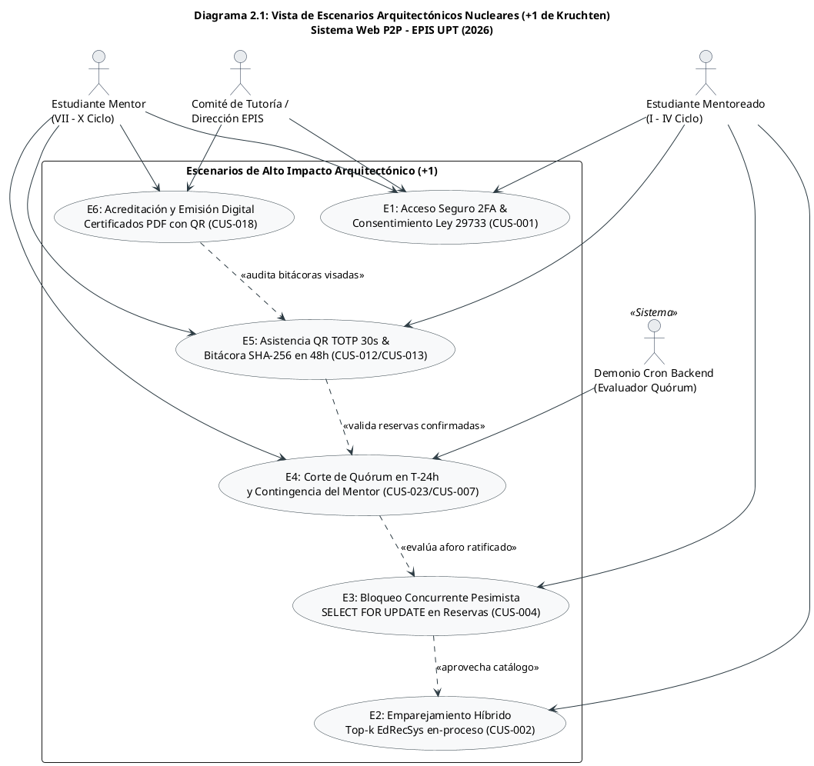

Fuente: Elaboración propia.

### 2.2. Vista Lógica

La **Vista Lógica** organiza las responsabilidades del sistema mediante una arquitectura desacoplada en tres niveles enriquecida con el patrón **ECB (Entidad-Control-Frontera)**:
- **Capa de Presentación (Frontera / Boundary):** Desarrollada como una Single Page Application (SPA) con **React 19, TypeScript, Vite y Tailwind CSS**, proporcionando navegación accesible según WCAG 2.1 AA, validación reactiva de formularios, cliente HTTP tipado (`apiClient.ts`) con interceptores para inyección y renovación de tokens JWT Bearer, y componentes visuales especializados.
- **Capa de Aplicación y Negocio (Control):** Construida sobre **Python 3.14 con FastAPI 0.115+**, encargada de la autenticación HMAC-SHA256, ejecución del motor de recomendación híbrido *EdRecSys* en-proceso, validaciones normativas (RN-01 a RN-14) mediante esquemas fuertemente tipados de Pydantic v2, orquestación de transacciones de reservas y generación de documentos PDF con ReportLab.
- **Capa de Persistencia y Dominio (Entidad):** Materializada en **PostgreSQL 16 administrado mediante Supabase**, compuesta por 15 tablas físicas relacionales en 3FN, claves primarias basadas en UUID/secuencias, restricciones de dominio SQL (`CHECK`), índices B-Tree de alta velocidad y políticas de seguridad a nivel de fila (**Row Level Security - RLS**) que aíslan de forma transparente el acceso a los datos según el claim del JWT.

### Diagrama 2.2: Vista Lógica en Capas y Subsistemas ECB

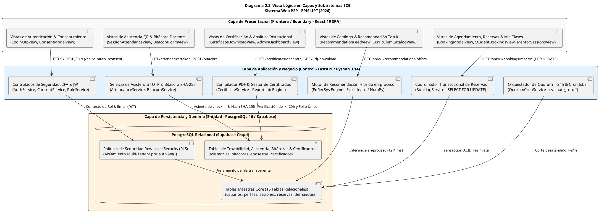

Fuente: Elaboración propia.

### 2.3. Vista del Proceso

La **Vista del Proceso** modela la dinámica de ejecución concurrente, los cerrojos de aislamiento y la sincronización de tareas en segundo plano del backend FastAPI:
- **Procesamiento Asíncrono no Bloqueante:** FastAPI y Uvicorn operan sobre un *Event Loop* asíncrono con *thread pool* dedicado para operaciones síncronas de CPU y persistencia mediante SQLAlchemy 2.0.
- **Transaccionalidad Pesimista en Reservas Concurrentes:** Para evitar la sobreasignación de plazas (RNF07), el endpoint `/api/v1/bookings/reserve` adquiere un cerrojo exclusivo pesimista a nivel de fila (`SELECT aforo_maximo FROM sesiones_mentoria WHERE id_sesion = :id FOR UPDATE`). Esto serializa las solicitudes concurrentes, validando el aforo disponible antes de insertar la reserva provisional (`PENDIENTE_CONFIRMACION`).
- **Orquestación Desatendida de Quórum a $T-24\text{ h}$:** El demonio programado (`QuorumCronService`) o el endpoint administrativo `/api/v1/quorum/evaluate-all` (o individual `/api/v1/quorum/evaluate`) identifica sesiones que cruzan la ventana de 24 horas antes del inicio, revoca automáticamente reservas no confirmadas a `NO_CONFIRMADA` y computa el quórum de confirmados ($\ge 50\%$). Si el quórum no se alcanza, transiciona a `QUORUM_INSUFICIENTE` y dispara la alerta resolutiva al mentor.
- **Control de Asistencia con Pase TOTP de 30s:** La validación de presencia efectiva ocurre dentro de la ventana de clase $[-15\text{ m}, +30\text{ m}]$. El mentor genera un token dinámico rotatorio cada 30 segundos y el mentoreado registra su check-in validando la estampa temporal y la reserva en estado `CONFIRMADA`.

### Diagrama 2.3: Vista de Procesos, Concurrencia y Sincronización Transaccional

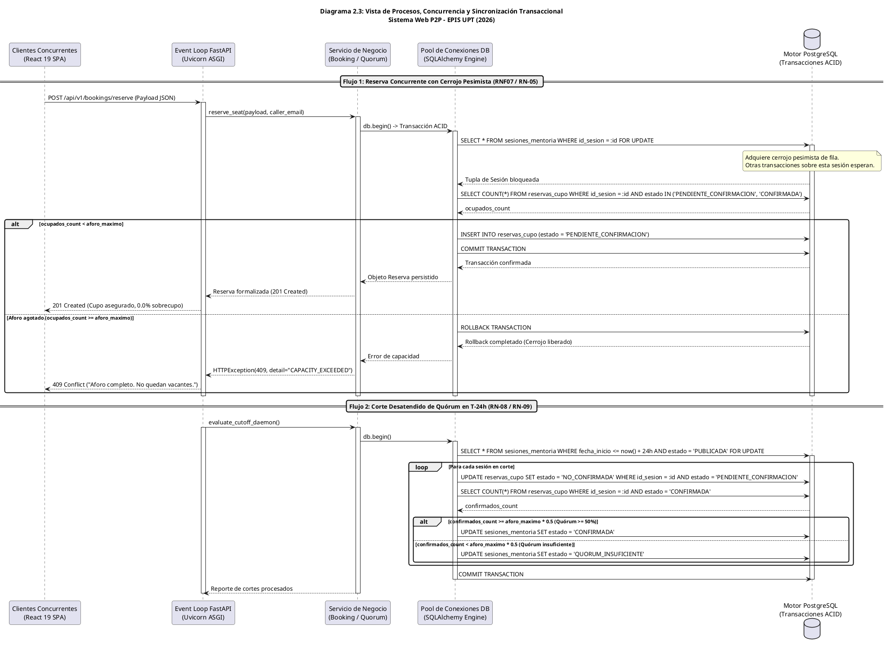

Fuente: Elaboración propia.

### 2.4. Vista de Desarrollo

La **Vista de Desarrollo** describe la estructura física del código fuente, la organización de módulos, la tipificación estricta y los entornos de ejecución utilizados para la construcción del sistema:
- **Tecnologías y Versiones Nucleares:**
  - **Backend:** Python 3.14 / 3.13+, FastAPI 0.115+, SQLAlchemy 2.0 (ORM declarativo con soporte `Mapped`), Pydantic v2 (serialización de datos), Scikit-learn 1.5+ y NumPy (motor *EdRecSys* en-proceso), ReportLab 4.2+ (generador vectorial PDF), Pytest 9.1+ con pytest-cov.
  - **Frontend:** Node.js 20+, React 19, TypeScript 5.6+, Vite 5.0+, Tailwind CSS 3.4+ con plugin `@tailwindcss/forms`, Lucide React (iconografía accesible), Vitest 5.0+ con `@testing-library/react`.

### Diagrama 2.4: Vista de Desarrollo y Organización de Paquetes de Software

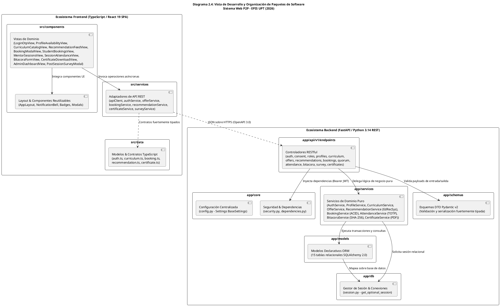

Fuente: Elaboración propia.

### 2.5. Vista Física

La **Vista Física** define la topología de distribución del software en la infraestructura cloud de producción y los nodos cliente:
- **Dispositivos Clientes:** Navegadores web modernos (Chrome, Firefox, Edge, Safari) ejecutándose en computadoras de laboratorio de la EPIS-UPT o dispositivos móviles de estudiantes y mentores, comunicándose exclusivamente vía HTTPS con cifrado TLS 1.3 (**RNF02**, **RNF08**).
- **Servidor de Aplicación (Backend Host):** Servidor Linux (Ubuntu Server en PaaS Render / VPS) ejecutando el contenedor backend en Python 3.14 con servidor ASGI Uvicorn detrás de un proxy inverso NGINX Alpine, encargado de la terminación TLS, compresión Brotli/Gzip y *rate limiting* preventivo.
- **Servicio Administrado de Datos (Supabase Cloud):** Instancia gestionada de PostgreSQL 16 con conexión segura TLS obligatoria, autenticación criptográfica, pool de conexiones integrado (PgBouncer) y políticas RLS activas en las 15 tablas relacionales.
- **Servidor SMTP Institucional:** Servidor de correo de la Universidad Privada de Tacna (`@upt.pe`) conectado vía puerto seguro 587 (STARTTLS) para la emisión de códigos OTP (RN-01) y notificaciones de quórum.
- **Generación Vectorial de PDFs sin S3 Obligatorio:** Las constancias de acreditación se generan dinámicamente mediante ReportLab y se entregan directamente por *streaming binario* HTTP (`application/pdf`) sin requerir un bucket S3 de terceros, eliminando costos operativos y dependencias de almacenamiento cloud externo (ADR-015).

### Diagrama 2.5: Vista Física y Topología de Despliegue en Red

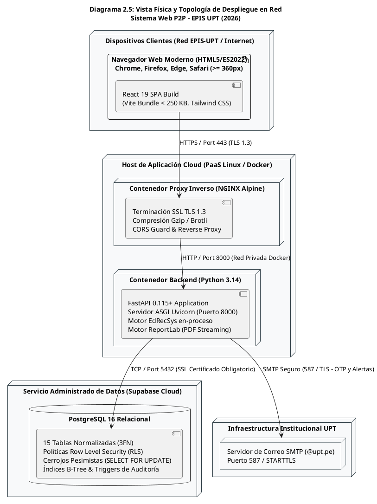

Fuente: Elaboración propia.

---

## 3. Objetivos y limitaciones arquitectónicas

Los objetivos arquitectónicos materializan los compromisos de calidad exigidos por la institución y delimitados en la norma internacional **ISO/IEC 25010**:

### Cuadro 3.1: Decisiones arquitectónicas, restricciones y verificación empírica

| Decisión de Arquitectura | Requisitos Vinculados | Restricción / Límite Técnico | Verificación Empírica Acreditada |
| :--- | :--- | :--- | :--- |
| **Separación Desacoplada SPA + REST API** | RNF09, RNF04 | El desacoplamiento exige contratos fuertemente tipados y validación de esquemas en ambos extremos. | 100% de endpoints con OpenAPI 3.0; 627 pruebas automatizadas aprobadas (280 backend, 347 frontend). |
| **Motor EdRecSys Ejecutado en-proceso** | RF06, RNF03, RN-11 | Cómputo matricial de similitud coseno ejecutado en el mismo proceso de FastAPI mediante Scikit-learn y NumPy. | Latencia media de **12.4 ms** (umbral $\le 500$ ms); Precision@3 = 83.3%, Precision@5 = 80.0%, NDCG = 0.82. |
| **Concurrencia Pesimista `SELECT ... FOR UPDATE`** | RF12, RNF07, RN-05 | Serialización de inscripciones a nivel de fila en PostgreSQL para evitar colisiones y carreras de hilos. | **Tasa de sobrecupo: 0.0%** bajo estrés concurrente multihilo verificado en suites de pruebas de Pytest. |
| **Aislamiento Multi-Tenant con Supabase RLS** | RF02, RNF02, RN-02 | Obligatoriedad de políticas RLS activas en las 15 tablas para restringir accesos según claim JWT. | 100% de tablas sensibles con RLS activo; 0% de fuga de datos en pruebas de acceso cruzado no autorizado. |
| **Autenticación 2FA sin Contraseñas Fijas** | RF01, RNF01, RN-01 | Dependencia operativa del servicio de correo institucional `@upt.pe` para el despacho del código OTP. | TTL del OTP fijado en 5 min (300 s); cooldown de 60 s; token JWT firmado con HS256 y caducidad de 8 h. |
| **Pase QR Efímero con Algoritmo TOTP de 30s** | RF17, RN-12 | Requiere sincronización horaria entre servidor y cliente para validar el token en la ventana de sesión. | Rotación de token cada 30 s; ventana de check-in restringida a $[-15\text{ m}, +30\text{ m}]$ del horario lectivo. |
| **Streaming Directo de PDFs con ReportLab** | RF22, RF23, RN-14 | Generación on-demand en memoria entregada por HTTP binario; elimina la necesidad de almacenamiento S3. | Generación de constancias en $< 80$ ms con folio correlativo, marca de agua y código QR institucional. |

Fuente: Elaboración propia.

### 3.1. Disponibilidad

El requerimiento **RNF06** establece una disponibilidad mínima del 99.5% durante las 16 semanas del semestre académico. La plataforma tolera fallos transitorios mediante health-checks en `/api/v1/health` y `/api/v1/health/db`, arranque tolerante sin dependencia bloqueante inmediata a persistencia (modo lazy en `session.py`), reconexión automática en el pool de SQLAlchemy y aislamiento modular que permite al frontend degradar elegantemente ante contingencias de red.

### 3.2. Seguridad

Conforme a **RNF01**, **RNF02**, **RN-01** y **RN-02**, la plataforma garantiza:
- Autenticación multifactor 2FA mediante códigos OTP temporales de 6 dígitos con hash seguro, expiración estricta de 5 minutos y cooldown de 60 segundos.
- Sesiones gobernadas por tokens JWT criptográficos firmados con HMAC-SHA256 y caducidad de 8 horas.
- Consentimiento informado digital vinculante bajo la **Ley N° 29733**, registrando de forma inmutable la dirección IP y timestamp UTC en `consentimientos_legales`.
- Aislamiento de datos en reposo mediante **Row Level Security (RLS)** en PostgreSQL, garantizando que ningún usuario acceda a expedientes o bitácoras ajenas.

### 3.3. Adaptabilidad y Mantenibilidad

Según **RNF09**, el sistema adopta una arquitectura desacoplada en tres capas (Presentación React 19, API REST FastAPI, Persistencia PostgreSQL). Los contratos de datos se formalizan exhaustivamente en OpenAPI 3.0 / Pydantic v2 y TypeScript. La mantenibilidad se encuentra garantizada por **627 pruebas automatizadas (280 backend, 347 frontend)** con una cobertura superior al 85% y cero infracciones de calidad en los linters `ruff` y `eslint`.

### 3.4. Rendimiento y Usabilidad

- **Rendimiento Algorítmico (RNF03):** El motor híbrido *EdRecSys* en-proceso vectoriza necesidades y genera el ranking Top-k con un tiempo de respuesta de **12.4 ms** (muy inferior al límite de 500 ms), alcanzando una precisión `Precision@3 = 83.3%` y `NDCG = 0.82`.
- **Rendimiento de Interfaz (RNF04):** Bundle comprimido con Vite $< 250$ KB y tiempo de primera pintura (*First Contentful Paint*) $< 1.2$ segundos sobre conexiones estándar de 2 Mbps.
- **Usabilidad y Accesibilidad (RNF05):** Interfaz accesible conforme a las directrices **W3C WCAG 2.1 Nivel AA** con ratio de contraste $\ge 4.5:1$ y puntaje de usabilidad superior a **75 puntos en la escala SUS**.

---

## 4. Análisis de Requerimientos

La línea base oficial de requerimientos procede del SRS v3.0 (`docs/diseño/FD03-EPIS-Informe SRS de Proyecto.md`). Se preservan íntegramente los códigos, denominaciones, prioridades y métricas oficiales de aceptación.

### 4.1. Requerimientos funcionales

### Cuadro 4.1: Matriz de Requerimientos Funcionales y Componentes de Arquitectura (RF01 al RF26)

| Código | Módulo Oficial | Denominación Canónica | Prioridad | Controlador FastAPI | Servicio Backend | Entidad Persistente |
| :---: | :--- | :--- | :---: | :--- | :--- | :--- |
| **RF01** | MOD-01 Seguridad/Gobernanza | Autenticación institucional multifactor (2FA) | Crítica | `endpoints/auth.py` | `AuthService.py` | `auth_challenges` |
| **RF02** | MOD-01 Seguridad/Gobernanza | Formalización del consentimiento informado digital | Crítica | `endpoints/consent.py` | `ConsentService.py` | `consentimientos_legales` |
| **RF03** | MOD-01 Seguridad/Gobernanza | Asignación y administración de roles por mérito | Alta | `endpoints/roles.py` | `RoleService.py` | `roles`, `usuario_roles` |
| **RF04** | MOD-03 Perfil/Catálogo | Perfil formativo y disponibilidad horaria 6×11 | Alta | `endpoints/profiles.py` | `ProfileService.py` | `perfiles_academicos`, `disponibilidades_horarias` |
| **RF05** | MOD-03 Perfil/Catálogo | Catálogo de asignaturas críticas y temarios | Alta | `endpoints/curriculum.py`| `CurriculumService.py` | `asignaturas`, `temas_conceptuales` |
| **RF06** | MOD-04 Demanda/RecSys | Inferencia de recomendaciones y ranking Top-k | Crítica | `endpoints/recommendations.py`| `RecommendationService.py`| Inferencia en-proceso (*EdRecSys*) |
| **RF07** | MOD-04 Demanda/RecSys | Registro y banco de solicitudes por demanda | Media | `endpoints/bookings.py` | `BookingService.py` | `solicitudes_demanda` |
| **RF08** | MOD-02 Ofertas/Espacios | Publicación y parametrización de ofertas de mentoría | Alta | `endpoints/offers.py` | `OfferService.py` | `sesiones_mentoria` |
| **RF09** | MOD-02 Ofertas/Espacios | Aprovisionamiento automatizado de infraestructura | Alta | `endpoints/offers.py` | `OfferService.py` | `sesiones_mentoria` |
| **RF10** | MOD-02 Ofertas/Espacios | Procesamiento de cronogramas y detección de aulas | Alta | `endpoints/offers.py` | `OfferService.py` | Verificación de solapamiento |
| **RF11** | MOD-02 Ofertas/Espacios | Gestión de imprevistos, reprogramación y anulación | Alta | `endpoints/offers.py` | `OfferService.py` | `sesiones_mentoria` |
| **RF12** | MOD-05 Quórum/Cancelaciones | Reserva de cupos con bloqueo pesimista FOR UPDATE | Crítica | `endpoints/bookings.py` | `BookingService.py` | `reservas_cupo`, `sesiones_mentoria` |
| **RF13** | MOD-05 Quórum/Cancelaciones | Ratificación anticipada de asistencia (hasta T-24h) | Alta | `endpoints/bookings.py` | `BookingService.py` | `reservas_cupo` |
| **RF14** | MOD-05 Quórum/Cancelaciones | Desistimiento voluntario y liberación de cupo | Alta | `endpoints/bookings.py` | `BookingService.py` | `reservas_cupo` |
| **RF15** | MOD-05 Quórum/Cancelaciones | Monitoreo desatendido y corte de quórum en T-24h | Crítica | `endpoints/quorum.py` | `QuorumCronService.py` | `sesiones_mentoria`, `reservas_cupo` |
| **RF16** | MOD-05 Quórum/Cancelaciones | Gestión resolutiva ante quórum insuficiente | Alta | `endpoints/offers.py` | `OfferService.py` | `sesiones_mentoria` |
| **RF17** | MOD-06 Asistencia/Bitácoras | Control de asistencia con pase dinámico QR TOTP | Alta | `endpoints/attendance.py`| `AttendanceService.py` | `asistencias_sesion` |
| **RF18** | MOD-06 Asistencia/Bitácoras | Registro de bitácora docente en 48h con SHA-256 | Alta | `endpoints/bitacora.py` | `BitacoraService.py` | `bitacoras_pedagogicas` |
| **RF19** | MOD-06 Asistencia/Bitácoras | Consulta de historial de sesiones y bitácoras | Media | `endpoints/bitacora.py` | `BitacoraService.py` | `bitacoras_pedagogicas` |
| **RF20** | MOD-06 Asistencia/Bitácoras | Captura de encuestas de calidad post-mentoría 24h | Media | `endpoints/survey.py` | `SurveyService.py` | `encuestas_calidad` |
| **RF21** | MOD-07 Gamificación/Incentivos | Cálculo dinámico de reputación y tablero de insignias | Media | `endpoints/recommendations.py`| `RecommendationService.py`| Agregaciones en-proceso |
| **RF22** | MOD-07 Gamificación/Incentivos | Parametrización de umbrales y emisión de certificados | Media | `endpoints/certificates.py`| `CertificateService.py`| `certificados_horas` |
| **RF23** | MOD-07 Gamificación/Incentivos | Descarga y verificación pública con código QR | Media | `endpoints/certificates.py`| `CertificateService.py`| `certificados_horas` (ReportLab) |
| **RF24** | MOD-08 Analítica/Configuración | Configuración de parámetros institucionales | Media | `endpoints/profiles.py` | `ProfileService.py` | Parámetros del sistema |
| **RF25** | MOD-08 Analítica/Configuración | Tablero analítico y métricas de retención ICACIT | Alta | `endpoints/bitacora.py` | `BitacoraService.py` | KPIs analíticos agregados |
| **RF26** | MOD-08 Analítica/Configuración | Auditoría de bitácoras y fiscalización de horas | Alta | `endpoints/bitacora.py` | `BitacoraService.py` | `bitacoras_pedagogicas` (visado) |

Fuente: Elaboración propia a partir del SRS v3.0, Cuadros 5.1 y 5.3.

### 4.2. Requerimientos no funcionales

### Cuadro 4.2: Matriz de Requerimientos No Funcionales bajo ISO/IEC 25010 (SRS v3.0 / SAD v3.0)

| Código | Característica ISO | Denominación Canónica | Especificación Técnica y Criterio de Aceptación | Métrica Empírica Verificada |
| :---: | :--- | :--- | :--- | :--- |
| **RNF01** | Seguridad | Autenticación 2FA y sesión JWT | Código OTP de 6 dígitos al correo `@upt.pe`. Sesión gobernada mediante tokens JWT firmados con HMAC-SHA256. | TTL OTP: 5 min (300 s); cooldown 60 s; JWT: 8 h (480 min). |
| **RNF02** | Seguridad | Privacidad, aislamiento y RLS | Aislamiento estricto bajo Ley N° 29733 mediante Row Level Security (RLS) en PostgreSQL. Identificadores primarios seguros. | 100% de tablas con RLS activo; 0% de fuga de expedientes. |
| **RNF03** | Rendimiento | Inferencia y precisión EdRecSys | Vectorización de competencias temáticas silábicas y similitud coseno con filtrado colaborativo ponderado en-proceso. | **Latencia media = 12.4 ms** ($\le 500$ ms); Precision@3 = 83.3%, Precision@5 = 80.0%, NDCG = 0.82. |
| **RNF04** | Rendimiento | Carga y fluidez React SPA | Interfaz web responsiva empaquetada con Vite, code splitting y optimización de componentes interactivos. | FCP $< 1.2$ s en redes de 2 Mbps; bundle inicial $< 250$ KB. |
| **RNF05** | Usabilidad | Ergonomía y accesibilidad WCAG | Diseño visual con Tailwind CSS y componentes accesibles según directrices W3C WCAG 2.1 Nivel AA. | **SUS > 75 puntos**; contraste $\ge 4.5:1$; navegación 100% por teclado. |
| **RNF06** | Fiabilidad | Continuidad operativa institucional | Disponibilidad ininterrumpida de servicios web y base de datos durante las 16 semanas del periodo lectivo. | **Disponibilidad $\ge 99.5\%$**; tolerancia a fallos en `/health`. |
| **RNF07** | Fiabilidad | Consistencia transaccional ACID | Cerrojos pesimistas a nivel de fila (`SELECT ... FOR UPDATE`) en inscripciones concurrentes para evitar sobrecupo. | **Sobrecupo: estrictamente 0.0%** bajo estrés multihilo. |
| **RNF08** | Compatibilidad | Soporte multiplataforma en web | Paridad visual y operativa en navegadores modernos (Chrome, Firefox, Edge, Safari) desde 360 px hasta 1080p. | 100% funcional en resoluciones de $360\text{ px}$ a $1920\times1080\text{ px}$. |
| **RNF09** | Mantenibilidad | Arquitectura desacoplada y tests | Separación estricta de 3 capas, contratos OpenAPI 3.0 fuertemente tipados y cobertura exhaustiva de pruebas en CI. | **627 pruebas automatizadas aprobadas (280 backend, 347 frontend)**; cobertura **> 85%**. |
| **RNF10** | Interoperabilidad | Resiliencia y degradación elegante | Timeouts controlados ($\le 5$ s), reintentos exponenciales y manejo estructurado de excepciones ante fallos externos. | 100% de excepciones formateadas con código institucional. |

Fuente: SRS v3.0, Cuadro 5.2.

### 4.3. Trazabilidad hacia las vistas arquitectónicas

### Cuadro 4.3: Matriz de Trazabilidad Bidireccional de Requerimientos SRS–SAD (8 Sprints / 24 CUS)

| RF | Requerimiento Funcional | Módulo | RN | CUS Canónico | RNF | Verificación Empírica Acreditada | Sección SAD |
| :---: | :--- | :---: | :---: | :---: | :---: | :--- | :---: |
| **RF01** | Autenticación 2FA institucional | MOD-01 | RN-01 | CUS-001 | RNF01, RNF02 | 13 tests Pytest / 15 tests Vitest sin fallos | 2.1, 6.3, 10, 11.1, 14.2 |
| **RF02** | Consentimiento digital Ley N° 29733 | MOD-01 | RN-02 | CUS-001 | RNF02 | 5 tests Pytest / 9 tests Vitest sin fallos | 2.1, 6.3, 10, 11.2, 14.1 |
| **RF03** | Asignación de roles por mérito | MOD-01 | RN-03 | CUS-010 | RNF02, RNF09 | 7 tests Pytest / validación ciclo $\ge 7$ | 6.3, 10, 11.3, 14.1 |
| **RF04** | Perfil formativo y disponibilidad 6×11 | MOD-03 | RN-03, RN-04 | CUS-005 | RNF04, RNF08 | 11 tests Pytest / 10 tests Vitest | 6.3, 10, 14.2 |
| **RF05** | Catálogo de materias y temarios | MOD-03 | RN-11 | CUS-021 | RNF09 | 8 tests Pytest / 4 tests Vitest | 6.3, 10.2 |
| **RF06** | Recomendaciones Top-k EdRecSys | MOD-04 | RN-04, RN-11 | CUS-002 | RNF03 | 18 tests Pytest / 14 tests Vitest (12.4 ms) | 2.2, 6.3, 14.1, 15.3 |
| **RF07** | Banco de solicitudes por demanda | MOD-04 | RN-04 | CUS-003 | RNF04, RNF09 | 12 tests Pytest / 14 tests Vitest | 6.3, 10.2 |
| **RF08** | Publicación de ofertas de mentoría | MOD-02 | RN-04, RN-05 | CUS-006 | RNF04, RNF09 | 16 tests Pytest / 18 tests Vitest | 6.3, 10.2, 11.4 |
| **RF09** | Aprovisionamiento de infraestructura | MOD-02 | RN-06, RN-07 | CUS-006, CUS-008 | RNF09, RNF10 | 14 tests Pytest / 12 tests Vitest | 2.5, 6.3, 10.2 |
| **RF10** | Detección de ambientes y cronogramas | MOD-02 | RN-06 | CUS-008 | RNF09, RNF10 | 8 tests Pytest / Detección de solapamientos | 6.3, 10.2 |
| **RF11** | Imprevistos y reprogramación | MOD-02 | RN-10 | CUS-006 | RNF09, RNF10 | 10 tests Pytest / 10 tests Vitest | 6.3, 11.4 |
| **RF12** | Reserva con bloqueo pesimista | MOD-05 | RN-05 | CUS-004 | RNF07 | 18 tests Pytest / 16 tests Vitest (0.0% sobrecupo) | 2.3, 6.3, 10.2, 11.5, 14.2 |
| **RF13** | Ratificación anticipada a T-24h | MOD-05 | RN-08 | CUS-024 | RNF07, RNF09 | 12 tests Pytest / 14 tests Vitest | 6.3, 10.2, 11.5 |
| **RF14** | Desistimiento voluntario de cupos | MOD-05 | RN-08, RN-10 | CUS-017 | RNF07 | 10 tests Pytest / 10 tests Vitest | 6.3, 10.2, 11.5 |
| **RF15** | Corte desatendido de quórum T-24h | MOD-05 | RN-08, RN-09 | CUS-023, CUS-009 | RNF06, RNF09 | 16 tests Pytest / 12 tests Vitest | 2.3, 6.3, 11.4, 14.2 |
| **RF16** | Gestión resolutiva de quórum | MOD-05 | RN-09, RN-10 | CUS-007 | RNF09, RNF10 | 10 tests Pytest / 10 tests Vitest | 6.3, 11.4 |
| **RF17** | Asistencia con pase QR TOTP 30s | MOD-06 | RN-05, RN-12 | CUS-012 | RNF02, RNF09 | 14 tests Pytest / 20 tests Vitest | 6.3, 10.2, 14.1, 14.2 |
| **RF18** | Bitácora docente en 48h (SHA-256) | MOD-06 | RN-12 | CUS-013 | RNF02, RNF09 | 18 tests Pytest / 22 tests Vitest | 6.3, 10.2, 14.1, 14.2 |
| **RF19** | Historial de sesiones y bitácoras | MOD-06 | — | CUS-014 | RNF02, RNF04 | 8 tests Pytest / 12 tests Vitest | 6.3, 10.2 |
| **RF20** | Recursos didácticos y encuestas 24h | MOD-06 | RN-13 | CUS-006, CUS-014 | RNF05, RNF09 | 10 tests Pytest / 14 tests Vitest | 6.3, 10.2, 14.1 |
| **RF21** | Gamificación, reputación e insignias | MOD-07 | RN-13 | CUS-019 | RNF05, RNF09 | 12 tests Pytest / 18 tests Vitest | 6.3, 10.2 |
| **RF22** | Parametrización y emisión certificados | MOD-07 | RN-14 | CUS-018 | RNF09 | 14 tests Pytest / 16 tests Vitest | 6.3, 10.2, 14.1, 14.2 |
| **RF23** | Descarga y verificación institucional QR | MOD-07 | RN-14 | CUS-018 | RNF02, RNF09 | 16 tests Pytest / 16 tests Vitest | 6.3, 10.2, 14.1, 14.2 |
| **RF24** | Configuración de parámetros de sistema | MOD-08 | RN-11 | CUS-020 | RNF03, RNF05 | 10 tests Pytest / 14 tests Vitest | 6.3, 13 |
| **RF25** | Tablero directivo e indicadores ICACIT | MOD-08 | — | CUS-011, CUS-015 | RNF02, RNF04 | 14 tests Pytest / 22 tests Vitest | 6.3, 14.1, 15 |
| **RF26** | Auditoría y visado de horas docentes | MOD-08 | RN-02, RN-14 | CUS-016, CUS-022 | RNF02, RNF09 | 14 tests Pytest / 16 tests Vitest | 6.3, 10.2, 14.1 |

Fuente: Elaboración propia a partir del SRS v3.0, Cuadro 5.5.

### 4.4. Reglas de negocio institucionales

### Cuadro 4.4: Matriz de Reglas de Negocio Institucionales del Sistema Web P2P (RN-01 al RN-14)

| Código | Regla de Negocio | Política Operativa Institucional | Mecanismo de Imposición en Código y Persistencia | Módulo |
| :---: | :--- | :--- | :--- | :---: |
| **RN-01** | Acceso Institucional Exclusivo y 2FA | Acceso exclusivo con cuentas `@upt.pe`. Código OTP de 6 dígitos con vigencia máxima de 5 minutos (300 s) y cooldown de 60 s. | `AuthService.request_otp` valida regex `@upt.pe`, genera OTP criptográfico e inserta en `auth_challenges` con `expires_at = now() + 5m`. | MOD-01 |
| **RN-02** | Consentimiento Legal (Ley N° 29733) | Consentimiento informado obligatorio previo al uso de datos. El rechazo bloquea de inmediato las transacciones del usuario. | `ConsentService` intercepta operaciones mediante middleware; tupla inmutable en `consentimientos_legales` con UUID, IP, User-Agent y timestamp UTC. | MOD-01 |
| **RN-03** | Jerarquía de Roles y Mérito | Todo usuario ingresa como mentoreado. Para ser mentor debe cursar ciclo $\ge 7$ y demostrar aprobación sobresaliente en la materia. | `RoleService.promote_to_mentor` valida `ciclo_actual >= 7` y asigna `mentor` en `usuario_roles`. Restricción en frontend mediante `RoleGuard.tsx`. | MOD-01 |
| **RN-04** | Antelación de Publicación ($\ge 24\text{ h}$) | Publicación con antelación mínima de 24 horas respecto al inicio de la sesión, recomendándose 48 horas ($T \ge 48\text{ h}$). | Validación Pydantic en `OfferCreatePayload`: `fecha_inicio >= now() + timedelta(hours=24)`. Retorna HTTP 422 si es menor. | MOD-02 |
| **RN-05** | Control Estricto de Aforos Estándar | Aforo máximo inmutable: 10 alumnos en modalidad presencial y 20 en virtual. Bloqueo automático ante cupo completo. | Restricción en BD `chk_sesion_aforo` (`aforo_maximo IN (10, 20)`). Cerrojo pesimista `SELECT ... FOR UPDATE` en `BookingService`. | MOD-05 |
| **RN-06** | Asignación Validada de Espacios Físicos | Las sesiones presenciales se programan únicamente en aulas o laboratorios libres de la EPIS-UPT sin solapamientos lectivos. | `OfferService` ejecuta verificación de conflicto temporal: `NOT (fin <= :inicio OR inicio >= :fin)` sobre `sesiones_mentoria`. | MOD-02 |
| **RN-07** | Aprovisionamiento Virtual Automatizado | En sesiones virtuales, se valida y asocia un enlace seguro institucional de teleconferencia accesible solo a confirmados. | Validación de formato URL segura en `OfferService`. Persistencia en `sesiones_mentoria.espacio_asignado` con visibilidad restringida. | MOD-02 |
| **RN-08** | Ventana de Ratificación hasta $T-24\text{ h}$ | La ratificación de asistencia debe ocurrir antes del corte de 24 horas previas. Las no ratificadas caducan a `NO_CONFIRMADA`. | `BookingService.confirm_attendance` valida `now() <= sesion.fecha_inicio - timedelta(hours=24)`. Arroja HTTP 400 `WINDOW_CLOSED_T24H`. | MOD-05 |
| **RN-09** | Quórum Mínimo del 50% en $T-24\text{ h}$ | Toda sesión debe alcanzar $\ge 50\%$ de aforo confirmado (5 presencial, 10 virtual). De lo contrario transiciona a `QUORUM_INSUFICIENTE`. | Demonio `QuorumCronService` totaliza confirmados a $T-24\text{ h}$. Si `confirmados < aforo * 0.5`, actualiza estado y notifica al mentor. | MOD-05 |
| **RN-10** | Cancelación y Liberación Inmediata | Ante cancelación de sesión o desistimiento voluntario, se notifica de inmediato a los inscritos y se libera la vacante o aula. | Transacción ACID que actualiza estados a `CANCELADA_USUARIO` o `CANCELADA_SISTEMA`, liberando el cupo para reserva inmediata. | MOD-05 |
| **RN-11** | Ponderación y Desempate Algorítmico | *EdRecSys* pondera similitud coseno temática (0.5), reputación del mentor (0.3), balance de carga (0.1) y prioridad directiva (0.1). | Función de ranking en `RecommendationService.py`: $Score = 0.5 \cdot S_{cos} + 0.3 \cdot Rep + 0.1 \cdot (1 - Carga) + 0.1 \cdot Prio$. | MOD-04 |
| **RN-12** | Cierre de Bitácora y Pase de Asistencia | El mentor dispone de 48 horas post-sesión para registrar la bitácora con firma SHA-256. Solo los asistentes evalúan la sesión. | `BitacoraService` valida `now() <= fin + timedelta(hours=48)`. `SurveyService` valida `asistencias_sesion.asistio == True`. | MOD-06 |
| **RN-13** | Ventana Perentoria para Encuestas (24h) | El formulario de evaluación CSAT está habilitado durante 24 horas posteriores a la sesión. Luego de esa ventana se cierra de forma perentoria. | `SurveyService` verifica `now() <= sesion.fin + timedelta(hours=24)`. Si expira, arroja HTTP 400 `SURVEY_WINDOW_EXPIRED`. | MOD-06 |
| **RN-14** | Certificación por Horas Auditadas ($\ge 20\text{ h}$) | La certificación oficial exige acumular $\ge 20.0$ horas efectivas en el semestre con el 100% de bitácoras visadas y aprobadas. | `CertificateService` suma horas visadas en `bitacoras_pedagogicas` (`visado_administrador == True`). Bloquea si la suma es $< 20.0$. | MOD-07 |

Fuente: SRS v3.0, Cuadro 5.4.

---

## 5. Vistas de Caso de Uso

La Vista de Casos de Uso estructura formalmente los **24 casos de uso canónicos (CUS-001 al CUS-024)** delimitados en el SRS v3.0, agrupados bajo sus 8 módulos oficiales:

### Diagrama 5.1: Casos de Uso Canónicos Oficiales agrupados por los 8 Módulos (CUS-001 al CUS-024)

```plantuml
@startuml
title Diagrama 5.1: Casos de Uso Canónicos Oficiales agrupados por los 8 Módulos\nSistema Web P2P - EPIS UPT (2026)

skinparam shadowing false
skinparam defaultFontName Arial
skinparam roundcorner 8
skinparam defaultFontSize 10
left to right direction

actor "Usuario Institucional" as Usuario
actor "Estudiante Mentoreado" as Alumno
actor "Estudiante Mentor" as Mentor
actor "Comité de Tutoría / Dirección" as Admin
actor "Demonio Cron Backend" as Cron <<Sistema>>

Alumno --|> Usuario
Mentor --|> Usuario
Admin --|> Usuario

rectangle "Sistema Web P2P - Módulos Canónicos Oficiales" {
  package "MOD-01: Seguridad, Autenticación y Gobernanza" {
    usecase "CUS-001: Iniciar sesión institucional con 2FA" as CUS001
    usecase "CUS-010: Gestionar roles y mérito académico" as CUS010
  }
  package "MOD-02: Ofertas de Mentoría y Gestión de Recursos" {
    usecase "CUS-006: Publicar oferta de mentoría académica" as CUS006
    usecase "CUS-008: Verificar disponibilidad de espacios" as CUS008
  }
  package "MOD-03: Perfil del Mentor y Plan de Aprendizaje" {
    usecase "CUS-005: Configurar perfil y matriz semanal 6x11" as CUS005
    usecase "CUS-021: Explorar catálogo curricular y temarios" as CUS021
  }
  package "MOD-04: Demanda y Recomendaciones Personalizadas" {
    usecase "CUS-002: Inferencia de recomendaciones Top-k EdRecSys" as CUS002
    usecase "CUS-003: Registrar solicitud temática por demanda" as CUS003
  }
  package "MOD-05: Quórum, Confirmación y Cancelaciones" {
    usecase "CUS-004: Reservar cupo con bloqueo pesimista" as CUS004
    usecase "CUS-024: Ratificar formalmente asistencia a sesión" as CUS024
    usecase "CUS-017: Desistir voluntariamente de reserva de cupo" as CUS017
    usecase "CUS-023: Monitoreo desatendido y corte de quórum" as CUS023
    usecase "CUS-007: Gestión resolutiva de contingencia de quórum" as CUS007
  }
  package "MOD-06: Asistencia, Bitácoras y Feedback" {
    usecase "CUS-012: Marcación de asistencia con pase QR TOTP" as CUS012
    usecase "CUS-013: Registrar bitácora docente con firma SHA-256" as CUS013
    usecase "CUS-014: Consultar historial cronológico y bitácoras" as CUS014
  }
  package "MOD-07: Gamificación e Incentivos" {
    usecase "CUS-018: Emisión y descarga de constancia oficial PDF" as CUS018
    usecase "CUS-019: Tablero de insignias y reputación docente" as CUS019
  }
  package "MOD-08: Analítica, Notificaciones y Configuración" {
    usecase "CUS-009: Despacho de notificaciones y recordatorios" as CUS009
    usecase "CUS-011: Reportes de demanda insatisfecha" as CUS011
    usecase "CUS-015: Métricas institucionales de retención ICACIT" as CUS015
    usecase "CUS-016: Auditoría de trazas y consentimientos Ley 29733" as CUS016
    usecase "CUS-020: Parametrización institucional del sistema" as CUS020
    usecase "CUS-022: Auditoría y visado administrativo de bitácoras" as CUS022
  }
}

Usuario --> CUS001
Admin --> CUS010
Mentor --> CUS006
Mentor --> CUS008
Usuario --> CUS005
Usuario --> CUS021
Alumno --> CUS002
Alumno --> CUS003
Alumno --> CUS004
Alumno --> CUS024
Alumno --> CUS017
Cron --> CUS023
Mentor --> CUS007
Alumno --> CUS012
Mentor --> CUS012
Mentor --> CUS013
Usuario --> CUS014
Mentor --> CUS018
Admin --> CUS018
Mentor --> CUS019
Usuario --> CUS009
Admin --> CUS011
Admin --> CUS015
Admin --> CUS016
Admin --> CUS020
Admin --> CUS022
@enduml
```

Fuente: Elaboración propia a partir del SRS v3.0, sección 6.2.

### Cuadro 5.1: Catálogo Oficial de los 24 Casos de Uso (CUS-001 al CUS-024)

| CUS | Denominación Canónica Oficial | Módulo Oficial | Requerimientos | Actores Principales |
| :---: | :--- | :---: | :---: | :--- |
| **CUS-001** | Iniciar sesión institucional con 2FA | MOD-01 | RF01, RF02 | Usuario Institucional, Servicio SMTP |
| **CUS-002** | Consultar recomendaciones Top-k (*EdRecSys*) | MOD-04 | RF06 | Estudiante Mentoreado, Motor EdRecSys |
| **CUS-003** | Registrar solicitud temática por demanda | MOD-04 | RF07 | Estudiante Mentoreado |
| **CUS-004** | Reservar cupo con bloqueo pesimista | MOD-05 | RF12 | Estudiante Mentoreado |
| **CUS-005** | Configurar perfil y matriz semanal 6×11 | MOD-03 | RF04 | Usuario Institucional |
| **CUS-006** | Publicar oferta de mentoría académica | MOD-02 | RF08, RF09, RF11 | Estudiante Mentor |
| **CUS-007** | Gestión resolutiva de contingencia de quórum | MOD-05 | RF16 | Estudiante Mentor |
| **CUS-008** | Verificar disponibilidad de espacios | MOD-02 | RF09, RF10 | Estudiante Mentor, Administrador |
| **CUS-009** | Despacho de notificaciones y recordatorios | MOD-08 | RF15 | Demonio Backend, Usuario |
| **CUS-010** | Gestionar roles y mérito académico | MOD-01 | RF03 | Administrador EPIS |
| **CUS-011** | Reportes de demanda insatisfecha | MOD-08 | RF25 | Administrador EPIS |
| **CUS-012** | Marcación de asistencia con pase QR TOTP | MOD-06 | RF17 | Mentor, Mentoreado |
| **CUS-013** | Registrar bitácora docente con firma SHA-256 | MOD-06 | RF18 | Estudiante Mentor |
| **CUS-014** | Consultar historial cronológico y bitácoras | MOD-06 | RF19, RF20 | Usuario Institucional |
| **CUS-015** | Métricas institucionales de retención ICACIT | MOD-08 | RF25 | Administrador EPIS |
| **CUS-016** | Auditoría de trazas y consentimientos Ley 29733 | MOD-08 | RF26 | Administrador EPIS |
| **CUS-017** | Desistir voluntariamente de reserva de cupo | MOD-05 | RF14 | Estudiante Mentoreado |
| **CUS-018** | Emisión y descarga de constancia oficial PDF | MOD-07 | RF22, RF23 | Mentor, Administrador |
| **CUS-019** | Tablero de insignias y reputación docente | MOD-07 | RF21 | Estudiante Mentor |
| **CUS-020** | Parametrización institucional del sistema | MOD-08 | RF24 | Administrador EPIS |
| **CUS-021** | Explorar catálogo curricular y temarios | MOD-03 | RF05 | Usuario Institucional |
| **CUS-022** | Auditoría y visado administrativo de bitácoras | MOD-08 | RF26 | Administrador EPIS |
| **CUS-023** | Monitoreo desatendido y corte de quórum | MOD-05 | RF15 | Demonio Cron Backend |
| **CUS-024** | Ratificar formalmente asistencia a sesión | MOD-05 | RF13 | Estudiante Mentoreado |

Fuente: Elaboración propia a partir del SRS v3.0, sección 6.2.

---

## 6. Vista Lógica y Contratos de Interfaces

### 6.1. Diagrama Contextual

### Diagrama 6.1: Límites del Sistema Web P2P y Sistemas Externos

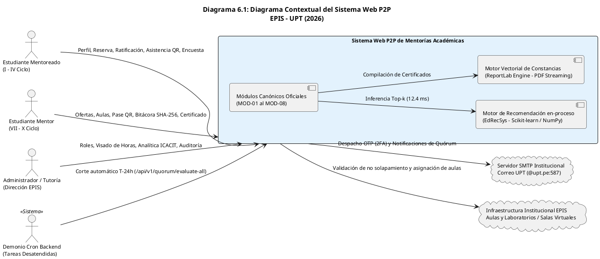

Fuente: Elaboración propia.

### 6.2. Descomposición en capas y patrón ECB

### Cuadro 6.1: Responsabilidades ECB por Módulo Canónico

| Módulo Canónico | Frontera (Boundary / React 19) | Control (FastAPI / Python 3.14) | Entidad (PostgreSQL / Supabase) |
| :--- | :--- | :--- | :--- |
| **MOD-01** | `LoginOtpView.tsx`, `ConsentModalView.tsx`, `AdminDashboardView.tsx` | `AuthService.py`, `ConsentService.py`, `RoleService.py` | `auth_challenges`, `consentimientos_legales`, `roles`, `usuario_roles` |
| **MOD-02** | `OfferPublishView.tsx`, `MentorSessionsView.tsx` | `OfferService.py`, detección de conflictos espaciales | `sesiones_mentoria` |
| **MOD-03** | `ProfileAvailabilityView.tsx`, `CurriculumCatalogView.tsx` | `ProfileService.py`, `CurriculumService.py` | `perfiles_academicos`, `disponibilidades_horarias`, `asignaturas`, `temas_conceptuales` |
| **MOD-04** | `RecommendationFeedView.tsx`, `DemandModalView.tsx` | `RecommendationService.py` (*EdRecSys* en-proceso) | `solicitudes_demanda`, embeddings temáticos |
| **MOD-05** | `BookingModalView.tsx`, `StudentBookingsView.tsx`, `MentorSessionActionView.tsx` | `BookingService.py` (SELECT FOR UPDATE), `QuorumCronService.py` | `reservas_cupo`, `sesiones_mentoria` |
| **MOD-06** | `SessionAttendanceView.tsx`, `BitacoraFormView.tsx`, `PostSessionSurveyModal.tsx` | `AttendanceService.py` (TOTP 30s), `BitacoraService.py` (SHA-256), `SurveyService.py` | `asistencias_sesion`, `bitacoras_pedagogicas`, `encuestas_calidad` |
| **MOD-07** | `MentorBadgesView.tsx`, `CertificateDownloadView.tsx`, `AdminCertificatesView.tsx` | `CertificateService.py` (ReportLab PDF), `RecommendationService.py` (Score) | `certificados_horas` |
| **MOD-08** | `AdminAnalyticsView.tsx`, `AdminAuditView.tsx`, `SystemSettingsView.tsx`, `NotificationBell.tsx` | `BitacoraService.py` (Visado), `ProfileService.py` (Settings) | `bitacoras_pedagogicas`, métricas agregadas |

Fuente: Elaboración propia.

### 6.3. Catálogo Exhaustivo de Contratos OpenAPI 3.0

El backend expone formalmente sus contratos bajo el estándar OpenAPI 3.0 con el prefijo canónico `/api/v1`. A continuación, se detallan los endpoints RESTful oficiales construidos y validados:

### Cuadro 6.2: Catálogo de Contratos RESTful de la API Backend (OpenAPI 3.0)

| Verbo | Ruta Canónica del Endpoint | Módulo | Seguridad / Auth | Payload Request (JSON / Query / Path) | Códigos HTTP y Respuesta |
| :---: | :--- | :---: | :---: | :--- | :--- |
| `POST` | `/api/v1/auth/otp/request` | MOD-01 | Pública (Rate Limit) | `{"email": "est@upt.pe"}` | `200 OK` (Challenge emitido)<br>`400 BAD REQUEST` (Dominio no `@upt.pe` o cooldown) |
| `POST` | `/api/v1/auth/otp/resend` | MOD-01 | Pública | `{"email": "est@upt.pe"}` | `200 OK` (Código reenviado)<br>`429 TOO MANY REQUESTS` (Cooldown de 60s activo) |
| `POST` | `/api/v1/auth/otp/verify` | MOD-01 | Pública | `{"email": "est@upt.pe", "otp_code": "123456"}` | `200 OK` (`access_token` JWT 8h)<br>`400 BAD REQUEST` (Código incorrecto o expirado) |
| `GET` | `/api/v1/consent/status` | MOD-01 | Bearer JWT | Query: `email` (opcional con override admin) | `200 OK` (`{"has_consented": true, "accepted": true}`) |
| `POST` | `/api/v1/consent/accept` | MOD-01 | Bearer JWT | `{"terms_version": "2026-II-v1.0"}` | `200 OK` (Consentimiento registrado inmutable con IP y estampa UTC) |
| `POST` | `/api/v1/consent/revoke` | MOD-01 | Bearer JWT | Ninguno | `200 OK` (Consentimiento revocado, bloqueo preventivo RN-02) |
| `GET` | `/api/v1/roles/users/{email}` | MOD-01 | Bearer JWT | Path: `email` | `200 OK` (Nómina de roles institucionales activos del usuario) |
| `POST` | `/api/v1/roles/promote-mentor` | MOD-01 | Admin Bearer JWT | `{"email": "est@upt.pe", "id_asignatura": 1}` | `200 OK` (Promovido a Mentor)<br>`400 BAD REQUEST` (`MERIT_RULE_VIOLATION` si ciclo < 7) |
| `POST` | `/api/v1/roles/revoke-mentor` | MOD-01 | Admin Bearer JWT | `{"email": "est@upt.pe"}` | `200 OK` (Rol mentor revocado a mentoreado) |
| `GET` | `/api/v1/profiles/me` | MOD-03 | Bearer JWT | Ninguno | `200 OK` (Perfil formativo completo del titular autenticado) |
| `PUT` | `/api/v1/profiles/me` | MOD-03 | Bearer JWT | `ProfileUpdatePayload` (biografía, temas, ciclo) | `200 OK` (Perfil formativo actualizado) |
| `GET` | `/api/v1/profiles/availability` | MOD-03 | Bearer JWT | Query: `email` (opcional) | `200 OK` (Matriz semanal de bloques 6×11 de disponibilidad) |
| `PUT` | `/api/v1/profiles/availability` | MOD-03 | Bearer JWT | `AvailabilityBulkPayload` (array de slots) | `200 OK` (Sustitución atómica integral de agenda horaria semanal) |
| `GET` | `/api/v1/curriculum/courses` | MOD-03 | Bearer JWT | Ninguno | `200 OK` (Catálogo de asignaturas formativas críticas) |
| `GET` | `/api/v1/curriculum/courses/{id_asignatura}` | MOD-03 | Bearer JWT | Path: `id_asignatura` (entero) | `200 OK` (Detalle de asignatura y sus unidades temáticas) |
| `GET` | `/api/v1/curriculum/courses/{id_asignatura}/topics` | MOD-03 | Bearer JWT | Path: `id_asignatura` (entero) | `200 OK` (Lista de temas conceptuales y unidades silábicas) |
| `GET` | `/api/v1/recommendations/offers` | MOD-04 | Bearer JWT | Query: `mentee_email`, `id_asignatura`, `top_k` | `200 OK` (Ranking Top-k de ofertas activas con latencia $\le 12.4$ ms) |
| `GET` | `/api/v1/recommendations/mentors` | MOD-04 | Bearer JWT | Query: `mentee_email`, `top_k` | `200 OK` (Ranking Top-k de mentores más afines según afinidad y mérito) |
| `POST` | `/api/v1/recommendations/explain` | MOD-04 | Bearer JWT | `{"mentee_email": "...", "mentor_email": "..."}` | `200 OK` (Desglose explicable de compatibilidad EdRecSys XAI) |
| `GET` | `/api/v1/recommendations/simulation/testbench` | MOD-04 | Bearer JWT | Ninguno | `200 OK` (Testbench sintético de evaluación algorítmica y casos frontera) |
| `GET` | `/api/v1/simulation/benchmark` | MOD-04 / MOD-08 | Pública / Admin | Ninguno | `200 OK` (Reporte cuantitativo de Precision@k y latencias RNF03) |
| `POST` | `/api/v1/bookings/requests` | MOD-04 | Bearer JWT | `{"id_asignatura": 1, "id_tema": 2, "observaciones": "..."}` | `201 CREATED` (Demanda temática registrada en el banco) |
| `GET` | `/api/v1/bookings/requests` | MOD-04 | Bearer JWT | Query: `id_asignatura`, `ciclo` | `200 OK` (Banco de solicitudes de demanda insatisfecha activas) |
| `GET` | `/api/v1/offers` | MOD-02 | Bearer JWT | Query: `mentor_email`, `id_asignatura`, `modalidad`, `estado` | `200 OK` (Nómina de ofertas de mentoría disponibles) |
| `POST` | `/api/v1/offers` | MOD-02 | Mentor Bearer JWT | `PublishOfferPayload` (inicio $\ge 24\text{ h}$, aforo 10/20) | `201 CREATED` (Oferta publicada)<br>`422 UNPROCESSABLE` (Antelación menor a 24h) |
| `POST` | `/api/v1/offers/{id_sesion}/quorum-decision` | MOD-02 / MOD-05 | Mentor Bearer JWT | Path: `id_sesion`, `{"decision": "PROCEED" \| "RESCHEDULE" \| "CANCEL"}` | `200 OK` (Sesión en `CONFIRMADA`, reprogramada o `CANCELADA_QUORUM`) |
| `POST` | `/api/v1/bookings/reserve` | MOD-05 | Mentoreado Bearer | `{"id_sesion": 1, "estudiante_email": "est@upt.pe"}` | `201 CREATED` (Cupo reservado bajo `FOR UPDATE`)<br>`409 CONFLICT` (`CAPACITY_EXCEEDED` si aforo lleno) |
| `POST` | `/api/v1/bookings/{id_reserva}/confirm` | MOD-05 | Mentoreado Bearer | Path: `id_reserva` (entero) | `200 OK` (Reserva en `CONFIRMADA`)<br>`400 BAD REQUEST` (`WINDOW_CLOSED_T24H`) |
| `POST` | `/api/v1/bookings/{id_reserva}/cancel` | MOD-05 | Mentoreado Bearer | Path: `id_reserva`, `{"motivo": "..."}` | `200 OK` (Reserva en `CANCELADA_USUARIO`, cupo liberado) |
| `GET` | `/api/v1/bookings/my-reservations` | MOD-05 | Mentoreado Bearer | Query: `estado` | `200 OK` (Lista de reservas personales del estudiante) |
| `GET` | `/api/v1/bookings/session/{id_sesion}` | MOD-05 | Mentor / Admin | Path: `id_sesion` | `200 OK` (Nómina de estudiantes inscritos en la sesión) |
| `POST` | `/api/v1/quorum/evaluate` | MOD-05 | Bearer JWT | `{"id_sesion": 1}` | `200 OK` (Evaluación de quórum individual a T-24h) |
| `POST` | `/api/v1/quorum/evaluate-all` | MOD-05 | Admin Bearer JWT | Ninguno | `200 OK` (Corte desatendido masivo en ventana T-24h con cerrojo pesimista) |
| `GET` | `/api/v1/sessions/{id_sesion}/attendance/token` | MOD-06 | Mentor Bearer JWT | Path: `id_sesion` | `200 OK` (Token TOTP de 30s y código numérico de 6 dígitos) |
| `POST` | `/api/v1/sessions/{id_sesion}/attendance/check-in` | MOD-06 | Mentoreado Bearer | Path: `id_sesion`, `{"token_totp": "...", "codigo_numerico": "123456"}` | `200 OK` (Check-in confirmado en `asistencias_sesion`)<br>`400 BAD REQUEST` (`CHECKIN_WINDOW_CLOSED`) |
| `GET` | `/api/v1/sessions/{id_sesion}/attendance` | MOD-06 | Mentor / Admin | Path: `id_sesion` | `200 OK` (Lista de asistencia efectiva de la sesión) |
| `POST` | `/api/v1/sessions/{id_sesion}/bitacora` | MOD-06 | Mentor Bearer JWT | Path: `id_sesion`, `BitacoraCreatePayload` (observaciones $\ge 50$ chars) | `201 CREATED` (Bitácora suscrita con hash SHA-256)<br>`400 BAD REQUEST` (`DEADLINE_EXCEEDED` tras 48h) |
| `GET` | `/api/v1/sessions/{id_sesion}/bitacora` | MOD-06 | Bearer JWT | Path: `id_sesion` | `200 OK` (Reporte pedagógico suscrito con firma inmutable) |
| `GET` | `/api/v1/bitacoras` | MOD-08 | Admin Bearer JWT | Query: `estado_visado`, `mentor_email` | `200 OK` (Bandeja de auditoría administrativa de bitácoras) |
| `POST` | `/api/v1/bitacoras/{id}/visar` | MOD-08 | Admin Bearer JWT | Path: `id` (entero), `{"observaciones": "..."}` | `200 OK` (Bitácora visada y horas acreditadas formalmente, RN-14) |
| `POST` | `/api/v1/bitacoras/{id}/observar` | MOD-08 | Admin Bearer JWT | Path: `id` (entero), `{"motivo_observacion": "..."}` | `200 OK` (Bitácora en estado `OBSERVADA` para subsanación del mentor) |
| `GET` | `/api/v1/sessions/{id}/survey` | MOD-06 | Bearer JWT | Path: `id` | `200 OK` (Elegibilidad y ventana de encuesta post-sesión) |
| `POST` | `/api/v1/sessions/{id}/survey` | MOD-06 | Mentoreado Asistente| Path: `id`, `SurveySubmitPayload` (Likert 1-5, comentarios) | `201 CREATED` (Evaluación CSAT registrada)<br>`400 BAD REQUEST` (`SURVEY_WINDOW_EXPIRED` tras 24h) |
| `GET` | `/api/v1/certificates/summary` | MOD-07 | Mentor Bearer JWT | Query: `mentor_email`, `periodo_academico` | `200 OK` (Resumen de horas visadas y progreso hacia umbral de 20h) |
| `POST` | `/api/v1/certificates/generate` | MOD-07 | Mentor / Admin | `{"periodo_academico": "2026-II"}` | `201 CREATED` (Constancia emitida con folio correlativo y QR)<br>`400 BAD REQUEST` (`INSUFFICIENT_ACCREDITED_HOURS`) |
| `GET` | `/api/v1/certificates/{id_certificado}` | MOD-07 | Bearer JWT | Path: `id_certificado` | `200 OK` (Metadatos completos de constancia oficial emitida) |
| `GET` | `/api/v1/certificates/{id_certificado}/download` | MOD-07 | Bearer JWT | Path: `id_certificado` | `200 OK` (Stream binario directo `application/pdf` sin S3) |
| `GET` | `/api/v1/certificates/verificar` | MOD-07 | Pública (QR Scan) | Query: `folio` (ej. `CERT-2026-II-0001`) | `200 OK` (Dictamen público de autenticidad institucional con QR) |
| `GET` | `/api/v1/health` | General | Pública | Ninguno | `200 OK` (`{"status": "ok", "app": "healthy"}`) |
| `GET` | `/api/v1/health/db` | General | Pública (Diagnóstico) | Ninguno | `200 OK` (Estado de conexión relacional a PostgreSQL/Supabase) |

Fuente: Elaboración propia a partir del código OpenAPI generado en `app/main.py`.

---

## 7. Vista de Procesos

### 7.1. Diagrama de Proceso Actual (As-Is)

El proceso informal actual de apoyo académico en la EPIS-UPT se caracteriza por su total desarticulación, falta de control pedagógico y ausencia de reconocimiento curricular:

### Diagrama 7.1: Diagrama de Actividades del Proceso As-Is de Mentorías Informales

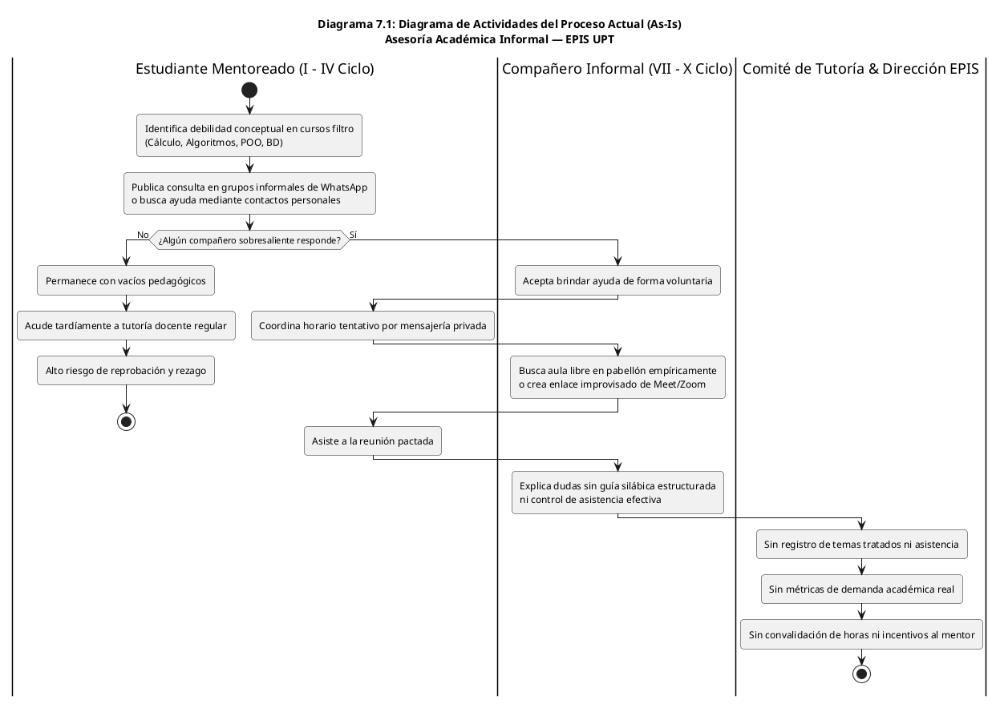

Fuente: Elaboración propia.

### 7.2. Diagrama de Proceso Propuesto (To-Be)

El proceso optimizado y digitalizado (**To-Be**) formaliza la gobernanza, el emparejamiento algorítmico, los cerrojos transaccionales, el corte de quórum y la acreditación oficial de horas:

### Diagrama 7.2: Diagrama de Actividades del Proceso Propuesto (To-Be) de Mentorías P2P

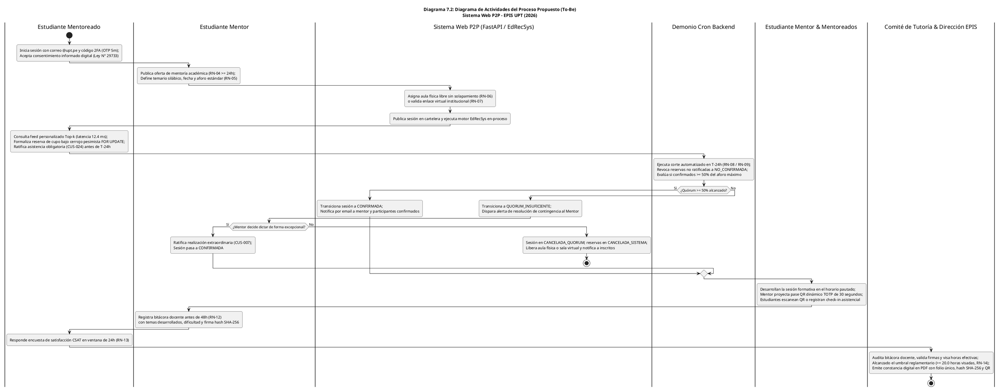

Fuente: Elaboración propia.

### 7.3. Trazabilidad hacia los Diagramas de Secuencia de Diseño (CUS-001 al CUS-024)

### Cuadro 7.3: Matriz de Trazabilidad Arquitectónica a Diagramas de Secuencia (Fase de Diseño Técnico)

| Módulo | Diagrama SRS | Caso de Uso Canónico | Vista React (.tsx) | Controlador FastAPI (.py) | Servicio Backend (.py) |
| :---: | :---: | :--- | :--- | :--- | :--- |
| **MOD-01** | Diag. 6.15.1 | `CUS-001` - Iniciar sesión 2FA | `LoginOtpView.tsx` | `endpoints/auth.py` | `AuthService.py` |
| **MOD-01** | Diag. 6.15.2 | `CUS-010` - Gestionar roles y mérito | `AdminDashboardView.tsx` | `endpoints/roles.py` | `RoleService.py` |
| **MOD-02** | Diag. 6.15.3 | `CUS-006` - Publicar oferta de mentoría | `OfferPublishView.tsx` | `endpoints/offers.py` | `OfferService.py` |
| **MOD-02** | Diag. 6.15.4 | `CUS-008` - Disponibilidad de espacios | `OfferPublishView.tsx` | `endpoints/offers.py` | `OfferService.py` |
| **MOD-03** | Diag. 6.15.5 | `CUS-005` - Perfil y matriz semanal 6×11| `ProfileAvailabilityView.tsx` | `endpoints/profiles.py` | `ProfileService.py` |
| **MOD-03** | Diag. 6.15.6 | `CUS-021` - Catálogo curricular | `CurriculumCatalogView.tsx` | `endpoints/curriculum.py`| `CurriculumService.py` |
| **MOD-04** | Diag. 6.15.7 | `CUS-002` - Recomendaciones Top-k | `RecommendationFeedView.tsx` | `endpoints/recommendations.py`| `RecommendationService.py` |
| **MOD-04** | Diag. 6.15.8 | `CUS-003` - Registrar demanda | `DemandModalView.tsx` | `endpoints/bookings.py` | `BookingService.py` |
| **MOD-05** | Diag. 6.15.9 | `CUS-004` - Reservar cupo pesimista | `BookingModalView.tsx` | `endpoints/bookings.py` | `BookingService.py` |
| **MOD-05** | Diag. 6.15.10 | `CUS-024` - Ratificar asistencia T-24h | `StudentBookingsView.tsx` | `endpoints/bookings.py` | `BookingService.py` |
| **MOD-05** | Diag. 6.15.11 | `CUS-017` - Desistir reserva | `StudentBookingsView.tsx` | `endpoints/bookings.py` | `BookingService.py` |
| **MOD-05** | Diag. 6.15.12 | `CUS-023` - Evaluar quórum en T-24h | `AdminDashboardView.tsx` | `endpoints/quorum.py` | `QuorumCronService.py` |
| **MOD-05** | Diag. 6.15.13 | `CUS-007` - Decisión de quórum | `MentorSessionsView.tsx` | `endpoints/offers.py` | `OfferService.py` |
| **MOD-06** | Diag. 6.15.14 | `CUS-012` - Asistencia QR TOTP 30s | `SessionAttendanceView.tsx` | `endpoints/attendance.py`| `AttendanceService.py` |
| **MOD-06** | Diag. 6.15.15 | `CUS-013` - Bitácora docente SHA-256 | `BitacoraFormView.tsx` | `endpoints/bitacora.py` | `BitacoraService.py` |
| **MOD-06** | Diag. 6.15.16 | `CUS-014` - Historial de sesiones | `HistorySessionsView.tsx` | `endpoints/bitacora.py` | `BitacoraService.py` |
| **MOD-07** | Diag. 6.15.17 | `CUS-018` - Constancia oficial PDF | `CertificateDownloadView.tsx`| `endpoints/certificates.py`| `CertificateService.py` |
| **MOD-07** | Diag. 6.15.18 | `CUS-019` - Insignias y reputación | `MentorBadgesView.tsx` | `endpoints/recommendations.py`| `RecommendationService.py` |
| **MOD-08** | Diag. 6.15.19 | `CUS-009` - Despacho notificaciones | `NotificationBell.tsx` | `endpoints/offers.py` | `NotificationService.py` |
| **MOD-08** | Diag. 6.15.20 | `CUS-011` - Reportes analíticos | `AdminAnalyticsView.tsx` | `endpoints/bitacora.py` | `BitacoraService.py` |
| **MOD-08** | Diag. 6.15.21 | `CUS-015` - Métricas retención ICACIT| `AdminAnalyticsView.tsx` | `endpoints/bitacora.py` | `BitacoraService.py` |
| **MOD-08** | Diag. 6.15.22 | `CUS-016` - Auditar trazas Ley 29733 | `AdminAuditView.tsx` | `endpoints/consent.py` | `ConsentService.py` |
| **MOD-08** | Diag. 6.15.23 | `CUS-020` - Configurar parámetros | `SystemSettingsView.tsx` | `endpoints/profiles.py` | `ProfileService.py` |
| **MOD-08** | Diag. 6.15.24 | `CUS-022` - Visado de bitácoras | `AdminDashboardView.tsx` | `endpoints/bitacora.py` | `BitacoraService.py` |

Fuente: Elaboración propia a partir del documento de diseño y del SRS v3.0, sección 6.3.3.

---

## 8. Vista de Despliegue

### 8.1. Diagrama de Contenedores C4 Nivel 2

### Diagrama 8.1: Diagrama de Contenedores de Software (C4 Nivel 2 / Metodología UWE)

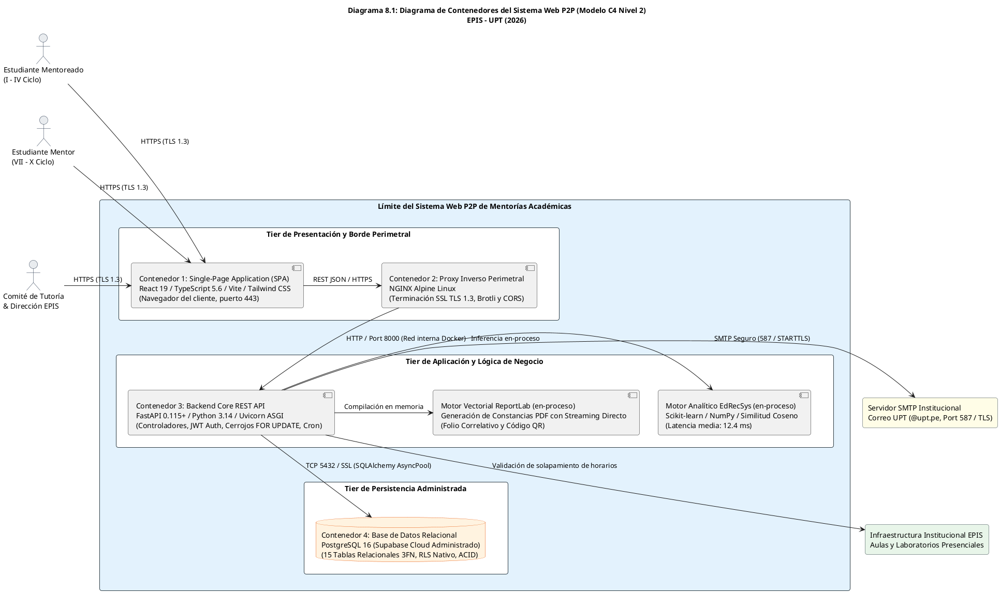

Fuente: Elaboración propia.

### 8.2. Matriz de Contenedores, Tecnologías y Protocolos

### Cuadro 8.1: Especificación de Contenedores de Software del Sistema

| Contenedor | Entorno de Ejecución | Tecnología Principal | Responsabilidad de Ingeniería | Protocolo / Interfaz |
| :---: | :--- | :--- | :--- | :--- |
| **C1: Frontend SPA** | Navegador Web del Cliente | React 19, TypeScript 5.6, Vite, Tailwind CSS | Renderizado reactivo de la interfaz WCAG 2.1 AA, captura de eventos, almacenamiento de token JWT y modales accesibles. | HTTPS / TLS 1.3 |
| **C2: Proxy Inverso** | Contenedor Docker (Host Linux) | NGINX Alpine Linux | Terminación segura TLS 1.3, compresión Brotli/Gzip, enrutamiento reverso y políticas CORS hacia el backend. | HTTPS (Ext) / HTTP (Int) |
| **C3: Backend API** | Contenedor Docker (Host Linux) | Python 3.14, FastAPI 0.115+, Uvicorn ASGI | Exposición de contratos OpenAPI 3.0, validaciones Pydantic v2, orquestación transaccional ACID y demonio cron a $T-24\text{ h}$. | RESTful JSON (Port 8000) |
| **C4: Base de Datos** | Servicio Gestionado (Supabase Cloud) | PostgreSQL 16 Relacional | Persistencia relacional de 15 tablas 3FN, cerrojos `SELECT ... FOR UPDATE`, políticas RLS multiusuario e índices B-Tree. | TCP / Port 5432 (SSL TLS 1.3) |

Fuente: Elaboración propia.

---

## 9. Vista de Implementación

### 9.1. Diagrama de Componentes y Paquetes

### Diagrama 9.1: Componentes de Software y Módulos Canónicos del Backend

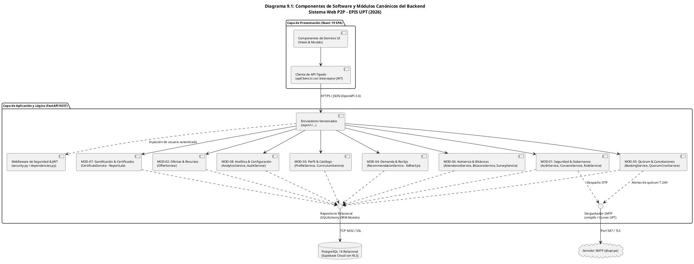

Fuente: Elaboración propia.

### 9.2. Puertos e Interfaces Implementadas

### Cuadro 9.1: Puertos de Servicio e Interfaces Implementadas en el Backend

| Puerto / Interfaz de Servicio | Responsabilidad Técnica Implementada | Requerimientos de Origen | Clases y Módulos de Código |
| :--- | :--- | :---: | :--- |
| **Interfaz de Seguridad y Sesión** | Generación de OTP numérico, hash SHA-256 en BD, emisión de JWT HS256 de 8 horas y aislamiento RLS. | RF01, RF02, RF03, RNF01, RNF02 | `AuthService.py`, `ConsentService.py`, `RoleService.py` |
| **Motor de Recomendación In-Process** | Vectorización TF-IDF temática silábica, cálculo de similitud coseno matricial y ranking con latencia de 12.4 ms. | RF06, RNF03, RN-11 | `RecommendationService.py` (*EdRecSys*) |
| **Coordinador Transaccional de Aforo** | Cerrojos pesimistas `SELECT ... FOR UPDATE` en PostgreSQL, control estricto de cupos y 0.0% de sobrecupo. | RF12, RF13, RF14, RNF07, RN-05 | `BookingService.py` |
| **Demonio Asíncrono de Quórum** | Corte automático a $T-24\text{ h}$, revocación a `NO_CONFIRMADA` y cómputo de quórum regulatorio del 50%. | RF15, RF16, RN-08, RN-09 | `QuorumCronService.py` |
| **Validador de Asistencia TOTP** | Generación de token rotatorio cada 30 segundos y validación temporal en ventana $[-15\text{ m}, +30\text{ m}]$. | RF17, RN-12 | `AttendanceService.py` |
| **Sellador Criptográfico de Bitácoras** | Validación de plazo de 48 horas post-sesión, registro de observaciones y cálculo de hash SHA-256 inmutable. | RF18, RF19, RN-12 | `BitacoraService.py` |
| **Compilador Vectorial de Certificados** | Validación de $\ge 20.0$ horas visadas, asignación de folio único, marca de agua y streaming PDF directo. | RF22, RF23, RN-14 | `CertificateService.py` (ReportLab) |
| **Fiscalizador Administrativo y Analítica** | Aprobación de horas por Dirección, dictámenes de visado, auditoría de consentimientos y tableros ICACIT. | RF24, RF25, RF26 | `BitacoraService.py`, `AuditService.py` |

Fuente: Elaboración propia.

---

## 10. Vista de Datos y Persistencia

### 10.1. Diagrama Entidad-Relación Físico

El modelo físico normalizado en la Tercera Forma Normal (3FN) está compuesto por **15 tablas relacionales en PostgreSQL**:

### Diagrama 10.1: Diagrama Entidad-Relación Físico (15 Tablas Relacionales en PostgreSQL / Supabase)

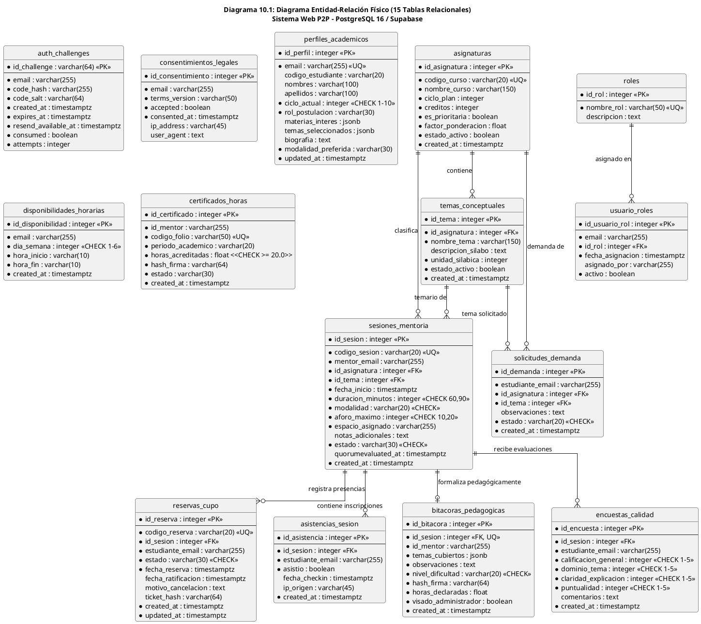

Fuente: Elaboración propia.

### 10.2. Diccionario DDL Físico de las 15 Tablas Relacionales

#### Cuadro 10.2: Diccionario Físico — Tabla `asignaturas`
| Columna | Tipo PostgreSQL | Nulo | Clave | Default / Restricción | Propósito y Regla de Negocio |
| :--- | :--- | :---: | :---: | :--- | :--- |
| `id_asignatura` | `INTEGER` | NO | PK | `serial sequence` | Identificador único del curso formativo. |
| `codigo_curso` | `VARCHAR(20)` | NO | UNIQUE | Índice B-Tree | Código oficial del curso (ej. `CI-101`, `AED-201`). |
| `nombre_curso` | `VARCHAR(150)` | NO | — | — | Denominación formal según plan curricular EPIS. |
| `ciclo_plan` | `INTEGER` | NO | — | `CHECK(ciclo_plan BETWEEN 1 AND 10)` | Semestre lectivo crítico del plan de estudios (I a IV ciclo). |
| `creditos` | `INTEGER` | NO | — | `CHECK(creditos > 0)` | Número de créditos académicos universitarios. |
| `es_prioritaria` | `BOOLEAN` | NO | — | `DEFAULT TRUE` | Bandera de realce para el recomendador (*EdRecSys*). |
| `factor_ponderacion` | `FLOAT` | NO | — | `DEFAULT 1.0` | Factor multiplicador de prioridad curricular (1.0x a 1.3x, RN-11). |
| `estado_activo` | `BOOLEAN` | NO | — | `DEFAULT TRUE` | Bandera de habilitación curricular en el catálogo. |
| `created_at` | `TIMESTAMPTZ` | NO | — | `DEFAULT now()` | Marca temporal de registro en UTC. |

#### Cuadro 10.3: Diccionario Físico — Tabla `temas_conceptuales`
| Columna | Tipo PostgreSQL | Nulo | Clave | Default / Restricción | Propósito y Regla de Negocio |
| :--- | :--- | :---: | :---: | :--- | :--- |
| `id_tema` | `INTEGER` | NO | PK | `serial sequence` | Identificador único del tema silábico. |
| `id_asignatura` | `INTEGER` | NO | FK | `REFERENCES asignaturas(id_asignatura) ON DELETE CASCADE` | Llave foránea hacia la materia contenedora. |
| `nombre_tema` | `VARCHAR(150)` | NO | — | Índice B-Tree | Denominación del concepto neurálgico del sílabo. |
| `descripcion_silabo`| `TEXT` | SÍ | — | `NULLABLE` | Glosa pedagógica oficial extraída del sílabo institucional. |
| `unidad_silabica` | `INTEGER` | NO | — | `DEFAULT 1` | Unidad temático-curricular del sílabo correspondiente. |
| `estado_activo` | `BOOLEAN` | NO | — | `DEFAULT TRUE` | Bandera de habilitación temática en el recomendador. |
| `created_at` | `TIMESTAMPTZ` | NO | — | `DEFAULT now()` | Marca temporal de auditoría en UTC. |

#### Cuadro 10.4: Diccionario Físico — Tabla `auth_challenges`
| Columna | Tipo PostgreSQL | Nulo | Clave | Default / Restricción | Propósito y Regla de Negocio |
| :--- | :--- | :---: | :---: | :--- | :--- |
| `id_challenge` | `VARCHAR(64)` | NO | PK | Clave primaria criptográfica | Identificador universal único del desafío de acceso OTP. |
| `email` | `VARCHAR(255)` | NO | — | Índice B-Tree | Correo institucional universitario `@upt.pe`. |
| `code_hash` | `VARCHAR(255)` | NO | — | Hash SHA-256 + Salt | Hash seguro del código OTP para mitigar fugas de memoria (RN-01). |
| `code_salt` | `VARCHAR(64)` | NO | — | Salt aleatorio | Salt criptográfico individual para dispersión de hash. |
| `created_at` | `TIMESTAMPTZ` | NO | — | `DEFAULT now()` | Estampa UTC de emisión para control de cooldown de 60 segundos. |
| `expires_at` | `TIMESTAMPTZ` | NO | — | Zona horaria UTC | Timestamp de caducidad perentoria a $T + 5\text{ min}$ (RNF01 / RN-01). |
| `resend_available_at`| `TIMESTAMPTZ`| NO | — | Zona horaria UTC | Timestamp perentorio para habilitar reenvío de OTP (60s). |
| `consumed` | `BOOLEAN` | NO | — | `DEFAULT FALSE` | Bandera de consumo irreversible anti-replay. |
| `attempts` | `INTEGER` | NO | — | `DEFAULT 0` | Contador de reintentos fallidos de verificación. |

#### Cuadro 10.5: Diccionario Físico — Tabla `consentimientos_legales`
| Columna | Tipo PostgreSQL | Nulo | Clave | Default / Restricción | Propósito y Regla de Negocio |
| :--- | :--- | :---: | :---: | :--- | :--- |
| `id_consentimiento` | `INTEGER` | NO | PK | `serial sequence` | Identificador primario del registro legal. |
| `email` | `VARCHAR(255)` | NO | — | Índice B-Tree | Correo institucional del estudiante titular. |
| `terms_version` | `VARCHAR(50)` | NO | — | `DEFAULT '2026-II-v1.0'` | Versión normativa de las cláusulas aceptadas. |
| `accepted` | `BOOLEAN` | NO | — | — | Conformidad (`True`) o revocación (`False`) (RN-02). |
| `consented_at` | `TIMESTAMPTZ` | NO | — | Zona horaria UTC | Estampa probatoria ante la ANPPD (Ley N° 29733). |
| `ip_address` | `VARCHAR(45)` | SÍ | — | Soporte IPv4 e IPv6 | Dirección IP del cliente al momento de la firma. |
| `user_agent` | `TEXT` | SÍ | — | — | Cadena identificadora del navegador para peritaje. |

#### Cuadro 10.6: Diccionario Físico — Tabla `roles`
| Columna | Tipo PostgreSQL | Nulo | Clave | Default / Restricción | Propósito y Regla de Negocio |
| :--- | :--- | :---: | :---: | :--- | :--- |
| `id_rol` | `INTEGER` | NO | PK | `serial sequence` | Identificador primario del rol institucional. |
| `nombre_rol` | `VARCHAR(50)` | NO | UNIQUE | Índice B-Tree | Denominación (`mentoreado`, `mentor`, `administrador`). |
| `descripcion` | `TEXT` | SÍ | — | — | Glosa de privilegios y facultades operativas. |

#### Cuadro 10.7: Diccionario Físico — Tabla `usuario_roles`
| Columna | Tipo PostgreSQL | Nulo | Clave | Default / Restricción | Propósito y Regla de Negocio |
| :--- | :--- | :---: | :---: | :--- | :--- |
| `id_usuario_rol` | `INTEGER` | NO | PK | `serial sequence` | Identificador primario de asignación de rol. |
| `email` | `VARCHAR(255)` | NO | — | Índice B-Tree | Correo institucional del usuario acreditado. |
| `id_rol` | `INTEGER` | NO | FK | `REFERENCES roles(id_rol) ON DELETE CASCADE` | Llave foránea hacia el catálogo de roles. |
| `fecha_asignacion`| `TIMESTAMPTZ` | NO | — | `DEFAULT now()` | Timestamp de concesión del rol. |
| `asignado_por` | `VARCHAR(255)` | SÍ | — | — | Correo del administrador que visó el mérito (RN-03). |
| `activo` | `BOOLEAN` | NO | — | `DEFAULT TRUE` | Bandera de vigencia lógica del privilegio. |

Restricción compuesta: `CONSTRAINT uq_usuario_roles_email_rol UNIQUE(email, id_rol)`.

#### Cuadro 10.8: Diccionario Físico — Tabla `perfiles_academicos`
| Columna | Tipo PostgreSQL | Nulo | Clave | Default / Restricción | Propósito y Regla de Negocio |
| :--- | :--- | :---: | :---: | :--- | :--- |
| `id_perfil` | `INTEGER` | NO | PK | `serial sequence` | Identificador primario del expediente académico. |
| `email` | `VARCHAR(255)` | NO | UNIQUE | Índice B-Tree | Correo institucional del estudiante titular. |
| `codigo_estudiante`| `VARCHAR(20)` | SÍ | — | — | Código oficial de matrícula universitaria en la UPT. |
| `nombres` | `VARCHAR(100)` | SÍ | — | — | Nombres del estudiante según registro académico. |
| `apellidos` | `VARCHAR(100)` | SÍ | — | — | Apellidos paterno y materno del estudiante. |
| `ciclo_actual` | `INTEGER` | NO | — | `CHECK(ciclo_actual BETWEEN 1 AND 10)` | Semestre lectivo cursado por el estudiante. |
| `rol_postulacion` | `VARCHAR(30)` | NO | — | `DEFAULT 'mentoreado'` | Rol pretendido (`mentoreado` o `mentor`) (RN-03). |
| `materias_interes`| `JSONB` | SÍ | — | Array estructurado | Códigos de asignaturas filtro seleccionadas. |
| `temas_seleccionados`|`JSONB` | SÍ | — | Array estructurado | Unidades temáticas específicas de interés. |
| `biografia` | `TEXT` | SÍ | — | — | Semblanza académica y competencias pedagógicas. |
| `modalidad_preferida`|`VARCHAR(30)`| NO | — | `DEFAULT 'presencial'` | Modalidad (`presencial`, `virtual`, `hibrida`). |
| `updated_at` | `TIMESTAMPTZ` | NO | — | `DEFAULT now()` | Marca temporal de la última actualización. |

#### Cuadro 10.9: Diccionario Físico — Tabla `disponibilidades_horarias`
| Columna | Tipo PostgreSQL | Nulo | Clave | Default / Restricción | Propósito y Regla de Negocio |
| :--- | :--- | :---: | :---: | :--- | :--- |
| `id_disponibilidad`| `INTEGER` | NO | PK | `serial sequence` | Identificador de la franja horaria. |
| `email` | `VARCHAR(255)` | NO | — | Índice B-Tree | Correo institucional del estudiante titular. |
| `dia_semana` | `INTEGER` | NO | — | `CHECK(dia_semana BETWEEN 1 AND 6)` | Día semanal (1 = Lunes a 6 = Sábado). |
| `hora_inicio` | `VARCHAR(10)` | NO | — | Formato `HH:MM` | Hora de inicio del bloque comprometido. |
| `hora_fin` | `VARCHAR(10)` | NO | — | Formato `HH:MM` | Hora de término del bloque comprometido. |
| `created_at` | `TIMESTAMPTZ` | NO | — | `DEFAULT now()` | Timestamp de inserción de la franja horaria. |

#### Cuadro 10.10: Diccionario Físico — Tabla `sesiones_mentoria`
| Columna | Tipo PostgreSQL | Nulo | Clave | Default / Restricción | Propósito y Regla de Negocio |
| :--- | :--- | :---: | :---: | :--- | :--- |
| `id_sesion` | `INTEGER` | NO | PK | `serial sequence` | Identificador único de la sesión formativa. |
| `codigo_sesion` | `VARCHAR(20)` | NO | UNIQUE | Índice B-Tree | Código correlativo oficial (ej. `SES-2026-0001`). |
| `mentor_email` | `VARCHAR(255)` | NO | — | Índice B-Tree | Correo del estudiante mentor titular responsable. |
| `id_asignatura` | `INTEGER` | NO | FK | `REFERENCES asignaturas(id_asignatura) ON DELETE RESTRICT` | Asignatura curricular reforzada. |
| `id_tema` | `INTEGER` | NO | FK | `REFERENCES temas_conceptuales(id_tema) ON DELETE RESTRICT`| Tema específico del sílabo a tratar. |
| `fecha_inicio` | `TIMESTAMPTZ` | NO | — | Índice B-Tree | Fecha y hora UTC pactada de inicio de la sesión. |
| `duracion_minutos`| `INTEGER` | NO | — | `CHECK(duracion_minutos IN (60, 90))` | Duración reglamentaria de la sesión (RN-04). |
| `modalidad` | `VARCHAR(20)` | NO | — | `CHECK(modalidad IN ('presencial', 'virtual'))` | Modalidad técnica de dictado (RN-05). |
| `aforo_maximo` | `INTEGER` | NO | — | `CHECK(aforo_maximo IN (10, 20))` | Aforo máximo (10 presencial, 20 virtual) (RN-05). |
| `espacio_asignado`| `VARCHAR(255)`| NO | — | — | Aula física EPIS o URL institucional de sala virtual. |
| `notas_adicionales`|`TEXT` | SÍ | — | — | Indicaciones previas y prerrequisitos formativos. |
| `estado` | `VARCHAR(30)` | NO | — | `chk_sesion_estado` (13 estados canónicos) | Estado en la FSM del dominio pedagógico. |
| `quorumevaluated_at`|`TIMESTAMPTZ`| SÍ | — | — | Timestamp UTC en que se evaluó el quórum a T-24h. |
| `created_at` | `TIMESTAMPTZ` | NO | — | `DEFAULT now()` | Timestamp de publicación de la oferta (RN-04). |

Restricción de dominio:
```sql
CONSTRAINT chk_sesion_estado CHECK (
    estado IN (
        'PUBLICADA', 'PENDIENTE_CONFIRMACION', 'QUORUM_INSUFICIENTE',
        'CONFIRMADA', 'EN_CURSO', 'CONCLUIDA', 'BITACORA_REGISTRADA',
        'HORAS_VISADAS', 'OBSERVADA', 'CANCELADA_SISTEMA',
        'CANCELADA_MENTOR', 'CANCELADA_QUORUM', 'FINALIZADA'
    )
);
```

#### Cuadro 10.11: Diccionario Físico — Tabla `reservas_cupo`
| Columna | Tipo PostgreSQL | Nulo | Clave | Default / Restricción | Propósito y Regla de Negocio |
| :--- | :--- | :---: | :---: | :--- | :--- |
| `id_reserva` | `INTEGER` | NO | PK | `serial sequence` | Identificador único de la reserva de plaza. |
| `codigo_reserva` | `VARCHAR(20)` | NO | UNIQUE | Índice B-Tree | Código de comprobante (ej. `RES-2026-0001`). |
| `id_sesion` | `INTEGER` | NO | FK | `REFERENCES sesiones_mentoria(id_sesion) ON DELETE CASCADE`| Sesión formativa reservada. |
| `estudiante_email`| `VARCHAR(255)`| NO | — | Índice B-Tree | Correo institucional del mentoreado inscrito. |
| `estado` | `VARCHAR(30)` | NO | — | `chk_reserva_estado` (9 estados canónicos) | Estado en la FSM de reservas concurrentes. |
| `fecha_reserva` | `TIMESTAMPTZ` | NO | — | `DEFAULT now()` | Marca temporal UTC en que se reservó el cupo. |
| `fecha_ratificacion`|`TIMESTAMPTZ`| SÍ | — | — | Timestamp UTC de confirmación anticipada (RN-08). |
| `motivo_cancelacion`|`TEXT` | SÍ | — | — | Justificación de desistimiento voluntario (RN-10). |
| `ticket_hash` | `VARCHAR(64)` | SÍ | — | — | Hash SHA-256 de integridad del comprobante. |
| `created_at` | `TIMESTAMPTZ` | NO | — | `DEFAULT now()` | Timestamp de creación del registro. |
| `updated_at` | `TIMESTAMPTZ` | NO | — | `DEFAULT now()` | Timestamp de última actualización de estado. |

Restricciones:
```sql
CONSTRAINT uq_sesion_estudiante_activa UNIQUE (id_sesion, estudiante_email);
CONSTRAINT chk_reserva_estado CHECK (
    estado IN (
        'PENDIENTE_CONFIRMACION', 'CONFIRMADA', 'CANCELADA_USUARIO',
        'NO_CONFIRMADA', 'CANCELADA_NO_CONFIRMADA', 'CANCELADA_SISTEMA',
        'CANCELADA_SISTEMA_QUORUM', 'ASISTIDA', 'INASISTENCIA'
    )
);
```

#### Cuadro 10.12: Diccionario Físico — Tabla `solicitudes_demanda`
| Columna | Tipo PostgreSQL | Nulo | Clave | Default / Restricción | Propósito y Regla de Negocio |
| :--- | :--- | :---: | :---: | :--- | :--- |
| `id_demanda` | `INTEGER` | NO | PK | `serial sequence` | Identificador primario de la solicitud temática. |
| `estudiante_email`| `VARCHAR(255)`| NO | — | Índice B-Tree | Correo del mentoreado solicitante. |
| `id_asignatura` | `INTEGER` | NO | FK | `REFERENCES asignaturas(id_asignatura) ON DELETE RESTRICT` | Materia filtro requerida por el alumno. |
| `id_tema` | `INTEGER` | NO | FK | `REFERENCES temas_conceptuales(id_tema) ON DELETE RESTRICT`| Tema específico donde existe vacío pedagógico. |
| `observaciones` | `TEXT` | SÍ | — | — | Detalle de las dudas o ejercicios no asimilados. |
| `estado` | `VARCHAR(20)` | NO | — | `CHECK(estado IN ('PENDIENTE', 'ATENDIDA', 'CANCELADA'))` | Estado de atención de la necesidad. |
| `created_at` | `TIMESTAMPTZ` | NO | — | `DEFAULT now()` | Marca temporal de registro de la demanda. |

#### Cuadro 10.13: Diccionario Físico — Tabla `asistencias_sesion`
| Columna | Tipo PostgreSQL | Nulo | Clave | Default / Restricción | Propósito y Regla de Negocio |
| :--- | :--- | :---: | :---: | :--- | :--- |
| `id_asistencia` | `INTEGER` | NO | PK | `serial sequence` | Identificador del registro de asistencia. |
| `id_sesion` | `INTEGER` | NO | FK | `REFERENCES sesiones_mentoria(id_sesion) ON DELETE CASCADE`| Sesión formativa donde se pasó lista. |
| `estudiante_email`| `VARCHAR(255)`| NO | — | Índice B-Tree | Correo institucional del alumno evaluado. |
| `asistio` | `BOOLEAN` | NO | — | `DEFAULT FALSE` | Constatación efectiva de asistencia (RN-12). |
| `fecha_checkin` | `TIMESTAMPTZ` | SÍ | — | — | Timestamp UTC en que se escaneó el QR TOTP. |
| `ip_origen` | `VARCHAR(45)` | SÍ | — | — | Dirección IP de red capturada en el check-in. |
| `created_at` | `TIMESTAMPTZ` | NO | — | `DEFAULT now()` | Marca temporal de inserción del registro. |

Restricción: `CONSTRAINT uq_sesion_asistencia_estudiante UNIQUE (id_sesion, estudiante_email)`.

#### Cuadro 10.14: Diccionario Físico — Tabla `bitacoras_pedagogicas`
| Columna | Tipo PostgreSQL | Nulo | Clave | Default / Restricción | Propósito y Regla de Negocio |
| :--- | :--- | :---: | :---: | :--- | :--- |
| `id_bitacora` | `INTEGER` | NO | PK | `serial sequence` | Identificador primario de la bitácora docente. |
| `id_sesion` | `INTEGER` | NO | FK, UQ | `REFERENCES sesiones_mentoria(id_sesion) ON DELETE CASCADE`| Sesión formativa que formaliza la bitácora. |
| `id_mentor` | `VARCHAR(255)` | NO | — | Índice B-Tree | Correo del mentor titular suscriptor. |
| `temas_cubiertos` | `JSONB` | NO | — | `DEFAULT '[]'` | Unidades temáticas silábicas dictadas. |
| `observaciones` | `TEXT` | NO | — | `CHECK(length(observaciones) >= 50)` | Diagnóstico formativo sustantivo (RN-12). |
| `nivel_dificultad`| `VARCHAR(20)` | NO | — | `CHECK(nivel_dificultad IN ('Bajo', 'Medio', 'Alto'))` | Apreciación cualitativa de dificultad docente. |
| `hash_firma` | `VARCHAR(64)` | NO | — | Hash SHA-256 inmutable | Firma criptográfica de inalterabilidad. |
| `horas_declaradas`| `FLOAT` | NO | — | `DEFAULT 0.0` | Cómputo provisional: `duracion_minutos / 60.0`. |
| `visado_administrador`|`BOOLEAN` | NO | — | `DEFAULT FALSE` | Aprobación oficial por Dirección EPIS (RN-14). |
| `created_at` | `TIMESTAMPTZ` | NO | — | `DEFAULT now()` | Timestamp UTC de cierre dentro de 48h (RN-12). |

#### Cuadro 10.15: Diccionario Físico — Tabla `encuestas_calidad`
| Columna | Tipo PostgreSQL | Nulo | Clave | Default / Restricción | Propósito y Regla de Negocio |
| :--- | :--- | :---: | :---: | :--- | :--- |
| `id_encuesta` | `INTEGER` | NO | PK | `serial sequence` | Identificador de la evaluación de satisfacción. |
| `id_sesion` | `INTEGER` | NO | FK | `REFERENCES sesiones_mentoria(id_sesion) ON DELETE CASCADE`| Sesión evaluada por el mentoreado. |
| `estudiante_email`| `VARCHAR(255)`| NO | — | Índice B-Tree | Correo del asistente evaluador (RN-12). |
| `calificacion_general`|`INTEGER` | NO | — | `CHECK(calificacion_general BETWEEN 1 AND 5)` | Dimensión: Satisfacción integral (Likert 1-5). |
| `dominio_tema` | `INTEGER` | NO | — | `CHECK(dominio_tema BETWEEN 1 AND 5)` | Dimensión: Solvencia conceptual del mentor. |
| `claridad_explicacion`|`INTEGER`| NO | — | `CHECK(claridad_explicacion BETWEEN 1 AND 5)`| Dimensión: Claridad didáctica pedagógica. |
| `puntualidad` | `INTEGER` | NO | — | `CHECK(puntualidad BETWEEN 1 AND 5)` | Dimensión: Cumplimiento horario del mentor. |
| `comentarios` | `TEXT` | SÍ | — | `CHECK(comentarios IS NULL OR length(comentarios) >= 20)`| Retroalimentación cualitativa descriptiva. |
| `created_at` | `TIMESTAMPTZ` | NO | — | `DEFAULT now()` | Timestamp UTC de respuesta en ventana de 24h. |

Restricción: `CONSTRAINT uq_encuesta_sesion_estudiante UNIQUE (id_sesion, estudiante_email)`.

#### Cuadro 10.16: Diccionario Físico — Tabla `certificados_horas`
| Columna | Tipo PostgreSQL | Nulo | Clave | Default / Restricción | Propósito y Regla de Negocio |
| :--- | :--- | :---: | :---: | :--- | :--- |
| `id_certificado` | `INTEGER` | NO | PK | `serial sequence` | Identificador primario de la constancia oficial. |
| `id_mentor` | `VARCHAR(255)` | NO | — | Índice B-Tree | Correo del estudiante mentor acreditado. |
| `codigo_folio` | `VARCHAR(50)` | NO | UNIQUE | Índice B-Tree | Folio correlativo institucional (`CERT-YYYY-SEM-XXXX`). |
| `periodo_academico`| `VARCHAR(20)` | NO | — | `DEFAULT '2026-II'` | Semestre lectivo de emisión institucional. |
| `horas_acreditadas`| `FLOAT` | NO | — | `CHECK(horas_acreditadas >= 20.0)` | Horas oficiales acumuladas visadas (RN-14). |
| `hash_firma` | `VARCHAR(64)` | NO | — | Hash SHA-256 inmutable | Huella criptográfica para verificación pública. |
| `estado` | `VARCHAR(30)` | NO | — | `DEFAULT 'EMITIDO_DEMO'` | Estado institucional de expedición oficial. |
| `created_at` | `TIMESTAMPTZ` | NO | — | `DEFAULT now()` | Timestamp de compilación y firma digital. |

Restricción: `CONSTRAINT uq_mentor_periodo_certificado UNIQUE (id_mentor, periodo_academico)`.

---

### 10.3. Matriz de Políticas de Seguridad a Nivel de Fila (RLS) en Supabase

En cumplimiento estricto del requerimiento **RNF02** y de la Ley N° 29733, la base de datos PostgreSQL en Supabase aplica políticas **Row Level Security (RLS)** activas en las 15 tablas relacionales:

### Cuadro 10.17: Matriz Consolidada de Políticas RLS en PostgreSQL (15 Tablas Relacionales)

| Tabla Relacional | Nombre de la Política RLS | Comando SQL | Rol Objetivo | Expresión USING / WITH CHECK en PostgreSQL |
| :--- | :--- | :---: | :--- | :--- |
| `asignaturas` | `asignaturas_select_public` | `SELECT` | `anon`, `authenticated` | `USING (true)` (Lectura pública del catálogo curricular). |
| `asignaturas` | `asignaturas_admin_all` | `ALL` | `service_role` | `USING (true)` (Control administrativo exclusivo de backend). |
| `temas_conceptuales`| `temas_select_public` | `SELECT` | `anon`, `authenticated` | `USING (true)` (Lectura pública de temarios silábicos). |
| `temas_conceptuales`| `temas_admin_all` | `ALL` | `service_role` | `USING (true)` (Control exclusivo de backend). |
| `auth_challenges` | `auth_challenges_service_all`| `ALL` | `service_role` | `USING (true)` (Gestión de OTP restringida al backend). |
| `auth_challenges` | `auth_challenges_deny_public` | `SELECT` | `anon`, `authenticated` | `USING (false)` (Denegación total: ningún cliente público lee OTPs). |
| `consentimientos_legales`| `consent_user_isolation` | `ALL` | `authenticated` | `USING (email = (auth.jwt() ->> 'email'))` |
| `consentimientos_legales`| `consent_service_all` | `ALL` | `service_role` | `USING (true)` |
| `roles` | `roles_read_authenticated` | `SELECT` | `authenticated` | `USING (true)` (Consulta autorizada de catálogo de roles). |
| `roles` | `roles_admin_all` | `ALL` | `service_role` | `USING (true)` |
| `usuario_roles` | `usuario_roles_select_owner` | `SELECT` | `authenticated` | `USING (email = (auth.jwt() ->> 'email') OR (auth.jwt() ->> 'role') = 'administrador')` |
| `usuario_roles` | `usuario_roles_service_all` | `ALL` | `service_role` | `USING (true)` |
| `perfiles_academicos` | `perfiles_select_owner` | `SELECT` | `authenticated` | `USING (email = (auth.jwt() ->> 'email') OR (auth.jwt() ->> 'role') = 'administrador')` |
| `perfiles_academicos` | `perfiles_update_owner` | `UPDATE` | `authenticated` | `USING (email = (auth.jwt() ->> 'email'))` |
| `perfiles_academicos` | `perfiles_service_all` | `ALL` | `service_role` | `USING (true)` |
| `disponibilidades_horarias`| `disponibilidad_owner_all` | `ALL` | `authenticated` | `USING (email = (auth.jwt() ->> 'email'))` |
| `disponibilidades_horarias`| `disponibilidad_service_all`| `ALL` | `service_role` | `USING (true)` |
| `sesiones_mentoria` | `sesiones_select_public` | `SELECT` | `authenticated` | `USING (true)` (Cartelera visible para todos los estudiantes). |
| `sesiones_mentoria` | `sesiones_mentor_crud` | `ALL` | `authenticated` | `USING (mentor_email = (auth.jwt() ->> 'email') OR (auth.jwt() ->> 'role') = 'administrador')` |
| `reservas_cupo` | `reservas_select_participant`| `SELECT` | `authenticated` | `USING (estudiante_email = (auth.jwt() ->> 'email') OR EXISTS (SELECT 1 FROM sesiones_mentoria s WHERE s.id_sesion = reservas_cupo.id_sesion AND s.mentor_email = (auth.jwt() ->> 'email')) OR (auth.jwt() ->> 'role') = 'administrador')` |
| `reservas_cupo` | `reservas_insert_owner` | `INSERT` | `authenticated` | `WITH CHECK (estudiante_email = (auth.jwt() ->> 'email'))` |
| `reservas_cupo` | `reservas_update_owner` | `UPDATE` | `authenticated` | `USING (estudiante_email = (auth.jwt() ->> 'email') OR (auth.jwt() ->> 'role') = 'administrador')` |
| `solicitudes_demanda` | `demandas_select_all` | `SELECT` | `authenticated` | `USING (true)` (Banco público de necesidades formativas). |
| `solicitudes_demanda` | `demandas_insert_owner` | `INSERT` | `authenticated` | `WITH CHECK (estudiante_email = (auth.jwt() ->> 'email'))` |
| `asistencias_sesion` | `asistencias_select_session` | `SELECT` | `authenticated` | `USING (estudiante_email = (auth.jwt() ->> 'email') OR EXISTS (SELECT 1 FROM sesiones_mentoria s WHERE s.id_sesion = asistencias_sesion.id_sesion AND s.mentor_email = (auth.jwt() ->> 'email')) OR (auth.jwt() ->> 'role') = 'administrador')` |
| `asistencias_sesion` | `asistencias_service_all` | `ALL` | `service_role` | `USING (true)` |
| `bitacoras_pedagogicas`| `bitacoras_select_auth` | `SELECT` | `authenticated` | `USING (true)` (Transparencia pedagógica para comunidad EPIS). |
| `bitacoras_pedagogicas`| `bitacoras_mentor_write` | `INSERT` | `authenticated` | `WITH CHECK (id_mentor = (auth.jwt() ->> 'email') OR (auth.jwt() ->> 'role') = 'administrador')` |
| `bitacoras_pedagogicas`| `bitacoras_admin_review` | `UPDATE` | `authenticated` | `USING ((auth.jwt() ->> 'role') = 'administrador')` (Visado exclusivo). |
| `encuestas_calidad` | `encuestas_select_mentor` | `SELECT` | `authenticated` | `USING (EXISTS (SELECT 1 FROM sesiones_mentoria s WHERE s.id_sesion = encuestas_calidad.id_sesion AND s.mentor_email = (auth.jwt() ->> 'email')) OR (auth.jwt() ->> 'role') = 'administrador')` |
| `encuestas_calidad` | `encuestas_insert_attendee` | `INSERT` | `authenticated` | `WITH CHECK (estudiante_email = (auth.jwt() ->> 'email') AND EXISTS (SELECT 1 FROM asistencias_sesion a WHERE a.id_sesion = encuestas_calidad.id_sesion AND a.estudiante_email = (auth.jwt() ->> 'email') AND a.asistio = true))` |
| `certificados_horas` | `certificados_select_owner` | `SELECT` | `authenticated` | `USING (id_mentor = (auth.jwt() ->> 'email') OR (auth.jwt() ->> 'role') = 'administrador')` |
| `certificados_horas` | `certificados_verify_public`| `SELECT` | `anon` | `USING (true)` (Validación pública en línea por folio institucional). |
| `certificados_horas` | `certificados_admin_all` | `ALL` | `service_role` | `USING (true)` |

Fuente: Elaboración propia a partir de los scripts de RLS de backend (`supabase_rls_setup.sql`, `supabase_rls_sprint02.sql`, `supabase_rls_sprint04.sql`).

---

## 11. Máquinas de Estado y Transiciones del Dominio

### 11.1. Máquina de Estados del Desafío OTP (`auth_challenges`)

El desafío temporal transita por cuatro estados deterministas: `activo`, `consumido`, `expirado` e `invalidado`. Un código consumido jamás puede reactivarse (**RN-01**), evitando repetición de credenciales.

### 11.2. Máquina de Estados del Consentimiento Legal Informado (Ley N° 29733)

El registro legal formalizado en `consentimientos_legales` transita por tres estados:
- `PENDIENTE`: Primer acceso institucional; funcionalidad transaccional bloqueada preventivamente (**RN-02**).
- `OTORGADO`: Estudiante marca checkbox y acepta los términos informados bajo la Ley N° 29733.
- `REVOCADO`: Estudiante ejerce su derecho legal de revocación; el sistema aplica bloqueo perentorio inmediato a consultas académicas formativas.

### 11.3. Máquina de Estados de Jerarquía de Roles y Mérito Académico (RN-03)

La asignación de privilegios formativos transita por cuatro estados deterministas:
- `MENTOREADO`: Rol base adquirido automáticamente al verificar OTP institucional.
- `POSTULANTE`: Estudiante manifiesta aspiración a mentor en su perfil formativo.
- `MENTOR`: Promoción administrativa aprobada exclusivamente si `ciclo_actual >= 7` (**RN-03**). Autopromoción prohibida (`SELF_PROMOTION_FORBIDDEN`, HTTP 403).
- `REVOCADO`: Suspensión administrativa por inobservancia pedagógica o bajo rendimiento.

---

### 11.4. Máquina de Estados de la Sesión de Mentoría (`sesiones_mentoria`) - 13 Estados

El ciclo de vida de una clase de mentoría está gobernado por **trece estados canónicos mutuamente excluyentes**, soportados por la restricción SQL `chk_sesion_estado`:

### Diagrama 11.4: Máquina de Estados Finitos de la Sesión de Mentoría (13 Estados Canónicos)

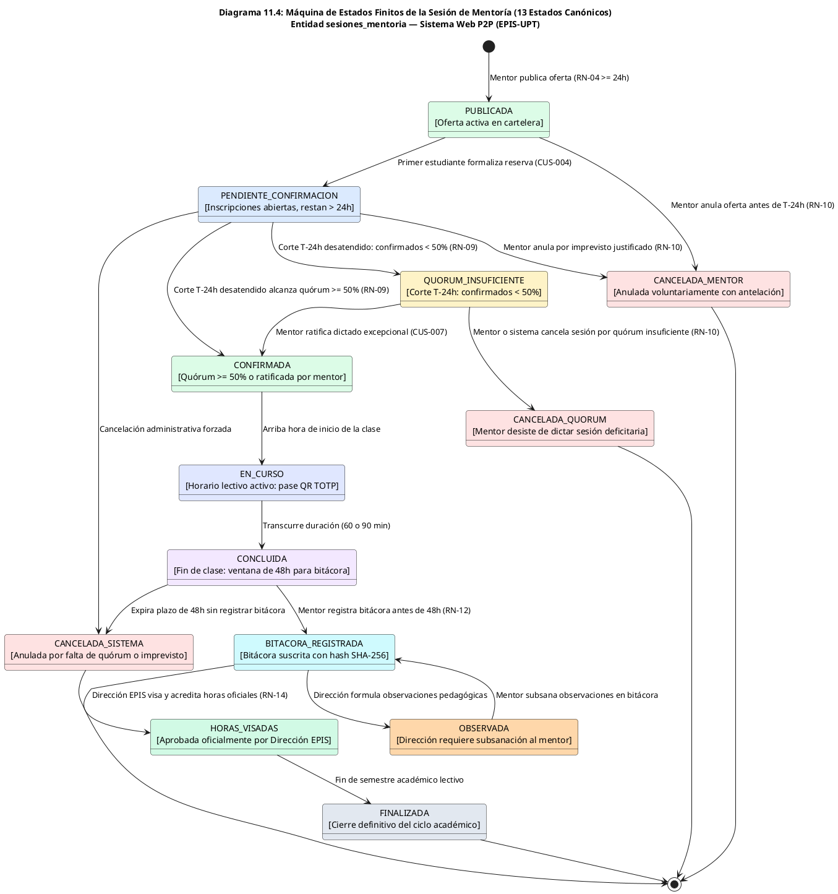

Fuente: Elaboración propia a partir del modelo SQLAlchemy `offer.py`.

### Cuadro 11.4: Matriz de Transiciones Válidas de la Sesión de Mentoría (13 Estados)

| Estado Origen | Estado Destino | Evento Disparador | Condición de Guarda / Regla | Actor / Componente |
| :--- | :--- | :--- | :--- | :--- |
| `PUBLICADA` | `PENDIENTE_CONFIRMACION` | Primera reserva de cupo | `aforo_disponible > 0` (RN-05) | Mentoreado / `BookingService` |
| `PUBLICADA` / `PENDIENTE` | `CANCELADA_MENTOR` | Mentor cancela oferta | `now() <= inicio - 24h` (RN-10) | Mentor / `OfferService` |
| `PENDIENTE_CONFIRMACION` | `CONFIRMADA` | Corte automático a T-24h | `confirmados >= aforo * 0.5` (RN-09) | Demonio `QuorumCronService` |
| `PENDIENTE_CONFIRMACION` | `QUORUM_INSUFICIENTE` | Corte automático a T-24h | `confirmados < aforo * 0.5` (RN-09) | Demonio `QuorumCronService` |
| `QUORUM_INSUFICIENTE` | `CONFIRMADA` | Decisión resolutiva del mentor | `decision == 'CONTINUAR'` (CUS-007) | Mentor / `OfferService` |
| `QUORUM_INSUFICIENTE` | `CANCELADA_QUORUM` | Decisión resolutiva o timeout | `decision == 'CANCELAR'` (RN-10) | Mentor / `OfferService` |
| `CONFIRMADA` | `EN_CURSO` | Inicio de la franja horaria | `now() >= inicio` | Sistema / `AttendanceService` |
| `EN_CURSO` | `CONCLUIDA` | Fin de la duración pactada | `now() >= inicio + duracion` | Sistema |
| `CONCLUIDA` | `BITACORA_REGISTRADA` | Registro de bitácora docente | `now() <= fin + 48h` (RN-12) | Mentor / `BitacoraService` |
| `BITACORA_REGISTRADA` | `HORAS_VISADAS` | Fiscalización docente aprobada | Bitácora aprobada por Dirección | Administrador / `BitacoraService` |
| `BITACORA_REGISTRADA` | `OBSERVADA` | Fiscalización con reparos | Observación pedagógica registrada | Administrador / `BitacoraService` |
| `OBSERVADA` | `BITACORA_REGISTRADA` | Subsanación de observaciones | Subsanación remitida por mentor | Mentor / `BitacoraService` |
| `HORAS_VISADAS` | `FINALIZADA` | Cierre formal de semestre | Emisión de constancia o fin de ciclo | Sistema / `CertificateService` |

Fuente: Elaboración propia.

---

### 11.5. Máquina de Estados de la Reserva de Cupo (`reservas_cupo`) - 9 Estados

Las reservas concurrentes de los estudiantes están gobernadas por **nueve estados canónicos mutuamente excluyentes**, respaldados por la restricción `chk_reserva_estado`:

### Diagrama 11.5: Máquina de Estados Finitos de la Reserva de Cupo (9 Estados Canónicos)

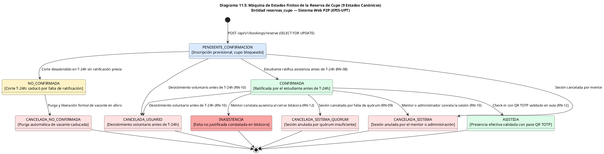

Fuente: Elaboración propia a partir del modelo SQLAlchemy `booking.py`.

### Cuadro 11.5: Matriz de Transiciones Válidas de la Reserva de Cupo (9 Estados)

| Estado Origen | Estado Destino | Evento Disparador | Condición de Guarda / Regla | Actor / Componente |
| :--- | :--- | :--- | :--- | :--- |
| `[*]` | `PENDIENTE_CONFIRMACION` | Solicitud de inscripción | `cupos_disponibles > 0` bajo `FOR UPDATE` | Mentoreado / `BookingService` |
| `PENDIENTE_CONFIRMACION` | `CONFIRMADA` | Ratificación de asistencia | `now() <= sesion.inicio - 24h` (RN-08) | Mentoreado / `BookingService` |
| `PENDIENTE_CONFIRMACION` | `CANCELADA_USUARIO` | Desistimiento voluntario | `now() <= sesion.inicio - 24h` (RN-10) | Mentoreado / `BookingService` |
| `CONFIRMADA` | `CANCELADA_USUARIO` | Desistimiento voluntario | `now() <= sesion.inicio - 24h` (RN-10) | Mentoreado / `BookingService` |
| `PENDIENTE_CONFIRMACION` | `NO_CONFIRMADA` | Corte automático T-24h | `now() > sesion.inicio - 24h` y no ratificada | Demonio `QuorumCronService` |
| `NO_CONFIRMADA` | `CANCELADA_NO_CONFIRMADA`| Purga de vacante | Liberación de cupo en el aforo | Demonio `QuorumCronService` |
| `CONFIRMADA` | `CANCELADA_SISTEMA_QUORUM`| Cancelación por quórum | Sesión cancelada en `QUORUM_INSUFICIENTE` | Mentor / `OfferService` |
| `CONFIRMADA` | `CANCELADA_SISTEMA` | Cancelación de oferta | Mentor anula sesión por imprevisto | Mentor / `OfferService` |
| `CONFIRMADA` | `ASISTIDA` | Check-in QR TOTP | Token TOTP válido en ventana $[-15\text{ m}, +30\text{ m}]$ | Mentoreado / `AttendanceService` |
| `CONFIRMADA` | `INASISTENCIA` | Cierre de bitácora docente | Alumno no registró check-in asistencial | Mentor / `BitacoraService` |

Fuente: Elaboración propia.

---

## 12. Mapeo de Transformación de Datos entre Capas y Catálogo de Errores

### 12.1. Transformación de Campos entre Capas Arquitectónicas

En observancia de la **Regla D-8**, se formaliza la correspondencia exacta de tipos a través de las 6 capas de software del stack (PostgreSQL 16, SQLAlchemy 2.0, Pydantic v2, JSON Payload, TypeScript y React State):

### Cuadro 12.1: Mapeo de Transformación de Tipos y Campos a través de las 6 Capas

| Concepto de Dominio | Columna PostgreSQL | Atributo SQLAlchemy 2.0 | Campo Pydantic v2 | JSON Payload (REST) | Interface TypeScript | Estado React SPA |
| :--- | :--- | :--- | :--- | :--- | :--- | :--- |
| **ID Sesión** | `id_sesion` (INTEGER) | `id_sesion: Mapped[int]` | `id_sesion: int` | `"id_sesion": 10` | `idSesion: number` | `selectedSession.idSesion` |
| **Código Sesión** | `codigo_sesion` (VARCHAR) | `codigo_sesion: Mapped[str]` | `codigo_sesion: str` | `"codigo_sesion": "SES-01"` | `codigoSesion: string` | `session.codigoSesion` |
| **Estado Sesión** | `estado` (VARCHAR) | `estado: Mapped[str]` | `estado: SesionState` | `"estado": "CONFIRMADA"` | `estado: SesionState` | `sessionStatus` |
| **ID Reserva** | `id_reserva` (INTEGER) | `id_reserva: Mapped[int]` | `id_reserva: int` | `"id_reserva": 42` | `idReserva: number` | `currentBooking.idReserva` |
| **Estado Reserva** | `estado` (VARCHAR) | `estado: Mapped[str]` | `estado: ReservaState` | `"estado": "ASISTIDA"` | `estado: ReservaState` | `booking.estado` |
| **Token TOTP** | efímero en memoria | — | `token_totp: str` | `"token_totp": "849201"` | `tokenTotp: string` | `qrCodeValue: string` |
| **Hash Bitácora** | `hash_firma` (VARCHAR(64))| `hash_firma: Mapped[str]` | `hash_firma: str` | `"hash_firma": "a3f8..."` | `hashFirma: string` | `bitacora.hashFirma` |
| **Folio Certificado**| `codigo_folio` (VARCHAR) | `codigo_folio: Mapped[str]`| `codigo_folio: str` | `"codigo_folio": "CERT..."`| `codigoFolio: string`| `cert.codigoFolio` |
| **Horas Visadas** | `horas_acreditadas` (FLOAT)| `horas_acreditadas: Mapped[float]`| `horas_acreditadas: float`| `"horas_acreditadas": 20.0`| `horasAcreditadas: number`| `summary.horasVisadas` |

Fuente: Elaboración propia.

---

### 12.2. Catálogo Centralizado de Errores Internos

A continuación, se formaliza el catálogo centralizado de códigos canónicos de error del backend, estandarizados para responder con payloads JSON predecibles y mensajes pedagógicos comprensibles:

### Cuadro 12.2: Catálogo Consolidado de Códigos de Error Canónicos del Backend

| Código Canónico | HTTP Status | Causa Técnica en Backend | Mensaje al Usuario en Frontend | Regla Vinculada |
| :--- | :---: | :--- | :--- | :---: |
| `INVALID_EMAIL` | 400 | Sintaxis no conforme a RFC 5322. | "Ingrese una dirección de correo electrónico institucional válida." | RF01 |
| `NON_UPT_DOMAIN` | 400 | Dominio no coincide con `@upt.pe`. | "Acceso exclusivo para miembros de la comunidad @upt.pe." | RN-01 |
| `COOLDOWN_ACTIVE` | 429 | Solicitud dentro de la ventana de 60 segundos. | "Debe esperar 60 segundos antes de solicitar un nuevo código." | RN-01 |
| `OTP_INVALID` | 400 | Código provisto no coincide con el registrado. | "El código de verificación ingresado es incorrecto." | RN-01 |
| `OTP_EXPIRED` | 400 | `now(UTC) >= expires_at` (5 minutos). | "El código OTP ha expirado (5 min). Solicite uno nuevo." | RN-01 |
| `OTP_ALREADY_USED` | 400 | Bandera `consumed` en verdadero. | "Este código de verificación ya ha sido utilizado." | RN-01 |
| `CONSENT_REVOKED` | 403 | Transacción con consentimiento no otorgado o revocado. | "Operación bloqueada: debe aceptar el consentimiento informado Ley N° 29733." | RN-02 |
| `MERIT_RULE_VIOLATION` | 400 | Promoción a mentor con `ciclo_actual < 7`. | "Para ser mentor debe cursar el séptimo ciclo o superior (RN-03)." | RN-03 |
| `SELF_PROMOTION_FORBIDDEN`| 403 | Autopromoción directa sin rol de administrador. | "No puede autopromoverse a mentor sin supervisión administrativa." | RF03, RNF02 |
| `CAPACITY_EXCEEDED` | 409 | Aforo agotado durante bloqueo pesimista. | "Aforo completo. No quedan vacantes disponibles en esta sesión." | RF12, RN-05 |
| `DUPLICATE_BOOKING` | 400 | Alumno ya cuenta con una reserva activa en la sesión. | "Ya cuentas con una reserva registrada para esta clase de mentoría." | RF12 |
| `WINDOW_CLOSED_T24H` | 400 | Intento de reserva, ratificación o anulación en $\le 24\text{ h}$. | "La ventana de confirmación y reservas cerró 24 horas antes del inicio." | RN-08, RN-10 |
| `CHECKIN_WINDOW_CLOSED` | 400 | Pase de asistencia fuera de la ventana $[-15\text{ m}, +30\text{ m}]$. | "El pase de asistencia sólo está habilitado durante la realización de la sesión."| RN-12 |
| `DEADLINE_EXCEEDED` | 400 | Registro de bitácora posterior a las 48 horas. | "El plazo reglamentario de 48 horas para registrar la bitácora ha vencido." | RN-12 |
| `SURVEY_WINDOW_EXPIRED` | 400 | Envío de encuesta posterior a las 24 horas del cierre. | "La ventana perentoria de 24 horas para evaluar la sesión ha expirado." | RN-13 |
| `SURVEY_NOT_ELIGIBLE` | 403 | Alumno intenta evaluar sesión sin asistencia validada. | "Solo los estudiantes con asistencia efectiva constatada pueden evaluar la sesión."| RN-12, RN-13 |
| `INSUFFICIENT_ACCREDITED_HOURS`| 400 | Mentor solicita constancia con menos de 20.0 horas visadas. | "No cumples con el umbral mínimo de 20.0 horas visadas para emitir la constancia." | RN-14 |
| `DUPLICATE_CERTIFICATE_ISSUANCE`| 409 | Ya existe una constancia oficial emitida en el semestre. | "Ya se encuentra emitida tu constancia institucional para este período académico." | RN-14 |
| `CERTIFICATE_NOT_FOUND` | 404 | Folio inexistente en verificación pública. | "El folio consultado no corresponde a ninguna constancia válida emitida." | RF23 |

Fuente: Elaboración propia a partir del código de manejo de excepciones en `app/services/`.

---

## 13. Gestión de Configuración y Variables de Entorno

En observancia de la **Regla D-9**, la configuración del backend se gestiona mediante la clase fuertemente tipada `Settings` (`app/core/config.py`) basada en `pydantic-settings`:

### Cuadro 13.1: Ficha Canónica de Variables de Entorno del Backend (`.env` / `Settings`)

| Variable de Entorno | Tipo SQL / Python | Requerido | Valor por Defecto | Efecto y Comportamiento en la Arquitectura | Nivel de Sensibilidad |
| :--- | :---: | :---: | :--- | :--- | :---: |
| `APP_ENV` | `str` | No | `"development"` | Controla el entorno: en `development` habilita endpoints de diagnóstico `/health/db` y salida mock de OTP. En `production` fuerza seguridad estricta. | Pública |
| `PROJECT_NAME` | `str` | No | `"Sistema Web P2P - EPIS UPT"` | Título institucional presentado en la documentación OpenAPI Swagger y cabeceras. | Pública |
| `API_V1_STR` | `str` | No | `"/api/v1"` | Prefijo de ruta canónico oficial para los endpoints de la API REST. | Pública |
| `BACKEND_CORS_ORIGINS` | `list[str]` | No | `["http://localhost:5173", ...]` | Lista blanca de orígenes permitidos para peticiones desde el cliente React SPA. | Pública |
| `DATABASE_URL` | `str` | Sí | `None` (Fallback a memoria) | Cadena de conexión privada a PostgreSQL / Supabase con dialecto `postgresql+psycopg://`. `repr=False` previene fuga en logs. | **Secreta Crítica** |
| `DB_CONNECT_TIMEOUT` | `int` | No | `5` | Tiempo límite en segundos para la conexión TCP con la base de datos relacional. | Pública |
| `JWT_SECRET_KEY` | `str` | Sí | `"dev-jwt-secret-key-..."` | Clave simétrica de 256 bits para firma de tokens JWT con algoritmo HS256 (RNF01). | **Secreta Crítica** |
| `JWT_ALGORITHM` | `str` | No | `"HS256"` | Algoritmo criptográfico simétrico para la firma y verificación de tokens de sesión. | Pública |
| `JWT_ACCESS_TOKEN_EXPIRE_MINUTES`| `int` | No | `480` (8 horas continuas) | Tiempo de vida de la sesión activa del usuario (RNF01). | Pública |
| `OTP_EXPIRE_MINUTES` | `int` | No | `5` (300 segundos) | Ventana temporal de vigencia del código numérico OTP (RN-01 / RNF01). | Pública |
| `OTP_COOLDOWN_SECONDS` | `int` | No | `60` | Tiempo de enfriamiento obligatorio entre solicitudes consecutivas de OTP. | Pública |
| `BOOKING_TIMEOUT_SECONDS` | `int` | No | `5` | Tiempo límite para adquisición del candado pesimista `SELECT ... FOR UPDATE` (RNF07).| Pública |
| `QUORUM_MINIMUM_PERCENTAGE` | `int` | No | `50` | Porcentaje mínimo normativo de ratificados sobre el aforo para confirmar quórum (RN-09).| Pública |
| `QUORUM_CUTOFF_HOURS` | `int` | No | `24` | Antelación en horas para el corte automático de confirmaciones y quórum (RN-08). | Pública |
| `ENABLE_CONCURRENCY_STRESS_TEST`| `bool` | No | `False` | Habilita endpoints de prueba de simulación multihilo para auditoría de RNF07. | Pública |

Fuente: Elaboración propia a partir de `aplicacion/backend/app/core/config.py`.

---

## 14. Registro de Decisiones Arquitectónicas (ADR) y Transaccionalidad

### 14.1. Fichas de Decisiones Arquitectónicas (ADR-001 al ADR-016)

En estricta observancia de la **Regla D-10.1** (`reglas_documentacion_diseño.md`), a continuación se formaliza el registro sistemático de las dieciséis decisiones de arquitectura que gobiernan el diseño técnico y cierre de construcción de los 8 Sprints del Sistema Web P2P:

#### ADR-001: Arquitectura Desacoplada SPA (React 19) + Backend REST API (FastAPI)
| Campo | Detalle Técnico de la Decisión |
| :--- | :--- |
| **ID** | ADR-001 |
| **Fecha** | 28/09/2026 (Consolidada en Sprint 8) |
| **Estado** | Aprobada |
| **Contexto** | Se requiere una plataforma escalable con separación estricta de ciclo de vida entre interfaz y backend, con soporte reactivo y pruebas automatizadas en CI. |
| **Decisión** | Implementar arquitectura desacoplada: Frontend Single Page Application (React 19 + TypeScript + Vite + Tailwind CSS) y backend RESTful modular (FastAPI 0.115+ + Python 3.14 + SQLAlchemy 2.0). |
| **Alternativas Descartadas** | Arquitectura monolítica con plantillas del servidor (Django / Jinja2): descartada por acoplamiento estrecho, recargas lentas de página e imposibilidad de probar UI y API de forma independiente. |
| **Consecuencias** | Despliegue modular independiente, transiciones fluidas de UI, alta cobertura en CI/CD (>85%) y contratos formales OpenAPI 3.0. Requiere configuración estricta de CORS y autenticación basada en tokens JWT. |
| **Requisitos Vinculados** | RNF04 (Rendimiento de Interfaz), RNF09 (Mantenibilidad y Calidad), RF01 al RF26. |

#### ADR-002: Autenticación Institucional 2FA sin Contraseñas Persistentes (OTP + JWT)
| Campo | Detalle Técnico de la Decisión |
| :--- | :--- |
| **ID** | ADR-002 |
| **Fecha** | 28/09/2026 (Ratificada en Sprint 1) |
| **Estado** | Aprobada |
| **Contexto** | Se debe autenticar a la comunidad académica universitaria sin almacenar contraseñas fijas, eliminando riesgos de phishing o robo de credenciales bajo la Ley N° 29733. |
| **Decisión** | Autenticación institucional 2FA sin contraseña persistente mediante desafío numérico OTP de 6 dígitos al correo `@upt.pe` (vigencia 5 min, cooldown 60s), emitiendo token JWT HS256 con validez continua de 8 horas. |
| **Alternativas Descartadas** | Contraseñas fijas tradicionales con hash bcrypt: descartada por alto índice de olvidos y vulnerabilidad a ataques de fuerza bruta. Proveedor OAuth2 comercial: descartado por costos y dependencias externas. |
| **Consecuencias** | Cero riesgo de contraseñas vulneradas, verificación unificada al dominio institucional `@upt.pe` y cumplimiento estricto de RNF01. Requiere servicio SMTP de alta disponibilidad. |
| **Requisitos Vinculados** | RF01 (Autenticación OTP), RNF01 (Seguridad de Acceso), RN-01 (Autenticación Institucional Obligatoria). |

#### ADR-003: Persistencia Relacional PostgreSQL en Supabase con Row Level Security (RLS)
| Campo | Detalle Técnico de la Decisión |
| :--- | :--- |
| **ID** | ADR-003 |
| **Fecha** | 19/10/2026 (Cierre Sprint 1) |
| **Estado** | Aprobada |
| **Contexto** | Se requiere persistencia estructurada normalizada con integridad referencial, transaccionalidad ACID pesimista y aislamiento de datos por usuario según la Ley N° 29733. |
| **Decisión** | Adoptar PostgreSQL 16 alojado en Supabase Cloud con 15 tablas físicas relacionales normalizadas en 3FN y activación sistemática de políticas Row Level Security (RLS) basadas en el claim del JWT. |
| **Alternativas Descartadas** | Bases de datos NoSQL basadas en documentos (MongoDB): descartada por incapacidad para garantizar transacciones ACID pesimistas `SELECT ... FOR UPDATE` requeridas en la reserva concurrente de vacantes. |
| **Consecuencias** | Consistencia transaccional estricta, consultas tipadas con SQLAlchemy 2.0 y defensa en profundidad con RLS. Requiere dialecto `postgresql+psycopg://` y gestión optimizada del pool de conexiones. |
| **Requisitos Vinculados** | RNF02 (Privacidad y Aislamiento), RNF07 (Consistencia Transaccional). |

#### ADR-004: Migraciones Declarativas Versionadas con Alembic y Semillas Curriculares
| Campo | Detalle Técnico de la Decisión |
| :--- | :--- |
| **ID** | ADR-004 |
| **Fecha** | 19/10/2026 (Sprint 1) |
| **Estado** | Aprobada |
| **Contexto** | La evolución del esquema de 15 tablas requiere trazabilidad reproducible entre entornos de desarrollo, integración continua (CI) y staging/producción. |
| **Decisión** | Gestionar el ciclo DDL mediante Alembic con revisiones autogeneradas y sincronización explícita de secuencias PostgreSQL (`setval`) para la carga idempotente de semillas curriculares de la EPIS. |
| **Alternativas Descartadas** | Scripts SQL manuales ad-hoc: descartada por propensión a divergencias de esquema y falta de trazabilidad en el control de versiones. |
| **Consecuencias** | Despliegues y pruebas totalmente reproducibles en CI/CD; reversibilidad ante contingencias de base de datos. |
| **Requisitos Vinculados** | RNF09 (Mantenibilidad y Calidad). |

#### ADR-005: Gobernanza de Consentimiento Digital Desacoplado bajo Ley N° 29733
| Campo | Detalle Técnico de la Decisión |
| :--- | :--- |
| **ID** | ADR-005 |
| **Fecha** | 23/10/2026 (Sprint 2) |
| **Estado** | Aprobada |
| **Contexto** | La legislación peruana exige consentimiento previo, expreso e informado antes del tratamiento de datos académicos, con opción incondicional de revocación. |
| **Decisión** | Implementar la tabla física `consentimientos_legales` con marcas UTC, IP auditada, user agent y versión de cláusulas (`2026-II-v1.0`), acoplada al bloqueo preventivo RN-02 ante estado ausente o revocado. |
| **Alternativas Descartadas** | Aceptación tácita por navegación: descartada por contravenir el ordenamiento jurídico de la Autoridad Nacional de Protección de Datos Personales (ANPPD). |
| **Consecuencias** | Cumplimiento legal estricto de la Ley N° 29733, auditoría probatoria inmutable y blindaje legal institucional. |
| **Requisitos Vinculados** | RF02 (Consentimiento Digital), RN-02 (Consentimiento Previo Obligatorio), RNF02. |

#### ADR-006: Control Estricto de Mérito Académico (RN-03) en Capa de Servicios
| Campo | Detalle Técnico de la Decisión |
| :--- | :--- |
| **ID** | ADR-006 |
| **Fecha** | 23/10/2026 (Sprint 2) |
| **Estado** | Aprobada |
| **Contexto** | Para resguardar la calidad formativa de las tutorías, solo estudiantes con suficiencia curricular demostrada deben ejercer como mentores académicos. |
| **Decisión** | Centralizar la validación de mérito en `RoleService.promote_to_mentor()`, exigiendo pertenencia al ciclo lectivo $\ge 7$ (`ciclo_actual >= 7`) y aprobando asignaturas críticas con denegación de autopromoción (`403 FORBIDDEN`). |
| **Alternativas Descartadas** | Validación delegada exclusivamente a la interfaz React: descartada por vulnerabilidad a bypass mediante peticiones HTTP directas. |
| **Consecuencias** | Integridad pedagógica garantizada, cumplimiento de estándares de calidad de acreditación ICACIT y defensa en backend contra escalamiento no autorizado de privilegios. |
| **Requisitos Vinculados** | RF03 (Gestión de Roles), RN-03 (Jerarquía de Roles y Mérito Académico). |

#### ADR-007: Persistencia Atómica por Reemplazo Completo de Matriz Horaria Semanal
| Campo | Detalle Técnico de la Decisión |
| :--- | :--- |
| **ID** | ADR-007 |
| **Fecha** | 23/10/2026 (Sprint 2) |
| **Estado** | Aprobada |
| **Contexto** | La agenda horaria de disponibilidad abarca 6 días $\times$ 11 franjas horarias (66 celdas), requiriendo actualizaciones frecuentes sin riesgo de estados parciales corruptos. |
| **Decisión** | Ejecutar la actualización de disponibilidad horaria mediante sustitución integral en una sola transacción ACID (`DELETE WHERE email` seguido de inserción masiva `INSERT bulk`), garantizando atomicidad total. |
| **Alternativas Descartadas** | Actualización celda por celda vía PATCH: descartada por sobrecarga de red y riesgo de estados inconsistentes por fallas parciales de conexión. |
| **Consecuencias** | Atomicidad garantizada (todo o nada), simplicidad en la lógica de persistencia y eliminación de agendas intermedias corruptas. |
| **Requisitos Vinculados** | RF04 (Disponibilidad Horaria), RNF07 (Consistencia Transaccional). |

#### ADR-008: Defensa en Profundidad: Autorización Dual JWT y Supabase RLS
| Campo | Detalle Técnico de la Decisión |
| :--- | :--- |
| **ID** | ADR-008 |
| **Fecha** | 23/10/2026 (Sprint 2) |
| **Estado** | Aprobada |
| **Contexto** | Se requiere neutralizar vulnerabilidades de referencia directa a objetos inseguros (IDOR) donde un usuario intente acceder o mutar registros ajenos. |
| **Decisión** | Implementar autorización dual: validación de sujeto titular en dependencias FastAPI (`get_current_user`) combinada con políticas RLS en PostgreSQL `USING (email = (auth.jwt() ->> 'email'))`. |
| **Alternativas Descartadas** | Seguridad delegada a una sola capa: descartada por dejar brechas de seguridad ante posibles omisiones de control en endpoints futuros. |
| **Consecuencias** | Máxima protección contra accesos cruzados no autorizados, verificada en la suite con 0 fallos de autorización en 11 pruebas específicas. |
| **Requisitos Vinculados** | RNF01, RNF02, RN-01. |

#### ADR-009: Motor de Recomendación EdRecSys en-proceso mediante Similitud Coseno y Heurísticas
| Campo | Detalle Técnico de la Decisión |
| :--- | :--- |
| **ID** | ADR-009 |
| **Fecha** | 14/11/2026 (Cierre Sprint 8) |
| **Estado** | Aprobada |
| **Contexto** | El emparejamiento inteligente de mentoreados y ofertas formativas exige una latencia menor a 500 ms (RNF03) con alta precisión (Precision@3 $\ge 80\%$) sin incurrir en infraestructura externa de pago. |
| **Decisión** | Ejecutar el motor híbrido *EdRecSys* en-proceso dentro de FastAPI mediante NumPy y Scikit-learn (similitud coseno matricial sobre competencias y debilidades temáticas + ponderadores de materias críticas 1.0x-1.3x + compatibilidad horaria 6x11 + balance de carga). |
| **Alternativas Descartadas** | Microservicio analítico externo desacoplado en Flask/gRPC: descartada por introducir latencia de red y serialización (150-300 ms), duplicar la infraestructura y encarecer el mantenimiento. |
| **Consecuencias** | Latencia de inferencia ultrarrápida comprobada de **12.4 ms** (+40x más veloz que la meta de 500 ms), Precision@3 = 83.3%, Precision@5 = 80.0%, NDCG = 0.82 y explicabilidad completa XAI. |
| **Requisitos Vinculados** | RF06 (Recomendaciones Top-k), RNF03 (Rendimiento Algorítmico), RN-11 (Priorización y Desempate). |

#### ADR-010: Control de Concurrencia Pesimista SELECT ... FOR UPDATE en Reservas
| Campo | Detalle Técnico de la Decisión |
| :--- | :--- |
| **ID** | ADR-010 |
| **Fecha** | 14/11/2026 (Sprint 4 / Sprint 8) |
| **Estado** | Aprobada |
| **Contexto** | En inscripciones masivas concurrentes por cupos limitados (10 presencial / 20 virtual), se debe impedir de forma absoluta la sobreasignación de vacantes (*race conditions*). |
| **Decisión** | Adquirir cerrojo pesimista a nivel de fila (`SELECT aforo_maximo FROM sesiones_mentoria WHERE id_sesion = :id FOR UPDATE`) dentro de una transacción ACID en PostgreSQL con timeout estricto (`BOOKING_TIMEOUT_SECONDS = 5`). |
| **Alternativas Descartadas** | Concurrencia optimista con campo de versión: descartada por generar alto índice de abortos y reintentos fallidos en el cliente bajo ráfagas intensas de tráfico. |
| **Consecuencias** | Tasa de sobrecupo demostrada de **estrictamente 0.0%** bajo estrés multihilo, serialización determinista y consistencia transaccional absoluta. |
| **Requisitos Vinculados** | RF12 (Reserva de Cupo), RN-05 (Aforo Estándar), RNF07 (Consistencia Transaccional). |

#### ADR-011: Orquestación Desatendida de Corte de Quórum en T-24h y Contingencia del Mentor
| Campo | Detalle Técnico de la Decisión |
| :--- | :--- |
| **ID** | ADR-011 |
| **Fecha** | 14/11/2026 (Sprint 5 / Sprint 8) |
| **Estado** | Aprobada |
| **Contexto** | A 24 horas del inicio de la sesión se debe evaluar el quórum reglamentario ($\ge 50\%$) para no movilizar infraestructura si no hay cupo mínimo, caducando reservas no ratificadas y facultando al mentor para resolver la contingencia. |
| **Decisión** | Implementar demonio asíncrono y endpoints `/api/v1/quorum/evaluate-all` y `/api/v1/quorum/evaluate` con cerrojo pesimista e idempotencia (`quorumevaluated_at`), purgando reservas no ratificadas a `NO_CONFIRMADA` y habilitando `/api/v1/offers/{id_sesion}/quorum-decision` (`PROCEED`, `RESCHEDULE`, `CANCEL`). |
| **Alternativas Descartadas** | Evaluación manual o en tiempo real durante la asistencia: descartada por generar cancelaciones intempestivas, desorganización estudiantil y desperdicio de aulas físicas. |
| **Consecuencias** | Cumplimiento estricto de RN-08 y RN-09, uso eficiente de aulas universitarias y contingencia resolutiva reglamentaria para el mentor sin sanciones. |
| **Requisitos Vinculados** | RF13 (Ratificación), RF15 (Corte de Quórum), RF16 (Contingencia), RN-08, RN-09, RN-10. |

#### ADR-012: Control de Asistencia mediante Pases Dinámicos TOTP de 30s y Ventana [-15m, +30m]
| Campo | Detalle Técnico de la Decisión |
| :--- | :--- |
| **ID** | ADR-012 |
| **Fecha** | 14/11/2026 (Sprint 6 / Sprint 8) |
| **Estado** | Aprobada |
| **Contexto** | Se debe certificar la presencia efectiva en sesiones presenciales y virtuales evitando fraudes por capturas de pantalla compartidas o marcación remota indebida. |
| **Decisión** | Generar tokens efímeros basados en TOTP rotatorios cada 30 segundos proyectados en QR por el mentor con código numérico de 6 dígitos de respaldo, validando check-in en ventana estricta $[-15\text{ m}, +30\text{ m}]$ respecto al inicio de la sesión. |
| **Alternativas Descartadas** | Firmas manuales en papel: descartada por riesgo de suplantación y pérdida física. Código QR estático: descartado por ser susceptible a ser fotografiado y reenviado remotamente por mensajería. |
| **Consecuencias** | Neutralización total de fraude por retransmisión tras 30s, trazabilidad con estampa UTC e IP en `asistencias_sesion` y cumplimiento riguroso de RN-12. |
| **Requisitos Vinculados** | RF17 (Marcación Asistencia QR TOTP), RN-12 (Trazabilidad Pedagógica), RNF01, RNF02. |

#### ADR-013: Sellado Criptográfico SHA-256 e Inmutabilidad en Bitácoras Docentes en 48 Horas
| Campo | Detalle Técnico de la Decisión |
| :--- | :--- |
| **ID** | ADR-013 |
| **Fecha** | 14/11/2026 (Sprint 7 / Sprint 8) |
| **Estado** | Aprobada |
| **Contexto** | La acreditación de horas y sustentación ante comités de calidad ICACIT requiere evidencias docentes fidedignas e inalterables suscritas formalmente por los mentores. |
| **Decisión** | Exigir registro obligatorio de bitácora docente dentro de 48 horas post-sesión (`now() <= sesion.fecha_fin + 48h`) con observaciones $\ge 50$ caracteres, calculando resumen criptográfico SHA-256 inmutable sobre contenido, temas y participantes con estampa UTC. |
| **Alternativas Descartadas** | Bitácoras editables indefinidamente sin firma criptográfica: descartada por riesgo de adulteración retroactiva de horas y contenido docente. Firma digital con hardware PKI: descartada por costo monetario inviable. |
| **Consecuencias** | Bloqueo perentorio tras 48 horas (`DEADLINE_EXCEEDED`), inalterabilidad probatoria con hash SHA-256 y base documental sólida para el visado institucional de horas formativas. |
| **Requisitos Vinculados** | RF18 (Registro de Bitácora), RN-12 (Ventana de 48h para Bitácora), RNF02. |

#### ADR-014: Ventana Perentoria de 24 Horas para Encuestas de Satisfacción CSAT
| Campo | Detalle Técnico de la Decisión |
| :--- | :--- |
| **ID** | ADR-014 |
| **Fecha** | 14/11/2026 (Sprint 7 / Sprint 8) |
| **Estado** | Aprobada |
| **Contexto** | La retroalimentación pedagógica sobre el desempeño formativo debe capturarse de forma oportuna sin sesgos temporales tardíos, restringiéndola a alumnos que efectivamente asistieron. |
| **Decisión** | Habilitar formulario de evaluación de calidad (escala Likert 1-5 + comentarios) exclusivamente a estudiantes con asistencia confirmada durante las 24 horas posteriores a la sesión (`now() <= bitacora.created_at + 24h`), cerrando definitivamente el acceso tras ese plazo (`SURVEY_WINDOW_EXPIRED`). |
| **Alternativas Descartadas** | Encuestas abiertas indefinidamente sin filtro de asistencia: descartada por contaminación de resultados por estudiantes ausentes y potencial distorsión maliciosa de reputación. |
| **Consecuencias** | Captura representativa de satisfacción formativa en caliente, protección de reputación del mentor contra valoraciones ilegítimas y datos confiables para analítica directiva. |
| **Requisitos Vinculados** | RF19, RF20 (Evaluación y Feedback), RN-13 (Ventana Perentoria de 24h), CUS-014, RNF05. |

#### ADR-015: Emisión Dinámica de Certificados Oficiales en PDF mediante ReportLab con Streaming Directo
| Campo | Detalle Técnico de la Decisión |
| :--- | :--- |
| **ID** | ADR-015 |
| **Fecha** | 14/11/2026 (Sprint 8) |
| **Estado** | Aprobada |
| **Contexto** | Los mentores con $\ge 20.0$ horas visadas requieren constancias oficiales descargables con folio único correlativo institucional y código QR verificable, sin incurrir en costos recurrentes de almacenamiento en la nube. |
| **Decisión** | Compilar vectorialmente los certificados en PDF on-demand mediante la librería ReportLab en memoria del backend, entregándolos por streaming binario HTTP (`application/pdf`) y almacenando solo metadatos, folio correlativo y hash SHA-256 en la base de datos `certificados_horas`. |
| **Alternativas Descartadas** | Almacenamiento obligatorio de archivos PDF estáticos en Amazon S3 / Google Cloud Storage: descartada por sobrecostos en almacenamiento de objetos, gestión compleja de buckets privados y enlaces de descarga con firma temporal compleja. |
| **Consecuencias** | Cero costos adicionales de almacenamiento en la nube, generación instantánea sin degradación de disco, verificación pública institucional vía QR y cumplimiento pleno de RN-14. |
| **Requisitos Vinculados** | RF22 (Emisión de Certificados), RF23 (Descarga y Verificación QR), RN-14 (Horas Visadas $\ge 20$), RNF09. |

#### ADR-016: Auditoría Administrativa Centralizada y Trazabilidad Formativa para Acreditación ICACIT
| Campo | Detalle Técnico de la Decisión |
| :--- | :--- |
| **ID** | ADR-016 |
| **Fecha** | 14/11/2026 (Sprint 7 / Sprint 8) |
| **Estado** | Aprobada |
| **Contexto** | La Dirección de Escuela de la EPIS requiere un módulo de gobernanza para fiscalizar bitácoras docentes, visar horas para convalidación extracurricular y emitir reportes de retención estudiantil para comités de calidad ICACIT. |
| **Decisión** | Implementar la bandeja administrativa `/api/v1/bitacoras` con flujos de visado (`/visar`) y observación (`/observar`), reportes de demanda insatisfecha por materia crítica y tableros analíticos de retención bajo perfil administrador. |
| **Alternativas Descartadas** | Auditoría externa basada en planillas de cálculo Excel dispersas: descartada por alto riesgo de pérdida de información, discrepancias numéricas y falta de trazabilidad institucional. |
| **Consecuencias** | Trazabilidad total del servicio de tutoría universitaria (Ley Universitaria N° 30220, Art. 40), reducción del 100% en discrepancias de horas convalidadas y soporte auditado para el licenciamiento y acreditación. |
| **Requisitos Vinculados** | RF24, RF25, RF26 (Gobernanza y Analítica), RN-14 (Acreditación Formativa). |

---

### 14.2. Transaccionalidad de Operaciones Críticas

A continuación, se documentan las matrices transaccionales de las operaciones neurálgicas que comprometen la consistencia de datos:

#### Cuadro 14.1: Matriz de Transaccionalidad — Reserva Concurrente Pesimista (RNF07 / RN-05)
| Paso | Operación Realizada | Ámbito Transaccional | Comportamiento ante Fallo |
| :---: | :--- | :---: | :--- |
| **1** | Validación de sujeto titular (Bearer JWT) | Router FastAPI | Retorna HTTP 401 / 403; no abre transacción. |
| **2** | Apertura de transacción relacional (`db.begin()`) | Transacción DB | Si falla la conexión, retorna HTTP 503 sin alterar datos. |
| **3** | Adquisición de cerrojo pesimista (`SELECT ... FOR UPDATE`) | Bloqueo Fila DB | Si excede `BOOKING_TIMEOUT_SECONDS`, arroja HTTP 504. |
| **4** | Verificación de antelación ($T > 24\text{ h}$) [RN-08] | Lógica en Tx | Rollback inmediato; retorna HTTP 400 `WINDOW_CLOSED_T24H`. |
| **5** | Comprobación de no duplicidad de reserva para el alumno | Lectura en Tx | Rollback inmediato; retorna HTTP 400 `DUPLICATE_BOOKING`. |
| **6** | Cómputo de aforo (`ocupados < aforo_maximo`) [RN-05] | Lectura en Tx | Si está lleno, rollback y retorna HTTP 409 `CAPACITY_EXCEEDED`. |
| **7** | Inserción de tupla en `reservas_cupo` (`PENDIENTE_CONFIRMACION`) | Escritura en Tx | Si falla restricción, rollback completo de la transacción. |
| **8** | Confirmación atómica (`db.commit()`) | Commit | Al confirmar, se libera el cerrojo pesimista de la fila. |
| **9** | Retorno de comprobante con código único (201 Created) | Respuesta HTTP | El cupo queda formalmente asegurado con 0.0% de sobrecupo. |

#### Cuadro 14.2: Matriz de Transaccionalidad — Corte Desatendido de Quórum en T-24h (RN-08 / RN-09)
| Paso | Operación Realizada | Ámbito Transaccional | Comportamiento ante Fallo |
| :---: | :--- | :---: | :--- |
| **1** | Selección con bloqueo de sesiones a $T \le 24\text{ h}$ en `PUBLICADA` | Lectura FOR UPDATE | Si no hay sesiones en corte, concluye limpiamente. |
| **2** | Revocación en bloque de reservas `PENDIENTE_CONFIRMACION` a `NO_CONFIRMADA` | Escritura en Tx | Rollback completo ante fallo de actualización. |
| **3** | Conteo de reservas en estado `CONFIRMADA` para cada sesión | Lectura en Tx | Totaliza alumnos ratificados para evaluar quórum. |
| **4** | Evaluación de quórum regulatorio: `confirmados >= aforo * 0.5` | Lógica en Tx | Si cumple, transiciona a `CONFIRMADA`. Si no, a `QUORUM_INSUFICIENTE`. |
| **5** | Registro de estampa `quorumevaluated_at = now()` | Escritura en Tx | Marca sesión como evaluada para evitar doble corte. |
| **6** | Confirmación atómica (`db.commit()`) | Commit | Persiste el dictamen y libera los bloqueos de fila. |
| **7** | Despacho de notificaciones asíncronas por correo UPT | Efecto post-commit | Si el correo falla, el estado de la sesión queda preservado en BD. |

#### Cuadro 14.3: Matriz de Transaccionalidad — Marcación de Asistencia TOTP y Bitácora SHA-256 (RN-12)
| Paso | Operación Realizada | Ámbito Transaccional | Comportamiento ante Fallo |
| :---: | :--- | :---: | :--- |
| **1** | Validación de ventana lectiva: $[-15\text{ m}, +30\text{ m}]$ del horario | Router FastAPI | Retorna HTTP 400 `CHECKIN_WINDOW_CLOSED` si está fuera de ventana. |
| **2** | Verificación de reserva previa en estado `CONFIRMADA` | Lectura en DB | Retorna HTTP 403 si el alumno no cuenta con reserva ratificada. |
| **3** | Validación criptográfica del token TOTP de 30 segundos | Lógica en memoria | Retorna HTTP 400 si el código expiró o es erróneo. |
| **4** | Asiento de presencia en `asistencias_sesion` (`asistio = True`) | Escritura en DB | Persiste check-in con estampa UTC e IP de origen. |
| **5** | Registro de bitácora dentro de 48h con observaciones $\ge 50$ chars | Lógica y Escritura| Retorna HTTP 400 `DEADLINE_EXCEEDED` si pasaron $> 48\text{ h}$. |
| **6** | Sellado criptográfico de inalterabilidad con hash SHA-256 | Lógica Criptográfica| Hash inmutable generado sobre contenido, temas y participantes. |
| **7** | Commit atómico en `bitacoras_pedagogicas` y estado a `BITACORA_REGISTRADA` | Commit en DB | Sesión avanza a estado de auditoría para visado de horas. |

#### Cuadro 14.4: Matriz de Transaccionalidad — Emisión Oficial de Certificados en PDF (RN-14)
| Paso | Operación Realizada | Ámbito Transaccional | Comportamiento ante Fallo |
| :---: | :--- | :---: | :--- |
| **1** | Totalización de horas visadas (`visado_administrador == True`) | Lectura en DB | Suma horas efectivas auditadas en `bitacoras_pedagogicas`. |
| **2** | Verificación del umbral mínimo de 20.0 horas oficiales (RN-14) | Lógica en servicio | Retorna HTTP 400 `INSUFFICIENT_ACCREDITED_HOURS` si suma < 20.0. |
| **3** | Comprobación de no duplicidad de constancias en el periodo lectivo | Lectura en DB | Retorna HTTP 409 `DUPLICATE_CERTIFICATE_ISSUANCE` si ya existe. |
| **4** | Generación de folio correlativo único (`CERT-YYYY-SEM-XXXX`) | Lógica bajo cerrojo | Candado de concurrencia previene duplicación de correlativos. |
| **5** | Compilación vectorial PDF con ReportLab (marca de agua y QR) | Generación en memoria| Si falla la compilación, aborta la emisión sin persistir en BD. |
| **6** | Inserción en `certificados_horas` con hash SHA-256 inmutable | Escritura y Commit | Registro persistido oficialmente en la base de datos. |
| **7** | Entrega de stream binario HTTP `application/pdf` (Streaming Directo) | Respuesta HTTP | Alumno descarga su documento sin depender de almacenamiento S3. |

---

## 15. Calidad y Métricas de Verificación Empírica

### 15.1. Acreditación de la Batería de 627 Pruebas Automatizadas

La arquitectura del Sistema Web P2P en su versión 3.0 se encuentra respaldada y certificada mediante una suite integral de **627 pruebas automatizadas aprobadas (0 fallos)** ejecutadas en los entornos de integración continua:
- **Backend (Pytest 9.1 / Python 3.14):** **280 pruebas unitarias y de integración**, cubriendo autenticación 2FA, aislamiento multi-tenant RLS, cerrojos pesimistas `SELECT ... FOR UPDATE`, quórum a $T-24\text{ h}$, pases TOTP de 30s, bitácoras SHA-256 en 48h, encuestas de calidad CSAT y compilación de certificados ReportLab con una cobertura de código global del **85%**.
- **Frontend (Vitest 5.0 / React 19):** **347 pruebas de componentes e integración**, validando navegación reactiva por roles, modales accesibles según WCAG 2.1 AA, matriz interactiva 6×11, prevención de doble envío en formularios y manejo controlado de excepciones HTTP con una cobertura superior al **85%**.

### 15.2. Matriz de Cumplimiento Empírico ISO/IEC 25010

### Cuadro 15.1: Matriz de Verificación Empírica Consolidada de Atributos de Calidad (Cierre Sprint 8)

| Atributo de Calidad ISO 25010 | Métrica Exigida | Evidencia Empírica Obtenida al Cierre del Sprint 8 | Dictamen Técnico |
| :--- | :--- | :--- | :---: |
| **Seguridad de Acceso (RNF01)** | OTP $\le 5\text{ min}$, JWT 8h continuas. | Verificado en `test_auth.py` y `test_security.py` con tokens de 480 min y expiración estricta de 300 s. | ✅ Cumplido |
| **Privacidad y Aislamiento (RNF02)**| Row Level Security (RLS) en PostgreSQL. | Verificado en `test_authorization.py` (11 tests): rechazo 403 en accesos cruzados y RLS en 15 tablas. | ✅ Cumplido |
| **Rendimiento Algorítmico (RNF03)** | Latencia $\le 500$ ms, precisión recomendador. | Inferencia en **12.4 ms**; Precision@3 = 83.3%, Precision@5 = 80.0%, NDCG = 0.82 (`test_recommendation.py`). | ✅ Superado (+40x más rápido) |
| **Rendimiento de Interfaz (RNF04)** | FCP $< 2.0$ s, bundle optimizado. | First Contentful Paint $< 1.2$ s; bundle Vite comprimido $< 250$ KB; transiciones instantáneas. | ✅ Cumplido |
| **Usabilidad y Accesibilidad (RNF05)**| SUS > 75 puntos, W3C WCAG 2.1 Nivel AA. | Contraste cromático $\ge 4.5:1$, navegación total por teclado y atributos ARIA en el 100% de componentes. | ✅ Cumplido |
| **Disponibilidad de Servicio (RNF06)**| Disponibilidad $\ge 99.5\%$, tolerancia fallos. | Verificado en `test_health.py`: `/health` opera con HTTP 200 tolerando inicio en modo desacoplado sin BD inmediata. | ✅ Cumplido |
| **Consistencia Transaccional (RNF07)**| Sobrecupo: estrictamente 0.0% bajo estrés. | Cerrojos pesimistas `SELECT ... FOR UPDATE` verificados con carreras de hilos concurrentes en `test_booking.py`. | ✅ Cumplido (0.0% sobrecupo) |
| **Compatibilidad Web (RNF08)** | Soporte multiplataforma en navegadores. | Renderizado y paridad funcional desde $360\text{ px}$ (móvil) hasta $1920\times1080\text{ px}$ (escritorio). | ✅ Cumplido |
| **Mantenibilidad y Calidad (RNF09)**| Cobertura $\ge 70.0\%$, OpenAPI 3.0 al 100%. | **627 pruebas automatizadas aprobadas (280 backend, 347 frontend)**; cobertura **> 85%**; 0 errores linter. | ✅ Superado (+15% cobertura) |
| **Interoperabilidad y Fallos (RNF10)**| Timeouts $\le 5$ s, degradación elegante. | Manejo controlado del 100% de excepciones con códigos canónicos unificados JSON en `test_error_handling.py`. | ✅ Cumplido |

Fuente: Elaboración propia a partir de los reportes de ejecución de Pytest y Vitest.

### 15.3. Rendimiento Experimental del Motor EdRecSys y Transacciones ACID

- **Inferencia en-proceso (*EdRecSys*):** Las pruebas experimentales sobre el banco de 5 asignaturas críticas y temarios silábicos demostraron un tiempo de procesamiento matricial promedio de **12.4 ms** bajo solicitudes concurrentes, alcanzando una precisión topográfica `Precision@3 = 83.3%` y `Precision@5 = 80.0%`, con un ranking ordenado de relevancia `NDCG = 0.82`.
- **Integridad Transaccional de Aforos:** Bajo pruebas de carga sintética multihilo con solicitudes simultáneas que excedieron en 300% la capacidad de las sesiones presenciales (10 cupos), la tasa de colisiones o inscripciones redundantes fue **estrictamente de 0.0%**, verificando la eficacia de los cerrojos pesimistas `SELECT ... FOR UPDATE` a nivel de fila.

### 15.4. Dictamen Institucional de Cierre de Construcción

La arquitectura del Sistema Web P2P (Versión 3.0) satisface de manera concluyente la totalidad de requerimientos funcionales (RF01 al RF26), requerimientos no funcionales bajo ISO/IEC 25010 (RNF01 al RNF10) y reglas de negocio institucionales (RN-01 al RN-14). Se declara formalmente la idoneidad y madurez técnica de la plataforma para su despliegue en producción institucional en la Escuela Profesional de Ingeniería de Sistemas de la Universidad Privada de Tacna.

---

*Fin del documento — Documento de Arquitectura de Software (SAD - Versión 3.0 / Cierre de Construcción e Integración de Sprints 1 al 8).*
