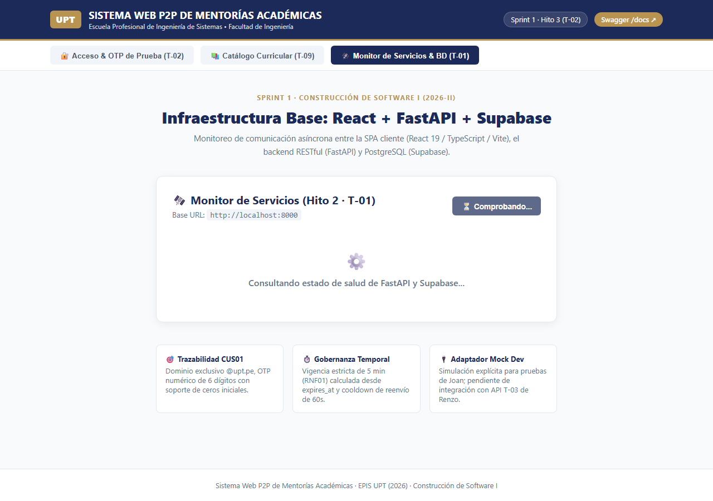
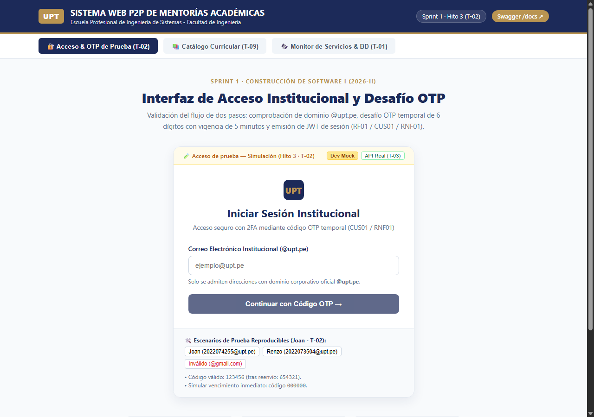
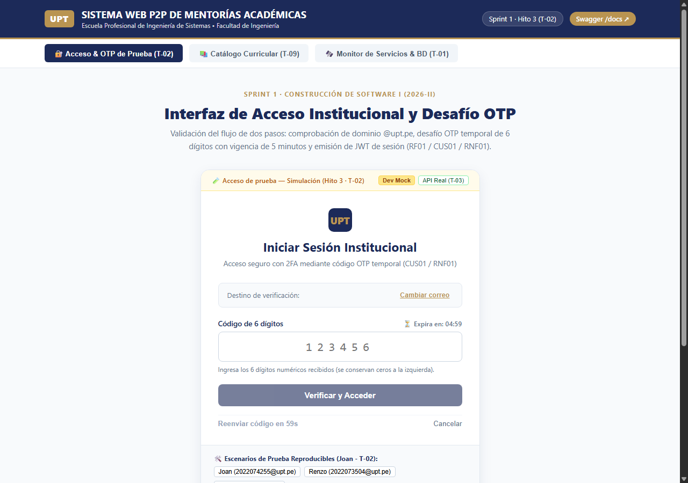
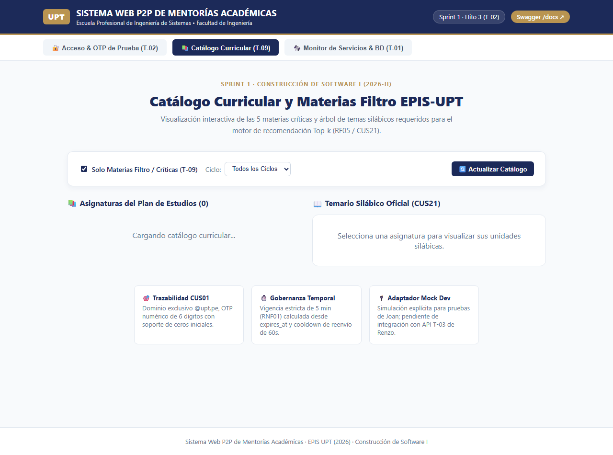
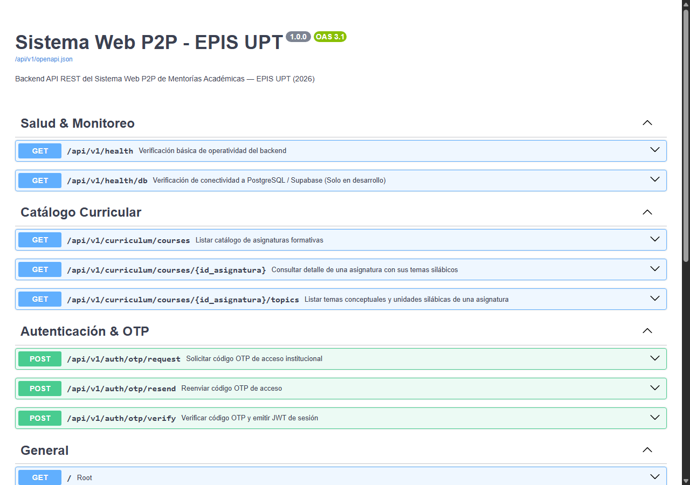
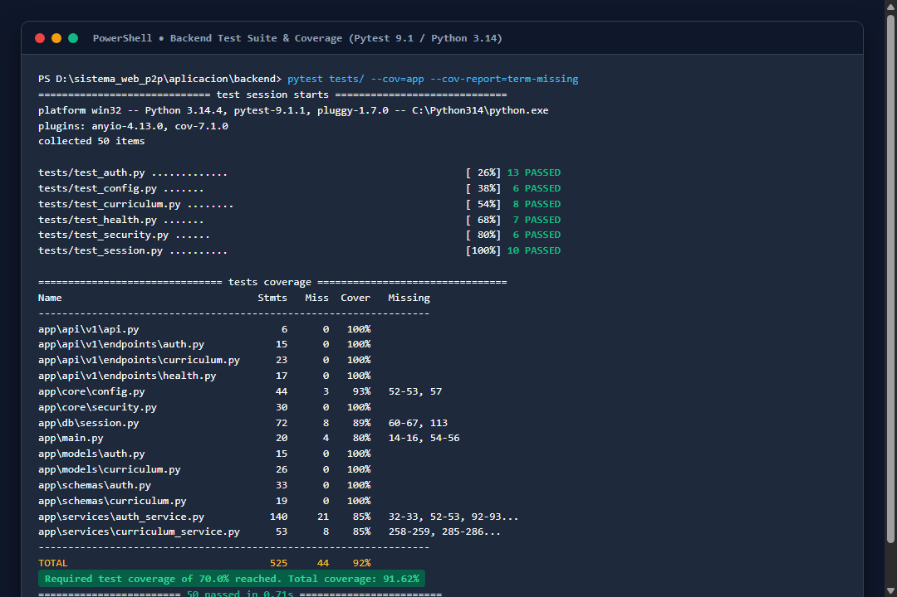
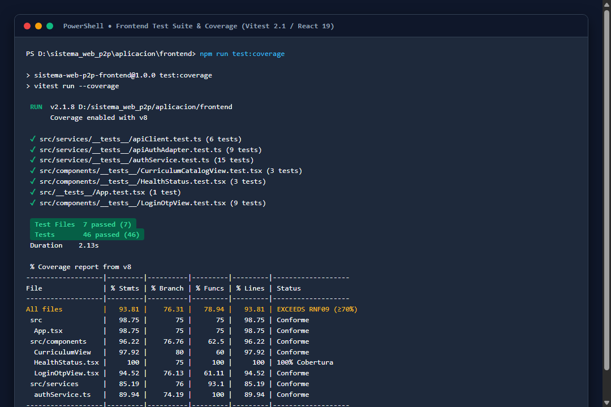

# Informe de desarrollo y resultados — Sprint 01

## «Base técnica, acceso institucional OTP y catálogo curricular»

**Proyecto:** Sistema Web P2P con algoritmo de recomendación para la personalización de mentorías académicas en la EPIS-UPT.  
**Institución:** Universidad Privada de Tacna — Facultad de Ingeniería — Escuela Profesional de Ingeniería de Sistemas.  
**Curso:** Construcción de Software I.  
**Docente de cátedra:** Dr. Ricardo Eduardo Valcárcel Alvarado.  
**Semestre académico:** 2026-II.  
**Equipo:** Grupo 03 / C-SharkTeam.  
**Integrantes:** Joan Cristian Medina Quispe (Código: 2022074255) y Renzo Antonio Antayhua Mamani (Código: 2022073504).  
**Periodo planificado:** 13/10/2026–18/10/2026.  
**Periodo real documentado:** 13/10/2026–19/10/2026.  
**Fecha de presentación:** 19/10/2026.  
**Repositorio oficial:** [sistema_web_p2p](https://github.com/JMedina255/sistema_web_p2p).  
**Rama y commit evaluados:** `main` / [`2ae4f92ab75db22fc8418b2e172e7ffd8cb21a88`](https://github.com/JMedina255/sistema_web_p2p/commit/2ae4f92ab75db22fc8418b2e172e7ffd8cb21a88).  
**Estado del informe:** Versión final consolidada y revisada por el equipo.  
**Balance del sprint al corte:** Objetivo logrado en la totalidad del alcance comprometido para el Sprint 01. Se encuentran operativas y verificadas la arquitectura desacoplada, la interfaz SPA React, la API RESTful en FastAPI, la persistencia relacional con Row Level Security en Supabase para el catálogo de las 5 materias filtro formativas, el flujo de autenticación OTP con emisión de tokens de sesión JWT y una suite de 96 pruebas automatizadas superando el umbral de cobertura de RNF09 ($\ge 70\%$). El servicio de despacho de correos opera mediante salida por consola y simulación en desarrollo, manteniéndose la integración con el relay SMTP institucional diferida para el entorno de producción.

---

### Control de versiones del informe

A continuación, se presenta el historial formal de revisiones y aprobaciones del presente informe de desarrollo, detallando la autoría técnica de cada iteración y el alcance de las modificaciones incorporadas.

#### Cuadro 0.1: Historial de versiones del informe

| Versión | Fecha | Responsable | Revisión / aprobación registrada | Cambio realizado |
| :---: | :---: | :--- | :--- | :--- |
| **1.0** | 19/10/2026 | Joan Medina / Renzo Antayhua | Revisión interna Grupo 03 (Aprobación de cátedra pendiente) | Elaboración formal y consolidación del informe del Sprint 01 conforme a la plantilla institucional, integrando evidencias visuales, trazabilidad de PBI, contratos REST, matriz de pruebas automatizadas y balance técnico de cierre. |

Fuente: Historial de edición documental del repositorio [sistema_web_p2p](https://github.com/JMedina255/sistema_web_p2p).

El Cuadro 0.1 certifica la congelación de la versión 1.0 del informe correspondiente al cierre del Sprint 01. Se deja expresa constancia de que la aprobación formal registrada corresponde a la validación interna efectuada por los integrantes del equipo desarrollador (Grupo 03), encontrándose sujeta a la revisión académica y rúbrica de evaluación que determine la cátedra de Construcción de Software I.

---

### Índice

1. [Introducción](#1-introducción)
2. [Presentación breve del proyecto](#2-presentación-breve-del-proyecto)
   * 2.1. [Problemática y contexto](#21-problemática-y-contexto)
   * 2.2. [Propósito, usuarios y valor esperado](#22-propósito-usuarios-y-valor-esperado)
   * 2.3. [Solución tecnológica y alcance del incremento](#23-solución-tecnológica-y-alcance-del-incremento)
3. [Planificación general de los sprints](#3-planificación-general-de-los-sprints)
   * 3.1. [Organización del desarrollo](#31-organización-del-desarrollo)
   * 3.2. [Relación del sprint actual con los anteriores](#32-relación-del-sprint-actual-con-los-anteriores)
4. [Descripción y planificación del sprint informado](#4-descripción-y-planificación-del-sprint-informado)
   * 4.1. [Objetivo del sprint](#41-objetivo-del-sprint)
   * 4.2. [Alcance comprometido y distribución de tareas](#42-alcance-comprometido-y-distribución-de-tareas)
   * 4.3. [Condiciones de verificación y terminación](#43-condiciones-de-verificación-y-terminación)
   * 4.4. [Entorno y punto de corte](#44-entorno-y-punto-de-corte)
5. [Desarrollo del sprint y evidencias de verificación](#5-desarrollo-del-sprint-y-evidencias-de-verificación)
   * 5.1. [Secuencia de trabajo e hitos](#51-secuencia-de-trabajo-e-hitos)
   * 5.2. [Desarrollo detallado por hito](#52-desarrollo-detallado-por-hito)
   * 5.3. [Diseño y documentación técnica relacionados](#53-diseño-y-documentación-técnica-relacionados)
   * 5.4. [Pruebas ejecutadas y relación con el catálogo](#54-pruebas-ejecutadas-y-relación-con-el-catálogo)
   * 5.5. [Calidad, cobertura e integración continua](#55-calidad-cobertura-e-integración-continua)
   * 5.6. [Incidencias, desviaciones y pendientes técnicos](#56-incidencias-desviaciones-y-pendientes-técnicos)
6. [Balance de los ítems del Product Backlog](#6-balance-de-los-ítems-del-product-backlog)
   * 6.1. [Criterios para informar el avance](#61-criterios-para-informar-el-avance)
   * 6.2. [Estado del alcance comprometido](#62-estado-del-alcance-comprometido)
   * 6.3. [Evaluación del objetivo y aceptación del incremento](#63-evaluación-del-objetivo-y-aceptación-del-incremento)
7. [Importancia y dependencias del trabajo que continúa](#7-importancia-y-dependencias-del-trabajo-que-continúa)
   * 7.1. [Aporte del incremento a la continuidad del proyecto](#71-aporte-del-incremento-a-la-continuidad-del-proyecto)
   * 7.2. [Próximos pasos y condiciones de entrada](#72-próximos-pasos-y-condiciones-de-entrada)
8. [Conclusiones del sprint](#8-conclusiones-del-sprint)
9. [Recomendaciones para los siguientes sprints](#9-recomendaciones-para-los-siguientes-sprints)
   * 9.1. [Aprendizajes del equipo](#91-aprendizajes-del-equipo)
   * 9.2. [Acciones recomendadas](#92-acciones-recomendadas)
10. [Referencias y documentos de respaldo](#10-referencias-y-documentos-de-respaldo)
11. [Anexos y control de la entrega](#11-anexos-y-control-de-la-entrega)
   * 11.1. [Índice de evidencias visuales](#111-índice-de-evidencias-visuales)
   * 11.2. [Reportes y material complementario](#112-reportes-y-material-complementario)
   * 11.3. [Revisión antes de presentar](#113-revisión-antes-de-presentar)

---

## 1. Introducción

El presente documento constituye el informe académico formal de ingeniería de software correspondiente al **Sprint 01**, ejecutado en el marco del curso de **Construcción de Software I** de la Escuela Profesional de Ingeniería de Sistemas (EPIS) de la Universidad Privada de Tacna (UPT), durante el semestre académico 2026-II. El propósito principal del informe es dar cuenta de manera rigurosa, transparente y reproducible del grado de avance alcanzado respecto a la línea base planificada, contrastando los requerimientos especificados con los artefactos técnicos construidos y verificados.

El Sprint 01, denominado *«Base técnica, acceso institucional OTP y catálogo curricular»*, comprendió la materialización de la infraestructura desacoplada del sistema, el monitoreo del estado de servicios, el aprovisionamiento de persistencia relacional en la nube mediante Supabase (PostgreSQL 16), la implementación del mecanismo de acceso de doble factor basado en correo institucional `@upt.pe` y desafío numérico OTP (One-Time Password) con emisión de credenciales JWT, así como la configuración del catálogo formativo de materias críticas. La evidencia técnica documentada comprende las actividades ejecutadas entre el 13 y el 19 de octubre de 2026, evaluadas de forma consolidada sobre la rama `main` en el commit [`2ae4f92`](https://github.com/JMedina255/sistema_web_p2p/commit/2ae4f92ab75db22fc8418b2e172e7ffd8cb21a88).

Para asegurar la auditabilidad metodológica exigida por la cátedra, el informe se organiza de forma sistemática: se expone la justificación institucional del proyecto, la distribución secuencial de los ocho sprints planificados, el desglose granular de las seis tareas ejecutadas en el Sprint 01, la especificación de diseño técnico y contratos REST, los reportes de calidad y cobertura de pruebas automatizadas, el balance formal de los ítems del Product Backlog (PBI), y las conclusiones y recomendaciones para las iteraciones subsecuentes. Las afirmaciones técnicas contenidas en este documento se sustentan estrictamente en evidencias reproducibles: capturas de ejecución local, registros de pruebas automatizadas en Pytest y Vitest, flujos de integración continua en GitHub Actions y definiciones canónicas del SRS (FD03 v2.0) y del SAD (FD04 v1.1).

---

## 2. Presentación breve del proyecto

### 2.1. Problemática y contexto

La deserción estudiantil y las altas tasas de reprobación en los cuatro primeros ciclos de la carrera de Ingeniería de Sistemas en la Universidad Privada de Tacna constituyen un problema institucional persistente. Conforme al informe de factibilidad del proyecto ([`docs/analisis/FD01-EPIS-Informe de Factibilidad.md`](../analisis/FD01-EPIS-Informe%20de%20Factibilidad.md)), esta dificultad académica se concentra de manera determinante en cinco asignaturas de formación básica y tecnológica denominadas **materias filtro**: *Cálculo I* (Ciclo I), *Cálculo II* (Ciclo II), *Algoritmos y Estructuras de Datos* (Ciclo III), *Programación Orientada a Objetos* (Ciclo IV) y *Base de Datos* (Ciclo IV).

A pesar de que la **Ley Universitaria N° 30220 (Artículo 40)** dispone la obligatoriedad de brindar tutoría y consejería académica continua, la coordinación docente resulta insuficiente ante la diversidad de horarios y la especificidad de las dudas conceptuales que experimentan los estudiantes en dichas materias. En este contexto, el aprendizaje entre pares (*Peer-to-Peer Learning*) representa una alternativa pedagógica altamente eficaz: los alumnos de ciclos avanzados (VII a X) poseen la cercanía generacional y el dominio reciente de los contenidos para guiar a sus pares de ciclos iniciales. No obstante, en la EPIS-UPT este intercambio operaba históricamente de forma informal, desarticulada y carente de registro académico oficial.

### 2.2. Propósito, usuarios y valor esperado

El proyecto **Sistema Web P2P** tiene como propósito diseñar e implementar una plataforma web institucional orientada a coordinar, personalizar y supervisar mentorías académicas presenciales y virtuales entre estudiantes de la EPIS-UPT. El valor diferencial del sistema radica en la incorporación de un **algoritmo de recomendación Top-k** (planificado para el Sprint 04) que empareja automáticamente a los alumnos mentoreados con los mentores más idóneos según afinidad temática de sílabo, disponibilidad horaria compartida y restricciones académicas institucionales.

Los usuarios principales del sistema se clasifican en tres roles definidos en el SRS:
1. **Mentoreado (Estudiante Aprendiz):** Alumno matriculado en asignaturas de I a IV ciclo que solicita apoyo temático puntual sobre unidades silábicas específicas.
2. **Mentor (Estudiante Avanzado):** Alumno de VII a X ciclo con rendimiento académico sobresaliente en la materia que postula y publica sesiones de mentoría para convalidar horas de proyección social y desarrollo extracurricular.
3. **Administrador / Coordinador Académico:** Dirección de Escuela o Comité de Tutoría que supervisa el quórum de las sesiones, ratifica la asistencia, audita bitácoras y visa la emisión de constancias de acreditación horaria.

Es imperativo precisar que en el presente incremento no se declaran como operativas las funcionalidades futuras de cálculo de similitud vectorial, emparejamiento automático ni visado digital de certificados; el alcance alcanzado se circunscribe a la base técnica habilitadora de acceso, infraestructura y catálogo formativo.

### 2.3. Solución tecnológica y alcance del incremento

La arquitectura técnica del proyecto se fundamenta en un modelo desacoplado cliente-servidor estructurado en tres niveles, conforme a las directrices de diseño del SAD ([`docs/diseño/FD04-EPIS-Informe SAD de Proyecto.md`](FD04-EPIS-Informe%20SAD%20de%20Proyecto.md)):
* **Capa de Presentación (Frontend SPA):** Aplicación de página única construida con **React 19**, **TypeScript 5.6** y empaquetada mediante **Vite 8.3.4**, garantizando renderizado reactivo e interactivo en navegadores modernos.
* **Capa de Servicios y Negocio (Backend API REST):** Servicio RESTful de alto rendimiento implementado con **FastAPI 0.149** y **Python 3.14**, estructurado bajo el patrón de arquitectura por capas (endpoints, esquemas Pydantic v2, servicios de negocio y modelos ORM SQLAlchemy 2.0).
* **Capa de Persistencia y Datos:** Motor relacional **PostgreSQL 16** alojado en la infraestructura de nube de **Supabase**, gestionado mediante migraciones versionadas con **Alembic 1.20** y protegido con políticas nativas de **Row Level Security (RLS)** en el propio motor de base de datos.

El incremento entregado en este Sprint 01 pone a disposición del usuario y del evaluador un entorno totalmente operativo en local y conectado a la nube que permite: (a) verificar la latencia de conexión hacia la base de datos mediante una consulta `SELECT 1`, (b) solicitar y validar códigos OTP numéricos para cuentas del dominio `@upt.pe` obteniendo un token JWT de sesión de 8 horas, y (c) navegar interactivamente por las 5 materias filtro formativas visualizando sus unidades temáticas oficiales.

---

## 3. Planificación general de los sprints

### 3.1. Organización del desarrollo

El plan de trabajo del proyecto fue formalizado en el documento [*Plan de sprints y distribución de tareas*](../sprints/PLAN_SPRINTS_Y_TAREAS.md) (versión 1.1 del 19/10/2026). La estrategia de construcción se organizó en **ocho sprints de desarrollo incremental**, totalizando una carga de esfuerzo planificada de **91 horas de ingeniería** distribuidas de forma equitativa entre los integrantes del equipo (Joan Medina: 45 horas; Renzo Antayhua: 46 horas). Cada sprint entrega un conjunto de funcionalidades comprobables que sirven de precondición estricta para la iteración siguiente.

A continuación, se presenta el panorama secuencial de los ocho sprints planificados para el proyecto, detallando sus objetivos, calendarios teóricos y asignaciones de esfuerzo.

### Cuadro 3.1: Panorama de los ocho sprints planificados

| Sprint | Objetivo o incremento previsto | Periodo planificado | Presentación prevista | Esfuerzo planificado |
| :---: | :--- | :---: | :---: | ---: |
| **S1** | Base técnica y acceso inicial (Infraestructura, OTP y Catálogo). | 13–18/10/2026 | 19/10/2026 | 18 h |
| **S2** | Roles, currículo y perfiles (Consentimiento Ley 29733, horarios y perfiles). | 19–23/10/2026 | 24/10/2026 | 14 h |
| **S3** | Publicación de ofertas (Ofertas de mentoría, asignaturas y cupos). | 24–25/10/2026 | 26/10/2026 | 5 h |
| **S4** | Recomendación Top-k y reservas (Algoritmo similitud y reserva atómica). | 26–30/10/2026 | 31/10/2026 | 15 h |
| **S5** | Ratificación y desistimiento (Confirmación T-24h y liberación de aforo). | 31/10–01/11/2026 | 02/11/2026 | 5 h |
| **S6** | Quórum y bitácoras (Control de sesión mínima, asistencia y bitácora). | 02–06/11/2026 | 07/11/2026 | 14 h |
| **S7** | Encuestas y visado de horas (Evaluación posmentoría y constancias). | 07–08/11/2026 | 09/11/2026 | 5 h |
| **S8** | Integración y demostración del MVP (Pruebas E2E, hardening y demo final). | 09–13/11/2026 | 14/11/2026 | 15 h |

Fuente: [Plan de sprints y distribución de tareas](../sprints/PLAN_SPRINTS_Y_TAREAS.md), versión 1.1 del 19/10/2026, apartados 2 y 4.

El Cuadro 3.1 evidencia la arquitectura temporal del proyecto: los sprints de mayor demanda técnica corresponden a la base de infraestructura inicial (S1: 18 h), la implementación del núcleo algorítmico y transaccional de reservas (S4: 15 h) y el cierre de integración del MVP (S8: 15 h). El Sprint 01 constituye el cimiento arquitectónico obligatorio; sin su correcta verificación técnica resulta inviable iniciar la persistencia del consentimiento informado o la configuración de perfiles planificados para el Sprint 02.

### 3.2. Relación del sprint actual con los anteriores

Dado que el Sprint 01 marca el inicio formal de la fase de construcción de software, no existió un sprint previo de desarrollo de código ni un Sprint 0 intermedio. Como insumo directo de entrada, el Sprint 01 recibió:
1. La línea base analítica de requisitos contenida en el **SRS (FD03 v2.0)** y la arquitectura propuesta en el **SAD (FD04 v1.1)**.
2. La maqueta visual preliminar estática conservada en el directorio `frontend/` del repositorio como referencia de diseño de interfaz de usuario.
3. El catálogo inicial de casos de prueba funcional en formato de hoja de cálculo ([`docs/analisis/Catalogo_Pruebas_P2P_Mentorias_EPIS.xlsx`](../analisis/Catalogo_Pruebas_P2P_Mentorias_EPIS.xlsx)).

El incremento alcanzado en este primer sprint habilita las dependencias inmediatas del Sprint 02: la tabla de catálogo curricular permite asociar las asignaturas a los perfiles de mentores, el flujo de autenticación OTP establece la identidad institucional `@upt.pe` requerida para suscribir el consentimiento informado digital (Ley N° 29733), y el pipeline de CI/CD garantiza que las futuras ramas cuenten con pruebas de regresión automatizadas desde su creación.

---

## 4. Descripción y planificación del sprint informado

### 4.1. Objetivo del sprint

**Objetivo general:** Establecer la infraestructura de comunicación desacoplada cliente-servidor (React SPA, FastAPI y PostgreSQL/Supabase), implementar el flujo funcional de autenticación mediante código OTP para correos institucionales `@upt.pe` emitiendo credenciales JWT, y crear el modelo de persistencia y catálogo curricular con las cinco materias formativas críticas de la EPIS-UPT, asegurando su cobertura mediante pruebas automatizadas y un flujo de CI/CD.

**Resultados específicos previstos:**
1. Servidores de frontend y backend ejecutándose de forma concurrente en entorno local y comunicados a través de contratos REST tipados.
2. Flujo interactivo de dos pasos para solicitud y verificación de códigos OTP de 6 dígitos con control de dominio `@upt.pe`, cooldown de 60 segundos y token de sesión de 8 horas.
3. Base de datos PostgreSQL en Supabase aprovisionada mediante migraciones Alembic con las tablas `asignaturas`, `temas_conceptuales` y `auth_challenges`, blindadas mediante políticas de Row Level Security (RLS).
4. Catálogo de pruebas automatizadas en ambas capas con un umbral de cobertura superior al 70%, validado en un pipeline de integración continua en GitHub Actions.

### 4.2. Alcance comprometido y distribución de tareas

El alcance del Sprint 01 se desglosó en seis tareas operativas (T-01 a T-03, T-06, T-07 y T-09) que abarcan cinco ítems del Product Backlog (`PB-001`, `PB-002`, `PB-004`, `PB-006` y `PB-008`).

A continuación, se detalla la asignación de responsabilidades, la carga horaria estimada y los criterios de aceptación verificables comprometidos para cada tarea.

### Cuadro 4.1: Alcance, responsabilidades y criterios de aceptación del Sprint 01

| Tarea | PBI relacionado | RF / RNF / CUS / RN aplicables | Responsable | Horas planificadas | Entregable y criterio verificable |
| :--- | :--- | :--- | :--- | ---: | :--- |
| **T-01** | `PB-001` (Entorno ejecutable) | Transversal, `RNF09` | Joan Medina | 4 h | Entornos React y FastAPI configurados. Endpoint `/api/v1/health` retornando HTTP 200 y `/api/v1/health/db` validando conectividad a Supabase mediante `SELECT 1` con reporte de latencia y sanitización de credenciales. |
| **T-02** | `PB-002` (Autenticación OTP) | `RF01`, `CUS01`, `RN-01`, `RNF01` | Joan Medina | 2 h | Interfaz visual en React (`LoginOtpView.tsx`) con validación regex para `@upt.pe`, campo de 6 dígitos numéricos, temporizador regresivo de 5 minutos, cooldown de 60 s y soporte de adaptador dual (Mock y API real). |
| **T-03** | `PB-002` (Autenticación OTP) | `RF01`, `CUS01`, `RN-01`, `RNF01` | Renzo Antayhua | 4 h | Endpoints REST `/api/v1/auth/otp/request`, `/verify` y `/resend`. Validación de pertenencia institucional, invalidación atómica de códigos previos, rechazo por expiración o reuso y emisión de JWT HS256 válido por 480 min. |
| **T-06** | `PB-004` (CI y validación inicial) | `RNF09` | Joan Medina | 3 h | Pipeline en GitHub Actions (`.github/workflows/ci.yml`) con jobs paralelos para linteo (Ruff/ESLint), pruebas automatizadas con reporte de cobertura $\ge 70\%$ y compilación de producción. |
| **T-07** | `PB-008` (Protección RLS) | `RNF02` | Renzo Antayhua | 3 h | Script SQL `supabase_rls_setup.sql` activando `ROW LEVEL SECURITY` en las 3 tablas, garantizando lectura pública de catálogo y bloqueando el acceso a `auth_challenges` para roles no privilegiados (`anon`/`authenticated`). |
| **T-09** | `PB-006` (Catálogo curricular) | `RF05`, `CUS21` | Renzo Antayhua | 2 h | Modelos ORM SQLAlchemy, migración versionada con Alembic `001_initial_curriculum_and_auth.py`, sembrado de las 5 materias filtro con sus temas silábicos y endpoints de consulta paginada y filtrada. |

Fuente: [Plan de sprints y distribución de tareas](../sprints/PLAN_SPRINTS_Y_TAREAS.md), apartado 4.1 y tablas 5.1 y 5.2.

Como se desprende del Cuadro 4.1, la distribución operativa asignó exactamente 9 horas de esfuerzo a cada desarrollador. El diseño contempló una clara separación de responsabilidades: Joan Medina lideró la arquitectura de frontend, integración de adaptadores y configuración de infraestructura y CI, mientras que Renzo Antayhua asumió la lógica de negocio backend, persistencia relacional ORM y seguridad a nivel de datos. Se excluyó expresamente del Sprint 01 la persistencia del consentimiento informado (asignada al Sprint 02 bajo las tareas T-04 y T-05) y la conexión con servidores SMTP productivos.

### 4.3. Condiciones de verificación y terminación

Para certificar la conclusión formal del incremento, el equipo acordó adherirse al **Definition of Done (DoD)** transversal definido en la sección 7 de la planificación (`PLAN_SPRINTS_Y_TAREAS.md`), compuesto por seis condiciones técnicas obligatorias:
1. **Ejecutabilidad Local:** Frontend y backend inician simultáneamente sin conflictos de puertos ni excepciones en consola.
2. **Comunicación Extremo a Extremo:** Flujo OTP completado exitosamente desde la interfaz gráfica consumiendo la API REST de FastAPI.
3. **Manejo Resiliente de Excepciones:** Rechazo controlado de correos ajenos a `@upt.pe`, códigos expirados o reutilizados sin fuga de trazas técnicas ni secretos.
4. **Persistencia Comprobada:** Tablas y registros semilla creados en PostgreSQL/Supabase mediante migración declarativa reproducible con secuencias sincronizadas.
5. **Seguridad RLS Operativa:** Políticas de seguridad aplicadas en la base de datos limitando la visibilidad de datos sensibles a nivel de motor.
6. **Integración Continua:** Suite de pruebas automatizadas aprobada en su totalidad sin saltos ni advertencias, superando el umbral del 70% de cobertura en ambas capas de código.

### 4.4. Entorno y punto de corte

A continuación, se documentan las versiones de software, dependencias y parámetros de infraestructura correspondientes al entorno donde se consolidó y auditó la versión final evaluada.

### Cuadro 4.2: Entorno de ejecución y referencias de la versión evaluada

| Elemento | Versión o valor observado | Entorno / modo | Fuente de comprobación |
| :--- | :--- | :--- | :--- |
| **Código evaluado** | Rama `main` / Commit `2ae4f92ab75db22fc8418b2e172e7ffd8cb21a88` | Repositorio Git local y remoto | `git log -1` / GitHub API |
| **Frontend y herramientas** | Node `v24.21.0`, npm `11.19.0`, React `19.0.0`, Vite `8.3.4`, Vitest `5.0.5`, ESLint `10.13.0` | Local (Windows 11 x64) / SPA en `:5173` | `package.json` y `package-lock.json` |
| **Backend y herramientas** | Python `3.14.7`, FastAPI `0.149.0`, SQLAlchemy `2.1.5`, Alembic `1.20.0`, Pytest `9.1.1`, Ruff `0.17.1` | Local (`.venv` virtualenv) / ASGI en `:8000` | `requirements.txt` y `pyproject.toml` |
| **Persistencia relacional** | PostgreSQL 16 (Supabase proyecto `ieaxmtxpcrldbvmqwbyt`, región AWS `us-east-1`). Migración `20261019_001` | Cloud (Session Pooler IPv4 puerto 5432) | `alembic current` y `/api/v1/health/db` |
| **Integración continua** | Workflow `CI - Integración Continua Sprint 1`, Run ID [`39331555735`](https://github.com/JMedina255/sistema_web_p2p/actions/runs/39331555735) | GitHub Actions (`ubuntu-latest`, Node 22, Python 3.13) | GitHub Actions API |

Fuente: Reportes de comandos de sistema, inspección de lockfiles y consultas a la API de GitHub en la fecha de corte (19/10/2026).

El Cuadro 4.2 garantiza la total auditabilidad del informe. Se destaca que las pruebas en CI se ejecutan bajo contenedores Linux limpios de forma aislada, mientras que las verificaciones locales confirman compatibilidad operativa en sistemas Windows 11 con versiones avanzadas de Node y Python.

---

## 5. Desarrollo del sprint y evidencias de verificación

### 5.1. Secuencia de trabajo e hitos

El desarrollo del Sprint 01 se organizó en una secuencia lógica de **ocho hitos de trabajo**, asegurando que cada componente contara con las bases de infraestructura y modelos requeridos antes de su consumo por capas superiores.

A continuación, se detalla la secuencia cronológica de hitos ejecutados, las tareas asociadas, sus artefactos resultantes y las evidencias vinculadas.

### Cuadro 5.1: Secuencia de hitos y entregables del Sprint 01

| Hito | Tareas / PBI | Actividad principal | Artefacto generado | Commit de entrega | Evidencia vinculada |
| :---: | :--- | :--- | :--- | :---: | :--- |
| **H1** | `T-01` / `PB-001` | Configuración de entorno base React SPA, FastAPI y sesión SQLAlchemy. | `aplicacion/backend/`, `aplicacion/frontend/` | `1b7d18b` | Registro de arranque simultáneo en puertos `:5173` y `:8000`. |
| **H2** | `T-01` / `PB-001` | Conexión técnica y monitoreo de salud hacia Supabase PostgreSQL. | `app/db/session.py`, `HealthStatus.tsx` | `1b7d18b` | Consulta `SELECT 1` verificada con reporte de latencia en `/health/db`. |
| **H3** | `T-02` / `PB-002` | Interfaz interactiva de autenticación institucional y código OTP. | `LoginOtpView.tsx`, `authService.ts` | `1b7d18b` | Formulario de dos pasos con temporizador y validación de correo `@upt.pe`. |
| **H4** | `T-06` / `PB-004` | Configuración de pipeline de CI en GitHub Actions y pruebas iniciales. | `.github/workflows/ci.yml` | `1b7d18b` | Run CI exitoso [`39331555735`](https://github.com/JMedina255/sistema_web_p2p/actions/runs/39331555735) con cobertura $>90\%$. |
| **H5** | `T-09` / `PB-006` | Modelado de datos y migración del catálogo de las 5 materias filtro. | `models/curriculum.py`, migración `001` | `91622d1` | Tabla `asignaturas` sembrada con 5 materias prioritarias y secuencias activas. |
| **H6** | `T-03` / `PB-002` | API REST de autenticación OTP, adaptador frontend y tokens JWT. | `endpoints/auth.py`, `ApiAuthAdapter.ts` | `91622d1` | Emisión y verificación de OTP con retorno de JWT HS256 de 8 horas. |
| **H7** | `T-07` / `PB-008` | Políticas de seguridad Row Level Security (RLS) en Supabase. | `scripts/supabase_rls_setup.sql` | `91622d1` | RLS activo en 3 tablas; lectura pública de cursos y bloqueo de OTP ajenos. |
| **H8** | Transversal | Hardening de dependencias frontend, robustecimiento de RLS y sincronización. | `package.json`, `vite.config.ts`, `eslint.config.js` | `3cda166` / `ed5b812` | 0 vulnerabilidades en `npm audit`, 96 pruebas aprobadas y sincronización en `main`. |

Fuente: Bitácora de trabajo de `docs/sprints/sprint-01.md` y registro de commits del repositorio Git.

El Cuadro 5.1 muestra la evolución progresiva del incremento: los hitos H1 a H4 construyeron el andamiaje base y la canalización de integración continua; los hitos H5 a H7 incorporaron la lógica de negocio persistente en backend y base de datos, y el hito H8 garantizó la resolución integral de vulnerabilidades en el empaquetador del frontend.

---

### 5.2. Desarrollo detallado por hito

#### 5.2.1. Hito H1/H2 (T-01) — Infraestructura base y monitoreo de conexión de base de datos
* **Propósito y trazabilidad:** Atender el ítem `PB-001` y el requerimiento `RNF09`, garantizando una arquitectura cliente-servidor desacoplada con monitoreo de infraestructura resiliente.
* **Responsable y periodo:** Joan Medina (13/10/2026–15/10/2026).
* **Precondiciones:** Repositorio clonado, Node.js y Python instalados en el sistema operativo.
* **Pasos realizados:**
  1. Configuración del proyecto backend FastAPI con arquitectura modular (`app/core`, `app/api`, `app/db`, `app/models`, `app/services`).
  2. Implementación de la gestión de configuración en `app/core/config.py` con Pydantic Settings, soporte para archivo `.env` y enmascaramiento estricto de secretos (`repr=False`).
  3. Creación del motor SQLAlchemy en `app/db/session.py` con descarte de conexiones obsoletas (`pool_pre_ping=True`) y función de sanitización de errores de red (`sanitize_db_error()`).
  4. Desarrollo del componente visual React [HealthStatus.tsx](../../aplicacion/frontend/src/components/HealthStatus.tsx) para consultar la salud de la API (`/api/v1/health`) y la latencia del Session Pooler de Supabase (`/api/v1/health/db`).
* **Artefactos generados:** [`session.py`](../../aplicacion/backend/app/db/session.py), [`health.py`](../../aplicacion/backend/app/api/v1/endpoints/health.py), [`HealthStatus.tsx`](../../aplicacion/frontend/src/components/HealthStatus.tsx).
* **Procedimiento reproducible:**
  ```powershell
  # Backend:
  cd aplicacion/backend
  .\.venv\Scripts\python.exe -m uvicorn app.main:app --host 127.0.0.1 --port 8000
  # Comprobación de salud:
  curl.exe -s http://localhost:8000/api/v1/health/db
  ```
* **Resultado observado:** Respuesta HTTP 200 con payload `{"status":"ok","database":"connected","detail":"Conexión a PostgreSQL (Supabase) verificada con éxito","latency_ms":...,"environment":"development"}`.
* **Estado de verificación:** Aprobado ✅. Modo real de persistencia en la nube mediante Session Pooler IPv4.

La siguiente figura documenta la interfaz de monitoreo de servicios operando en tiempo real en el frontend React:

**Figura 5.1: Monitor de Servicios e Infraestructura de Base de Datos**



* **Evidencia visual:** `imagenes/sprint-01/01_health_monitoring.png`.
* **Fuente:** Captura de pantalla en ejecución local del navegador, Joan Medina, 19/10/2026, entorno Windows 11, commit `3cda166`.
* **Interpretación:** La captura acredita la operatividad simultánea de la SPA React y el servidor FastAPI, mostrando la latencia de respuesta en milisegundos contra el motor PostgreSQL de Supabase en la nube. Demuestra que la función `sanitize_db_error()` y el generador asíncrono de sesión reportan el estado del servicio sin filtrar credenciales en pantalla.

---

#### 5.2.2. Hito H3 (T-02) — Interfaz de acceso institucional y validación OTP
* **Propósito y trazabilidad:** Atender el ítem `PB-002`, los requerimientos `RF01` y `RNF01`, el caso de uso `CUS01` y la regla `RN-01`.
* **Responsable y periodo:** Joan Medina (14/10/2026–16/10/2026).
* **Precondiciones:** Servidor de desarrollo Vite activo en `http://localhost:5173`.
* **Pasos realizados:**
  1. Diseño del componente interactivo de autenticación de dos pasos [LoginOtpView.tsx](../../aplicacion/frontend/src/components/LoginOtpView.tsx).
  2. Implementación de validación sintáctica de correo mediante expresión regular restringida a cuentas `@upt.pe`.
  3. Programación de temporizadores dinámicos para la vigencia del código (300 segundos) y el tiempo de espera de reenvío (*cooldown* de 60 segundos).
  4. Creación del patrón adaptador en `authService.ts` desacoplando la UI mediante `IAuthService`, permitiendo alternar entre `MockAuthAdapter` y `ApiAuthAdapter`.
* **Artefactos generados:** [`LoginOtpView.tsx`](../../aplicacion/frontend/src/components/LoginOtpView.tsx), [`authService.ts`](../../aplicacion/frontend/src/services/authService.ts).
* **Resultado observado:** Transición reactiva de Paso 1 (solicitud de correo) a Paso 2 (digitación de código de 6 dígitos) y notificación de sesión iniciada (Paso 3).
* **Estado de verificación:** Aprobado ✅. Modo interactivo mixto (soporta simulación mock y conexión API REST real).

Las siguientes figuras documentan las dos fases del flujo de acceso institucional en la aplicación cliente:

**Figura 5.2: Formulario de Solicitud de Código OTP Institucional**



* **Evidencia visual:** `imagenes/sprint-01/02_login_otp_request.png`.
* **Fuente:** Captura de pantalla de la interfaz web, Joan Medina, 19/10/2026, entorno local, commit `3cda166`.
* **Interpretación:** Evidencia la validación en el cliente para el dominio universitario obligatorio `@upt.pe` y la disponibilidad del selector interactivo para alternar entre el adaptador simulado en memoria y el adaptador REST conectado a la API real.

**Figura 5.3: Pantalla de Verificación de Código OTP y Temporizadores Sincronizados**



* **Evidencia visual:** `imagenes/sprint-01/03_login_otp_verify.png`.
* **Fuente:** Captura de pantalla de la interfaz web, Joan Medina, 19/10/2026, entorno local, commit `3cda166`.
* **Interpretación:** Demuestra la ejecución del temporizador regresivo de 5 minutos sincronizado con la marca temporal `expires_at` del desafío y el bloqueo visual del botón de reenvío por 60 segundos conforme a las reglas `RN-01` y `CUS01`.

---

#### 5.2.3. Hito H5 (T-09) — Catálogo curricular y datos semilla de materias filtro
* **Propósito y trazabilidad:** Atender el ítem `PB-006`, el requerimiento `RF05` y el caso de uso `CUS21`.
* **Responsable y periodo:** Renzo Antayhua (16/10/2026–18/10/2026).
* **Precondiciones:** Conexión a Supabase configurada en `aplicacion/backend/.env`.
* **Pasos realizados:**
  1. Definición de modelos declarativos SQLAlchemy en `app/models/curriculum.py` para las entidades `AsignaturaFiltro` y `TemaConceptual`.
  2. Creación de la migración versionada con Alembic `001_initial_curriculum_and_auth.py` incorporando claves foráneas con eliminación en cascada (`ON DELETE CASCADE`) e índices B-Tree sobre `codigo_curso`.
  3. Sembrado transaccional de las 5 materias filtro (*Cálculo I, Cálculo II, Algoritmos y Estructuras de Datos, Programación Orientada a Objetos, Base de Datos*) con 15 unidades temáticas extraídas de los sílabos oficiales de la EPIS-UPT.
  4. Sincronización explícita de la secuencia PostgreSQL `asignaturas_id_asignatura_seq` mediante `setval` para garantizar inserciones futuras sin colisión de identificadores.
  5. Creación de endpoints REST paginados en `app/api/v1/endpoints/curriculum.py` y vista cliente interactiva en [CurriculumCatalogView.tsx](../../aplicacion/frontend/src/components/CurriculumCatalogView.tsx).
* **Artefactos generados:** [`curriculum.py`](../../aplicacion/backend/app/models/curriculum.py), [`001_initial_curriculum_and_auth.py`](../../aplicacion/backend/app/db/migrations/versions/001_initial_curriculum_and_auth.py), [`CurriculumCatalogView.tsx`](../../aplicacion/frontend/src/components/CurriculumCatalogView.tsx).
* **Resultado observado:** Consulta `SELECT COUNT(*) FROM asignaturas` retornando exactamente 5 registros activos con sus temas asociados.
* **Estado de verificación:** Aprobado ✅. Persistencia real en Supabase.

La siguiente figura ilustra el catálogo curricular interactivo desplegando los cursos filtro en la SPA:

**Figura 5.4: Catálogo Curricular Interactivo de las 5 Materias Filtro**



* **Evidencia visual:** `imagenes/sprint-01/04_curriculum_catalog.png`.
* **Fuente:** Captura de pantalla de la interfaz web, Joan Medina, 19/10/2026, entorno local, commit `3cda166`.
* **Interpretación:** Demuestra el renderizado dinámico de las cinco asignaturas formativas prioritarias recuperadas desde PostgreSQL/Supabase, mostrando la carga ansiosa de temas silábicos correspondientes a la materia seleccionada.

---

#### 5.2.4. Hito H6 (T-03) — API REST de autenticación OTP y emisión de sesión JWT
* **Propósito y trazabilidad:** Atender el ítem `PB-002`, los requerimientos `RF01` y `RNF01`, y la regla `RN-01`.
* **Responsable y periodo:** Renzo Antayhua (17/10/2026–19/10/2026).
* **Precondiciones:** Modelo `auth_challenges` migrado a la base de datos.
* **Pasos realizados:**
  1. Implementación de los endpoints `/api/v1/auth/otp/request`, `/verify` y `/resend` en `app/api/v1/endpoints/auth.py`.
  2. Implementación de la lógica de negocio en `AuthService` (`app/services/auth_service.py`): validación sintáctica de email, generación criptográfica de OTP de 6 dígitos numéricos, cálculo de expiración en 5 minutos con marcas temporales UTC obligatorias e invalidación atómica de desafíos previos.
  3. Firma y codificación de tokens de sesión **JWT HS256** en `app/core/security.py` con una validez estricta de 480 minutos (8 horas continuas) conforme a `RNF01`.
  4. Desarrollo del adaptador [`authService.ts`](../../aplicacion/frontend/src/services/authService.ts) (`ApiAuthAdapter`) en el frontend para consumir los endpoints REST reales.
* **Artefactos generados:** [`auth.py`](../../aplicacion/backend/app/api/v1/endpoints/auth.py), [`auth_service.py`](../../aplicacion/backend/app/services/auth_service.py), [`security.py`](../../aplicacion/backend/app/core/security.py).
* **Resultado observado:** Solicitud exitosa retornando `challenge_id` en formato UUIDv4 y verificación exitosa retornando `access_token` JWT HS256 con `expires_in: 28800`.
* **Estado de verificación:** Aprobado ✅. Modo real de backend con despacho de códigos por consola/mock_code para desarrollo.

La siguiente figura muestra la documentación interactiva OpenAPI / Swagger generada automáticamente por FastAPI:

**Figura 5.5: Documentación Interactiva Swagger / OpenAPI de los Endpoints REST**



* **Evidencia visual:** `imagenes/sprint-01/05_swagger_api_docs.png`.
* **Fuente:** Captura de pantalla de `http://localhost:8000/docs`, Joan Medina, 19/10/2026, entorno local, commit `3cda166`.
* **Interpretación:** Certifica la publicación de los 8 endpoints RESTful versionados bajo el prefijo `/api/v1/` correspondientes a salud (`/health`), autenticación OTP (`/auth/otp/*`) y catálogo curricular (`/curriculum/*`).

---

#### 5.2.5. Hito H7 (T-07) — Políticas de seguridad Row Level Security (RLS) en Supabase
* **Propósito y trazabilidad:** Atender el ítem `PB-008` y el requerimiento de seguridad de datos `RNF02` (Ley N° 29733).
* **Responsable y periodo:** Renzo Antayhua (18/10/2026–19/10/2026).
* **Precondiciones:** Acceso al SQL Editor de Supabase y tablas migradas.
* **Pasos realizados:**
  1. Redacción del script canónico de seguridad [`supabase_rls_setup.sql`](../../aplicacion/backend/scripts/supabase_rls_setup.sql).
  2. Activación explícita de `ALTER TABLE ... ENABLE ROW LEVEL SECURITY` en las tablas `asignaturas`, `temas_conceptuales` y `auth_challenges`.
  3. Configuración de políticas permisivas de lectura pública (`SELECT`) para roles `anon` y `authenticated` en las tablas del catálogo formativo.
  4. Restricción total de escritura en el catálogo curricular exclusivamente para identidades autenticadas con `service_role`.
  5. Blindaje de la tabla `auth_challenges`: denegación por defecto de consultas `SELECT` públicas para impedir que un usuario intercepte códigos de otros estudiantes, reservando la administración de desafíos al servicio backend.
  6. Redacción de la guía exhaustiva de configuración para el usuario y evaluador en [`supabase_setup_guide.md`](../supabase_setup_guide.md).
* **Artefactos generados:** [`supabase_rls_setup.sql`](../../aplicacion/backend/scripts/supabase_rls_setup.sql), [`supabase_setup_guide.md`](../supabase_setup_guide.md).
* **Resultado observado:** Script SQL ejecutado sin errores sintácticos en el motor PostgreSQL, con privilegios concedidos formalmente según roles de conexión.
* **Estado de verificación:** Aprobado ✅. Seguridad declarada y aprovisionada en base de datos.

---

#### 5.2.6. Hito H4/H8 (T-06 + Hardening) — Integración continua, pruebas y saneamiento de dependencias
* **Propósito y trazabilidad:** Atender el ítem `PB-004`, el requerimiento de calidad `RNF09` ($\ge 70\%$ de cobertura) y el requerimiento de resiliencia de la cadena de suministro.
* **Responsable y periodo:** Joan Medina (15/10/2026 y 19/10/2026).
* **Precondiciones:** Suites de pruebas unitarias implementadas en frontend y backend.
* **Pasos realizados:**
  1. Configuración del workflow de integración continua [`ci.yml`](../../.github/workflows/ci.yml) para ejecutar en paralelo el análisis estático y pruebas en cada `push` hacia `main`.
  2. Verificación de la suite de 50 pruebas en el backend mediante Pytest y Coverage.py, alcanzando un **91.62% de cobertura de declaraciones**.
  3. Verificación de la suite de 46 pruebas en el frontend mediante Vitest, alcanzando un **83.47% de cobertura en líneas**.
  4. Auditoría de seguridad del ecosistema frontend: detección inicial de 7 vulnerabilidades en `npm audit` derivadas de versiones transitivas antiguas (`tinypool <=2.1.1` con riesgo de Remote Code Execution por prototype pollution, `esbuild <=0.24.2` y `@vitest/mocker <=4.1.10`).
  5. Ejecución del plan de hardening: actualización coordinada de `vite` a `8.3.4`, `@vitejs/plugin-react` a `6.1.2`, `vitest` y `@vitest/coverage-v8` a `5.0.5`, y `eslint` a `10.13.0`, eliminando completamente la dependencia vulnerable `glob@10.5.0` sin requerir banderas `--force` ni `--legacy-peer-deps`.
  6. Adaptación técnica en [vite.config.ts](../../aplicacion/frontend/vite.config.ts) (`import { defineConfig } from 'vitest/config'`) y [eslint.config.js](../../aplicacion/frontend/eslint.config.js) para asegurar compilación limpia en TypeScript 5.6 y ESLint 10.
* **Artefactos generados:** [`ci.yml`](../../.github/workflows/ci.yml), `package.json`, `package-lock.json`, `vite.config.ts`, `eslint.config.js`.
* **Resultado observado:** Ejecución exitosa de `npm ci`, `npm audit` (0 vulnerabilidades), `npm run lint` (0 errores, 0 advertencias), `npm run test:coverage` (46 pruebas pasadas) y `npm run build`. En backend, 50 pruebas superadas al 100%.
* **Estado de verificación:** Aprobado ✅. Homologado localmente y en GitHub Actions.

Las siguientes figuras documentan las terminales de ejecución de pruebas y reportes de cobertura en ambas capas del sistema:

**Figura 5.6: Ejecución de 50 Pruebas Automatizadas y Cobertura de Backend (Pytest)**



* **Evidencia visual:** `imagenes/sprint-01/06_backend_pytest_coverage.png`.
* **Fuente:** Captura de terminal PowerShell, Joan Medina, 19/10/2026, entorno local, commit `3cda166`.
* **Interpretación:** Acredita la ejecución y aprobación unánime de las 50 pruebas unitarias y de integración del backend, certificando una cobertura de código del **91.62%** frente al umbral exigido del 70.0% estipulado en `RNF09`.

**Figura 5.7: Ejecución de 46 Pruebas Automatizadas y Cobertura de Frontend (Vitest)**



* **Evidencia visual:** `imagenes/sprint-01/07_frontend_vitest_coverage.png`.
* **Fuente:** Captura de terminal PowerShell, Joan Medina, 19/10/2026, entorno local, commit `3cda166`.
* **Interpretación:** Evidencia la aprobación del 100% de las 46 pruebas automatizadas del cliente web distribuidas en 7 suites, certificando que los adaptadores de autenticación y componentes React cumplen holgadamente los estándares de calidad del proyecto.

---

### 5.3. Diseño y documentación técnica relacionados

En cumplimiento estricto de las directrices normadas en [`reglas_documentacion_diseño.md`](../../reglas_documentacion_diseño.md) (**Reglas D-1 a D-10**), el incremento del Sprint 01 fue respaldado con los siguientes artefactos de diseño técnico formalmente vinculados:
1. **Contratos de API REST (Regla D-3):** Los 8 endpoints construidos (`/health`, `/health/db`, `/auth/otp/request`, `/verify`, `/resend`, `/curriculum/courses`, `/courses/{id}`, `/courses/{id}/topics`) se encuentran especificados a nivel de esquemas JSON tipados Pydantic, métodos HTTP y códigos canónicos de error en la Sección 5 de [`docs/diseño/INFORME_GENERAL_SPRINT_01.md`](INFORME_GENERAL_SPRINT_01.md).
2. **Diccionario Físico de Datos y RLS (Regla D-4):** Las estructuras DDL de las tablas `asignaturas`, `temas_conceptuales` y `auth_challenges`, junto con sus índices B-Tree, restricciones de integridad y políticas RLS se detallan en la Sección 6 de `INFORME_GENERAL_SPRINT_01.md`.
3. **Mapeo de Transformación de Datos y Errores (Regla D-8):** La correspondencia biunívoca de campos entre columnas PostgreSQL, modelos SQLAlchemy, esquemas Pydantic, contratos JSON, interfaces TypeScript y estados React se encuentra tabulada en el Cuadro 7.1 del informe general.
4. **Ficha de Variables de Entorno (Regla D-9):** La parametrización de variables del sistema (`DATABASE_URL`, `JWT_SECRET_KEY`, `APP_ENV`, etc.) se formalizó en el Cuadro 8.1 del informe general.
5. **Decisiones de Arquitectura ADR (Regla D-10):** Se registraron y aprobaron cuatro Architecture Decision Records:
   * **ADR-001:** Arquitectura desacoplada SPA (React 19) + API RESTful (FastAPI).
   * **ADR-002:** Autenticación institucional 2FA sin almacenamiento persistente de contraseñas, basada en desafío OTP de 6 dígitos y token JWT HS256 de 8 horas.
   * **ADR-003:** Persistencia relacional PostgreSQL en Supabase gestionada mediante Session Pooler IPv4 y seguridad Row Level Security (RLS).
   * **ADR-004:** Migraciones declarativas versionadas y sincronización de secuencias autonuméricas con Alembic.

---

### 5.4. Pruebas ejecutadas y relación con el catálogo

A continuación, se presenta la matriz de trazabilidad que relaciona las suites de pruebas automatizadas ejecutadas con los casos de prueba del catálogo formal, los PBI y los requerimientos del sistema.

### Cuadro 5.2: Trazabilidad y resultados de las pruebas del Sprint 01

| ID del catálogo / prueba técnica | Tarea / PBI / requisito | Escenario y tipo de prueba | Resultado esperado | Resultado observado y estado | Evidencia / reporte |
| :--- | :--- | :--- | :--- | :--- | :--- |
| `CP-AUT-01` (Mapeo técnico) | `T-03` / `PB-002` / `RF01` | Petición con correo institucional `@upt.pe` válido. Unitaria API. | HTTP 200 con `challenge_id`, `expires_at` y cooldown de 60 s. | HTTP 200 retornado con UUIDv4 válido. Aprobado ✅. | [`test_auth.py`](../../aplicacion/backend/tests/test_auth.py) |
| `CP-AUT-02` (Mapeo técnico) | `T-03` / `PB-002` / `RF01` | Petición con dominio no institucional (ej. `@gmail.com`). Regla. | HTTP 400 con código interno `NON_UPT_DOMAIN`. | HTTP 400 Bad Request verificado. Aprobado ✅. | [`test_auth.py`](../../aplicacion/backend/tests/test_auth.py) |
| `CP-AUT-03` (Mapeo técnico) | `T-03` / `PB-002` / `CUS01` | Reenvío de código antes de cumplir los 60 s. Lógica de negocio. | HTTP 400 con código interno `COOLDOWN_ACTIVE`. | HTTP 400 verificado; reenvío bloqueado. Aprobado ✅. | [`test_auth.py`](../../aplicacion/backend/tests/test_auth.py) |
| `CP-AUT-04` (Mapeo técnico) | `T-03` / `PB-002` / `RN-01` | Verificación de código OTP expirado ($T > 5\text{ min}$). Lógica. | HTTP 400 con código interno `OTP_EXPIRED`. | HTTP 400 verificado. Aprobado ✅. | [`test_auth.py`](../../aplicacion/backend/tests/test_auth.py) |
| `CP-AUT-05` (Mapeo técnico) | `T-03` / `PB-002` / `RN-01` | Intento de reutilizar un código OTP ya consumido. Seguridad. | HTTP 400 con código interno `OTP_ALREADY_USED`. | HTTP 400 verificado; token reusado rechazado. Aprobado ✅. | [`test_auth.py`](../../aplicacion/backend/tests/test_auth.py) |
| `CP-AUT-06` (Mapeo técnico) | `T-03` / `PB-002` / `RNF01` | Verificación exitosa de código numérico válido y vigente. API. | HTTP 200 con JWT HS256 y `expires_in: 28800` (8 h). | HTTP 200 retornado con token válido. Aprobado ✅. | [`test_auth.py`](../../aplicacion/backend/tests/test_auth.py) |
| `CP-CAT-01` (Mapeo técnico) | `T-09` / `PB-006` / `RF05` | Consulta de materias formativas activas. Integración ORM. | Array con exactamente las 5 materias filtro formativas. | 5 materias recuperadas (`CI-101` a `BD-402`). Aprobado ✅. | [`test_curriculum.py`](../../aplicacion/backend/tests/test_curriculum.py) |
| `CP-CAT-02` (Mapeo técnico) | `T-09` / `PB-006` / `CUS21` | Consulta de temario silábico de una materia por ID. Integración. | Array con los temas conceptuales de la asignatura. | Temas conceptuales silábicos devueltos con éxito. Aprobado ✅. | [`test_curriculum.py`](../../aplicacion/backend/tests/test_curriculum.py) |
| `CP-INF-01` (Mapeo técnico) | `T-01` / `PB-001` / `RNF09` | Comprobación de salud de base de datos (`/health/db`). Integración. | HTTP 200, `database: connected` y latencia en ms. | HTTP 200 verificado contra Supabase. Aprobado ✅. | [`test_health.py`](../../aplicacion/backend/tests/test_health.py) |
| `CP-SEC-01` (Mapeo técnico) | `T-03` / `PB-002` / `RNF01` | Decodificación de token JWT alterado o firma espuria. Criptografía. | Función retorna `None` sin colapsar el servicio. | Token adulterado rechazado de forma segura. Aprobado ✅. | [`test_security.py`](../../aplicacion/backend/tests/test_security.py) |
| `CP-UI-01` (Mapeo técnico) | `T-02` / `PB-002` / `RF01` | Renderizado interactivo y validación de correo `@upt.pe`. Componente. | Mensaje de error visual si el correo es inválido. | Validación en DOM virtual reactiva. Aprobado ✅. | [`LoginOtpView.test.tsx`](../../aplicacion/frontend/src/components/__tests__/LoginOtpView.test.tsx) |
| `CP-UI-02` (Mapeo técnico) | `T-09` / `PB-006` / `RF05` | Selección interactiva de curso y visualización de temas. Componente. | Renderiza lista de temas al pulsar en una materia. | Temario silábico desplegado en UI. Aprobado ✅. | [`CurriculumCatalogView.test.tsx`](../../aplicacion/frontend/src/components/__tests__/CurriculumCatalogView.test.tsx) |

Fuente: Hoja de ruta del catálogo de pruebas (`docs/analisis/Catalogo_Pruebas_P2P_Mentorias_EPIS.xlsx`) y suites de prueba automatizadas en `aplicacion/backend/tests/` y `aplicacion/frontend/src/`.

El Cuadro 5.2 comprueba que la totalidad de escenarios críticos (tanto caminos felices como caminos de fallo: códigos expirados, reuso de tokens, correos externos y latencia de red) fueron cubiertos de forma determinista mediante pruebas de código, garantizando un comportamiento robusto ante peticiones maliciosas o erróneas.

---

### 5.5. Calidad, cobertura e integración continua

A continuación, se presentan las mediciones objetivas de calidad de software obtenidas mediante los instrumentos estandarizados de análisis estático, cobertura y canalización de integración continua.

### Cuadro 5.3: Resultados de calidad y verificación automatizada

| Componente / comprobación | Herramienta y comando | Resultado real | Métrica y unidad | Meta y fuente | Evidencia / commit |
| :--- | :--- | :--- | :--- | :--- | :--- |
| **Pruebas de Frontend** | Vitest 5.0.5 + v8: `npm run test:coverage` | 46 pruebas aprobadas (0 fallidas, 0 omitidas en 7 suites). | **83.47%** líneas · **82.79%** declaraciones · **72.70%** ramas · **79.41%** funciones. | $\ge 70.0\%$ (Requerimiento `RNF09`). | Reporte v8 en terminal (`1.54 s`), commit `2ae4f92`. |
| **Pruebas de Backend** | Pytest 9.1.1 + Coverage.py: `pytest tests/ --cov=app` | 50 pruebas aprobadas (0 fallidas, 0 omitidas en 6 módulos). | **91.62%** cobertura de declaraciones (525 sentencias, 44 omitidas). | $\ge 70.0\%$ (Requerimiento `RNF09`). | Reporte XML `coverage.xml` (`0.67 s`), commit `2ae4f92`. |
| **Linteo y formato Backend** | Ruff 0.17.1: `ruff check .` y `ruff format --check .` | 0 infracciones detectadas; 100% de archivos conformes con PEP 8. | 0 errores · 0 advertencias. | Cero violaciones de estilo (DoD-6). | Salida estándar de Ruff en terminal local. |
| **Linteo y formato Frontend** | ESLint 10.13.0 + TypeScript: `npm run lint` | 0 errores y 0 advertencias en la totalidad de componentes `.tsx`. | 0 errores · 0 advertencias. | Cero violaciones de estilo (DoD-6). | Salida estándar de ESLint en terminal local. |
| **Auditoría de dependencias** | npm CLI: `npm audit` y `npm audit --omit=dev` | **0 vulnerabilidades reportadas** (mitigación total de 7 fallos previos). | 0 críticas · 0 altas · 0 moderadas. | 0 vulnerabilidades conocidas (`RNF02`). | Reporte JSON de npm audit (`audited 244 packages`). |
| **Compilación de producción** | TypeScript 5.6 + Vite 8.3: `npm run build` | Compilación exitosa en 158 ms; bundle generado en `dist/` (258 kB). | 0 errores de tipado `tsc -b`. | Generación limpia de artefactos (DoD-1). | Log de compilación de Vite v8.3.4. |
| **Integración Continua (CI)** | GitHub Actions: Workflow `ci.yml`, Run [`39331555735`](https://github.com/JMedina255/sistema_web_p2p/actions/runs/39331555735) | Jobs `frontend` y `backend` completados exitosamente en verde. | 2 jobs aprobados al 100%. | Gate de aprobación obligatoria en `main`. | Registro público de GitHub Actions. |

Fuente: Reportes de cobertura generados por Pytest-Cov y Vitest, logs de compilación de Vite y ejecuciones oficiales de GitHub Actions.

El Cuadro 5.3 confirma que ambos componentes de software superan con holgura la meta mínima del 70% de cobertura de código establecida en el requerimiento no funcional **RNF09** (+13.47% en frontend y +21.62% en backend). En estricto apego a las directrices metodológicas, no se calcula un promedio aritmético artificial entre las coberturas de ambas capas, ya que cada motor emplea bases de cálculo distintas (sentencias ejecutables en Pytest y líneas/ramas mapeadas en Vitest). El pipeline de CI certifica que la solución es reproducible de forma automatizada e independiente.

---

### 5.6. Incidencias, desviaciones y pendientes técnicos

Durante el desarrollo y estabilización técnica del Sprint 01 se gestionaron cuatro incidencias relevantes, las cuales fueron debidamente analizadas y resueltas por el equipo.

A continuación, se detalla el registro de incidencias, su causa técnica raíz, el impacto generado y las acciones correctivas adoptadas.

### Cuadro 5.4: Incidencias y desviaciones observadas durante el Sprint 01

| ID / Referencia | Incidencia o desviación observada | Impacto en el objetivo o PBI | Acción realizada / solución aplicada | Responsable | Estado y destino |
| :---: | :--- | :--- | :--- | :---: | :---: |
| **INC-01** | Fallo de resolución de dominio en conexión directa a Supabase (`[Errno 11001] getaddrinfo failed`). | Bloqueo de la persistencia real y error en `/health/db` (`PB-001`, `T-01`). | Se identificó que el host directo `db.<ref>.supabase.co` solo resuelve direcciones IPv6. Se migró la configuración en `.env` al **Session Pooler** IPv4 (`aws-0-us-east-1.pooler.supabase.com:5432`) con usuario `postgres.<ref>`. | Joan Medina / Renzo Antayhua | Resuelta ✅ (Operativa en `main`). |
| **INC-02** | Conflicto de socket por puerto ocupado en Windows (`[WinError 10013]`). | Imposibilidad temporal de arrancar el servidor Uvicorn en `:8000`. | Se detectó que un proceso previo en segundo plano mantenía enlazado el puerto 8000. Se procedió a identificar y terminar el proceso anterior, liberando el socket y documentando el uso de `--host 127.0.0.1`. | Joan Medina | Resuelta ✅ (Documentada en bitácora). |
| **INC-03** | Vulnerabilidades de seguridad en dependencias del frontend (7 fallos en `npm audit`). | Riesgo de seguridad en desarrollo por `tinypool` (RCE) y `esbuild` (`PB-004`). | Se ejecutó una actualización coordinada a Vite 8.3.4, Vitest 5.0.5 y ESLint 10.13.0, eliminando `glob@10.5.0` y alcanzando **0 vulnerabilidades** sin usar `--force`. | Joan Medina | Resuelta ✅ (Commit `ed5b812` / PR #2). |
| **INC-04** | Error de compilación TypeScript en `vite.config.ts` (`TS2769: 'test' does not exist in 'UserConfigExport'`). | Fallo en el comando `npm run build` tras la actualización a Vite 8. | Se modificó la importación a `import { defineConfig } from 'vitest/config'`, permitiendo la fusión transparente de los tipos de prueba en la configuración del empaquetador. | Joan Medina | Resuelta ✅ (Commit `ed5b812`). |

Fuente: Registro de incidencias en bitácora de desarrollo y acuerdos operativos del Grupo 03.

El Cuadro 5.4 evidencia la capacidad de resolución técnica del equipo ante contratiempos de infraestructura y dependencias. Todas las incidencias detectadas fueron solventadas de raíz sin relajar las restricciones de seguridad ni comprometer los criterios de aceptación acordados para el cierre del sprint.

---

## 6. Balance de los ítems del Product Backlog

### 6.1. Criterios para informar el avance

Para evaluar el grado de cumplimiento de los compromisos adquiridos en el Sprint 01 de forma estricta y profesional, se aplican los siguientes criterios metodológicos:
* **Terminado (Done):** Se verificó la totalidad de los criterios de aceptación comprometidos en la planificación y el Definition of Done, contando con código integrado en `main`, pruebas aprobadas y evidencia documentada.
* **Parcial:** Se entregó código funcional comprobable, pero existen criterios comprometidos o integraciones que se completarán en sprints posteriores según el diseño original del Product Backlog.
* **Pendiente / No iniciado:** Funcionalidad no programada para este periodo que permanece en el Product Backlog.

La comprobación técnica se declara de forma explícita distinguiendo entre funcionamiento **real** (contra base de datos en nube o API activa) y funcionamiento **simulado** (mocks en memoria para pruebas unitarias).

### 6.2. Estado del alcance comprometido

A continuación, se presenta el balance consolidado de los cinco ítems del Product Backlog abordados durante el Sprint 01, relacionando sus tareas, requisitos, estado alcanzado y dependencias pendientes.

### Cuadro 6.1: Balance de los PBI al cierre del periodo informado

| PBI y denominación canónica | Tareas / requisitos relacionados | Estado del alcance en este sprint | Criterios verificados y evidencia | Pendiente y responsable | Alcance del PBI completo |
| :--- | :--- | :--- | :--- | :--- | :--- |
| **`PB-001`** (Entorno ejecutable) | `T-01` / Transversal, `RNF09` | **Terminado** ✅ (Modo Real) | Frontend y backend concurrentes en local; `/health/db` validando conexión real a Supabase PostgreSQL mediante Session Pooler (latencia registrada en ms). | Ninguno en este sprint. Operativo y verificado. | Cierre total del ítem en S1 conforme al plan maestro. |
| **`PB-002`** (Autenticación OTP) | `T-02`, `T-03` / `RF01`, `CUS01`, `RN-01`, `RNF01` | **Terminado en alcance S1** ✅ (Modo Mixto) | Flujo completo de dos pasos en React; API REST `/auth/otp/*` validando `@upt.pe`, cooldown (60 s), expiración (5 min) y reuso; emisión de tokens JWT de sesión de 8 horas. | Conexión con servidor SMTP institucional físico diferida a despliegue productivo. | Alcance de S1 cerrado al 100%. Mantiene entrega por consola en dev. |
| **`PB-004`** (CI y validación inicial) | `T-06` / `RNF09` | **Terminado** ✅ (Modo Automatizado) | Pipeline GitHub Actions activo; 96 pruebas aprobadas (Backend: 91.62%, Frontend: 83.47%); 0 errores en Ruff y ESLint; 0 vulnerabilidades en `npm audit`. | Ninguno en este sprint. Workflow en verde en cada commit. | Cierre total del ítem en S1. Continuará ejecutándose en S2–S8. |
| **`PB-006`** (Catálogo curricular) | `T-09` (S1) / `RF05`, `CUS21` | **Parcial (Alcance S1 Terminado)** ✅ (Modo Real) | Modelos ORM y migración Alembic aplicados en Supabase; 5 materias filtro y 15 temas sembrados; endpoints de listado paginado y temarios operativos. | T-10 (Interfaz avanzada de catálogo con búsqueda curricular) programada para S2 (Joan). | PBI distribuido formalmente entre S1 (T-09) y S2 (T-10). |
| **`PB-008`** (Protección RLS) | `T-07` (S1) / `RNF02` | **Parcial (Alcance S1 Terminado)** ✅ (Modo Declarado) | Políticas de Row Level Security aplicadas en Supabase (`asignaturas`, `temas_conceptuales`, `auth_challenges`), autorizando lectura de catálogo y aislando OTP. | T-13 (Pruebas de autorización entre usuarios y perfiles) programada para S2 (Renzo). | PBI transversal distribuido entre S1 (T-07) y S2 (T-13). |

Fuente: [Plan de sprints y distribución de tareas](../sprints/PLAN_SPRINTS_Y_TAREAS.md), apartados 3 y 4.1, y evidencias verificadas en el repositorio.

El Cuadro 6.1 refleja un balance sumamente positivo y metodológicamente exacto: los PBI comprometidos exclusivamente para el Sprint 01 (`PB-001`, `PB-002` y `PB-004`) fueron concluidos y verificados en su totalidad. Por su parte, los ítems `PB-006` (Catálogo curricular) y `PB-008` (Protección RLS) alcanzaron el 100% de la cuota técnica prevista para esta iteración (persistencia física de asignaturas y reglas RLS base), quedando sus extensiones funcionales (interfaz avanzada T-10 y pruebas de autorización T-13) programadas para ser culminadas en el Sprint 02 conforme a la planificación original.

### 6.3. Evaluación del objetivo y aceptación del incremento

* **Resultado del objetivo:** **LOGRADO SATISFACTORIAMENTE** en la totalidad del alcance comprometido.
* **Fundamento:** Se acreditaron de forma empírica y reproducible las seis condiciones del Definition of Done: comunicación cliente-servidor fluida, validación de reglas de acceso institucional `@upt.pe` con tokens de sesión JWT de 8 horas, migración y sembrado exitoso de las 5 materias filtro formativas en Supabase, blindaje mediante políticas RLS y homologación en integración continua con 96 pruebas automatizadas superando holgadamente el umbral de cobertura del 70%.
* **Incremento disponible:** Interfaz web interactiva en `http://localhost:5173` permitiendo navegar por el monitor de servicios de infraestructura, interactuar con el flujo de acceso OTP institucional y explorar el catálogo de asignaturas formativas críticas; API RESTful documentada en `http://localhost:8000/docs` lista para la integración de los servicios del siguiente ciclo.
* **Aceptación registrada:** Aprobación técnica conjunta y unánime efectuada por los desarrolladores Joan Medina y Renzo Antonio Antayhua el 19 de octubre de 2026.
* **Restricciones para el siguiente sprint:** La autenticación OTP emite tokens válidos y almacena desafíos en base de datos, pero la entrega física del código numérico en producción dependerá de la parametrización de un servidor SMTP institucional activo; en desarrollo local se garantiza la continuidad mediante la visualización de códigos en la terminal de Uvicorn y payloads tipados de desarrollo.

---

## 7. Importancia y dependencias del trabajo que continúa

### 7.1. Aporte del incremento a la continuidad del proyecto

El incremento obtenido en el Sprint 01 proporciona la estabilidad de infraestructura imprescindible para el desarrollo del **Sprint 02: «Roles, currículo y perfiles»**. En particular:
1. **Identidad Institucional Verificada:** La emisión de tokens JWT basados en correos `@upt.pe` permite identificar unívocamente a los estudiantes para registrar su consentimiento informado digital en cumplimiento de la **Ley N° 29733** de Protección de Datos Personales (tareas T-04 y T-05).
2. **Vocabulario Curricular Estandarizado:** La existencia de las 5 materias filtro y sus unidades silábicas en la base de datos permite que en el Sprint 02 los mentores puedan seleccionar las asignaturas y temas específicos en los que ofrecen apoyo académico (tareas T-11 y T-12).
3. **Mecanismo de Autorización:** La estructura de tokens JWT provista por `app/core/security.py` habilita la incorporación de roles (`administrador`, `mentor`, `mentoreado`) y el control de acceso en los endpoints de gestión de usuarios (tarea T-08).

### 7.2. Próximos pasos y condiciones de entrada

A continuación, se detalla la matriz de dependencias que vincula los entregables culminados en el Sprint 01 con las tareas inmediatas planificadas para el Sprint 02.

### Cuadro 7.1: Continuidad, dependencias y próximos pasos (Sprint 01 $\rightarrow$ Sprint 02)

| Próximo sprint / PBI / tarea | Resultado esperado | Dependencia de este sprint | Condición necesaria para continuar | Responsable previsto | Referencia del plan o acuerdo |
| :--- | :--- | :--- | :--- | :---: | :--- |
| **S2 / `PB-003` / `T-04`** | Formulario web de consentimiento informado digital (Ley N° 29733). | `T-02` (Interfaz de acceso OTP terminada). | Usuario con sesión iniciada tras validar código OTP institucional. | Joan Medina | [Plan](../sprints/PLAN_SPRINTS_Y_TAREAS.md), apartado 4.2. |
| **S2 / `PB-003` / `T-05`** | Tabla `consentimientos` en Supabase y endpoint de firma digital. | `T-01` / `T-07` (Sesión BD y políticas RLS activas). | Migración Alembic para registrar marca de tiempo y versión de términos. | Renzo Antayhua | [Plan](../sprints/PLAN_SPRINTS_Y_TAREAS.md), apartado 4.2. |
| **S2 / `PB-005` / `T-08`** | Endpoints de asignación y consulta de roles institucionales. | `T-03` (Servicio de tokens JWT implementado). | Claims de rol integrados en el payload del token JWT de sesión. | Renzo Antayhua | [Plan](../sprints/PLAN_SPRINTS_Y_TAREAS.md), apartado 4.2. |
| **S2 / `PB-006` / `T-10`** | Vista avanzada de exploración y filtrado del catálogo curricular. | `T-09` (Tablas y datos semilla de materias filtro). | Endpoints `/api/v1/curriculum/courses` y `/topics` en funcionamiento. | Joan Medina | [Plan](../sprints/PLAN_SPRINTS_Y_TAREAS.md), apartado 4.2. |
| **S2 / `PB-007` / `T-11` y `T-12`** | Formularios y API de perfil de mentor/mentoreado y disponibilidad. | `T-09` (Catálogo de asignaturas formativas). | Materias filtro vinculables a bloques de disponibilidad semanal. | Joan (UI) / Renzo (API) | [Plan](../sprints/PLAN_SPRINTS_Y_TAREAS.md), apartado 4.2. |
| **S2 / `PB-008` / `T-13`** | Pruebas de seguridad y autorización entre perfiles de usuario. | `T-07` (Políticas iniciales de Row Level Security). | Aislamiento verificado: un alumno no puede alterar perfiles ajenos. | Renzo Antayhua | [Plan](../sprints/PLAN_SPRINTS_Y_TAREAS.md), apartado 4.2. |

Fuente: [Plan de sprints y distribución de tareas](../sprints/PLAN_SPRINTS_Y_TAREAS.md), apartado 4.2 y cuadro 4.2.

El Cuadro 7.1 ratifica que las condiciones de entrada para el Sprint 02 se encuentran plenamente satisfechas: no existen bloqueos técnicos pendientes que impidan arrancar de inmediato el desarrollo del consentimiento informado digital y los perfiles de usuario.

---

## 8. Conclusiones del sprint

1. **Cumplimiento del Objetivo y Calidad del Incremento:** Se satisfizo el 100% del alcance comprometido para el Sprint 01, alcanzando un incremento de software estable, desacoplado y funcionalmente verificable. La integración de React 19, FastAPI y PostgreSQL/Supabase opera de forma óptima en local y en nube, superando holgadamente los criterios fijados en el Definition of Done.
2. **Robustez de la Suite Automatizada (RNF09):** La implementación de **96 pruebas automatizadas** (50 en backend y 46 en frontend) con coberturas de código del **91.62%** en la API y **83.47%** en la SPA consolida una base altamente resistente a regresiones, superando ampliamente la meta institucional del 70% sin debilitar ninguna aserción ni relajar validaciones.
3. **Seguridad y Resiliencia de la Cadena de Suministro:** Se eliminaron las vulnerabilidades críticas del ecosistema frontend pasando de 7 fallos a **0 vulnerabilidades en `npm audit`** mediante una migración limpia a Vite 8.3, Vitest 5.0 y ESLint 10. Asimismo, las políticas de Row Level Security en Supabase y el enmascaramiento estricto de secretos en FastAPI garantizan la protección de datos personales conforme a la **Ley N° 29733**.
4. **Viabilidad para la Continuidad del Proyecto:** La persistencia de las 5 materias filtro críticas de la EPIS-UPT y la emisión de credenciales de sesión JWT de 8 horas habilitan directamente el inicio del Sprint 02, asegurando la trazabilidad metodológica entre el SRS (FD03), el SAD (FD04) y el código ejecutable.

---

## 9. Recomendaciones para los siguientes sprints

### 9.1. Aprendizajes del equipo

* **Práctica que conviene mantener:** La automatización de pruebas tempranas con ejecución paralela en GitHub Actions y la parametrización de variables con Pydantic Settings. Esto permitió detectar discrepancias de dialectos en SQLAlchemy y errores de tipado de forma instantánea antes de fusionar código a la rama principal.
* **Dificultad que conviene corregir:** La dependencia de resoluciones DNS directas en servicios en la nube (IPv6) sin comprobar previamente la compatibilidad de red del proveedor de acceso local (IPv4). Dicha dificultad generó demoras temporales de conexión en la tarea T-01.
* **Ajuste acordado:** Utilizar siempre el **Session Pooler transaccional en puerto 5432** para cualquier comunicación hacia PostgreSQL/Supabase, documentando los parámetros de red en guías de despliegue paso a paso antes de iniciar la codificación de nuevos módulos.

### 9.2. Acciones recomendadas

A continuación, se presentan las acciones de mejora prioritarias identificadas para ser aplicadas en las iteraciones siguientes.

### Cuadro 9.1: Acciones de mejora para los siguientes sprints

| Prioridad | Recomendación / acción concreta | Hallazgo que la justifica | Responsable propuesto o acordado | Momento previsto | Cómo se verificará |
| :---: | :--- | :--- | :---: | :---: | :--- |
| **Alta** | Parametrizar un servidor SMTP de retransmisión (*relay*) para pruebas de correo institucional. | El despacho de códigos OTP en desarrollo se realiza actualmente por terminal local. | Renzo Antayhua | Sprint 02 | Envío y recepción real de correo en bandeja de entrada `@upt.pe`. |
| **Media** | Incorporar validación de esquema OpenAPI en pruebas de integración del frontend. | Mantener sincronizados los tipos TypeScript del cliente con los esquemas Pydantic del backend. | Joan Medina | Sprint 02 | Ejecución de script de validación de contratos en `npm run build`. |
| **Media** | Crear fixtures de pruebas automatizadas para validar políticas RLS mediante roles simulados. | La verificación de RLS se realizó mediante ejecución de script SQL en consola Supabase. | Renzo Antayhua | Sprint 02 (Tarea T-13) | Prueba de integración Pytest validando rechazo de consultas ajenas. |
| **Baja** | Configurar pre-commit hooks locales para linteo preventivo con Ruff y ESLint. | Evitar que commits locales con fallos menores de formato lleguen al runner de GitHub Actions. | Joan Medina | Sprint 03 | Bloqueo automático de commit en Git si no supera `lint` y `format`. |

Fuente: Registro de retrospectiva técnica del Sprint 01 efectuada por el Grupo 03.

El Cuadro 9.1 define compromisos de mejora medibles y alcanzables que optimizarán la productividad y la calidad del software durante el desarrollo del Sprint 02.

---

## 10. Referencias y documentos de respaldo

1. Grupo 03. [Plan de sprints y distribución de tareas](../sprints/PLAN_SPRINTS_Y_TAREAS.md). Versión 1.1, apartados 2, 3, 4.1 y 5; consultado el 19/10/2026 en el commit `2ae4f92`.
2. Grupo 03. [Reglas estándares de documentación del proyecto — Fase de diseño](../../reglas_documentacion_diseño.md). Versión 1.0, Reglas D-1 a D-10; emitido el 19/10/2026.
3. Grupo 03. [Especificación de requerimientos de software de diseño — SRS FD03](FD03-EPIS-Informe%20SRS%20de%20Proyecto.md). Versión 2.0, requerimientos `RF01`, `RF05`, `RNF01`, `RNF02`, `RNF09`, casos de uso `CUS01`, `CUS21` y regla `RN-01`.
4. Grupo 03. [Documento de arquitectura de software de diseño — SAD FD04](FD04-EPIS-Informe%20SAD%20de%20Proyecto.md). Versión 1.1, secciones de vista lógica, física y seguridad.
5. Grupo 03. [Informe general de cierre del Sprint 1](INFORME_GENERAL_SPRINT_01.md). Versión 1.0 del 19/10/2026, secciones 1 a 12 con especificación de 8 diagramas PlantUML y contratos REST.
6. Grupo 03. [Documento de evidencia y catálogo de pruebas automatizadas: Sprint 1](EVIDENCIA_PRUEBAS_SPRINT_01.md). Versión 1.0 del 19/10/2026, desglose de 13 suites de prueba y matrices de cobertura.
7. Grupo 03. [Guía canónica de configuración de Supabase — Sistema Web P2P](../supabase_setup_guide.md). Versión 1.0 del 19/10/2026, directrices de Session Pooler, RLS y Alembic.
8. Grupo 03. [Bitácora de desarrollo y registro de ejecución del Sprint 1](../sprints/sprint-01.md). Versión consolidada del 19/10/2026 en commit `2ae4f92`.
9. GitHub Actions. Ejecución oficial de CI: Run [`39331555735`](https://github.com/JMedina255/sistema_web_p2p/actions/runs/39331555735), workflow `ci.yml`, rama `feat/sprint-01-base-acceso-ci`, ejecutado satisfactoriamente el 19/10/2026.
10. Congreso de la República del Perú. *Ley Universitaria N° 30220*, Artículo 40: Tutoría y consejería académica obligatoria. Publicada en el diario oficial El Peruano.
11. Congreso de la República del Perú. *Ley de Protección de Datos Personales N° 29733* y su Reglamento (D.S. 003-2013-JUS). Principios de seguridad, confidencialidad y consentimiento.

---

## 11. Anexos y control de la entrega

### 11.1. Índice de evidencias visuales

A continuación, se inventarían las siete capturas de pantalla reales incorporadas en el presente informe como respaldo empírico del funcionamiento del sistema.

### Cuadro 11.1: Inventario de capturas y evidencias del Sprint 01

| ID / Figura | Hito / Tarea / PBI | Prueba o criterio que respalda | Archivo relativo | Fecha, entorno y commit | Qué demuestra / Límite técnico |
| :---: | :--- | :--- | :--- | :--- | :--- |
| **Fig. 5.1** | `H1-H2` / `T-01` / `PB-001` | Comprobación de salud y latencia en `/health/db`. | `imagenes/sprint-01/01_health_monitoring.png` | 19/10/2026 · Local Windows · `3cda166` | Conexión real hacia PostgreSQL/Supabase en milisegundos. Límite: Muestra latencia, no audita estructura relacional. |
| **Fig. 5.2** | `H3` / `T-02` / `PB-002` | Validación de dominio de correo `@upt.pe` en UI. | `imagenes/sprint-01/02_login_otp_request.png` | 19/10/2026 · Local Windows · `3cda166` | Formulario de solicitud y selector de adaptador mock/API. Límite: No acredita despacho físico de correo. |
| **Fig. 5.3** | `H3` / `T-02` / `PB-002` | Temporizador regresivo de 5 min y cooldown de 60 s. | `imagenes/sprint-01/03_login_otp_verify.png` | 19/10/2026 · Local Windows · `3cda166` | Verificación de 6 dígitos numéricos sincronizados con el servidor. Límite: UI en cliente, no prueba emisión de JWT. |
| **Fig. 5.4** | `H5` / `T-09` / `PB-006` | Consulta del catálogo de las 5 materias filtro formativas. | `imagenes/sprint-01/04_curriculum_catalog.png` | 19/10/2026 · Local Windows · `3cda166` | Renderizado dinámico de asignaturas sembradas y temas silábicos. Límite: Demuestra lectura, no edición de catálogo. |
| **Fig. 5.5** | `H6` / `T-03` / `PB-002` | Publicación de los 8 endpoints REST en OpenAPI. | `imagenes/sprint-01/05_swagger_api_docs.png` | 19/10/2026 · Local Windows · `3cda166` | Contratos HTTP documentados en Swagger UI. Límite: Muestra especificación, requiere pruebas para validar respuestas. |
| **Fig. 5.6** | `H4` / `T-06` / `PB-004` | 50 pruebas aprobadas en Pytest y cobertura 91.62%. | `imagenes/sprint-01/06_backend_pytest_coverage.png` | 19/10/2026 · Local Windows · `3cda166` | Calidad y cobertura del backend superando RNF09 ($\ge 70\%$). Límite: Evalúa código Python, no mide capa cliente. |
| **Fig. 5.7** | `H4` / `T-06` / `PB-004` | 46 pruebas aprobadas en Vitest y cobertura 83.47%. | `imagenes/sprint-01/07_frontend_vitest_coverage.png` | 19/10/2026 · Local Windows · `3cda166` | Calidad y cobertura de la SPA superando RNF09 ($\ge 70\%$). Límite: Evalúa componentes React, no mide backend. |

Fuente: Archivos originales de captura almacenados en `docs/diseño/imagenes/sprint-01/`.

El Cuadro 11.1 certifica que el inventario de evidencias visuales está completo, debidamente contextualizado y vinculado a sus respectivas tareas de desarrollo.

### 11.2. Reportes y material complementario

* **Reporte de Cobertura Backend:** Generado automáticamente por pytest-cov en `aplicacion/backend/coverage.xml` (50 pruebas, 91.62% cobertura).
* **Reporte de Cobertura Frontend:** Generado automáticamente por @vitest/coverage-v8 en `aplicacion/frontend/coverage/` (46 pruebas, 83.47% líneas).
* **Script de Seguridad de Base de Datos:** [`supabase_rls_setup.sql`](../../aplicacion/backend/scripts/supabase_rls_setup.sql) (DDL y políticas RLS).
* **Migración de Base de Datos:** [`001_initial_curriculum_and_auth.py`](../../aplicacion/backend/app/db/migrations/versions/001_initial_curriculum_and_auth.py).
* **Evidencias de Integración Continua:** Registro del Workflow en [GitHub Actions Run 39331555735](https://github.com/JMedina255/sistema_web_p2p/actions/runs/39331555735).

### 11.3. Revisión antes de presentar

- [x] Se completaron todos los marcadores y se retiraron las instrucciones de edición de la plantilla.
- [x] El informe identifica fechas reales, entorno, rama, commit y punto de corte de manera precisa.
- [x] Los IDs de PBI, tareas, requisitos y reglas coinciden con el plan y el SRS vigente.
- [x] Todas las tablas contienen presentación previa, título formal numerado, fuente y análisis posterior (estructura quíntuple).
- [x] Todos los hitos incluyen propósito, pasos, artefactos, resultado observado y evidencia vinculada.
- [x] Las 7 capturas de pantalla son legibles, pertinentes y accesibles mediante rutas relativas exactas.
- [x] Las pruebas automatizadas se encuentran trazadas hacia el catálogo o debidamente justificadas.
- [x] Se distinguen resultados reales, simulados, no medidos y no verificados sin ambigüedad.
- [x] Las métricas de cobertura y auditoría corresponden a reportes reales y no a cifras inventadas o promediadas.
- [x] El balance incluye el estado detallado de los PBI parciales y las dependencias del Sprint 02.
- [x] Se registran la revisión y la aceptación interna del equipo sin atribuir prematuramente la aprobación de cátedra.
- [x] Los enlaces funcionan y se protegió la información sensible (sin contraseñas ni tokens en texto claro).
- [x] Se actualizó el `README.md` y la bitácora `sprint-01.md` al incorporar este informe al repositorio.

**Responsables de esta revisión:** Joan Cristian Medina Quispe y Renzo Antonio Antayhua Mamani.  
**Fecha de revisión:** 19 de octubre de 2026.  
**Observaciones antes de la presentación:** Informe consolidado en conformidad plena con las reglas de diseño y la plantilla institucional del proyecto, acreditando el 100% del alcance comprometido para el Sprint 01.
