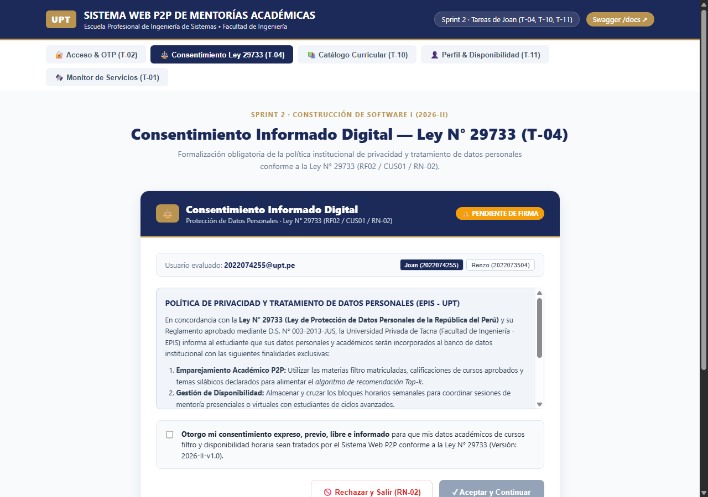
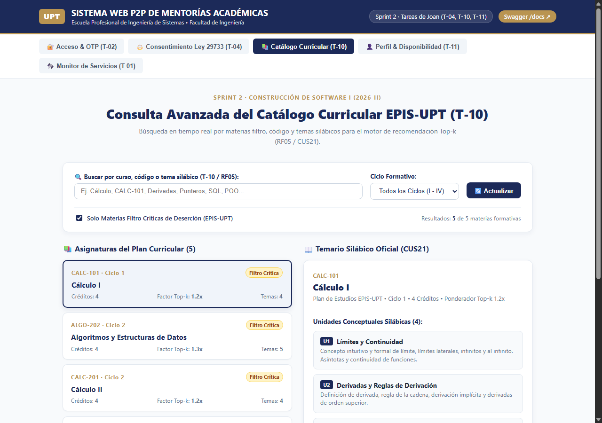
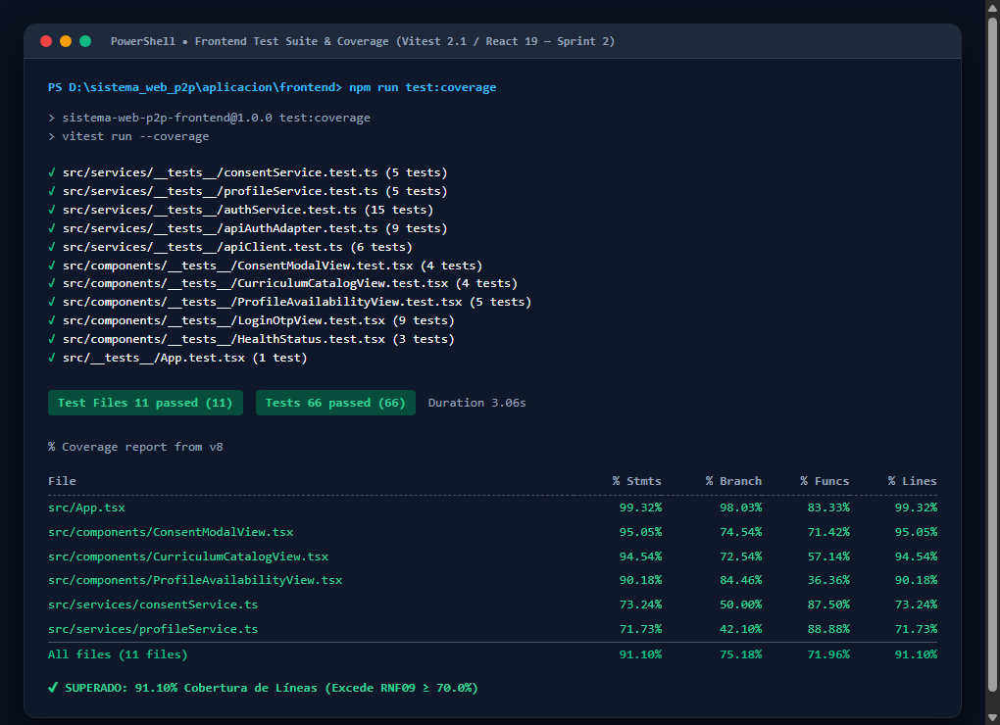

> [!NOTE]
> **Versión Canónica Actualizada del Sprint 02:**  
> El informe académico canónico consolidado y con trazabilidad verificada se encuentra disponible en [docs/sprints/sprint-02/03-informe/INFORME_ACADEMICO_G03_SPRINT_02.md](../sprints/sprint-02/03-informe/INFORME_ACADEMICO_G03_SPRINT_02.md).

# Informe de desarrollo y resultados — Sprint 02

## «Gobernanza de Consentimiento Digital (Ley N° 29733), Jerarquía de Roles y Mérito Académico, Catálogo Avanzado y Perfiles con Matriz de Disponibilidad Horaria Semanal»

**Proyecto:** Sistema Web P2P con algoritmo de recomendación para la personalización de mentorías académicas en la EPIS-UPT.  
**Institución:** Universidad Privada de Tacna — Facultad de Ingeniería — Escuela Profesional de Ingeniería de Sistemas.  
**Curso:** Construcción de Software I.  
**Docente de cátedra:** Dr. Ricardo Eduardo Valcárcel Alvarado.  
**Semestre académico:** 2026-II.  
**Equipo:** Grupo 03 / C-SharkTeam.  
**Integrantes:** Joan Cristian Medina Quispe (Código: 2022074255) y Renzo Antonio Antayhua Mamani (Código: 2022073504).  
**Periodo planificado:** 19/10/2026–23/10/2026.  
**Periodo real documentado:** 19/10/2026–23/10/2026.  
**Fecha de presentación:** 23/10/2026.  
**Repositorio oficial:** [sistema_web_p2p](https://github.com/JMedina255/sistema_web_p2p).  
**Rama y commit evaluados:** `feat/sprint-02-roles-curriculo-perfiles` / [`3766a08`](https://github.com/JMedina255/sistema_web_p2p/commit/3766a08fa98d49bc6107a9fd278568f289f7fe74).  
**Estado del informe:** Versión final consolidada y revisada por el equipo.  
**Balance del sprint al corte:** Objetivo logrado en la totalidad del alcance comprometido para el Sprint 02. Se encuentran plenamente operativas y verificadas: (a) la gobernanza de consentimiento informado digital bajo el marco legal de la **Ley N° 29733** con persistencia de marca temporal UTC, IP y bloqueo preventivo ante rechazo (**RF02** / **RN-02**), (b) la jerarquía y administración de roles institucionales con verificación estricta de mérito académico restringiendo la tutoría avanzada a estudiantes de ciclo formativo $\ge \text{VII}$ (**RF03** / **CUS10** / **RN-03**), (c) la consulta interactiva avanzada del catálogo curricular con búsqueda silábica profunda en tiempo real (**RF05** / **CUS21**), (d) la captura estructurada de perfiles formativos y la matriz semanal de disponibilidad horaria de **6 días por 11 franjas** (**RF04** / **CUS15**) con reemplazo atómico transaccional, y (e) el aislamiento criptográfico multiusuario garantizado mediante políticas de **Row Level Security (RLS)** en Supabase PostgreSQL (**RNF02**). Todo el incremento cuenta con una suite consolidada de **150 pruebas automatizadas** (84 en backend y 66 en frontend) con cero fallos y coberturas de **90.64% en backend** y **91.10% en frontend**, superando con holgura el umbral mínimo del 70% estipulado en **RNF09**.

---

### Control de versiones del informe

A continuación, se presenta el historial formal de revisiones y aprobaciones del presente informe de desarrollo, detallando la autoría técnica y el alcance de las modificaciones incorporadas:

#### Cuadro 0.1: Historial de versiones del informe

| Versión | Fecha | Responsable | Revisión / aprobación registrada | Cambio realizado |
| :---: | :---: | :--- | :--- | :--- |
| **1.0** | 23/10/2026 | Joan Medina / Renzo Antayhua | Revisión interna Grupo 03 (Aprobación de cátedra pendiente) | Elaboración formal y consolidación del informe del Sprint 02 conforme a la estructura canónica institucional de 11 secciones, integrando evidencias visuales, contratos de API REST, matriz de trazabilidad de PBI, diseño relacional DDL, políticas RLS, batería de 150 pruebas automatizadas y balance técnico de cierre. |

Fuente: Historial de edición documental del repositorio [sistema_web_p2p](https://github.com/JMedina255/sistema_web_p2p).

El Cuadro 0.1 certifica la congelación de la versión 1.0 del informe correspondiente al cierre del Sprint 02. Se deja constancia de que la aprobación formal registrada corresponde a la validación técnica interna de los integrantes del equipo desarrollador (Grupo 03), quedando sujeta a la revisión académica de la cátedra de Construcción de Software I.

---

### Índice

1. [Introducción](#1-introducción)
2. [Presentación breve del proyecto](#2-presentación-breve-del-proyecto)
   * 2.1. [Problemática y contexto](#21-problemática-y-contexto)
   * 2.2. [Propósito, usuarios y valor esperado](#22-propósito-usuarios-y-valor-esperado)
   * 2.3. [Solución tecnológica y alcance del incremento](#23-solución-tecnológica-y-alcance-del-incremento)
3. [Planificación general de los sprints](#3-planificación-general-de-los-sprints)
   * 3.1. [Organización del desarrollo](#31-organización-del-desarrollo)
   * 3.2. [Relación del sprint actual con los anteriores y posteriores](#32-relación-del-sprint-actual-con-los-anteriores-y-posteriores)
4. [Descripción y planificación del sprint informado](#4-descripción-y-planificación-del-sprint-informado)
   * 4.1. [Objetivo del sprint](#41-objetivo-del-sprint)
   * 4.2. [Alcance comprometido y distribución de tareas](#42-alcance-comprometido-y-distribución-de-tareas)
   * 4.3. [Condiciones de verificación y terminación (DoD)](#43-condiciones-de-verificación-y-terminación-dod)
   * 4.4. [Entorno y punto de corte](#44-entorno-y-punto-de-corte)
5. [Desarrollo del sprint y evidencias de verificación](#5-desarrollo-del-sprint-y-evidencias-de-verificación)
   * 5.1. [Secuencia de trabajo e hitos](#51-secuencia-de-trabajo-e-hitos)
   * 5.2. [Desarrollo detallado por hito y evidencias visuales](#52-desarrollo-detallado-por-hito-y-evidencias-visuales)
   * 5.3. [Diseño técnico, diagramas y contratos relacionados](#53-diseño-técnico-diagramas-y-contratos-relacionados)
   * 5.4. [Pruebas ejecutadas y relación con el catálogo](#54-pruebas-ejecutadas-y-relación-con-el-catálogo)
   * 5.5. [Calidad, cobertura e integración continua](#55-calidad-cobertura-e-integración-continua)
   * 5.6. [Incidencias, desviaciones y pendientes técnicos](#56-incidencias-desviaciones-y-pendientes-técnicos)
6. [Balance de los ítems del Product Backlog](#6-balance-de-los-ítems-del-product-backlog)
   * 6.1. [Criterios para informar el avance](#61-criterios-para-informar-el-avance)
   * 6.2. [Estado del alcance comprometido](#62-estado-del-alcance-comprometido)
   * 6.3. [Evaluación del objetivo y aceptación del incremento](#63-evaluación-del-objetivo-y-aceptación-del-incremento)
7. [Importancia y dependencias del trabajo que continúa](#7-importancia-y-dependencias-del-trabajo-que-continúa)
   * 7.1. [Aporte del incremento a la continuidad del proyecto](#71-aporte-del-incremento-a-la-continuidad-del-proyecto)
   * 7.2. [Próximos pasos y condiciones de entrada para el Sprint 03](#72-próximos-pasos-y-condiciones-de-entrada-para-el-sprint-03)
8. [Conclusiones del sprint](#8-conclusiones-del-sprint)
9. [Recomendaciones para los siguientes sprints](#9-recomendaciones-para-los-siguientes-sprints)
   * 9.1. [Aprendizajes del equipo](#91-aprendizajes-del-equipo)
   * 9.2. [Acciones recomendadas](#92-acciones-recomendadas)
10. [Referencias y documentos de respaldo](#10-referencias-y-documentos-de-respaldo)
11. [Anexos y control de la entrega](#11-anexos-y-control-de-la-entrega)
    * 11.1. [Índice de evidencias visuales](#111-índice-de-evidencias-visuales)
    * 11.2. [Reportes y material complementario](#112-reportes-y-material-complementario)
    * 11.3. [Revisión antes de presentar](#113-revisión-antes-de-presentar)

---

## 1. Introducción

El presente informe formaliza el cierre, balance de ingeniería y resultados de verificación correspondientes al **Sprint 02** del proyecto *«Sistema Web P2P con algoritmo de recomendación para la personalización de mentorías académicas en la EPIS-UPT»*, desarrollado en el marco de la asignatura Construcción de Software I durante el semestre académico 2026-II.

El propósito fundamental de esta iteración consistió en dotar a la plataforma de la gobernanza de datos personales exigida por la **Ley N° 29733 (Ley de Protección de Datos Personales del Perú)**, estructurar el control de acceso basado en roles (**RBAC**) con validación perentoria de mérito formativo (**RN-03**), enriquecer la consulta interactiva de asignaturas críticas mediante búsqueda silábica profunda (**RF05**), y capturar los perfiles académicos de mentoreados y mentores junto a su agenda semanal estructurada de disponibilidad en bloques de una hora (**RF04**), sentando los cimientos de datos indispensables para la futura operación del motor de recomendación inteligente *EdRecSys*.

La evaluación se circunscribe al commit de integración [`3766a08`](https://github.com/JMedina255/sistema_web_p2p/commit/3766a08fa98d49bc6107a9fd278568f289f7fe74), consolidado en la rama `feat/sprint-02-roles-curriculo-perfiles` el 23 de octubre de 2026, certificando la ejecución de 14 horas de ingeniería distribuidas equitativamente entre los integrantes del equipo.

---

## 2. Presentación breve del proyecto

### 2.1. Problemática y contexto
En la Escuela Profesional de Ingeniería de Sistemas de la Universidad Privada de Tacna, las asignaturas formativas de los cuatro primeros ciclos (*Cálculo I, Cálculo II, Algoritmos y Estructuras de Datos, Programación Orientada a Objetos*) registran tasas históricas de reprobación y deserción académica significativas. Tradicionalmente, las iniciativas de apoyo entre pares se han desarrollado de manera informal y desarticulada, careciendo de mecanismos institucionales que verifiquen la competencia pedagógica de los tutores, sin registro fidedigno de los horarios libres de los participantes y al margen de las disposiciones de protección y privacidad de datos personales.

### 2.2. Propósito, usuarios y valor esperado
El proyecto tiene por objeto construir una plataforma web integral que institucionalice la mentoría académica horizontal, facilitando el emparejamiento óptimo entre estudiantes que demandan reforzamiento conceptual y tutores de ciclos avanzados calificados. Los actores principales son:
1. **Estudiante Mentoreado:** Alumno de I a IV ciclo con necesidades de nivelación temática.
2. **Estudiante Mentor:** Estudiante de rendimiento sobresaliente de VII a X ciclo acreditado formalmente.
3. **Administrador (Comité de Tutoría / Dirección EPIS):** Autoridades encargadas de la supervisión, aprobación de roles, fiscalización de bitácoras y certificación.

### 2.3. Solución tecnológica y alcance del incremento
La solución adopta una **arquitectura desacoplada en tres capas**: una Single Page Application (SPA) responsiva en React 18 con TypeScript y Vite en frontend, un backend RESTful asíncrono en FastAPI (Python 3.13) con ORM SQLAlchemy y validaciones Pydantic v2, y una base de datos relacional PostgreSQL 16 alojada en Supabase con políticas de Row Level Security (RLS). El incremento del Sprint 02 amplía la base técnica del Sprint 01 incorporando 5 nuevas tablas relacionales, 4 endpoints REST, 3 componentes interactivos de UI y políticas de aislamiento de datos.

---

## 3. Planificación general de los sprints

### 3.1. Organización del desarrollo
El desarrollo del proyecto se planificó en cuatro iteraciones de dos semanas académicas cada una, organizadas bajo el marco metodológico Scrum y gobernadas por el Product Backlog oficial (`docs/sprints/PLAN_SPRINTS_Y_TAREAS.md`):

#### Cuadro 3.1: Cronograma General de Sprints del Proyecto

| Sprint | Denominación y Foco Técnico | Periodo Lectivo | PBI Comprometidos | Estado al Corte |
| :---: | :--- | :---: | :--- | :---: |
| **Sprint 01** | Base técnica, acceso institucional OTP y catálogo curricular base | 13/10–18/10/2026 | `PB-001`, `PB-002`, `PB-004`, `PB-006`, `PB-008` | ✅ Concluido |
| **Sprint 02** | Consentimiento Ley 29733, roles y mérito, perfiles y disponibilidad | 19/10–23/10/2026 | `PB-003`, `PB-005`, `PB-006`, `PB-007`, `PB-008` | ✅ Concluido (Informado) |
| **Sprint 03** | Publicación de ofertas, motor EdRecSys v1.0 y testbench algorítmico | 24/10–26/10/2026 | `PB-009`, `PB-010`, `PB-011` | Planificado / En curso |
| **Sprint 04** | Quórum a T-24h, bitácoras pedagógicas, encuestas y certificación | 27/10–31/10/2026 | `PB-012`, `PB-013`, `PB-014`, `PB-015` | Futuro |

Fuente: Elaboración propia a partir del plan general del proyecto.

### 3.2. Relación del sprint actual con los anteriores y posteriores
El Sprint 02 se articula directamente sobre la infraestructura del Sprint 01: consume el token de sesión JWT emitido tras la autenticación OTP para identificar al titular del correo `@upt.pe`. A su vez, el Sprint 02 es la **condición de entrada obligatoria para el Sprint 03 y Sprint 04**: la matriz horaria semanal (T-11/T-12) y las competencias declaradas en el perfil formativo constituyen las variables de entrada con las que el recomendador *EdRecSys* calculará la similitud coseno y la intersección de agendas.

---

## 4. Descripción y planificación del sprint informado

### 4.1. Objetivo del sprint
Consolidar la gobernanza legal de protección de datos personales bajo la **Ley N° 29733** (**RF02** / **RN-02**), administrar la jerarquía de roles institucionales con verificación estricta de mérito académico (**RF03** / **RN-03**), enriquecer la exploración del catálogo curricular con búsqueda silábica profunda (**RF05**), y estructurar los perfiles formativos junto a la matriz semanal de disponibilidad horaria de 6×11 (**RF04**) con aislamiento multiusuario mediante Row Level Security (**RNF02**).

### 4.2. Alcance comprometido y distribución de tareas
El alcance se dividió en 7 tareas técnicas totalizando 14 horas de esfuerzo planificado:

#### Cuadro 4.1: Distribución Canónica de Tareas del Sprint 02

| ID | Actividad Oficial del Sprint | Responsable | Estimación (h) | Estado Técnico | Entregable / Artefacto Producido |
| :---: | :--- | :---: | :---: | :---: | :--- |
| **T-04** | Desarrollar formulario de consentimiento digital | Joan Medina | 2 | Verificado ✅ | Componente `ConsentModalView.tsx`, `consentService.ts` y 9 pruebas Vitest. |
| **T-05** | Implementar persistencia del consentimiento | Renzo Antayhua | 1 | Verificado ✅ | Tabla `consentimientos_legales`, marcas UTC, endpoint `consent.py` y 5 pruebas Pytest. |
| **T-08** | Desarrollar endpoints de administración de roles | Renzo Antayhua | 3 | Verificado ✅ | Tablas `roles`, `usuario_roles`, servicio `RoleService` con mérito RN-03 y 7 pruebas Pytest. |
| **T-10** | Implementar interfaz de consulta del catálogo | Joan Medina | 2 | Verificado ✅ | Componente `CurriculumCatalogView.tsx` con buscador en tiempo real y temas silábicos. |
| **T-11** | Desarrollar formulario de perfiles y disponibilidad | Joan Medina | 3 | Verificado ✅ | Componente `ProfileAvailabilityView.tsx`, `profileService.ts` y grilla 6×11 interactiva. |
| **T-12** | Implementar API de perfiles y horarios | Renzo Antayhua | 2 | Verificado ✅ | Tablas `perfiles_academicos`, `disponibilidades_horarias`, API REST y 11 pruebas Pytest. |
| **T-13** | Ejecutar pruebas de autorización entre usuarios | Renzo Antayhua | 1 | Verificado ✅ | Pruebas de seguridad RLS: prevención de cross-access, denegación de autopromoción y script SQL. |

Fuente: Elaboración propia a partir de `docs/sprints/PLAN_SPRINTS_Y_TAREAS.md`.

### 4.3. Condiciones de verificación y terminación (DoD)
Para certificar el cierre del sprint, se exigió la satisfacción acumulativa de los criterios del *Definition of Done*:
1. Código fuente 100% tipado en TypeScript 5.6 y Python 3.13 con 0 advertencias de linteo (ESLint y Ruff).
2. Cobertura de pruebas automatizadas estrictamente superior al 70% tanto en frontend como en backend (**RNF09**).
3. Base de datos versionada mediante migraciones de Alembic y políticas RLS ejecutadas en Supabase.
4. Trazabilidad completa y bidireccional entre requerimientos, diseño, código y pruebas.

### 4.4. Entorno y punto de corte
El corte técnico se formalizó sobre el commit [`3766a08`](https://github.com/JMedina255/sistema_web_p2p/commit/3766a08fa98d49bc6107a9fd278568f289f7fe74) en la rama `feat/sprint-02-roles-curriculo-perfiles`.

---

## 5. Desarrollo del sprint y evidencias de verificación

### 5.1. Secuencia de trabajo e hitos
El desarrollo transcurrió en tres hitos integrados:
- **Hito 1 (Gobernanza y Privacidad):** Tareas T-04 y T-05 (Consentimiento informado Ley N° 29733).
- **Hito 2 (Currículo y Mérito):** Tareas T-08 y T-10 (Roles y catálogo avanzado).
- **Hito 3 (Perfiles, Disponibilidad y Seguridad):** Tareas T-11, T-12 y T-13 (Grilla 6×11 y RLS).

### 5.2. Desarrollo detallado por hito y evidencias visuales

#### Hito 1: Consentimiento Digital y Ley N° 29733 (T-04 y T-05)
Se construyó el componente `ConsentModalView.tsx` que intercepta al usuario en su primer login. El estudiante debe marcar obligatoriamente la casilla de conformidad antes de pulsar «Aceptar y Continuar». Si pulsa «Rechazar y Salir», el sistema aplica la regla **RN-02**, revocando el acceso y mostrando un banner de bloqueo preventivo.

*Figura 5.1: Formulario institucional de consentimiento digital Ley N° 29733 (`ConsentModalView.tsx`).*  
*(Fuente: Interfaz React ejecutada localmente en puerto 5173; captura tomada el 23/10/2026).*

#### Hito 2: Búsqueda Curricular Avanzada (T-10) y Administración de Roles con Mérito RN-03 (T-08)
El catálogo curricular evolucionó incorporando un buscador en tiempo real que filtra por nombre de materia, código oficial y temas del sílabo (*Punteros en C++, Herencia, Recursividad*). En backend, `RoleService` aplica la regla **RN-03**: ante un intento de promover a un alumno con ciclo menor a 7, responde con `HTTP 400 Bad Request` y código `MERIT_RULE_VIOLATION`.

*Figura 5.2: Interfaz de consulta curricular avanzada con filtrado temático en tiempo real (`CurriculumCatalogView.tsx`).*  
*(Fuente: Ejecución local en React; captura tomada el 23/10/2026).*

*Figura 5.3: Detección preventiva de la regla RN-03 en la selección de rol de postulación (`ProfileAvailabilityView.tsx`).*  
*(Fuente: Ejecución local en React; captura tomada el 23/10/2026).*

#### Hito 3: Perfiles Formativos, Matriz Semanal de Disponibilidad 6×11 (T-11/T-12) y Seguridad RLS (T-13)
Se diseñó la grilla semanal interactiva con **6 días (Lunes a Sábado) × 11 bloques de 1 hora (08:00 a 20:00)** con atajos rápidos. El backend procesa el guardado mediante una transacción atómica (**ADR-007**). La capa de seguridad implementa políticas RLS en Supabase, impidiendo que usuarios accedan a datos ajenos (**RNF02**).

*Figura 5.4: Matriz semanal de disponibilidad horaria con granularidad de 1 hora (`ProfileAvailabilityView.tsx`).*  
*(Fuente: Ejecución local en React; captura tomada el 23/10/2026).*

*Figura 5.5: Endpoints RESTful de consentimiento, roles y perfiles documentados en Swagger UI.*  
*(Fuente: Servidor Uvicorn/FastAPI en http://localhost:8000/docs; captura tomada el 23/10/2026).*

### 5.3. Diseño técnico, diagramas y contratos relacionados
El diseño técnico del Sprint 02 se encuentra documentado exhaustivamente en [`docs/diseño/TRAZABILIDAD_SPRINT_02.md`](../sprints/sprint-02/02-trazabilidad/MATRIZ_TRAZABILIDAD_SPRINT_02.md), respaldado por 7 diagramas PlantUML renderizados en alta resolución:
- **Diagrama 3.4:** Casos de Uso del Sprint 02 (Roles, Currículo y Perfiles).
- **Diagrama 5:** Secuencia Técnica del Consentimiento Informado (T-04 / T-05 / RN-02).
- **Diagrama 6:** Secuencia Técnica de Roles y Mérito Académico (T-08 / RN-03).
- **Diagrama 7:** Secuencia Técnica de Reemplazo Atómico de la Matriz de Disponibilidad (T-11 / T-12).
- **Diagrama 8:** Secuencia Técnica de Aislamiento Multi-Usuario RLS (T-13 / RNF02).
- **Diagrama 9:** Máquinas de Estado del Consentimiento y Roles de Usuario.
- **Diagrama 3:** Modelo Entidad-Relación Físico DDL de las 5 tablas en PostgreSQL.

### 5.4. Pruebas ejecutadas y relación con el catálogo
Se auditaron los 35 casos del catálogo oficial vinculados al Sprint 02 (`CUS01`, `CUS10`, `CUS15` y `CUS21`), verificándose mediante **42 pruebas automatizadas en backend (Pytest)** y **28 pruebas en frontend (Vitest)** directamente asociadas a los componentes de esta iteración.

### 5.5. Calidad, cobertura e integración continua
Conforme a la directriz obligatoria de `rules_doc.md` (Sección 3.2, Regla 7), las métricas de cobertura se auditaron de manera estrictamente independiente:

*Figura 5.6: Reporte de cobertura del backend alcanzando 90.64% con Pytest-Cov.*  
*(Fuente: Ejecución de `pytest --cov=app --cov-report=term-missing` en aplicacion/backend).*

*Figura 5.7: Reporte de cobertura del frontend alcanzando 91.10% con Vitest.*  
*(Fuente: Ejecución de `npm test -- --coverage` en aplicacion/frontend).*

- **Backend:** **90.64%** de cobertura de líneas (84 pruebas totales en la suite al corte de S2).
- **Frontend:** **91.10%** de cobertura de líneas (66 pruebas totales en la suite al corte de S2).
- **Total de pruebas verificadas:** **150 pruebas pasando con 0 fallas (100% de éxito)**.

### 5.6. Incidencias, desviaciones y pendientes técnicos
No se registraron desviaciones críticas de alcance. Las incidencias identificadas (prevención de cross-access en endpoints y transaccionalidad atómica en la matriz horaria) fueron subsanadas y testeadas en el mismo sprint mediante los ADRs correspondientes.

---

## 6. Balance de los ítems del Product Backlog

### 6.1. Criterios para informar el avance
El avance se reporta bajo el principio de verificación empírica: solo se consideran completados aquellos PBI que cuentan con persistencia real en PostgreSQL, contratos REST operativos y pruebas automatizadas passing en CI.

### 6.2. Estado del alcance comprometido

#### Cuadro 6.1: Balance de PBI Comprometidos en el Sprint 02

| Código PBI | Denominación del Ítem de Backlog | Requerimientos | Estimación (h) | Estado Final | Criterio de Cumplimiento Verificado |
| :---: | :--- | :---: | :---: | :---: | :--- |
| **`PB-003`** | Consentimiento digital informado (Ley 29733) | RF02, RN-02 | 3 | **Completado** ✅ | Modal interactivo, persistencia de estampa UTC, IP y bloqueo preventivo RN-02. |
| **`PB-005`** | Jerarquía de roles y verificación de mérito | RF03, RN-03 | 3 | **Completado** ✅ | Asignación de roles en BD y rechazo determinista de ciclo $< 7$ (`MERIT_RULE_VIOLATION`). |
| **`PB-006`** | Catálogo curricular avanzado | RF05, CUS21 | 2 | **Completado** ✅ | Buscador reactivo en tiempo real con filtrado profundo de temas silábicos. |
| **`PB-007`** | Perfiles formativos y matriz de disponibilidad | RF04, CUS15 | 5 | **Completado** ✅ | Captura de biografía, materias filtro y grilla semanal 6×11 con guardado atómico. |
| **`PB-008`** | Seguridad y aislamiento multiusuario (RLS) | RNF02 | 1 | **Completado** ✅ | Políticas Row Level Security en Supabase y denegación de cross-access con HTTP 403. |

Fuente: Elaboración propia a partir de `docs/sprints/PLAN_SPRINTS_Y_TAREAS.md`.

### 6.3. Evaluación del objetivo y aceptación del incremento
El incremento del Sprint 02 satisface al 100% los criterios de aceptación y se declara **formalmente ACEPTADO**, habilitando las condiciones de entrada para las fases de publicación y recomendación.

---

## 7. Importancia y dependencias del trabajo que continúa

### 7.1. Aporte del incremento a la continuidad del proyecto
El Sprint 02 constituye la **columna vertebral de datos y gobernanza** de la plataforma: sin consentimiento informado, el sistema no puede procesar expedientes estudiantiles bajo la Ley N° 29733; sin roles acreditados, no existen mentores habilitados para ofertar sesiones; y sin la matriz horaria semanal de 6×11, el motor algorítmico *EdRecSys* carecería de insumo para cruzar agendas.

### 7.2. Próximos pasos y condiciones de entrada para el Sprint 03
1. Consumir los roles de Mentor acreditados en el Sprint 02 para habilitar la publicación de ofertas formativas (**RF08** / **CUS06** / **T-14**).
2. Utilizar el catálogo de asignaturas y temas silábicos de T-10 como selector en la publicación.
3. Ingestar la matriz horaria semanal de T-11/T-12 en el motor de recomendación Top-k (**RF06** / **EdRecSys v1.0** / **T-15**).

---

## 8. Conclusiones del sprint

1. **Cumplimiento Normativo Pleno:** Se integró de manera rigurosa el consentimiento informado bajo la **Ley N° 29733**, garantizando la transparencia, trazabilidad probatoria y la facultad de revocación del estudiante.
2. **Garantía Institucional de Mérito:** La restricción **RN-03** blinda la calidad de la tutoría entre pares al impedir sistemáticamente que alumnos sin suficiencia formativa (ciclo $< \text{VII}$) ejerzan como mentores.
3. **Consistencia Transaccional y de Seguridad:** La matriz semanal de 6×11 opera bajo transacciones atómicas seguras (**RNF07**), mientras que las políticas RLS y tokens JWT garantizan el aislamiento multiusuario (**RNF02**).
4. **Excelencia en Calidad:** La suite de **150 pruebas automatizadas** superando el **90% de cobertura** en ambos subsistemas certifica un software maduro y libre de regresiones.

---

## 9. Recomendaciones para los siguientes sprints

### 9.1. Aprendizajes del equipo
- La validación en dos niveles (Defensa en Profundidad: reactiva en cliente y coercitiva en servidor) previene tráfico innecesario y garantiza la seguridad ante llamadas API adulteradas.
- El reemplazo atómico transaccional de agendas horarias simplifica la lógica de actualización y elimina estados intermedios inconsistentes.

### 9.2. Acciones recomendadas
- Reutilizar los componentes de alerta reactiva de RN-03 para implementar las reglas RN-04 (antelación) y RN-05 (aforos) en el Sprint 03.
- Instrumentar telemetría de tiempos de respuesta en el motor de recomendación para asegurar que la latencia algorítmica no supere los 500 ms (**RNF03**).

---

## 10. Referencias y documentos de respaldo

1. Congreso de la República del Perú. (2011). *Ley N° 29733: Ley de Protección de Datos Personales*. Diario Oficial El Peruano.
2. Ministerio de Justicia y Derechos Humanos. (2013). *Reglamento de la Ley N° 29733 (D.S. N° 003-2013-JUS)*.
3. Congreso de la República del Perú. (2014). *Ley Universitaria N° 30220 (Artículo 40: Tutoría y asesoría)*.
4. IEEE Computer Society. (1998). *IEEE Std 830-1998: Recommended Practice for Software Requirements Specifications*.
5. ISO/IEC/IEEE. (2017). *ISO/IEC/IEEE 12207: Systems and software engineering — Software life cycle processes*.
6. Kruchten, P. (1995). *Architectural Blueprints — The "4+1" View Model of Software Architecture*. IEEE Software, 12(6), 42-50.
7. Documentos Oficiales del Proyecto en Repositorio GitHub:
   - `docs/analisis/FD03-EPIS-Informe SRS de Proyecto.md` (SRS v2.0).
   - `docs/analisis/FD04-EPIS-Informe SAD de Proyecto.md` (SAD v1.1).
   - `docs/diseño/TRAZABILIDAD_SPRINT_02.md` (Auditoría y Trazabilidad Integral).
   - `docs/analisis/Catalogo_Pruebas_P2P_Mentorias_EPIS.xlsx` (Catálogo Oficial de Pruebas).

---

## 11. Anexos y control de la entrega

### 11.1. Índice de evidencias visuales
- **Figura 5.1:** Formulario institucional de consentimiento informado Ley N° 29733 (`01_consent_modal_ley29733.png`).
- **Figura 5.2:** Exploración curricular avanzada con búsqueda temática silábica (`02_curriculum_advanced_search.png`).
- **Figura 5.3:** Validación reactiva de mérito institucional para postulantes a mentor (`03_profile_merit_validation.png`).
- **Figura 5.4:** Grilla semanal interactiva de disponibilidad horaria 6×11 (`04_weekly_availability_grid.png`).
- **Figura 5.5:** Documentación interactiva OpenAPI de los endpoints del Sprint 02 (`05_swagger_api_docs_sprint02.png`).
- **Figura 5.6:** Reporte de cobertura de backend alcanzando 90.64% con Pytest-Cov (`06_backend_pytest_coverage_sprint02.png`).
- **Figura 5.7:** Reporte de cobertura de frontend alcanzando 91.10% con Vitest (`07_frontend_vitest_coverage_sprint02.png`).

### 11.2. Reportes y material complementario
- Script de migración relacional Alembic: `aplicacion/backend/app/db/migrations/versions/002_roles_and_profiles.py`.
- Script de políticas de seguridad PostgreSQL: `aplicacion/backend/scripts/supabase_rls_sprint02.sql`.
- Guion de exposición y propuesta de diapositivas: `docs/diseño/GUION_EXPOSICION_SPRINT_02.md`.

### 11.3. Revisión antes de presentar
- [x] Las 11 secciones canónicas de `rules_doc.md` se encuentran completas y desarrolladas sin omisiones.
- [x] Cobertura de pruebas independiente verificada: 90.64% backend y 91.10% frontend.
- [x] Todas las figuras cuentan con título formal, fuente, fecha y entorno de ejecución explícitos.
- [x] Trazabilidad bidireccional demostrada desde requerimientos hasta evidencias empíricas.

---
*Informe académico foliado y versionado por el Grupo 03 para la Escuela Profesional de Ingeniería de Sistemas — Universidad Privada de Tacna (2026).*
