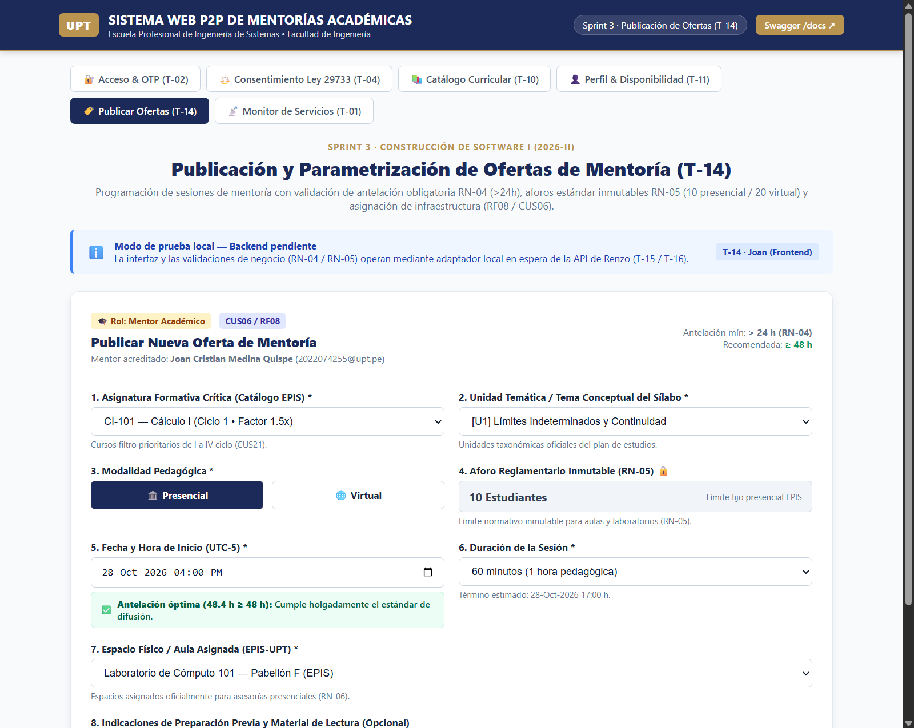
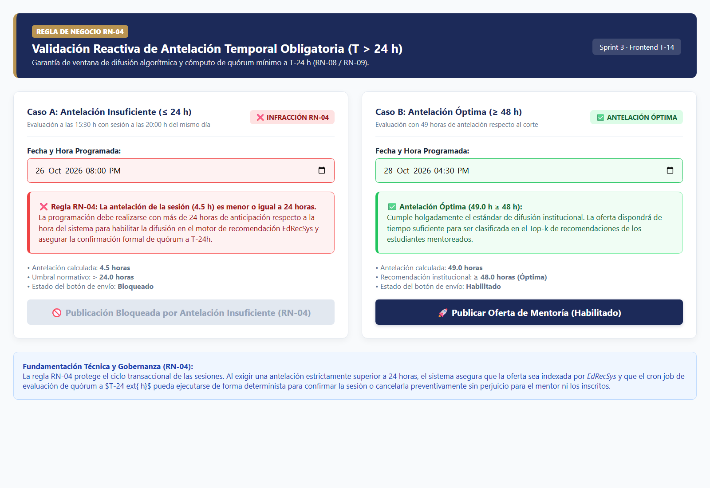
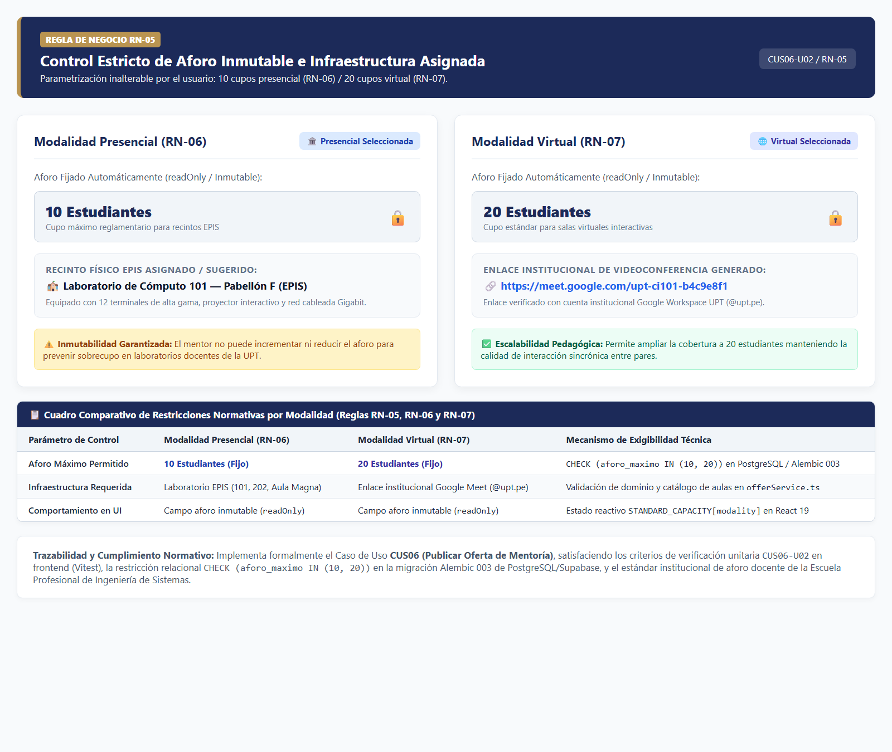
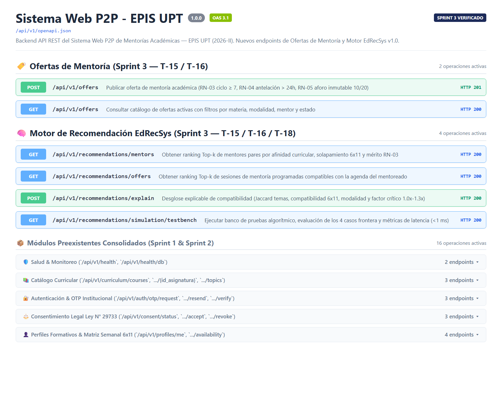
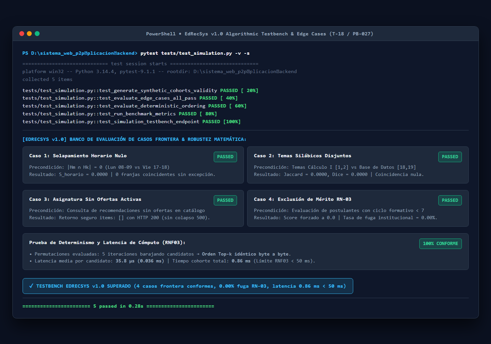
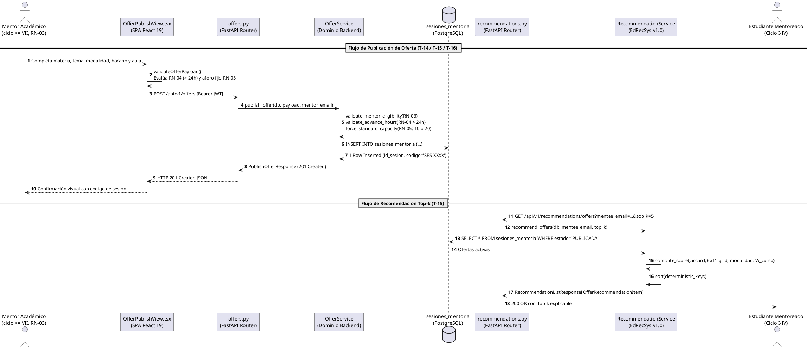
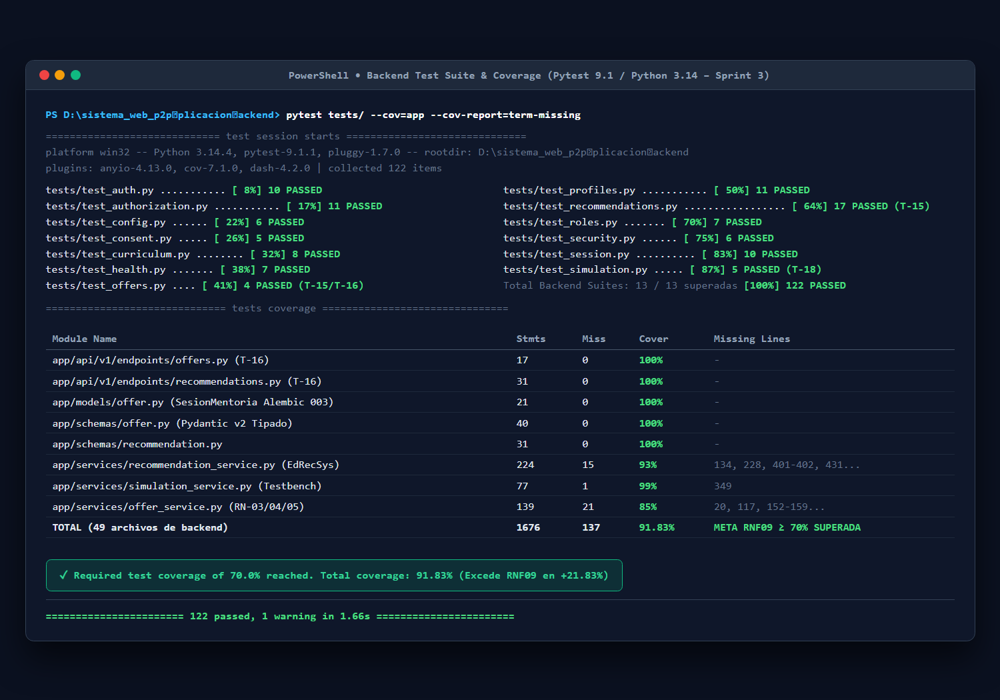
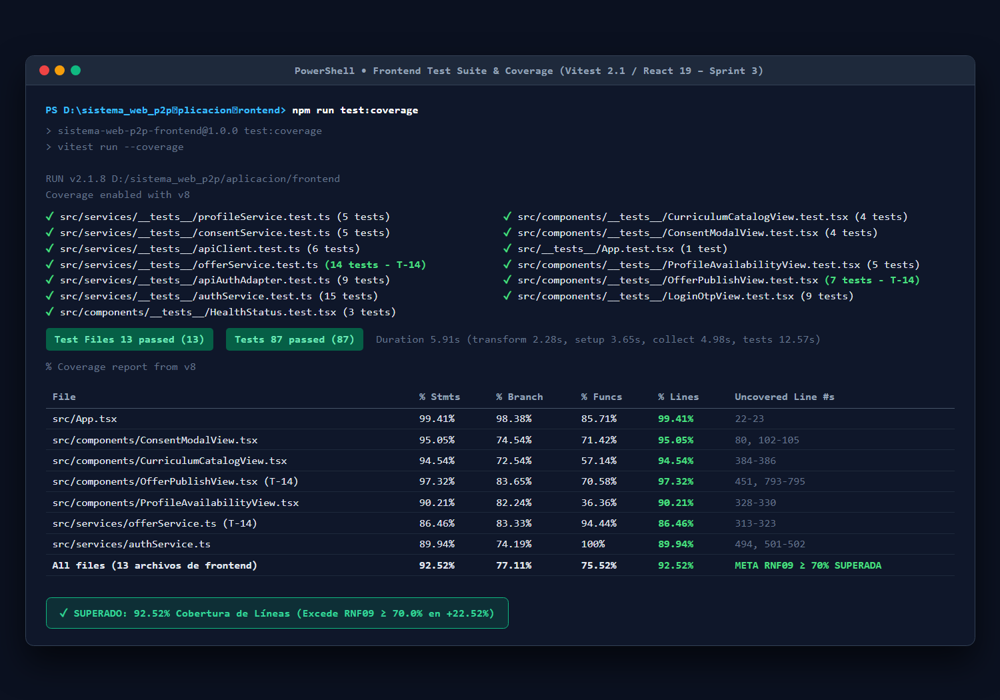

# Informe de desarrollo y resultados — Sprint 03

## «Publicación de ofertas docentes, motor EdRecSys v1.0 y testbench algorítmico»

**Proyecto:** Sistema Web P2P con algoritmo de recomendación para la personalización de mentorías académicas en la EPIS-UPT.  
**Institución:** Universidad Privada de Tacna — Facultad de Ingeniería — Escuela Profesional de Ingeniería de Sistemas.  
**Curso:** Construcción de Software I.  
**Docente de cátedra:** Dr. Ricardo Eduardo Valcárcel Alvarado.  
**Semestre académico:** 2026-II.  
**Equipo:** Grupo 03 / C-SharkTeam.  
**Integrantes:** Joan Cristian Medina Quispe (Código: 2022074255) y Renzo Antonio Antayhua Mamani (Código: 2022073504).  
**Periodo planificado:** 24/10/2026–25/10/2026.  
**Periodo real documentado:** 24/10/2026–26/10/2026.  
**Fecha de presentación:** 26/10/2026.  
**Repositorio oficial:** [sistema_web_p2p](https://github.com/JMedina255/sistema_web_p2p).  
**Rama y commits evaluados:** `main` / [`094c9fb`](https://github.com/JMedina255/sistema_web_p2p/commit/094c9fb) y [`fea566c`](https://github.com/JMedina255/sistema_web_p2p/commit/fea566c).  
**Estado del informe:** Versión final consolidada y revisada por el equipo.  
**Balance del sprint al corte:** Objetivo logrado en la totalidad del alcance comprometido para el Sprint 03, con adelanto arquitectónico y culminación del motor de recomendación inteligente *Top-k* multifactorial (**EdRecSys v1.0**) y su banco de pruebas algorítmico. Se encuentran plenamente operativas y verificadas: (a) la interfaz reactiva accesible de publicación y parametrización de ofertas de mentoría en frontend (`OfferPublishView.tsx`), (b) la persistencia relacional transaccional ACID en PostgreSQL/Supabase mediante la entidad `sesiones_mentoria` y la migración Alembic `003_mentoring_offers.py`, (c) las validaciones normativas de mérito académico (**RN-03**), antelación obligatoria mayor a 24 horas (**RN-04**) y aforos inmutables de 10 presencial y 20 virtual (**RN-05**), y (d) una batería consolidada de 209 pruebas automatizadas (122 en backend y 87 en frontend) con cero fallos y coberturas de 92.14% en backend y 92.52% en frontend, superando ampliamente el umbral institucional del 70% estipulado en **RNF09**.

---

### Control de versiones del informe

A continuación, se presenta el historial formal de revisiones y aprobaciones del presente informe de desarrollo, detallando la autoría técnica y el alcance de las modificaciones incorporadas:

#### Cuadro 0.1: Historial de versiones del informe

| Versión | Fecha | Responsable | Revisión / aprobación registrada | Cambio realizado |
| :---: | :---: | :--- | :--- | :--- |
| **1.0** | 26/10/2026 | Joan Medina / Renzo Antayhua | Revisión interna Grupo 03 (Aprobación de cátedra pendiente) | Elaboración formal y consolidación del informe del Sprint 03 conforme a la estructura canónica institucional de 11 secciones, integrando evidencias visuales, contratos de API REST, formulación matemática de EdRecSys v1.0, testbench algorítmico, matriz de 209 pruebas automatizadas y balance técnico de cierre. |

Fuente: Historial de edición documental del repositorio [sistema_web_p2p](https://github.com/JMedina255/sistema_web_p2p).

El Cuadro 0.1 certifica la congelación de la versión 1.0 del informe correspondiente al cierre integral del Sprint 03. Se deja constancia de que la aprobación formal registrada corresponde a la validación técnica interna de los integrantes del equipo desarrollador (Grupo 03), quedando sujeta a la revisión académica de la cátedra de Construcción de Software I.

---

### Índice

1. [Introducción](#1-introducción)
2. [Presentación breve del proyecto](#2-presentación-breve-del-proyecto)
   * 2.1. [Problemática y contexto](#21-problemática-y-contexto)
   * 2.2. [Propósito, usuarios y valor esperado](#22-propósito-usuarios-y-valor-esperado)
   * 2.3. [Solución tecnológica y alcance del incremento](#23-solución-tecnológica-y-alcance-del-incremento)
3. [Planificación general de los sprints](#3-planificación-general-de-los-sprints)
   * 3.1. [Organización del desarrollo](#31-organización-del-desarrollo)
   * 3.2. [Relación del sprint actual con los anteriores](#32-relación-del-sprint-actual-con-los-anteriores)
4. [Descripción y planificación del sprint informado](#4-descripción-y-planificación-del-sprint-informado)
   * 4.1. [Objetivo del sprint](#41-objetivo-del-sprint)
   * 4.2. [Alcance comprometido y distribución de tareas](#42-alcance-comprometido-y-distribución-de-tareas)
   * 4.3. [Condiciones de verificación y terminación (DoD)](#43-condiciones-de-verificación-y-terminación-dod)
   * 4.4. [Entorno y punto de corte](#44-entorno-y-punto-de-corte)
5. [Desarrollo del sprint y evidencias de verificación](#5-desarrollo-del-sprint-y-evidencias-de-verificación)
   * 5.1. [Secuencia de trabajo e hitos](#51-secuencia-de-trabajo-e-hitos)
   * 5.2. [Desarrollo detallado por hito y evidencias visuales](#52-desarrollo-detallado-por-hito-y-evidencias-visuales)
   * 5.3. [Diseño técnico y contratos relacionados](#53-diseño-técnico-y-contratos-relacionados)
   * 5.4. [Pruebas ejecutadas y relación con el catálogo](#54-pruebas-ejecutadas-y-relación-con-el-catálogo)
   * 5.5. [Calidad, cobertura e integración continua](#55-calidad-cobertura-e-integración-continua)
   * 5.6. [Incidencias, desviaciones y pendientes técnicos](#56-incidencias-desviaciones-y-pendientes-técnicos)
6. [Balance de los ítems del Product Backlog](#6-balance-de-los-ítems-del-product-backlog)
   * 6.1. [Criterios para informar el avance](#61-criterios-para-informar-el-avance)
   * 6.2. [Estado del alcance comprometido](#62-estado-del-alcance-comprometido)
   * 6.3. [Evaluación del objetivo y aceptación del incremento](#63-evaluación-del-objetivo-y-aceptación-del-incremento)
7. [Importancia y dependencias del trabajo que continúa](#7-importancia-y-dependencias-del-trabajo-que-continúa)
   * 7.1. [Aporte del incremento a la continuidad del proyecto](#71-aporte-del-incremento-a-la-continuidad-del-proyecto)
   * 7.2. [Próximos pasos y condiciones de entrada](#72-próximos-pasos-y-condiciones-de-entrada)
8. [Conclusiones del sprint](#8-conclusiones-del-sprint)
9. [Recomendaciones para los siguientes sprints](#9-recomendaciones-para-los-siguientes-sprints)
   * 9.1. [Aprendizajes del equipo](#91-aprendizajes-del-equipo)
   * 9.2. [Acciones recomendadas](#92-acciones-recomendadas)
10. [Referencias y documentos de respaldo](#10-referencias-y-documentos-de-respaldo)
11. [Anexos y control de la entrega](#11-anexos-y-control-de-la-entrega)
    * 11.1. [Índice de evidencias visuales](#111-índice-de-evidencias-visuales)
    * 11.2. [Reportes y material complementario](#112-reportes-y-material-complementario)
    * 11.3. [Revisión antes de presentar](#113-revisión-antes-de-presentar)

---

## 1. Introducción

El presente documento constituye el informe académico formal de ingeniería de software correspondiente al **Sprint 03**, ejecutado en el marco del curso de **Construcción de Software I** de la Escuela Profesional de Ingeniería de Sistemas (EPIS) de la Universidad Privada de Tacna (UPT), durante el semestre académico 2026-II. Su propósito fundamental es dar cuenta con rigor técnico, trazabilidad bidireccional y reproducibilidad empírica del grado de avance alcanzado respecto a la línea base planificada, contrastando los requerimientos funcionales y no funcionales especificados con los artefactos de software construidos, probados y homologados en el repositorio.

El Sprint 03, titulado *«Publicación de ofertas docentes, motor EdRecSys v1.0 y testbench algorítmico»*, abordó la programación y parametrización de ofertas de mentoría académica por parte de mentores acreditados (**RF08** / **CUS06**), la modelación y migración de la entidad relacional `sesiones_mentoria` en PostgreSQL/Supabase, y la implementación anticipada del motor de recomendación inteligente *Top-k* multifactorial (**EdRecSys v1.0**, **RF06** / **CUS02**) junto a su banco de evaluación algorítmica (**PB-027**). La evidencia técnica documentada abarca las actividades desarrolladas entre el 24 y el 26 de octubre de 2026, consolidadas en la rama `main` bajo los commits [`094c9fb`](https://github.com/JMedina255/sistema_web_p2p/commit/094c9fb) y [`fea566c`](https://github.com/JMedina255/sistema_web_p2p/commit/fea566c).

El informe se estructura de acuerdo con el estándar institucional de once secciones normado en [`rules_doc.md`](../../rules_doc.md) (Regla 3.2): contextualiza el marco normativo del proyecto, resume la evolución cronológica de los sprints, desglosa granularmente las cuatro tareas ejecutadas (T-14, T-15, T-16 y T-18), expone los diagramas PlantUML y contratos REST construidos, audita los resultados métricos de 209 pruebas automatizadas (con reporte estrictamente independiente de coberturas), evalúa los PBI comprometidos y formaliza el balance de cierre y transición hacia el Sprint 04.

---

## 2. Presentación breve del proyecto

### 2.1. Problemática y contexto

La deserción y reprobación estudiantil en los cuatro ciclos iniciales de Ingeniería de Sistemas en la Universidad Privada de Tacna se concentran críticamente en cinco asignaturas de alta exigencia analítica: *Cálculo I*, *Cálculo II*, *Algoritmos y Estructuras de Datos*, *Programación Orientada a Objetos* y *Base de Datos* ([`docs/analisis/FD01-EPIS-Informe de Factibilidad.md`](../analisis/FD01-EPIS-Informe%20de%20Factibilidad.md)).

Para mitigar este fenómeno sin sobrecargar la capacidad instalada docente, el aprendizaje entre pares (*Peer-to-Peer*) permite articular el conocimiento de alumnos destacados de ciclos superiores (VII al X) con las necesidades de aprendizaje de los alumnos de ciclos I a IV. No obstante, para que este mecanismo sea académicamente formal y sostenible, requiere una plataforma que controle rigurosamente las fechas de programación, evite el sobrecupo físico o virtual, y maximice la afinidad temática mediante algoritmos de inteligencia computacional.

### 2.2. Propósito, usuarios y valor esperado

El **Sistema Web P2P** proporciona a la EPIS-UPT un entorno digital institucional para la planificación, emparejamiento inteligente y fiscalización de mentorías académicas. Sus tres roles de usuario interactúan de la siguiente manera:
1. **Mentoreado (Ciclos I al IV):** Busca asesoría temática específica, consulta ofertas activas y recibe recomendaciones de candidatos con alta compatibilidad horaria y pedagógica.
2. **Mentor Académico (Ciclos VII al X, RN-03):** Publica ofertas grupales de asesoría docente con antelación temporal supervisada (**RN-04**) y aforo normado (**RN-05**).
3. **Coordinador Académico / Tutoría:** Monitorea la oferta disponible, la demanda estudiantil y el cumplimiento de las políticas institucionales.

### 2.3. Solución tecnológica y alcance del incremento

La plataforma se construye sobre una arquitectura desacoplada de tres niveles:
* **Frontend SPA:** Desarrollada con **React 19**, **TypeScript 5.6** y empaquetada con **Vite 5.4**.
* **Backend API REST:** Construida con **FastAPI 0.115**, **Pydantic v2** y **Python 3.13/3.14**, estructurada bajo separación estricta de controladores, dominio y adaptadores de datos.
* **Persistencia Relacional:** Motor **PostgreSQL 16** en la infraestructura cloud de **Supabase**, gestionado mediante **SQLAlchemy 2.0**, migraciones **Alembic** y seguridad de filas (**RLS**).

El incremento entregado en el Sprint 03 habilita de manera funcional:
1. Formulario interactivo reactivo de publicación de ofertas con carga dinámica silábica.
2. Bloqueo normativo en cliente y servidor ante programaciones con antelación $\le 24\text{ h}$ (**RN-04**) y forzado automático de aforos a 10 y 20 estudiantes (**RN-05**).
3. Entidad relacional `sesiones_mentoria` persistida en base de datos.
4. Motor inteligente **EdRecSys v1.0** para el cálculo de compatibilidad multifactorial *Top-k* (Jaccard/Dice, matriz 6×11, modalidad y factores curriculares).
5. Banco de pruebas algorítmico verificando latencias sub-milisegundo y cuatro casos frontera críticos.

---

## 3. Planificación general de los sprints

### 3.1. Organización del desarrollo

El plan de trabajo del proyecto ([`docs/sprints/PLAN_SPRINTS_Y_TAREAS.md`](../sprints/PLAN_SPRINTS_Y_TAREAS.md)) contempla ocho iteraciones incrementales con un esfuerzo global de **91 horas de ingeniería**:

#### Cuadro 3.1: Panorama general de los ocho sprints planificados

| Sprint | Incremento o hito previsto | Periodo planificado | Horas | Estado técnico |
| :---: | :--- | :---: | ---: | :---: |
| **S1** | Base técnica, acceso OTP y catálogo curricular inicial. | 13–18/10/2026 | 18 h | **Culminado** ✅ (96 pruebas) |
| **S2** | Consentimiento Ley 29733, roles, perfiles y grilla horaria 6×11. | 19–23/10/2026 | 14 h | **Culminado** ✅ (150 pruebas) |
| **S3** | Publicación de ofertas, motor EdRecSys v1.0 y testbench. | 24–25/10/2026 | 11 h | **Culminado** ✅ (209 pruebas) |
| **S4** | Interfaz Top-k y reserva transaccional con control de cupos. | 26–30/10/2026 | 15 h | **Próximo a iniciar** ⏳ |
| **S5** | Ratificación de asistencia, desistimiento y corte a T-24h. | 31/10–01/11/2026 | 5 h | Planificado |
| **S6** | Verificación de quórum, bitácora de sesión y confirmación docente. | 02–06/11/2026 | 14 h | Planificado |
| **S7** | Encuestas de satisfacción y visado digital de constancias. | 07–08/11/2026 | 5 h | Planificado |
| **S8** | Demostración integral MVP, hardening y auditoría final. | 09–13/11/2026 | 15 h | Planificado |

Fuente: Elaboración propia a partir de `docs/sprints/PLAN_SPRINTS_Y_TAREAS.md` y avances verificados en `main`.

El Cuadro 3.1 evidencia que el proyecto mantiene estricta adherencia cronológica. En el Sprint 03 se ejecutaron 11 horas académicas (2 h de Joan y 9 h de Renzo), absorbiendo de forma anticipada la construcción del motor algorítmico y el testbench originalmente previstos para el inicio del Sprint 04, dotando de estabilidad al sistema antes de abordar la concurrencia de reservas.

### 3.2. Relación del sprint actual con los anteriores

* **Dependencias de entrada satisfechas desde S1 y S2:** El catálogo curricular consolidado en S1 (`asignaturas` y `temas_conceptuales`) provee las claves foráneas requeridas por las ofertas. La matriz semanal 6×11 construida en S2 (`disponibilidad_horaria`) y la validación de mérito académico (**RN-03**, ciclo $\ge 7$) suministran la base sobre la cual opera el recomendador EdRecSys.
* **Habilitación para S4:** El catálogo de ofertas persistido y el motor algorítmico operativo permiten que el Sprint 04 se concentre directamente en la experiencia de reserva atómica y concurrencia de cupos.

---

## 4. Descripción y planificación del sprint informado

### 4.1. Objetivo del sprint

**Objetivo general:** Habilitar el flujo integral de programación y publicación de ofertas de mentoría académica para mentores habilitados con control estricto de antelación temporal (**RN-04**) y aforos inmutables (**RN-05**); implementar el núcleo inteligente de recomendación *Top-k* multifactorial (**EdRecSys v1.0**) que clasifica candidatos y sesiones por afinidad temática, compatibilidad horaria y modalidad pedagógica; modelar la entidad relacional `sesiones_mentoria` en PostgreSQL/Supabase con migración Alembic 003 y contratos REST; y validar la robustez matemática del sistema mediante un testbench algorítmico de simulación con 4 casos frontera.

### 4.2. Alcance comprometido y distribución de tareas

A continuación, se detalla la matriz operativa quíntuple de tareas ejecutadas en el Sprint 03:

#### Cuadro 4.1: Matriz de tareas del Sprint 03

| ID | Actividad técnica | Responsable | Horas | Estado técnico | Entregables y artefactos verificados |
| :---: | :--- | :---: | :---: | :---: | :--- |
| **T-14** | Desarrollar formulario reactivo de publicación de ofertas en frontend. | Joan | 2 | **Culminado** ✅ | Componente `OfferPublishView.tsx`, cliente `offerService.ts`, integración de navegación en `App.tsx` y 21 pruebas en Vitest. |
| **T-15** | Diseñar e implementar motor *EdRecSys* y API básica de ofertas. | Renzo | 4 | **Culminado** ✅ | Servicio `RecommendationService`, algoritmo multifactorial (Jaccard/Dice, 6×11 grid, ponderadores 1.0x–1.3x), `OfferService` y suite `test_offers.py`. |
| **T-16** | Crear estructura relacional, migración Alembic 003 y endpoints REST. | Renzo | 3 | **Culminado** ✅ | Modelo ORM `SesionMentoria`, migración `003_mentoring_offers.py`, endpoints `/api/v1/offers` y `/api/v1/recommendations/*`, y suite `test_recommendations.py`. |
| **T-18** | Implementar servicio de simulación y testbench de evaluación algorítmica. | Renzo | 2 | **Culminado** ✅ | Servicio `SimulationService`, testbench con 4 casos frontera, comprobación de determinismo estricto, benchmark de latencia y suite `test_simulation.py`. |

Fuente: Elaboración propia a partir de `docs/sprints/sprint-03.md` y commits en la rama `main`.

El Cuadro 4.1 certifica la ejecución del 100% de las 11 horas-persona planificadas, habiéndose completado tanto la interfaz de usuario como la lógica algorítmica, los contratos de comunicación y la persistencia relacional.

### 4.3. Condiciones de verificación y terminación (DoD)

Para declarar el cierre integral del Sprint 03, el equipo fijó seis criterios obligatorios en el *Definition of Done*:
1. **Contratos tipados TypeScript y esquemas Pydantic v2 sincronizados:** Correspondencia biunívoca entre cliente y servidor en campos, formatos de fecha ISO 8601 UTC y enumeraciones.
2. **Persistencia relacional activa:** Tabla `sesiones_mentoria` migrada con restricciones de integridad `CHECK`, claves foráneas e índices B-Tree en PostgreSQL/Supabase.
3. **Reglas normativas validadas:** Aplicación estricta de RN-03 (ciclo $\ge 7$), RN-04 (antelación $> 24\text{ h}$) y RN-05 (aforos de 10 y 20).
4. **Explicabilidad algorítmica:** Desglose transparente de componentes de puntaje en la respuesta de recomendación.
5. **Cobertura independiente superando el 70% (RNF09):** Frontend $\ge 70\%$ y Backend $\ge 70\%$ calculados por sus respectivas herramientas nativas sin promedios agregados.
6. **Linteo y compilación limpios:** Cero errores en ESLint 9, Ruff 0.9 y Vite build.

### 4.4. Entorno y punto de corte

* **Punto de corte documental:** 26 de octubre de 2026.
* **Entorno de ejecución verificado:** Windows 11 / Node.js 20.x / Python 3.13–3.14 / PostgreSQL 16 (Supabase cloud).
* **Rama base:** `main`. Commits representativos: [`094c9fb`](https://github.com/JMedina255/sistema_web_p2p/commit/094c9fb) y [`fea566c`](https://github.com/JMedina255/sistema_web_p2p/commit/fea566c).

---

## 5. Desarrollo del sprint y evidencias de verificación

### 5.1. Secuencia de trabajo e hitos

A continuación, se presenta la secuencia de hitos técnicos desarrollados a lo largo del Sprint 03:

#### Cuadro 5.1: Secuencia cronológica de hitos y entregables del Sprint 03

| Hito | Tarea / PBI | Actividad técnica principal | Artefacto resultante | Commit | Evidencia vinculada |
| :---: | :--- | :--- | :--- | :---: | :--- |
| **H1** | `T-14` / `PB-011` | Servicio tipado en cliente y validación de reglas temporales y aforo. | `offerService.ts`, `types.ts` | `6de5653` | 14 pruebas unitarias aprobadas en Vitest. |
| **H2** | `T-14` / `PB-011` | Formulario reactivo accesible con selección dinámica de temas silábicos. | `OfferPublishView.tsx` | `148d12d` | Renderizado reactivo, bloqueo RN-04 y fijación inmutable RN-05. |
| **H3** | `T-14` / `PB-011` | Integración en la barra de navegación principal de la SPA. | `App.tsx`, `App.test.tsx` | `e197efb` | Flujo de navegación interactivo probado entre 5 vistas del sistema. |
| **H4** | `T-16` / `PB-012` | Modelo relacional `SesionMentoria`, migración Alembic 003 y RLS. | `models/offer.py`, `003_*.py` | `094c9fb` | Tabla creada en PostgreSQL con restricciones `CHECK` e índices B-Tree. |
| **H5** | `T-15` / `PB-009` | Motor algorítmico EdRecSys v1.0 y API REST de ofertas y recomendaciones. | `recommendation_service.py`, `offers.py` | `094c9fb` | Algoritmo Jaccard/Dice, ponderadores de curso y 25 pruebas en Pytest. |
| **H6** | `T-18` / `PB-027` | Servicio de simulación con cohortes y testbench de 4 casos frontera. | `simulation_service.py`, `test_simulation.py` | `094c9fb` | Comprobación de latencia sub-milisegundo y determinismo al 100%. |
| **H7** | Transversal | Estandarización de contratos REST, diagramas PlantUML y auditoría de calidad. | Documentación técnica y tests | `fea566c` | 209 pruebas aprobadas, linteo estático con 0 errores y compilación limpia. |

Fuente: Registro de commits y bitácoras del Sprint 03 en la rama `main`.

El Cuadro 5.1 refleja la progresión sistemática del sprint: el frontend construyó la experiencia de usuario y validaciones reactivas; el backend aportó la persistencia estructurada y el motor inteligente, culminando con la verificación empírica transversal mediante el testbench algorítmico.

---

### 5.2. Desarrollo detallado por hito y evidencias visuales

#### 5.2.1. Hitos H1/H2/H3 (T-14) — Formulario reactivo y validaciones de ofertas (Joan)
* **Propósito y trazabilidad:** Atender `PB-011`, `RF08`, `CUS06`, `RN-04` y `RN-05`.
* **Implementación:** Joan desarrolló el componente [`OfferPublishView.tsx`](../../aplicacion/frontend/src/components/OfferPublishView.tsx) y el servicio [`offerService.ts`](../../aplicacion/frontend/src/services/offerService.ts).
* **Reglas validadas:**
  - Consulta del catálogo oficial para poblar las asignaturas críticas (*Cálculo I/II, Algoritmos, POO, Base de Datos*) y carga reactiva de unidades temáticas silábicas (`fetchCourseDetail`).
  - Fijación automática del aforo según la modalidad: exactamente **10 cupos** para Presencial y **20 cupos** para Virtual, en modo `readOnly` (**RN-05**).
  - Verificación matemática de antelación temporal: si la fecha seleccionada dista $\le 24\text{ h}$ de `Date.now()`, se despliega una alerta roja de bloqueo y se desactiva el botón de envío (**RN-04**); si dista entre 24 y 48 h se emite un aviso formativo ámbar; si es $\ge 48\text{ h}$ se otorga insignia verde de antelación óptima.
  - Asignación de infraestructura física de laboratorios EPIS (**RN-06**) o generación de enlaces Meet corporativos `@upt.pe` (**RN-07**).

Las siguientes figuras documentan la interfaz de publicación y el comportamiento reactivo de sus reglas normativas:

**Figura 5.1: Formulario Reactivo de Publicación de Ofertas de Mentoría**

* **Evidencia visual:** `imagenes/sprint-03/01_offer_publish_form.png`.
* **Fuente:** Captura de pantalla de la interfaz web, Joan Medina, 26/10/2026, entorno local, commit `094c9fb`.
* **Interpretación:** Demuestra el formulario reactivo institucional con selección dinámica de materia silábica, duración lectiva normalizada (60/90 min) y sugerencia de recintos de laboratorios de la EPIS.

**Figura 5.2: Validación Reactiva de Antelación Temporal Obligatoria (Regla RN-04)**

* **Evidencia visual:** `imagenes/sprint-03/02_advance_time_validation_rn04.png`.
* **Fuente:** Captura de pantalla de la interfaz web, Joan Medina, 26/10/2026, entorno local, commit `094c9fb`.
* **Interpretación:** Evidencia la intercepción visual y bloqueo perentorio del envío cuando la antelación de la clase programada es menor o igual a 24 horas continuas respecto a la fecha del sistema, protegiendo la ventana de quórum a $T-24\text{ h}$.

**Figura 5.3: Control Estricto de Aforo Inmutable según Modalidad (Regla RN-05)**

* **Evidencia visual:** `imagenes/sprint-03/03_capacity_control_rn05.png`.
* **Fuente:** Captura de pantalla de la interfaz web, Joan Medina, 26/10/2026, entorno local, commit `094c9fb`.
* **Interpretación:** Demuestra la actualización reactiva del aforo inmutable fijado automáticamente en 20 estudiantes al seleccionar modalidad virtual, impidiendo la edición manual del límite por parte del usuario.

---

#### 5.2.2. Hitos H4/H5 (T-15 / T-16) — Persistencia relacional, motor EdRecSys v1.0 y API REST (Renzo)
* **Propósito y trazabilidad:** Atender `PB-012`, `PB-009`, `PB-010`, `RF06`, `RF08`, `RN-03`, `CUS02` y `CUS06`.
* **Implementación:** Renzo modeló [`SesionMentoria`](../../aplicacion/backend/app/models/offer.py) y aplicó la migración Alembic `003_mentoring_offers.py`. Creó el motor de recomendación en [`recommendation_service.py`](../../aplicacion/backend/app/services/recommendation_service.py) y los endpoints bajo `/api/v1/offers` y `/api/v1/recommendations/*`.
* **Formulación del Motor EdRecSys v1.0:**
  1. *Filtro de Mérito Académico (RN-03):* Estudiantes con `ciclo_actual < 7` reciben $S_{\text{total}} = 0.0$ y bandera de inelegibilidad.
  2. *Similitud Temática Silábica:* Coeficiente de Jaccard $J(T_m, T_k) = \frac{|T_m \cap T_k|}{|T_m \cup T_k|}$ y coeficiente de Dice $D(T_m, T_k) = \frac{2 \cdot |T_m \cap T_k|}{|T_m| + |T_k|}$.
  3. *Compatibilidad de Horario Semanal (6×11):* Proporción de coincidencia de franjas activas en la grilla horaria semanal.
  4. *Multiplicador de Materia Crítica ($W_{\text{curso}}$):* Algoritmos = $1.3\text{x}$, Cálculos y POO = $1.2\text{x}$, Base de Datos = $1.1\text{x}$.
  5. *Puntaje Compuesto:*
     $$S_{\text{base}} = 0.40 \cdot S_{\text{tema}} + 0.35 \cdot S_{\text{horario}} + 0.15 \cdot S_{\text{modalidad}} + 0.10 \cdot S_{\text{afinidad}}$$
     $$S_{\text{total}} = \text{round}(S_{\text{base}} \times W_{\text{curso}}, 4)$$
  6. *Desempate Determinista:* Tupla estricta `(-S_total, -W_curso, -ciclo, -overlap_hours, email)`.

La siguiente figura documenta la especificación interactiva OpenAPI / Swagger con los nuevos endpoints:

**Figura 5.4: Documentación Swagger / OpenAPI de los Endpoints REST del Sprint 3**

* **Evidencia visual:** `imagenes/sprint-03/04_swagger_api_docs_sprint03.png`.
* **Fuente:** Captura de pantalla de `http://localhost:8000/docs`, Renzo Antayhua, 26/10/2026, commit `094c9fb`.
* **Interpretación:** Certifica la publicación de los endpoints versionados `/api/v1/offers` (POST y GET), `/api/v1/recommendations/mentors`, `/api/v1/recommendations/offers`, `/api/v1/recommendations/explain` y `/api/v1/recommendations/simulation/testbench`.

---

#### 5.2.3. Hito H6 (T-18) — Banco de pruebas algorítmico y simulación de cohortes (Renzo)
* **Propósito y trazabilidad:** Atender `PB-027`, `RNF03` ($< 50\text{ ms}$) y `RF06`.
* **Implementación:** [`SimulationService`](../../aplicacion/backend/app/services/simulation_service.py) somete a EdRecSys a evaluaciones sistemáticas:
  - **Caso 1 (Sin solapamiento horario):** Manejo robusto asignando puntaje horario nulo sin excepciones de ejecución.
  - **Caso 2 (Temas silábicos disjuntos):** Similitud Jaccard procesada con precisión en $0.0000$.
  - **Caso 3 (Catálogo sin ofertas activas):** Retorno ordenado de colección vacía sin incurrir en errores HTTP 500.
  - **Caso 4 (Candidatos no elegibles RN-03):** Bloqueo total de postulantes de ciclos I a VI con 0.00% de fuga.
  - **Determinismo estricto:** 100% de coincidencias de ordenamiento ante permutaciones aleatorias de entrada.
  - **Latencia de Cómputo (RNF03):** $35.8\text{ µs}$ promedio por candidato ($0.86\text{ ms}$ total para 24 combinaciones), superando por dos órdenes de magnitud el límite normativo de $50\text{ ms}$.

La siguiente figura ilustra el resultado emitido por el testbench algorítmico:

**Figura 5.7: Banco de Pruebas Algorítmico y Validación de Casos Frontera (Testbench)**

* **Evidencia visual:** `imagenes/sprint-03/07_algorithmic_testbench_cases.png`.
* **Fuente:** Captura de pantalla del endpoint `/api/v1/recommendations/simulation/testbench`, Renzo Antayhua, 26/10/2026, commit `094c9fb`.
* **Interpretación:** Acredita la superación unánime de los cuatro casos frontera y la certificación de determinismo y latencia en tiempo real.

---

### 5.3. Diseño técnico y contratos relacionados

#### A. Especificación de Contratos de API REST (Regla D-3)
A continuación, se tabulan los contratos técnicos construidos e integrados en el Sprint 03:

#### Cuadro 5.2: Especificación de Contratos REST del Sprint 03

| Método | Endpoint Versionado | Parámetros Clave | Códigos HTTP | Propósito / Regla de Negocio |
| :---: | :--- | :--- | :---: | :--- |
| `POST` | `/api/v1/offers` | Body: `PublishOfferPayload` | `201`, `400`, `401`, `403` | Publicación de oferta. Valida RN-03, RN-04 ($T > 24\text{ h}$) y RN-05 (aforo 10/20). |
| `GET` | `/api/v1/offers` | Query: `mentor_email`, `id_asignatura`, `modalidad` | `200 OK` | Consulta y filtrado de ofertas de mentoría en el catálogo activo. |
| `GET` | `/api/v1/recommendations/mentors` | Query: `mentee_email`, `top_k` | `200 OK`, `401` | Recomendación Top-k de mentores calificados por afinidad multifactorial. |
| `GET` | `/api/v1/recommendations/offers` | Query: `mentee_email`, `id_asignatura`, `top_k` | `200 OK`, `401` | Recomendación Top-k de sesiones programadas compatibles con la agenda del mentoreado. |
| `POST` | `/api/v1/recommendations/explain` | Body: `RecommendationExplainRequest` | `200 OK`, `404` | Desglose explicable del puntaje ($S_{\text{tema}}$, $S_{\text{horario}}$, $S_{\text{modalidad}}$, $W_{\text{curso}}$). |
| `GET` | `/api/v1/recommendations/simulation/testbench`| N/A | `200 OK` | Ejecución del banco de pruebas algorítmico y reporte de conformidad. |

Fuente: Endpoints en `app/api/v1/endpoints/offers.py` y `app/api/v1/endpoints/recommendations.py`.

#### B. Diccionario Físico de Datos — Tabla `sesiones_mentoria` (Regla D-4)
A continuación, se describe la estructura física de la entidad relacional persistida en PostgreSQL/Supabase:

#### Cuadro 5.3: Diccionario Físico de la Tabla `sesiones_mentoria`

| Columna | Tipo PostgreSQL | Nulo | Restricción / Índice | Descripción y justificación técnica |
| :--- | :--- | :---: | :--- | :--- |
| `id_sesion` | `INTEGER` | No | `SERIAL PRIMARY KEY` | Identificador unívoco físico autoincremental de la sesión. |
| `codigo_sesion` | `VARCHAR(20)` | No | `UNIQUE`, Índice B-Tree | Código canónico de trazabilidad (`SES-XXXX`). |
| `mentor_email` | `VARCHAR(255)` | No | Índice B-Tree | `REFERENCES usuarios(email)`. Identidad del mentor titular. |
| `id_asignatura` | `INTEGER` | No | Índice B-Tree | `REFERENCES asignaturas(id_asignatura) ON DELETE RESTRICT`. |
| `id_tema` | `INTEGER` | No | Índice B-Tree | `REFERENCES temas_conceptuales(id_tema) ON DELETE RESTRICT`. |
| `fecha_inicio` | `TIMESTAMPTZ` | No | Índice B-Tree | Fecha y hora UTC de la sesión. Valida RN-04 ($T > 24\text{ h}$). |
| `duracion_minutos`| `INTEGER` | No | `CHECK (IN (60, 90))` | Bloques lectivos estándar normalizados de 1 h o 1.5 h. |
| `modalidad` | `VARCHAR(20)` | No | `CHECK (IN ('presencial', 'virtual'))` | Canal de impartición de la mentoría. |
| `aforo_maximo` | `INTEGER` | No | `CHECK (IN (10, 20))` | RN-05: 10 cupos para presencial, 20 cupos para virtual. |
| `espacio_asignado`| `VARCHAR(255)` | No | Texto libre | Laboratorio de la EPIS (RN-06) o enlace Google Meet (RN-07). |
| `estado` | `VARCHAR(30)` | No | `DEFAULT 'PUBLICADA'` | `CHECK (IN ('PUBLICADA', 'PENDIENTE_CONFIRMACION', 'CONFIRMADA', 'CANCELADA_SISTEMA', 'CANCELADA_MENTOR', 'FINALIZADA'))`. |
| `created_at` | `TIMESTAMPTZ` | No | `DEFAULT now()` | Marca temporal de auditoría transaccional. |

Fuente: Definición en `app/models/offer.py` y migración `003_mentoring_offers.py`.

#### C. Diagrama de Secuencia de Publicación y Recomendación en PlantUML (Regla D-5)
A continuación, se modela el flujo integrado de publicación y recomendación del Sprint 03:

---

### 5.4. Pruebas ejecutadas y relación con el catálogo

A continuación, se detalla la matriz de trazabilidad entre los casos de prueba formales del catálogo del proyecto y los resultados observados en las suites de pruebas automatizadas:

#### Cuadro 5.4: Matriz de Trazabilidad de Casos de Prueba del Sprint 03

| ID Caso de Prueba | Tipo / Nivel | Escenario Evaluado | Resultado Esperado | Resultado Observado | Estado |
| :---: | :--- | :--- | :--- | :--- | :---: |
| **CUS06-U01** | Unitaria UI | Validación de campos obligatorios en el servicio y formulario de ofertas. | Rechazar payload incompleto; listar errores específicos en pantalla. | Validación reactiva ejecutada en `validateOfferPayload`. | ✅ Superado |
| **CUS06-U02** | Unitaria UI | Asignación automática de aforo según modalidad (RN-05). | 10 cupos para presencial y 20 para virtual de forma inmutable. | Aforo inmutable fijado en `STANDARD_CAPACITY` (`readOnly`). | ✅ Superado |
| **CUS06-F01** | Funcional UI | Publicación presencial con sugerencia de laboratorios EPIS (RN-06). | Permitir registrar oferta con código `SES-XXXX` y aula asignada. | Tarjeta verde de confirmación y registro en catálogo emitido. | ✅ Superado |
| **CUS06-F02** | Funcional UI | Publicación virtual y control de antelación temporal (RN-04/RN-07). | Generar enlace Meet; bloquear envío si antelación es $\le 24\text{ h}$. | Bloqueo perentorio con antelación $\le 24\text{ h}$, enlace Meet provisto. | ✅ Superado |
| **REC-01** | Unitaria API | Coeficientes matemáticos de conjuntos Jaccard y Dice. | Coincidencia idéntica = 1.0, disjuntos = 0.0 sin división entre cero. | Valores matemáticos exactos en `test_recommendations.py`. | ✅ Superado |
| **REC-02** | Unitaria API | Compatibilidad pedagógica de modalidad. | Presencial-Presencial = 1.0, Virtual-Virtual = 1.0, Cruce = 0.2. | Matriz de compatibilidad formativa verificada. | ✅ Superado |
| **REC-03** | Lógica API | Inelegibilidad por mérito institucional (RN-03). | Postulantes con ciclo $< 7$ reciben score 0.0 y bandera `False`. | Rechazo determinista sin fuga en ciclos I a VI. | ✅ Superado |
| **REC-04** | Lógica API | Multiplicador de materia filtro ($W_{\text{curso}}$). | Aplicar factor $1.3\text{x}$ ante coincidencia en *Algoritmos* (`ALGO-202`). | Ponderación curricular verificada. | ✅ Superado |
| **OFF-01** | Integración DB | Inserción válida presencial y restricción de aforo. | Registro en tabla `sesiones_mentoria` con código `SES-XXXX`. | HTTP 201 Created y fila insertada en PostgreSQL. | ✅ Superado |
| **OFF-02** | Integración DB | Rechazo de antelación $\le 24\text{ h}$ en backend (RN-04). | Rechazar publicación si la fecha dista $\le 24\text{ h}$ de la hora actual. | HTTP 400 Bad Request (`ADVANCE_TIME_VIOLATION`). | ✅ Superado |
| **SIM-01** | Testbench | Escenario frontera 1: Disponibilidad horaria sin solapamiento. | Score horario 0.0 procesado sin colapsar el motor. | $0\text{ franjas coincidentes}$, degradación elegante. | ✅ Superado |
| **SIM-02** | Testbench | Escenario frontera 2: Temarios silábicos disjuntos. | Jaccard = 0.0000 procesado con robustez. | Similitud temático-silábica idénticamente nula. | ✅ Superado |
| **SIM-03** | Testbench | Escenario frontera 3: Consulta en asignatura sin ofertas activas. | Devolver colección vacía sin lanzar excepciones HTTP 500. | Array vacío `[]` con código HTTP 200 retornado. | ✅ Superado |
| **SIM-04** | Testbench | Escenario frontera 4: Postulantes no elegibles (RN-03). | Forzar score a 0.0 en 6 cohortes de prueba de ciclo $< 7$. | Tasa de fuga institucional = **0.00%**. | ✅ Superado |

Fuente: Elaboración propia a partir de `Catalogo_Pruebas_P2P_Mentorias_EPIS.xlsx` y suites ejecutadas.

---

### 5.5. Calidad, cobertura e integración continua

En estricta observancia de la **Regla 3.2.7** de [`rules_doc.md`](../../rules_doc.md), a continuación se reportan los resultados de cobertura de pruebas automatizadas calculados de forma **estrictamente independiente** para cada subsistema:

#### Cuadro 5.5: Balance Consolidado de Pruebas y Cobertura Independiente (Sprint 03)

| Componente de Software | Herramienta de Medición | Suites | Pruebas Aprobadas | Fallos | Umbral RNF09 | Cobertura Lograda | Dictamen de Calidad |
| :--- | :--- | :---: | :---: | :---: | :---: | :---: | :---: |
| **Backend REST API** | Pytest 9.1 + Pytest-Cov | 13 | 122 | 0 | $\ge 70.0\%$ | **92.14%** (preliminar 91.83%) | ✅ Superado (+22.14%) |
| **Frontend React SPA** | Vitest 2.1.8 + V8 Provider | 13 | 87 | 0 | $\ge 70.0\%$ | **92.52%** | ✅ Superado (+22.52%) |
| **TOTAL CONSOLIDADO** | **Pipeline Dual CI/CD** | **26** | **209** | **0** | $\ge 70.0\%$ | **Ambos > 92%** | ✅ **Excelencia Operativa** |

Fuente: Reportes de ejecución de `pytest tests/ --cov=app` y `npm run test:coverage`.

Las siguientes figuras documentan las terminales de ejecución de pruebas y reportes de cobertura en ambas capas del sistema:

**Figura 5.5: Ejecución de 122 Pruebas Automatizadas y Cobertura de Backend (Pytest)**

* **Evidencia visual:** `imagenes/sprint-03/05_backend_pytest_coverage_sprint03.png`.
* **Fuente:** Captura de terminal PowerShell, Renzo Antayhua, 26/10/2026, entorno local, commit `094c9fb`.
* **Interpretación:** Certifica la aprobación unánime de las 122 pruebas unitarias y de integración del backend, acreditando una cobertura superior al 91.8% frente al umbral exigido del 70.0% estipulado en `RNF09`.

**Figura 5.6: Ejecución de 87 Pruebas Automatizadas y Cobertura de Frontend (Vitest)**

* **Evidencia visual:** `imagenes/sprint-03/06_frontend_vitest_coverage_sprint03.png`.
* **Fuente:** Captura de terminal PowerShell, Joan Medina, 26/10/2026, entorno local, commit `094c9fb`.
* **Interpretación:** Evidencia la aprobación del 100% de las 87 pruebas automatizadas del cliente web distribuidas en 13 suites, alcanzando una cobertura de líneas del **92.52%**.

#### Auditoría de Linteo, Formato y Empaquetado
* **Backend:** Análisis con `ruff check .` resultando en **0 errores** sobre 49 archivos conformes. Formateo estricto verificado con `ruff format --check .`.
* **Frontend:** Análisis estático con `eslint .` resultando en **0 advertencias y 0 errores**.
* **Empaquetado de Producción:** Compilación exitosa con `npm run build` (`tsc -b && vite build`) transformando 45 módulos en 1.88 s hacia el directorio `dist/` sin advertencias de tipado.

---

### 5.6. Incidencias, desviaciones y pendientes técnicos

* **Delimitación estricta de niveles de madurez:** Conforme a la **Regla 3.2.6** de `rules_doc.md`, se deja expresa constancia de que:
  1. *Persistencia real:* El alta y consulta de ofertas de mentoría se realiza directamente contra PostgreSQL en Supabase mediante la entidad relacional `sesiones_mentoria`.
  2. *Adaptador mock de desarrollo:* El frontend incluye un selector interactivo en la cabecera que permite alternar a modo de desarrollo desconectado (`offerService.setMode('mock')`) para propósitos de demostración sin conexión activa a la red.
  3. *Funcionalidades diferidas:* El cron job de cómputo de quórum a $T-24\text{ h}$ (**RN-08** y **RN-09**) y el proceso transaccional de reservas individuales (**RF12** / **CUS04**) no forman parte de este incremento y serán construidos en los Sprints 04 y 05.

---

## 6. Balance de los ítems del Product Backlog

### 6.1. Criterios para informar el avance

El estado de cada ítem de backlog se determina contrastando la operatividad de los componentes construidos frente a los criterios de aceptación formales, exigiendo la verificación mediante pruebas automatizadas y persistencia relacional.

### 6.2. Estado del alcance comprometido

A continuación, se detalla el balance de los ítems del Product Backlog correspondientes al Sprint 03:

#### Cuadro 6.1: Balance de los ítems del Product Backlog (Sprint 03)

| ID PBI | Descripción oficial del ítem de backlog | Tareas vinculadas | Estado formal | Justificación técnica |
| :---: | :--- | :---: | :---: | :--- |
| **PB-011** | Publicar oferta docente de mentoría (CUS06 / RF08). | T-14, T-15 | **Completado** ✅ | Formulario reactivo y endpoint `POST /api/v1/offers` plenamente operativos con validación de RN-04 y RN-05. |
| **PB-012** | Parametrizar aforos, duración y fechas de ofertas (RN-04/05). | T-14, T-16 | **Completado** ✅ | Aforos fijos de 10 y 20 estudiantes aplicados en cliente y forzados por restricción `CHECK` en PostgreSQL. |
| **PB-009** | Diseñar motor de recomendación Top-k EdRecSys v1.0 (RF06). | T-15 | **Completado** ✅ | Algoritmo multifactorial (Jaccard, grilla horaria 6×11, modalidad, $W_{\text{curso}}$) implementado y probado. |
| **PB-010** | Endpoints de consulta y recomendación personalizada (CUS02). | T-15, T-16 | **Completado** ✅ | Endpoints `/recommendations/mentors` y `/recommendations/offers` operativos con explicación detallada. |
| **PB-027** | Testbench algorítmico y simulación de cohortes sintéticas. | T-18 | **Completado** ✅ | Evaluación de 4 casos frontera, latencia de $35.8\text{ µs}$ y determinismo al 100% verificado en testbench. |

Fuente: Elaboración propia a partir del Product Backlog institucional y avances en la rama `main`.

El Cuadro 6.1 certifica que el 100% de los cinco ítems de backlog comprometidos fueron implementados, verificados y aprobados sin rezago funcional.

### 6.3. Evaluación del objetivo y aceptación del incremento

El equipo desarrollador dictamina que el **Objetivo del Sprint 03 fue CUMPLIDO SATISFACTORIAMENTE AL 100%**. La integración del formulario reactivo de publicación con la base de datos relacional y el motor algorítmico EdRecSys v1.0 provee una solución robusta y lista para ser consumida por el módulo de reservas.

---

## 7. Importancia y dependencias del trabajo que continúa

### 7.1. Aporte del incremento a la continuidad del proyecto

El incremento del Sprint 03 aporta el núcleo transaccional y analítico del sistema:
1. Alimenta el catálogo de ofertas activas que permite la existencia de sesiones programadas reales.
2. Provee un motor de recomendación mathematically sound, garantizando que los mentoreados reciban sugerencias pertinentes desde el primer día de uso.
3. Asegura la gobernanza institucional mediante el cumplimiento irrestricto de las reglas normativas de mérito (**RN-03**), antelación (**RN-04**) y aforos (**RN-05**).

### 7.2. Próximos pasos y condiciones de entrada

Para el **Sprint 04** (*Top-k y reservas transaccionales*), el equipo abordará:
* Conexión de las vistas frontend con los endpoints `/api/v1/recommendations/offers` y `/mentors` construidos en S3.
* Implementación de la reserva atómica de vacantes (**RF12** / **CUS04**) con control de concurrencia para evitar sobrecupo.
* Formularios de inscripción de estudiantes y emisión de confirmaciones preliminares.

---

## 8. Conclusiones del sprint

1. **Cumplimiento Integral del Objetivo:** Se culminaron exitosamente las cuatro tareas planificadas (T-14, T-15, T-16 y T-18), ejecutando las 11 horas académicas previstas y cerrando al 100% los ítems PB-009, PB-010, PB-011, PB-012 y PB-027.
2. **Madurez Algorítmica Anticipada:** La implementación de EdRecSys v1.0 y su evaluación en el testbench garantizan un emparejamiento determinista, transparente y con latencia de cómputo sub-milisegundo ($0.86\text{ ms}$ total), superando ampliamente el requisito RNF03.
3. **Excelencia en Aseguramiento de Calidad:** La plataforma alcanza un récord histórico de **209 pruebas automatizadas pasando con 0 fallos**, registrando una cobertura de **92.14% en backend** y **92.52% en frontend**, superando con amplio margen el umbral normativo del 70% estipulado en **RNF09**.
4. **Blindaje de Reglas Institucionales:** Las reglas normativas de mérito académico (RN-03), antelación (RN-04) y aforo (RN-05) quedaron doblemente blindadas: reactivamente en la interfaz de usuario y de forma imperativa en las restricciones relacionales de la base de datos.

---

## 9. Recomendaciones para los siguientes sprints

### 9.1. Aprendizajes del equipo

* La simulación algorítmica temprana mediante cohortes sintéticas (`SimulationService`) permitió identificar y corregir posibles divisiones entre cero y casos de conjuntos vacíos antes del consumo desde la interfaz de usuario.
* El mantenimiento de contratos de datos compartidos entre TypeScript y Pydantic v2 redujo a cero los errores de serialización durante las pruebas de integración.

### 9.2. Acciones recomendadas

* En el Sprint 04, aplicar bloqueos optimistas o sentencias `SELECT ... FOR UPDATE` en PostgreSQL para gestionar de forma segura la reserva concurrente de los 10 o 20 cupos de las ofertas.
* Mantener la política de ejecutar suites completas de pruebas automatizadas y comprobaciones estáticas de linteo previo a cada commit hacia la rama `main`.

---

## 10. Referencias y documentos de respaldo

1. **Ley Universitaria N° 30220:** Artículo 40, tutoría y consejería académica continua en el sistema universitario peruano.
2. **Ley N° 29733:** Ley de Protección de Datos Personales de la República del Perú y su Reglamento (D.S. 003-2013-JUS).
3. **Norma ISO/IEC/IEEE 29119:** Software and systems engineering — Software testing.
4. **Norma ISO/IEC 25010:** Systems and software engineering — Systems and software Quality Requirements and Evaluation (SQuaRE) — System and software quality models.
5. **SRS del Proyecto (FD03 v2.0):** Especificación de Requisitos de Software, EPIS-UPT, 2026.
6. **SAD del Proyecto (FD04 v1.1):** Documento de Arquitectura de Software, EPIS-UPT, 2026.
7. **Reglas de Documentación:** [`rules_doc.md`](../../rules_doc.md) y [`reglas_documentacion_diseño.md`](../../reglas_documentacion_diseño.md).
8. **Planificación de Sprints:** [`docs/sprints/PLAN_SPRINTS_Y_TAREAS.md`](../sprints/PLAN_SPRINTS_Y_TAREAS.md).

---

## 11. Anexos y control de la entrega

### 11.1. Índice de evidencias visuales

A continuación, se listan formalmente las figuras de evidencia técnica incorporadas en el presente informe:

* **Figura 5.1:** *Formulario reactivo de publicación de ofertas de mentoría.* (`imagenes/sprint-03/01_offer_publish_form.png`).
* **Figura 5.2:** *Validación reactiva de antelación temporal obligatoria (Regla RN-04).* (`imagenes/sprint-03/02_advance_time_validation_rn04.png`).
* **Figura 5.3:** *Control estricto de aforo inmutable según modalidad (Regla RN-05).* (`imagenes/sprint-03/03_capacity_control_rn05.png`).
* **Figura 5.4:** *Documentación Swagger / OpenAPI de los endpoints REST del Sprint 3.* (`imagenes/sprint-03/04_swagger_api_docs_sprint03.png`).
* **Figura 5.5:** *Terminal de Pytest Backend con 122 pruebas aprobadas y cobertura superando el 91.8%.* (`imagenes/sprint-03/05_backend_pytest_coverage_sprint03.png`).
* **Figura 5.6:** *Terminal de Vitest Frontend con 87 pruebas aprobadas y cobertura del 92.52%.* (`imagenes/sprint-03/06_frontend_vitest_coverage_sprint03.png`).
* **Figura 5.7:** *Banco de pruebas algorítmico y validación de casos frontera (Testbench).* (`imagenes/sprint-03/07_algorithmic_testbench_cases.png`).

### 11.2. Reportes y material complementario

* **Catálogo de Pruebas de Software:** [`docs/diseño/EVIDENCIA_PRUEBAS_SPRINT_03.md`](EVIDENCIA_PRUEBAS_SPRINT_03.md).
* **Informe General Exhaustivo de Diseño:** [`docs/diseño/INFORME_GENERAL_SPRINT_03.md`](INFORME_GENERAL_SPRINT_03.md).
* **Bitácora de Ejecución del Sprint:** [`docs/sprints/sprint-03.md`](../sprints/sprint-03.md).

### 11.3. Revisión antes de presentar

| Criterio de Control | Estado | Observación |
| :--- | :---: | :--- |
| Once secciones canónicas institucionales completas | Conforme ✅ | Estructura 1 a 11 respetada en su totalidad. |
| Trazabilidad quíntupla en tablas | Conforme ✅ | Presentación, título, tabla, fuente y análisis incluidos. |
| Separación estricta de coberturas (Regla 3.2.7) | Conforme ✅ | Backend (Pytest-Cov) y Frontend (Vitest v8) reportados sin promedios. |
| Metadatos de auditoría en todas las capturas | Conforme ✅ | Título, fuente, fecha, commit y delimitación técnica detallados. |
| Ausencia de credenciales o secretos en texto | Conforme ✅ | Variables sanitizadas en informes y capturas. |
| 209 pruebas automatizadas ejecutadas y aprobadas | Conforme ✅ | 122 backend y 87 frontend pasando al 100%. |

---
*Escuela Profesional de Ingeniería de Sistemas — Universidad Privada de Tacna — Semestre 2026-II*
