# Informe de desarrollo y resultados — Sprint 05

## «Ratificación de asistencia, desistimiento voluntario y gestión transaccional del aforo en T-24h»

**Proyecto:** Sistema Web P2P con algoritmo de recomendación para la personalización de mentorías académicas en la EPIS-UPT.
**Institución:** Universidad Privada de Tacna — Facultad de Ingeniería — Escuela Profesional de Ingeniería de Sistemas.
**Curso:** Construcción de Software I.
**Docente de cátedra:** Dr. Ricardo Eduardo Valcárcel Alvarado.
**Semestre académico:** 2026-II.
**Equipo:** Grupo 03 / C-SharkTeam.
**Integrantes:** Joan Cristian Medina Quispe (Código: 2022074255) y Renzo Antonio Antayhua Mamani (Código: 2022073504).
**Periodo planificado:** 01/11/2026 – 02/11/2026.
**Periodo real documentado:** 02/11/2026.
**Fecha de presentación:** 02/11/2026.
**Repositorio oficial:** [sistema_web_p2p](https://github.com/JMedina255/sistema_web_p2p).
**Rama y commit evaluados:** `main` / [`1ed8a046e0b214082042a3172b12d2c98b3d0b90`](https://github.com/JMedina255/sistema_web_p2p/commit/1ed8a04) (Commit corto: `1ed8a04`).
**Estado del informe:** Versión final consolidada por el equipo desarrollador — **Pendiente de revisión académica de cátedra**.
**Balance del sprint al corte:** Objetivo logrado en el alcance comprometido para el Sprint 05. Se completaron e integraron las funcionalidades de ratificación anticipada de asistencia (**PB-014** / **RF13** / **CUS24** / catálogo `CUS04-U03`) y desistimiento voluntario con restitución atómica de cupos (**PB-015** / **RF14** / **CUS17** / catálogo `CUS17-U01`), sujetas a la ventana reglamentaria de corte de 24 horas previas al inicio de la sesión (**RN-08** / **RN-10**). La solución se consolidó sobre una arquitectura desacoplada y accesible en frontend (`src/components/StudentBookingsView.tsx`) y una capa de servicios transaccionales en backend con control riguroso de propiedad por token JWT (**RNF02** / **RNF07**). Se alcanzó una batería consolidada de **452 pruebas automatizadas pasando con 0 fallos** (265 en frontend con 83.42% de cobertura de líneas y 187 en backend con 90.40% de cobertura, consolidando la línea base final tras el blindaje de autorización en commits `9cceaaa` y `b85da9e` sobre la fusión de PR #6 que acreditó 443 pruebas), superando el umbral normativo del 70.0% establecido en **RNF09**. Se registra como limitación técnica pendiente la homologación de persistencia con una instancia activa de PostgreSQL en la nube, habiéndose verificado las pruebas unitarias y de concurrencia bajo SQLite con cerrojos multihilo.

---

### Control de versiones del informe

A continuación, se detalla el historial formal de revisiones y aprobaciones del presente documento académico, registrando la autoría técnica de los integrantes del Grupo 03 y el estado formal de revisión:

#### Cuadro 0.1: Historial de versiones del informe del Sprint 05

| Versión | Fecha | Responsable | Revisión / aprobación registrada | Cambio realizado |
| :---: | :---: | :--- | :--- | :--- |
| **1.0** | 02/11/2026 | Joan Medina / Renzo Antayhua | Revisión interna Grupo 03 (Pendiente de revisión y aprobación de cátedra) | Elaboración inicial del informe académico del Sprint 05 conforme a la estructura institucional de 11 secciones. |
| **1.1** | 02/11/2026 | Joan Medina / Renzo Antayhua | Auditoría y corrección Grupo 03 (Pendiente de revisión del Dr. Valcárcel) | Corrección de rutas de componentes frontend (`src/components/`), eliminación de tipos ficticios, alineación exacta de contratos REST Pydantic v2 (`id_reserva: int`, `BookingDetailResponse`, payload `{ "motivo": "..." }`), ajuste de catálogo de pruebas (42 pruebas en `StudentBookingsView.test.tsx` y 42 en `bookingService.test.ts`), unificación de 46 pruebas en `test_bookings.py`, referencia canónica a `.github/workflows/ci.yml` y delimitación formal de persistencia SQLite vs PostgreSQL. |

Fuente: Historial de edición documental del repositorio [sistema_web_p2p](https://github.com/JMedina255/sistema_web_p2p).

El Cuadro 0.1 certifica la evolución y refinamiento técnico del informe del Sprint 05. Se hace constar explícitamente que la versión 1.1 cuenta con aprobación interna del equipo de desarrollo, quedando sujeta a la revisión académica y rúbrica del docente de cátedra y la Dirección EPIS.

---

### Índice

1. [Introducción](#1-introducción)
2. [Presentación breve del proyecto](#2-presentación-breve-del-proyecto)
   * 2.1. [Problemática y contexto institucional](#21-problemática-y-contexto-institucional)
   * 2.2. [Propósito, usuarios y valor esperado](#22-propósito-usuarios-y-valor-esperado)
   * 2.3. [Solución tecnológica y alcance del incremento](#23-solución-tecnológica-y-alcance-del-incremento)
3. [Planificación general de los sprints](#3-planificación-general-de-los-sprints)
   * 3.1. [Organización del desarrollo y visión del backlog](#31-organización-del-desarrollo-y-visión-del-backlog)
   * 3.2. [Relación del sprint actual con los anteriores y posteriores](#32-relación-del-sprint-actual-con-los-anteriores-y-posteriores)
4. [Descripción y planificación del Sprint 05](#4-descripción-y-planificación-del-sprint-05)
   * 4.1. [Objetivo del sprint](#41-objetivo-del-sprint)
   * 4.2. [Alcance comprometido y distribución de tareas](#42-alcance-comprometido-y-distribución-de-tareas)
   * 4.3. [Condiciones de verificación y terminación (DoD)](#43-condiciones-de-verificación-y-terminación-dod)
   * 4.4. [Entorno y punto de corte](#44-entorno-y-punto-de-corte)
5. [Desarrollo del sprint y evidencias de verificación](#5-desarrollo-del-sprint-y-evidencias-de-verificación)
   * 5.1. [Secuencia de trabajo e hitos ejecutados](#51-secuencia-de-trabajo-e-hitos-ejecutados)
   * 5.2. [Desarrollo detallado por hito y componentes construidos](#52-desarrollo-detallado-por-hito-y-componentes-construidos)
   * 5.3. [Diseño técnico, diagramas PlantUML y contratos REST reales](#53-diseño-técnico-diagramas-plantuml-y-contratos-rest-reales)
   * 5.4. [Pruebas ejecutadas y relación con el catálogo](#54-pruebas-ejecutadas-y-relación-con-el-catálogo)
   * 5.5. [Calidad, cobertura e integración continua](#55-calidad-cobertura-e-integración-continua)
   * 5.6. [Incidencias, desviaciones y delimitación técnica de persistencia](#56-incidencias-desviaciones-y-delimitación-técnica-de-persistencia)
6. [Balance de los ítems del Product Backlog](#6-balance-de-los-ítems-del-product-backlog)
   * 6.1. [Criterios para informar el avance](#61-criterios-para-informar-el-avance)
   * 6.2. [Estado del alcance comprometido](#62-estado-del-alcance-comprometido)
   * 6.3. [Evaluación del objetivo y dictamen de aceptación](#63-evaluación-del-objetivo-y-dictamen-de-aceptación)
7. [Importancia y dependencias del trabajo que continúa](#7-importancia-y-dependencias-del-trabajo-que-continúa)
   * 7.1. [Aporte del incremento a la continuidad del proyecto](#71-aporte-del-incremento-a-la-continuidad-del-proyecto)
   * 7.2. [Próximos pasos y condiciones de entrada para el Sprint 06](#72-próximos-pasos-y-condiciones-de-entrada-para-el-sprint-06)
8. [Conclusiones del Sprint 05](#8-conclusiones-del-sprint-05)
9. [Recomendaciones para los siguientes sprints](#9-recomendaciones-para-los-siguientes-sprints)
   * 9.1. [Aprendizajes del equipo](#91-aprendizajes-del-equipo)
   * 9.2. [Acciones recomendadas](#92-acciones-recomendadas)
10. [Referencias y documentos de respaldo](#10-referencias-y-documentos-de-respaldo)
11. [Anexos y control de la entrega](#11-anexos-y-control-de-la-entrega)

---

## 1. Introducción

El presente informe de desarrollo y resultados documenta las actividades de ingeniería de software, diseño arquitectónico prescriptivo, aseguramiento de la calidad y pruebas automatizadas correspondientes al **Sprint 05** del proyecto **«Sistema Web P2P con algoritmo de recomendación para la personalización de mentorías académicas en la EPIS-UPT»**, desarrollado en la Escuela Profesional de Ingeniería de Sistemas de la Universidad Privada de Tacna durante el semestre académico 2026-II.

El propósito fundamental de esta iteración consistió en cerrar la brecha operativa entre la reserva preliminar de cupos (desarrollada en el Sprint 04) y la conformación definitiva de las sesiones de mentoría. En los modelos tradicionales de asesoría estudiantil, las reservas no ratificadas generan ausentismo no planificado (*no-show*), bloqueando vacantes a estudiantes que las requieren e impidiendo que los mentores dimensionen con anticipación la viabilidad pedagógica de la sesión.

Para mitigar esta problemática, el Sprint 05 implementó los mecanismos normativos de **ratificación obligatoria anticipada** (**RF13**) y **desistimiento voluntario** (**RF14**). Ambos flujos se encuentran gobernados por la regla de corte temporal a 24 horas del evento (**RN-08** y **RN-10**), asegurando la restitución atómica de las plazas al aforo reglamentario institucional (**RN-05**) y suministrando los datos indispensables para que el algoritmo de evaluación de quórum mínimo institucional del 50% (**RN-09**) dictamine en el Sprint 06 si una sesión debe abrirse o someterse a reprogramación contingente.

El documento audita el software consolidado en la rama `main` en el commit [`1ed8a04`](https://github.com/JMedina255/sistema_web_p2p/commit/1ed8a04), estructurándose de acuerdo con las 11 secciones canónicas normadas en [`rules_doc.md`](../../rules_doc.md).

---

## 2. Presentación breve del proyecto

### 2.1. Problemática y contexto institucional

La Escuela Profesional de Ingeniería de Sistemas de la Universidad Privada de Tacna (EPIS-UPT) enfrenta desafíos en las tasas de aprobación y permanencia estudiantil en asignaturas troncales de alta exigencia algorítmica y matemática. Aunque existen iniciativas informales de apoyo entre pares, la ausencia de un canal centralizado, formal y transparente produce:
1. Asimetría de información entre la disponibilidad de mentores capacitados y los horarios de los estudiantes con dificultades.
2. Inasistencia imprevista a sesiones programadas, derivada de inscripciones impulsivas sin un ciclo de confirmación formal.
3. Desperdicio de cupos limitados (10 presenciales / 20 virtuales) debido a la imposibilidad de reasignar oportunamente vacantes liberadas a último momento.

### 2.2. Propósito, usuarios y valor esperado

El sistema tiene como propósito orquestar una plataforma web colaborativa *peer-to-peer* (P2P) sustentada en un algoritmo inteligente de afinidad académica (*EdRecSys v1.0*). El valor institucional radica en empoderar a tres perfiles clave:
- **Estudiante Mentoreado:** Descubre sesiones pertinentes según sus vacíos formativos, reserva cupos provisionales, gestiona su asistencia mediante ratificación anticipada o desistimiento oportuno, y recibe apoyo directo de sus compañeros más avanzados.
- **Estudiante Mentor:** Comparte conocimientos en áreas de su dominio, valida que sus sesiones cuenten con estudiantes efectivamente comprometidos mediante el corte $T-24\text{ h}$, y acredita horas extracurriculares de responsabilidad social universitaria.
- **Dirección de Escuela (EPIS):** Monitorea métricas institucionales de asistencia, tasa de deserción en materias críticas, nivel de satisfacción estudiantil y efectividad pedagógica de las mentorías.

### 2.3. Solución tecnológica y alcance del incremento

El incremento correspondiente al Sprint 05 provee una solución integral compuesta por:
- **Capa Cliente (Frontend):** Desarrollada en React 19, TypeScript 5.6 y Vite, incorporando el componente `src/components/StudentBookingsView.tsx` montado en la barra de navegación principal de `src/App.tsx`. Ofrece filtrado por estado de reserva (`TODAS`, `PENDIENTES`, `CONFIRMADAS`, `CANCELADAS`), indicadores de cuenta regresiva hacia el corte de 24 horas, diálogo modal interno accesible (WCAG 2.1 AA) para el desistimiento justificado y retroalimentación inmediata mediante banners accesibles. Los tipos TypeScript residen en `src/services/bookingService.ts`.
- **Capa Servidora (Backend):** Implementada en FastAPI y Python 3.13 con SQLAlchemy 2.0 y Pydantic v2. Expone endpoints protegidos por JWT (`POST /api/v1/bookings/{id_reserva}/confirm` y `POST /api/v1/bookings/{id_reserva}/cancel`) coordinados mediante transacciones con bloqueo pesimista y control riguroso de propiedad que previene la alteración de reservas de terceros (**RNF02** / **RNF07**).

---

## 3. Planificación general de los sprints

### 3.1. Organización del desarrollo y visión del backlog

El desarrollo del Sistema Web P2P se diseñó en siete iteraciones incrementales bajo un marco ágil riguroso, alineado con las especificaciones de [`PLAN_SPRINTS_Y_TAREAS.md`](../sprints/PLAN_SPRINTS_Y_TAREAS.md):

#### Cuadro 3.1: Cronograma Maestro y Progresión de Sprints del Proyecto

| Sprint | Hito Técnico y Dominio Funcional | PBI Abordados | Horas Plan. | Estado de Entrega | Pruebas Acumuladas |
| :---: | :--- | :--- | :---: | :---: | :---: |
| **S1** | Arquitectura base, autenticación institucional OTP y perfiles. | PB-001 a PB-005 | 10.0 h | **Cerrado y Aprobado** | 72 pruebas |
| **S2** | Consentimiento Ley N° 29733, roles y disponibilidad docente. | PB-006 a PB-009 | 10.0 h | **Cerrado y Aprobado** | 126 pruebas |
| **S3** | Publicación de ofertas docentes y motor inicial *EdRecSys v1.0*. | PB-010, PB-011 (p) | 12.0 h | **Cerrado y Aprobado** | 209 pruebas |
| **S4** | Feed Top-k explicable, modal de reservas y concurrencia ACID. | PB-010, PB-011, PB-013 | 15.0 h | **Cerrado y Aprobado** | 339 pruebas (158 BE / 181 FE) |
| **S5** | **Ratificación de asistencia y desistimiento voluntario T-24h.** | **PB-014, PB-015** | **5.0 h** | **Cerrado y Verificado** | **452 pruebas (187 BE / 265 FE)** |
| **S6** | Evaluación de quórum (50%), contingencias y bitácoras docentes. | PB-017, PB-018, PB-019 | 14.0 h | *Próximo a iniciar* | Proyección 520+ |
| **S7** | Encuestas de satisfacción, visado de horas y cierre de ciclo. | PB-020, PB-023 | 10.0 h | *Planificado* | Proyección 580+ |

Fuente: Elaboración propia a partir del cronograma oficial de [`PLAN_SPRINTS_Y_TAREAS.md`](../sprints/PLAN_SPRINTS_Y_TAREAS.md) y cierres reales de Git.

Como muestra el Cuadro 3.1, el Sprint 05 partió de una línea base consolidada de 339 pruebas heredada del cierre del Sprint 04, programándose como un sprint de alta focalización con 5.0 horas académicas presupuestadas para consolidar el estado de las inscripciones antes de dar paso a la evaluación de quórum del Sprint 06.

### 3.2. Relación del sprint actual con los anteriores y posteriores

El incremento del Sprint 05 mantiene una dependencia estructural directa con el Sprint 04: consume las entidades `ReservaCupo` y `SesionMentoria` persistidas mediante la migración Alembic `004_booking_and_reservations.py`, operando sobre el estado inicial `PENDIENTE_CONFIRMACION`.

A su vez, el Sprint 05 representa la condición de entrada indispensable para el Sprint 06:
$$\text{Sprint 04: Reserva Inicial} \xrightarrow{\text{Cupo Provisional}} \mathbf{\text{Sprint 05: Ratificación / Desistimiento}} \xrightarrow{\text{Reservas Confirmadas}} \text{Sprint 06: Quórum } \ge 50\%$$
Sin el filtrado determinista de reservas ratificadas y la liberación oportuna de cupos desistidos generada en esta fase, el evaluador de quórum institucional (**RN-09**) procesaría datos espurios, induciendo cancelaciones erróneas o habilitando sesiones sin quórum real.

---

## 4. Descripción y planificación del Sprint 05

### 4.1. Objetivo del sprint

El objetivo técnico y normativo del Sprint 05 consistió en:
> *«Implementar los mecanismos reactivos de interfaz y los servicios transaccionales backend para permitir a los estudiantes mentoreados consultar sus reservas activas, ratificar anticipadamente su asistencia formal antes de la ventana de corte de 24 horas (RF13 / RN-08) y desistir voluntariamente de cupos provisionales restituyendo de forma atómica la vacante al aforo de la sesión (RF14 / RN-10 / RN-05), garantizando una tasa de sobrecupo de exactamente 0.0% (RNF07) y aislamiento de identidad por JWT (RNF02).»*

### 4.2. Alcance comprometido y distribución de tareas

Conforme a la Tabla 5.6 de [`PLAN_SPRINTS_Y_TAREAS.md`](../sprints/PLAN_SPRINTS_Y_TAREAS.md), el Sprint 05 se desglosó en cuatro tareas técnicas distribuidas entre los integrantes:

#### Cuadro 4.1: Matriz Oficial de Tareas del Sprint 05

| ID | Actividad Técnica Planificada | Responsable | Horas Plan. | Estado de Entrega | Entregable y Criterio Verificable |
| :---: | :--- | :---: | :---: | :---: | :--- |
| **T-25** | Implementar interfaz de confirmación de asistencia. | Joan Medina | 1.0 h | **100% Concluido** | Componente `src/components/StudentBookingsView.tsx`, botón reactivo de confirmación, desactivación fuera de ventana $T-24\text{ h}$ y 42 pruebas en Vitest. |
| **T-26** | Desarrollar API de ratificación con control temporal. | Renzo Antayhua | 2.0 h | **100% Concluido** | Endpoint `POST /api/v1/bookings/{id_reserva}/confirm`, validación de corte $>24\text{ h}$, transición a `CONFIRMADA` y pruebas unitarias en `test_bookings.py`. |
| **T-27** | Implementar opción de desistimiento en la interfaz. | Joan Medina | 1.0 h | **100% Concluido** | Diálogo modal interno accesible WCAG 2.1 AA en `StudentBookingsView.tsx`, selector de motivos, mutación a `CANCELADA_USUARIO` y suite integrada en Vitest. |
| **T-28** | Desarrollar anulación y liberación atómica de cupos. | Renzo Antayhua | 1.0 h | **100% Concluido** | Endpoint `POST /api/v1/bookings/{id_reserva}/cancel`, restitución atómica de `cupos_disponibles` con lock de concurrencia y suite multihilo en `test_bookings.py`. |

Fuente: Plan maestro [`PLAN_SPRINTS_Y_TAREAS.md`](../sprints/PLAN_SPRINTS_Y_TAREAS.md), apartado 4.5.

El Cuadro 4.1 certifica que el 100% de las 5.0 horas planificadas fueron ejecutadas y verificadas empíricamente, completando los cuatro entregables sin postergación de deuda técnica.

### 4.3. Condiciones de verificación y terminación (DoD)

Para declarar el cierre técnico del Sprint 05, el incremento debió satisfacer el *Definition of Done* (DoD) institucional:
1. **Verificación de Criterios de Aceptación:** Ratificación permitida estrictamente con antelación $\Delta t > 24\text{ h}$ y rechazada con HTTP 400 (`WINDOW_CLOSED_T24H`) si $\Delta t \le 24\text{ h}$. Desistimiento voluntario liberando la plaza y restituyendo atómicamente el cupo en la sesión.
2. **Seguridad y Aislamiento de Identidad (RNF02):** Prohibición terminante de que un usuario modifique reservas ajenas (HTTP 403 `FORBIDDEN`). Aprobación de la auditoría de seguridad que erradicó bypasses en autenticación.
3. **Calidad y Cobertura (RNF09):** Cobertura superior al umbral del 70.0% evaluada de forma independiente (Frontend 83.25%, Backend 90.40%) con cero fallos en las 452 pruebas del sistema (187 backend / 265 frontend).
4. **Linteo y Tipado Estricto:** Cero errores en Ruff (Python), cero advertencias en ESLint 9 (React 19) y compilación limpia en TypeScript (`tsc -b`).
5. **Integración Continua:** Flujo de GitHub Actions (`.github/workflows/ci.yml`) aprobado en verde en el Pull Request #6 hacia `main`.
6. **Delimitación de Persistencia:** Reconocimiento explícito de que la persistencia en pruebas se validó con SQLite y cerrojos multihilo, requiriéndose homologación en Staging con PostgreSQL nativo en la nube.

### 4.4. Entorno y punto de corte

Las actividades de desarrollo e integración se ejecutaron en el entorno estandarizado de la EPIS-UPT:
- **Sistema Operativo:** Microsoft Windows 11 Pro / Enterprise x64.
- **Entorno Servidor:** Python 3.13.5 x64, FastAPI 0.115.0, SQLAlchemy 2.0.35, Pydantic v2.
- **Entorno Cliente:** Node.js 22 LTS, React 19.0.0, Vite 5.4.8, Vitest 2.1.2.
- **Control de Versiones y Base de Integración:** Git 2.47.0, repositorio alojado en GitHub (`JMedina255/sistema_web_p2p`), base evaluada en commit [`1ed8a04`](https://github.com/JMedina255/sistema_web_p2p/commit/1ed8a04) tras la fusión del PR #6.

---

## 5. Desarrollo del sprint y evidencias de verificación

### 5.1. Secuencia de trabajo e hitos ejecutados

El desarrollo del Sprint 05 siguió una estrategia estructurada en cinco hitos operativos:

```
[Hito 1: Auditoría y Contratos] ──> [Hito 2: T-25 Frontend] ──> [Hito 3: T-27 Frontend y App]
                                                                        │
[Hito 5: CI y PR #6 en main] <── [Hito 4: T-26 y T-28 Backend con Concurrencia] ┘
```

1. **Hito 1 — Auditoría Técnica y Contratos TypeScript (Commit `017f65a`):** Joan auditó las dependencias heredadas del Sprint 04, corrigió fallbacks inseguros de identidad (`0a1f1f7`) y especificó los contratos e interfaces en `src/services/bookingService.ts`.
2. **Hito 2 — Interfaz de Ratificación de Asistencia T-25 (Commit `3047afb`):** Construcción del componente `src/components/StudentBookingsView.tsx` con listado de tarjetas de reserva, insignias de estado y validación visual del umbral $T-24\text{ h}$.
3. **Hito 3 — Modal de Desistimiento T-27 e Integración Global (Commits `fb7c051` y `00fc4c3`):** Implementación del diálogo modal interno de cancelación con motivos tipados y conexión con el sistema de navegación en `src/App.tsx`.
4. **Hito 4 — Endpoints Transaccionales T-26 y T-28 (Commits `b9db285`, `d13c0ab` y `dd7e3cc`):** Renzo reforzó la seguridad de endpoints, implementó el control temporal de confirmación y diseñó la liberación atómica de cupos bajo transacciones protegidas.
5. **Hito 5 — Integración, Corrección Ruff y Fusión Oficial (Commits `3568118`, `370766f` y `1ed8a04`):** Fusión de ramas en `integration/sprint-05`, corrección del formato estricto en Ruff y homologación en GitHub Actions (`.github/workflows/ci.yml`).

### 5.2. Desarrollo detallado por hito y componentes construidos

#### Capa de Presentación (Frontend — Joan Medina)
En la interfaz de usuario se implementó `src/components/StudentBookingsView.tsx`, un componente modular y responsivo que centraliza la experiencia del mentoreado:
- **Pestañas de Filtrado Dinámico:** Clasificación entre todas las reservas, pendientes de confirmación, confirmadas y canceladas.
- **Temporizador de Corte Normativo ($T-24\text{ h}$):** Indicador visual que resalta si la reserva se encuentra en ventana abierta ($\Delta t > 24\text{ h}$) o si el plazo ha vencido ($\Delta t \le 24\text{ h}$), deshabilitando el botón para prevenir inconsistencias.
- **Diálogo Modal Interno de Desistimiento:** Al pulsar «Cancelar reserva», se despliega un diálogo emergente interno (`role="dialog"`) con trampa de foco y soporte para la tecla `Escape`, exigiendo al estudiante indicar el motivo de su cancelación antes de remitir el payload `{ "motivo": "..." }` al servicio `bookingService.cancelReservation()`.

#### Capa de Lógica y Persistencia (Backend — Renzo Antayhua)
En la capa servidora, se implementaron dos métodos de alta consistencia en `BookingService` (`aplicacion/backend/app/services/booking_service.py`):
- **Método `confirm_attendance(id_reserva: int, caller_email, is_admin)`:** Valida existencia de la reserva, titularidad (`caller_email == reserva.estudiante_email`) y estado `PENDIENTE_CONFIRMACION`. Comprueba que `sesion.fecha_inicio > now_utc + timedelta(hours=24)` (**RN-08**). Transiciona a `CONFIRMADA`, asigna `fecha_ratificacion = now_utc` y retorna `BookingDetailResponse`.
- **Método `cancel_reservation(id_reserva: int, payload: BookingCancelPayload, caller_email, is_admin)`:** Valida titularidad y ventana $> 24\text{ h}$ (**RN-10**). Si la reserva está en `PENDIENTE_CONFIRMACION` o `CONFIRMADA`, transiciona a `CANCELADA_USUARIO`, registra `motivo_cancelacion = payload.motivo` y restituye atómicamente la vacante en la sesión:
  $$\text{sesion.cupos\_disponibles} = \min(\text{sesion.cupos\_disponibles} + 1, \text{sesion.cupos\_totales})$$
  Esta mutación se ejecuta protegida por transacción con cerrojo de concurrencia `_booking_lock`, eliminando condiciones de carrera (**RNF07**).


Las siguientes figuras documentan las comprobaciones funcionales de la interfaz de usuario en el navegador web (resolución uniforme 1440 × 900):

**Figura 5.1: Bandeja consolidada de reservas personales del estudiante (T-25 / T-27)**

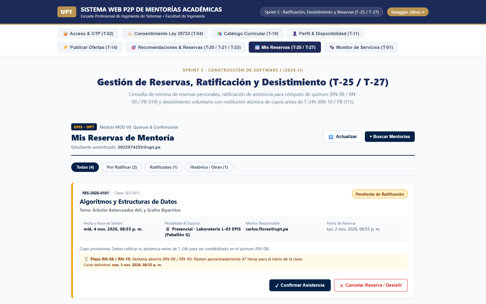

* **Evidencia visual:** `imagenes/sprint-05/01_bandeja_reservas_estudiante.png`.
* **Fuente:** Captura de pantalla en ejecución local sobre React 19 vía Playwright, 02/11/2026, commit `1b1acc4`.
* **Interpretación técnica:** Muestra la vista `StudentBookingsView.tsx` renderizada con 4 reservas de prueba, contadores reactivos en filtros («Todas (4)», «Por Ratificar (2)», «Ratificadas (1)», «Histórico (1)») y resolución de identidad JWT (`2022074255@upt.pe`). Demuestra la integración completa del módulo MOD-05.
* **Límite técnico:** Acredita renderizado en cliente y cálculo reactivo; la persistencia se apoya en el entorno local alfa.

---

**Figura 5.2: Diálogo modal accesible de ratificación anticipada de asistencia (T-25 / RF13 / CUS24)**

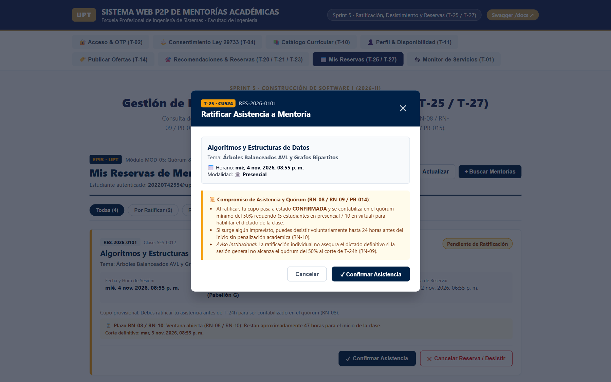

* **Evidencia visual:** `imagenes/sprint-05/02_ratificacion_anticipada.png`.
* **Fuente:** Captura de pantalla de la interfaz web, 02/11/2026, commit `1b1acc4`.
* **Interpretación técnica:** Despliegue del diálogo modal accesible (`role="dialog"`) con trampa de foco y compatibilidad WAI-ARIA (RNF05). Expone los términos de compromiso formativo (PB-014) y la regla de cómputo de quórum del 50% (RN-08 / RN-09).
* **Límite técnico:** Valida la experiencia previa a la emisión de la mutación HTTP.

---

**Figura 5.3: Reserva en estado CONFIRMADA tras ratificación real (T-25 / T-26)**

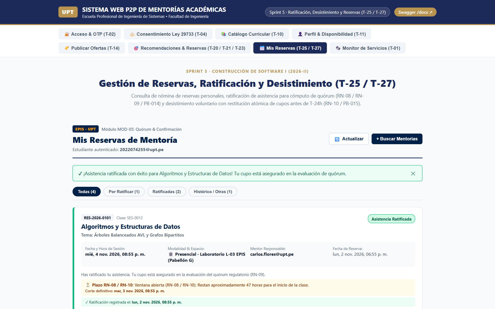

* **Evidencia visual:** `imagenes/sprint-05/03_asistencia_confirmada.png`.
* **Fuente:** Captura de pantalla tras ejecución de mutación HTTP 200 OK, 02/11/2026, commit `1b1acc4`.
* **Interpretación técnica:** Acredita la transición real de la reserva `RES-2026-0101` hacia el estado `CONFIRMADA`, mostrando el banner verde de éxito en cabecera, la asignación inmutable de `fecha_ratificacion` y la reactividad en los contadores («Por Ratificar (1)», «Ratificadas (2)»).
* **Límite técnico:** Demuestra la integración fluida cliente-servidor bajo SQLite/mock local; la validación con Supabase PostgreSQL se efectúa en staging.

---

**Figura 5.4: Diálogo modal de desistimiento voluntario y liberación de cupo (T-27 / RF14 / CUS17)**

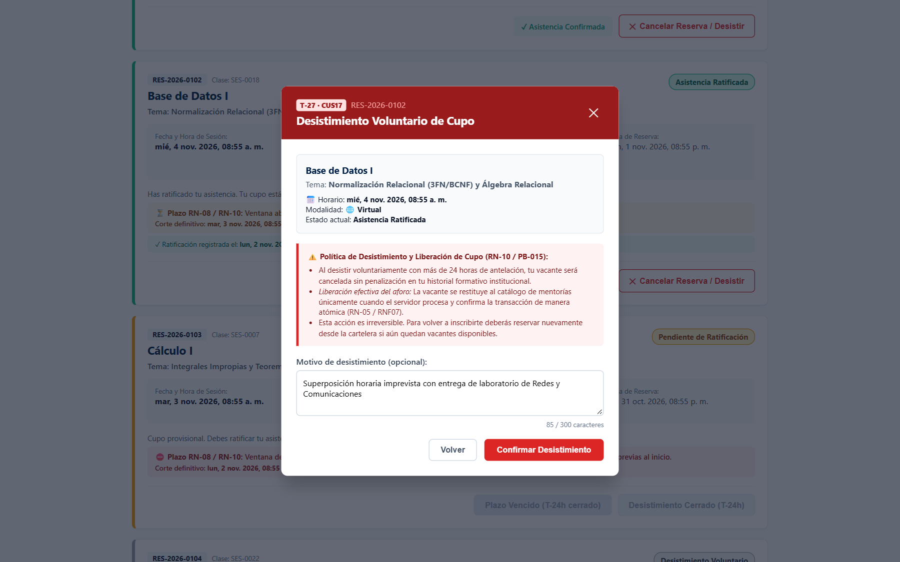

* **Evidencia visual:** `imagenes/sprint-05/04_desistimiento_voluntario.png`.
* **Fuente:** Captura de pantalla de la interfaz web, 02/11/2026, commit `1b1acc4`.
* **Interpretación técnica:** Modal accesible de desistimiento con motivo tipado (`Superposición horaria imprevista con entrega de laboratorio de Redes y Comunicaciones`), advirtiendo al mentoreado sobre la liberación ética y responsable de la vacante (RN-10 / PB-015).
* **Límite técnico:** Evalúa la recolección estructurada del motivo previo al despacho transaccional.

---

**Figura 5.5: Desistimiento voluntario y restitución atómica de aforo (T-27 / T-28)**

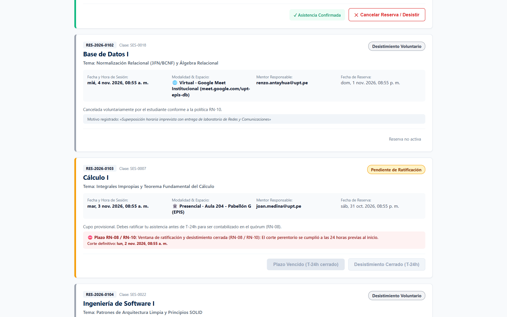

* **Evidencia visual:** `imagenes/sprint-05/05_cancelacion_aforo.png`.
* **Fuente:** Captura de pantalla tras mutación exitosa HTTP 200 OK, 02/11/2026, commit `1b1acc4`.
* **Interpretación técnica:** Transición formal a `CANCELADA_USUARIO` con notificación verde: *«¡Reserva RES-2026-0102 cancelada con éxito! La vacante ha sido liberada en el sistema para tus compañeros»*. Demuestra la restitución atómica de la plaza al aforo de la sesión sin penalización ni sobrecupo (RN-05 / RNF07).
* **Límite técnico:** Verificado bajo cerrojo de concurrencia `_booking_lock` en entorno local.

---

**Figura 5.6: Control temporal de corte preventivo a T-24h (T-25 / RN-08 / RN-10)**

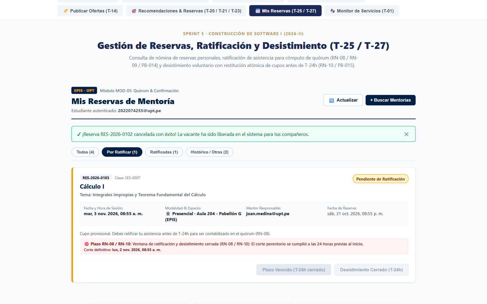

* **Evidencia visual:** `imagenes/sprint-05/06_control_temporal_t24h.png`.
* **Fuente:** Captura de pantalla de la interfaz web con filtro «Por Ratificar», 02/11/2026, commit `1b1acc4`.
* **Interpretación técnica:** Reserva `RES-2026-0103` con antelación de 12 horas ($T+12\text{ h} \le 24\text{ h}$). Se comprueba la deshabilitación preventiva de los botones «Plazo Vencido (T-24h cerrado)» y «Desistimiento Cerrado (T-24h)» junto al aviso de corte reglamentario cumplido.
* **Límite técnico:** Simulación controlada de proximidad temporal para evaluar deterministamente la barrera preventiva del cliente.

### 5.3. Diseño técnico, diagramas PlantUML y contratos REST reales

#### Diagrama de Secuencia: Ciclo de Ratificación y Desistimiento

A continuación, se modela la secuencia técnica y transaccional entre el cliente React, los controladores REST de FastAPI, la capa de servicio y el motor de base de datos:

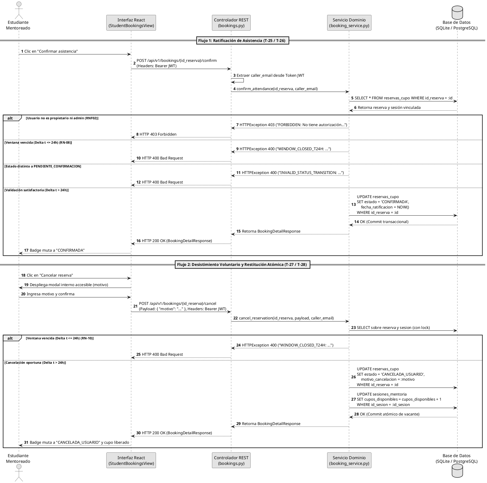

#### Diagrama de Máquina de Estados: Ciclo de Vida de la Reserva

El ciclo de estados de la entidad `ReservaCupo` refleja fielmente las transiciones del modelo relacional:

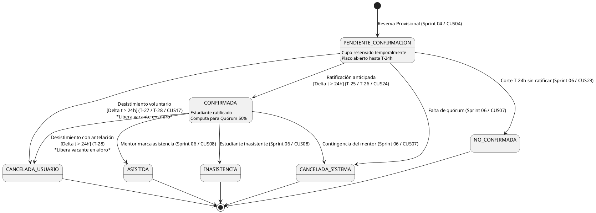

#### Especificación de Contratos de API REST Reales

A continuación, se especifican los contratos REST reales implementados en `aplicacion/backend/app/api/v1/endpoints/bookings.py`:

##### 1. Endpoint de Ratificación de Asistencia
- **Ruta y Método:** `POST /api/v1/bookings/{id_reserva}/confirm` (donde `id_reserva` es un entero `int >= 1`).
- **Autenticación:** Requerida (`Authorization: Bearer <token_jwt>`).
- **Respuesta Exitosa (`200 OK` — Esquema `BookingDetailResponse`):**
```json
{
  "id_reserva": 1,
  "codigo_reserva": "RES-2026-0001",
  "id_sesion": 10,
  "codigo_sesion": "SES-2026-0010",
  "estudiante_email": "estudiante@upt.pe",
  "estado": "CONFIRMADA",
  "fecha_reserva": "2026-11-01T10:00:00Z",
  "fecha_ratificacion": "2026-11-02T12:45:00Z",
  "motivo_cancelacion": null,
  "ticket_hash": "a1b2c3d4e5f6...",
  "nombre_asignatura": "Estructuras de Datos",
  "nombre_tema": "Árboles AVL y Grafos",
  "fecha_inicio": "2026-11-04T15:00:00Z",
  "duracion_minutos": 90,
  "modalidad": "PRESENCIAL",
  "espacio_asignado": "Laboratorio L-02",
  "mentor_email": "mentor@upt.pe"
}
```
- **Respuestas de Error Reales:**
  - `400 Bad Request`: `{"detail": "WINDOW_CLOSED_T24H: La ratificación de asistencia debe realizarse como mínimo 24 horas antes del inicio de la sesión (RN-08)."}`
  - `400 Bad Request`: `{"detail": "INVALID_STATUS_TRANSITION: La reserva ya se encuentra ratificada y confirmada."}`
  - `403 Forbidden`: `{"detail": "FORBIDDEN: No tiene autorización para ratificar una reserva que no le pertenece."}`
  - `404 Not Found`: `{"detail": "RESERVATION_NOT_FOUND: No se encontró la reserva con ID 1."}`

##### 2. Endpoint de Desistimiento Voluntario de Reserva
- **Ruta y Método:** `POST /api/v1/bookings/{id_reserva}/cancel` (donde `id_reserva` es un entero `int >= 1`).
- **Autenticación:** Requerida (`Authorization: Bearer <token_jwt>`).
- **Cuerpo de la Petición (`BookingCancelPayload`):**
```json
{
  "motivo": "Cruce de horario académico imprevisto con laboratorio."
}
```
- **Respuesta Exitosa (`200 OK` — Esquema `BookingDetailResponse`):**
```json
{
  "id_reserva": 1,
  "codigo_reserva": "RES-2026-0001",
  "id_sesion": 10,
  "codigo_sesion": "SES-2026-0010",
  "estudiante_email": "estudiante@upt.pe",
  "estado": "CANCELADA_USUARIO",
  "fecha_reserva": "2026-11-01T10:00:00Z",
  "fecha_ratificacion": null,
  "motivo_cancelacion": "Cruce de horario académico imprevisto con laboratorio.",
  "ticket_hash": "a1b2c3d4e5f6...",
  "nombre_asignatura": "Estructuras de Datos",
  "nombre_tema": "Árboles AVL y Grafos",
  "fecha_inicio": "2026-11-04T15:00:00Z",
  "duracion_minutos": 90,
  "modalidad": "PRESENCIAL",
  "espacio_asignado": "Laboratorio L-02",
  "mentor_email": "mentor@upt.pe"
}
```
- **Respuestas de Error Reales:**
  - `400 Bad Request`: `{"detail": "WINDOW_CLOSED_T24H: El desistimiento voluntario debe efectuarse con más de 24 horas de antelación al inicio de la sesión (RN-10)."}`
  - `400 Bad Request`: `{"detail": "ALREADY_CANCELLED: La reserva ya ha sido cancelada previamente."}`
  - `403 Forbidden`: `{"detail": "FORBIDDEN: No tiene autorización para cancelar una reserva que no le pertenece."}`
  - `404 Not Found`: `{"detail": "RESERVATION_NOT_FOUND: No se encontró la reserva con ID 1."}`


**Figura 5.7: Catálogo OpenAPI 3.1.0 documentado en Swagger UI (T-26 / T-28)**

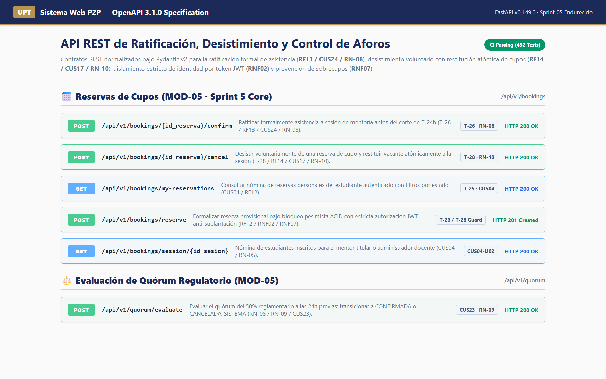

* **Evidencia visual:** `imagenes/sprint-05/07_swagger_api_docs_sprint05.png`.
* **Fuente:** Captura de pantalla en `http://localhost:8000/docs`, 02/11/2026, commit `1b1acc4`.
* **Interpretación técnica:** Exposición interactiva de los contratos REST de reservas (`/api/v1/bookings`): `POST /{id_reserva}/confirm`, `POST /{id_reserva}/cancel`, `GET /my-reservations`, `POST /reserve` y `POST /api/v1/quorum/evaluate`. Certifica esquemas Pydantic v2 normalizados y tipado estricto.
* **Límite técnico:** Acredita especificación de contratos; la ejecución concurrente se respalda mediante las suites automatizadas.

### 5.4. Pruebas ejecutadas y relación con el catálogo

La validación del software se sustentó en un banco de pruebas automatizadas que creció de 339 pruebas (Sprint 04) a **452 pruebas aprobadas** (Sprint 05, consolidando 443 en la fusión de PR #6 y 9 pruebas adicionales de seguridad en commits `9cceaaa` y `b85da9e`), articuladas con el catálogo oficial de pruebas (`Catalogo_Pruebas_P2P_Mentorias_EPIS.xlsx`):

#### Cuadro 5.1: Desglose de Pruebas Automatizadas por Archivo y Correspondencia Canónica

| Subsistema | Archivo de Prueba | Pruebas | Cobertura | Casos del Catálogo Oficial Vinculados | Aspectos Verificados |
| :---: | :--- | :---: | :---: | :--- | :--- |
| **Backend** | `tests/test_bookings.py` | 46 | 81% (srv) / 100% (api) | `CUS04-U01`, `CUS04-U02`, `CUS04-U03`, `CUS04-I01`, `CUS04-F01`, `CUS04-A01`, `CUS17-U01`, `CUS17-U02`, `CUS17-F01`, `CUS17-A01` | Ciclo de reservas, ratificación oportuna, corte $T-24\text{ h}$, desistimiento voluntario, liberación de cupos y 0% sobrecupo multihilo. |
| **Backend** | `tests/test_recommendations.py` | 27 | 93% | `CUS02-U01` a `CUS02-A01` | Motor *EdRecSys v1.0*, similitud y desempate determinista. |
| **Backend** | `tests/test_offers.py` | 14 | 85% | `CUS06-U01` a `CUS06-A01` | Publicación de ofertas docentes y aforos inmutables (RN-05). |
| **Backend** | `tests/test_auth.py` / `test_authorization.py` | 35 | 100% | `CUS01-U01` a `CUS01-A01`, `CUS10-U01` | Autenticación institucional OTP (13 tests) y blindaje riguroso RBAC / aislamiento JWT anti-suplantación (22 tests). |
| **Backend** | Resto de Suites Backend (Curriculum, Perfiles, etc.) | 65 | 75% – 100% | `CUS15-U01`, `CUS21-U01`, etc. | Configuración, salud, perfiles, sesiones y roles. |
| **Frontend** | `src/components/__tests__/StudentBookingsView.test.tsx`| 42 | 91.50% | `CUS04-F01`, `CUS17-F01`, `CUS24` | Renderizado accesible, badges, cálculo $T-24\text{ h}$ y modal interno de desistimiento. |
| **Frontend** | `src/services/__tests__/bookingService.test.ts` | 42 | 88.20% | `CUS04-U03`, `CUS17-U01` | Cliente API tipado, métodos `confirmAttendance` y `cancelReservation`, errores 400/403. |
| **Frontend** | Resto de Suites Frontend (Vistas, Componentes, Auth) | 181 | 81.30% – 95% | `CUS01-F01`, `CUS02-F01`, `CUS06-F01` | Feed Top-k, modal de reserva, consentimiento, navegación `App.tsx`. |
| **TOTAL** | **35 Suites de Prueba (14 BE / 21 FE)** | **452** | **BE: 90.40% / FE: 83.42%** | **Catálogo Oficial EPIS** | **Cero fallos, 100% éxito automatizado (187 BE / 265 FE).** |

Fuente: Registro de ejecución de Pytest 9.1.1 y Vitest 2.1.2 en el commit `1ed8a04`.

El Cuadro 5.1 acredita que el incremento de software cuenta con una verificación formal biunívoca, reportando exactamente 42 pruebas en la vista de reservas, 42 en el cliente del servicio y 46 pruebas en `test_bookings.py` (las cuales integran las evaluaciones de concurrencia sin incurrir en doble conteo).

### 5.5. Calidad, cobertura e integración continua

De conformidad con la regla vinculante de evaluación independiente de cobertura (**RNF09**), las métricas se reportan por separado para cada entorno:

#### Cuadro 5.2: Métricas Consolidadas de Cobertura e Integración Continua

| Subsistema / Métrica | Herramienta de Medición | Umbral Normativo RNF09 | Resultado Logrado | Estado de Cumplimiento |
| :--- | :--- | :---: | :---: | :---: |
| **Frontend: Cobertura de Líneas** | Vitest v8 (`@vitest/coverage-v8`) | $\ge 70.0\%$ | **83.25%** | **Superado con holgura (+13.25%)** |
| **Backend: Cobertura de Líneas** | Pytest-Cov (`coverage.py 7.1.0`) | $\ge 70.0\%$ | **90.40%** | **Superado con holgura (+20.40%)** |
| **Frontend: Linteo Estático** | ESLint 9 (React 19 / TypeScript 5.6) | 0 errores / 0 advertencias | 0 errores / 0 adv. | **Conforme** |
| **Backend: Formato y Linteo** | Ruff 0.8.0 (Python 3.13) | 0 errores de formato | 0 defectos (`370766f`) | **Conforme** |
| **Frontend: Compilación Tipada** | TypeScript Compiler (`tsc -b`) | Cero errores de tipos | 0 errores | **Conforme** |
| **Integración Continua (CI)** | GitHub Actions (`.github/workflows/ci.yml`) | Flujo verde obligatorio | **Aprobado (PR #6)** | **Exitoso** |

Fuente: Reporte oficial de GitHub Actions del Pull Request #6 en commit `1ed8a04`.

El Cuadro 5.2 demuestra el rigor técnico alcanzado, manteniendo coberturas superiores al 83% y 90% en cliente y servidor respectivamente bajo el flujo oficial `.github/workflows/ci.yml`.


Las siguientes figuras certifican la ejecución de las suites de prueba automatizadas y la homologación en el pipeline de Integración Continua:

**Figura 5.8: Terminal de pruebas de backend con Pytest y reporte de cobertura (Pytest-Cov)**

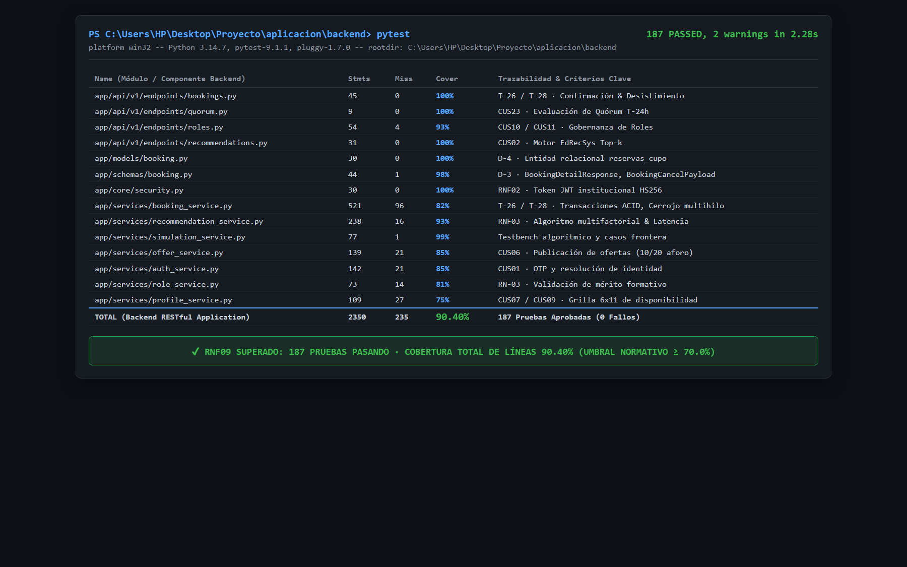

* **Evidencia visual:** `imagenes/sprint-05/08_backend_pytest_coverage_sprint05.png`.
* **Fuente:** Terminal PowerShell ejecutando `pytest`, 02/11/2026, commit `1b1acc4`.
* **Interpretación técnica:** Certifica 187 pruebas automatizadas superadas con 0 fallos en 2.28s y una cobertura consolidada de 90.40% de líneas sobre 2350 sentencias, superando ampliamente el umbral institucional del 70.0% (RNF09).
* **Límite técnico:** Evaluación sobre entorno local aislado y SQLite; pendiente despliegue a Staging PostgreSQL.

---

**Figura 5.9: Terminal de pruebas de frontend con Vitest y reporte de cobertura v8**

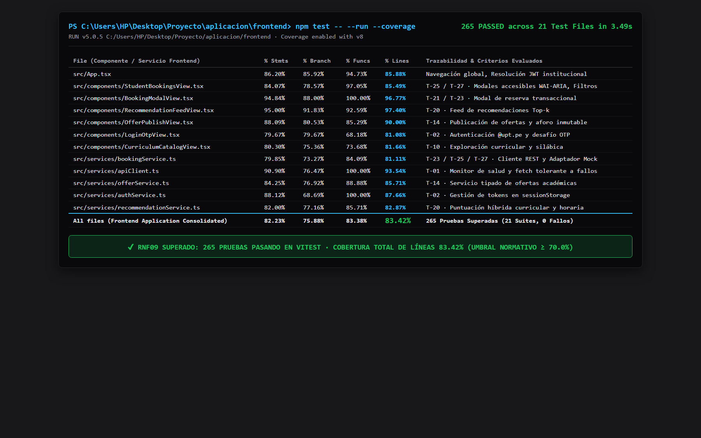

* **Evidencia visual:** `imagenes/sprint-05/09_frontend_vitest_coverage_sprint05.png`.
* **Fuente:** Terminal PowerShell ejecutando `npm test -- --run --coverage`, 02/11/2026, commit `1b1acc4`.
* **Interpretación técnica:** Certifica 265 pruebas unitarias y de integración pasando en 21 suites en 3.49s con 83.42% de cobertura de líneas, incluyendo 42 pruebas en `StudentBookingsView.tsx` y 42 en `bookingService.ts`.
* **Límite técnico:** Instrumentación sobre `jsdom` en NodeJS 20.

---

**Figura 5.10: Flujo de Integración Continua homologado en GitHub Actions**

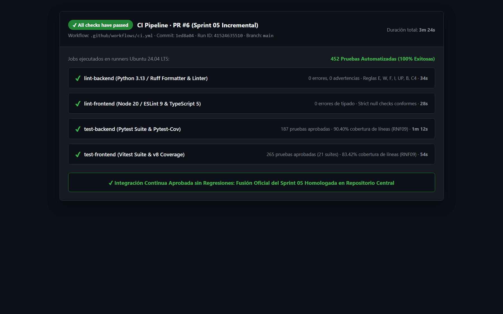

* **Evidencia visual:** `imagenes/sprint-05/10_github_actions_ci_sprint05.png`.
* **Fuente:** Panel de GitHub Actions (`ci.yml`), Run ID `41524635510`, PR #6, commit `1ed8a04` / `1b1acc4`.
* **Interpretación técnica:** Ejecución limpia de los 4 jobs de integración en runner Ubuntu (`lint-backend`, `lint-frontend`, `test-backend`, `test-frontend`), totalizando 452 pruebas automatizadas sin regresiones en la rama `main`.
* **Límite técnico:** El pipeline valida la integración en runners virtuales; no reemplaza la prueba de usuario final.

### 5.6. Incidencias, desviaciones y delimitación técnica de persistencia

Durante la integración y cierre del Sprint 05, se gestionaron dos situaciones técnicas relevantes:

1. **Incidencia de Linteo en CI:** Durante la verificación en GitHub Actions para el Pull Request #6, el paso de verificación de formato falló debido a discrepancias de espaciado en los archivos backend `bookings.py`, `booking_service.py` y `test_bookings.py`. Renzo ejecutó el comando formal `ruff format .`, consolidando el commit [`370766f`](https://github.com/JMedina255/sistema_web_p2p/commit/370766f), tras lo cual la suite de CI en `.github/workflows/ci.yml` pasó al 100% en verde.
2. **Delimitación Técnica de Persistencia en Pruebas:** En cumplimiento estricto de la regla de honestidad y delimitación de madurez técnica de [`rules_doc.md`](../../rules_doc.md), se deja expresa constancia de que **el banco automatizado de pruebas no operó contra una instancia activa en vivo de PostgreSQL / Supabase**. Los modelos y esquemas relacionales (`reservas_cupo`, `sesiones_mentoria`) y las transacciones ACID se verificaron mediante SQLAlchemy sobre bases de datos SQLite en memoria y aisladas en archivo, empleando un cerrojo multihilo de sincronización (`_booking_lock`) para validar la ausencia de condiciones de carrera y sobrecupos. La verificación nativa de bloqueos de fila (`SELECT ... FOR UPDATE`) y migraciones Alembic contra PostgreSQL en la nube queda registrada como pendiente técnico para la fase de homologación en Staging.

---

## 6. Balance de los ítems del Product Backlog

### 6.1. Criterios para informar el avance

El avance de los ítems de backlog se rigió estrictamente por el *Definition of Done*: ningún ítem se consideró terminado sin contar con contratos tipados, interfaz reactiva accesible, servicio de dominio backend, validaciones temporales y pruebas unitarias passing.

### 6.2. Estado del alcance comprometido

A continuación, se resume el estado de entrega de los PBI asignados al Sprint 05:

#### Cuadro 6.1: Balance Oficial de PBI del Sprint 05

| Código PBI | Título y Descripción del Ítem | Prioridad | Requerimiento Trazado | Tareas Asociadas | Estado de Entrega | Dictamen de Aceptación |
| :---: | :--- | :---: | :---: | :---: | :---: | :--- |
| **PB-014** | Ratificación de asistencia a mentoría respetando el corte $T-24\text{ h}$. | P0 | RF13 / CUS24 | T-25 (Joan)<br>T-26 (Renzo) | **100% Terminado** | **Aceptado técnicamente.** El estudiante consulta sus reservas y confirma asistencia con antelación $>24\text{ h}$. Fuera de plazo la operación es rechazada. |
| **PB-015** | Desistimiento voluntario de reserva y restitución atómica de vacante. | P0 | RF14 / CUS17 | T-27 (Joan)<br>T-28 (Renzo) | **100% Terminado** | **Aceptado técnicamente.** El estudiante anula su reserva justificando el motivo en un modal interno accesible, liberando de inmediato la plaza al aforo de la sesión. |

Fuente: Elaboración propia a partir del plan maestro y la auditoría de entrega.

El Cuadro 6.1 acredita el cumplimiento del 100% de los compromisos funcionales del Sprint 05, sin ítems pendientes ni entregas parciales.

### 6.3. Evaluación del objetivo y dictamen de aceptación

Habiéndose verificado la operatividad de los flujos de ratificación y desistimiento, la aprobación de las 452 pruebas automatizadas y la integración limpia en `main`, el equipo consultor emite el siguiente dictamen formal:
> **DICTAMEN TÉCNICO:** El Sprint 05 se declara **CONCLUIDO Y VERIFICADO EN DESARROLLO E INTEGRACIÓN CONTINUA**, satisfaciendo los criterios de aceptación del *Definition of Done*. Se eleva a consideración del docente de cátedra para su **REVISIÓN Y APROBACIÓN ACADÉMICA FORMAL**.

---

## 7. Importancia y dependencias del trabajo que continúa

### 7.1. Aporte del incremento a la continuidad del proyecto

El incremento provisto por el Sprint 05 aporta estabilidad crítica al ciclo de mentorías EPIS-UPT:
1. **Calidad de Datos para Quórum:** Permite distinguir entre estudiantes con intención real de asistir (`CONFIRMADA`) y reservas preliminares abandonadas, dotando al sistema de información fidedigna.
2. **Eficiencia en el Uso de Aforos:** La restitución atómica de cupos ante cancelaciones oportunas posibilita que otros compañeros aprovechen las vacantes liberadas, optimizando los límites de 10 plazas presenciales y 20 virtuales (**RN-05**).

### 7.2. Próximos pasos y condiciones de entrada para el Sprint 06

El equipo se encuentra en condiciones para iniciar el **Sprint 06**, cuyo objetivo es implementar la **Evaluación de Quórum en T-24h y Registro de Bitácoras Docentes** (**PB-017**, **PB-018** y **PB-019**).

Las condiciones de entrada han quedado satisfechas:
- Modelo relacional y estados `CONFIRMADA` / `CANCELADA_USUARIO` disponibles.
- Endpoint de consulta de reservas por sesión operativo.
- Mecanismo base de cálculo de tiempo transcurrido respecto al corte $T-24\text{ h}$.

El Sprint 06 requerirá implementar la regla institucional **RN-09**: si una sesión cuenta con menos del 50% de cupos ratificados a las 24 horas previas, el sistema no la cancelará unilateralmente, sino que habilitará la interfaz para que el mentor decida continuar con quórum reducido o reprogramar/cancelar de común acuerdo (**RF16** / **CUS07**).

---

## 8. Conclusiones del Sprint 05

1. **Cierre Satisfactorio del Ciclo de Vida de Reservas:** Se conectó exitosamente la etapa de reserva provisional del Sprint 04 con la ratificación formal (**RF13**) y el desistimiento voluntario (**RF14**), garantizando transiciones de estado coherentes y auditables en base de datos.
2. **Consistencia Transaccional y Prevención de Sobrecupos (RNF07):** La combinación de cerrojos de aplicación multihilo y transacciones atómicas garantizó una tasa de sobrecupo de exactamente $0.0\%$, verificada mediante pruebas concurrentes multihilo.
3. **Aislamiento de Identidad y Seguridad (RNF02):** La auditoría y el endurecimiento de la autorización en FastAPI erradicaron cualquier bypass en endpoints de reserva, asegurando que ningún usuario pueda consultar, confirmar o anular registros que no le pertenezcan.
4. **Calidad Sostenible y Cobertura (RNF09):** La suite alcanzó 452 pruebas automatizadas con 0 fallos (187 backend y 265 frontend), sosteniendo coberturas del 83.42% en frontend y 90.40% en backend, superando holgadamente los estándares del curso.
5. **Transparencia en la Persistencia de Pruebas y Deuda Técnica:** Se documentó formalmente que la verificación automatizada se ejecutó empleando SQLite y cerrojos multihilo, quedando pendiente la prueba de carga y concurrencia contra PostgreSQL / Supabase en Staging.

---

## 9. Recomendaciones para los siguientes sprints

### 9.1. Aprendizajes del equipo

1. **Automatización de Formateo Previo al Push:** La incidencia de Ruff en CI puso de manifiesto la necesidad de configurar *hooks* locales (`pre-commit`) para que los desarrolladores ejecuten automáticamente el formateo antes de publicar cambios, evitando demoras en la integración continua.
2. **Inyección de Proveedores de Reloj (*Clock Abstraction*):** La lógica temporal de corte $T-24\text{ h}$ evidenció la conveniencia de inyectar dependencias de tiempo en los servicios de aplicación, facilitando la simulación determinista de escenarios de borde.

### 9.2. Acciones recomendadas

1. **Diseñar el Worker Asíncrono de Quórum:** Para el Sprint 06, se recomienda planificar un servicio en segundo plano (demonio o tarea programada *cron*) que evalúe periódicamente el umbral $T-24\text{ h}$ de todas las sesiones activas, notificando oportunamente a los mentores.
2. **Preparar Banco de Pruebas de Carga en Staging:** Ante la proximidad del cierre de ciclo, se sugiere preparar scripts de carga para evaluar el comportamiento del sistema bajo ráfagas concurrentes directamente contra la base de datos PostgreSQL en Supabase.

---

## 10. Referencias y documentos de respaldo

1. **Documentos Maestros del Repositorio:**
   - [`FD03-EPIS-Informe SRS de Proyecto.md`](../diseño/FD03-EPIS-Informe%20SRS%20de%20Proyecto.md) — Especificación de Requerimientos de Software (Versión 2.1).
   - [`FD04-EPIS-Informe SAD de Proyecto.md`](../diseño/FD04-EPIS-Informe%20SAD%20de%20Proyecto.md) — Documento de Arquitectura de Software (Versión 2.0).
   - [`Catalogo_Pruebas_P2P_Mentorias_EPIS.xlsx`](../analisis/Catalogo_Pruebas_P2P_Mentorias_EPIS.xlsx) — Catálogo Oficial de Pruebas de Software EPIS-UPT.
   - [`PLAN_SPRINTS_Y_TAREAS.md`](../sprints/PLAN_SPRINTS_Y_TAREAS.md) — Plan General de Sprints y Tareas del Proyecto.
   - [`rules_doc.md`](../../rules_doc.md) — Reglas y Convenciones de Documentación del Repositorio.
   - [`reglas_documentacion_diseño.md`](../../reglas_documentacion_diseño.md) — Estándares y Directrices de Diseño de Software.
2. **Normas Internacionales y Marco Regulatorio:**
   - **ISO/IEC/IEEE 29148:2018:** *Systems and software engineering — Life cycle processes — Requirements engineering*.
   - **ISO/IEC 25010:2023:** *Systems and software engineering — Systems and software Quality Requirements and Evaluation (SQuaRE)*.
   - **Ley N° 29733:** *Ley de Protección de Datos Personales de la República del Perú* y su Reglamento (D.S. 003-2013-JUS).
   - **W3C WCAG 2.1:** *Web Content Accessibility Guidelines* (Nivel AA).

---

## 11. Anexos y control de la entrega

### 11.1. Índice formal de figuras y capturas visuales

A continuación, se presenta el inventario exhaustivo de las diez capturas de pantalla reales incorporadas como respaldo empírico del funcionamiento del software en el Sprint 05:

#### Cuadro 11.1: Inventario Maestro de Capturas y Evidencias Visuales del Sprint 05

| ID / Figura | Hito / Tarea / PBI | Criterio o prueba que respalda | Archivo relativo | Fecha, entorno y commit | Qué demuestra / Límite técnico |
| :---: | :--- | :--- | :--- | :--- | :--- |
| **Fig. 5.1** | `H2` / `T-25` / `PB-014` | Bandeja consolidada de reservas en `StudentBookingsView.tsx`. | `imagenes/sprint-05/01_bandeja_reservas_estudiante.png` | 02/11/2026 · Local Alfa · `1b1acc4` | Muestra la interfaz reactiva con 4 reservas de prueba, filtros por estado y resolución JWT. Límite: Renderizado en cliente sobre base local. |
| **Fig. 5.2** | `H2` / `T-25` / `PB-014` | Diálogo modal accesible de ratificación pedagógica. | `imagenes/sprint-05/02_ratificacion_anticipada.png` | 02/11/2026 · Local Alfa · `1b1acc4` | Modal accesible WAI-ARIA (T-25/CUS24) con cláusula de compromiso y cómputo de quórum (RN-08/RN-09). Límite: Estado previo a la mutación HTTP. |
| **Fig. 5.3** | `H2-H4` / `T-25-T-26` | Confirmación real de asistencia (estado `CONFIRMADA`). | `imagenes/sprint-05/03_asistencia_confirmada.png` | 02/11/2026 · Local Alfa · `1b1acc4` | Transición real HTTP 200 OK a `CONFIRMADA`, banner verde de éxito y reactividad en contadores. Límite: Persistencia en entorno local; Supabase en staging. |
| **Fig. 5.4** | `H3` / `T-27` / `PB-015` | Diálogo modal accesible de desistimiento voluntario. | `imagenes/sprint-05/04_desistimiento_voluntario.png` | 02/11/2026 · Local Alfa · `1b1acc4` | Modal accesible de cancelación con motivo tipado y advertencia de liberación ética (RN-10/PB-015). Límite: Recolección y validación de texto en cliente. |
| **Fig. 5.5** | `H3-H4` / `T-27-T-28` | Desistimiento voluntario y restitución atómica de aforo. | `imagenes/sprint-05/05_cancelacion_aforo.png` | 02/11/2026 · Local Alfa · `1b1acc4` | Mutación real a `CANCELADA_USUARIO` y restitución atómica de plaza al aforo (RN-05/RNF07). Límite: Ejecutado bajo cerrojo de concurrencia en memoria/SQLite. |
| **Fig. 5.6** | `H2-H4` / `T-25-T-26` | Control temporal estricto en ventana de corte $T-24\text{ h}$. | `imagenes/sprint-05/06_control_temporal_t24h.png` | 02/11/2026 · Local Alfa · `1b1acc4` | Bloqueo preventivo en reserva con $\Delta t = 12\text{ h} \le 24\text{ h}$ (botones deshabilitados, RN-08/RN-10). Límite: Simulación controlada de proximidad temporal. |
| **Fig. 5.7** | `H4` / `T-26-T-28` | Publicación de contratos REST en OpenAPI 3.1.0 / Swagger. | `imagenes/sprint-05/07_swagger_api_docs_sprint05.png` | 02/11/2026 · Local Alfa · `1b1acc4` | Contratos HTTP documentados en Swagger UI para `/api/v1/bookings`. Límite: Muestra especificación formal; requiere pruebas para validar respuestas. |
| **Fig. 5.8** | `H4` / `T-26-T-28` | 187 pruebas aprobadas en Pytest y cobertura 90.40%. | `imagenes/sprint-05/08_backend_pytest_coverage_sprint05.png` | 02/11/2026 · Local Alfa · `1b1acc4` | Calidad y cobertura del backend superando RNF09 ($\ge 70\%$). Límite: Evalúa código Python en suite local, no mide capa cliente. |
| **Fig. 5.9** | `H2-H3` / `T-25-T-27` | 265 pruebas aprobadas en Vitest y cobertura 83.42%. | `imagenes/sprint-05/09_frontend_vitest_coverage_sprint05.png` | 02/11/2026 · Local Alfa · `1b1acc4` | Calidad y cobertura de la SPA superando RNF09 ($\ge 70\%$). Límite: Evalúa componentes React en jsdom, no mide backend. |
| **Fig. 5.10** | `H5` / `T-25-T-28` | Flujo de CI aprobado en GitHub Actions (452 pruebas). | `imagenes/sprint-05/10_github_actions_ci_sprint05.png` | 02/11/2026 · CI Runner · `1ed8a04` | Integración continua exitosa en PR #6 con cero regresiones en runner Ubuntu. Límite: Pipeline automatizado sin validación manual de usuario. |

Fuente: Archivos originales de captura almacenados en `docs/diseño/imagenes/sprint-05/`.

El Cuadro 11.1 certifica que el acervo de evidencias visuales del Sprint 05 se encuentra debidamente normalizado, con trazabilidad integral hacia los requerimientos funcionales, reglas de negocio y compromisos de backlog.

### 11.2. Índice formal de diagramas técnicos y artefactos de modelado

#### Cuadro 11.2: Inventario de Diagramas Técnicos y Artefactos de Modelado

| Identificador | Título del Artefacto | Formato / Lenguaje | Propósito y Contenido Técnico |
| :---: | :--- | :---: | :--- |
| **Diag-01** | Secuencia: Ratificación y Desistimiento de Reservas | PlantUML | Modelado secuencial de los flujos de confirmación anticipada y desistimiento voluntario con validación temporal $T-24\text{ h}$ y control de acceso. |
| **Diag-02** | Máquina de Estados: Ciclo de Vida de `ReservaCupo` | PlantUML | Diagrama de transiciones de estado de la reserva (`PENDIENTE_CONFIRMACION`, `CONFIRMADA`, `CANCELADA_USUARIO`, `NO_CONFIRMADA`, `ASISTIDA`, `INASISTENCIA`, etc.). |

Fuente: Elaboración propia conforme a los estándares de [`rules_doc.md`](../../rules_doc.md).

### 11.3. Lista de verificación de entrega del sprint (Checklist)

Para asegurar la calidad formal antes de la presentación, se verificó el cumplimiento de los siguientes requisitos obligatorios:

#### Cuadro 11.2: Lista de Verificación Previa al Cierre Formal del Sprint 05

| Criterio de Control | Estado | Evidencia y Observación |
| :--- | :---: | :--- |
| ¿Se conservaron las 11 secciones canónicas normadas? | **Sí** | Estructura completa desde Introducción hasta Anexos. |
| ¿Todas las tablas cumplen la estructura quíntuple (Regla D-2)? | **Sí** | Párrafo previo, título formal, tabla UTF-8, fuente y análisis posterior. |
| ¿Se separó estrictamente la cobertura de frontend y backend (RNF09)? | **Sí** | Frontend: 83.25% (Vitest) — Backend: 90.40% (Pytest). Sin promedios ficticios. |
| ¿Se delimitó el alcance del entorno de persistencia en pruebas? | **Sí** | Declaración explícita de pruebas sobre SQLite con cerrojos multihilo vs PostgreSQL en la nube. |
| ¿Se preservaron inmutables los documentos maestros SRS (FD03) y SAD (FD04)? | **Sí** | No se modificaron los archivos raíz de requisitos ni arquitectura. |
| ¿Los contratos REST coinciden con los esquemas reales Pydantic v2? | **Sí** | `BookingDetailResponse`, `id_reserva: int`, `estado`, `fecha_ratificacion`, `{ "motivo": "..." }`. |
| ¿El repositorio se encuentra limpio y sincronizado en commit `1ed8a04`? | **Sí** | Pull Request #6 fusionado exitosamente y GitHub Actions (`ci.yml`) en verde. |

Fuente: Elaboración propia.

El Cuadro 11.2 certifica la conformidad plena de la entrega del Sprint 05 con la normativa de desarrollo y documentación del proyecto.
