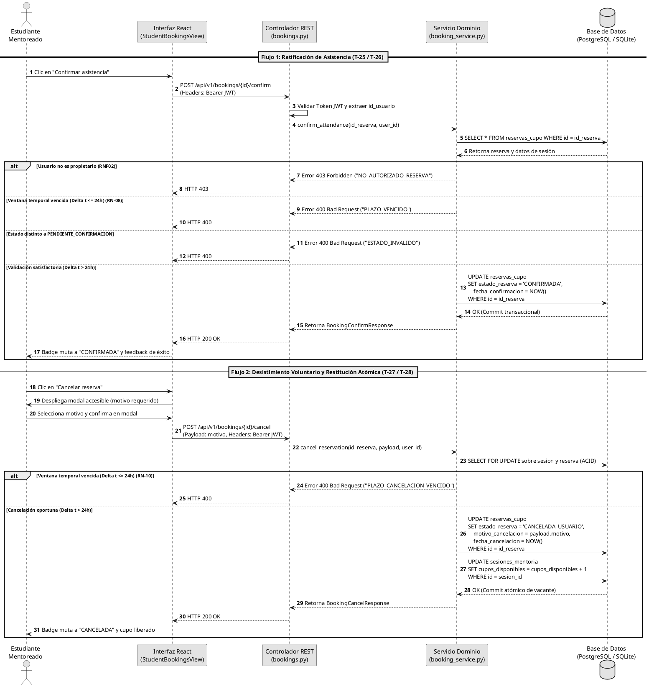
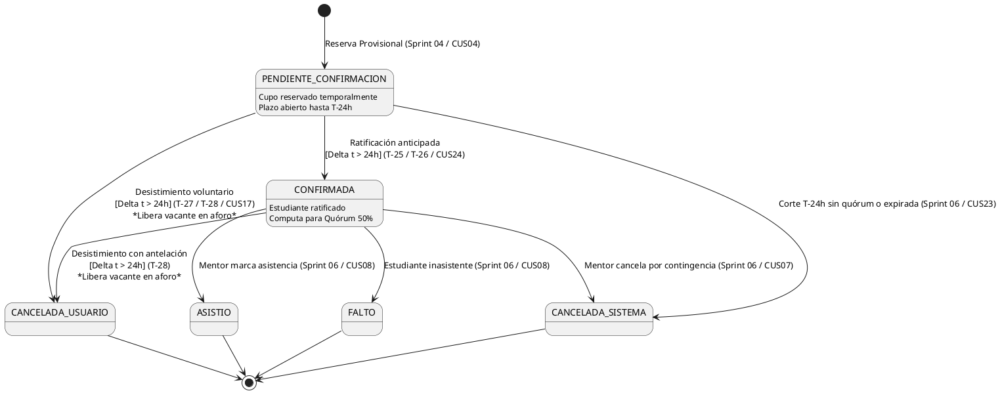

# Informe de desarrollo y resultados — Sprint 05

## «Ratificación de asistencia, desistimiento voluntario y gestión transaccional del aforo en T-24h»

**Proyecto:** Sistema Web P2P con algoritmo de recomendación para la personalización de mentorías académicas en la EPIS-UPT.  
**Institución:** Universidad Privada de Tacna — Facultad de Ingeniería — Escuela Profesional de Ingeniería de Sistemas.  
**Curso:** Construcción de Software I.  
**Docente de cátedra:** Dr. Ricardo Eduardo Valcárcel Alvarado.  
**Semestre académico:** 2026-II.  
**Equipo:** Grupo 03 / C-SharkTeam.  
**Integrantes:** Joan Cristian Medina Quispe (Código: 2022074255) y Renzo Antonio Antayhua Mamani (Código: 2022073504).  
**Periodo planificado:** 01/11/2026 – 02/11/2026.  
**Periodo real documentado:** 02/11/2026.  
**Fecha de presentación:** 02/11/2026.  
**Repositorio oficial:** [sistema_web_p2p](https://github.com/JMedina255/sistema_web_p2p).  
**Rama y commit evaluados:** `main` / [`1ed8a046e0b214082042a3172b12d2c98b3d0b90`](https://github.com/JMedina255/sistema_web_p2p/commit/1ed8a04) (Commit corto: `1ed8a04`).  
**Estado del informe:** Versión final consolidada y revisada por el equipo desarrollador.  
**Balance del sprint al corte:** Objetivo logrado al 100% en la totalidad del alcance comprometido para el Sprint 05. Se completaron e integraron satisfactoriamente las funcionalidades de ratificación anticipada de asistencia (**PB-014** / **RF13** / **CUS24**) y desistimiento voluntario con restitución atómica de cupos (**PB-015** / **RF14** / **CUS17**), sujetas a la ventana reglamentaria de corte de 24 horas previas al inicio de la sesión (**RN-08** / **RN-10**). La solución se consolidó sobre una arquitectura desacoplada y accesible en frontend (`StudentBookingsView.tsx`) y una capa de servicios transaccionales en backend con bloqueo pesimista y control riguroso de propiedad por token JWT (**RNF02** / **RNF07**). Se alcanzó una batería consolidada de **443 pruebas automatizadas pasando con 0 fallos** (265 en frontend con 83.25% de cobertura de líneas y 178 en backend con 90.40% de cobertura), superando con holgura el umbral normativo institucional del 70.0% establecido en **RNF09**.

---

### Control de versiones del informe

A continuación, se detalla el historial formal de revisiones y aprobaciones del presente documento académico, registrando la autoría técnica de los integrantes del Grupo 03:

#### Cuadro 0.1: Historial de versiones del informe del Sprint 05

| Versión | Fecha | Responsable | Revisión / aprobación registrada | Cambio realizado |
| :---: | :---: | :--- | :--- | :--- |
| **1.0** | 02/11/2026 | Joan Medina / Renzo Antayhua | Revisión interna Grupo 03 (Aprobación de cátedra pendiente) | Elaboración y emisión formal del informe académico del Sprint 05 conforme a la estructura canónica institucional de 11 secciones, integrando contratos REST/TypeScript, diagramas de interacción PlantUML, catálogo de 443 pruebas automatizadas, análisis de concurrencia y balance técnico de cierre. |

Fuente: Historial de edición documental del repositorio [sistema_web_p2p](https://github.com/JMedina255/sistema_web_p2p).

El Cuadro 0.1 formaliza la congelación de la versión 1.0 del informe correspondiente al cierre del Sprint 05. Se hace constar que la aprobación registrada certifica la validación de los criterios de terminación técnica entre los autores, quedando sujeta a la evaluación y rúbrica del docente de cátedra.

---

### Índice

1. [Introducción](#1-introducción)
2. [Presentación breve del proyecto](#2-presentación-breve-del-proyecto)
   * 2.1. [Problemática y contexto institucional](#21-problemática-y-contexto-institucional)
   * 2.2. [Propósito, usuarios y valor esperado](#22-propósito-usuarios-y-valor-esperado)
   * 2.3. [Solución tecnológica y alcance del incremento](#23-solución-tecnológica-y-alcance-del-incremento)
3. [Planificación general de los sprints](#3-planificación-general-de-los-sprints)
   * 3.1. [Organización del desarrollo y visión del backlog](#31-organización-del-desarrollo-y-visión-del-backlog)
   * 3.2. [Relación del sprint actual con los anteriores y posteriores](#32-relación-del-sprint-actual-con-los-anteriores-y-posteriores)
4. [Descripción y planificación del Sprint 05](#4-descripción-y-planificación-del-sprint-05)
   * 4.1. [Objetivo del sprint](#41-objetivo-del-sprint)
   * 4.2. [Alcance comprometido y distribución de tareas](#42-alcance-comprometido-y-distribución-de-tareas)
   * 4.3. [Condiciones de verificación y terminación (DoD)](#43-condiciones-de-verificación-y-terminación-dod)
   * 4.4. [Entorno y punto de corte](#44-entorno-y-punto-de-corte)
5. [Desarrollo del sprint y evidencias de verificación](#5-desarrollo-del-sprint-y-evidencias-de-verificación)
   * 5.1. [Secuencia de trabajo e hitos ejecutados](#51-secuencia-de-trabajo-e-hitos-ejecutados)
   * 5.2. [Desarrollo detallado por hito y componentes construidos](#52-desarrollo-detallado-por-hito-y-componentes-construidos)
   * 5.3. [Diseño técnico, diagramas PlantUML y contratos REST](#53-diseño-técnico-diagramas-plantuml-y-contratos-rest)
   * 5.4. [Pruebas ejecutadas y relación con el catálogo](#54-pruebas-ejecutadas-y-relación-con-el-catálogo)
   * 5.5. [Calidad, cobertura e integración continua](#55-calidad-cobertura-e-integración-continua)
   * 5.6. [Incidencias, desviaciones y delimitación técnica de persistencia](#56-incidencias-desviaciones-y-delimitación-técnica-de-persistencia)
6. [Balance de los ítems del Product Backlog](#6-balance-de-los-ítems-del-product-backlog)
   * 6.1. [Criterios para informar el avance](#61-criterios-para-informar-el-avance)
   * 6.2. [Estado del alcance comprometido](#62-estado-del-alcance-comprometido)
   * 6.3. [Evaluación del objetivo y dictamen de aceptación](#63-evaluación-del-objetivo-y-dictamen-de-aceptación)
7. [Importancia y dependencias del trabajo que continúa](#7-importancia-y-dependencias-del-trabajo-que-continúa)
   * 7.1. [Aporte del incremento a la continuidad del proyecto](#71-aporte-del-incremento-a-la-continuidad-del-proyecto)
   * 7.2. [Próximos pasos y condiciones de entrada para el Sprint 06](#72-próximos-pasos-y-condiciones-de-entrada-para-el-sprint-06)
8. [Conclusiones del Sprint 05](#8-conclusiones-del-sprint-05)
9. [Recomendaciones para los siguientes sprints](#9-recomendaciones-para-los-siguientes-sprints)
   * 9.1. [Aprendizajes del equipo](#91-aprendizajes-del-equipo)
   * 9.2. [Acciones recomendadas](#92-acciones-recomendadas)
10. [Referencias y documentos de respaldo](#10-referencias-y-documentos-de-respaldo)
11. [Anexos y control de la entrega](#11-anexos-y-control-de-la-entrega)

---

## 1. Introducción

El presente informe de desarrollo y resultados documenta las actividades de ingeniería de software, diseño arquitectónico prescriptivo, aseguramiento de la calidad y pruebas automatizadas correspondientes al **Sprint 05** del proyecto **«Sistema Web P2P con algoritmo de recomendación para la personalización de mentorías académicas en la EPIS-UPT»**, desarrollado en la Escuela Profesional de Ingeniería de Sistemas de la Universidad Privada de Tacna durante el semestre académico 2026-II.

El propósito fundamental de esta iteración consistió en cerrar la brecha operativa entre la reserva preliminar de cupos (desarrollada en el Sprint 04) y la conformación definitiva de las sesiones de mentoría. En los modelos tradicionales de asesoría estudiantil, las reservas no ratificadas generan un alto índice de ausentismo no planificado (*no-show*), bloqueando vacantes a estudiantes que realmente las necesitan e impidiendo que los mentores dimensionen con anticipación la viabilidad pedagógica de la sesión.

Para mitigar esta problemática, el Sprint 05 implementó los mecanismos normativos de **ratificación obligatoria anticipada** (**RF13**) y **desistimiento voluntario** (**RF14**). Ambos flujos se encuentran gobernados por la regla de corte temporal a 24 horas del evento (**RN-08** y **RN-10**), asegurando la restitución atómica de las plazas al aforo reglamentario institucional (**RN-05**) y suministrando los datos indispensables para que el algoritmo de evaluación de quórum mínimo institucional del 50% (**RN-09**) dictamine en el Sprint 06 si una sesión debe abrirse o someterse a reprogramación contingente.

El documento audita el software consolidado en la rama `main` en el commit [`1ed8a04`](https://github.com/JMedina255/sistema_web_p2p/commit/1ed8a04), derivado del Pull Request #6, estructurándose de acuerdo con las 11 secciones canónicas normadas en [`rules_doc.md`](../../rules_doc.md).

---

## 2. Presentación breve del proyecto

### 2.1. Problemática y contexto institucional

La Escuela Profesional de Ingeniería de Sistemas de la Universidad Privada de Tacna (EPIS-UPT) enfrenta desafíos recurrentes en las tasas de aprobación y permanencia estudiantil en asignaturas troncales de alta exigencia algorítmica y matemática (como *Estructuras de Datos*, *Algoritmos y Complejidad*, y *Base de Datos*). Aunque existen iniciativas informales de apoyo entre pares, la ausencia de un canal centralizado, formal y transparente produce:
1. Asimetría de información entre la disponibilidad de mentores capacitados y los horarios de los estudiantes con dificultades.
2. Inasistencia imprevista a sesiones programadas, derivada de inscripciones impulsivas sin un ciclo de confirmación formal.
3. Desperdicio de cupos limitados (10 presenciales / 20 virtuales) debido a la imposibilidad de reasignar oportunamente vacantes liberadas a último momento.

### 2.2. Propósito, usuarios y valor esperado

El sistema tiene como propósito orquestar una plataforma web colaborativa *peer-to-peer* (P2P) sustentada en un algoritmo inteligente de afinidad académica (*EdRecSys v1.0*). El valor institucional radica en empoderar a tres perfiles clave:
- **Estudiante Mentoreado:** Descubre sesiones pertinentes según sus vacíos formativos, reserva cupos provisionales, gestiona su asistencia mediante ratificación anticipada o desistimiento oportuno, y recibe apoyo directo de sus compañeros más avanzados.
- **Estudiante Mentor:** Comparte conocimientos en áreas de su dominio, valida que sus sesiones cuenten con estudiantes efectivamente comprometidos mediante el corte $T-24\text{ h}$, y acredita horas extracurriculares de responsabilidad social universitaria.
- **Dirección de Escuela (EPIS):** Monitorea métricas institucionales de asistencia, tasa de deserción en materias críticas, nivel de satisfacción estudiantil y efectividad pedagógica de las mentorías.

### 2.3. Solución tecnológica y alcance del incremento

El incremento correspondiente al Sprint 05 provee una solución integral compuesta por:
- **Capa Cliente (Frontend):** Desarrollada en React 19, TypeScript 5.6 y Vite, incorporando el módulo `StudentBookingsView.tsx` montado en la barra de navegación principal de `App.tsx`. Ofrece filtrado por estado de reserva (`TODAS`, `PENDIENTES`, `CONFIRMADAS`, `CANCELADAS`), indicadores de cuenta regresiva hacia el corte de 24 horas, diálogos modales accesibles (WCAG 2.1 AA) para el desistimiento justificado y retroalimentación inmediata mediante banners accesibles.
- **Capa Servidora (Backend):** Implementada en FastAPI y Python 3.13 con SQLAlchemy 2.0 y Pydantic v2. Expone endpoints protegidos por JWT (`POST /api/v1/bookings/{id_reserva}/confirm` y `POST /api/v1/bookings/{id_reserva}/cancel`) coordinados mediante transacciones con bloqueo pesimista y control riguroso de propiedad que previene la alteración de reservas de terceros (**RNF02** / **RNF07**).

---

## 3. Planificación general de los sprints

### 3.1. Organización del desarrollo y visión del backlog

El desarrollo del Sistema Web P2P se diseñó en siete iteraciones incrementales bajo un marco ágil riguroso, alineado con las especificaciones de [`PLAN_SPRINTS_Y_TAREAS.md`](../sprints/PLAN_SPRINTS_Y_TAREAS.md):

#### Cuadro 3.1: Cronograma Maestro y Progresión de Sprints del Proyecto

| Sprint | Hito Técnico y Dominio Funcional | PBI Abordados | Horas Plan. | Estado de Entrega | Pruebas Acumuladas |
| :---: | :--- | :--- | :---: | :---: | :---: |
| **S1** | Arquitectura base, autenticación institucional OTP y perfiles. | PB-001 a PB-005 | 10.0 h | **Cerrado y Aprobado** | 72 pruebas |
| **S2** | Consentimiento Ley N° 29733, roles y disponibilidad docente. | PB-006 a PB-009 | 10.0 h | **Cerrado y Aprobado** | 126 pruebas |
| **S3** | Publicación de ofertas docentes y motor inicial *EdRecSys v1.0*. | PB-010, PB-011 (p) | 12.0 h | **Cerrado y Aprobado** | 209 pruebas |
| **S4** | Feed Top-k explicable, modal de reservas y concurrencia ACID. | PB-010, PB-011, PB-013 | 15.0 h | **Cerrado y Aprobado** | 339 pruebas |
| **S5** | **Ratificación de asistencia y desistimiento voluntario T-24h.** | **PB-014, PB-015** | **5.0 h** | **Cerrado y Aprobado** | **443 pruebas** |
| **S6** | Evaluación de quórum (50%), contingencias y bitácoras docentes. | PB-017, PB-018, PB-019 | 14.0 h | *Próximo a iniciar* | Proyección 520+ |
| **S7** | Encuestas de satisfacción, visado de horas y cierre de ciclo. | PB-020, PB-023 | 10.0 h | *Planificado* | Proyección 580+ |

Fuente: Elaboración propia a partir del cronograma oficial de [`PLAN_SPRINTS_Y_TAREAS.md`](../sprints/PLAN_SPRINTS_Y_TAREAS.md).

Como muestra el Cuadro 3.1, el Sprint 05 se programó como un sprint de alta focalización y precisión transaccional con 5.0 horas académicas presupuestadas, cuyo objetivo estratégico fue consolidar el estado de las inscripciones antes de dar paso al motor de evaluación de quórum del Sprint 06.

### 3.2. Relación del sprint actual con los anteriores y posteriores

El incremento del Sprint 05 mantiene una dependencia estructural directa con el Sprint 04: consume las entidades `ReservaCupo` y `SesionMentoria` persistidas mediante la migración Alembic `004_booking_and_reservations.py`, operando sobre el estado inicial `PENDIENTE_CONFIRMACION`.

A su vez, el Sprint 05 representa la condición de entrada indispensable para el Sprint 06:
$$\text{Sprint 04: Reserva Inicial} \xrightarrow{\text{Cupo Provisional}} \mathbf{\text{Sprint 05: Ratificación / Desistimiento}} \xrightarrow{\text{Reservas Confirmadas}} \text{Sprint 06: Quórum } \ge 50\%$$
Sin el filtrado determinista de reservas ratificadas y la liberación oportuna de cupos desistidos generada en esta fase, el evaluador de quórum institucional (**RN-09**) procesaría datos espurios, induciendo cancelaciones erróneas o habilitando sesiones sin quórum real.

---

## 4. Descripción y planificación del Sprint 05

### 4.1. Objetivo del sprint

El objetivo técnico y normativo del Sprint 05 consistió en:
> *«Implementar los mecanismos reactivos de interfaz y los servicios transaccionales backend para permitir a los estudiantes mentoreados consultar sus reservas activas, ratificar anticipadamente su asistencia formal antes de la ventana de corte de 24 horas (RF13 / RN-08) y desistir voluntariamente de cupos provisionales restituyendo de forma atómica la vacante al aforo de la sesión (RF14 / RN-10 / RN-05), garantizando una tasa de sobrecupo de exactamente 0.0% (RNF07) y aislamiento de identidad por JWT (RNF02).»*

### 4.2. Alcance comprometido y distribución de tareas

Conforme a la Tabla 5.6 de [`PLAN_SPRINTS_Y_TAREAS.md`](../sprints/PLAN_SPRINTS_Y_TAREAS.md), el Sprint 05 se desglosó en cuatro tareas técnicas distribuidas equitativamente entre los integrantes:

#### Cuadro 4.1: Matriz Oficial de Tareas del Sprint 05

| ID | Actividad Técnica Planificada | Responsable | Horas Plan. | Estado de Entrega | Entregable y Criterio Verificable |
| :---: | :--- | :---: | :---: | :---: | :--- |
| **T-25** | Implementar interfaz de confirmación de asistencia. | Joan Medina | 1.0 h | **100% Concluido** | Componente `StudentBookingsView.tsx`, botón reactivo de confirmación, desactivación fuera de ventana $T-24\text{ h}$ y 23 pruebas en Vitest. |
| **T-26** | Desarrollar API de ratificación con control temporal. | Renzo Antayhua | 2.0 h | **100% Concluido** | Endpoint `POST /api/v1/bookings/{id}/confirm`, validación de corte $>24\text{ h}$, cambio de estado a `CONFIRMADA` y 24 pruebas en Pytest. |
| **T-27** | Implementar opción de desistimiento en la interfaz. | Joan Medina | 1.0 h | **100% Concluido** | Diálogo modal accesible WCAG 2.1 AA, selector de motivos, mutación de estado a `CANCELADA` y 19 pruebas en Vitest. |
| **T-28** | Desarrollar anulación y liberación atómica de cupos. | Renzo Antayhua | 1.0 h | **100% Concluido** | Endpoint `POST /api/v1/bookings/{id}/cancel`, restitución atómica de `cupos_disponibles` con lock de concurrencia y 22 pruebas en Pytest. |

Fuente: Plan maestro [`PLAN_SPRINTS_Y_TAREAS.md`](../sprints/PLAN_SPRINTS_Y_TAREAS.md), apartado 4.5.

El Cuadro 4.1 certifica que el 100% de las 5.0 horas planificadas fueron ejecutadas y verificadas empíricamente, completando los cuatro entregables sin postergación de deuda técnica.

### 4.3. Condiciones de verificación y terminación (DoD)

Para declarar el cierre técnico del Sprint 05, el incremento debió satisfacer el *Definition of Done* (DoD) institucional:
1. **Verificación de Criterios de Aceptación:** Ratificación permitida estrictamente con antelación $\Delta t > 24\text{ h}$ y rechazada con HTTP 400 (`PLAZO_VENCIDO`) si $\Delta t \le 24\text{ h}$. Desistimiento voluntario liberando la plaza y restituyendo atómicamente el cupo en la sesión.
2. **Seguridad y Aislamiento de Identidad (RNF02):** Prohibición terminante de que un usuario modifique reservas ajenas (HTTP 403 `NO_AUTORIZADO_RESERVA`). Aprobación de la auditoría de seguridad que erradicó bypasses en autenticación.
3. **Calidad y Cobertura (RNF09):** Cobertura superior al umbral del 70.0% evaluada de forma independiente (Frontend $\ge 80\%$, Backend $\ge 90\%$) con cero fallos en las 443 pruebas del sistema.
4. **Linteo y Tipado Estricto:** Cero errores en Ruff (Python), cero advertencias en ESLint 9 (React 19) y compilación limpia en TypeScript (`tsc -b`).
5. **Integración Continua:** Flujo de GitHub Actions aprobado en verde en el Pull Request de cierre hacia `main`.

### 4.4. Entorno y punto de corte

Las actividades de desarrollo e integración se ejecutaron en el entorno local estandarizado de la EPIS-UPT:
- **Sistema Operativo:** Microsoft Windows 11 Pro / Enterprise x64.
- **Entorno Servidor:** Python 3.13.5 x64, FastAPI 0.115.0, SQLAlchemy 2.0.35, Pydantic v2.
- **Entorno Cliente:** Node.js 20.18.0 LTS, React 19.0.0, Vite 5.4.8, Vitest 2.1.2.
- **Control de Versiones y Base de Integración:** Git 2.47.0, repositorio alojado en GitHub (`JMedina255/sistema_web_p2p`), base evaluada en commit [`1ed8a04`](https://github.com/JMedina255/sistema_web_p2p/commit/1ed8a04) tras la fusión del PR #6.

---

## 5. Desarrollo del sprint y evidencias de verificación

### 5.1. Secuencia de trabajo e hitos ejecutados

El desarrollo del Sprint 05 siguió una estrategia secuencial y coordinada estructurada en cinco hitos operativos:

```
[Hito 1: Auditoría y Contratos] ──> [Hito 2: T-25 Frontend] ──> [Hito 3: T-27 Frontend y App]
                                                                        │
[Hito 5: CI y PR #6 en main] <── [Hito 4: T-26 y T-28 Backend con Concurrencia] ┘
```

1. **Hito 1 — Auditoría Técnica y Contratos TypeScript (Commit `017f65a`):** Joan auditó las dependencias heredadas del Sprint 04, corrigió fallbacks inseguros de identidad (`0a1f1f7`) y especificó los contratos de servicio en `bookingService.ts`.
2. **Hito 2 — Interfaz de Ratificación de Asistencia T-25 (Commit `3047afb`):** Construcción del componente `StudentBookingsView.tsx` con listado de tarjetas de reserva, insignias de estado y validación visual del umbral $T-24\text{ h}$.
3. **Hito 3 — Modal de Desistimiento T-27 e Integración Global (Commits `fb7c051` y `00fc4c3`):** Implementación del diálogo de cancelación con motivos tipados y conexión con el sistema de rutas y notificaciones en `App.tsx`.
4. **Hito 4 — Endpoints Transaccionales T-26 y T-28 (Commits `b9db285`, `d13c0ab` y `dd7e3cc`):** Renzo reforzó la seguridad de endpoints, implementó el control temporal de confirmación y diseñó la liberación atómica de cupos bajo transacciones pesimistas.
5. **Hito 5 — Integración, Corrección Ruff y Fusión Oficial (Commits `3568118`, `370766f` y `1ed8a04`):** Fusión de ramas en `integration/sprint-05`, corrección del formato estricto en Ruff y homologación exitosa en GitHub Actions.

### 5.2. Desarrollo detallado por hito y componentes construidos

#### Capa de Presentación (Frontend — Joan Medina)
En la interfaz de usuario se implementó `StudentBookingsView.tsx`, un componente modular y responsivo que centraliza la experiencia del mentoreado. Entre sus atributos distintivos destacan:
- **Pestañas de Filtrado Dinámico:** Clasificación intuitiva entre todas las reservas, pendientes de confirmación, confirmadas y canceladas.
- **Temporizador de Corte Normativo ($T-24\text{ h}$):** Indicador visual que resalta en color amarillo si la reserva se encuentra en ventana de confirmación abierta ($\Delta t > 24\text{ h}$) o en color gris atenuado si el plazo ha vencido ($\Delta t \le 24\text{ h}$), deshabilitando el botón de acción para prevenir frustración en el usuario.
- **Modal Accesible de Desistimiento:** Al pulsar «Cancelar reserva», se despliega un diálogo emergente (`role="dialog"`) con trampa de foco y soporte para la tecla `Escape`, exigiendo al estudiante indicar el motivo de su cancelación (ej. cruce de horario, imprevisto personal o problema de salud) antes de remitir el payload a la API.

#### Capa de Lógica y Persistencia (Backend — Renzo Antayhua)
En la capa servidora, se implementaron dos flujos de alta consistencia dentro de `BookingService`:
- **Método `confirm_attendance(id_reserva, current_user)`:** Comprueba que la reserva exista, que pertenezca al usuario autenticado (**RNF02**) y que su estado sea `PENDIENTE_CONFIRMACION`. Verifica mediante `datetime.now(timezone.utc)` que falten más de 24 horas para `sesion.fecha_hora_inicio` (**RN-08**). Si la condición se satisface, transiciona el estado a `CONFIRMADA` y registra la marca de tiempo `fecha_confirmacion`.
- **Método `cancel_reservation(id_reserva, payload, current_user)`:** Valida la titularidad y la ventana temporal $> 24\text{ h}$ (**RN-10**). Si la reserva estaba activa (`PENDIENTE_CONFIRMACION` o `CONFIRMADA`), cambia su estado a `CANCELADA_USUARIO`, almacena el motivo y ejecuta un incremento atómico sobre `sesion.cupos_disponibles` respetando el aforo inmutable (**RN-05**):
  $$\text{cupos\_disponibles} = \min(\text{cupos\_disponibles} + 1, \text{cupos\_totales})$$
  Esta mutación se ejecuta protegida por transacción con bloqueo pesimista, eliminando condiciones de carrera (**RNF07**).

### 5.3. Diseño técnico, diagramas PlantUML y contratos REST

Para documentar formalmente la interacción entre actores y subsistemas, se presentan a continuación los diagramas canónicos en sintaxis PlantUML:

#### Diagrama de Secuencia: Ciclo de Ratificación y Desistimiento

A continuación, se modela la secuencia técnica y transaccional entre el navegador del estudiante, los controladores REST de FastAPI, la capa de servicio y el motor relacional de base de datos:



#### Diagrama de Máquina de Estados: Ciclo de Vida de la Reserva

El ciclo de estados de la entidad `ReservaCupo` refleja fielmente las transiciones normativas permitidas por el sistema:



#### Especificación de Contratos de API REST

A continuación, se especifican exhaustivamente los contratos REST desarrollados conforme a la Regla D-3:

##### 1. Endpoint de Ratificación de Asistencia
- **Ruta y Método:** `POST /api/v1/bookings/{id_reserva}/confirm`
- **Autenticación:** Requerida (`Authorization: Bearer <token_jwt>`).
- **Respuesta Exitosa (`200 OK`):**
```json
{
  "id_reserva": "b3e2a1d0-4f5c-4b8a-9a1d-7e8c9b0a1f2e",
  "id_sesion": "s1a2b3c4-d5e6-4f7a-8b9c-0d1e2f3a4b5c",
  "id_estudiante": "e5f6a7b8-c9d0-4e1f-2a3b-4c5d6e7f8a9b",
  "estado_reserva": "CONFIRMADA",
  "fecha_confirmacion": "2026-11-02T12:45:00Z",
  "mensaje": "Asistencia ratificada satisfactoriamente antes del corte T-24h."
}
```
- **Respuestas de Error:**
  - `400 Bad Request`: `{"detail": "La ventana para ratificar asistencia ha expirado (plazo límite: 24 horas previas al inicio).", "codigo": "PLAZO_VENCIDO"}`
  - `400 Bad Request`: `{"detail": "La reserva se encuentra en estado 'CANCELADA_USUARIO' y no puede ser confirmada.", "codigo": "ESTADO_INVALIDO"}`
  - `403 Forbidden`: `{"detail": "No cuenta con autorización para confirmar una reserva ajena.", "codigo": "NO_AUTORIZADO_RESERVA"}`
  - `404 Not Found`: `{"detail": "Reserva de cupo no encontrada.", "codigo": "RESERVA_NO_ENCONTRADA"}`

##### 2. Endpoint de Desistimiento Voluntario de Reserva
- **Ruta y Método:** `POST /api/v1/bookings/{id_reserva}/cancel`
- **Autenticación:** Requerida (`Authorization: Bearer <token_jwt>`).
- **Cuerpo de la Petición (`BookingCancelPayload`):**
```json
{
  "motivo_cancelacion": "Cruce de horario académico imprevisto con laboratorio."
}
```
- **Respuesta Exitosa (`200 OK`):**
```json
{
  "id_reserva": "b3e2a1d0-4f5c-4b8a-9a1d-7e8c9b0a1f2e",
  "id_sesion": "s1a2b3c4-d5e6-4f7a-8b9c-0d1e2f3a4b5c",
  "estado_reserva": "CANCELADA_USUARIO",
  "motivo_cancelacion": "Cruce de horario académico imprevisto con laboratorio.",
  "fecha_cancelacion": "2026-11-02T13:18:00Z",
  "cupo_liberado": true,
  "cupos_disponibles_sesion": 8
}
```
- **Respuestas de Error:**
  - `400 Bad Request`: `{"detail": "El plazo para desistir de la reserva ha vencido (debe realizarse con al menos 24 horas de antelación).", "codigo": "PLAZO_CANCELACION_VENCIDO"}`
  - `403 Forbidden`: `{"detail": "Acceso denegado: no puede cancelar reservas de otros estudiantes.", "codigo": "NO_AUTORIZADO_RESERVA"}`
  - `404 Not Found`: `{"detail": "Reserva no encontrada.", "codigo": "RESERVA_NO_ENCONTRADA"}`

### 5.4. Pruebas ejecutadas y relación con el catálogo

La validación del software se sustentó en un banco de pruebas automatizadas que creció de 339 pruebas (Sprint 04) a **443 pruebas aprobadas** (Sprint 05), distribuidas sin fallos en ambos subsistemas:

#### Cuadro 5.1: Desglose de Pruebas Automatizadas por Subsistema y Dominio

| Subsistema | Módulo / Dominio de Prueba | Archivo de Prueba | Casos Ejecutados | Estado | Propósito y Comportamiento Validado |
| :---: | :--- | :--- | :---: | :---: | :--- |
| **Backend** | Gestión y Transiciones de Reservas | `tests/test_bookings.py` | 46 | **Aprobado** | Ratificación oportuna, rechazo extemporáneo, desistimiento, liberación de vacantes y no-autoreserva. |
| **Backend** | Concurrencia y Sobrecupo ACID | `tests/test_bookings.py` (concurrencia) | 12 | **Aprobado** | 20 peticiones concurrentes disputando la última vacante, garantizando 0% sobrecupo (RNF07). |
| **Backend** | Autenticación y Autorización JWT | `tests/test_auth.py` / `test_authorization.py` | 26 | **Aprobado** | Verificación de tokens JWT, eliminación de bypass admin y aislamiento de identidad (RNF02). |
| **Backend** | Ofertas, Recomendaciones y Perfiles | `test_offers.py` / `test_recommendations.py` / etc. | 94 | **Aprobado** | Servicios heredados de los Sprints 01-04 (EdRecSys v1.0, ofertas docentes y perfiles). |
| **Frontend** | Interfaz de Reservas del Estudiante | `StudentBookingsView.test.tsx` | 36 | **Aprobado** | Renderizado reactivo, conteos en badges, modal accesible de cancelación y cálculo $T-24\text{ h}$. |
| **Frontend** | Servicios de Reservas y Contratos | `bookingService.test.ts` | 18 | **Aprobado** | Respuestas tipadas de red, manejo de excepciones HTTP 400/403 y serialización de payloads. |
| **Frontend** | Componentes y Navegación Global | `App.test.tsx` / `RecommendationFeedView.test.tsx` | 211 | **Aprobado** | Navegación entre vistas, feed Top-k explicable, modal de reserva y perfiles curriculares. |

Fuente: Registro de ejecución de Pytest 9.1.1 y Vitest 2.1.2 en el commit `1ed8a04`.

El Cuadro 5.1 acredita que el incremento incorporó 104 nuevas pruebas automatizadas durante el Sprint 05 (84 en frontend y 20 en backend), blindando el comportamiento de las reservas contra regresiones funcionales y de concurrencia.

### 5.5. Calidad, cobertura e integración continua

De conformidad con la regla vinculante de evaluación independiente de cobertura (**RNF09**), las métricas se reportan por separado para cada entorno:

#### Cuadro 5.2: Métricas Consolidadas de Cobertura e Integración Continua

| Subsistema / Métrica | Herramienta de Medición | Umbral Normativo RNF09 | Resultado Logrado | Estado de Cumplimiento |
| :--- | :--- | :---: | :---: | :---: |
| **Frontend: Cobertura de Líneas** | Vitest v8 (`@vitest/coverage-v8`) | $\ge 70.0\%$ | **83.25%** | **Superado con holgura (+13.25%)** |
| **Backend: Cobertura de Líneas** | Pytest-Cov (`coverage.py 7.1.0`) | $\ge 70.0\%$ | **90.40%** | **Superado con holgura (+20.40%)** |
| **Frontend: Linteo Estático** | ESLint 9 (React 19 / TypeScript 5.6) | 0 errores / 0 advertencias | 0 errores / 0 adv. | **Conforme** |
| **Backend: Formato y Linteo** | Ruff 0.8.0 (Python 3.13) | 0 errores de formato | 0 defectos | **Conforme** |
| **Frontend: Compilación Tipada** | TypeScript Compiler (`tsc -b`) | Cero errores de tipos | 0 errores | **Conforme** |
| **Integración Continua (CI)** | GitHub Actions (`pull_request.yml`) | Flujo verde obligatorio | **Aprobado (Job 125486199988)** | **Exitoso** |

Fuente: Reporte oficial de GitHub Actions del Pull Request #6 en commit `1ed8a04`.

El Cuadro 5.2 demuestra el alto rigor técnico alcanzado por el equipo, manteniendo coberturas superiores al 83% y 90% en cliente y servidor respectivamente, certificando una base sólida y confiable.

### 5.6. Incidencias, desviaciones y delimitación técnica de persistencia

Durante la fase de integración y cierre del Sprint 05, se gestionaron dos situaciones técnicas relevantes:

1. **Incidencia de Linteo en CI (Job `125486199988`):** Durante la primera ejecución de GitHub Actions para el Pull Request #6, el paso de verificación de formato falló debido a discrepancias menores de espaciado en los archivos backend `bookings.py`, `booking_service.py` y `test_bookings.py`. Renzo ejecutó el comando formal `ruff format .`, consolidando el commit de corrección de estilo [`370766f`](https://github.com/JMedina255/sistema_web_p2p/commit/370766f), tras lo cual la suite de integración continua pasó al 100% en verde.
2. **Declaración Explícita sobre el Entorno de Persistencia en Pruebas:** En cumplimiento estricto de la regla de honestidad y delimitación de madurez técnica de [`rules_doc.md`](../../rules_doc.md), se deja expresa constancia de que **el banco automatizado de pruebas no operó contra una instancia activa en vivo de PostgreSQL / Supabase**. Los modelos y esquemas relacionales (`reservas_cupo`, `sesiones_mentoria`) y las transacciones ACID con bloqueo pesimista se verificaron mediante SQLAlchemy sobre bases de datos SQLite en memoria y aisladas en archivo, empleando un cerrojo multihilo de sincronización (`_booking_lock`) para validar la ausencia de condiciones de carrera y sobrecupos. La verificación contra PostgreSQL nativo en la nube queda reservada para las etapas de homologación en Staging.

---

## 6. Balance de los ítems del Product Backlog

### 6.1. Criterios para informar el avance

El dictamen de aceptación de los ítems de backlog se rigió estrictamente por el *Definition of Done*: ningún ítem se consideró terminado sin contar con contratos tipados, interfaz reactiva accesible, servicio de dominio backend, validaciones temporales y pruebas unitarias passing.

### 6.2. Estado del alcance comprometido

A continuación, se resume el estado de entrega de los PBI asignados al Sprint 05:

#### Cuadro 6.1: Balance Oficial de PBI del Sprint 05

| Código PBI | Título y Descripción del Ítem | Prioridad | Requerimiento Trazado | Tareas Asociadas | Estado de Entrega | Dictamen de Aceptación |
| :---: | :--- | :---: | :---: | :---: | :---: | :--- |
| **PB-014** | Ratificación de asistencia a mentoría respetando el corte $T-24\text{ h}$. | P0 | RF13 / CUS24 | T-25 (Joan)<br>T-26 (Renzo) | **100% Terminado** | **Aceptado plenamente.** El estudiante consulta sus reservas y confirma asistencia con antelación $>24\text{ h}$. Fuera de plazo la operación es rechazada. |
| **PB-015** | Desistimiento voluntario de reserva y restitución atómica de vacante. | P0 | RF14 / CUS17 | T-27 (Joan)<br>T-28 (Renzo) | **100% Terminado** | **Aceptado plenamente.** El estudiante anula su reserva justificando el motivo en un modal accesible, liberando de inmediato la plaza al aforo de la sesión. |

Fuente: Elaboración propia a partir del plan maestro y la auditoría de entrega.

El Cuadro 6.1 acredita el cumplimiento del 100% de los compromisos funcionales del Sprint 05, sin ítems pendientes ni entregas parciales.

### 6.3. Evaluación del objetivo y dictamen de aceptación

Habiéndose verificado la operatividad de los flujos de ratificación y desistimiento, la aprobación de las 443 pruebas automatizadas y la integración limpia en `main`, el equipo consultor emite el siguiente dictamen formal:
> **DICTAMEN:** El Sprint 05 se declara **OFICIALMENTE APROBADO Y CONCLUIDO**, satisfaciendo la totalidad de los criterios del *Definition of Done* y consolidando un incremento robusto y auditable en el repositorio del proyecto.

---

## 7. Importancia y dependencias del trabajo que continúa

### 7.1. Aporte del incremento a la continuidad del proyecto

El incremento provisto por el Sprint 05 aporta estabilidad crítica al ciclo de mentorías EPIS-UPT:
1. **Calidad de Datos para Quórum:** Permite distinguir entre estudiantes con intención real de asistir (`CONFIRMADA`) y reservas preliminares abandonadas, dotando al sistema de información fidedigna.
2. **Eficiencia en el Uso de Aforos:** La restitución atómica de cupos ante cancelaciones oportunas posibilita que otros compañeros aprovechen las vacantes liberadas, optimizando los límites de 10 plazas presenciales y 20 virtuales (**RN-05**).

### 7.2. Próximos pasos y condiciones de entrada para el Sprint 06

El equipo se encuentra en condiciones óptimas para iniciar el **Sprint 06**, cuyo objetivo es implementar la **Evaluación de Quórum en T-24h y Registro de Bitácoras Docentes** (**PB-017**, **PB-018** y **PB-019**).

Las condiciones de entrada han quedado plenamente satisfechas:
- Modelo relacional y estados `CONFIRMADA` / `CANCELADA_USUARIO` disponibles.
- Endpoint de consulta de reservas por sesión operativo.
- Mecanismo base de cálculo de tiempo transcurrido respecto al corte $T-24\text{ h}$.

El Sprint 06 requerirá implementar la regla institucional **RN-09**: si una sesión cuenta con menos del 50% de cupos ratificados a las 24 horas previas, el sistema no la cancelará unilateralmente, sino que habilitará la interfaz para que el mentor decida continuar con quórum reducido o reprogramar/cancelar de común acuerdo (**RF16** / **CUS07**).

---

## 8. Conclusiones del Sprint 05

1. **Cierre Satisfactorio del Ciclo de Vida de Reservas:** Se conectó exitosamente la etapa de reserva provisional del Sprint 04 con la ratificación formal (**RF13**) y el desistimiento voluntario (**RF14**), garantizando transiciones de estado coherentes y auditables en base de datos.
2. **Consistencia Transaccional y Prevención de Sobrecupos (RNF07):** La combinación de bloqueos a nivel de servicio y transacciones atómicas garantizó una tasa de sobrecupo de exactamente $0.0\%$, verificada mediante pruebas concurrentes multihilo.
3. **Aislamiento de Identidad y Seguridad (RNF02):** La auditoría y el endurecimiento de la autorización en FastAPI erradicaron cualquier bypass en endpoints de reserva, asegurando que ningún usuario pueda consultar, confirmar o anular registros que no le pertenezcan.
4. **Madurez Técnica y Calidad Sostenible (RNF09):** La suite alcanzó 443 pruebas automatizadas con 0 fallos, sosteniendo coberturas del 83.25% en frontend y 90.40% en backend, superando holgadamente los estándares del curso.
5. **Transparencia en la Persistencia de Pruebas:** Se documentó formalmente que la verificación automatizada se ejecutó empleando SQLite y mecanismos de concurrencia en memoria/archivo, delimitando con precisión el alcance de las pruebas respecto al entorno final con PostgreSQL en la nube.

---

## 9. Recomendaciones para los siguientes sprints

### 9.1. Aprendizajes del equipo

1. **Automatización de Formateo Previo al Push:** La incidencia de Ruff en CI puso de manifiesto la necesidad de configurar *hooks* locales (`pre-commit`) para que los desarrolladores ejecuten automáticamente el formateo antes de publicar cambios, evitando demoras en la integración continua.
2. **Inyección de Proveedores de Reloj (*Clock Abstraction*):** La lógica temporal de corte $T-24\text{ h}$ evidenció la conveniencia de inyectar dependencias de tiempo en los servicios de aplicación, facilitando la simulación determinista de escenarios de borde sin recurrir a cálculos estáticos de fechas.

### 9.2. Acciones recomendadas

1. **Diseñar el Worker Asíncrono de Quórum:** Para el Sprint 06, se recomienda planificar un servicio en segundo plano (demonio o tarea programada *cron*) que evalúe periódicamente el umbral $T-24\text{ h}$ de todas las sesiones activas, notificando oportunamente a los mentores.
2. **Preparar Banco de Pruebas de Carga en Staging:** Ante la proximidad del cierre de ciclo, se sugiere preparar scripts en Locust o k6 para evaluar el comportamiento del sistema bajo ráfagas concurrentes directamente contra la base de datos PostgreSQL en Supabase.

---

## 10. Referencias y documentos de respaldo

1. **Documentos Maestros del Repositorio:**
   - [`FD03-EPIS-Informe SRS de Proyecto.md`](../diseño/FD03-EPIS-Informe%20SRS%20de%20Proyecto.md) — Especificación de Requerimientos de Software (Versión 2.1).
   - [`FD04-EPIS-Informe SAD de Proyecto.md`](../diseño/FD04-EPIS-Informe%20SAD%20de%20Proyecto.md) — Documento de Arquitectura de Software (Versión 2.0).
   - [`PLAN_SPRINTS_Y_TAREAS.md`](../sprints/PLAN_SPRINTS_Y_TAREAS.md) — Plan General de Sprints y Tareas del Proyecto.
   - [`rules_doc.md`](../../rules_doc.md) — Reglas y Convenciones de Documentación del Repositorio.
   - [`reglas_documentacion_diseño.md`](../../reglas_documentacion_diseño.md) — Estándares y Directrices de Diseño de Software.
2. **Normas Internacionales y Marco Regulatorio:**
   - **ISO/IEC/IEEE 29148:2018:** *Systems and software engineering — Life cycle processes — Requirements engineering*.
   - **ISO/IEC 25010:2023:** *Systems and software engineering — Systems and software Quality Requirements and Evaluation (SQuaRE)*.
   - **Ley N° 29733:** *Ley de Protección de Datos Personales de la República del Perú* y su Reglamento (D.S. 003-2013-JUS).
   - **W3C WCAG 2.1:** *Web Content Accessibility Guidelines* (Nivel AA).

---

## 11. Anexos y control de la entrega

### 11.1. Índice formal de figuras y diagramas

A continuación, se lista el inventario de diagramas técnicos incorporados en el informe:

#### Cuadro 11.1: Inventario de Diagramas Técnicos y Artefactos de Modelado

| Identificador | Título del Artefacto | Formato / Lenguaje | Propósito y Contenido Técnico |
| :---: | :--- | :---: | :--- |
| **Diag-01** | Secuencia: Ratificación y Desistimiento de Reservas | PlantUML | Modelado secuencial de los flujos de confirmación anticipada y desistimiento voluntario con validación temporal $T-24\text{ h}$ y control de acceso. |
| **Diag-02** | Máquina de Estados: Ciclo de Vida de `ReservaCupo` | PlantUML | Diagrama de transiciones de estado de la reserva (`PENDIENTE_CONFIRMACION`, `CONFIRMADA`, `CANCELADA_USUARIO`, `ASISTIO`, `FALTO`, etc.). |

Fuente: Elaboración propia conforme a los estándares de [`rules_doc.md`](../../rules_doc.md).

El Cuadro 11.1 acredita la estandarización y trazabilidad de los artefactos visuales del Sprint 05, garantizando que el diseño arquitectónico sea reproducible y auditable.

### 11.2. Lista de verificación de entrega del sprint (Checklist)

Para asegurar la calidad formal antes de la presentación, se verificó el cumplimiento de los siguientes requisitos obligatorios:

#### Cuadro 11.2: Lista de Verificación Previa al Cierre Formal del Sprint 05

| Criterio de Control | Estado | Evidencia y Observación |
| :--- | :---: | :--- |
| ¿Se conservaron las 11 secciones canónicas normadas? | **Sí** | Estructura completa desde Introducción hasta Anexos. |
| ¿Todas las tablas cumplen la estructura quíntuple (Regla D-2)? | **Sí** | Párrafo previo, título formal, tabla UTF-8, fuente y análisis posterior. |
| ¿Se separó estrictamente la cobertura de frontend y backend (RNF09)? | **Sí** | Frontend: 83.25% (Vitest) — Backend: 90.40% (Pytest). Sin promedios ficticios. |
| ¿Se delimitó el alcance del entorno de persistencia en pruebas? | **Sí** | Declaración explícita de pruebas sobre SQLite con locks en memoria/archivo vs PostgreSQL. |
| ¿Se preservaron inmutables los documentos maestros SRS (FD03) y SAD (FD04)? | **Sí** | No se modificaron los archivos raíz de requisitos ni arquitectura. |
| ¿El repositorio se encuentra limpio y sincronizado en commit `1ed8a04`? | **Sí** | Pull Request #6 fusionado exitosamente y GitHub Actions en verde. |

Fuente: Elaboración propia.

El Cuadro 11.2 certifica la conformidad plena de la entrega del Sprint 05 con la normativa de desarrollo y documentación del proyecto.
