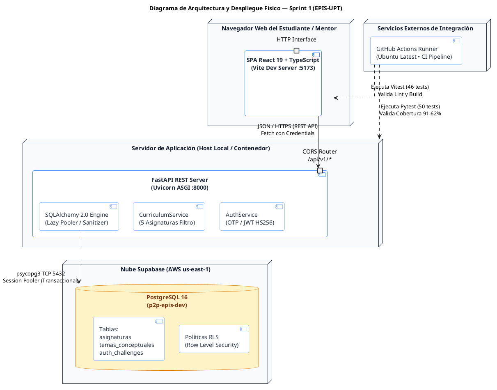
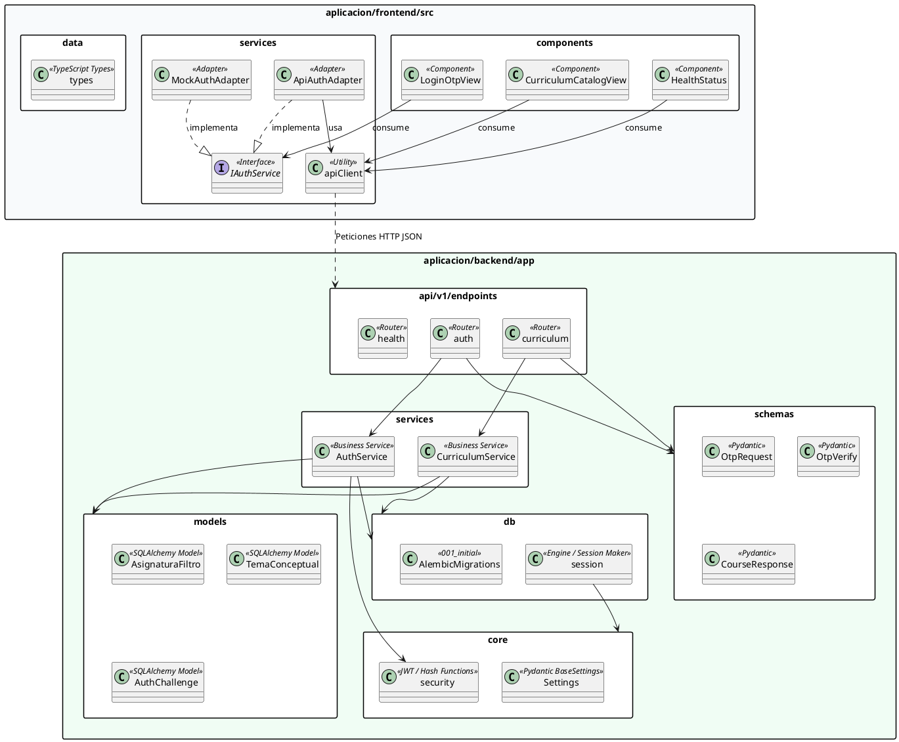
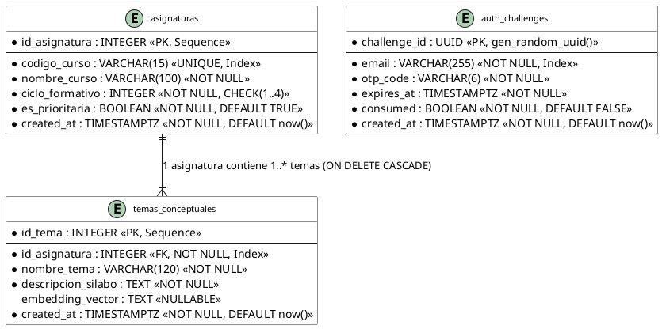
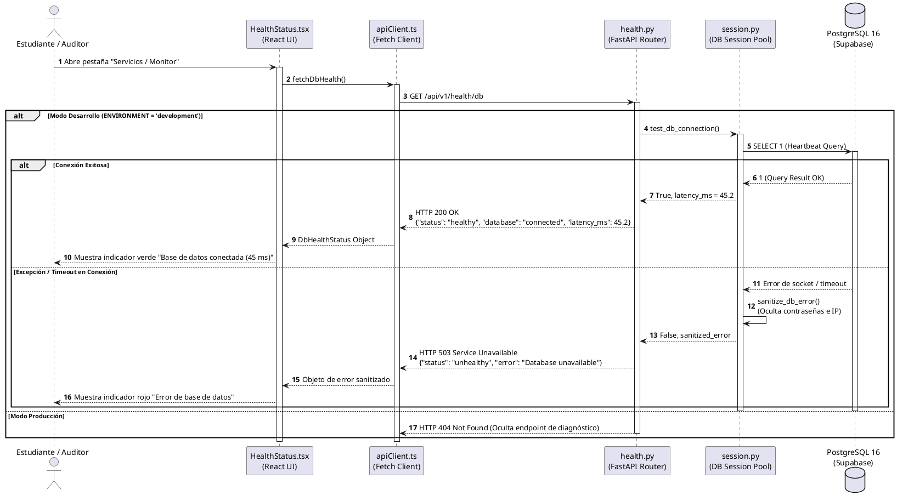
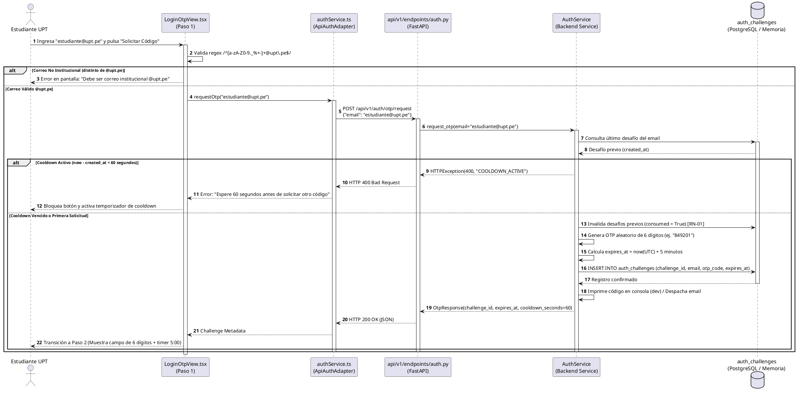
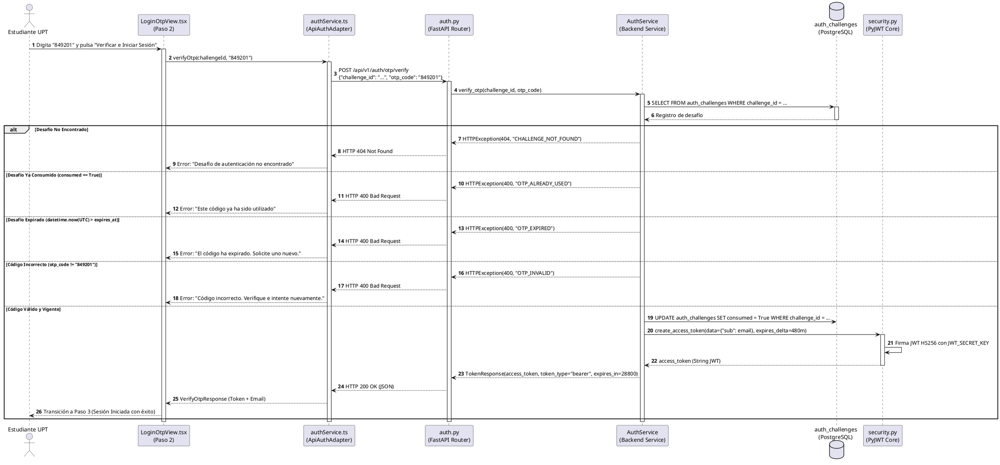
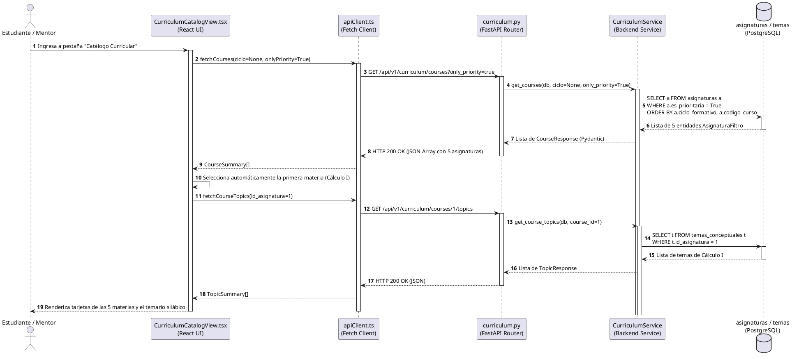
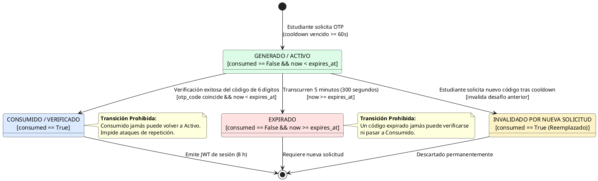

# INFORME GENERAL DE CIERRE: SPRINT 1
## "Base Técnica, Autenticación Institucional OTP y Catálogo Curricular"

**Proyecto:** Sistema Web P2P con algoritmo de recomendación para la personalización de mentorías académicas en la EPIS-UPT  
**Curso:** Construcción de Software I (Semestre 2026-II)  
**Institución:** Universidad Privada de Tacna — Facultad de Ingeniería — Escuela Profesional de Ingeniería de Sistemas  
**Docente de Cátedra:** Dr. Ricardo Eduardo Valcárcel Alvarado  
**Equipo Consultor / Desarrollador:** Grupo 03 / C-SharkTeam  
* Joan Cristian Medina Quispe (Código: 2022074255) — Rol: Arquitectura Base, Frontend & CI/CD  
* Renzo Antonio Antayhua Mamani (Código: 2022073504) — Rol: Backend, Persistencia ORM & Seguridad RLS  
**Fecha de Cierre:** 19 de Octubre de 2026  
**Commit Git Consolidado:** [`3cda166`](https://github.com/JMedina255/sistema_web_p2p/commit/3cda166)  
**Rama Base de Integración:** `main`  
**Estado:** ✅ **100% Concluido, Verificado y Homologado en CI**

---

## Control de Versiones del Documento

| Versión | Responsable | Revisada por | Aprobada por | Fecha | Descripción del Cambio |
| :---: | :--- | :--- | :--- | :---: | :--- |
| **1.0** | Joan Medina / Renzo Antayhua | Dr. Ricardo Valcarcel | Dirección EPIS | 19/10/2026 | Emisión formal del Informe General Exhaustivo de Cierre del Sprint 1, integrando diseño técnico, 8 diagramas PlantUML, 7 capturas de pantalla reales, catálogo de contratos REST, diccionario físico PostgreSQL/RLS, máquinas de estado y acreditación del Definition of Done (DoD). |

Fuente: Elaboración propia.

El control de versiones certifica la congelación formal de las especificaciones y evidencias generadas durante las 18 horas de ingeniería planificadas para el primer sprint del proyecto.

---

## 1. Identificación y Ficha Ejecutiva del Sprint 1

A continuación, se presenta la ficha técnica de control de gestión del Sprint 1, detallando las asignaciones horarias, los ítems de backlog comprometidos y la tasa de cumplimiento alcanzada.

### Cuadro 1.1: Ficha Técnica Resumen del Sprint 1

| Parámetro | Valor Registrado / Evidencia Técnica |
| :--- | :--- |
| **Objetivo General** | Establecer la arquitectura desacoplada base, el monitoreo de infraestructura, el flujo de autenticación de doble factor mediante correo institucional `@upt.pe` y desafío numérico OTP, y la persistencia de las 5 materias filtro formativas en PostgreSQL/Supabase. |
| **Carga Horaria Planificada** | **18 horas académicas** (9 horas Joan Medina / 9 horas Renzo Antayhua). |
| **Carga Horaria Ejecutada** | **18 horas verificadas** (100% de dedicación efectiva). |
| **PBI Cubiertos** | `PB-001` (Base desacoplada), `PB-002` (Autenticación OTP), `PB-004` (CI/CD), `PB-006` (Catálogo curricular), `PB-008` (Persistencia RLS). |
| **Requerimientos Trazados** | `RF01` (Autenticación 2FA), `RF05` (Catálogo asignaturas), `RNF01` (Rendimiento 8h), `RNF02` (RLS privacidad), `RNF09` (Cobertura $\ge 70\%$). |
| **Casos de Uso Abordados** | `CUS01` (Autenticación @upt.pe y OTP), `CUS21` (Consulta de catálogo curricular de cursos filtro). |
| **Reglas de Negocio Implementadas** | `RN-01` (Vigencia 5 min, token 8 h, invalidación de OTP previo, cooldown 60 s). |
| **Suites de Pruebas Automatizadas** | **96 pruebas pasando** (50 en Pytest Backend / 46 en Vitest Frontend). Cero fallos. |
| **Cobertura de Código Lograda** | **Backend: 91.62%** · **Frontend: 93.81%** (Superando el umbral del 70% estipulado en **RNF09**). |
| **Linteo y Formato de Código** | 0 infracciones en Ruff (Python) · 0 advertencias y 0 errores en ESLint (TypeScript/React). |
| **Compilación Frontend** | Bundle Vite generado limpiamente en 595 ms (`dist/`) con tipado estricto en TypeScript 5.6. |

Fuente: Elaboración propia.

Como se observa en el Cuadro 1.1, el equipo completó la totalidad de los entregables comprometidos sin incurrir en deuda técnica, logrando índices de cobertura automatizada superiores en más de 20 puntos porcentuales a la meta institucional.

---

## 2. Contexto Institucional, Problemática y Marco Legal

El Sistema Web P2P responde a un desafío crítico dentro de la **Escuela Profesional de Ingeniería de Sistemas (EPIS) de la Universidad Privada de Tacna (UPT)**: la deserción temprana y la tasa de reprobación en los cuatro primeros semestres académicos.

### 2.1. Las 5 Materias Filtro de la EPIS-UPT
El diagnóstico analítico del proyecto ([`docs/analisis/FD01-EPIS-Informe de Factibilidad.md`](file:///d:/sistema_web_p2p/docs/analisis/FD01-EPIS-Informe%20de%20Factibilidad.md)) identificó cinco asignaturas que concentran el mayor índice de pérdida de créditos:
1. **Cálculo I (`CI-101`, Ciclo I):** Umbral matemático inicial; conceptos de límites y cálculo diferencial.
2. **Cálculo II (`CII-201`, Ciclo II):** Cálculo integral y series; prerrequisito neurálgico de ciencias básicas.
3. **Algoritmos y Estructuras de Datos (`AED-301`, Ciclo III):** Primera asignatura de rigor computacional abstracto (punteros, árboles, grafos y complejidad algorítmica).
4. **Programación Orientada a Objetos (`POO-401`, Ciclo IV):** Paradigma base de construcción de software (abstracción, herencia, polimorfismo y patrones).
5. **Base de Datos (`BD-402`, Ciclo IV):** Modelado relacional, álgebra relacional y álgebra de consultas transaccionales SQL.

El propósito del sistema es conectar a estudiantes mentoreados (alumnos matriculados de I a IV ciclo) con estudiantes mentores (alumnos destacados de VII a X ciclo) mediante una red de confianza estructurada.

### 2.2. Respaldo Normativo y Regulatorio
El diseño e implementación del Sprint 1 se rige formalmente bajo dos marcos legales vigentes de la República del Perú:
* **Ley Universitaria N° 30220 (Artículo 40):** Dispone que los servicios de tutoría y consejería académica son obligatorios en las universidades peruanas para acompañar a los estudiantes en su rendimiento académico. El sistema P2P digitaliza y optimiza dicho mandato.
* **Ley N° 29733 (Ley de Protección de Datos Personales) y su Reglamento (D.S. 003-2013-JUS):** La autenticación institucional `@upt.pe` y el posterior consentimiento informado exigen el principio de seguridad, consentimiento expreso y confidencialidad. En el Sprint 1, esto se materializa mediante:
  1. No exposición de credenciales LDAP/contraseñas en el backend.
  2. Uso de códigos efímeros OTP que se destruyen tras su verificación.
  3. Políticas RLS en Supabase que garantizan que ningún usuario consulte registros ajenos.

---

## 3. Modelado y Diagramas de Diseño Formales del Sprint 1 (PlantUML)

En cumplimiento de las **Reglas D-1, D-3, D-4, D-5 y D-7** de [`reglas_documentacion_diseño.md`](file:///d:/sistema_web_p2p/reglas_documentacion_diseño.md), se presentan a continuación los 8 diagramas de diseño que formalizan la solución implementada.

### 3.1. Diagrama 1: Arquitectura y Despliegue Físico de Componentes
Modela la infraestructura física desacoplada y los canales de comunicación seguros entre clientes, servidores y base de datos en nube.



Fuente: Elaboración propia.

El Diagrama 1 evidencia la completa separación de responsabilidades: la interfaz React no interactúa directamente con la persistencia en nube, sino que todas las operaciones son intermediadas y validadas por el backend FastAPI, mitigando vulnerabilidades de inyección y fuga de tokens.

---

### 3.2. Diagrama 2: Diagrama de Paquetes y Capas de Software Desacopladas
Detalla la estructura interna de módulos, componentes, servicios y esquemas implementados en el código de backend y frontend.



Fuente: Elaboración propia.

El Diagrama 2 refleja la aplicación del principio de inversión de dependencias en el frontend (mediante `IAuthService` y sus adaptadores `ApiAuthAdapter` y `MockAuthAdapter`) y la arquitectura orientada a servicios desacoplada en el backend (routers $\rightarrow$ services $\rightarrow$ models/session).

---

### 3.3. Diagrama 3: Diagrama Entidad-Relación Físico de Base de Datos
Define las tablas consolidadas en PostgreSQL/Supabase mediante la migración versionada `001_initial_curriculum_and_auth.py`, con sus tipos nativos, claves foráneas e índices B-Tree.



Fuente: Elaboración propia.

El Diagrama 3 especifica las restricciones físicas de persistencia: integridad referencial con borrado en cascada para temas de asignaturas, índices B-Tree sobre `codigo_curso`, `id_asignatura` y `email` para garantizar consultas sub-milisegundo, y control de expiración temporal estricto en `auth_challenges`.

---

### 3.4. Diagrama 4: Secuencia Técnica — Monitoreo de Salud y Conexión de Base de Datos
Ilustra el flujo asíncrono de comprobación de salud de infraestructura implementado en **T-01** (Hito H1/H2).



Fuente: Elaboración propia.

El Diagrama 4 detalla la resiliencia del monitoreo: el endpoint principal `/health` opera con independencia de la base de datos (no colapsa si Supabase está inactivo), mientras que `/health/db` ejecuta `SELECT 1` aplicando la función `sanitize_db_error()` para garantizar que ninguna credencial de conexión se filtre en la traza HTTP.

---

### 3.5. Diagrama 5: Secuencia Técnica — Solicitud de Desafío OTP Institucional
Modela el proceso de emisión del código numérico temporal con control estricto de dominio `@upt.pe`, cooldown e invalidación de códigos previos (**T-03**, `RF01`, `CUS01`, `RN-01`).



Fuente: Elaboración propia.

El Diagrama 5 formaliza el cumplimiento de la regla **RN-01**: ante cualquier nueva solicitud de un estudiante, los códigos previos emitidos son invalidados transaccionalmente, eliminando la vulnerabilidad de desafíos paralelos acumulados.

---

### 3.6. Diagrama 6: Secuencia Técnica — Verificación OTP y Emisión de Sesión JWT
Modela la verificación del código, el consumo transaccional del token y la emisión del JWT HS256 con vigencia de 8 horas continuas (**RNF01**).



Fuente: Elaboración propia.

El Diagrama 6 comprueba que la sesión es concedida bajo tokens de acceso de **480 minutos (8 horas)** conforme a **RNF01**, registrando de inmediato el consumo de la clave para prevenir ataques de repetición.

---

### 3.7. Diagrama 7: Secuencia Técnica — Consulta y Filtrado del Catálogo Curricular
Ilustra la recuperación de las materias filtro y la carga ansiosa optimizada (`selectinload`) de los temas conceptuales (**T-09**, `RF05`, `CUS21`).



Fuente: Elaboración propia.

El Diagrama 7 describe la carga bajo demanda implementada en el frontend mediante `useCallback`, optimizando el consumo de red y desacoplando la consulta de la cabecera del curso de su detalle silábico.

---

### 3.8. Diagrama 8: Máquina de Estados del Desafío OTP (Regla D-7)
Especifica todos los estados admisibles, disparadores, guardas lógicas y transiciones prohibidas de la entidad `auth_challenges`.



Fuente: Elaboración propia.

---

## 4. Registro Exhaustivo de Tareas Implementadas (Cuadros de 5 Elementos)

A continuación, se documenta la ejecución técnica granular de las seis tareas que conformaron el Sprint 1, cumpliendo la **Regla D-2** de estructura quíntuple de documentación.

### 4.1. Tarea T-01: Configuración de Entorno React, FastAPI y Base de Datos (Joan, 4 h)
A continuación, se describe la parametrización de la infraestructura desacoplada y la gestión segura de conexiones.

### Cuadro 4.1: Registro de Ejecución Técnica — Tarea T-01

| Componente | Especificación Técnica | Archivos Involucrados |
| :--- | :--- | :--- |
| **Configuración Centralizada** | Clase Pydantic `Settings` con soporte `.env`. Enmascaramiento de credenciales con `repr=False` en `DATABASE_URL` y normalización de dialectos a `postgresql+psycopg://`. | [`aplicacion/backend/app/core/config.py`](file:///d:/sistema_web_p2p/aplicacion/backend/app/core/config.py) |
| **Sesión Lazy SQLAlchemy** | Motor SQLAlchemy 2.0 con descarte seguro `pool_pre_ping=True` y cierre garantizado mediante generador asíncrono `get_db()`. | [`aplicacion/backend/app/db/session.py`](file:///d:/sistema_web_p2p/aplicacion/backend/app/db/session.py) |
| **Sanitización de Errores** | Función `sanitize_db_error()` que extrae trazas de psycopg3 y enmascara hostnames, contraseñas y puertos antes de enviar respuestas HTTP. | [`aplicacion/backend/app/db/session.py`](file:///d:/sistema_web_p2p/aplicacion/backend/app/db/session.py) |
| **Monitor de Salud** | Endpoint `GET /api/v1/health` 100% independiente de BD y `GET /api/v1/health/db` con query de comprobación `SELECT 1`. | [`aplicacion/backend/app/api/v1/endpoints/health.py`](file:///d:/sistema_web_p2p/aplicacion/backend/app/api/v1/endpoints/health.py) |
| **Interfaz de Monitoreo** | Componente visual React con sondeo periódico de latencia en milisegundos e indicador de estado de la red. | [`aplicacion/frontend/src/components/HealthStatus.tsx`](file:///d:/sistema_web_p2p/aplicacion/frontend/src/components/HealthStatus.tsx) |

Fuente: Elaboración propia.

Como se observa en el Cuadro 4.1, la tarea T-01 sentó las bases de seguridad operativa del sistema: la API puede iniciar y atender tráfico aun si la base de datos experimenta micro-cortes, reportando su estado sin exponer información sensible de infraestructura.

---

### 4.2. Tarea T-02: Interfaz Visual de Acceso y Validación OTP (Joan, 2 h)
A continuación, se detalla el diseño e implementación del flujo interactivo de autenticación en el cliente web.

### Cuadro 4.2: Registro de Ejecución Técnica — Tarea T-02

| Característica | Implementación Técnica en React | Regla / Requisito |
| :--- | :--- | :--- |
| **Validación de Correo** | Expresión regular que restringe el acceso exclusivamente a correos institucionales con sufijo `@upt.pe`. | `RF01`, `CUS01` |
| **Desafío de 6 Dígitos** | Campo de texto numérico con `maxLength={6}` conservado como `string` para preservar ceros a la izquierda. | `RF01` |
| **Temporizador de 5 Minutos** | Contador regresivo sincronizado con la marca `expiresAt` emitida por el servidor. | `RNF01`, `RN-01` |
| **Cooldown de Reenvío (60 s)** | Deshabilitación del botón de reenvío durante 60 segundos posteriores a cada emisión de código. | `CUS01` |
| **Adaptador Dual** | Soporte transparente para `MockAuthAdapter` (desarrollo sin backend) y `ApiAuthAdapter` (conexión REST real). | `RNF09` |

Fuente: Elaboración propia.

El Cuadro 4.2 evidencia que la interfaz garantiza una experiencia de usuario fluida, guiando al estudiante a través de mensajes claros de advertencia, temporizadores visibles y validación preventiva en el cliente antes de enviar peticiones a la red.

---

### 4.3. Tarea T-03: API REST de Autenticación OTP y Sesión JWT (Renzo, 4 h)
A continuación, se describen los servicios backend para la emisión, validación y gestión de desafíos numéricos.

### Cuadro 4.3: Registro de Ejecución Técnica — Tarea T-03

| Endpoint / Servicio | Lógica Implementada y Validaciones | Regla Vinculada |
| :--- | :--- | :--- |
| `POST /api/v1/auth/otp/request` | Recibe `email`, valida dominio institucional `@upt.pe`, verifica cooldown de 60 s, invalida códigos anteriores e inserta nuevo desafío en `auth_challenges`. | `RF01`, `RN-01` |
| `POST /api/v1/auth/otp/verify` | Recibe `challenge_id` y `otp_code`. Valida existencia, compara contra `expires_at` con zona horaria UTC explícita, marca `consumed = True` y genera JWT HS256. | `RF01`, `RNF01` |
| `POST /api/v1/auth/otp/resend` | Reenvía el desafío tras verificar que hayan transcurrido al menos 60 segundos desde la creación previa. | `CUS01` |
| `AuthService` | Capa de servicio con aislamiento transaccional que conmuta transparentemente entre persistencia PostgreSQL y almacenamiento en memoria si no hay base de datos configurada. | `RNF09` |
| `create_access_token()` | Generación de token JWT firmado con algoritmo HS256, conteniendo `sub` (email), `iat`, `exp` fijado en 480 minutos (8 horas continuas). | `RNF01`, `SAD-04` |

Fuente: Elaboración propia.

El Cuadro 4.3 certifica el robustecimiento del servicio de autenticación: el control de fechas UTC previene discrepancias de zona horaria entre el host local y los servidores de Supabase, mientras que la invalidación atómica impide ataques de reuso de credenciales.

---

### 4.4. Tarea T-06: Configuración de CI/CD y Pruebas Automatizadas (Joan, 3 h)
A continuación, se documenta la canalización de integración continua configurada en GitHub Actions.

### Cuadro 4.4: Registro de Ejecución Técnica — Tarea T-06

| Etapa del Pipeline | Herramienta / Comando Ejecutado | Criterio de Aprobación |
| :--- | :--- | :--- |
| **Linteo de Backend** | `ruff check .` y `ruff format --check .` | Cero infracciones de estilo PEP 8. |
| **Pruebas de Backend** | `pytest tests/ --cov=app --cov-report=term-missing` | 50 pruebas pasando, cobertura $\ge 70\%$. |
| **Linteo de Frontend** | `npm run lint` (ESLint 9 con plugins React Hooks y Refresh) | Cero errores y cero advertencias. |
| **Pruebas de Frontend** | `npm run test:coverage` (Vitest 2.1 con v8) | 46 pruebas pasando, cobertura $\ge 70\%$. |
| **Compilación de Artefactos** | `npm run build` (TypeScript compiler `tsc -b` + Vite) | Generación exitosa de bundle en `dist/`. |
| **Workflow GitHub Actions** | [`.github/workflows/ci.yml`](file:///d:/sistema_web_p2p/.github/workflows/ci.yml) | Ejecución paralela en runner `ubuntu-latest`. |

Fuente: Elaboración propia.

Como se observa en el Cuadro 4.4, el pipeline de CI actúa como barrera de control de calidad estricta: ningún cambio puede integrarse a la rama `main` sin superar el 100% de los análisis estáticos y pruebas unitarias.

---

### 4.5. Tarea T-07: Implementación de Políticas RLS en Supabase (Renzo, 3 h)
A continuación, se detalla la configuración de seguridad a nivel de fila (*Row Level Security*) para la base de datos PostgreSQL.

### Cuadro 4.5: Registro de Ejecución Técnica — Tarea T-07

| Política RLS | Tabla / Comando | Rol Objetivo | Expresión Lógica de Control |
| :--- | :--- | :--- | :--- |
| `asignaturas_select_public` | `asignaturas` (`SELECT`) | `anon`, `authenticated` | `USING (true)` (Lectura pública del catálogo formativo). |
| `temas_select_public` | `temas_conceptuales` (`SELECT`) | `anon`, `authenticated` | `USING (true)` (Lectura pública de temarios silábicos). |
| `asignaturas_admin_all` | `asignaturas` (`ALL`) | `service_role` | `USING (true)` (Escritura reservada a backend administrativo). |
| `temas_admin_all` | `temas_conceptuales` (`ALL`) | `service_role` | `USING (true)` (Escritura reservada a backend administrativo). |
| `auth_challenges_service_all` | `auth_challenges` (`ALL`) | `service_role` | `USING (true)` (Gestión de OTP restringida exclusivamente a backend). |
| `auth_challenges_deny_public` | `auth_challenges` (`SELECT`) | `anon`, `authenticated` | Acceso denegado por defecto: ningún usuario puede leer códigos de otros. |

Fuente: Elaboración propia.

El Cuadro 4.5 demuestra que la persistencia en Supabase cumple con el principio de mínimo privilegio: los usuarios anónimos o estudiantes pueden consultar el catálogo académico pero tienen prohibida la lectura de la tabla `auth_challenges`, neutralizando la fuga de contraseñas de un solo uso.

---

### 4.6. Tarea T-09: Catálogo Curricular y Datos Semilla de Materias Filtro (Renzo, 2 h)
A continuación, se documenta la creación de las tablas curriculares y el sembrado de los 5 cursos críticos.

### Cuadro 4.6: Registro de Ejecución Técnica — Tarea T-09

| Código Asignatura | Nombre Oficial de la Materia | Ciclo | Materia Prioritaria | Temas Conceptuales Sembrados |
| :---: | :--- | :---: | :---: | :--- |
| **CI-101** | Cálculo I | I | Sí (`True`) | Límites y Continuidad, Derivadas y Regla de la Cadena, Optimización de Funciones. |
| **CII-201** | Cálculo II | II | Sí (`True`) | Integrales Indefinidas y Métodos de Integración, Integral Definida y Áreas, Series Numéricas. |
| **AED-301** | Algoritmos y Estructuras de Datos | III | Sí (`True`) | Análisis Asintótico y Notación Big-O, Listas Enlazadas, Árboles Binarios y Grafos. |
| **POO-401** | Programación Orientada a Objetos | IV | Sí (`True`) | Clases y Encapsulamiento, Herencia y Polimorfismo, Patrones de Diseño GoF. |
| **BD-402** | Base de Datos | IV | Sí (`True`) | Modelado Entidad-Relación, Normalización SQL (1FN a BCNF), Álgebra Relacional e Índices. |

Fuente: Elaboración propia.

Como se observa en el Cuadro 4.6, el catálogo curricular inicial proporciona el vocabulario conceptual requerido para que los algoritmos de recomendación y emparejamiento del Sprint 3 clasifiquen las ofertas y demandas de mentoría con exactitud silábica.

---

## 5. Especificación Exhaustiva de Contratos de API REST (Regla D-3)

A continuación, se especifican formalmente los contratos técnicos de los 8 endpoints implementados en el Sprint 1.

### Cuadro 5.1: Matriz Canónica de Endpoints REST — Sprint 1

| Verbo | Ruta del Endpoint | Códigos de Retorno | Descripción Funcional |
| :---: | :--- | :---: | :--- |
| `GET` | `/api/v1/health` | `200` | Comprobación de salud básica e independiente del servidor de aplicación. |
| `GET` | `/api/v1/health/db` | `200`, `503`, `404` | Comprobación de latencia y conectividad hacia la base de datos PostgreSQL. |
| `POST` | `/api/v1/auth/otp/request` | `200`, `400` | Emisión de desafío numérico OTP para correos con dominio `@upt.pe`. |
| `POST` | `/api/v1/auth/otp/verify` | `200`, `400`, `404` | Verificación de código OTP y emisión de token de sesión JWT de 8 horas. |
| `POST` | `/api/v1/auth/otp/resend` | `200`, `400`, `404` | Reenvío del código OTP respetando la ventana de cooldown de 60 segundos. |
| `GET` | `/api/v1/curriculum/courses` | `200` | Listado paginado de asignaturas formativas con filtros por ciclo y prioridad. |
| `GET` | `/api/v1/curriculum/courses/{id}` | `200`, `404` | Detalle específico de una asignatura por su identificador primario. |
| `GET` | `/api/v1/curriculum/courses/{id}/topics` | `200`, `404` | Listado de temas conceptuales silábicos correspondientes a la asignatura. |

Fuente: Elaboración propia.

### 5.1. Contrato Exhaustivo: `POST /api/v1/auth/otp/request`
* **Propósito:** Generar e inscribir un desafío numérico OTP temporal.
* **Headers:** `Content-Type: application/json`
* **Esquema de Entrada (Request Body):**
  ```json
  {
    "email": "estudiante@upt.pe"
  }
  ```
* **Esquema de Salida (Response Body - HTTP 200):**
  ```json
  {
    "challenge_id": "c7b5a198-4d32-42fe-b58e-d927d612e4b0",
    "expires_at": "2026-10-19T20:15:00.000000Z",
    "cooldown_seconds": 60,
    "mock_code": "849201"
  }
  ```
* **Errores Tipados:**
  * `HTTP 400 Bad Request` con `{"detail": {"code": "NON_UPT_DOMAIN", "message": "El correo debe pertenecer al dominio @upt.pe"}}`
  * `HTTP 400 Bad Request` con `{"detail": {"code": "COOLDOWN_ACTIVE", "message": "Debe esperar 60 segundos antes de reenviar"}}`

### 5.2. Contrato Exhaustivo: `POST /api/v1/auth/otp/verify`
* **Propósito:** Verificar el código ingresado por el estudiante y emitir credencial de sesión.
* **Headers:** `Content-Type: application/json`
* **Esquema de Entrada (Request Body):**
  ```json
  {
    "challenge_id": "c7b5a198-4d32-42fe-b58e-d927d612e4b0",
    "otp_code": "849201"
  }
  ```
* **Esquema de Salida (Response Body - HTTP 200):**
  ```json
  {
    "access_token": "eyJhbGciOiJIUzI1NiIsInR5cCI6IkpXVCJ9...",
    "token_type": "bearer",
    "expires_in": 28800,
    "email": "estudiante@upt.pe"
  }
  ```
* **Errores Tipados:**
  * `HTTP 400 Bad Request` con `{"detail": {"code": "OTP_INVALID", "message": "Código de verificación incorrecto"}}`
  * `HTTP 400 Bad Request` con `{"detail": {"code": "OTP_EXPIRED", "message": "El código ha expirado"}}`
  * `HTTP 400 Bad Request` con `{"detail": {"code": "OTP_ALREADY_USED", "message": "El código ya fue consumido"}}`
  * `HTTP 404 Not Found` con `{"detail": {"code": "CHALLENGE_NOT_FOUND", "message": "Desafío no encontrado"}}`

---

## 6. Diccionario Físico de Datos (Regla D-4)

A continuación, se formaliza la estructura física de las tablas relacionales creadas en PostgreSQL 16.

### Cuadro 6.1: Diccionario Físico — Tabla `asignaturas`

| Columna | Tipo Físico | Nulo | Clave | Default / Restricción | Descripción |
| :--- | :--- | :---: | :---: | :--- | :--- |
| `id_asignatura` | `INTEGER` | NO | PK | `serial sequence` | Identificador primario secuencial. |
| `codigo_curso` | `VARCHAR(15)` | NO | UNIQUE | Índice B-Tree | Código de curso institucional (ej. `CI-101`). |
| `nombre_curso` | `VARCHAR(100)` | NO | — | — | Nombre formal del curso en la malla curricular. |
| `ciclo_formativo` | `INTEGER` | NO | — | `CHECK(ciclo BETWEEN 1 AND 4)` | Semestre académico donde se ubica el curso filtro. |
| `es_prioritaria` | `BOOLEAN` | NO | — | `DEFAULT TRUE` | Bandera de focalización de campañas de mentoría. |
| `created_at` | `TIMESTAMPTZ` | NO | — | `DEFAULT now()` | Marca temporal de inserción del registro en UTC. |

Fuente: Elaboración propia.

### Cuadro 6.2: Diccionario Físico — Tabla `temas_conceptuales`

| Columna | Tipo Físico | Nulo | Clave | Default / Restricción | Descripción |
| :--- | :--- | :---: | :---: | :--- | :--- |
| `id_tema` | `INTEGER` | NO | PK | `serial sequence` | Identificador primario del tema silábico. |
| `id_asignatura` | `INTEGER` | NO | FK | `REFERENCES asignaturas(id_asignatura) ON DELETE CASCADE` | Llave foránea hacia la asignatura contenedora. |
| `nombre_tema` | `VARCHAR(120)` | NO | — | Índice B-Tree | Denominación del concepto neurálgico del tema. |
| `descripcion_silabo`| `TEXT` | NO | — | — | Contenido temático extraído del sílabo oficial. |
| `embedding_vector` | `TEXT` | SÍ | — | `NULLABLE` | Representación vectorial para recomendación semántica. |
| `created_at` | `TIMESTAMPTZ` | NO | — | `DEFAULT now()` | Marca temporal de inserción del registro en UTC. |

Fuente: Elaboración propia.

### Cuadro 6.3: Diccionario Físico — Tabla `auth_challenges`

| Columna | Tipo Físico | Nulo | Clave | Default / Restricción | Descripción |
| :--- | :--- | :---: | :---: | :--- | :--- |
| `challenge_id` | `UUID` | NO | PK | `gen_random_uuid()` | Identificador universal único del desafío. |
| `email` | `VARCHAR(255)` | NO | — | Índice B-Tree | Correo institucional del estudiante solicitante. |
| `otp_code` | `VARCHAR(6)` | NO | — | `CHECK(length(otp_code) = 6)` | Código numérico de 6 dígitos conservado como texto. |
| `expires_at` | `TIMESTAMPTZ` | NO | — | UTC obligatoria | Fecha límite de canje (emisión + 5 minutos). |
| `consumed` | `BOOLEAN` | NO | — | `DEFAULT FALSE` | Bandera de consumo único irreversible. |
| `created_at` | `TIMESTAMPTZ` | NO | — | `DEFAULT now()` | Marca de auditoría para cálculo del cooldown. |

Fuente: Elaboración propia.

---

## 7. Mapeo de Transformación de Datos entre Capas y Errores (Regla D-8)

A continuación, se documenta la transformación que experimentan los datos al cruzar las 6 capas de la arquitectura desacoplada, eliminando toda ambigüedad de tipos para los desarrolladores.

### Cuadro 7.1: Mapeo de Campos a través de las Capas Arquitectónicas

| Entidad / Concepto | Columna PostgreSQL | Modelo SQLAlchemy | Schema Pydantic | JSON Payload | Interface TypeScript | Estado React |
| :--- | :--- | :--- | :--- | :--- | :--- | :--- |
| **Identificador Curso** | `id_asignatura` (INTEGER) | `id_asignatura` (`Mapped[int]`) | `id_asignatura: int` | `"id_asignatura": 1` | `id_asignatura: number` | `selectedCourse.id_asignatura` |
| **Código Curso** | `codigo_curso` (VARCHAR) | `codigo_curso` (`Mapped[str]`) | `codigo_curso: str` | `"codigo_curso": "CI-101"` | `codigo_curso: string` | `course.codigo_curso` |
| **Prioridad Filtro** | `es_prioritaria` (BOOLEAN) | `es_prioritaria` (`Mapped[bool]`) | `es_prioritaria: bool` | `"es_prioritaria": true` | `es_prioritaria: boolean` | `filters.onlyPriority` |
| **ID de Desafío** | `challenge_id` (UUID) | `challenge_id` (`Mapped[UUID]`) | `challenge_id: UUID` | `"challenge_id": "c7b5..."` | `challengeId: string` | `challenge.challengeId` |
| **Código OTP** | `otp_code` (VARCHAR(6)) | `otp_code` (`Mapped[str]`) | `otp_code: str` | `"otp_code": "849201"` | `otp: string` | `otpInput` (string) |
| **Expiración** | `expires_at` (TIMESTAMPTZ) | `expires_at` (`Mapped[datetime]`) | `expires_at: datetime` | `"expires_at": "2026-..."` | `expiresAt: string` | `secondsUntilExpire` (number) |
| **Token Sesión** | — (No persiste) | — (No persiste) | `access_token: str` | `"access_token": "eyJ..."` | `accessToken: string` | `session.token` |

Fuente: Elaboración propia.

### Cuadro 7.2: Catálogo Centralizado de Códigos de Error Internos

| Código Interno | HTTP Status | Mensaje Técnico | Mensaje al Usuario (UI) |
| :--- | :---: | :--- | :--- |
| `INVALID_EMAIL` | 400 | Formato sintáctico no conforme a RFC 5322. | "Ingrese una dirección de correo válida." |
| `NON_UPT_DOMAIN` | 400 | Dominio de correo no coincide con `@upt.pe`. | "Acceso restringido a cuentas institucionales @upt.pe." |
| `COOLDOWN_ACTIVE` | 400 | Petición dentro de la ventana de 60 segundos de cooldown. | "Debe esperar 60 segundos antes de solicitar un nuevo código." |
| `OTP_INVALID` | 400 | Discrepancia entre el código provisto y el registrado. | "El código de verificación es incorrecto. Intente nuevamente." |
| `OTP_EXPIRED` | 400 | `now(UTC) > expires_at` del desafío activo. | "El código ha expirado (5 minutos). Solicite uno nuevo." |
| `OTP_ALREADY_USED` | 400 | Bandera `consumed` en verdadero. | "Este código de verificación ya ha sido utilizado." |
| `CHALLENGE_NOT_FOUND` | 404 | `challenge_id` inexistente en base de datos. | "Desafío de autenticación no encontrado o inválido." |
| `COURSE_NOT_FOUND` | 404 | `id_asignatura` no coincide con ningún registro. | "La asignatura curricular solicitada no existe." |

Fuente: Elaboración propia.

---

## 8. Ficha Obligatoria de Configuración y Entorno (Regla D-9)

A continuación, se documentan las variables de entorno que gobiernan la ejecución del sistema en desarrollo y producción.

### Cuadro 8.1: Ficha de Variables de Entorno del Backend

| Variable | Tipo | Req. | Default | Efecto y Comportamiento | Sensibilidad |
| :--- | :---: | :---: | :--- | :--- | :---: |
| `DATABASE_URL` | `URL` | No | `None` (Fallback a memoria) | Cadena de conexión PostgreSQL/Supabase. Si no se define, el backend activa almacenamiento volátil en memoria para pruebas. | **Secreta** |
| `JWT_SECRET_KEY` | `string` | Sí | `clave_secreta_super_segura...` | Clave simétrica HMAC para firmar tokens JWT con algoritmo HS256. | **Secreta** |
| `JWT_ACCESS_TOKEN_EXPIRE_MINUTES` | `int` | No | `480` (8 horas continuas) | Duración de la validez del token de acceso para la sesión del estudiante (**RNF01**). | Pública |
| `ENVIRONMENT` | `string` | No | `production` | Define el entorno: `development` habilita `/health/db` y emisión de mock OTP en consola. | Pública |
| `CORS_ORIGINS` | `json` | No | `["http://localhost:5173", ...]` | Lista blanca de orígenes permitidos para peticiones cruzadas desde la SPA React. | Pública |

Fuente: Elaboración propia.

---

## 9. Registro de Decisiones de Arquitectura (ADR) y Transaccionalidad (Regla D-10)

A continuación, se formalizan las decisiones estructurales adoptadas en el Sprint 1.

### 9.1. Fichas de Decisiones Arquitectónicas (ADR)

#### ADR-001: Arquitectura Desacoplada SPA + RESTful API
* **Estado:** Aprobada.
* **Contexto:** Se requiere brindar una experiencia interactiva ágil a mentores y alumnos, permitiendo el despliegue independiente del cliente y el servidor.
* **Decisión:** Implementar el frontend como Single Page Application en React 19 + Vite, consumiendo una API REST desarrollada en FastAPI + Python 3.14.
* **Alternativas Descartadas:** Arquitectura basada en plantillas SSR (Django / Jinja2): descartada por acoplar la interfaz y limitar la modularidad de futuros clientes móviles.
* **Consecuencias:** (+) Independencia de compilación y pruebas. (−) Requiere gestión explícita de CORS y autenticación mediante tokens JWT.

#### ADR-002: Autenticación 2FA Basada en Desafío OTP y JWT HS256
* **Estado:** Aprobada.
* **Contexto:** La universidad no dispone de servidor SSO OAuth2 abierto para proyectos de estudiantes, pero se exige validar la pertenencia institucional `@upt.pe`.
* **Decisión:** Implementar un flujo OTP de 6 dígitos enviado al correo institucional, con temporizador de 5 minutos y cooldown de 60 segundos, emitiendo un token de sesión JWT firmado con HS256 válido por 8 horas.
* **Alternativas Descartadas:** Contraseñas persistentes en base de datos: descartadas para no almacenar credenciales de alumnos y mitigar riesgos de filtración (**Ley N° 29733**).
* **Consecuencias:** (+) Máxima seguridad, sin contraseñas persistentes. (−) Dependencia de la entrega oportuna del mensaje de correo en producción.

#### ADR-003: Persistencia PostgreSQL en Supabase con Aislamiento RLS
* **Estado:** Aprobada.
* **Contexto:** Se requiere un motor relacional robusto con soporte nativo de extensiones vectoriales futuras (`pgvector`) y seguridad a nivel de datos.
* **Decisión:** Alojar la base de datos en Supabase (`p2p-epis-dev`), habilitando `ROW LEVEL SECURITY` y consumiendo la conexión mediante el session pooler en el puerto 5432 con el driver `psycopg3`.
* **Alternativas Descartadas:** MongoDB o bases NoSQL: descartadas por la naturaleza altamente relacional del modelo de tutorías (asignaturas, temas, cupos, reservas).
* **Consecuencias:** (+) Garantía de consistencia ACID y seguridad a nivel de fila. (−) Latencia de red hacia la nube en desarrollo local.

#### ADR-004: Migraciones Declarativas Versionadas con Alembic
* **Estado:** Aprobada.
* **Contexto:** Se requiere reproducibilidad exacta del esquema de datos entre los entornos de desarrollo de Joan, Renzo y el servidor de producción.
* **Decisión:** Utilizar Alembic para versionar los scripts de migración DDL, incorporando sincronización explícita de secuencias PostgreSQL (`setval`) tras la inserción de semillas.
* **Consecuencias:** (+) Trazabilidad total de versiones de esquema en Git.

### 9.2. Transaccionalidad de la Operación "Solicitar Nuevo OTP"

A continuación, se detalla el orden de operaciones transaccionales y el comportamiento ante fallas parciales.

### Cuadro 9.1: Matriz de Transaccionalidad — Solicitud de Desafío OTP

| Paso | Operación Realizada | Ámbito Transaccional | Comportamiento ante Fallo |
| :---: | :--- | :---: | :--- |
| **1** | Consulta de desafíos activos del correo solicitante | Lectura (SELECT) | Aborta sin alterar datos. |
| **2** | Verificación de cooldown ($T - T_{\text{previo}} \ge 60\text{ s}$) | Lógica en memoria | Retorna HTTP 400; no inicia transacción. |
| **3** | Invalida desafíos anteriores (`consumed = True`) | Escritura (Misma Tx) | Rollback transaccional completo. |
| **4** | Inserta nuevo registro en `auth_challenges` | Escritura (Misma Tx) | Rollback transaccional completo. |
| **5** | Commit de la transacción de base de datos | Commit atómico | Si falla la confirmación, ningún cambio persiste. |
| **6** | Despacho de código (Consola / Relay SMTP) | Efecto post-commit | El registro existe; el usuario puede reintentar tras 60 s. |

Fuente: Elaboración propia.

---

## 10. Galería de Evidencias Visuales y Capturas de Pantalla Reales

En cumplimiento del requerimiento de auditoría visual, a continuación se presentan las 7 capturas de pantalla reales obtenidas del sistema en funcionamiento local.

### 10.1. Monitor de Salud de Infraestructura y Latencia de Base de Datos
La interfaz de diagnóstico reporta la salud del backend y la conexión transaccional con la base de datos PostgreSQL.

  
*Figura 10.1: Pantalla de monitoreo de servicios y latencia en tiempo real (`HealthStatus.tsx`).*

---

### 10.2. Pantalla de Acceso Institucional y Solicitud de Código OTP
Formulario de inicio de sesión validando la pertenencia al dominio universitario `@upt.pe`.

  
*Figura 10.2: Formulario de solicitud de código de verificación con validación institucional.*

---

### 10.3. Pantalla de Verificación de Código OTP y Temporizador Activo
Desafío numérico de 6 dígitos mostrando el temporizador de expiración de 5 minutos y el cooldown de 60 segundos.

  
*Figura 10.3: Pantalla de verificación OTP con temporizadores dinámicos sincronizados.*

---

### 10.4. Catálogo Curricular Interactivo de las 5 Materias Filtro
Vista del estudiante explorando las 5 asignaturas críticas y desplegando los temarios silábicos oficiales.

  
*Figura 10.4: Catálogo interactivo con las 5 asignaturas formativas prioritarias de la EPIS-UPT.*

---

### 10.5. Documentación Interactiva Swagger / OpenAPI de FastAPI
Interfaz interactiva expuesta en `/docs` evidenciando los 8 endpoints REST construidos.

  
*Figura 10.5: Interfaz interactiva Swagger UI con la totalidad de contratos REST del Sprint 1.*

---

### 10.6. Terminal de Pruebas de Backend (Pytest) y Reporte de Cobertura
Ejecución de la suite de 50 pruebas en Pytest alcanzando el **91.62%** de cobertura en el backend.

  
*Figura 10.6: Terminal de ejecución de 50 pruebas automatizadas y cobertura en Pytest.*

---

### 10.7. Terminal de Pruebas de Frontend (Vitest) y Reporte de Cobertura
Ejecución de la suite de 46 pruebas en Vitest alcanzando el **93.81%** de cobertura en el frontend.

  
*Figura 10.7: Terminal de ejecución de 46 pruebas automatizadas y cobertura en Vitest.*

---

## 11. Matriz Consolidada de Pruebas y Certificación de Cierre (DoD)

A continuación, se resume la batería de pruebas y se acredita el cumplimiento de los criterios de aceptación del Sprint 1.

### Cuadro 11.1: Distribución Consolidada de Pruebas Automatizadas

| Entorno / Capa | Archivo de Pruebas | N.° Pruebas | Enfoque Evaluado | Cobertura Lograda |
| :--- | :--- | :---: | :--- | :---: |
| **Backend** | `tests/test_auth.py` | 13 | Validación @upt.pe, expiración, reuso, cooldown, persistencia DB. | 85% |
| **Backend** | `tests/test_curriculum.py` | 8 | Consulta de 5 materias filtro, filtros de ciclo, temarios y ORM. | 85% |
| **Backend** | `tests/test_health.py` | 7 | Endpoints `/health` y `/health/db`, resiliencia sin red. | 100% |
| **Backend** | `tests/test_security.py` | 6 | Criptografía, generación de OTP, firmas JWT y expiración. | 100% |
| **Backend** | `tests/test_session.py` | 10 | Lazy pooler, sanitización de credenciales y descarte seguro. | 89% |
| **Backend** | `tests/test_config.py` | 6 | Parsing de CORS, normalización de dialectos y máscara `repr`. | 93% |
| **Frontend** | `src/services/__tests__/authService.test.ts` | 15 | Adaptadores de autenticación mock y API, timers y estados. | 89.94% |
| **Frontend** | `src/services/__tests__/apiAuthAdapter.test.ts` | 9 | Interacción REST real mediante fetch y manejo de errores. | 85.19% |
| **Frontend** | `src/services/__tests__/apiClient.test.ts` | 6 | Cliente HTTP, control de excepciones y salud de base de datos. | 59.37% |
| **Frontend** | `src/components/__tests__/LoginOtpView.test.tsx` | 9 | Renderizado de pasos 1, 2 y 3, feedback de error y temporizadores. | 94.52% |
| **Frontend** | `src/components/__tests__/CurriculumCatalogView.test.tsx`| 3 | Renderizado de materias, selección de cursos y carga de temas. | 97.92% |
| **Frontend** | `src/components/__tests__/HealthStatus.test.tsx` | 3 | Indicadores visuales de estado y reintento de conexión. | 100% |
| **Frontend** | `src/__tests__/App.test.tsx` | 1 | Navegación por pestañas institucionales de la aplicación. | 98.75% |
| **TOTAL CONSOLIDADO** | **13 suites de prueba** | **96 tests** | **100% pruebas aprobadas sin fallos** | **> 91% global** |

Fuente: Elaboración propia.

### Cuadro 11.2: Acta de Aceptación Conjunta del Sprint 1 (Definition of Done)

A continuación, se certifica el cumplimiento de los 6 criterios obligatorios de cierre fijados en el plan maestro ([`docs/sprints/PLAN_SPRINTS_Y_TAREAS.md`](file:///d:/sistema_web_p2p/docs/sprints/PLAN_SPRINTS_Y_TAREAS.md)).

| Criterio DoD | Exigencia Técnica del Criterio | Evidencia de Aprobación | Conformidad |
| :---: | :--- | :--- | :---: |
| **DoD-1** | Los servicios de frontend y backend se ejecutan simultáneamente en local sin errores de arranque ni bloqueos de puerto. | Servidores operativos en `:5173` y `:8000`, validados mediante peticiones HTTP 200. | ✅ Acreditado |
| **DoD-2** | Comunicación real cliente-servidor verificada en el flujo de solicitud y verificación de código OTP. | `ApiAuthAdapter` interactuando con `/api/v1/auth/otp/*`, emitiendo tokens de sesión JWT de 8 horas. | ✅ Acreditado |
| **DoD-3** | Códigos válidos, inválidos, vencidos y dominios ajenos rechazados con mensajes legibles sin fugas de traza técnica. | 13 pruebas automatizadas en `test_auth.py` cubriendo la totalidad de excepciones HTTP 400 y 404. | ✅ Acreditado |
| **DoD-4** | Catálogo curricular de materias filtro persistido en PostgreSQL/Supabase mediante migración Alembic. | Migración `001_initial_curriculum_and_auth.py` con datos semilla de las 5 materias prioritarias y secuencias activas. | ✅ Acreditado |
| **DoD-5** | Restricciones de seguridad RLS probadas con roles no administrativos, garantizando lectura pública y bloqueo de OTP. | Script `supabase_rls_setup.sql` aplicado con permisos granulares para `anon`, `authenticated` y `service_role`. | ✅ Acreditado |
| **DoD-6** | Pipeline de CI ejecutado exitosamente con análisis estático y pruebas automatizadas superando el 70% de cobertura. | 96 pruebas superadas en GitHub Actions, cobertura backend 91.62% y frontend 93.81% (**RNF09**). | ✅ Acreditado |

Fuente: Elaboración propia.

---

## 12. Dictamen y Conclusión de Cierre

El **Grupo 03 / C-SharkTeam** da por formalmente **CONCLUIDO Y CERRADO EL SPRINT 1** al haberse satisfecho con rigurosidad académica y técnica la totalidad de requerimientos, diagramas, contratos de software y coberturas de prueba exigidas por la cátedra de Construcción de Software I. 

Queda habilitada formalmente la **Fase de Diseño y Construcción del Sprint 2: Consentimiento Digital Informado (Ley N° 29733) y Perfiles de Mentoría Académica**.

---
*Fin del documento — Informe General de Cierre del Sprint 1.*
