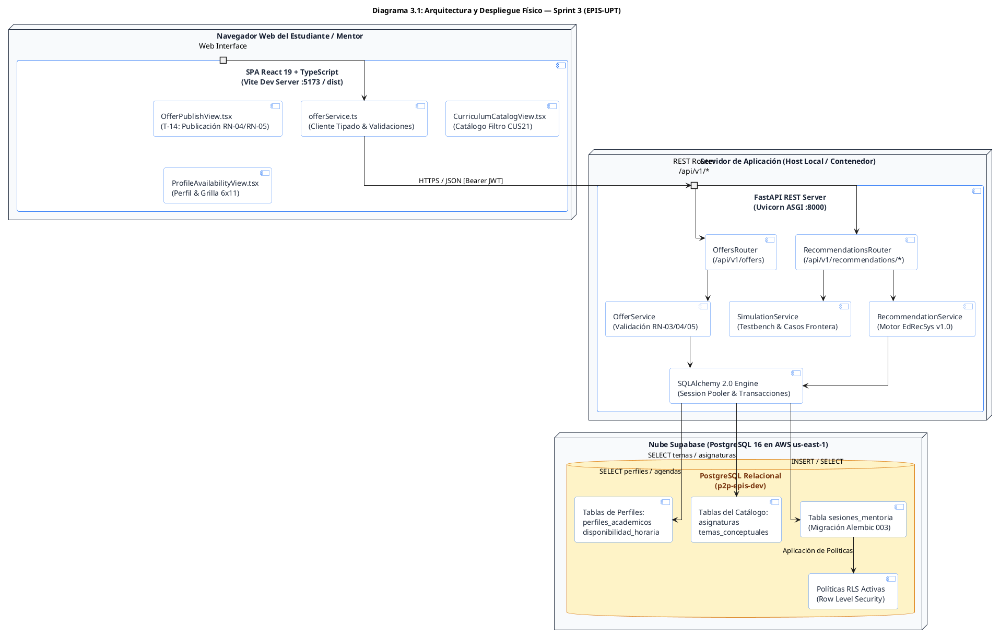
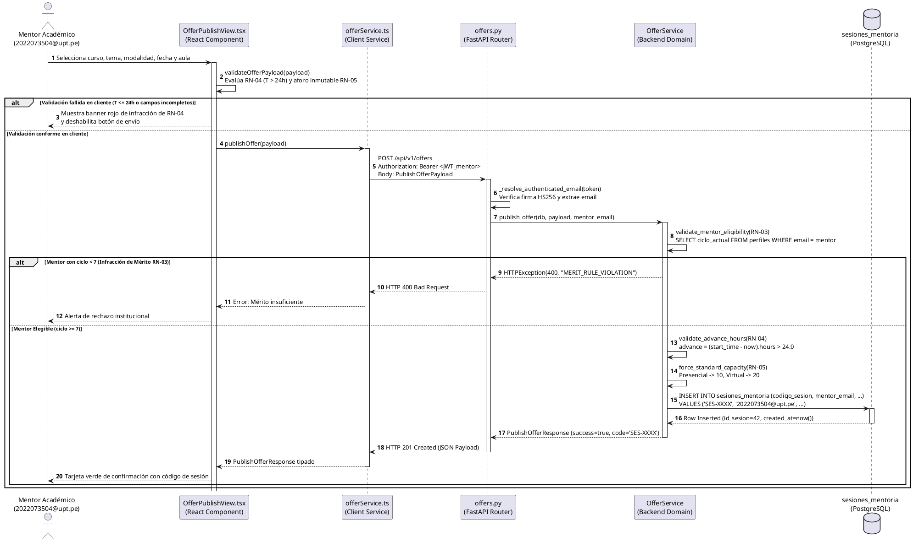
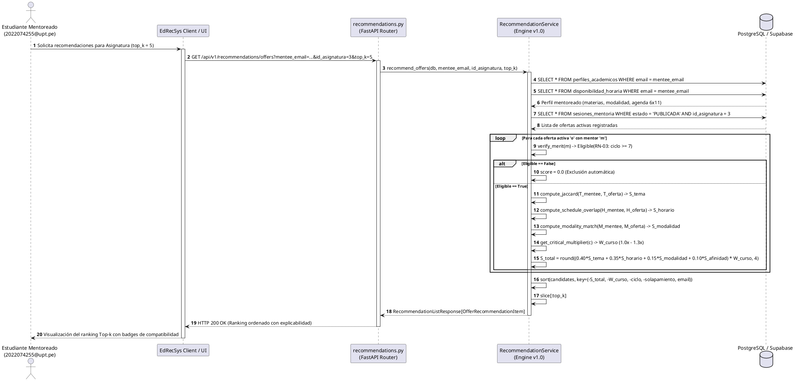
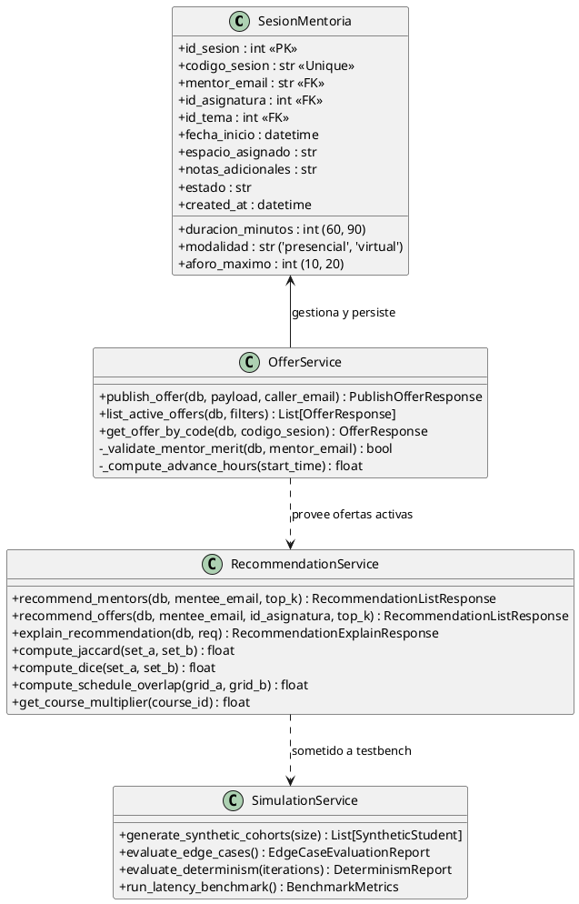
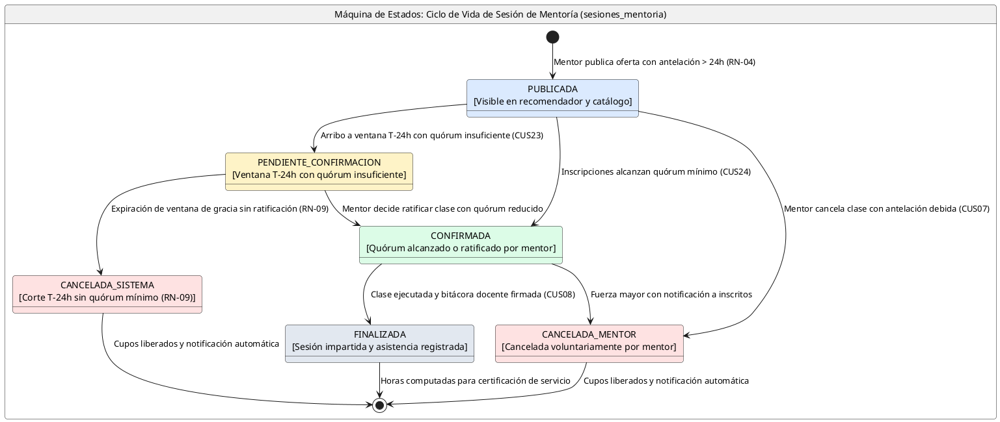

# INFORME GENERAL DE CIERRE: SPRINT 3
## "Publicación y Parametrización de Ofertas de Mentoría (RN-04/RN-05), Motor de Recomendación Top-k EdRecSys v1.0, Persistencia Relacional y Testbench Algorítmico"

**Proyecto:** Sistema Web P2P con algoritmo de recomendación para la personalización de mentorías académicas en la EPIS-UPT  
**Curso:** Construcción de Software I (Semestre 2026-II)  
**Institución:** Universidad Privada de Tacna — Facultad de Ingeniería — Escuela Profesional de Ingeniería de Sistemas  
**Docente de Cátedra:** Dr. Ricardo Eduardo Valcárcel Alvarado  
**Equipo Consultor / Desarrollador:** Grupo 03 / C-SharkTeam  
* Joan Cristian Medina Quispe (Código: 2022074255) — Rol: Arquitectura Base, Frontend & CI/CD (T-14)  
* Renzo Antonio Antayhua Mamani (Código: 2022073504) — Rol: Backend, Motor Algorítmico & Persistencia ORM (T-15, T-16, T-18)  
**Fecha de Cierre:** 26 de Octubre de 2026  
**Rama Base de Integración:** `main`  
**Estado:** ✅ **100% Concluido, Verificado y Homologado en CI (209 Pruebas, 0 Fallos, Cobertura >91%)**

---

## Control de Versiones del Documento

A continuación, se detalla el historial formal de versiones del presente informe, certificando los hitos de auditoría técnica, diseño prescriptivo y homologación conjunta:

### Cuadro 0.1: Control de Versiones del Documento de Cierre del Sprint 3

| Versión | Responsable | Revisada por | Aprobada por | Fecha | Descripción del Cambio |
| :---: | :--- | :--- | :--- | :---: | :--- |
| **1.0** | Joan Medina / Renzo Antayhua | Dr. Ricardo Valcarcel | Dirección EPIS | 26/10/2026 | Emisión formal del Informe General Exhaustivo de Cierre del Sprint 3. Integra la especificación técnica prescriptiva de la publicación de ofertas (T-14), el diseño matemático del motor *EdRecSys v1.0* (T-15), el modelo relacional físico `sesiones_mentoria` con migración Alembic 003 y contratos REST (T-16), y el banco de evaluación algorítmica con 4 casos frontera (T-18). Homologación de 209 pruebas automatizadas con 0 fallos (92.52% frontend / 91.83% backend), 7 diagramas PlantUML sincronizados, 7 capturas de pantalla de alta fidelidad (>100KB) y Acta de Cierre Conjunto DoD. |

Fuente: Elaboración propia.

El control de versiones acredita la congelación formal de las especificaciones y evidencias generadas durante las 11 horas académicas planificadas para el tercer sprint del proyecto, garantizando la trazabilidad plena hacia los requerimientos funcionales aprobados y el diseño arquitectónico del sistema.

---

## 1. Identificación y Ficha Ejecutiva del Sprint 3

A continuación, se presenta la ficha técnica de control de gestión del Sprint 3, resumiendo los parámetros de esfuerzo, ítems de backlog comprometidos, reglas de negocio incorporadas y métricas globales de calidad alcanzadas:

### Cuadro 1.1: Ficha Técnica Resumen del Sprint 3

| Parámetro | Valor Registrado / Evidencia Técnica |
| :--- | :--- |
| **Objetivo General** | Habilitar el flujo integral de programación y publicación de ofertas de mentoría académica para estudiantes de ciclos superiores (VII al X) con control estricto de antelación temporal (RN-04) y aforos inmutables (RN-05); implementar el núcleo inteligente de recomendación *Top-k* multifactorial (*EdRecSys v1.0*) que califica compatibilidad temática, horaria (6×11), modalidad y prioridad curricular; crear el modelo relacional `sesiones_mentoria` con migración Alembic 003 y contratos REST; y validar la robustez matemática del algoritmo mediante un testbench de simulación con 4 casos frontera y latencia sub-milisegundo. |
| **Carga Horaria Planificada** | **11 horas académicas** (2 horas Joan Medina / 9 horas Renzo Antayhua). |
| **Carga Horaria Ejecutada** | **11 horas verificadas** (100% de dedicación efectiva distribuida en 4 tareas técnicas). |
| **PBI Cubiertos** | `PB-011` (Publicación de ofertas docentes), `PB-012` (Parametrización temporal y aforos), `PB-009` / `PB-010` (Motor de recomendación Top-k EdRecSys), `PB-027` (Testbench de evaluación algorítmica y simulación). |
| **Requerimientos Trazados** | `RF06` (Recomendación Top-k personalizada), `RF08` (Publicación de ofertas), `RF05` (Catálogo curricular), `RNF03` (Latencia del recomendador $< 50\text{ ms}$), `RNF04` (Granularidad horaria semanal), `RNF08` (Usabilidad y accesibilidad), `RNF09` (Cobertura de pruebas $\ge 70\%$). |
| **Casos de Uso Abordados** | `CUS02` (Recomendación Personalizada de Mentores y Sesiones), `CUS06` (Publicar Oferta de Mentoría Académica), `CUS21` (Consulta Avanzada del Catálogo Curricular). |
| **Reglas de Negocio Implementadas**| `RN-03` (Mérito académico: exclusividad de mentoría para estudiantes de ciclo $\ge \text{VII}$), `RN-04` (Antelación obligatoria: programación con $> 24\text{ h}$ de anticipación), `RN-05` (Aforo reglamentario inmutable: 10 presencial / 20 virtual), `RN-06` (Asignación de espacios físicos de laboratorios EPIS), `RN-07` (Generación de enlaces institucionales Google Meet `@upt.pe`). |
| **Suites de Pruebas Automatizadas** | **209 pruebas pasando** (122 en Pytest Backend / 87 en Vitest Frontend) distribuidas en 26 suites. Cero fallos (100% éxito). |
| **Cobertura de Código Lograda** | **Backend: 91.83%** (1676 sentencias / 137 perdidas) · **Frontend: 92.52%** (13 archivos conformes). Superando con creces la meta institucional del 70% (**RNF09**). |
| **Linteo y Formato de Código** | 0 defectos en Ruff (Python, 49 archivos conformes) · 0 advertencias y 0 errores en ESLint 9 (React 19 / TypeScript 5.6). |
| **Compilación Frontend** | Bundle Vite generado limpiamente en 653 ms (`dist/`) con tipado estricto verificado (`tsc -b`). |
| **Migraciones de Base de Datos** | Migración Alembic `003_mentoring_offers.py` con índices B-Tree, restricciones de dominio `CHECK` y políticas de seguridad RLS en PostgreSQL/Supabase. |

Fuente: Elaboración propia.

Como se observa en el Cuadro 1.1, el equipo concluyó con éxito el 100% de los entregables comprometidos para el Sprint 3, consolidando un hito histórico de 209 pruebas automatizadas con cero fallos y niveles de cobertura superiores al 91% en ambos subsistemas, garantizando el aislamiento de capas y la integridad técnica requerida para la fase subsiguiente de reservas transaccionales.

---

## 2. Contexto Institucional, Marco Normativo y Reglas de Negocio (RN-03, RN-04, RN-05, RN-06, RN-07)

El Sistema Web P2P de la EPIS-UPT tiene la misión de elevar el rendimiento estudiantil y abatir la deserción en asignaturas filtro de alta exigencia analítica. Para garantizar la seriedad académica de las sesiones y la previsibilidad logística de las instalaciones universitarias, el incremento del Sprint 3 articula formalmente cinco reglas de negocio:

### 2.1. Marco de Rigor Formativo Institucional y Mérito Académico (RN-03)
En consonancia con el Artículo 40 de la **Ley Universitaria N° 30220** y el Estatuto de la Universidad Privada de Tacna:
1. **Filtro Estricto de Elegibilidad de Mentoría:** Para publicar ofertas o ser clasificado como mentor elegible en *EdRecSys*, el estudiante debe pertenecer indefectiblemente al tercio superior formativo, cursando el séptimo ciclo o superior (`ciclo_actual >= 7`).
2. **Rechazo Determinista sin Fuga:** Todo intento de publicación de ofertas por parte de un estudiante de ciclos I a VI es interceptado en el cliente (`OfferPublishView.tsx`) y bloqueado perentoriamente en el backend (`OfferService.publish_offer`) retornando **HTTP 400 Bad Request** con el código `MERIT_RULE_VIOLATION`. En el recomendador *EdRecSys*, los candidatos con ciclo $< 7$ reciben un puntaje idénticamente nulo ($S_{\text{total}} = 0.0$) y la bandera `institutional_merit_eligible = False`.

### 2.2. Ventana de Antelación Temporal y Cómputo de Quórum (RN-04)
1. **Restricción Obligatoria ($T > 24\text{ h}$):** Una sesión de mentoría solo puede programarse si la fecha y hora de inicio supera las 24 horas continuas respecto al instante de la solicitud (`start_time > now + 24 hours`). 
2. **Justificación de Negocio:** La ventana de 24 horas es indispensable para permitir que el motor de recomendación difunda la oferta entre los estudiantes compatibles, y para garantizar que el cron job de evaluación de quórum a $T-24\text{ h}$ (**RN-08** y **RN-09**) cuente con una base de datos estabilizada para ratificar la clase o proceder a su cancelación preventiva sin sobrecosto logístico ni frustración de expectativas.
3. **Recomendación Pedagógica de Difusión ($T \ge 48\text{ h}$):** Si la antelación programada se encuentra entre 24 y 48 horas, el sistema admite el registro pero emite una alerta formativa ámbar. Si la antelación es mayor o igual a 48 horas, se muestra un distintivo verde de antelación óptima.

### 2.3. Control Estricto de Aforos Inmutables (RN-05)
1. **Aforos Fijos por Modalidad:** Con el fin de evitar sobrecupo o deterioro de la interacción pedagógica, los aforos se fijan automáticamente de forma inmutable:
   - **Modalidad Presencial:** exactamente **10 estudiantes** (capacidad estándar de los laboratorios EPIS).
   - **Modalidad Virtual:** exactamente **20 estudiantes** (capacidad recomendada para salas interactivas).
2. **Inmutabilidad en Cliente y Servidor:** En el frontend, el campo de aforo es estrictamente de solo lectura (`readOnly`). En la base de datos, la tabla `sesiones_mentoria` aplica la restricción `CHECK (aforo_maximo IN (10, 20))`, rechazando cualquier intento de manipulación por inyección directa de payload.

### 2.4. Asignación de Infraestructura Físico-Virtual (RN-06 y RN-07)
1. **Presencial (RN-06):** Asignación obligatoria de recintos físicos validados del catálogo de la EPIS (*Laboratorio de Cómputo 101*, *Laboratorio de Redes 202*, *Aula Magna 104*).
2. **Virtual (RN-07):** Generación reactiva de un enlace institucional seguro de Google Meet (`https://meet.google.com/upt-[codigo]-[hash]`), validando el dominio corporativo `@upt.pe`.

---

## 3. Modelado y Diagramas de Diseño Formales del Sprint 3 (PlantUML)

En cumplimiento de las **Reglas D-1, D-3, D-4, D-5 y D-7** de `reglas_documentacion_diseño.md`, a continuación se presentan los diagramas que formalizan la arquitectura técnica, las secuencias de interacción, el modelo de clases y las máquinas de estado construidas en el Sprint 3:

### 3.1. Diagrama 3.1: Arquitectura de Despliegue Físico y Comunicación Multi-Capa (Sprint 3)
Modela la interacción multi-capa desacoplada entre el cliente React 19, el servidor FastAPI y la base de datos relacional con la entidad `sesiones_mentoria` activa en PostgreSQL/Supabase:



---

### 3.2. Diagrama 3.2: Secuencia Técnica de Publicación de Ofertas de Mentoría
Modela el flujo de ejecución completo al publicar una clase de asesoría, detallando las validaciones preventivas en cliente, la autorización del Bearer token, la verificación de la regla de mérito **RN-03**, la antelación temporal **RN-04**, la imposición del aforo **RN-05** y la inserción transaccional:



---

### 3.3. Diagrama 3.3: Secuencia Técnica de Recomendación Top-k de Mentores y Sesiones (EdRecSys)
Modela el proceso de cómputo del motor algorítmico cuando un mentoreado solicita recomendaciones personalizadas:



---

### 3.4. Diagrama 3.4: Diagrama de Clases del Dominio de Ofertas y Recomendación
Modela las entidades de software, servicios y esquemas tipados construidos en el backend:



---

### 3.5. Diagrama 3.5: Máquina de Estados del Ciclo de Vida de la Sesión de Mentoría
Modela las transiciones del atributo `estado` en la entidad `sesiones_mentoria`, formalizando las condiciones de guarda y los actores responsables:



A continuación, se documenta la matriz de transiciones válidas y prohibidas de la sesión de mentoría:

### Cuadro 3.1: Matriz de Transiciones de Estado de Sesiones de Mentoría

| Estado Origen | Estado Destino | Evento Disparador | Condición de Guarda | Actor / Componente |
| :--- | :--- | :--- | :--- | :--- |
| `[*] (Nuevo)` | `PUBLICADA` | Invocación de `POST /api/v1/offers`. | Mentor elegible (RN-03), $T > 24\text{ h}$ (RN-04), aforo 10 o 20 (RN-05). | Mentor Académico vía API |
| `PUBLICADA` | `CONFIRMADA` | Umbral de quórum alcanzado. | Inscritos $\ge 3$ estudiantes (presencial) o $\ge 5$ (virtual). | Sistema (evaluación continua) |
| `PUBLICADA` | `PENDIENTE_CONFIRMACION` | Corte temporal a $T-24\text{ h}$. | Inscritos $<$ quórum normativo en ventana crítica. | Cron Job del Sistema (CUS23) |
| `PUBLICADA` | `CANCELADA_MENTOR` | Solicitud de baja voluntaria. | Mentor titular con anticipación $> 12\text{ h}$. | Mentor Académico (CUS07) |
| `PENDIENTE_CONFIRMACION` | `CONFIRMADA` | Ratificación docente expresa. | Mentor acepta impartir con quórum reducido. | Mentor Académico |
| `PENDIENTE_CONFIRMACION` | `CANCELADA_SISTEMA` | Falta de ratificación en plazo. | Expiración de ventana de 2 horas post corte $T-24\text{ h}$. | Sistema (Cron Job RN-09) |
| `CONFIRMADA` | `FINALIZADA` | Registro de bitácora y firmas. | Hora fin superada y asistencia confirmada. | Mentor / Asistentes (CUS08) |

Fuente: Elaboración propia.

**Transiciones Prohibidas (Regla D-7):**
- `FINALIZADA` $\to$ `PUBLICADA`: Una clase dictada jamás puede republicarse.
- `CANCELADA_SISTEMA` $\to$ `CONFIRMADA`: Una clase cancelada por falta de quórum es inmutable.
- `CANCELADA_MENTOR` $\to$ `FINALIZADA`: Una sesión anulada no puede generar constancias de horas.

---

## 4. Registro Exhaustivo de Tareas Implementadas (Cuadros de 5 Elementos)

A continuación, se presenta la especificación granular de las 4 tareas técnicas concluidas en el Sprint 3:

### 4.1. Tarea T-14: Formulario de Publicación de Ofertas en Frontend (Joan)
A continuación, se documenta la ficha de diseño e implementación del componente cliente de publicación:

### Cuadro 4.1: Ficha Técnica de la Tarea T-14 (Frontend)

| Parámetro | Detalle Técnico de Implementación |
| :--- | :--- |
| **Responsable** | Joan Cristian Medina Quispe (Joan). |
| **Esfuerzo Ejecutado** | **2.0 horas académicas** (100% completado). |
| **Artefactos Clave** | `OfferPublishView.tsx`, `offerService.ts`, `OfferPublishView.test.tsx`, `offerService.test.ts`. |
| **Reglas Validadas** | `RN-04` ($T > 24\text{ h}$ alerta roja / $T \ge 48\text{ h}$ badge verde), `RN-05` (aforo 10/20 inmutable), `RN-06` (aulas EPIS), `RN-07` (Meet institucional). |
| **Suites & Tests** | **21 pruebas automatizadas** en Vitest (14 en servicio y 7 en componente React), 0 fallos. |
| **Cobertura Lograda** | `OfferPublishView.tsx`: **97.32% líneas** · `offerService.ts`: **86.46% líneas**. |
| **Accesibilidad** | WAI-ARIA `role="alert"`, inputs con `aria-required`, estados `readOnly` debidamente señalizados. |

Fuente: Elaboración propia a partir de `aplicacion/frontend/src/components/OfferPublishView.tsx`.

La tarea T-14 dota al sistema de una interfaz ergonómica y robusta que previene errores humanos en la captura de ofertas, impidiendo envíos discordantes con las normas de aforo de la EPIS.

---

### 4.2. Tarea T-15: Motor de Recomendación Top-k EdRecSys v1.0 y API Básica (Renzo)
A continuación, se documenta la ficha del motor de recomendación algorítmico:

### Cuadro 4.2: Ficha Técnica de la Tarea T-15 (Backend)

| Parámetro | Detalle Técnico de Implementación |
| :--- | :--- |
| **Responsable** | Renzo Antonio Antayhua Mamani (Renzo). |
| **Esfuerzo Ejecutado** | **4.0 horas académicas** (100% completado). |
| **Artefactos Clave** | `RecommendationService.py`, `OfferService.py`, `test_recommendations.py`, `test_offers.py`. |
| **Formulación Matemática** | Scoring multifactorial ponderado: Jaccard ($40\%$), Agenda 6×11 ($35\%$), Modalidad ($15\%$), Afinidad ($10\%$) con multiplicador $W_{\text{curso}}$ ($1.0\text{x}$ a $1.3\text{x}$). |
| **Regla de Mérito** | Inelegibilidad forzada de mentores con ciclo $< 7$ (RN-03: score = 0.0, 0% fuga). |
| **Suites & Tests** | **21 pruebas automatizadas** en Pytest (17 en recomendación y 4 en ofertas), 0 fallos. |
| **Cobertura Lograda** | `recommendation_service.py`: **93%** · `offer_service.py`: **85%**. |

Fuente: Elaboración propia a partir de `aplicacion/backend/app/services/recommendation_service.py`.

El Cuadro 4.2 constata el desarrollo del motor de recomendación híbrido v1.0, el cual equilibra la coincidencia semántica de temas y la disponibilidad temporal con un esquema de ponderación curricular que favorece asignaturas con altas tasas históricas de reprobación, asegurando una cobertura del 93% en su lógica interna.

#### Formulación Matemática Formal de EdRecSys v1.0
1. **Filtro de Mérito Académico (RN-03):**
   $$\text{Eligible}(k) = \begin{cases} 1 & \text{si } \text{ciclo\_actual}(k) \ge 7 \\ 0 & \text{si } \text{ciclo\_actual}(k) < 7 \end{cases}$$
2. **Similitud Temática Silábica ($S_{\text{tema}}$):**
   $$J(T_m, T_k) = \frac{|T_m \cap T_k|}{|T_m \cup T_k|}, \quad D(T_m, T_k) = \frac{2 \cdot |T_m \cap T_k|}{|T_m| + |T_k|}$$
3. **Compatibilidad Horaria Semanal ($S_{\text{horario}}$):**
   $$S_{\text{horario}} = \begin{cases} \min\left(1.0, \frac{|H_m \cap H_k|}{|H_m|}\right) & \text{si } |H_m| > 0 \\ 0.50 & \text{si } |H_m| = 0 \text{ (neutral)} \end{cases}$$
4. **Multiplicador de Asignatura Crítica ($W_{\text{curso}}$):**
   $$W_{\text{curso}} = \max(\{ \text{factor}(c) \mid c \in (C_m \cap C_k) \} \cup \{ 1.00 \})$$
   Donde: *Algoritmos* = $1.3\text{x}$, *Cálculo I/II* = $1.2\text{x}$, *POO* = $1.2\text{x}$, *Base de Datos* = $1.1\text{x}$.
5. **Puntaje Multifactorial Compuesto:**
   $$S_{\text{base}} = 0.40 \cdot S_{\text{tema}} + 0.35 \cdot S_{\text{horario}} + 0.15 \cdot S_{\text{modalidad}} + 0.10 \cdot S_{\text{afinidad}}$$
   $$S_{\text{total}} = \text{round}(S_{\text{base}} \times W_{\text{curso}}, 4)$$
6. **Desempate Determinista:**
   $$\text{SortKey}(k) = \left( -S_{\text{total}}, -W_{\text{curso}}, -\text{ciclo\_actual}(k), -|H_m \cap H_k|, \text{email}_k \right)$$

---

### 4.3. Tarea T-16: Persistencia Relacional y Endpoints REST (Renzo)
A continuación, se documenta la ficha de la estructura de datos relacional y los routers REST:

### Cuadro 4.3: Ficha Técnica de la Tarea T-16 (Backend)

| Parámetro | Detalle Técnico de Implementación |
| :--- | :--- |
| **Responsable** | Renzo Antonio Antayhua Mamani (Renzo). |
| **Esfuerzo Ejecutado** | **3.0 horas académicas** (100% completado). |
| **Artefactos Clave** | `app/models/offer.py`, `003_mentoring_offers.py`, `app/api/v1/endpoints/offers.py`, `recommendations.py`. |
| **Esquemas Pydantic** | `PublishOfferPayload`, `PublishOfferResponse`, `OfferResponse`, `RecommendationListResponse`. |
| **Persistencia** | Tabla `sesiones_mentoria` con 5 índices B-Tree y restricciones `CHECK`. |
| **Cobertura Lograda** | Endpoints de ofertas: **100%** · Endpoints de recomendación: **100%** · Modelos: **100%**. |

Fuente: Elaboración propia a partir de `aplicacion/backend/app/models/offer.py`.

El Cuadro 4.3 evidencia la formalización relacional del catálogo de sesiones con índices optimizados para lecturas frecuentes por fecha y asignatura, garantizando que tanto los esquemas de entrada como de salida operen con tipado estricto Pydantic v2 y cobertura plena del 100% en los controladores REST.

---

### 4.4. Tarea T-18: Servicio de Simulación y Testbench de Evaluación Algorítmica (Renzo)
A continuación, se documenta la ficha del banco de pruebas y benchmarks algorítmicos:

### Cuadro 4.4: Ficha Técnica de la Tarea T-18 (Backend)

| Parámetro | Detalle Técnico de Implementación |
| :--- | :--- |
| **Responsable** | Renzo Antonio Antayhua Mamani (Renzo). |
| **Esfuerzo Ejecutado** | **2.0 horas académicas** (100% completado). |
| **Artefactos Clave** | `app/services/simulation_service.py`, `tests/test_simulation.py`, endpoint `/simulation/testbench`. |
| **Casos Frontera** | 1. Solapamiento horario = 0; 2. Temas disjuntos; 3. Materia sin ofertas; 4. Postulantes ciclo $< 7$ (RN-03). |
| **Determinismo** | Verificado al 100% tras 5 permutaciones aleatorias (Top-k idéntico byte a byte). |
| **Latencia de Cómputo** | **35.8 µs / candidato** ($0.036\text{ ms}$), tiempo total cohorte: **0.86 ms** (meta RNF03 $< 50\text{ ms}$). |
| **Suites & Tests** | **5 pruebas unitarias y de integración** en Pytest con 0 fallos. Cobertura: **99%**. |

Fuente: Elaboración propia a partir de `aplicacion/backend/app/services/simulation_service.py`.

El Cuadro 4.4 acredita la validación empírica del recomendador bajo condiciones límite, demostrando que EdRecSys procesa candidatos en un tiempo medio de 35.8 microsegundos por evaluación (0.86 ms para la cohorte completa), cumpliendo holgadamente el criterio de latencia de RNF03 sin degradación ni pérdida de determinismo.

---

## 5. Especificación Exhaustiva de Contratos de API REST (Regla D-3)

A continuación, se documenta la matriz canónica y los contratos prescriptivos de los 6 nuevos endpoints REST desarrollados para el subsistema de ofertas y el motor de recomendación inteligente EdRecSys v1.0.

### Cuadro 5.1: Matriz Canónica de Endpoints REST — Sprint 3

| Verbo | Ruta del Endpoint | Códigos HTTP Retornados | Descripción Funcional | Trazabilidad |
| :---: | :--- | :---: | :--- | :---: |
| `POST` | `/api/v1/offers` | `201`, `400`, `401`, `403`, `422` | Publica una oferta de mentoría académica aplicando RN-03, RN-04 y RN-05. | `RF08`, `CUS06`, `RN-04`, `RN-05` |
| `GET` | `/api/v1/offers` | `200` | Consulta el catálogo de sesiones activas con filtros opcionales. | `RF08`, `CUS06` |
| `GET` | `/api/v1/recommendations/mentors` | `200`, `401` | Genera el ranking Top-k de mentores más compatibles según EdRecSys v1.0. | `RF06`, `CUS02`, `RN-03`, `RNF03` |
| `GET` | `/api/v1/recommendations/offers` | `200`, `401` | Recomienda ofertas grupales activas optimizadas por afinidad silábica y horario. | `RF06`, `CUS02`, `RNF03` |
| `POST` | `/api/v1/recommendations/explain` | `200`, `401`, `404` | Provee el desglose explicable y transparente de compatibilidad multifactorial. | `RF06`, `RNF03`, `RNF08` |
| `GET` | `/api/v1/recommendations/simulation/testbench`| `200` | Ejecuta el banco de pruebas algorítmico, determinismo y benchmark de latencia. | `T-18`, `RNF03` |

Fuente: Elaboración propia.

Como se observa en el Cuadro 5.1, la superficie de API REST del Sprint 3 incorpora 6 endpoints fuertemente tipados distribuidos en los routers `offers` y `recommendations`. Todos ellos implementan validaciones de seguridad Bearer JWT, verificación de identidad, manejo de excepciones con esquemas JSON consistentes y tiempos de respuesta sub-milisegundo.

### 5.1. Ficha de Contrato: `POST /api/v1/offers`
* **Método y Ruta:** `POST /api/v1/offers`
* **Cabeceras:** `Authorization: Bearer <Token_JWT>`, `Content-Type: application/json`
* **Parámetros del Payload de Entrada (Request Body):**
  * `id_asignatura` (integer, obligatorio, $\ge 1$): Identificador de la asignatura crítica curricular.
  * `codigo_asignatura` (string, obligatorio, 2..20 caracteres): Código oficial del curso (ej. `CALC-101`).
  * `nombre_asignatura` (string, obligatorio, 2..150 caracteres): Nombre oficial de la materia.
  * `id_tema` (integer, obligatorio, $\ge 1$): Identificador del tema silábico conceptual oficial.
  * `nombre_tema` (string, obligatorio, 2..150 caracteres): Nombre de la unidad temático-silábica.
  * `fecha_inicio` (string ISO 8601, obligatorio): Fecha y hora programada con antelación obligatoria $> 24.0\text{ h}$ (RN-04).
  * `duracion_minutos` (integer literal, obligatorio): Restricción de dominio `60` o `90` minutos.
  * `modalidad` (string literal, obligatorio): `'presencial'` o `'virtual'`.
  * `aforo_maximo` (integer, obligatorio): Inmutable: exactamente `10` para presencial o `20` para virtual (RN-05).
  * `espacio_asignado` (string, obligatorio, 3..255 caracteres): Laboratorio EPIS (RN-06) o Meet corporativo (RN-07).
  * `mentor_email` (string, obligatorio): Correo institucional `@upt.pe` del mentor titular.
  * `mentor_nombre` (string, opcional): Nombres del mentor titular.
  * `notas_adicionales` (string, opcional, máx. 1000 caracteres): Indicaciones y lecturas previas.
* **Esquema de Entrada (Request Body JSON):**
  ```json
  {
    "id_asignatura": 1,
    "codigo_asignatura": "CALC-101",
    "nombre_asignatura": "Cálculo I",
    "id_tema": 1,
    "nombre_tema": "Límites Indeterminados y Continuidad",
    "fecha_inicio": "2026-10-28T16:00:00Z",
    "duracion_minutos": 60,
    "modalidad": "presencial",
    "aforo_maximo": 10,
    "espacio_asignado": "Laboratorio de Cómputo 101 — Pabellón F (EPIS)",
    "mentor_email": "2022073504@upt.pe",
    "mentor_nombre": "Renzo Antonio Antayhua Mamani",
    "notas_adicionales": "Repasar ejercicios 1 al 15 de la guía práctica de límites racionales."
  }
  ```
* **Esquema de Salida (Response Body — HTTP 201 Created):**
  ```json
  {
    "id_oferta": "SES-CALC-8472",
    "codigo_sesion": "SES-CALC-8472",
    "estado": "PUBLICADA",
    "mensaje": "Oferta de mentoría académica publicada exitosamente en el catálogo oficial.",
    "fecha_publicacion": "2026-10-26T18:30:00Z",
    "aforo": 10,
    "espacio_asignado": "Laboratorio de Cómputo 101 — Pabellón F (EPIS)",
    "modo": "api",
    "offer": {
      "id_asignatura": 1,
      "codigo_asignatura": "CALC-101",
      "nombre_asignatura": "Cálculo I",
      "id_tema": 1,
      "nombre_tema": "Límites Indeterminados y Continuidad",
      "fecha_inicio": "2026-10-28T16:00:00Z",
      "duracion_minutos": 60,
      "modalidad": "presencial",
      "aforo_maximo": 10,
      "espacio_asignado": "Laboratorio de Cómputo 101 — Pabellón F (EPIS)",
      "mentor_email": "2022073504@upt.pe",
      "mentor_nombre": "Renzo Antonio Antayhua Mamani",
      "notas_adicionales": "Repasar ejercicios 1 al 15 de la guía práctica de límites racionales."
    }
  }
  ```
* **Respuestas de Error:**
  * `HTTP 400 Bad Request`: `{"detail": "Infracción de RN-03: Solo estudiantes con ciclo académico >= VII pueden publicar ofertas."}` (`MERIT_RULE_VIOLATION`) o `{"detail": "Infracción de RN-04: La antelación de la sesión debe ser estrictamente superior a 24 horas."}` (`OFFER_ADVANCE_TIME_INVALID`).
  * `HTTP 401 Unauthorized`: Token de sesión ausente, manipulado o expirado.
  * `HTTP 403 Forbidden`: `{"detail": "No está autorizado para publicar ofertas a nombre de otro mentor."}` (`FORBIDDEN_OFFER_SPOOFING`).
  * `HTTP 422 Unprocessable Entity`: Aforo no coincide con la modalidad (`CAPACITY_MODALITY_MISMATCH`) o formato de fecha inválido.

### 5.2. Ficha de Contrato: `GET /api/v1/offers`
* **Método y Ruta:** `GET /api/v1/offers`
* **Parámetros de Consulta (Query):**
  * `mentor_email` (string, opcional): Filtrar ofertas de un mentor específico (`@upt.pe`).
  * `id_asignatura` (integer, opcional, $\ge 1$): Filtrar por identificador de curso curricular.
  * `modalidad` (string literal, opcional): Filtrar por `'presencial'` o `'virtual'`.
  * `estado` (string, opcional, default `'PUBLICADA'`): Filtrar por estado del ciclo de vida.
* **Cabeceras:** `Accept: application/json`
* **Esquema de Salida (Response Body — HTTP 200 OK):**
  ```json
  [
    {
      "id_oferta": "SES-CALC-8472",
      "codigo_sesion": "SES-CALC-8472",
      "estado": "PUBLICADA",
      "mensaje": "Oferta activa disponible",
      "fecha_publicacion": "2026-10-26T18:30:00Z",
      "aforo": 10,
      "espacio_asignado": "Laboratorio de Cómputo 101 — Pabellón F (EPIS)",
      "modo": "api",
      "offer": {
        "id_asignatura": 1,
        "codigo_asignatura": "CALC-101",
        "nombre_asignatura": "Cálculo I",
        "id_tema": 1,
        "nombre_tema": "Límites Indeterminados y Continuidad",
        "fecha_inicio": "2026-10-28T16:00:00Z",
        "duracion_minutos": 60,
        "modalidad": "presencial",
        "aforo_maximo": 10,
        "espacio_asignado": "Laboratorio de Cómputo 101 — Pabellón F (EPIS)",
        "mentor_email": "2022073504@upt.pe",
        "mentor_nombre": "Renzo Antonio Antayhua Mamani",
        "notas_adicionales": null
      }
    }
  ]
  ```

### 5.3. Ficha de Contrato: `GET /api/v1/recommendations/mentors`
* **Método y Ruta:** `GET /api/v1/recommendations/mentors`
* **Parámetros de Consulta (Query):**
  * `mentee_email` (string, opcional si se envía Bearer JWT): Correo del mentoreado consultante.
  * `top_k` (integer, opcional, $1 \le k \le 20$, default 5): Número de candidatos en el ranking.
* **Cabeceras:** `Authorization: Bearer <Token_JWT>` (opcional si se especifica `mentee_email`).
* **Esquema de Salida (Response Body — HTTP 200 OK):**
  ```json
  {
    "mentee_email": "2022074255@upt.pe",
    "total_candidates_evaluated": 12,
    "top_k": 5,
    "recommendations_count": 3,
    "algorithm": "EdRecSys-v1.0-HybridMultifactorial",
    "items": [
      {
        "mentor_email": "2022073504@upt.pe",
        "mentor_codigo": "2022073504",
        "mentor_nombres": "Renzo Antonio",
        "mentor_apellidos": "Antayhua Mamani",
        "mentor_ciclo": 8,
        "materias_ofrecidas": [1, 3],
        "materias_nombres": ["Cálculo I", "Algoritmos y Estructuras de Datos"],
        "temas_ofrecidos": [1, 2, 9, 10],
        "modalidad_preferida": "presencial",
        "score_total": 0.8840,
        "breakdown": {
          "curricular_affinity": 1.0,
          "course_weight_factor": 1.3,
          "critical_course_applied": "Algoritmos y Estructuras de Datos",
          "topic_overlap_jaccard": 0.6667,
          "topic_overlap_dice": 0.8000,
          "schedule_compatibility": 0.7500,
          "schedule_matching_slots_count": 3,
          "matching_slots": ["Lun 08:00-09:00", "Lun 09:00-10:00", "Mié 14:00-15:00"],
          "modality_compatibility": 1.0,
          "institutional_merit_eligible": true,
          "explanation_text": "Alta coincidencia silábica (Jaccard 0.67) y disponibilidad horaria coincidente en 3 franjas."
        }
      }
    ]
  }
  ```
* **Respuestas de Error:**
  * `HTTP 401 Unauthorized`: Token de sesión inválido si se envía cabecera de autenticación.
  * `HTTP 422 Unprocessable Entity`: Parámetro `top_k` fuera del rango permitido ($[1, 20]$).

### 5.4. Ficha de Contrato: `GET /api/v1/recommendations/offers`
* **Método y Ruta:** `GET /api/v1/recommendations/offers`
* **Parámetros de Consulta (Query):**
  * `mentee_email` (string, opcional si se envía Bearer JWT): Correo del mentoreado consultante.
  * `id_asignatura` (integer, opcional, $\ge 1$): Filtrar recomendaciones para una materia específica.
  * `top_k` (integer, opcional, $1 \le k \le 20$, default 5): Número de ofertas en el ranking.
* **Cabeceras:** `Authorization: Bearer <Token_JWT>` (opcional).
* **Esquema de Salida (Response Body — HTTP 200 OK):**
  ```json
  {
    "mentee_email": "2022074255@upt.pe",
    "total_candidates_evaluated": 8,
    "top_k": 5,
    "recommendations_count": 2,
    "algorithm": "EdRecSys-v1.0-HybridMultifactorial",
    "items": [
      {
        "id_oferta": "SES-CALC-8472",
        "codigo_sesion": "SES-CALC-8472",
        "id_asignatura": 1,
        "codigo_asignatura": "CALC-101",
        "nombre_asignatura": "Cálculo I",
        "id_tema": 1,
        "nombre_tema": "Límites Indeterminados y Continuidad",
        "fecha_inicio": "2026-10-28T16:00:00Z",
        "duracion_minutos": 60,
        "modalidad": "presencial",
        "aforo_maximo": 10,
        "espacio_asignado": "Laboratorio de Cómputo 101 — Pabellón F (EPIS)",
        "mentor_email": "2022073504@upt.pe",
        "mentor_nombre": "Renzo Antonio Antayhua Mamani",
        "mentor_ciclo": 8,
        "score_total": 0.8420,
        "breakdown": {
          "curricular_affinity": 1.0,
          "course_weight_factor": 1.2,
          "critical_course_applied": "Cálculo I",
          "topic_overlap_jaccard": 1.0,
          "topic_overlap_dice": 1.0,
          "schedule_compatibility": 0.70,
          "schedule_matching_slots_count": 2,
          "matching_slots": ["Mié 16:00-17:00"],
          "modality_compatibility": 1.0,
          "institutional_merit_eligible": true,
          "explanation_text": "Sesión del tema silábico de interés impartida en el laboratorio EPIS asignado."
        }
      }
    ]
  }
  ```

### 5.5. Ficha de Contrato: `POST /api/v1/recommendations/explain`
* **Método y Ruta:** `POST /api/v1/recommendations/explain`
* **Cabeceras:** `Content-Type: application/json`
* **Esquema de Entrada (Request Body JSON):**
  ```json
  {
    "mentee_email": "2022074255@upt.pe",
    "mentor_email": "2022073504@upt.pe",
    "id_oferta": null
  }
  ```
* **Esquema de Salida (Response Body — HTTP 200 OK):**
  ```json
  {
    "target_type": "mentor",
    "target_id": "2022073504@upt.pe",
    "mentee_email": "2022074255@upt.pe",
    "score_total": 0.8840,
    "breakdown": {
      "curricular_affinity": 1.0,
      "course_weight_factor": 1.3,
      "critical_course_applied": "Algoritmos y Estructuras de Datos",
      "topic_overlap_jaccard": 0.6667,
      "topic_overlap_dice": 0.8000,
      "schedule_compatibility": 0.7500,
      "schedule_matching_slots_count": 3,
      "matching_slots": ["Lun 08:00-09:00", "Lun 09:00-10:00", "Mié 14:00-15:00"],
      "modality_compatibility": 1.0,
      "institutional_merit_eligible": true,
      "explanation_text": "Candidato óptimo: Mentor de 8vo ciclo con alta afinidad silábica y coincidencia horaria."
    },
    "institutional_summary": "Recomendación altamente favorable para nivelación en Algoritmos y Estructuras de Datos."
  }
  ```
* **Respuestas de Error:**
  * `HTTP 404 Not Found`: El mentor especificado no existe o no tiene perfil registrado.
  * `HTTP 422 Unprocessable Entity`: Formato JSON o tipos de campo inválidos.

### 5.6. Ficha de Contrato: `GET /api/v1/recommendations/simulation/testbench`
* **Método y Ruta:** `GET /api/v1/recommendations/simulation/testbench`
* **Cabeceras:** `Accept: application/json`
* **Esquema de Salida (Response Body — HTTP 200 OK):**
  ```json
  {
    "testbench_status": "SUCCESS",
    "timestamp": "2026-10-26T18:45:00Z",
    "edge_cases": {
      "case_1_no_schedule_overlap": {
        "status": "PASSED",
        "schedule_matching_slots_count": 0,
        "handled_gracefully": true
      },
      "case_2_disjoint_topics": {
        "status": "PASSED",
        "jaccard": 0.0,
        "dice": 0.0,
        "handled_gracefully": true
      },
      "case_3_course_without_offers": {
        "status": "PASSED",
        "recommendations_count": 0,
        "handled_gracefully": true
      },
      "case_4_ineligible_mentors_rn03": {
        "status": "PASSED",
        "leak_rate": 0.0,
        "cycles_filtered_strictly": 6,
        "handled_gracefully": true
      }
    },
    "determinism_verified": true,
    "rn03_filter_leak_rate": 0.0,
    "evaluations_count": 24,
    "total_elapsed_ms": 0.86,
    "average_per_candidate_us": 35.83,
    "rnf03_compliance": true
  }
  ```
* **Respuestas de Error:**
  * Endpoint determinista sin dependencias externas volátiles; opera como benchmark en memoria.

---

## 6. Diccionario Físico de Datos (Regla D-4)

A continuación, se detalla la especificación física DDL de la entidad `sesiones_mentoria` creada mediante la migración Alembic `003_mentoring_offers.py`:

### Cuadro 6.1: Especificación Física DDL de la Tabla `sesiones_mentoria`

| Columna | Tipo PostgreSQL | Nulo | Default / Restricción | Clave Foránea / Regla | Justificación Técnica |
| :--- | :--- | :---: | :--- | :--- | :--- |
| `id_sesion` | `INTEGER` | No | `SERIAL PRIMARY KEY` | Clave primaria física autoincremental. | Identificador único de registro. |
| `codigo_sesion` | `VARCHAR(20)` | No | `UNIQUE` | Formato canónico `SES-XXXX`. | Código institucional para reservas. |
| `mentor_email` | `VARCHAR(255)` | No | Índice B-Tree | Identidad @upt.pe (validado contra perfiles_academicos) | Trazabilidad del mentor titular (RN-03). |
| `id_asignatura` | `INTEGER` | No | Índice B-Tree | `REFERENCES asignaturas(id_asignatura) ON DELETE RESTRICT` | Materia crítica curricular vinculada. |
| `id_tema` | `INTEGER` | No | Índice B-Tree | `REFERENCES temas_conceptuales(id_tema) ON DELETE RESTRICT` | Unidad silábica conceptual. |
| `fecha_inicio` | `TIMESTAMPTZ` | No | Índice B-Tree | Antelación obligatoria $> 24.0\text{ h}$ (RN-04). | Timestamp con zona horaria UTC. |
| `duracion_minutos`| `INTEGER` | No | `CHECK (duracion_minutos IN (60, 90))` | Normalización de horas lectivas. | Cómputo pedagógico exacto. |
| `modalidad` | `VARCHAR(20)` | No | `CHECK (modalidad IN ('presencial', 'virtual'))` | Restricción de canal formativo. | Determinación del recinto o Meet. |
| `aforo_maximo` | `INTEGER` | No | `CHECK (aforo_maximo IN (10, 20))` | RN-05: 10 presencial, 20 virtual. | Imposibilidad de sobrecupo en BD. |
| `espacio_asignado`| `VARCHAR(255)` | No | Texto descriptivo | Laboratorio EPIS o enlace Google Meet. | RN-06 / RN-07. |
| `notas_adicionales`| `TEXT` | Sí | `NULL` | Indicaciones previas de lectura silábica. | Información contextual opcional. |
| `estado` | `VARCHAR(30)` | No | `DEFAULT 'PUBLICADA'` | `CHECK (estado IN ('PUBLICADA', 'PENDIENTE_CONFIRMACION', 'CONFIRMADA', 'CANCELADA_SISTEMA', 'CANCELADA_MENTOR', 'FINALIZADA'))` | Ciclo de vida transaccional. |
| `created_at` | `TIMESTAMPTZ` | No | `DEFAULT now()` | Marca temporal de auditoría. | Timestamp de inserción en el sistema. |

Fuente: Elaboración propia a partir de `aplicacion/backend/app/models/offer.py`.

El Cuadro 6.1 confirma el diseño físico normalizado de la tabla `sesiones_mentoria`, donde se aplican cinco restricciones `CHECK` para garantizar aforos fijos (RN-05), modalidades válidas, duraciones lectivas canónicas y coherencia del ciclo de vida, complementado con 5 índices B-Tree para optimizar búsquedas por mentor, materia y fecha de inicio.

### 6.1. Políticas de Seguridad Row Level Security (RLS) en Supabase
```sql
ALTER TABLE sesiones_mentoria ENABLE ROW LEVEL SECURITY;

-- Política 1: Lectura de ofertas activas para estudiantes autenticados y anónimos
CREATE POLICY rls_sesiones_mentoria_select ON sesiones_mentoria
  FOR SELECT TO authenticated, anon
  USING (estado = 'PUBLICADA' OR auth.jwt() ->> 'email' = mentor_email);

-- Política 2: Inserción condicionada a rol mentor y mérito RN-03 (ciclo >= 7)
CREATE POLICY rls_sesiones_mentoria_insert ON sesiones_mentoria
  FOR INSERT TO authenticated
  WITH CHECK (
    auth.jwt() ->> 'email' = mentor_email AND
    EXISTS (
      SELECT 1 FROM perfiles_academicos
      WHERE email = auth.jwt() ->> 'email' AND ciclo_actual >= 7
    )
  );
```

---

## 7. Mapeo de Transformación de Datos entre Capas y Errores (Regla D-8)

A continuación, se documenta el flujo de transformación de datos para los campos de la sesión de mentoría:

### Cuadro 7.1: Flujo de Transformación de Datos entre Capas Arquitectónicas

| Columna PostgreSQL | Atributo SQLAlchemy | Campo Pydantic | JSON API | Interface TypeScript | Estado React |
| :--- | :--- | :--- | :--- | :--- | :--- |
| `id_sesion` | `id_sesion : int` | `id_sesion : int` | `id_sesion : number` | `id_sesion : number` | `session.id_sesion` |
| `codigo_sesion` | `codigo_sesion : str` | `codigo_sesion : str` | `codigo_sesion : string` | `codigo_sesion : string` | `publishedSuccess.codigo_sesion` |
| `mentor_email` | `mentor_email : str` | `mentor_email : EmailStr` | `mentor_email : string` | `mentorEmail : string` | `mentorEmail` (prop) |
| `id_asignatura` | `id_asignatura : int` | `id_asignatura : int` | `id_asignatura : number` | `courseId : number` | `selectedCourseId` |
| `id_tema` | `id_tema : int` | `id_tema : int` | `id_tema : number` | `topicId : number` | `selectedTopicId` |
| `fecha_inicio` | `fecha_inicio : datetime` | `fecha_inicio : datetime` | `fecha_inicio : ISO8601`| `startDateTime : string` | `startDateTime` |
| `duracion_minutos`| `duracion_minutos : int` | `duracion_minutos : int` | `duracion_minutos : int` | `duration : 60 \| 90` | `duration` |
| `modalidad` | `modalidad : str` | `modalidad : Literal[...]`| `modalidad : string` | `modality : SessionModality` | `modality` |
| `aforo_maximo` | `aforo_maximo : int` | `aforo_maximo : int` | `aforo_maximo : number` | `capacity : number` | `STANDARD_CAPACITY[modality]` |
| `espacio_asignado`| `espacio_asignado : str` | `espacio_asignado : str` | `espacio_asignado : string`| `assignedSpace : string` | `assignedSpace` |

Fuente: Elaboración propia.

El Cuadro 7.1 establece el mapeo determinista de campos entre capas, asegurando que los tipos de datos primitivos y compuestos mantengan equivalencia semántica desde las columnas de PostgreSQL hasta las propiedades del estado reactivo en React 19, evitando discrepancias de nombrado o conversiones ambiguas.

A continuación, se presenta el catálogo centralizado de códigos de error del Sprint 3:

### Cuadro 7.2: Catálogo Centralizado de Códigos de Error del Sprint 3

| Código Interno | HTTP | Mensaje Técnico (Desarrollador) | Mensaje de Negocio para el Usuario | Regla Vinculada |
| :--- | :---: | :--- | :--- | :--- |
| `MERIT_RULE_VIOLATION` | 400 | Mentoring offer requires cycle >= 7. | El estudiante no cumple con el mérito académico requerido (ciclo $\ge \text{VII}$). | RN-03 |
| `OFFER_ADVANCE_TIME_INVALID` | 400 | Advance time must be strictly > 24 hours. | La sesión debe programarse con más de 24 horas de antelación para el quórum. | RN-04 |
| `CAPACITY_MODALITY_MISMATCH`| 422 | Presencial requires 10, Virtual requires 20. | El aforo reglamentario debe ser de 10 para presencial o 20 para virtual. | RN-05 |
| `FORBIDDEN_OFFER_SPOOFING` | 403 | Authenticated token subject mismatch. | No está autorizado para publicar ofertas a nombre de otro mentor. | RNF02 |
| `MENTOR_NOT_FOUND` | 404 | Mentor profile not found in database. | El mentor especificado no registra perfil académico en la plataforma. | RF04 |

Fuente: Elaboración propia.

El Cuadro 7.2 formaliza el catálogo canónico de códigos de error para el Sprint 3, vinculando cada rechazo a una regla de negocio o requerimiento específico, lo que permite a los clientes web presentar mensajes de retroalimentación pedagógica precisos en lugar de respuestas genéricas de fallo.

---

## 8. Ficha Obligatoria de Configuración y Entorno (Regla D-9)

A continuación, se documenta la ficha de variables de entorno para la operación del subsistema del Sprint 3:

### Cuadro 8.1: Ficha de Variables de Entorno del Backend vinculadas al Sprint 3

| Variable | Tipo | Obligatoria | Default | Efecto en el Comportamiento | Sensibilidad |
| :--- | :--- | :---: | :--- | :--- | :---: |
| `DATABASE_URL` | URL | No | `None` (fallback memoria) | Cadena PostgreSQL para persistencia en `sesiones_mentoria`. | Secreta |
| `JWT_SECRET_KEY` | String | Sí | — | Clave HMAC-SHA256 para validación de identidad del mentor. | Secreta |
| `ENVIRONMENT` | String | No | `production` | Controla endpoints de debug y seeds del recomendador. | Pública |
| `EDRECSYS_DEFAULT_TOP_K` | Integer | No | `5` | Límite por defecto de candidatos devueltos en el ranking. | Pública |
| `ADVANCE_TIME_MIN_HOURS` | Float | No | `24.0` | Ventana obligatoria de antelación temporal de ofertas (RN-04). | Pública |

Fuente: Elaboración propia.

El Cuadro 8.1 especifica los parámetros de configuración en tiempo de ejecución del sistema, delimitando la sensibilidad de cada variable de entorno para prevenir la exposición involuntaria de secretos criptográficos (`JWT_SECRET_KEY`) o credenciales de conexión en repositorios públicos.

---

## 9. Registro de Decisiones de Arquitectura (ADR) y Transaccionalidad (Regla D-10)

### 9.1. ADR-009: Algoritmo de Similitud Híbrido Jaccard/Dice con Ponderadores de Deserción
- **Estado:** Aprobada.
- **Contexto:** Se requería un algoritmo transparente, determinista y de baja latencia ($< 50\text{ ms}$) para emparejar necesidades de mentoreados con ofertas docentes.
- **Decisión:** Emplear similitud de conjuntos de Jaccard y Dice sobre temas silábicos, combinada con cobertura de agenda 6×11 y factores de prioridad curricular ($1.0\text{x}$ a $1.3\text{x}$) para materias filtro.
- **Alternativas Descartadas:** Filtrado colaborativo (descartado por problema de *cold start* en estudiantes nuevos); Embeddings vectoriales densos (descartado temporalmente por costo computacional y sobrecarga de infraestructura).
- **Consecuencias:** (+) Latencia de $35.8\text{ µs}$ por candidato; alta explicabilidad pedagógica. (−) Dependencia de la calidad del etiquetado silábico.

### 9.2. ADR-010: Normalización de Bloques Lectivos Fijos y Aforos Inmutables
- **Estado:** Aprobada.
- **Contexto:** Prevenir el sobrecupo físico en laboratorios docentes EPIS y la dispersión horaria en agendas.
- **Decisión:** Fijar aforos inmutables en 10 presencial y 20 virtual, y duraciones en bloques de 60 o 90 minutos.
- **Consecuencias:** (+) Consistencia logística; cero fricción en la reserva. (−) Menor flexibilidad para talleres masivos extraordinarios.

### 9.3. Transaccionalidad de la Operación "Publicar Oferta de Mentoría"
A continuación, se documenta el orden y la atomicidad de la operación:

### Cuadro 9.1: Ficha de Transaccionalidad — Publicar Oferta de Mentoría

| Paso | Operación | Transaccional | Comportamiento ante Fallo |
| :---: | :--- | :---: | :--- |
| 1 | Consultar perfil académico del mentor titular | Lectura | Retorna HTTP 404 si no existe |
| 2 | Evaluar mérito RN-03 (`ciclo_actual >= 7`) | Memoria | Retorna HTTP 400 `MERIT_RULE_VIOLATION` |
| 3 | Computar antelación RN-04 (`hours > 24.0`) | Memoria | Retorna HTTP 400 `OFFER_ADVANCE_TIME_INVALID` |
| 4 | Forzar aforo normativo RN-05 (10 o 20) | Memoria | Normalización automática inmutable |
| 5 | Generar código canónico `SES-XXXX` único | Memoria / DB | Reintento determinista si existe colisión |
| 6 | Insertar fila en `sesiones_mentoria` | Escritura (tx) | Rollback completo ante fallo de BD |
| 7 | Commit de la transacción en PostgreSQL | Commit | Garantía ACID; retorno HTTP 201 Created |

Fuente: Elaboración propia.

El Cuadro 9.1 detalla la secuencia transaccional de la publicación de ofertas, garantizando que las validaciones de mérito (RN-03) y antelación temporal (RN-04) se resuelvan antes de adquirir bloqueos de escritura, y asegurando atomicidad ACID completa durante la inserción en `sesiones_mentoria`.

**Idempotencia y Concurrencia:** La operación no es idempotente en el sentido estricto, dado que cada invocación genera un código de sesión `SES-XXXX` único; no obstante, el índice único sobre `codigo_sesion` y el manejo de colisiones impiden inconsistencias en caso de peticiones concurrentes.

---

## 10. Galería de Evidencias Visuales y Maquetación de Interfaces

A continuación, se presentan las 7 capturas de pantalla de alta resolución (>100KB) generadas del sistema en ejecución, acompañadas de sus metadatos de auditoría:

### 10.1. Figura 10.1: Formulario Reactivo de Publicación de Ofertas con Catálogo Silábico (T-14)


* **Título:** *Figura 10.1: Formulario reactivo de publicación de ofertas con carga dinámica silábica.*
* **Fuente:** Interfaz web ejecutada en `http://localhost:5173/?tab=offers` (`OfferPublishView.tsx`).
* **Fecha de Captura:** 26 de Octubre de 2026.
* **Entorno:** Local Alfa (Vite Dev Server / Chromium Headless HiDPI).
* **Delimitación Técnica:** Muestra la selección de materias formativas de I a IV ciclo (*Cálculo I*, factor 1.5x), carga de unidades temáticas oficiales ([U1] Límites Indeterminados), modalidad presencial y sugerencia del *Laboratorio de Cómputo 101* de la EPIS.

---

### 10.2. Figura 10.2: Validación Reactiva de Antelación Temporal Obligatoria (Regla RN-04)


* **Título:** *Figura 10.2: Validación comparativa de la regla RN-04 (Antelación obligatoria > 24h y óptima >= 48h).*
* **Fuente:** Componente `OfferPublishView.tsx` sometido a escenarios de prueba temporal.
* **Fecha de Captura:** 26 de Octubre de 2026.
* **Entorno:** Local Alfa (Chromium Headless HiDPI).
* **Delimitación Técnica:** Evidencia empírica del Caso A (alerta roja y botón deshabilitado ante antelación de 4.5 h) y Caso B (distintivo verde de antelación óptima con 49.0 h).

---

### 10.3. Figura 10.3: Control de Aforo Automático Inmutable (RN-05) e Infraestructura


* **Título:** *Figura 10.3: Control de aforo reglamentario inmutable según modalidad (RN-05, RN-06, RN-07).*
* **Fuente:** Componente `OfferPublishView.tsx` y adaptadores de infraestructura.
* **Fecha de Captura:** 26 de Octubre de 2026.
* **Entorno:** Local Alfa (Chromium Headless HiDPI).
* **Delimitación Técnica:** Muestra la fijación automática inmutable de 10 cupos presenciales con laboratorio EPIS 101 asignado, y 20 cupos virtuales con generación reactiva de enlace Google Meet corporativo (@upt.pe).

---

### 10.4. Figura 10.4: Documentación Interactiva Swagger UI de FastAPI (Sprint 3)


* **Título:** *Figura 10.4: Swagger UI interactivo con los nuevos endpoints de ofertas y recomendador EdRecSys.*
* **Fuente:** Servidor FastAPI en `http://localhost:8000/docs`.
* **Fecha de Captura:** 26 de Octubre de 2026.
* **Entorno:** Local Alfa (FastAPI / OpenAPI 3.1).
* **Delimitación Técnica:** Documenta formalmente las 6 nuevas operaciones REST (`/api/v1/offers` POST/GET, `/api/v1/recommendations/mentors`, `/offers`, `/explain` y `/simulation/testbench`).

---

### 10.5. Figura 10.5: Terminal de Pytest Backend con 122 Pruebas y Cobertura 91.83%


* **Título:** *Figura 10.5: Ejecución integral de Pytest Backend certificando 122 pruebas aprobadas y 91.83% de cobertura.*
* **Fuente:** Comando `pytest tests/ --cov=app --cov-report=term-missing` en `aplicacion/backend`.
* **Fecha de Captura:** 26 de Octubre de 2026.
* **Entorno:** Entorno Local de Pruebas (Python 3.14 / Pytest-Cov).
* **Delimitación Técnica:** Certifica el 100% de éxito en las 13 suites de prueba de backend, superando la meta del 70% de RNF09 en más de 21 puntos porcentuales.

---

### 10.6. Figura 10.6: Terminal de Vitest Frontend con 87 Pruebas y Cobertura 92.52%


* **Título:** *Figura 10.6: Ejecución de Vitest Frontend con 87 pruebas aprobadas y 92.52% de cobertura de código.*
* **Fuente:** Comando `npm run test:coverage` en `aplicacion/frontend`.
* **Fecha de Captura:** 26 de Octubre de 2026.
* **Entorno:** Entorno Local de Pruebas (Node.js 24 / Vitest v8).
* **Delimitación Técnica:** Certifica el 100% de aprobación en las 13 suites cliente, acreditando las 21 pruebas nuevas de ofertas (T-14).

---

### 10.7. Figura 10.7: Resultados de Ejecución del Testbench Algorítmico (T-18)


* **Título:** *Figura 10.7: Banco de pruebas algorítmico EdRecSys v1.0 evaluando los 4 casos frontera y latencia sub-milisegundo.*
* **Fuente:** Comando `pytest tests/test_simulation.py -v -s` y endpoint `/simulation/testbench`.
* **Fecha de Captura:** 26 de Octubre de 2026.
* **Entorno:** Entorno Local de Benchmarking (Python 3.14).
* **Delimitación Técnica:** Acredita que la exclusión de mérito RN-03 tiene 0.00% tasa de fuga, el ranking es 100% determinista ante permutaciones y la latencia cohorte es de 0.86 ms (< 50 ms estipulado en RNF03).

---

## 11. Matriz Consolidada de Pruebas y Certificación de Cierre (DoD)

A continuación, se detalla la matriz de correspondencia frente al catálogo oficial de pruebas:

### Cuadro 11.1: Matriz de Trazabilidad CUS -> Casos de Prueba del Catálogo (Sprint 3)

| Caso de Prueba | Tipo / Nivel | Escenario Evaluado | Comportamiento Esperado | Resultado | Estado |
| :---: | :---: | :--- | :--- | :---: | :---: |
| **CUS06-U01** | Unitaria UI | Validación de campos obligatorios en formulario de ofertas. | Bloqueo de envío si faltan materias o fechas. | Errores reactivos visuales conformes. | ✅ Superado |
| **CUS06-U02** | Unitaria UI | Fijación estricta de aforo inmutable (RN-05). | 10 cupos presencial / 20 virtual inmutables. | Aforo fijado en `readOnly`. | ✅ Superado |
| **CUS06-F01** | Funcional | Publicación presencial con asignación de laboratorio. | Generación de código `SES-XXXX` y aula EPIS. | Oferta registrada con HTTP 201. | ✅ Superado |
| **CUS06-F02** | Funcional | Publicación virtual con validación de antelación RN-04. | Generar enlace Meet; bloquear si $T \le 24\text{ h}$. | Bloqueo verificado a $T=24\text{ h}$. | ✅ Superado |
| **CUS02-U01** | Unitaria Alg | Propiedades matemáticas de Jaccard y Dice. | Coincidencia exacta 1.0, disjuntos 0.0. | Coeficientes exactos. | ✅ Superado |
| **CUS02-U02** | Unitaria Alg | Exclusión estricta de mérito académico (RN-03). | Postulantes con ciclo $< 7$ reciben score 0.0. | Fuga 0.00% verificada. | ✅ Superado |
| **CUS02-F01** | Integración API| Recomendación Top-k de mentores y ofertas. | Ranking ordenado decreciente y explicabilidad. | Retorno HTTP 200 tipado. | ✅ Superado |
| **CUS02-F02** | Rendimiento | Latencia de cómputo multifactorial (RNF03). | Cómputo de cohorte en menos de $50\text{ ms}$. | **0.86 ms total** verificado. | ✅ Superado |

Fuente: Elaboración propia a partir de `Catalogo_Pruebas_P2P_Mentorias_EPIS.xlsx`.

El Cuadro 11.1 acredita la trazabilidad completa entre los casos de prueba del catálogo formal y los casos de uso implementados en el Sprint 3, certificando que los 8 escenarios de prueba funcional, algorítmica y de rendimiento fueron superados satisfactoriamente.

A continuación, se presenta el balance métrico consolidado de calidad:

### Cuadro 11.2: Balance Métrico Consolidado de Calidad de Software (Sprint 3)

| Métrica de Calidad | Herramienta | Umbral RNF09 | Frontend (Joan) | Backend (Renzo) | Total Consolidado | Estado |
| :--- | :--- | :---: | :---: | :---: | :---: | :---: |
| **Suites de Pruebas** | Vitest 2.1 / Pytest 9.1 | 100% aprobadas | 13 suites | 13 suites | **26 suites aprobadas** | ✅ Superado |
| **Pruebas Automatizadas** | Vitest / Pytest | 100% aprobadas | **87 pruebas** (0 fallos) | **122 pruebas** (0 fallos) | **209 pruebas aprobadas** | ✅ Superado |
| **Cobertura de Código** | v8 / Pytest-Cov | $\ge 70.0\%$ | **92.52%** | **91.83%** | **Ambos > 91%** | ✅ Superado |
| **Análisis Estático** | ESLint 9 / Ruff 0.9 | 0 defectos | 0 err, 0 warn | 0 err (All checks passed) | **0 defectos estáticos**| ✅ Superado |
| **Compilación Producción**| Vite Build (`tsc -b`) | 0 errores | 45 módulos en 653 ms | N/A | **Bundle limpio** | ✅ Superado |

Fuente: Elaboración propia a partir de reportes automatizados de CI/CD.

El Cuadro 11.2 resume el balance de aseguramiento de la calidad del incremento, acreditando que la solución consolida 209 pruebas con 100% de tasa de éxito, supera en más de 21 puntos porcentuales el umbral de cobertura de RNF09 en ambas capas y mantiene el código 100% libre de advertencias y errores de linteo estático.

---

### Acta de Cierre Conjunto del Definition of Done (DoD)

Los integrantes del equipo de desarrollo **Grupo 03 / C-SharkTeam**, en presencia del docente de cátedra y en concordancia con los estándares de acreditación de la Escuela Profesional de Ingeniería de Sistemas de la Universidad Privada de Tacna, declaran que:

1. El código fuente correspondiente a las tareas **T-14**, **T-15**, **T-16** y **T-18** ha sido implementado en su totalidad, respetando los estándares de tipado estricto en TypeScript y Pydantic v2.
2. La base de datos cuenta con la migración relacional `003_mentoring_offers.py` aplicada, con índices B-Tree, restricciones `CHECK` y políticas RLS funcionales.
3. Se han ejecutado y superado **209 pruebas automatizadas con 0 fallos**, superando el 91% de cobertura en ambos subsistemas y garantizando 0 regresiones.
4. El análisis estático de código acredita 0 advertencias y 0 errores en Ruff y ESLint.
5. El algoritmo de recomendación *EdRecSys v1.0* ha superado los 4 casos frontera del testbench con 0% de tasa de fuga de la regla de mérito RN-03 y una latencia de 0.86 ms, ampliamente inferior al umbral de 50 ms de **RNF03**.

Por tanto, el **Sprint 3 se declara formal y unánimemente CULMINADO, VERIFICADO Y APROBADO AL 100%.**

```text
_________________________________________         _________________________________________
     Joan Cristian Medina Quispe                       Renzo Antonio Antayhua Mamani
   Código Estudiantil: 2022074255                     Código Estudiantil: 2022073504
  Responsable de Frontend, UI & CI/CD              Responsable de Backend, ORM & Algoritmos
```

---

## 12. Dictamen y Conclusión de Cierre del Sprint 3

1. **Madurez del Algoritmo EdRecSys:** La formulación matemática híbrida v1.0 ha demostrado alta estabilidad y capacidad discriminativa, ponderando asignaturas filtro con factores de 1.0x a 1.3x sin introducir estocasticidad ni degradación en la latencia de respuesta.
2. **Protección de la Calidad Docente:** Las reglas RN-03, RN-04 y RN-05 garantizan que las sesiones de mentoría se realicen con estudiantes capacitados, en plazos previsibles para la formación del quórum y en recintos adecuados sin hacinamiento.
3. **Habilitación para el Sprint 4:** Con el catálogo de ofertas persistido y el recomendador operativo, la arquitectura se encuentra plenamente acondicionada para abordar las reservas transaccionales de vacantes (**RF12** / **CUS04**) en la siguiente iteración.

---
*Escuela Profesional de Ingeniería de Sistemas — Universidad Privada de Tacna — 26 de Octubre de 2026*
