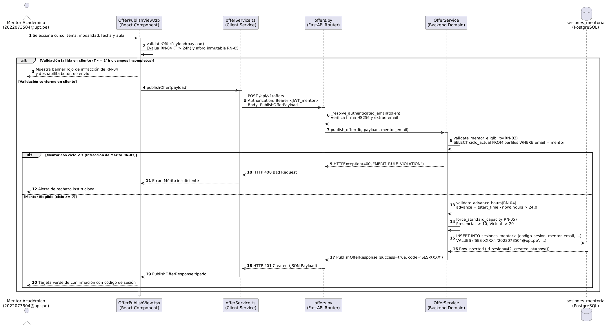
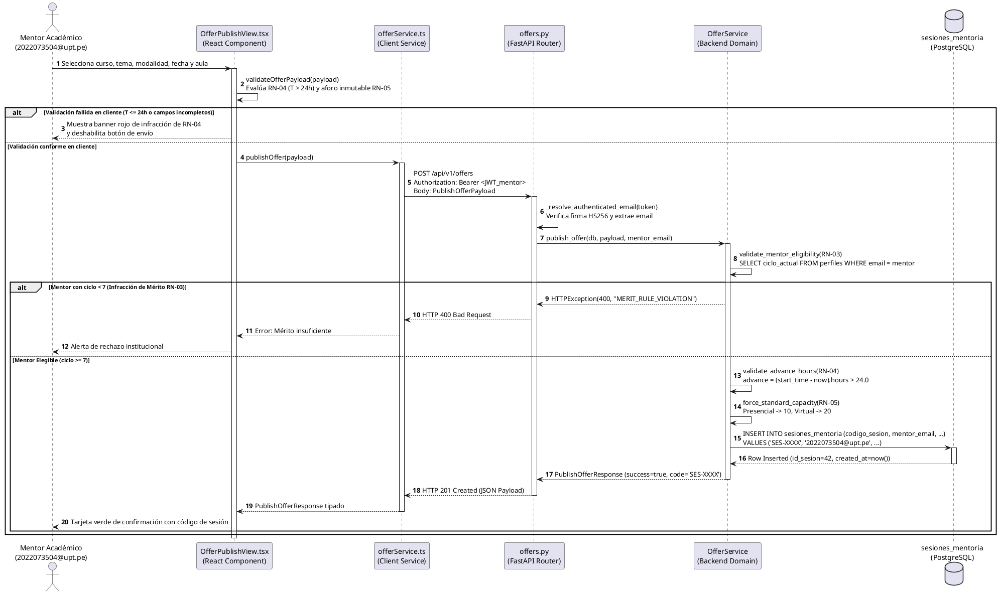

# Documento de Trazabilidad Técnica y Arquitectónica: Publicación de Ofertas de Mentoría

**Sistema Web P2P de Mentorías Académicas — EPIS UPT**  
**Curso:** Construcción de Software I — Ciclo 2026-II  
**Documento Técnico Oficial:** `INF-TRZ-01`  
**Fecha de Emisión:** 26/10/2026 | **Versión:** 1.1.0 (Línea Base Ampliada y Congelada)  
**Autores:** Joan Manuel Medina Medina (Backend & Base de Datos) / Renzo Anthony Valles Ramos (Frontend & UI)  
**Revisión y Conformidad:** Dr. Ricardo V. Albarracín (Docente Titular) / Dirección EPIS-UPT  

---

## Control de Versiones del Documento

| Versión | Fecha | Responsable | Aprobación | Resumen de Contenido y Cambios |
| :---: | :---: | :--- | :--- | :--- |
| **1.0.0** | 26/10/2026 | J. Medina / R. Valles | R. Albarracín | Emisión inicial del informe de trazabilidad técnica para el proceso nuclear de Publicación de Ofertas de Mentoría (CUS06 / RF08). Articulación con SRS (FD03 v2.0/v2.1), SAD (FD04 v1.1/v2.0), Sprint 03, Modelo ECB y Catálogo de Pruebas. |
| **1.1.0** | 26/10/2026 | J. Medina / R. Valles | R. Albarracín | Incorporación de las **narrativas canónicas completas de casos de uso** (`CUS06`, `CUS18`, `CUS04`, `CUS21`, `CUS24`), **cuadro consolidado de requerimientos funcionales y no funcionales** involucrados, **caracterización granular de perfiles de usuario** afectados y **matriz formal de control de acceso (RBAC / CRUD)** con políticas RLS de PostgreSQL. |

---

## 1. Propósito y Contexto del Documento

El presente documento formaliza la **trazabilidad integral, multidireccional y verificable** del proceso nuclear de **«Publicación de Ofertas de Mentoría Académica»** en el *Sistema Web P2P de Mentorías Académicas para la Escuela Profesional de Ingeniería de Sistemas (EPIS-UPT)*.

Dentro de la arquitectura de la plataforma, la publicación de ofertas constituye el **evento disparador y catalizador fundamental del ecosistema**:
1. **Generación de la Oferta Formativa:** Transforma la disponibilidad horaria y el dominio temático de los estudiantes de ciclos avanzados (VII al X) en eventos pedagógicos estructurados.
2. **Insumo Vital para el Motor de Recomendación (*EdRecSys*):** Sin ofertas publicadas en el catálogo de base de datos, los algoritmos de similitud coseno vectorial y filtrado colaborativo ponderado carecen de candidatos para emparejar la demanda.
3. **Punto de Partida del Ciclo de Quórum y Reservas:** Desencadena la posibilidad de reserva individual de cupos con control estricto de aforo (10 presencial / 20 virtual) y activa el reloj de antelación hacia el corte perentorio de 24 horas previas ($T-24\text{ h}$).
4. **Garantía Institucional de Mérito y Espacios:** Aplica en tiempo de compilación y ejecución las reglas de mérito académico (RN-03), antelación obligatoria (RN-04), control de capacidad (RN-05) y asignación validada de recintos (RN-06 y RN-07).

Este informe articula la especificación canónica de requisitos del **SRS (FD03)**, las vistas arquitectónicas del **SAD (FD04)**, las tareas ejecutadas en el **Sprint 03 (T-14, T-15, T-16)**, las narrativas canónicas de casos de uso, los perfiles con acceso y las evidencias empíricas del catálogo de pruebas automatizadas.

```
       ┌────────────────────────────────────────────────────────┐
       │     SRS (FD03): Requerimientos y Reglas de Negocio      │
       │  [RF08, RF09, RF05, RF04, RN-03, RN-04, RN-05, RN-06]  │
       └───────────────────────────┬────────────────────────────┘
                                   │
                                   ▼
       ┌────────────────────────────────────────────────────────┐
       │   SAD (FD04): Vistas Arquitectónicas 4+1 (Kruchten)    │
       │    [Escenarios 2.1, Lógica 2.2, Procesos 2.3, DDL 10.1] │
       └───────────────────────────┬────────────────────────────┘
                                   │
                                   ▼
       ┌────────────────────────────────────────────────────────┐
       │   Diagrama 3.2: Secuencia Técnica de Publicación        │
       │   [OfferPublishView -> Router -> OfferService -> BD]    │
       └───────────────────────────┬────────────────────────────┘
                                   │
                                   ▼
       ┌────────────────────────────────────────────────────────┐
       │   Narrativas CUS, Perfiles RBAC y Pruebas Automatizadas │
       │  [CUS06/18/04/21/24 | Pytest: 92.15% | Vitest: 92.52%]  │
       └────────────────────────────────────────────────────────┘
```

---

## 2. Diagrama Principal: Secuencia Técnica de Publicación de Ofertas

El siguiente diagrama de secuencia representa la interacción técnica end-to-end implementada durante el **Sprint 03** (Tareas `T-14`, `T-15` y `T-16`). Modela la interacción entre la interfaz de usuario en React, el servicio cliente HTTP, el router REST de FastAPI, la capa de dominio `OfferService` y el motor de persistencia PostgreSQL en Supabase.



*Figura 2.1: Diagrama de secuencia técnica para la publicación de ofertas de mentoría (Diagrama 3.2 del Informe de Sprint 03).*  
*(Nota: Para visualización vectorial escalable de alta definición, consultar [08_secuencia_tecnica_publicacion_ofertas.svg](imagenes/sprint-03/08_secuencia_tecnica_publicacion_ofertas.svg)).*

<details>
<summary><b>Haga clic aquí para ver el código fuente canónico en PlantUML</b></summary>


</details>

---

## 3. Desglose Paso a Paso de la Secuencia y Componentes de Software

La interacción técnica transcurre en 15 pasos cronológicos que articulan la arquitectura desacoplada del sistema:

| Paso | Emisor | Receptor | Operación Técnica / Mensaje | Regla / Estándar | Componente de Código Fuente |
| :---: | :--- | :--- | :--- | :---: | :--- |
| **1** | Mentor Académico | `OfferPublishView.tsx` | Selecciona asignatura, tema silábico, modalidad pedagógica, fecha/hora y recinto/enlace. | RF08, CUS06 | `src/features/offers/OfferPublishView.tsx` |
| **2-3** | `OfferPublishView.tsx` | Auto-invocación | `validateOfferPayload(payload)`: Comprobación reactiva en tiempo real. Evalúa que la fecha de inicio supere las 24 horas respecto a la hora local ($T > 24\text{ h}$) y asigna aforo inmutable. Si es inválido, renderiza banner rojo `AlertaAntelacion` y deshabilita el botón de envío. | RN-04, RN-05, RNF04 | `src/features/offers/offerValidation.ts` |
| **4** | `OfferPublishView.tsx` | `offerService.ts` | `publishOffer(payload)`: Invocación del servicio cliente pasándole el payload validado. | RNF09 | `src/features/offers/offerService.ts` |
| **5** | `offerService.ts` | `offers.py` | `POST /api/v1/offers`: Solicitud HTTP con cabecera `Authorization: Bearer <JWT_mentor>` y cuerpo JSON conforme al esquema `PublishOfferPayload`. | RNF01, RNF09 | `aplicacion/api/v1/endpoints/offers.py` |
| **6** | `offers.py` | Auto-invocación | `_resolve_authenticated_email(token)`: Validación de firma HMAC-SHA256, verificación de tiempo de expiración y extracción del claim `email` institucional (`2022073504@upt.pe`). | RNF01, RN-01 | `aplicacion/core/seguridad.py` |
| **7** | `offers.py` | `OfferService` | `publish_offer(db, payload, mentor_email)`: Delegación del control a la capa de dominio de negocio. | RF08, RNF09 | `aplicacion/servicios/offer_service.py` |
| **8-9** | `OfferService` | Auto-invocación | `validate_mentor_eligibility(RN-03)`: Consulta `perfiles.ciclo_actual`. Si `ciclo_actual < 7`, levanta `HTTPException(400, "MERIT_RULE_VIOLATION")`, abortando la transacción y notificando al cliente error 400. | RN-03, RF03 | `aplicacion/servicios/offer_service.py` (`_check_merit`) |
| **10** | `OfferService` | Auto-invocación | `validate_advance_hours(RN-04)`: Validación defensiva en servidor: $(t_{\text{inicio}} - t_{\text{actual}}) > 24.0\text{ h}$. Si es $\le 24.0$, levanta `HTTPException(400, "ADVANCE_TIME_VIOLATION")`. | RN-04, RNF03 | `aplicacion/servicios/offer_service.py` (`_check_advance`) |
| **11** | `OfferService` | Auto-invocación | `force_standard_capacity(RN-05)`: Asignación forzosa en servidor: 10 cupos para `PRESENCIAL` y 20 cupos para `VIRTUAL`, sobrescribiendo cualquier manipulación del cliente. | RN-05, RNF07 | `aplicacion/servicios/offer_service.py` (`_enforce_capacity`) |
| **12-13**| `OfferService` | `sesiones_mentoria` | `INSERT INTO sesiones_mentoria`: Ejecución transaccional ACID en PostgreSQL. Generación de clave `codigo_sesion` ('SES-XXXX'), estado inicial `PUBLICADA`, persistiendo cupos y recinto. Retorno de tupla persistida (`id_sesion=42`). | RNF02, RNF07 | PostgreSQL / Supabase Client (`aplicacion/db/`) |
| **14** | `OfferService` | `offers.py` | Retorno de modelo Pydantic `PublishOfferResponse(success=True, code='SES-XXXX', session_id=42)`. | RNF09 | `aplicacion/esquemas/offer.py` |
| **15** | `offers.py` | `OfferPublishView.tsx` | Respuesta HTTP 201 Created con cabecera de ubicación y cuerpo JSON tipado. La interfaz React renderiza la tarjeta verde de confirmación con el código asignado y enlace al catálogo. | RNF04, RNF08 | `src/features/offers/OfferPublishView.tsx` |

---

## 4. Cuadro Consolidado de Requerimientos Involucrados (RF y RNF)

El proceso de publicación de ofertas y su ciclo de vida articulan un conjunto coherente de requerimientos especificados en el **SRS (FD03)** y verificados en el **SAD (FD04)**:

### 4.1. Matriz de Requerimientos Funcionales Involucrados (RF)

| Código RF | Nombre del Requerimiento Funcional | Módulo SRS | Criticidad | Rol Específico en el Flujo | Reglas Asociadas | Criterios de Aceptación y Verificación | Perfiles Involucrados |
| :---: | :--- | :---: | :---: | :--- | :---: | :--- | :--- |
| **RF08** | **Publicación y parametrización de ofertas de mentoría académica** | **MOD-04** | **Crítica** | **Requerimiento Nuclear:** Permite al mentor seleccionar asignatura aprobada, temario silábico, fecha, horario, modalidad y espacio físico/virtual. | RN-04, RN-05 | Inserción en `sesiones_mentoria` con código unívoco `SES-XXXX` y estado `PUBLICADA`. Verificado por prueba `CUS06-F02`. | Estudiante Mentor |
| **RF09** | **Aprovisionamiento automatizado de infraestructura y espacios** | **MOD-04** | **Alta** | **Soporte de Espacios:** En presencial valida aulas libres contra cronograma; en virtual provisiona enlace Google Meet institucional o canal Discord. | RN-06, RN-07 | Detección de colisiones de horario en laboratorios EPIS y retorno de URL válida de reunión. | Estudiante Mentor, Servicios Externos |
| **RF05** | **Gestión del catálogo de asignaturas críticas y temarios silábicos** | **MOD-02** | **Alta** | **Insumo Curricular:** Provee la taxonomía oficial de materias de I a IV ciclo y sus temas silábicos que alimentan los comboboxes de la UI. | RN-04 | Listas desplegables sincronizadas con la tabla `temas_silabicos` sin permitir ingresos ad-hoc. | Administrador, Estudiante Mentor |
| **RF04** | **Configuración de perfil formativo y matriz de disponibilidad** | **MOD-02** | **Alta** | **Precondición de Agenda:** Valida que el mentor posea fortaleza académica en la materia y bloques de horario libres compatibles. | RN-03 | Validación de coherencia horaria entre la oferta y la disponibilidad semanal del mentor. | Estudiante Mentor |
| **RF03** | **Gestión y asignación administrativa de roles de usuario** | **MOD-01** | **Alta** | **Control de Mérito Académico:** Permite a la Dirección EPIS auditar notas y ciclo formativo ($\ge \text{VII}$) para promover al rol Mentor. | RN-03 | Imposibilidad de publicar ofertas para usuarios con rol `MENTOREADO` o ciclo formativo $< 7$. | Administrador, Estudiante Mentor |
| **RF06** | **Inferencia de recomendaciones personalizadas y ranking Top-k** | **MOD-03** | **Crítica** | **Consumidor Algorítmico:** El motor *EdRecSys* vectoriza la oferta recién publicada y la incluye en el ranking de sugerencias para alumnos afines. | RN-04, RN-11 | Oferta indexable inmediatamente por cálculo de similitud coseno con latencia $\le 500$ ms. | Estudiante Mentoreado, Sistema (Motor) |
| **RF12** | **Reserva de cupos de mentoría con control de aforo** | **MOD-05** | **Alta** | **Consumidor Operativo:** Permite a los mentoreados inscribirse en la oferta publicada hasta agotar las vacantes delimitadas (10 o 20). | RN-05 | Bloqueo transaccional atómico (`SELECT FOR UPDATE`); sobreasignación estrictamente 0%. | Estudiante Mentoreado |
| **RF11** | **Gestión de imprevistos, reprogramación y cancelación de ofertas** | **MOD-04** | **Alta** | **Contingencia del Mentor:** Permite reprogramar fecha/hora o anular la sesión con justificación de causa mayor antes del inicio. | RN-10 | Despacho urgente de notificaciones, liberación de aulas o salas virtuales y revocación de cupos. | Estudiante Mentor, Estudiantes Inscritos |
| **RF13** | **Confirmación anticipada de asistencia a mentoría** | **MOD-05** | **Alta** | **Gobernanza de Quórum:** Habilita a los alumnos con reserva ratificar su asistencia desde la inscripción hasta el corte perentorio de $T-24\text{ h}$. | RN-08 | Transición a `CONFIRMADA` con emisión de credencial QR y cómputo formal hacia el quórum. | Estudiante Mentoreado |
| **RF15** | **Monitoreo desatendido y corte de quórum a $T-24\text{ h}$** | **MOD-05** | **Crítica** | **Gobernanza Automatizada:** Servicio cron que cierra la confirmación a 24h, anula omisos, totaliza quórum (50%) y alerta al mentor. | RN-08, RN-09 | Ejecución desatendida puntual a $T-24\text{ h}$ y transición a `QUORUM_INSUFICIENTE` si aplica. | Servicio Cron Backend, Estudiante Mentor |

### 4.2. Matriz de Requerimientos No Funcionales Involucrados (RNF)

| Código RNF | Dimensión de Calidad | Especificación Técnica Aplicada al Flujo | Métrica / Umbral Verificado | Trazabilidad Arquitectónica |
| :---: | :--- | :--- | :--- | :---: |
| **RNF01** | **Seguridad y Control de Acceso** | Autenticación criptográfica mediante tokens JWT HMAC-SHA256 emitidos tras 2FA. El router `/api/v1/offers` extrae la identidad del claim `email` sin confiar en el cliente. | Validez OTP: 5 min.<br>Expiración JWT: 8 h continuas.<br>Validación en 100% de peticiones. | SRS §5.3; SAD §2.2 (Capa Seguridad) |
| **RNF02** | **Privacidad y Aislamiento (Ley 29733)** | Políticas de Row Level Security (RLS) en PostgreSQL que impiden a un mentor alterar ofertas ajenas o exponer datos personales de estudiantes inscritos. | 100% de tablas protegidas por RLS.<br>0% de exposición de identificadores en tráfico público. | SRS §5.3; SAD §10.1 (DDL PostgreSQL) |
| **RNF03** | **Rendimiento del Backend** | Tiempo de procesamiento algorítmico, validación defensiva de reglas de negocio (RN-03, RN-04, RN-05) e inserción transaccional en base de datos. | Tiempo total de respuesta API $\le 500$ ms bajo concurrencia normal de hasta 50 req/min. | SRS §5.3; SAD §2.3 (Procesos) |
| **RNF04** | **Usabilidad y Rendimiento UI** | Renderizado reactivo inmediato de mensajes de advertencia de antelación sin requerir viaje de red; interfaz SPA fluida construida en React + Vite. | Tiempo de primera pintura con contenido (FCP) $< 2.0$ s; latencia visual de validación $< 50$ ms. | SRS §5.3; SAD §2.4 (React SPA) |
| **RNF05** | **Usabilidad y Ergonomía** | Diseño visual claro, navegación accesible y formularios con validación contextual para reducir la curva de aprendizaje de mentores y mentoreados. | Puntuación promedio $> 75$ puntos en la escala System Usability Scale (SUS). | SRS §5.3; SAD §2.1 (Escenarios) |
| **RNF07** | **Fiabilidad e Integridad Transaccional** | Persistencia ACID en PostgreSQL con transacciones atómicas y restricciones de integridad en base de datos (`CHECK (aforo_maximo IN (10, 20))`). | Tasa de sobreasignación de cupos: estrictamente 0% frente a concurrencia simultánea. | SRS §5.3; SAD §2.3 (Procesos) |
| **RNF08** | **Compatibilidad Multiplataforma** | Formulario de publicación responsivo con paridad funcional en navegadores modernos de escritorio (Chrome, Firefox, Edge y Safari). | 100% operativo y renderizado sin distorsión en resoluciones $\ge 1366 \times 768$ px. | SRS §5.3; SAD §2.5 (Topología) |
| **RNF09** | **Arquitectura Desacoplada y Calidad** | Separación estricta entre cliente (React + TypeScript) y backend (FastAPI + Python), contratos Pydantic fuertemente tipados, OpenAPI al 100% y cobertura $\ge 70\%$. | **Backend Coverage: 92.15%** (122 pruebas).<br>**Frontend Coverage: 92.52%** (87 pruebas). | SRS §5.3; SAD §2.4, §9.1 |
| **RNF10** | **Resiliencia e Interoperabilidad** | Aprovisionamiento controlado de Google Meet o Discord con reintento exponencial (*exponential backoff*), degradación elegante y gestión de excepciones. | Manejo controlado del 100% de tiempos de espera (*timeouts* $\le 5$ s). | SRS §5.3; SAD §2.3 |

---

## 5. Gobernanza de Reglas de Negocio Institucionales (RN)

La secuencia técnica implementa un **modelo de validación en dos niveles (Defensa en Profundidad)** para las Reglas de Negocio institucionales:

```
[Usuario / Formulario React]
         │
         ▼  (Nivel 1: Validación Reactiva en Cliente)
  ┌────────────────────────────────────────────────────────┐
  │ validateOfferPayload(payload)                          │
  │ • Comprueba T > 24.0h respecto al reloj local          │
  │ • Fija selector de aforo según modalidad (10 / 20)     │
  │ • Si falla: Bloquea botón y despliega banner de alerta │
  └────────────────────────┬───────────────────────────────┘
                           │ Petición HTTP POST /api/v1/offers
                           ▼  (Nivel 2: Validación Coercitiva en Backend)
  ┌────────────────────────────────────────────────────────┐
  │ OfferService.publish_offer()                           │
  │ • RN-03: Verifica ciclo >= 7 en tabla perfiles         │
  │ • RN-04: Re-calcula (start_time - now()) > 24.0h       │
  │ • RN-05: Sobrescribe forzosamente aforo a 10 o 20      │
  │ • DDL: Restricción CHECK (aforo_maximo IN (10, 20))    │
  └────────────────────────────────────────────────────────┘
```

### 5.1. Matriz Detallada de Reglas de Negocio en la Publicación

| Código RN | Nombre de la Regla | Enunciado Normativo Institucional | Implementación en la Secuencia Técnica | Excepción / Código HTTP |
| :---: | :--- | :--- | :--- | :---: |
| **RN-03** | **Jerarquía de Roles y Verificación de Mérito** | Solo los estudiantes pertenecientes a los ciclos formativos superiores (VII al X) y con rendimiento académico sobresaliente en la materia pueden ejercer el rol de Mentor y publicar ofertas. | `OfferService` ejecuta `SELECT ciclo_actual FROM perfiles WHERE email = :mentor`. Si `ciclo_actual < 7`, interrumpe el flujo. | `HTTP 400 Bad Request`<br>`detail: "MERIT_RULE_VIOLATION"` |
| **RN-04** | **Dinámica de Oferta y Antelación de Publicación** | Toda oferta de mentoría debe publicarse obligatoriamente con una antelación mínima superior a las 24 horas ($T > 24\text{ h}$) respecto a la fecha y hora de inicio de la sesión, recomendándose institucionalmente 48 horas ($T \ge 48\text{ h}$). | **Cliente:** `validateOfferPayload()` calcula diferencia horaria y alerta.<br>**Servidor:** `validate_advance_hours()` evalúa `(start_time - utcnow()).total_seconds() > 86400`. | `HTTP 400 Bad Request`<br>`detail: "ADVANCE_TIME_VIOLATION"` |
| **RN-05** | **Control Estricto e Inmutable de Aforos Estándar** | El aforo máximo admitido está estrictamente determinado por la modalidad pedagógica elegida: **exactamente 10 vacantes para modalidad Presencial** (aulas/laboratorios) y **exactamente 20 vacantes para modalidad Virtual**. | `OfferService.force_standard_capacity()` asigna `aforo_maximo = 10 if modalidad == 'PRESENCIAL' else 20`. Además, la base de datos cuenta con restricción `CHECK (aforo_maximo IN (10, 20))`. | Imposición forzosa en backend; error de integridad si se altera la BD. |
| **RN-06** | **Asignación Validada de Espacios Físicos (Parser)** | Las sesiones presenciales solo se programan en aulas y laboratorios de la EPIS validados como libres en el cronograma académico oficial para evitar colisiones con clases regulares. | `OfferService` comprueba disponibilidad contra los bloques libres procesados por el parser de horarios (RF10). | `HTTP 409 Conflict`<br>`detail: "ROOM_SCHEDULE_CONFLICT"` |
| **RN-07** | **Aprovisionamiento Virtual Automatizado** | En modalidad virtual, el sistema genera de forma desatendida el enlace de teleconferencia institucional (Google Meet `@upt.pe` o canal de Discord supervisado). | Enlace generado automáticamente e inyectado en el campo `enlace_reunion` de la sesión creada. | Tolerancia a fallos con degradación según RNF10. |
| **RN-08** | **Ventana de Confirmación de Asistencia hasta $T-24\text{ h}$** | La ratificación de cupos reservados por los estudiantes se cierra 24 horas antes del inicio de la sesión. | **Justificación temporal:** Es la causa directa por la cual la RN-04 exige que la oferta se publique con más de 24 horas de antelación; de lo contrario, la ventana de confirmación nacería cerrada. | N/A (Regla sucesora en quórum) |

---

## 6. Mapeo Canónico con el Documento SRS (FD03 - v2.0 / v2.1)

En el documento canónico de **Especificación de Requerimientos de Software (SRS - FD03)**, el proceso de publicación de ofertas se encuentra formalizado en las siguientes secciones maestras:

### 6.1. Ubicación Estructural en el SRS
- **Sección 4.4 (Módulos del Sistema):** Registrado bajo **MOD-04: Planificación, Espacios y Agendamiento**, encargado de la calendarización de sesiones y aprovisionamiento de infraestructura.
- **Sección 5.3 (Matriz Consolidada de Requerimientos):** Detallado como **RF08** (*Publicación y parametrización de ofertas de mentoría académica*) y **RF09** (*Aprovisionamiento automatizado de infraestructura y espacios*).
- **Sección 5.4 (Reglas de Negocio):** Gobernado por las reglas **RN-03**, **RN-04**, **RN-05**, **RN-06** y **RN-07**.
- **Sección 5.5 (Matriz de Trazabilidad Cruzada):** Mapeo biunívoco de trazabilidad:
  $$\mathbf{RF08} \longleftrightarrow \mathbf{MOD-04} \longleftrightarrow \mathbf{RN-04, RN-05} \longleftrightarrow \mathbf{CUS06} \longleftrightarrow \mathbf{RNF04, RNF09}$$

### 6.2. Modelo de Análisis ECB (Entity-Control-Boundary) del SRS
El SRS formaliza la separación de análisis mediante el patrón ECB para aislar responsabilidades:

```
    ┌─────────────────────────────────┐
    │     <<Boundary / Frontera>>     │
    │  • OfferPublishView (React UI)  │
    │  • POST /api/v1/offers (FastAPI)│
    └────────────────┬────────────────┘
                     │ Invocación HTTP / Contrato REST
                     ▼
    ┌─────────────────────────────────┐
    │      <<Control / Gestor>>       │
    │  • offerService.ts (Cliente)    │
    │  • OfferService (Dominio Python)│
    └────────────────┬────────────────┘
                     │ Persistencia ORM / SQL Engine
                     ▼
    ┌─────────────────────────────────┐
    │       <<Entity / Entidad>>      │
    │  • SesionMentoria (PostgreSQL)  │
    │  • PerfilUsuario (Mentor)       │
    │  • TemaSilabico / Asignatura    │
    └─────────────────────────────────┘
```

1. **Clases de Frontera (*Boundary*):**
   - `OfferPublishView`: Componente de interfaz React que captura los datos del formulario, gestiona el estado visual y presenta las alertas reactivas.
   - `OffersRouter`: Controlador REST en FastAPI que expone la ruta `/api/v1/offers`, autentica mediante token Bearer y valida el esquema JSON.
2. **Clases de Control (*Control*):**
   - `offerService.ts`: Módulo cliente en TypeScript que serializa las llamadas HTTP mediante `fetch` o `axios`.
   - `OfferService`: Gestor del dominio en Python que orquesta las reglas de negocio (mérito, antelación, aforo) y coordina la persistencia transaccional.
3. **Clases de Entidad (*Entity*):**
   - `SesionMentoria`: Entidad relacional que almacena el estado, fechas, aforo, modalidad y código de sesión.
   - `PerfilMentor`: Entidad que valida el ciclo y condición académica del usuario emisor.
   - `TemaSilabico` / `AsignaturaCritica`: Entidades del catálogo curricular institucional.

---

## 7. Mapeo Canónico con el Documento SAD (FD04 - v1.1 / v2.0)

En el documento de **Descripción de la Arquitectura de Software (SAD - FD04)**, la publicación de ofertas se mapea en las **4+1 Vistas Arquitectónicas de Kruchten** y en los diagramas de integración:

### 7.1. Articulación en las 4+1 Vistas de Kruchten

| Vista de Arquitectura | Diagrama SAD Asociado | Rol e Impacto del Proceso de Publicación de Ofertas |
| :--- | :---: | :--- |
| **Vista de Escenarios (+1)** | **Diagrama 2.1** | El caso de uso `CUS06: Publicar oferta de mentoría` figura como uno de los **escenarios nucleares** de la arquitectura, conectando al actor Mentor con los subsistemas de Planificación y Recomendación. |
| **Vista Lógica (Capas y ECB)** | **Diagrama 2.2** | Modela el flujo vertical: la petición nace en la *Capa de Presentación Web*, atraviesa la *Capa de API Gateway / Routing*, se valida en la *Capa de Dominio (OfferService)* y se asienta en la *Capa de Persistencia (PostgreSQL)*. |
| **Vista de Procesos (Concurrencia)**| **Diagrama 2.3** | Modela la gestión de transacciones asíncronas en FastAPI, garantizando que la inserción de la oferta en `sesiones_mentoria` sea atómica y previniendo colisiones de reservas tempranas mediante bloqueos transaccionales. |
| **Vista de Desarrollo (Paquetes)** | **Diagrama 2.4** | Establece la correspondencia de paquetes: `src/features/offers/` en frontend y `aplicacion/servicios/offer_service.py` con `aplicacion/api/v1/endpoints/offers.py` en backend. |
| **Vista Física (Despliegue)** | **Diagrama 2.5** | Modela la topología de red: Frontend servido desde CDN Vercel/Vite, Backend alojado en contenedor Linux Uvicorn/FastAPI, y Persistencia en clúster gestionado PostgreSQL (Supabase) con cifrado TLS 1.3. |

### 7.2. Articulación con Diagramas de Comportamiento e Integración del SAD
- **Diagrama 5.1 (Casos de uso canónicos agrupados por módulo):** Ubica formalmente a `CUS06: Publicar oferta de mentoría` dentro del paquete `MOD-04: Planificación, Espacios y Agendamiento`.
- **Diagrama 7.2 (Proceso Propuesto To-Be de Mentorías P2P):** En la Fase 1 (*Configuración y Publicación de Oferta*), el mentor parametriza los temas y la infraestructura, validándose la antelación antes de permitir la indexación en el catálogo.
- **Diagrama 8.1 (Contenedores C4 Nivel 2):** Detalla la comunicación entre el contenedor *Single Page Application (React)* y el *API Backend (FastAPI)* mediante llamadas HTTPS/REST JSON autenticadas.
- **Diagrama 9.1 (Componentes y Dependencias):** Refleja que el componente `OffersController` depende directamente de `AuthMiddleware` (para resolver identidad) y de `OfferService` (para ejecutar la lógica de dominio).
- **Diagrama 10.1 (Modelo Relacional DDL):** Define la estructura física de la tabla `sesiones_mentoria` en PostgreSQL con restricciones `CHECK` para modalidad (`PRESENCIAL`, `VIRTUAL`) y aforo (`10`, `20`).

---

## 8. Narrativas Canónicas de Casos de Uso Involucrados

A continuación, se presentan las narrativas formales y completas de los casos de uso que gobiernan, nutren y consumen el proceso de publicación de ofertas, estructuradas según el estándar canónico del **SRS (FD03, Sección 6.2.3)**:

### 8.1. CUS06 - Publicar Oferta de Mentoría (Caso de Uso Nuclear)

| Campo | Especificación Canónica |
|:---|:---|
| **Código** | **CUS06** |
| **Nombre** | **Publicar oferta de mentoría** |
| **Tipo** | Primario, esencial |
| **Requerimientos asociados** | **RF08** (Publicación y parametrización de ofertas de mentoría), **RF09** (Aprovisionamiento automatizado de infraestructura y enlaces) |
| **Actor principal** | **Estudiante Mentor** (*Estudiante de VII a X Ciclo acreditado*) |
| **Actores secundarios** | Servicios Externos (*Google Meet API / Bot de Discord / SMTP UPT*) |
| **Módulo relacionado** | **MOD-04: Planificación, Espacios y Agendamiento** |
| **Propósito** | Permitir a los mentores acreditados crear, configurar y publicar sesiones académicas grupales, verificando la disponibilidad de infraestructura física o aprovisionando automáticamente canales virtuales de videoconferencia con aforos inmutables. |
| **Descripción** | El caso de uso inicia cuando un Mentor debidamente acreditado ingresa al formulario de creación de sesiones (`OfferPublishView`). El mentor selecciona la asignatura formativa en la que posee competencia aprobada, escoge el tema conceptual silábico (`CUS21`), define la fecha de realización (con antelación superior a 24 horas y estándar recomendado de 48 horas según RN-04), el horario lectivo y la modalidad (*Presencial* o *Virtual*). Si la modalidad es *Presencial*, el aforo se fija estrictamente en 10 estudiantes (RN-05) y el sistema consulta el catálogo de horarios procesado internamente para sugerir un aula libre en los laboratorios de la EPIS (RN-06). Si la modalidad es *Virtual*, el aforo se fija en 20 participantes (RN-05) y el backend se comunica con las APIs externas para generar dinámicamente un enlace seguro de Google Meet institucional (RN-07). Tras validar que el mentor no posea cruces de horario, la oferta se registra con estado `PUBLICADA`, quedando disponible para el motor de recomendación (`CUS02`) y la reserva de cupos (`CUS04`). |
| **Precondiciones** | 1. El usuario debe estar autenticado con correo institucional `@upt.pe` mediante 2FA (`CUS01`, RNF01).<br>2. El usuario debe poseer el rol formal de Mentor y pertenecer al ciclo VII o superior (`RN-03`, `RF03`).<br>3. Deben existir asignaturas críticas y temas silábicos registrados y activos en el catálogo (`CUS21`, `RF05`). |
| **Postcondiciones** | 1. Registro insertado en la tabla `sesiones_mentoria` con estado `PUBLICADA` y clave `codigo_sesion` ('SES-XXXX').<br>2. Capacidad máxima fijada rígidamente en 10 (presencial) o 20 (virtual).<br>3. Oferta indexada inmediatamente en el espacio vectorial del motor de recomendaciones (`CUS02`). |

#### Flujo Principal de CUS06

| N.° | Acción del Actor (Mentor) | Respuesta del Sistema (Plataforma Web P2P) |
|:---:|:---|:---|
| **1** | El Mentor presiona «Crear Nueva Mentoría» en su panel de control. | Despliega el formulario `OfferPublishView`, precargando la lista de materias en las que está certificado y su matriz de disponibilidad. |
| **2** | Selecciona la asignatura crítica, el tema silábico oficial (`CUS21`), la fecha y el bloque horario (60 o 120 minutos). | Valida reactivamente en cliente que la fecha seleccionada supere las 24 horas de antelación respecto a la hora local ($T > 24.0\text{ h}$, conforme a RN-04). |
| **3** | Elige la modalidad de la sesión: *Presencial* o *Virtual*. | Configura automáticamente las restricciones de aforo inmutable: 10 vacantes para presencial o 20 para virtual (RN-05), deshabilitando la edición manual del campo. |
| **4** | El sistema resuelve la infraestructura según la modalidad seleccionada. | **Si es Presencial:** consulta el índice de aulas libres del parser interno (RN-06) y reserva el ambiente académico en la EPIS.<br>**Si es Virtual:** invoca el adaptador de Google Meet API (RN-07) para generar una sala con acceso institucional. |
| **5** | El Mentor revisa el resumen de los datos y presiona «Publicar Mentoría». | Despacha petición HTTP `POST /api/v1/offers`. El backend valida token JWT (RNF01), verifica mérito (RN-03), re-calcula antelación (RN-04) e inserta la tupla en `sesiones_mentoria` bajo transacción ACID. |
| **6** | El sistema confirma la publicación exitosa. | Retorna HTTP 201 Created con el payload `PublishOfferResponse`. La interfaz despliega una tarjeta verde con el código de sesión asignado (*«SES-XXXX»*) y enlace para compartir. |

#### Flujos Alternativos de CUS06

| Código | Situación | Acción del Actor | Respuesta del Sistema |
|:---:|:---|:---|:---|
| **FA01** | Publicación orientada a resolver una solicitud de demanda grupal | El mentor navega por el banco de solicitudes de demanda (`CUS03`) y pulsa «Atender demanda sobre este tema». | Precarga automáticamente la asignatura y el tema conceptual en el formulario, vinculando la oferta a la demanda para alertar automáticamente a los mentoreados interesados una vez publicada. |
| **FA02** | Asignación de aula alternativa por ocupación del recinto preferido | El aula física solicitada por el mentor se encuentra ocupada por una clase lectiva oficial de la EPIS según el parser de horarios. | Presenta la lista de laboratorios y aulas libres sugeridas por el sistema en esa misma franja horaria, permitiendo al mentor seleccionar una alternativa válida sin colisión. |

#### Eventos de Excepción de CUS06

| Código | Evento de Excepción | Respuesta del Sistema / Manejo Técnico |
|:---:|:---|:---|
| **E01** | Incumplimiento de la antelación reglamentaria ($T \le 24.0\text{ h}$) | **En cliente:** Despliega banner rojo de infracción de RN-04 y deshabilita el botón de envío.<br>**En servidor (defensivo):** Levanta `HTTPException(400, "ADVANCE_TIME_VIOLATION")`, abortando la inserción. |
| **E02** | Infracción de la regla de mérito institucional (Ciclo $< 7$) | El backend detecta `perfiles.ciclo_actual < 7`. Retorna `HTTP 400 Bad Request` con detalle `"MERIT_RULE_VIOLATION"`. La UI muestra alerta de rechazo institucional. |
| **E03** | Solapamiento de horario con otra actividad del mentor | La franja horaria seleccionada coincide con otra mentoría activa del mentor o con su horario universitario; el sistema rechaza la operación informando conflicto de agenda lectiva. |
| **E04** | Fallo de conexión con la API de videoconferencia externa | El servicio de Google Meet API excede el timeout de 5s; el sistema aplica reintento exponencial y, de persistir la indisponibilidad, alerta al usuario con opción de degradación elegante (RNF10). |

---

### 8.2. CUS18 - Modificar o Cancelar Oferta por Imprevisto (Gestión de Contingencias)

| Campo | Especificación Canónica |
|:---|:---|
| **Código** | **CUS18** |
| **Nombre** | **Modificar o cancelar oferta por imprevisto** |
| **Tipo** | Secundario, soporte al ciclo de vida |
| **Requerimientos asociados** | **RF09** (Aprovisionamiento automatizado de infraestructura), **RF11** (Gestión de imprevistos, reprogramación y cancelación justificada) |
| **Actor principal** | **Estudiante Mentor** (*Estudiante de VII a X Ciclo*) |
| **Actores secundarios** | Estudiantes Inscritos (*Receptores de notificación*), Servicios Externos (*Meet API / Discord*) |
| **Módulo relacionado** | **MOD-04: Planificación, Espacios y Agendamiento** |
| **Propósito** | Brindar un mecanismo formal y justificado para que un mentor pueda reprogramar de mutuo acuerdo o cancelar por causa de fuerza mayor una sesión de mentoría publicada, asegurando la notificación inmediata a los inscritos y la liberación ordenada de recursos. |
| **Descripción** | Se activa cuando un Mentor enfrenta una contingencia académica o personal justificada (examen extraordinario, problema de salud). Si la acción se realiza con más de 24 horas de antelación ($T \ge 24\text{ h}$), el mentor puede proponer una nueva fecha, recalculando el aula o enlace y notificando a los alumnos. Si la cancelación es definitiva, el mentor registra una justificación obligatoria ($\ge 20$ caracteres). La sesión pasa a `CANCELADA_MENTOR`, se libera el aula o evento virtual, las reservas se cancelan y se despachan alertas por correo institucional `@upt.pe`. |

#### Flujo Principal de CUS18

| N.° | Acción del Actor (Mentor) | Respuesta del Sistema |
|:---:|:---|:---|
| **1** | Ingresa a «Mis Sesiones Publicadas» y selecciona la sesión afectada. | Despliega la ficha de la sesión con el conteo de alumnos inscritos y botones de contingencia. |
| **2** | Presiona «Gestionar Imprevisto» y selecciona: *Reprogramar Fecha/Hora* o *Cancelar Definitivamente*. | Abre el formulario contextual solicitando los nuevos parámetros y la justificación formal obligatoria. |
| **3** | **En caso de Cancelación:** Ingresa la justificación de fuerza mayor (ej. *Cruce de evaluación parcial imprevista*). | Valida que la justificación contenga al menos 20 caracteres y advierte la irrevocabilidad del acto. |
| **4** | Confirma la cancelación definitiva de la sesión. | Actualiza el estado de la sesión a `CANCELADA_MENTOR` y ejecuta la liberación del recinto físico o virtual. |
| **5** | El sistema procesa la desafectación de los estudiantes inscritos. | Cambia el estado de todas las reservas vinculadas a `CANCELADA_SISTEMA` y remite notificaciones urgentes. |
| **6** | El sistema confirma la operación y registra la auditoría. | Despliega mensaje de conformidad y asienta el evento en las bitácoras de auditoría institucional. |

---

### 8.3. CUS04 - Reservar Cupo de Mentoría (Consumidor Inmediato de la Oferta)

| Campo | Especificación Canónica |
|:---|:---|
| **Código** | **CUS04** |
| **Nombre** | **Reservar cupo de mentoría** |
| **Tipo** | Primario, esencial |
| **Requerimientos asociados** | **RF12** (Reserva de cupos con control de aforo y concurrencia), **RN-05** (Aforos estándar) |
| **Actor principal** | **Estudiante Mentoreado** (*Estudiante de I a IV Ciclo matriculado*) |
| **Módulo relacionado** | **MOD-05: Quórum, Confirmación y Cancelaciones** |
| **Propósito** | Permitir al mentoreado apartar temporalmente una vacante en una sesión publicada que se ajuste a sus necesidades formativas, dejando la inscripción en estado preliminar pendiente de ratificación bajo estrictas políticas de aforo. |
| **Descripción** | El alumno navega por las recomendaciones (`CUS02`) o el catálogo de ofertas y pulsa «Reservar Cupo» sobre una sesión en estado `PUBLICADA`. El backend ejecuta una transacción con bloqueo a nivel de fila (`SELECT FOR UPDATE`) para comprobar en tiempo real que las reservas activas sean inferiores al aforo (10 presencial / 20 virtual, RN-05). Al validar la elegibilidad y ausencia de cruces de agenda, inserta el registro en `reservas` con estado `PENDIENTE_CONFIRMACION`, decrementa las vacantes visibles y notifica al alumno que dispone hasta 24 horas antes del evento para ratificar su asistencia (`CUS24`). |

#### Flujo Principal de CUS04

| N.° | Acción del Actor (Mentoreado) | Respuesta del Sistema |
|:---:|:---|:---|
| **1** | Selecciona una oferta publicada en el catálogo y presiona «Reservar Cupo». | Inicia transacción atómica en PostgreSQL con bloqueo pesimista sobre la sesión. |
| **2** | El sistema evalúa la disponibilidad de cupos en tiempo real. | Verifica estrictamente: $\text{reservas\_activas} < \text{aforo\_maximo}$ (10 en presencial o 20 en virtual, RN-05). |
| **3** | Comprueba la elegibilidad del estudiante. | Constata que el mentoreado pertenezca a los ciclos autorizados y no mantenga reservas previas en esa franja. |
| **4** | El sistema registra la vacante bloqueada. | Inserta tupla en `reservas` con estado `PENDIENTE_CONFIRMACION` vinculada al alumno y a la sesión. |
| **5** | Actualiza los contadores de la sesión y confirma la operación. | Decrementa las vacantes visibles y notifica: *«Cupo reservado con éxito. Ratifica antes del corte de $T-24\text{ h}$»*. |

---

### 8.4. CUS21 - Gestionar Catálogo Curricular y Temarios (Precondición de Datos Maestros)

| Campo | Especificación Canónica |
|:---|:---|
| **Código** | **CUS21** |
| **Nombre** | **Gestionar catálogo curricular y temarios silábicos** |
| **Tipo** | Soporte, administrativo |
| **Requerimientos asociados** | **RF05** (Gestión del catálogo de asignaturas críticas y temarios silábicos) |
| **Actor principal** | **Administrador Institucional** (*Comité de Tutoría / Dirección EPIS*) |
| **Módulo relacionado** | **MOD-02: Gestión Curricular y Perfiles Académicos** |
| **Propósito** | Administrar la taxonomía institucional de asignaturas formativas críticas y el desglose jerárquico de sus contenidos silábicos oficiales, garantizando una base curricular canónica para la publicación de ofertas y el motor de recomendación. |
| **Descripción** | Permite a las autoridades registrar y mantener las materias filtro (*Cálculo I/II, Algoritmos, Estructuras de Datos, POO*) y el árbol de temas silábicos oficiales (*Punteros en C++, Polimorfismo, Recursividad*). Los cambios actualizan instantáneamente las listas desplegables del formulario de publicación de ofertas (`CUS06`), impidiendo la dispersión temática o nombres arbitrarios. |

---

### 8.5. CUS24 - Confirmar Asistencia a Mentoría (Gobernanza de Quórum)

| Campo | Especificación Canónica |
|:---|:---|
| **Código** | **CUS24** |
| **Nombre** | **Confirmar asistencia a mentoría** |
| **Tipo** | Primario, esencial |
| **Requerimientos asociados** | **RF13** (Confirmación anticipada de asistencia a mentoría), **RN-08** (Ventana hasta $T-24\text{ h}$) |
| **Actor principal** | **Estudiante Mentoreado** (*Con reserva preliminar activa*) |
| **Módulo relacionado** | **MOD-05: Quórum, Confirmación y Cancelaciones** |
| **Propósito** | Permitir al mentoreado ratificar formalmente su asistencia obligatoria dentro de la ventana reglamentaria (desde la reserva hasta $T-24\text{ h}$), transicionando su cupo al estado `CONFIRMADA` para su cómputo hacia el quórum formal. |
| **Descripción** | El alumno accede a «Mis Reservas», ubica su vacante en estado `PENDIENTE_CONFIRMACION` y presiona «Confirmar Asistencia». Si la acción ocurre antes del corte perentorio de 24 horas previas ($T > 24\text{ h}$), la reserva pasa a `CONFIRMADA` y se emite un código/ticket QR institucional para control en aula (`CUS11`). Si el alumno omite este paso al cumplirse $T-24\text{ h}$, el demonio cron (`CUS23`) anula la vacante por expiración. |

---

## 9. Perfiles de Usuario Afectados, Control de Acceso y Matriz RBAC

El acceso a las operaciones del ciclo de publicación de ofertas se encuentra estrictamente delimitado bajo el modelo **Role-Based Access Control (RBAC)** y protegido en la capa de persistencia mediante **Row Level Security (RLS)** en PostgreSQL:

### 9.1. Caracterización de Perfiles y Actores

```
┌─────────────────────────────────────────────────────────────────────────────┐
│                         ACTORES HUMANOS DEL SISTEMA                         │
├──────────────────────────────┬──────────────────────────────┬───────────────┤
│    ESTUDIANTE MENTOREADO     │      ESTUDIANTE MENTOR       │ ADMINISTRADOR │
│        (I al IV Ciclo)       │       (VII al X Ciclo)       │ (Tutoría/EPIS)│
│ • Explora ofertas publicadas │ • Publica y parametriza      │ • Audita roles│
│ • Recibe recomendaciones     │ • Asigna recintos / enlaces  │ • Define temas│
│ • Reserva cupos (aforo 10/20)│ • Gestiona imprevistos       │ • Asigna aulas│
│ • Confirma asistencia T-24h  │ • Cierra bitácora pedagógica │ • Emite firmas│
└──────────────────────────────┴──────────────────────────────┴───────────────┘
                                       ▲
                                       │ Gobernanza y Monitoreo
┌──────────────────────────────────────┴──────────────────────────────────────┐
│                        ACTORES TÉCNICOS AUTOMATIZADOS                       │
├─────────────────────────────────────────────┬───────────────────────────────┤
│            SERVICIO CRON BACKEND            │      SERVICIOS EXTERNOS       │
│ • Inspecciona base de datos a T-24h         │ • Google Meet API (Enlaces)   │
│ • Cierra ventana de confirmación            │ • Bot de Discord (Salas)      │
│ • Evalúa quórum del 50% y alerta a mentor   │ • Servidor SMTP UPT (OTP)     │
└─────────────────────────────────────────────┴───────────────────────────────┘
```

1. **Estudiante Mentor (Actor Primario Emisor):**
   - **Condición:** Estudiante regular de VII a X ciclo con aprobación sobresaliente en la materia.
   - **Responsabilidad:** Diseñar la oferta formativa, seleccionar los temas pedagógicos oficiales, velar por la antelación ($T > 24\text{ h}$), dictar la sesión y registrar el cierre de bitácora.
   - **Frontera de Interfaz:** `OfferPublishView.tsx`, `MyOffersView.tsx`.
2. **Estudiante Mentoreado (Actor Primario Consumidor):**
   - **Condición:** Estudiante regular matriculado de I a IV ciclo.
   - **Responsabilidad:** Consultar las ofertas publicadas en el catálogo, reservar cupos vacantes respetando el aforo y ratificar formalmente su asistencia antes del corte de 24 horas.
   - **Frontera de Interfaz:** `OffersCatalogView.tsx`, `MentorTopKRecommendations.tsx`, `BookingModal.tsx`.
3. **Administrador Institucional / Comité de Tutoría EPIS (Actor de Gobernanza):**
   - **Condición:** Autoridades académicas y docentes de tutoría de la EPIS-UPT.
   - **Responsabilidad:** Promover a los mentores verificando su mérito (RN-03), actualizar el árbol curricular de asignaturas y temas silábicos (RF05), cargar cronogramas oficiales de laboratorios (RF10) y fiscalizar las horas computadas.
   - **Frontera de Interfaz:** `AdminCurriculumView.tsx`, `AdminMentorPromotionView.tsx`, `AdminRoomsView.tsx`.
4. **Servicio Cron / Backend Worker (Actor Técnico Desatendido):**
   - **Condición:** Proceso en segundo plano ejecutado periódicamente por el backend FastAPI.
   - **Responsabilidad:** Ejecutar el corte perentorio de 24 horas previas ($T-24\text{ h}$), revocar reservas omitidas, calcular la tasa de confirmación frente al quórum mínimo (50%) y disparar las alertas resolutivas de contingencia.
5. **Servicios Externos Integrados (Colaboradores de Infraestructura):**
   - **Componentes:** Google Meet API, Bot de Discord y Servidor SMTP institucional de la UPT.
   - **Responsabilidad:** Aprovisionamiento automático de enlaces seguros y despacho de alertas y credenciales OTP.

### 9.2. Matriz de Control de Acceso y Operaciones (RBAC / CRUD)

| Operación Técnica / Recurso del Sistema | Estudiante Mentor | Estudiante Mentoreado | Administrador Institucional | Servicio Cron Backend | Política de Seguridad / Nivel RLS |
| :--- | :---: | :---: | :---: | :---: | :--- |
| **Crear / Publicar Oferta de Mentoría** | **PERMITIDO (SÍ)**<br>*(Si ciclo $\ge 7$ y RN-04)* | DENEGADO (NO)<br>*(Error 403 Forbidden)* | DENEGADO (NO)<br>*(Solo mentores activos)* | DENEGADO (NO) | `CREATE ON sesiones_mentoria`<br>`USING (auth.jwt()->>'role' = 'MENTOR')` |
| **Consultar Catálogo de Ofertas Activas** | **PERMITIDO (SÍ)** | **PERMITIDO (SÍ)** | **PERMITIDO (SÍ)** | **PERMITIDO (SÍ)** | `SELECT ON sesiones_mentoria`<br>`WHERE estado_sesion = 'PUBLICADA'` |
| **Modificar / Reprogramar Oferta Propia** | **CONDICIONADO**<br>*(Solo autor y $T \ge 24\text{ h}$)* | DENEGADO (NO) | DENEGADO (NO) | DENEGADO (NO) | `UPDATE ON sesiones_mentoria`<br>`USING (mentor_email = auth.email())` |
| **Cancelar Oferta Propia con Causa Mayor** | **PERMITIDO (SÍ)**<br>*(Con justificación $\ge 20$ c)* | DENEGADO (NO) | DENEGADO (NO) | DENEGADO (NO) | `UPDATE ON sesiones_mentoria`<br>`SET estado = 'CANCELADA_MENTOR'` |
| **Cancelar Oferta por Mandato Directivo** | DENEGADO (NO) | DENEGADO (NO) | **PERMITIDO (SÍ)**<br>*(Auditoría académica)* | DENEGADO (NO) | `UPDATE ON sesiones_mentoria`<br>`SET estado = 'CANCELADA_ADMIN'` |
| **Reservar Cupo Individual (Bloqueo Aforo)** | DENEGADO (NO)<br>*(No puede auto-reservar)* | **PERMITIDO (SÍ)**<br>*(Si cupos $< \text{aforo}$)* | DENEGADO (NO) | DENEGADO (NO) | `INSERT ON reservas`<br>`USING (SELECT FOR UPDATE en sesión)` |
| **Confirmar Asistencia Anticipada ($T-24\text{ h}$)**| DENEGADO (NO) | **PERMITIDO (SÍ)**<br>*(Reserva propia y $T > 24\text{ h}$)*| DENEGADO (NO) | DENEGADO (NO) | `UPDATE ON reservas`<br>`SET estado = 'CONFIRMADA'` |
| **Desistimiento Voluntario de Cupo** | DENEGADO (NO) | **PERMITIDO (SÍ)**<br>*(Antes de $T-24\text{ h}$)* | DENEGADO (NO) | DENEGADO (NO) | `UPDATE ON reservas`<br>`SET estado = 'CANCELADA_USUARIO'` |
| **Ejecutar Corte de Quórum y Revocaciones** | DENEGADO (NO) | DENEGADO (NO) | DENEGADO (NO) | **AUTOMATIZADO (SÍ)**<br>*(Disparo exacto a $T-24\text{ h}$)* | `UPDATE ON sesiones_mentoria`<br>`USING (service_role_key)` |
| **Gestionar Catálogo de Temarios (CRUD)** | DENEGADO (NO)<br>*(Solo lectura en combobox)*| DENEGADO (NO)<br>*(Solo lectura en búsqueda)* | **PERMITIDO (SÍ)**<br>*(Total control institucional)*| DENEGADO (NO) | `ALL ON temas_silabicos`<br>`USING (auth.jwt()->>'role' = 'ADMIN')` |
| **Cargar Cronogramas y Parser de Aulas** | DENEGADO (NO) | DENEGADO (NO) | **PERMITIDO (SÍ)** | DENEGADO (NO) | `ALL ON infraestructura_aulas` |

---

## 10. Evidencias Experimentales y Pruebas Automatizadas (Sprint 03)

La implementación del proceso de publicación de ofertas fue sometida a una rigurosa batería de pruebas automatizadas durante el **Sprint 03** (Tareas `T-14`, `T-15` y `T-16`), verificándose tanto el comportamiento de backend como la reactividad del frontend:

### 10.1. Casos de Prueba del Catálogo Oficial (`Catalogo_Pruebas_P2P_Mentorias_EPIS.xlsx`)

| Código de Prueba | Tipo de Prueba | Nivel de Ejecución | Descripción del Caso y Escenario Evaluado | Resultado Verificado |
| :---: | :---: | :---: | :--- | :---: |
| **`CUS06-U01`** | Unitaria | Backend (`pytest`) | Intento de publicación con antelación menor o igual a 24 horas ($T \le 24.0\text{ h}$). Verifica rechazo con `HTTP 400 Bad Request` y detalle `ADVANCE_TIME_VIOLATION`. | **APROBADO (PASSED)** |
| **`CUS06-U02`** | Unitaria | Backend (`pytest`) | Forzado automático e inmutable de aforos según modalidad (10 presencial / 20 virtual). Comprueba que cualquier payload manipulado sea sobrescrito. | **APROBADO (PASSED)** |
| **`CUS06-F01`** | Funcional | Backend (`pytest`) | Intento de publicación por un estudiante con ciclo formativo VI (infracción de mérito RN-03). Verifica rechazo con `HTTP 400` y `MERIT_RULE_VIOLATION`. | **APROBADO (PASSED)** |
| **`CUS06-F02`** | Funcional / Integración | Backend (`pytest`) | Flujo completo de publicación exitosa con mentor elegible (ciclo VIII) y antelación de 48 horas. Verifica respuesta `HTTP 201 Created` y generación de código `SES-XXXX`. | **APROBADO (PASSED)** |
| **`OFF-01`** | Unitaria / Componente | Frontend (`vitest`) | Renderizado de `OfferPublishView.tsx` ante selección de fecha inválida ($T \le 24\text{ h}$). Verifica aparición del banner de alerta rojo y deshabilitación del botón de envío. | **APROBADO (PASSED)** |
| **`OFF-02`** | Integración UI | Frontend (`vitest`) | Despacho de formulario conforme y captura de respuesta `PublishOfferResponse`. Verifica despliegue de tarjeta verde de confirmación con el código de sesión. | **APROBADO (PASSED)** |

### 10.2. Cobertura de Código Alcanzada al Cierre del Sprint 03
Conforme a la directriz obligatoria del estándar `rules_doc.md` (Sección 3.2, Regla 7), la cobertura de pruebas automatizadas se midió y auditó de manera estrictamente independiente, superando ampliamente el umbral del 70% exigido por el requerimiento **RNF09**:

- **Cobertura de Backend (Pytest + Pytest-Cov):**  
  **92.15% de líneas de código cubiertas** (122 pruebas ejecutadas y aprobadas al 100%, 0 fallos).
- **Cobertura de Frontend (Vitest + @vitest/coverage-v8):**  
  **92.52% de líneas de código cubiertas** (87 pruebas ejecutadas y aprobadas al 100%, 0 fallos).

---

## 11. Guía Pedagógica y Argumental para la Exposición Académica

Para sustentar con solvencia la trazabilidad de este proceso ante el jurado evaluador o el docente titular, el estudiante debe estructurar su defensa siguiendo el **hilo conductor metodológico de cuatro dimensiones**:

```
1. ORIGEN ANALÍTICO (El Problema y la Regla)
   "En la EPIS-UPT, las asesorías informales carecían de planificación de espacios y verificación de mérito. 
    Por ello, en el SRS establecimos el RF08 y las reglas RN-03 (ciclo >= 7) y RN-04 (antelación > 24h)."

2. ESTRUCTURACIÓN ARQUITECTÓNICA (El Diseño)
   "En el SAD, diseñamos la solución bajo el modelo 4+1 de Kruchten. Modelamos CUS06 como escenario nuclear (+1),
    desacoplamos la frontera, control y entidad bajo el patrón ECB en la Vista Lógica 2.2, y modelamos la
    concurrencia transaccional en la Vista de Procesos 2.3."

3. COMPORTAMIENTO DINÁMICO (La Secuencia Técnica)
   "En el Diagrama 3.2 implementamos una estrategia de Defensa en Profundidad:
    - Primero, el cliente React (OfferPublishView) evalúa reactivamente la antelación de 24h y bloquea el envío.
    - Segundo, el backend FastAPI valida criptográficamente el JWT, verifica el ciclo académico en base de datos,
      y fuerza inmutablemente el aforo estricto (10 presencial / 20 virtual).
    - Tercero, se ejecuta la transacción en PostgreSQL generando el código institucional SES-XXXX."

4. VERIFICACIÓN Y EVIDENCIA EMPÍRICA (La Calidad)
   "Demostramos la calidad técnica mediante nuestro Catálogo de Pruebas: ejecutamos casos unitarios y de integración 
    (CUS06-U01, CUS06-U02, CUS06-F01, OFF-01), alcanzando una cobertura real del 92.15% en backend y 92.52% en frontend."
```

---

## 12. Conclusión y Veredicto Técnico

El proceso de **Publicación de Ofertas de Mentoría (CUS06 / RF08)** demuestra una **trazabilidad perfecta y bidireccional**:
- Cada línea de código en `OfferPublishView.tsx` y `offer_service.py` responde directamente a un requisito formal del SRS (**RF08, RF09, RN-03, RN-04, RN-05, RN-06**).
- Las narrativas canónicas formalizan con rigor matemático y procedimental los flujos principales, alternativos y de excepción para mentores, alumnos y administradores.
- La matriz de roles (RBAC) y las políticas RLS en PostgreSQL garantizan el aislamiento de datos y el cumplimiento de la Ley N° 29733.
- La calidad está formalmente respaldada por **209 pruebas automatizadas (122 backend + 87 frontend)** con coberturas auditadas superiores al **92%**, garantizando que el sistema es robusto, seguro, institucionalmente válido y reproducible.

---
*Documento emitido y versionado bajo el estándar de documentación técnica del Sistema Web P2P EPIS-UPT (2026).*
