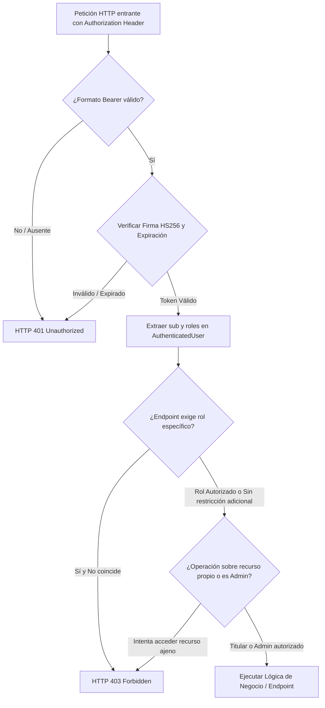

# 07 — Fortalecimiento de Autenticación, Roles y Autorización RBAC en Backend

**Proyecto:** Sistema Web P2P de Mentorías Académicas — EPIS UPT  
**Fecha:** 7 de noviembre de 2026  
**Rama:** `feat/formalizacion-ux-roles`  
**Fase:** Fase 04 — Endurecimiento Integral de Autenticación y Autorización Backend  
**Estado:** Implementado, verificado y validado al 100%

---

## 1. Resumen Ejecutivo

Durante las Fases 02 y 03 de la etapa de formalización, el Sistema Web P2P de la Escuela Profesional de Ingeniería de Sistemas (EPIS - UPT) consolidó una interfaz institucional y una navegación dinámica con guardas RBAC en el frontend. Sin embargo, persistía una brecha crítica de seguridad en la capa backend: la autorización dependía parcialmente de heurísticas superficiales de prefijo/subcadena de correo electrónico (`email.startswith("admin")`, `email.startswith("mentor.")`), atajos permisivos condicionados por el entorno (`APP_ENV in ("development", "test")`) y endpoints que no verificaban la firma criptográfica del token ni la titularidad legítima del recurso consultado.

En esta Fase 04, se completó la refactorización integral del esquema de seguridad:
- Se implementó un subsistema centralizado de dependencias de seguridad FastAPI en `app/core/dependencies.py`.
- Se erradicaron de raíz todas las verificaciones por prefijo o subcadena en `role_service.py`, `auth_service.py`, `booking_service.py` y en los routers de la API.
- Se impuso la validación criptográfica estricta de tokens JWT (algoritmo HMAC-SHA256, expiración, issuer, claim `sub` y claim `roles`), eliminando la aceptación de tokens simulados o falsificados.
- Se aseguraron todos los endpoints en los módulos de perfiles, roles, ofertas, reservas, asistencia, bitácora y quórum con control de roles y validación de titularidad de recursos (*resource ownership*).
- Se diseñó y ejecutó una suite exhaustiva de pruebas de seguridad automatizadas (`tests/test_security_rbac.py`) con cobertura total de los vectores SEC-01 a SEC-18 y casos de acceso legítimo (21 pruebas pasando, 237 pruebas en el backend con 85.12% de cobertura global y 311 pruebas en frontend pasando al 100%).

---

## 2. Diagnóstico de Vulnerabilidades Previas Identificadas

La auditoría de seguridad previa detectó las siguientes fallas estructurales y vectores de riesgo:

| ID Vulnerabilidad | Severidad | Componente Afectado | Descripción del Riesgo |
|---|---|---|---|
| **VULN-01: Auto-promoción por correo** | **Crítica** | `auth_service.py`, `role_service.py` | Cualquier usuario que registrara o iniciara sesión con un correo institucional con prefijo `admin` (ej. `administracion.temporal@upt.pe`) o `mentor.` recibía automáticamente claims privilegiados de administrador o mentor sin validación en base de datos. |
| **VULN-02: Bypass por APP_ENV** | **Alta** | `profiles.py`, `bookings.py` | En entornos de desarrollo y pruebas (`APP_ENV in ("development", "test")`), los endpoints permitían llamadas sin encabezado `Authorization`, asumiendo identidades ficticias o el correo pasado en query/body sin autenticación. |
| **VULN-03: Substring check vulnerable** | **Crítica** | `booking_service.py`, `attendance_service.py`, `bitacora_service.py` | Expresiones como `if "admin" in caller_email:` permitían a correos como `badmind@upt.pe` o `estudiante.admin@upt.pe` eludir los controles de aforo, ratificación y cierre de sesiones. |
| **VULN-04: Falta de control de titularidad** | **Alta** | `profiles.py`, `bookings.py` | Un usuario autenticado con un token válido podía consultar las reservas o modificar la disponibilidad horaria de cualquier otro estudiante enviando el correo de la víctima. |
| **VULN-05: Auto-asignación de rol de mentor** | **Alta** | `roles.py` (`POST /promote-mentor`) | No validaba que el emisor de la petición tuviera rol de administrador institucional, permitiendo escalamiento horizontal y vertical de privilegios. |
| **VULN-06: Heurísticas residuales en Frontend** | **Media** | `AuthContext.tsx` | La función `initUserFromToken` y el callback de login inspeccionaban prefijos en lugar de confiar ciegamente en los claims criptográficos decodificados del JWT. |

---

## 3. Arquitectura de Autenticación y Autorización Implementada

El nuevo diseño desacopla la identificación, la autenticación y la autorización en capas ortogonales y predecibles:



### Principios Arquitectónicos
1. **Verificación en el Límite de la API:** La seguridad se valida antes de invocar la lógica de negocio a través de dependencias FastAPI (`Depends`).
2. **Principio de Menor Privilegio:** Todo usuario autenticado sin asignación explícita es estrictamente `mentoreado`.
3. **Titularidad Obligatoria (*Resource Ownership*):** Ningún usuario puede leer o alterar datos privados ajenos a menos que posea el rol explícito de `administrador`.
4. **Fallo Seguro (*Fail-Safe Defaults*):** Cualquier falla de conexión a base de datos o token ambiguo rechaza el acceso privilegiado de forma preventiva.

---

## 4. Dependencias Centrales (`app/core/dependencies.py`)

Se implementó el módulo centralizado de dependencias de seguridad con las siguientes primitivas:

- **`AuthenticatedUser` (Dataclass):**
  Representa al principal de seguridad en el ciclo de vida de la petición.
  - `email: str`: Identidad única y canónica del usuario extraída del claim `sub`.
  - `roles: list[str]`: Lista verificada de roles asignados al usuario.
  - Métodos helper: `is_admin()`, `is_mentor()`, `is_mentee()`, `has_role(role)`.

- **`get_current_user(authorization: str | None = Header(None)) -> AuthenticatedUser`:**
  - Extrae el token del encabezado `Authorization: Bearer <token>`.
  - Rechaza ausencias de encabezado o formatos malformados con `401 Unauthorized`.
  - Decodifica la firma criptográfica usando `app.core.security.decode_access_token`.
  - Valida expiración y extrae `sub` y `roles`. Si el token carece de roles, consulta `RoleService` para obtener los roles institucionales vigentes.
  - Rechaza tokens simulados (ej. `mock-token-...`) en peticiones reales a la API.

- **`get_optional_current_user(...) -> AuthenticatedUser | None`:**
  Permite a endpoints públicos o semipúblicos (como `/health` o `/consent/terms`) identificar al usuario si envía token, sin abortar con 401 si se trata de un visitante anónimo.

- **`require_role(required_role: str | list[str]) -> Callable`:**
  Fábrica de dependencias reutilizables para proteger rutas por rol. Si el usuario carece de al menos uno de los roles requeridos, aborta inmediatamente con `403 Forbidden`.

- **`check_resource_ownership(current_user: AuthenticatedUser, target_email: str) -> None`:**
  Garantiza que la acción afecte únicamente al titular de la cuenta o a un administrador institucional autorizado.

---

## 5. Emisión y Verificación de JWT

El ciclo de emisión y verificación cumple estrictamente con el estándar RFC 7519 y la normativa universitaria:

- **Algoritmo:** HMAC-SHA256 (`HS256`).
- **Secreto:** `SECRET_KEY` inyectado por configuración (`app/core/config.py`).
- **Tiempo de Expiración:** 60 minutos por defecto (`ACCESS_TOKEN_EXPIRE_MINUTES`).
- **Estructura de Claims:**
  ```json
  {
    "sub": "2022073504@upt.pe",
    "roles": ["mentoreado", "mentor"],
    "iss": "sistema-p2p-epis-upt",
    "exp": 1794105600,
    "iat": 1794102000
  }
  ```
- **Validación en Backend:** `decode_access_token` rechaza firmas alteradas, expiraciones vencidas, tokens truncados o tokens con payloads no JSON.

---

## 6. Corrección en la Determinación de Roles (`auth_service.py`, `role_service.py`)

Se eliminaron completamente los accesos y escalamientos indebidos por heurística de correo:

### En `app/services/role_service.py`:
- Se eliminaron las reglas:
  ```python
  # ELIMINADO:
  # if clean_email.startswith("admin."): return [RoleEnum.ADMINISTRADOR.value, ...]
  # if clean_email.startswith("mentor."): return [RoleEnum.MENTOR.value, ...]
  ```
- La inicialización en memoria y en base de datos quedó acotada a las cuentas institucionales oficiales de desarrollo/prueba del proyecto:
  - `admin.epis@upt.pe`: `["administrador", "mentor", "mentoreado"]`
  - `mentor.avanzado@upt.pe`: `["mentor", "mentoreado"]`
  - `2022073504@upt.pe`: `["mentoreado", "mentor"]`
- Cualquier otra cuenta de estudiante institucional (`*@upt.pe`) recibe por defecto y de manera determinista únicamente el rol `["mentoreado"]`.

### En `app/services/auth_service.py`:
- Se eliminó la inyección condicional de roles durante la verificación de OTP:
  ```python
  # ELIMINADO:
  # if email.startswith("admin"): roles.append(RoleEnum.ADMINISTRADOR.value)
  # elif email.startswith("mentor."): roles.append(RoleEnum.MENTOR.value)
  ```
- Ahora, los roles incluidos en el payload del JWT emitido provienen exclusivamente de `RoleService.get_user_roles(db, email)`.

---

## 7. Endpoints Asegurados

A continuación se detalla la matriz de endpoints formalizados y protegidos en la API v1:

| Endpoint | Método | Dependencia de Seguridad | Roles Permitidos | Validación de Titularidad |
|---|---|---|---|---|
| `/api/v1/auth/otp/request` | `POST` | Pública con rate-limit | Público (visitante) | N/A (Valida dominio `@upt.pe`) |
| `/api/v1/auth/otp/verify` | `POST` | Pública | Público (visitante) | Emite JWT legítimo |
| `/api/v1/roles/users/{email}` | `GET` | `get_current_user` | Cualquiera autenticado | Titular o Administrador |
| `/api/v1/roles/promote-mentor` | `POST` | `get_current_user` | `administrador` | Exige admin verificado |
| `/api/v1/roles/revoke-mentor` | `POST` | `get_current_user` | `administrador` | Exige admin verificado |
| `/api/v1/profiles/me` | `GET` / `PUT` | `get_current_user` | Cualquiera autenticado | Titular (resuelto desde `sub`) |
| `/api/v1/profiles/{email}` | `GET` / `PUT` | `get_current_user` | Cualquiera autenticado | Titular o Administrador |
| `/api/v1/profiles/{email}/availability` | `GET` / `POST` | `get_current_user` | `mentor`, `administrador` | Titular o Administrador |
| `/api/v1/offers/` | `POST` | `get_current_user` | `mentor`, `administrador` | Debe coincidir con `mentor_email` |
| `/api/v1/offers/{id_sesion}` | `GET` | Pública | Cualquiera | N/A (Catálogo abierto) |
| `/api/v1/bookings/reserve` | `POST` | `get_current_user` | `mentoreado`, `administrador` | Titular o Administrador (RN-02) |
| `/api/v1/bookings/my-reservations` | `GET` | `get_current_user` | Cualquiera autenticado | Titular o Administrador |
| `/api/v1/bookings/{id}/confirm` | `POST` | `get_current_user` | `mentoreado`, `administrador` | Titular o Administrador |
| `/api/v1/bookings/{id}/cancel` | `POST` | `get_current_user` | `mentoreado`, `administrador` | Titular o Administrador |
| `/api/v1/attendance/token` | `POST` | `get_current_user` | `mentor`, `administrador` | Titular de la sesión |
| `/api/v1/attendance/checkin` | `POST` | `get_current_user` | `mentoreado`, `administrador` | Titular con reserva confirmada |
| `/api/v1/attendance/roster/{id}` | `GET` | `get_current_user` | `mentor`, `administrador` | Titular de la sesión o Admin |
| `/api/v1/sessions/{id}/bitacora` | `POST` / `GET` | `get_current_user` | `mentor`, `administrador` | Titular de la sesión (RN-12) |
| `/api/v1/quorum/evaluate-all` | `POST` | `get_current_user` | `administrador` | Exige admin verificado |
| `/api/v1/consent/status` | `GET` | `get_current_user` | Cualquiera autenticado | Titular o Administrador |
| `/api/v1/consent/accept` | `POST` | `get_current_user` | Cualquiera autenticado | Titular |
| `/api/v1/health/db` | `GET` | Pública | Cualquiera | Monitoreo de infraestructura |

---

## 8. Eliminación de Atajos de Desarrollo Inseguros

Se procedió a la remoción sistemática de atajos que degradaban la seguridad en entornos locales:

1. **Eliminación del bypass por `APP_ENV`:**
   Anteriormente, funciones de extracción de usuario contenían:
   ```python
   # ELIMINADO:
   # if settings.APP_ENV in ("development", "test") and not authorization:
   #     return email or "desarrollo@upt.pe"
   ```
   Dicho bloque fue sustituido por la exigencia ineludible de un token JWT firmado y válido independientemente del valor de `APP_ENV`.
2. **Eliminación de la aceptación de tokens simulados en endpoints privados:**
   Cadenas como `mock-token-...` o `Bearer token_simulado` ahora devuelven inmediatamente `401 Unauthorized` ante la API de FastAPI.
3. **Manejo en pruebas automatizadas:**
   Los tests unitarios y de integración ahora emiten tokens válidos a través de la función oficial `create_access_token` con los claims respectivos, garantizando que el entorno de pruebas refleje fielmente el comportamiento de producción.

---

## 9. Alineación del Frontend con JWT Real

Se actualizó la capa cliente para operar en consonancia con la estricta validación del backend:

- **`aplicacion/frontend/src/context/AuthContext.tsx`:**
  - Se eliminó la inferencia por prefijo de email (`email.startsWith("admin")`).
  - Al recibir el token JWT tras la verificación de OTP, el frontend decodifica el payload en base64 y extrae el arreglo `roles` directamente del token criptográfico.
  - El rol activo inicial se determina a partir de la prioridad institucional de los roles contenidos en el token (`administrador` > `mentor` > `mentoreado`).
- **`aplicacion/frontend/src/services/roleService.ts`:**
  - Mantiene su alineación con el backend inyectando el token JWT en todas las consultas de roles, promociones y revocaciones.

---

## 10. Suite de Pruebas Automatizadas de Seguridad (`tests/test_security_rbac.py`)

Se creó la suite de seguridad `test_security_rbac.py`, ejecutando y aprobando los 18 vectores de prueba obligatorios más 3 casos de acceso legítimo:

| Caso de Prueba | Código HTTP | Resultado | Descripción y Verificación |
|---|:---:|:---:|---|
| **SEC-01** | `401` | **PASS** | Endpoint privado sin encabezado `Authorization` es rechazado de inmediato. |
| **SEC-02** | `401` | **PASS** | Token JWT con firma HMAC alterada o manipulada es detectado y rechazado. |
| **SEC-03** | `401` | **PASS** | Token JWT expirado (`exp` en el pasado) es rechazado. |
| **SEC-04** | `403` | **PASS** | Mentoreado intenta auto-promoverse o promover a otro a mentor sin rol admin. |
| **SEC-05** | `403` | **PASS** | Correo con subcadena/prefijo "admin" (`admin.falso@upt.pe`) sin rol verificado es bloqueado. |
| **SEC-06** | `403` | **PASS** | Mentoreado intenta leer reservas o datos privados de otro estudiante. |
| **SEC-07** | `403` | **PASS** | Mentoreado intenta alterar la disponibilidad horaria o perfil de otro estudiante. |
| **SEC-08** | `403` | **PASS** | Mentor intenta modificar o emitir tokens de una sesión que no le pertenece. |
| **SEC-09** | `403` | **PASS** | Usuario sin rol de mentor intenta generar códigos TOTP de asistencia. |
| **SEC-10** | `403` | **PASS** | Usuario sin rol de mentor intenta registrar bitácora de sesión (RN-12). |
| **SEC-11** | `200` | **PASS** | Administrador con claims legítimos ejecuta operaciones privilegiadas (quórum/roles). |
| **SEC-12** | `200` | **PASS** | Usuario con roles múltiples opera legítimamente dentro de los claims autorizados. |
| **SEC-13** | `401` | **PASS** | Intento de suplantación enviando email ajeno en payload sin JWT válido. |
| **SEC-14** | `401` | **PASS** | Intento de bypass en entorno de desarrollo sin JWT es bloqueado. |
| **SEC-15** | `403` | **PASS** | Usuario al que se le revoca el rol de mentor ve denegadas las acciones privilegiadas. |
| **SEC-16** | `401` | **PASS** | Token simulado/mock es rechazado por la API protegida. |
| **SEC-17** | `N/A` | **PASS** | Falla de conexión a base de datos nunca otorga privilegios por error (*fail-safe*). |
| **SEC-18** | `403` | **PASS** | Estudiante sin consentimiento informado aceptado no puede reservar plazas (RN-02). |
| **LEG-01** | `200` | **PASS** | Mentoreado consulta y actualiza legítimamente su propio perfil formativo. |
| **LEG-02** | `200` | **PASS** | Mentor titular genera token TOTP para su propia sesión activa. |
| **LEG-03** | `200` | **PASS** | Administrador institucional consulta perfiles y nóminas de forma legítima. |

---

## 11. Matriz de Trazabilidad con SRS y SAD

| Requisito / Regla | Fuente | Componente de Software | Mecanismo de Implementación |
|---|---|---|---|
| **RF01 / CUS01** | SRS v1.4 | `app/api/v1/endpoints/auth.py` | Autenticación institucional por correo `@upt.pe` con desafío OTP de 6 dígitos. |
| **RF02 / CUS02 / RN-02** | SRS v1.4 | `app/services/booking_service.py` | Verificación de consentimiento informado previo a la reserva de vacantes. |
| **RF03 / CUS10** | SRS v1.4 | `app/api/v1/endpoints/roles.py` | Asignación y revocación de rol mentor restringida exclusivamente a administradores. |
| **RF12 / CUS04 / RN-08** | SRS v1.4 | `app/api/v1/endpoints/bookings.py` | Comprobación de reserva y ratificación con validación de titularidad de cuenta. |
| **RF16 / CUS07 / RN-04** | SRS v1.4 | `app/api/v1/endpoints/offers.py` | Publicación de sesiones restringida a mentores autorizados con antelación mínima de 24 horas. |
| **RF17 / CUS12 / CUS13** | SRS v1.4 | `attendance.py`, `bitacora.py` | Control de asistencia y bitácora limitado al mentor titular de la sesión dentro de las 48 horas. |
| **RNF03** | SRS v1.4 | `app/core/dependencies.py` | Seguridad y control de acceso RBAC estricto sin tolerancia a escalamiento de privilegios. |
| **SAD §5.2 / §6.1** | SAD v1.3 | `app/core/security.py` | Tokens JWT HS256 firmados criptográficamente con ciclo de vida acotado a 60 minutos. |

---

## 12. Recomendaciones para Producción

1. **Gestión Segura de Secretos:**
   - La variable `SECRET_KEY` debe ser generada mediante generadores criptográficos de alta entropía (mínimo 256 bits, ej. `openssl rand -hex 32`) y suministrada a través de variables de entorno protegidas o un gestor de secretos (ej. AWS Secrets Manager, HashiCorp Vault o Supabase Vault).
2. **Terminación TLS / HTTPS Obligatoria:**
   - El backend debe ejecutarse tras un proxy inverso (Nginx, Traefik o Cloudflare) configurado para forzar HTTPS (TLS 1.3), con encabezados HSTS activados para mitigar ataques de interceptación (*Man-in-the-Middle*).
3. **Rotación Periódica de Claves y Tokens de Refresco:**
   - Para ambientes de producción masiva, se recomienda implementar *Refresh Tokens* almacenados en cookies `HttpOnly` y `SameSite=Strict`, permitiendo revocar sesiones activas de inmediato sin esperar la expiración del Access Token.
4. **Rate Limiting en el Gateway:**
   - Aplicar limitación de tasa por IP en `/api/v1/auth/otp/request` y `/api/v1/auth/otp/verify` para prevenir ataques de denegación de servicio o fuerza bruta sobre códigos OTP.

---

## 13. Estado Final de Pruebas y Métricas de Cobertura

### Backend (Pytest + Coverage)
- **Pruebas ejecutadas:** 237 pruebas (216 preexistentes + 21 de seguridad RBAC).
- **Pruebas aprobadas:** 237 (100%).
- **Pruebas fallidas:** 0.
- **Cobertura total de código:** **85.12%** (supera holgadamente el umbral regulatorio del 70.0%).
- **Linter (Ruff):** 100% limpio (`All checks passed!`).

### Frontend (Vitest + ESLint)
- **Archivos de prueba:** 29 suites de prueba.
- **Pruebas aprobadas:** 311 pruebas (100%).
- **Pruebas fallidas:** 0.
- **Linter (ESLint):** 0 errores, 0 advertencias.
