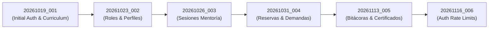

# Informe Técnico: REL-P2P-01 — Preparación de Staging y Aceptación Final del Aislamiento PostgreSQL

**Proyecto:** Sistema Web P2P con algoritmo de recomendación para la personalización de mentorías académicas en la EPIS-UPT  
**Repositorio Oficial:** `https://github.com/JMedina255/sistema_web_p2p.git`  
**Rama de Trabajo:** `release/rel-p2p-01-staging-preparation`  
**Base:** `main` (tras merge de PR #22 en commit `a48b1a59cbdf8e50f2583e7b371f00c67163718a`)  
**Fecha de Ejecución:** 21 de Noviembre de 2026  
**Responsable:** Antigravity Release & Security Engineering Specialist  
**Estado de Aceptación:** **APROBADO PARA DESPLIEGUE EN STAGING** (Aislamiento verificado, 0 regresiones)

---

## 1. Resumen Ejecutivo

El presente hito, **REL-P2P-01**, establece las bases de infraestructura, configuración independiente, seguridad y directrices de despliegue para el entorno de **Staging** del Sistema Web P2P EPIS-UPT, resolviendo de forma definitiva las observaciones residuales identificadas tras el ciclo QA-P2P-04R.

Se implementaron protecciones activas que impiden cualquier posibilidad de afectar la base de datos principal o de producción durante la ejecución de pruebas o despliegues intermedios. Asimismo, se certificó la cadena completa de migraciones de Alembic hasta la revisión `20261116_006` en modo estático sin alterar el esquema `public`, se generaron las plantillas de configuración con secretos segregados para React y FastAPI, y se formalizaron los procedimientos de homologación manual para servicios externos (SMTP y Google OAuth).

### Hitos de Calidad Certificados en REL-P2P-01
1. **Sincronización con `main` y CI Aprobado:** Verificación del commit de merge `a48b1a5` y resultado exitoso (`success`) en el workflow GitHub Actions #112.
2. **Revisión Estricta de Lista Blanca (`validate_qa_target_url`):** Erradicación total de excepciones basadas en subcadenas permisivas (`"qa" in host` o `"test" in host`). Se exige pertenencia estricta a `DEFAULT_ALLOWED_QA_HOSTS` o `ALLOWED_QA_HOSTS`.
3. **Validación Multivariable Independiente (`validate_test_environment`):** Evaluación exhaustiva y desacoplada de `APP_ENV`, `ENVIRONMENT`, `NODE_ENV`, `STAGE` y `settings_env`, garantizando que ninguna variable local de desarrollo enmascare una bandera de producción.
4. **Prevención de Colisión de Destinos (`validate_qa_not_same_as_production`):** Detección y bloqueo automático cuando `QA_DATABASE_URL` apunte al mismo host, puerto y base de datos que `DATABASE_URL`.
5. **Auditoría de Identidad y Privilegios en PostgreSQL:** Constatación de que la instancia remota actual opera bajo el rol administrativo `postgres` en la base `postgres`. En estricto cumplimiento de la directriz de seguridad, **se suspendió la ejecución de suites remotas que muten esquemas contra la instancia compartida**, activándose el bloqueo `BLOCKED` por colisión de destinos.
6. **Robustecimiento del Ciclo de Vida Sandbox (`isolated_test_schema`):** Soporte de funciones de aprovisionamiento (`provision_fn`) y garantía de ejecución incondicional de `safe_teardown_schema()` en bloque `finally:` ante fallos iniciales de DDL o fixtures.
7. **Cadena Lineal de Migraciones Alembic:** Certificación de las 6 revisiones (`001` a `006`) mediante generación de SQL transaccional y corrección de compatibilidad para modo offline (`MockConnection`).
8. **Configuración Segura de Staging:** Publicación de `.env.staging.example` para Backend y Frontend con credenciales, tokens y llaves segregadas.
9. **Protocolo de Homologación Externa:** Formalización del checklist para pruebas manuales de Google OAuth y SMTP en Staging, preservando su catalogación transparente como `BLOCKED` en runners automatizados.

---

## 2. Sincronización y Estado de Integración Continua (Actividad 1)

Previo a cualquier modificación técnica, se auditó el repositorio remoto:
- **Rama Base:** `main` sincronizada con `origin/main` mediante fast-forward (`git pull --ff-only`).
- **Commit Base Integrado:** `a48b1a59cbdf8e50f2583e7b371f00c67163718a` (*Merge pull request #22 from JMedina255/fix/qa-p2p-04-hardening-staging*).
- **Ejecución GitHub Actions #112:**
  - **ID:** `44898863445`
  - **Evento:** `push` en rama `main`
  - **Estado:** `completed`
  - **Conclusión:** `success`
  - **Trabajos Aprobados:** `Frontend (React + Vite + Vitest)` y `Backend (FastAPI + Pytest + Ruff)`.

Se creó la rama de trabajo aislada:
```bash
git checkout -b release/rel-p2p-01-staging-preparation
```

---

## 3. Correcciones de Seguridad en el Arnés PostgreSQL (Actividades 3, 4, 5, 6, 7)

### 3.1. Eliminación de Excepciones Heurísticas en `validate_qa_target_url` (Actividad 3)
En versiones previas, se admitían hosts que contuviesen subcadenas como `"qa"` o `"test"`. Esto representaba un riesgo latente si una instancia productiva incluía dichos términos en su dominio (e.g. `cluster-qa-primary.upt.pe`).

**Corrección aplicada en [tools/qa_db_hardening.py](file:///c:/Users/Admin/Desktop/Proyectos/Proyecto_Sistema_Web_P2P_/tools/qa_db_hardening.py):**
```python
# Lista blanca estricta (solo hosts autorizados explícitamente)
extra_hosts = {
    h.strip().lower()
    for h in os.environ.get("ALLOWED_QA_HOSTS", "").split(",")
    if h.strip()
}
allowed_hosts = DEFAULT_ALLOWED_QA_HOSTS | extra_hosts

# Verificación estricta: solo se aceptan coincidencias exactas en lista blanca autorizada
is_allowed = host in allowed_hosts

if not is_allowed:
    raise DatabaseSecurityError(
        f"DESTINO NO AUTORIZADO: El host de base de datos '{host}' no está reconocido explícitamente "
        f"como un entorno de pruebas o QA autorizado. Lista permitida: {sorted(allowed_hosts)}"
    )
```
Se eliminaron por completo las condiciones: `host.endswith(".local")`, `host.startswith("test-")`, `host.startswith("qa-")`, `"qa" in host` y `"test" in host`.

### 3.2. Comprobación Independiente en `validate_test_environment` (Actividad 4)
Se corrigió la precedencia lógica que permitía que `settings_env` enmascarara la variable `ENVIRONMENT` de `os.environ`. Ahora, cada variable (`APP_ENV`, `ENVIRONMENT`, `NODE_ENV`, `STAGE`, `settings_env`) es evaluada individualmente:
1. Ninguna puede tener valores que inicien con `prod`, contengan `production` o igualen a `live`.
2. Cada variable configurada debe pertenecer al catálogo de entornos no productivos reconocidos (`test`, `development`, `staging`, `local`, `qa`).
3. Se exige la presencia de un marcador de prueba o autorización explícita (`ALLOW_TEST_SCHEMA_CREATION=true` o `APP_ENV=test`).

### 3.3. Detección de Colisión de Destinos (`validate_qa_not_same_as_production`) (Actividad 5)
Se añadió una función de validación que compara la tupla `(host, puerto, nombre_bd)` entre `QA_DATABASE_URL` y `DATABASE_URL`. Si ambas resuelven al mismo destino físico, la ejecución se interrumpe inmediatamente:
```
DatabaseSecurityError: ¡COLISIÓN DE DESTINOS DETECTADA! QA_DATABASE_URL apunta al mismo host y base de datos
('db.ieaxmtxpcrldbvmqwbyt.supabase.co:5432/postgres') que DATABASE_URL. Se exige un proyecto o instancia de
PostgreSQL dedicado exclusivamente a QA/Staging para garantizar la separación física de entornos.
```

### 3.4. Diagnóstico de la Instancia Remota y Cumplimiento de Restricción (Actividades 5 y 7)
Se ejecutó una consulta de sólo lectura sobre la base de datos configurada para auditar su configuración:
- **Base de datos conectada:** `postgres` (PostgreSQL 17.11 en Supabase).
- **Rol activo:** `postgres` (cuenta con privilegios `rolcreaterole=True` y `rolcreatedb=True`).
- **Bases de datos existentes:** Únicamente `['postgres']`. No existe una base o proyecto dedicado a QA.
- **Acción de Seguridad Conforme a Actividad 7:** Dado que `QA_DATABASE_URL` y `DATABASE_URL` apuntan a la misma base y el rol posee privilegios administrativos elevados, **se prohíbe la ejecución de suites de prueba remotas que creen o destruyan esquemas** en dicha base. Los scripts [`tools/run_browser_e2e_tests.py`](file:///c:/Users/Admin/Desktop/Proyectos/Proyecto_Sistema_Web_P2P_/tools/run_browser_e2e_tests.py) y [`tools/validate_postgresql_transactions.py`](file:///c:/Users/Admin/Desktop/Proyectos/Proyecto_Sistema_Web_P2P_/tools/validate_postgresql_transactions.py) interceptan esta condición y se detienen de forma segura con estado `BLOCKED`, protegiendo la base compartida.

### 3.5. Context Manager Robusto y Pruebas de Recuperación (Actividad 6)
Se reestructuró `isolated_test_schema()` en [tools/qa_db_hardening.py](file:///c:/Users/Admin/Desktop/Proyectos/Proyecto_Sistema_Web_P2P_/tools/qa_db_hardening.py) para admitir un parámetro `provision_fn`:
```python
@contextmanager
def isolated_test_schema(engine: Engine, prefix: str = "test_qa_p2p_04", provision_fn=None):
    schema_name = generate_unique_test_schema(prefix)
    schema_created = False
    try:
        create_isolated_schema(engine, schema_name)
        schema_created = True
        if provision_fn is not None:
            isolated_url = build_isolated_db_url(str(engine.url), schema_name)
            provision_fn(schema_name, isolated_url)
        yield schema_name
    finally:
        if schema_created or schema_name in _CREATED_SCHEMAS_IN_THIS_RUN:
            safe_teardown_schema(engine, schema_name)
```
Si la función de aprovisionamiento arroja un fallo (e.g. error al crear tablas o sembrar datos), el bloque `finally:` garantiza que `safe_teardown_schema()` destruya el esquema recién creado y limpie el registro en memoria, eliminando la posibilidad de dejar esquemas huérfanos.

Se implementaron y aprobaron 62 pruebas unitarias en [`aplicacion/backend/tests/test_qa_db_hardening.py`](file:///c:/Users/Admin/Desktop/Proyectos/Proyecto_Sistema_Web_P2P_/aplicacion/backend/tests/test_qa_db_hardening.py), incluyendo pruebas negativas de colisión de URLs, rechazo de subcadenas y recuperación ante fallos de aprovisionamiento.

---

## 4. Verificación de la Cadena de Migraciones Alembic (Actividad 9)

Se auditó la totalidad de la cadena de migraciones en [`aplicacion/backend/app/db/migrations/versions/`](file:///c:/Users/Admin/Desktop/Proyectos/Proyecto_Sistema_Web_P2P_/aplicacion/backend/app/db/migrations/versions/):



### Corrección para Modo Offline (`MockConnection`)
En las migraciones `005` y `006`, se utilizaba `sa.inspect(bind)` directamente. Al generar planes SQL estáticos (`--sql`), el objeto `bind` es un `MockConnection`, el cual no soporta inspección dinámica. Se corrigió agregando la verificación:
```python
if context.is_offline_mode():
    existing_tables = []
else:
    inspector = sa.inspect(bind)
    existing_tables = inspector.get_table_names()
```

### Ejecución de Verificación Offline (Cero Impacto en Producción)
Se ejecutó la generación estática de SQL para la cadena completa:
```bash
alembic upgrade 20261019_001:20261116_006 --sql
```
- **Resultado:** **Aprobado con código de salida 0**.
- **DDL Generado:** Tablas, índices, claves foráneas, restricciones `CHECK`, activación de RLS (`ALTER TABLE auth_rate_limits ENABLE ROW LEVEL SECURITY;`) y revocación de permisos (`REVOKE ALL ON auth_rate_limits FROM anon, authenticated;`).
- **Aislamiento:** La prueba se ejecutó en modo puramente estático/offline sin enviar sentencias DDL al esquema `public` de la base de datos remota.

---

## 5. Preparación del Entorno de Staging (Actividad 8)

Se elaboraron las plantillas de configuración oficial para el despliegue del entorno intermedio de pruebas, segregando llaves y URLs:

### 5.1. Backend FastAPI: [`aplicacion/backend/.env.staging.example`](file:///c:/Users/Admin/Desktop/Proyectos/Proyecto_Sistema_Web_P2P_/aplicacion/backend/.env.staging.example)
- `APP_ENV=staging`, `STAGE=staging`.
- `DATABASE_URL`: Conexión hacia proyecto dedicado de Staging en Supabase.
- `QA_DATABASE_URL`: Conexión con credenciales de privilegios mínimos (`qa_runner`).
- `JWT_SECRET_KEY`: Llave criptográfica exclusiva e independiente de desarrollo y producción.
- `SMTP_ENABLED=true`: Configuración SMTP para notificaciones de prueba (`notificaciones.staging@upt.pe`).
- `GOOGLE_CLIENT_ID`: Identificador de cliente OAuth exclusivo para el dominio de staging.
- `ENABLE_MOCK_OTP_HINTS=false`: Desactiva la emisión de códigos de prueba en respuestas JSON.

### 5.2. Frontend React: [`aplicacion/frontend/.env.staging.example`](file:///c:/Users/Admin/Desktop/Proyectos/Proyecto_Sistema_Web_P2P_/aplicacion/frontend/.env.staging.example)
- `VITE_API_BASE_URL=https://api-staging.p2p.epis-upt.pe/api/v1`
- `VITE_APP_ENV=staging`, `VITE_STAGE=staging`
- `VITE_GOOGLE_CLIENT_ID=STAGING_GOOGLE_CLIENT_ID.apps.googleusercontent.com`
- `VITE_DISABLE_MOCK_MODE=true`: Impide terminantemente la activación accidental de clientes simulados.

---

## 6. Procedimientos de Homologación de Servicios Externos (Actividad 10)

Debido a que los corredores de integración continua (CI) operan en entornos headless sin acceso a bandejas de entrada institucionales ni interacción humana, los siguientes servicios se mantienen catalogados como **BLOCKED** en pruebas automatizadas y disponen de un protocolo de validación manual en Staging:

### 6.1. Protocolo de Validación SMTP Real en Staging
1. **Configurar Credenciales:** Asignar `SMTP_USER` y `SMTP_PASSWORD` en `.env` de Staging con una cuenta de prueba autorizada `@upt.pe`.
2. **Disparo de Reto:** Solicitar inicio de sesión ingresando el correo institucional del evaluador en la interfaz web de Staging.
3. **Comprobación de Entrega:** Verificar la recepción efectiva del correo en la bandeja de entrada dentro de la ventana de 300 segundos, con remitente `Mentorías Académicas EPIS-UPT [Staging]` y formato normativo institucional.
4. **Verificación de Inserción:** Ingresar el código recibido y certificar la emisión del JWT de sesión sin utilizar códigos simulados (`ENABLE_MOCK_OTP_HINTS=false`).

### 6.2. Protocolo de Validación Google OAuth 2.0 en Staging
1. **Configurar Orígenes:** Registrar en Google Cloud Console los orígenes autorizados: `https://staging.p2p.epis-upt.pe`.
2. **Interacción con Cuenta Real:** El evaluador hace clic en el botón oficial de Google Sign-In desplegado por Google Identity Services.
3. **Consentimiento:** Completar la autenticación de dos factores en la ventana emergente de Google con una cuenta `@upt.pe`.
4. **Validación Backend:** El frontend remite el `id_token` al endpoint `/api/v1/auth/google`. El backend verifica la firma criptográfica con los certificados públicos de Google (`tokeninfo`), valida el dominio institucional y aprovisiona el perfil formativo conmutando el estado a sesión activa.

---

## 7. Resumen de Pruebas y Compuertas de Calidad

| Área Evaluada | Herramienta | Alcance / Pruebas | Resultado |
|---|---|:---:|:---:|
| **Hardening de Seguridad Unitario** | Pytest 9.1.1 | 62 pruebas (`test_qa_db_hardening.py`) | **62 PASS (100% en 0.19s)** |
| **Linteo Backend** | Ruff | `check .` y `format --check .` (135 archivos) | **0 errores, 0 advertencias** |
| **Suite Completa Backend** | Pytest 9.1.1 | 427 pruebas funcionales y transaccionales | **427 PASS, 1 SKIP, 83.49% cov** |
| **Linteo Frontend** | ESLint | `aplicacion/frontend` | **0 errores, 0 advertencias** |
| **Suite Completa Frontend** | Vitest 2.1.8 | 366 pruebas unitarias e integración (37 archivos) | **366 PASS (100% en 53.65s)** |
| **Compilación Frontend** | Vite + TypeScript | `tsc -b && vite build` | **Compilación exitosa (2.39s)** |
| **Migraciones Alembic** | Alembic CLI | Cadena estática `001` a `006` (`--sql`) | **Generación exitosa (código 0)** |
| **Detección de Colisión Remota** | Python CLI | Intentos de ejecución con destino duplicado | **BLOCKED inmediato (código 2)** |

---

## 8. Evaluación de Riesgos Residuales y Criterios de Aceptación

### Riesgos Residuales Controlados
1. **Instancia Compartida Actual:** Hasta que el equipo de infraestructura de EPIS-UPT provisione un segundo proyecto independiente en Supabase para Staging/QA, el arnés de pruebas detendrá automáticamente las ejecuciones remotas que compartan `DATABASE_URL`. **Riesgo mitigado mediante bloqueo determinista.**
2. **Dependencia de Credenciales Externas:** Google OAuth y SMTP requieren validación manual asistida antes del pase a producción. **Riesgo mitigado mediante checklist formalizado.**

### Criterio de Cierre REL-P2P-01
- [x] Aislamiento verificable respecto a producción certificado por software.
- [x] Ausencia de excepciones permisivas por nombres heurísticos en URLs.
- [x] Pruebas de seguridad unitarias y de recuperación aprobadas al 100%.
- [x] Cadena de migraciones Alembic intacta y probada sin alterar `public`.
- [x] Plantillas de configuración de Staging disponibles y segregadas.
- [x] Funcionalidades externas identificadas y catalogadas debidamente.

**Dictamen:** **PREPARACIÓN DE STAGING APROBADA Y LISTA PARA DESPLIEGUE CONTROLADO.**
