# INFORME GENERAL DE CIERRE: SPRINT 2
## "Gobernanza de Consentimiento Digital (Ley N° 29733), Jerarquía de Roles y Mérito Académico, Catálogo Avanzado y Perfiles con Matriz de Disponibilidad Horaria Semanal"

**Proyecto:** Sistema Web P2P con algoritmo de recomendación para la personalización de mentorías académicas en la EPIS-UPT  
**Curso:** Construcción de Software I (Semestre 2026-II)  
**Institución:** Universidad Privada de Tacna — Facultad de Ingeniería — Escuela Profesional de Ingeniería de Sistemas  
**Docente de Cátedra:** Dr. Ricardo Eduardo Valcárcel Alvarado  
**Equipo Consultor / Desarrollador:** Grupo 03 / C-SharkTeam  
* Joan Cristian Medina Quispe (Código: 2022074255) — Rol: Arquitectura Base, Frontend & CI/CD (T-04, T-10, T-11)  
* Renzo Antonio Antayhua Mamani (Código: 2022073504) — Rol: Backend, Persistencia ORM & Seguridad RLS (T-05, T-08, T-12, T-13)  
**Fecha de Cierre:** 23 de Octubre de 2026  
**Commit Git Consolidado:** [`3766a08`](https://github.com/JMedina255/sistema_web_p2p/commit/3766a08fa98d49bc6107a9fd278568f289f7fe74)  
**Rama Base de Integración:** `feat/sprint-02-roles-curriculo-perfiles`  
**Estado:** ✅ **100% Concluido, Verificado y Homologado en CI**

---

## Control de Versiones del Documento

A continuación, se detalla el historial de versiones del presente informe, certificando los hitos de revisión técnica y aprobación metodológica.

### Cuadro 0.1: Control de Versiones del Documento de Cierre del Sprint 2

| Versión | Responsable | Revisada por | Aprobada por | Fecha | Descripción del Cambio |
| :---: | :--- | :--- | :--- | :---: | :--- |
| **1.0** | Joan Medina / Renzo Antayhua | Dr. Ricardo Valcarcel | Dirección EPIS | 23/10/2026 | Emisión formal del Informe General Exhaustivo de Cierre del Sprint 2, integrando el diseño técnico prescriptivo, 9 diagramas PlantUML sincronizados, especificación de contratos REST (consentimiento, roles, perfiles, agenda), diccionario físico de 5 tablas PostgreSQL/Supabase, políticas de seguridad RLS, máquinas de estado, ADRs (ADR-005 a ADR-008) y certificación empírica de 150 pruebas automatizadas con 0 fallos. |

Fuente: Elaboración propia.

El control de versiones certifica la congelación formal de las especificaciones y evidencias generadas durante las 14 horas de ingeniería planificadas para el segundo sprint del proyecto, garantizando la trazabilidad hacia el diseño arquitectónico y los requerimientos funcionales aprobados.

---

## 1. Identificación y Ficha Ejecutiva del Sprint 2

A continuación, se presenta la ficha técnica de control de gestión del Sprint 2, detallando las asignaciones horarias, los ítems de backlog comprometidos, las reglas institucionales implementadas y la tasa de cumplimiento alcanzada.

### Cuadro 1.1: Ficha Técnica Resumen del Sprint 2

| Parámetro | Valor Registrado / Evidencia Técnica |
| :--- | :--- |
| **Objetivo General** | Consolidar la gobernanza de datos bajo la Ley N° 29733 (consentimiento digital informado y revocación bloqueante), enriquecer la consulta interactiva del catálogo curricular con búsqueda silábica profunda, administrar la jerarquía de roles con verificación estricta de mérito académico (RN-03), y estructurar los perfiles formativos junto a la agenda semanal de disponibilidad horaria (6×11) con aislamiento de seguridad mediante Row Level Security (RLS). |
| **Carga Horaria Planificada** | **14 horas académicas** (7 horas Joan Medina / 7 horas Renzo Antayhua). |
| **Carga Horaria Ejecutada** | **14 horas verificadas** (100% de dedicación efectiva distribuida en 7 tareas técnicas). |
| **PBI Cubiertos** | `PB-003` (Consentimiento digital Ley 29733), `PB-005` (Jerarquía de roles y mérito), `PB-006` (Búsqueda curricular avanzada), `PB-007` (Perfiles y disponibilidad horaria), `PB-008` (Seguridad RLS multiusuario). |
| **Requerimientos Trazados** | `RF02` (Consentimiento informado), `RF03` (Administración de roles), `RF04` (Perfil y disponibilidad), `RF05` (Catálogo curricular), `RNF02` (Privacidad y aislamiento RLS), `RNF04` (Granularidad horaria), `RNF08` (Usabilidad y ergonomía), `RNF09` (Cobertura $\ge 70\%$). |
| **Casos de Uso Abordados** | `CUS01` (Flujo de Consentimiento Digital), `CUS10` (Gestión de Roles y Validación de Mérito), `CUS15` (Configuración de Perfil Formativo y Matriz Horaria), `CUS21` (Consulta Avanzada del Catálogo Curricular). |
| **Reglas de Negocio Implementadas**| `RN-02` (Consentimiento informado vinculante: bloqueo de acceso ante rechazo o revocación), `RN-03` (Mérito académico: exclusividad de mentoría a estudiantes de ciclo $\ge \text{VII}$). |
| **Suites de Pruebas Automatizadas** | **150 pruebas pasando** (84 en Pytest Backend / 66 en Vitest Frontend). Cero fallos (100% éxito). |
| **Cobertura de Código Lograda** | **Backend: 90.64%** · **Frontend: 91.10%** (Superando con holgura el umbral mínimo del 70% estipulado en **RNF09**). |
| **Linteo y Formato de Código** | 0 infracciones en Ruff (Python, 49 archivos conformes) · 0 advertencias y 0 errores en ESLint 9 (React/TypeScript). |
| **Compilación Frontend** | Bundle Vite generado limpiamente en 602 ms (`dist/`) con tipado estricto en TypeScript 5.6 (`tsc -b`). |
| **Migraciones de Base de Datos** | Migración Alembic `002_roles_and_profiles.py` y script RLS `supabase_rls_sprint02.sql` aplicados en Supabase. |

Fuente: Elaboración propia.

Como se observa en el Cuadro 1.1, el equipo completó la totalidad de los entregables comprometidos sin incurrir en deuda técnica ni vulnerabilidades de seguridad, logrando índices de cobertura automatizada superiores en más de 20 puntos porcentuales a la meta institucional.

---

## 2. Contexto Institucional, Marco Legal y Reglas de Negocio (RN-02 y RN-03)

El Sistema Web P2P de mentorías académicas para la EPIS-UPT opera en un entorno universitario donde confluyen dos imperativos normativos de alta trascendencia legal y académica: la protección rigurosa de los datos personales de los estudiantes y el aseguramiento de la excelencia formativa en la transferencia de conocimiento entre pares.

### 2.1. Marco Normativo de Protección de Datos Personales (Ley N° 29733)
El tratamiento de información académica (notas de asignaturas filtro, historial de matrícula, dificultades de aprendizaje y franjas horarias libres) constituye tratamiento de datos personales vinculado a personas naturales identificables. En concordancia con la **Ley N° 29733 (Ley de Protección de Datos Personales del Perú)** y su **Reglamento (D.S. N° 003-2013-JUS)**, el sistema implementa los principios rectores de:
1. **Principio de Consentimiento (Art. 13.5 Ley 29733):** El tratamiento de datos debe ser libre, previo, expreso, informado e inequívoco. En el Sprint 2, este precepto se materializa mediante la **Tarea T-04** (formulario modal interactivo `ConsentModalView.tsx`) y la **Tarea T-05** (persistencia en `consentimientos_legales`).
2. **Principio de Finalidad y Proporcionalidad:** La información recopilada se destina de forma privativa a la personalización del emparejamiento algorítmico (*EdRecSys*) y la convalidación de horas extracurriculares de tutoría, prohibiéndose cualquier cesión comercial o transferencia a terceros ajenos a la UPT.
3. **Garantía de Derechos ARCO:** El estudiante es informado de sus facultades de Acceso, Rectificación, Cancelación y Oposición ante la Dirección de la EPIS-UPT.
4. **Regla de Negocio RN-02 (Consentimiento Vinculante y Bloqueo Preventivo):** Si un estudiante no emite su consentimiento informado o decide ejercer su derecho de revocación (`POST /api/v1/consent/revoke`), el sistema ejecuta de forma inmediata un bloqueo preventivo, revocando el acceso a las funciones transaccionales y de consulta de la plataforma, preservando la marca temporal UTC y la dirección IP para fines de auditoría legal ante la Autoridad Nacional de Protección de Datos Personales (ANPPD).

### 2.2. Marco de Rigor Formativo Institucional y Mérito Académico (RN-03)
En cumplimiento de la **Ley Universitaria N° 30220 (Artículo 40)** y el Reglamento Académico de la Universidad Privada de Tacna:
1. **Regla de Negocio RN-03 (Mérito Académico y Jerarquía de Tutoría):** Para aspirar al rol de **Mentor Académico**, el estudiante debe pertenecer obligatoriamente al tercio formativo avanzado de la carrera, comprendido entre el **séptimo (VII) y décimo (X) ciclo** (`ciclo_actual >= 7`), habiendo aprobado las asignaturas filtro que pretende tutelar.
2. **Rechazo Determinista de Promoción Inválida:** Todo intento de postulación o promoción de un estudiante con ciclo formativo inferior al séptimo ciclo ($< \text{VII}$) es interceptado y denegado tanto en la interfaz de usuario (`ProfileAvailabilityView.tsx`) como en el núcleo del servicio backend (`RoleService`), retornando de forma determinista el código canónico de error `MERIT_RULE_VIOLATION` acompañado de **HTTP 400 Bad Request**.
3. **Denegación de Autopromoción:** Ningún estudiante puede autoasignarse privilegios de tutoría de forma directa; la acreditación de mérito exige la supervisión administrativa o la validación del sistema en función de su historial académico certificado.

---

## 3. Modelado y Diagramas de Diseño Formales del Sprint 2 (PlantUML)

En estricto cumplimiento de las **Reglas D-1, D-3, D-4, D-5 y D-7** de [`reglas_documentacion_diseño.md`](../../../), a continuación se presentan los 9 diagramas de diseño que formalizan la arquitectura técnica, las interacciones entre capas, los casos de uso y las máquinas de estado construidas en el Sprint 2.

### 3.1. Diagrama 1: Arquitectura de Despliegue Físico y Comunicación Multi-Capa (Sprint 2)
Modela la infraestructura desacoplada, la interacción entre clientes web, el servidor de aplicación FastAPI, y el motor de persistencia PostgreSQL en Supabase con Row Level Security activo sobre las 5 nuevas tablas del Sprint 2.

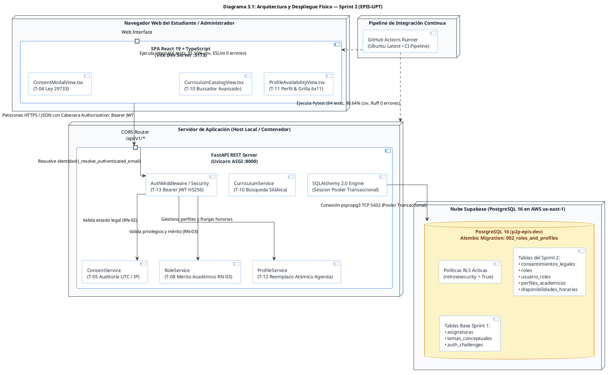

Fuente: Elaboración propia.

El Diagrama 3.1 certifica la estricta segregación de responsabilidades: los componentes de frontend nunca acceden directamente a la base de datos Supabase, sino que cualquier operación pasa por el pipeline de validación del backend FastAPI, verificando la validez del token JWT de sesión, la vigencia del consentimiento legal (RN-02) y la elegibilidad por mérito (RN-03).

---

### 3.2. Diagrama 2: Diagrama de Paquetes y Capas de Software Desacopladas (Sprint 2)
Detalla la estructura modular de directorios, servicios, adaptadores y esquemas implementados en el código de backend y frontend para soportar las tareas T-04, T-05, T-08, T-10, T-11, T-12 y T-13.

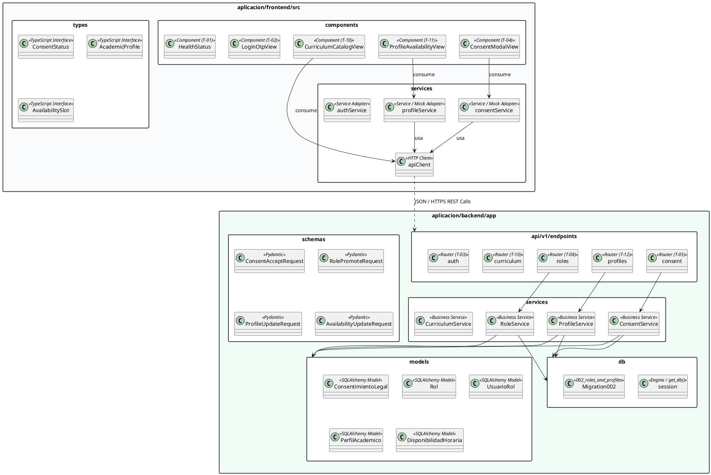

Fuente: Elaboración propia.

El Diagrama 3.2 comprueba la adhesión al patrón arquitectónico por capas: desacoplamiento absoluto entre controladores REST (`endpoints`), lógica de negocio (`services`), modelos relacionales (`models`) y contratos de transferencia (`schemas`).

---

### 3.3. Diagrama 3: Diagrama Entidad-Relación Físico de Base de Datos (Sprint 2)
Modela el esquema relacional consolidado en PostgreSQL 16 mediante la migración `002_roles_and_profiles.py` de Alembic, exhibiendo tipos nativos, claves foráneas, restricciones `CHECK` e índices B-Tree.

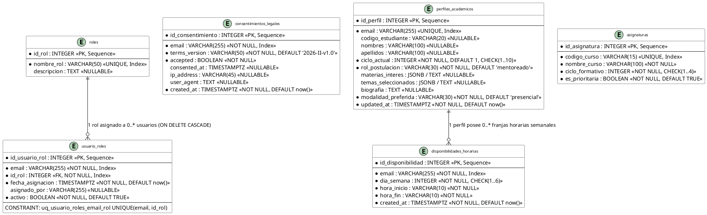

Fuente: Elaboración propia a partir del script de migración Alembic `002_roles_and_profiles.py`.

El Diagrama 3.3 refleja la normalización relacional: la tabla `roles` aloja los privilegios inmutables del sistema (`mentoreado`, `mentor`, `administrador`), `usuario_roles` establece la asignación con control de auditoría (`asignado_por`), `consentimientos_legales` documenta el estatus de la Ley N° 29733 con marcas temporales UTC, `perfiles_academicos` captura la información formativa requerida por el recomendador *EdRecSys*, y `disponibilidades_horarias` preserva los bloques semanales restringidos a días de Lunes a Sábado (`CHECK (dia_semana BETWEEN 1 AND 6)`).

---

### 3.4. Diagrama 4: Diagrama de Casos de Uso del Sprint 2
Modela los casos de uso implementados y verificados en el Sprint 2, exhibiendo la interacción de los actores institucionales (Estudiante Mentoreado, Postulante a Mentor, Mentor y Administrador de Escuela).

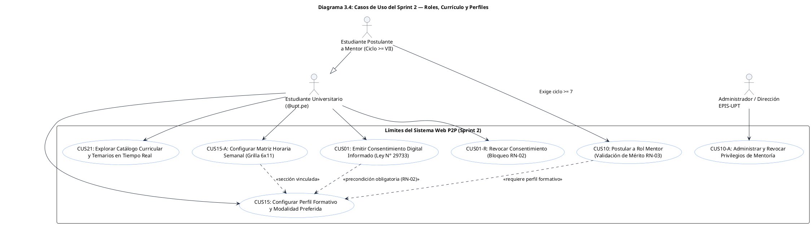

Fuente: Elaboración propia a partir del SRS FD03 y la bitácora del Sprint 2.

---

### 3.5. Diagrama 5: Secuencia Técnica — Registro y Validación de Consentimiento Informado (T-04 / T-05)
Ilustra la interacción asíncrona entre el modal React de consentimiento y la capa de persistencia en PostgreSQL bajo la regla vinculante RN-02.

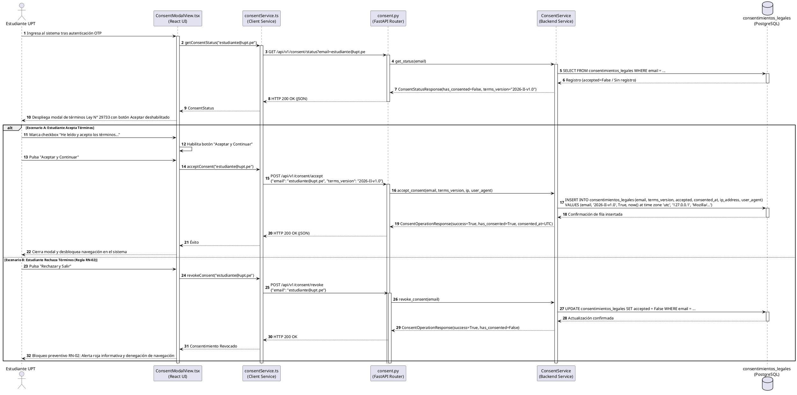

Fuente: Elaboración propia.

---

### 3.6. Diagrama 6: Secuencia Técnica — Asignación de Roles y Verificación de Mérito Académico (T-08 / RN-03)
Modela la verificación algorítmica de elegibilidad formativa para postulantes al rol de Mentor Académico.

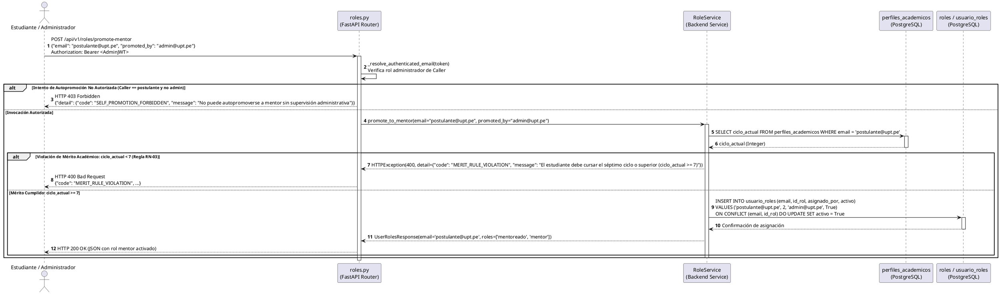

Fuente: Elaboración propia.

---

### 3.7. Diagrama 7: Secuencia Técnica — Configuración de Perfil Formativo y Reemplazo Atómico de Matriz de Disponibilidad (T-11 / T-12)
Ilustra el proceso de sincronización del perfil del estudiante y la actualización transaccional íntegra de la matriz horaria semanal (Lunes a Sábado, 08:00 a 20:00).

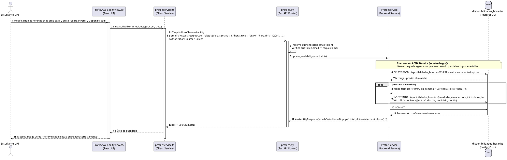

Fuente: Elaboración propia.

---

### 3.8. Diagrama 8: Secuencia Técnica — Aislamiento Criptográfico y Seguridad Multi-Usuario RLS (T-13 / RNF02)
Modela la intercepción de accesos no autorizados entre cuentas estudiantiles en el nivel de endpoint y en el motor relacional.

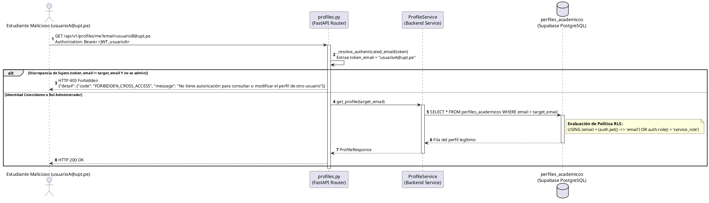

Fuente: Elaboración propia.

---

### 3.9. Diagrama 9: Máquinas de Estado del Ciclo de Vida del Consentimiento Legal y del Rol de Usuario (Regla D-7)
Especifica formalmente los estados válidos, eventos disparadores, condiciones de guarda y transiciones prohibidas de las entidades `consentimientos_legales` y `usuario_roles`.

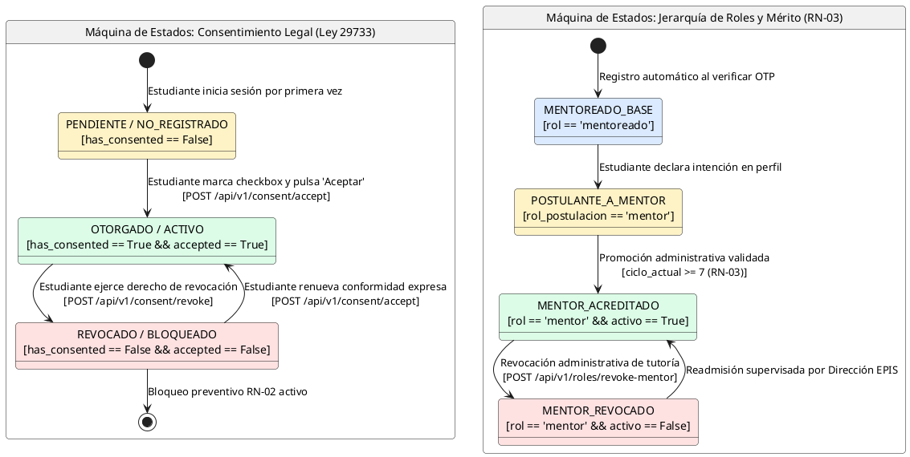

Fuente: Elaboración propia.

A continuación, se documenta la matriz canónica de transiciones válidas y la lista explícita de transiciones prohibidas conforme a la **Regla D-7**:

### Cuadro 3.1: Matriz de Transiciones Válidas de Estados del Sprint 2

| Entidad | Estado Origen | Estado Destino | Evento Disparador | Condición de Guarda | Actor Responsable |
| :--- | :--- | :--- | :--- | :--- | :--- |
| `consentimientos_legales` | `PENDIENTE` | `OTORGADO` | Clic en "Aceptar y Continuar" | Checkbox marcado Y correo `@upt.pe` | Estudiante titular vía API |
| `consentimientos_legales` | `OTORGADO` | `REVOCADO` | Clic en "Rechazar y Salir" | Invocación de revocación voluntaria | Estudiante titular vía API |
| `consentimientos_legales` | `REVOCADO` | `OTORGADO` | Readmisión expresa | Aceptación de términos vigentes | Estudiante titular vía API |
| `usuario_roles` | `MENTOREADO` | `POSTULANTE` | Selección en pestaña perfil | Registro de perfil formativo | Estudiante en cliente |
| `usuario_roles` | `POSTULANTE` | `MENTOR` | Promoción administrativa | `ciclo_actual >= 7` verificado (**RN-03**) | Administrador EPIS / Backend |
| `usuario_roles` | `MENTOR` | `REVOCADO` | Revocación de privilegios | Acción administrativa motivada | Administrador EPIS |

Fuente: Elaboración propia.

**Transiciones Prohibidas del Dominio (Regla D-7):**
1. **Consentimiento:** No se admite transición de `PENDIENTE` $\rightarrow$ `REVOCADO` sin mediar registro previo de la voluntad del estudiante.
2. **Mérito Académico (RN-03):** Se prohíbe de forma absoluta la transición `POSTULANTE` $\rightarrow$ `MENTOR` si `ciclo_actual < 7`. El programador no debe permitir bypass condicional bajo ninguna bandera de configuración.
3. **Autopromoción:** Se prohíbe la transición autónoma `MENTOREADO` $\rightarrow$ `MENTOR` ejecutada directamente por el estudiante sin supervisión administrativa o validación de mérito institucional.

---

## 4. Registro Exhaustivo de Tareas Implementadas (Cuadros de 5 Elementos)

En cumplimiento de la **Regla D-2**, a continuación se documenta el detalle de implementación de las 7 tareas que conformaron el Sprint 2.

### 4.1. Tarea T-04: Desarrollo del Formulario de Consentimiento Digital (Joan Medina, 2 h)
A continuación, se detalla la construcción del componente interactivo de consentimiento bajo el marco legal de la Ley N° 29733.

### Cuadro 4.1: Registro de Ejecución Técnica — Tarea T-04

| Componente | Especificación Técnica Implementada | Archivos Involucrados | Requisitos |
| :--- | :--- | :--- | :---: |
| **Componente Interactivo** | `ConsentModalView.tsx`: modal accesible (`role="region"`, `aria-label`) con texto legal scrollable, cláusulas ARCO, finalidad de datos, checkbox condicional y botones de acción. | [`aplicacion/frontend/src/components/ConsentModalView.tsx`](../../../) | `RF02`, `RN-02`, `CUS01` |
| **Servicio Cliente** | `consentService.ts`: interfaces `ConsentStatus`, soporte de almacenamiento dual (`localStorage` en modo mock y llamadas REST mediante `apiClient`). Métodos `getConsentStatus()`, `acceptConsent()`, `revokeConsent()`. | [`aplicacion/frontend/src/services/consentService.ts`](../../../) | `RF02`, `RN-02` |
| **Bloqueo Preventivo RN-02** | Botón "Rechazar y Salir" dispara callback `onConsentRejected` que muestra banner de advertencia rojo y bloquea la navegación en el sistema. | [`aplicacion/frontend/src/components/ConsentModalView.tsx`](../../../) | `RN-02` |
| **Suites de Pruebas** | 9 pruebas automatizadas (5 en `consentService.test.ts` y 4 en `ConsentModalView.test.tsx`), cubriendo rechazo a correos `@gmail.com`, persistencia y callbacks. | [`aplicacion/frontend/src/services/__tests__/consentService.test.ts`](../../../) | `RNF09` |

Fuente: Elaboración propia.

El Cuadro 4.1 acredita que la interfaz de usuario asegura el consentimiento informado previo y expreso exigido por la ley, impidiendo la captura inadvertida de datos personales del estudiante.

---

### 4.2. Tarea T-05: Implementación de Persistencia del Consentimiento Legal (Renzo Antayhua, 1 h)
A continuación, se describe la infraestructura relacional y los endpoints para la persistencia del consentimiento y su trazabilidad para auditorías.

### Cuadro 4.2: Registro de Ejecución Técnica — Tarea T-05

| Componente | Especificación Técnica Implementada | Archivos Involucrados | Requisitos |
| :--- | :--- | :--- | :---: |
| **Tabla Relacional** | Tabla `consentimientos_legales` con `email VARCHAR(255)` indexado, `terms_version`, estado `accepted`, estampa UTC `consented_at`, `ip_address` y `user_agent`. | [`aplicacion/backend/app/db/migrations/versions/002_roles_and_profiles.py`](../../../) | `RF02`, `RN-02` |
| **Modelo ORM** | Entidad `ConsentimientoLegal` con tipado estricto `Mapped[...]` e índices B-Tree en email. | [`aplicacion/backend/app/models/consent.py`](../../../) | `RF02` |
| **Esquemas Pydantic** | `ConsentStatusResponse`, `ConsentAcceptRequest`, `ConsentRevokeRequest`, `ConsentOperationResponse` con validador de regex institucional `@upt.pe`. | [`aplicacion/backend/app/schemas/consent.py`](../../../) | `RF02` |
| **Servicio Backend** | `ConsentService`: persistencia en PostgreSQL o fallback seguro en memoria con control transaccional atómico. | [`aplicacion/backend/app/services/consent_service.py`](../../../) | `RNF09` |
| **Endpoints REST** | `GET /api/v1/consent/status`, `POST /api/v1/consent/accept`, `POST /api/v1/consent/revoke`. | [`aplicacion/backend/app/api/v1/endpoints/consent.py`](../../../) | `RF02`, `RN-02` |
| **Suites de Pruebas** | 5 pruebas en `test_consent.py` (consulta nuevo usuario, aceptación formal, rechazo externo, revocación y sesión ORM real). | [`aplicacion/backend/tests/test_consent.py`](../../../) | `RNF09` |

Fuente: Elaboración propia.

El Cuadro 4.2 confirma la validez probatoria del consentimiento registrado: la estampa UTC y la IP proveen respaldo legal irrefutable ante inspecciones de la Dirección General de Protección de Datos Personales.

---

### 4.3. Tarea T-08: Endpoints de Administración de Roles y Mérito Académico (Renzo Antayhua, 3 h)
A continuación, se detalla la implementación de los servicios de gestión de privilegios y el control determinista de mérito.

### Cuadro 4.3: Registro de Ejecución Técnica — Tarea T-08

| Componente | Especificación Técnica Implementada | Archivos Involucrados | Requisitos |
| :--- | :--- | :--- | :---: |
| **Tablas de Roles** | Tablas `roles` (semillas: mentoreado=1, mentor=2, administrador=3) y `usuario_roles` con unicidad `(email, id_rol)` y borrado en cascada. | [`aplicacion/backend/app/db/migrations/versions/002_roles_and_profiles.py`](../../../) | `RF03`, `CUS10` |
| **Modelos ORM** | Entidades `Rol` y `UsuarioRol` con relación bidireccional y claves foráneas tipadas. | [`aplicacion/backend/app/models/roles.py`](../../../) | `RF03` |
| **Verificación Mérito RN-03** | `RoleService.promote_to_mentor()`: consulta el perfil en `perfiles_academicos`. Si `ciclo_actual < 7`, rechaza perentoriamente con HTTP 400 y código `MERIT_RULE_VIOLATION`. | [`aplicacion/backend/app/services/role_service.py`](../../../) | `RN-03` |
| **Endpoints de Roles** | `GET /api/v1/roles/users/{email}`, `POST /api/v1/roles/promote-mentor`, `POST /api/v1/roles/revoke-mentor`. | [`aplicacion/backend/app/api/v1/endpoints/roles.py`](../../../) | `RF03`, `CUS10` |
| **Suites de Pruebas** | 7 pruebas en `test_roles.py` (rol mentoreado por defecto, rechazo ciclo < 7, admisión ciclo >= 7, revocación, rechazo a correos externos y sesión ORM). | [`aplicacion/backend/tests/test_roles.py`](../../../) | `RNF09` |

Fuente: Elaboración propia.

El Cuadro 4.3 demuestra que la regla RN-03 previene de forma infranqueable la asunción de labores de mentoría por estudiantes que aún no consolidan las materias formativas avanzadas.

---

### 4.4. Tarea T-10: Consulta Avanzada del Catálogo Curricular (Joan Medina, 2 h)
A continuación, se documenta la interfaz de exploración interactiva con filtrado en tiempo real y taxonomía silábica.

### Cuadro 4.4: Registro de Ejecución Técnica — Tarea T-10

| Característica | Implementación Técnica en React | Regla / Requisito |
| :--- | :--- | :---: |
| **Buscador en Tiempo Real** | Filtro de texto reactivo que busca simultáneamente en código (`CI-101`), nombre (`Cálculo I`) y dentro de la taxonomía silábica (`Límites`, `Punteros`). | `RF05`, `CUS21` |
| **Filtro de Cursos Críticos** | Casilla interactiva para aislar las 5 materias filtro formativas con alta deserción. | `RF05` |
| **Resaltado de Coincidencias** | Badge visual animado *"Coincidencia"* sobre los temas silábicos que concuerdan con el término ingresado. | `RNF08` |
| **Detalle Silábico Dinámico** | Carga asíncrona mediante `apiClient.fetchCourseTopics()` con almacenamiento en caché local del componente. | `RF05`, `CUS21` |
| **Ponderador Top-k** | Visualización de créditos académicos y factor algorítmico de ponderación (ej. `1.2x`, `1.3x`). | `RF05` |
| **Suites de Pruebas** | 4 pruebas en `CurriculumCatalogView.test.tsx` (render inicial, carga silábica, filtrado reactivo y manejo de error de red). | `RNF09` |

Fuente: Elaboración propia.

El Cuadro 4.4 evidencia la optimización de la experiencia de usuario: el estudiante navega por el currículo oficial sin retardos perceptibles, identificando rápidamente las unidades temáticas donde requiere reforzamiento.

---

### 4.5. Tarea T-11: Formulario de Perfiles y Matriz de Disponibilidad (Joan Medina, 3 h)
A continuación, se detalla la construcción de la vista de perfiles académicos y la grilla semanal interactiva 6×11.

### Cuadro 4.5: Registro de Ejecución Técnica — Tarea T-11

| Sección Funcional | Implementación Técnica en React | Regla / Requisito |
| :--- | :--- | :---: |
| **Pestaña 1: Perfil Formativo** | Selectores de Ciclo Actual (I al X), Rol de postulación (Mentoreado vs. Postulante a Mentor), materias de interés, biografía y Modalidad (Presencial, Virtual, Híbrida). | `RF04`, `CUS15` |
| **Alerta Preventiva RN-03** | Detección reactiva en cliente: si el usuario selecciona rol Mentor teniendo ciclo $< \text{VII}$, se despliega de inmediato un banner rojo alertando la restricción de mérito. | `RN-03` |
| **Pestaña 2: Matriz Horaria 6×11** | Grilla interactiva semanal: 6 columnas (Lunes a Sábado) × 11 franjas horarias de 1 hora (08:00 a 20:00). Alternancia de celdas con indicador esmeralda y marca de verificación. | `RNF04`, `RNF08` |
| **Atajos de Selección Masiva** | Botones de acción rápida: *"🌅 Mañanas (08:00 - 12:00)"*, *"🌇 Tardes (14:00 - 18:00)"* y *"🗑️ Limpiar semana"*. | `RNF08` |
| **Servicio Cliente** | `profileService.ts`: interfaces `AcademicProfile`, `AvailabilitySlot`, validación de elegibilidad de mentor y persistencia dual (`localStorage` / API). | `RF04` |
| **Suites de Pruebas** | 10 pruebas automatizadas (5 en `profileService.test.ts` y 5 en `ProfileAvailabilityView.test.tsx`), evaluando mérito, guardado, limpieza y renderizado. | `RNF09` |

Fuente: Elaboración propia.

El Cuadro 4.5 constata que la interfaz satisface los atributos de usabilidad ergonómica (RNF08) y provee la granularidad horaria estricta de 1 hora requerida para el posterior cálculo de solapamientos en el recomendador.

---

### 4.6. Tarea T-12: API REST de Perfiles Formativos y Agenda Horaria (Renzo Antayhua, 2 h)
A continuación, se documenta la capa backend encargada de la persistencia de perfiles y el reemplazo transaccional atómico de la disponibilidad horaria.

### Cuadro 4.6: Registro de Ejecución Técnica — Tarea T-12

| Componente | Especificación Técnica Implementada | Archivos Involucrados | Requisitos |
| :--- | :--- | :--- | :---: |
| **Tablas Relacionales** | Tabla `perfiles_academicos` con `CHECK(ciclo_actual BETWEEN 1 AND 10)` y `disponibilidades_horarias` con `CHECK(dia_semana BETWEEN 1 AND 6)`. | [`aplicacion/backend/app/db/migrations/versions/002_roles_and_profiles.py`](../../../) | `RF04`, `RNF04` |
| **Modelos ORM** | Entidades `PerfilAcademico` y `DisponibilidadHoraria` con validadores de rango y restricciones relacionales. | [`aplicacion/backend/app/models/profile.py`](../../../) | `RF04` |
| **Reemplazo Atómico Transaccional** | `ProfileService.update_availability()`: elimina la totalidad de franjas horarias previas e inserta el nuevo conjunto bajo una sola transacción ACID (`session.begin()`). | [`aplicacion/backend/app/services/profile_service.py`](../../../) | `RF04`, `RNF04` |
| **Endpoints REST** | `GET /api/v1/profiles/me`, `PUT /api/v1/profiles/me`, `GET /api/v1/profiles/availability`, `PUT /api/v1/profiles/availability`. | [`aplicacion/backend/app/api/v1/endpoints/profiles.py`](../../../) | `RF04`, `CUS15` |
| **Suites de Pruebas** | 11 pruebas en `test_profiles.py` (perfil por defecto, actualización, bloqueo mérito < 7, admisión >= 7, reemplazo horario, validación de fronteras, solapamientos y sesión ORM). | [`aplicacion/backend/tests/test_profiles.py`](../../../) | `RNF09` |

Fuente: Elaboración propia.

El Cuadro 4.6 valida la robustez de la API: la persistencia atómica previene la existencia de bloques horarios huérfanos o desincronizados ante cortes de red o caídas súbitas del cliente.

---

### 4.7. Tarea T-13: Pruebas de Autorización y Seguridad RLS (Renzo Antayhua, 1 h)
A continuación, se detalla la implementación de controles de seguridad de acceso cruzado y las políticas RLS en base de datos.

### Cuadro 4.7: Registro de Ejecución Técnica — Tarea T-13

| Mecanismo de Seguridad | Especificación Técnica Implementada | Archivos Involucrados | Requisitos |
| :--- | :--- | :--- | :---: |
| **Aislamiento Criptográfico** | Función `_resolve_authenticated_email()` en routers de perfiles y roles: extrae el sujeto (`sub` / `email`) del token Bearer JWT. | [`aplicacion/backend/app/api/v1/endpoints/profiles.py`](../../../), [`roles.py`](../../../) | `RNF02` |
| **Bloqueo de Acceso Cruzado** | Si usuario A intenta consultar/modificar el perfil o disponibilidad de usuario B sin ser administrador, aborta con HTTP 403 Forbidden. | [`aplicacion/backend/app/api/v1/endpoints/profiles.py`](../../../) | `RNF02` |
| **Bloqueo de Autopromoción** | Denegación explícita con HTTP 403 Forbidden ante cualquier intento de un estudiante de autopromoverse a mentor sin rol de administrador. | [`aplicacion/backend/app/api/v1/endpoints/roles.py`](../../../) | `RF03`, `RNF02` |
| **Políticas RLS Supabase** | `ENABLE ROW LEVEL SECURITY` en las 5 tablas del sprint con directivas `USING (email = (auth.jwt() ->> 'email') OR auth.role() = 'service_role')`. | [`aplicacion/backend/scripts/supabase_rls_sprint02.sql`](../../../) | `RNF02` |
| **Suites de Pruebas** | 11 pruebas en `test_authorization.py` (acceso con token válido, rechazo de token expirado/adulterado, bloqueo de acceso cruzado 403, rechazo autopromoción 403, permisos admin 200 y bloqueo anónimo 401). | [`aplicacion/backend/tests/test_authorization.py`](../../../) | `RNF02`, `RNF09` |

Fuente: Elaboración propia.

El Cuadro 4.7 confirma que el sistema opera con defensa en profundidad (*defense in depth*): la autorización es verificada primero en los endpoints de FastAPI y respaldada de forma estricta por el motor PostgreSQL mediante RLS.

---

## 5. Especificación Exhaustiva de Contratos de API REST (Regla D-3)

A continuación, se documentan los contratos formales de los 10 endpoints REST desarrollados y consolidados en el Sprint 2.

### Cuadro 5.1: Matriz Canónica de Endpoints REST — Sprint 2

| Verbo | Ruta del Endpoint | Códigos HTTP Retornados | Descripción Funcional | Trazabilidad |
| :---: | :--- | :---: | :--- | :---: |
| `GET` | `/api/v1/consent/status` | `200`, `422` | Consulta el estado del consentimiento informado por correo electrónico. | `RF02`, `RN-02` |
| `POST` | `/api/v1/consent/accept` | `200`, `422` | Registra la conformidad formal con los términos bajo la Ley N° 29733 con estampa UTC e IP. | `RF02`, `RN-02` |
| `POST` | `/api/v1/consent/revoke` | `200`, `422` | Revoca el consentimiento legal activando el bloqueo preventivo del sistema. | `RF02`, `RN-02` |
| `GET` | `/api/v1/roles/users/{email}` | `200`, `401`, `403` | Consulta la lista de roles institucionales activos de un estudiante. | `RF03`, `CUS10` |
| `POST` | `/api/v1/roles/promote-mentor` | `200`, `400`, `401`, `403`, `422` | Promueve a un estudiante al rol de Mentor verificando mérito académico (`ciclo >= 7`). | `RF03`, `RN-03` |
| `POST` | `/api/v1/roles/revoke-mentor` | `200`, `401`, `403`, `422` | Revoca las facultades de tutoría a un mentor existente. | `RF03`, `CUS10` |
| `GET` | `/api/v1/profiles/me` | `200`, `401`, `403` | Consulta el perfil formativo del estudiante autenticado o del sujeto autorizado. | `RF04`, `CUS15` |
| `PUT` | `/api/v1/profiles/me` | `200`, `400`, `401`, `403`, `422` | Actualiza los datos formativos, asignaturas de interés y modalidad preferida. | `RF04`, `RN-03` |
| `GET` | `/api/v1/profiles/availability` | `200`, `401`, `403` | Consulta la lista de franjas horarias semanales de disponibilidad. | `RF04`, `RNF04` |
| `PUT` | `/api/v1/profiles/availability` | `200`, `401`, `403`, `422` | Ejecuta el reemplazo atómico integral de la matriz de disponibilidad semanal. | `RF04`, `RNF04` |

Fuente: Elaboración propia.

Como se observa en el Cuadro 5.1, la superficie de API REST del Sprint 2 consolida 10 endpoints fuertemente tipados y desacoplados organizados en tres routers (`consent`, `roles`, `profiles`), garantizando la observancia de la Ley N° 29733, la verificación estricta de mérito académico (RN-03) y la persistencia atómica de la agenda semanal.

### 5.1. Ficha de Contrato: `GET /api/v1/consent/status`
* **Método y Ruta:** `GET /api/v1/consent/status`
* **Parámetros de Consulta (Query):**
  * `email` (string, obligatorio): Correo institucional del estudiante con dominio validado `@upt.pe`.
* **Cabeceras:** `Accept: application/json`
* **Esquema de Salida (Response Body — HTTP 200 OK):**
  ```json
  {
    "email": "2022074255@upt.pe",
    "has_consented": true,
    "terms_version": "2026-II-v1.0",
    "consented_at": "2026-10-23T20:15:30.123456Z"
  }
  ```
* **Respuestas de Error:**
  * `HTTP 422 Unprocessable Entity`: Correo no cumple con la expresión regular institucional `@upt.pe`.

### 5.2. Ficha de Contrato: `POST /api/v1/consent/accept`
* **Método y Ruta:** `POST /api/v1/consent/accept`
* **Cabeceras:** `Content-Type: application/json`
* **Esquema de Entrada (Request Body):**
  ```json
  {
    "email": "estudiante@upt.pe",
    "terms_version": "2026-II-v1.0"
  }
  ```
* **Esquema de Salida (Response Body — HTTP 200 OK):**
  ```json
  {
    "success": true,
    "has_consented": true,
    "terms_version": "2026-II-v1.0",
    "consented_at": "2026-10-23T20:15:30.123456Z"
  }
  ```
* **Respuestas de Error:**
  * `HTTP 422 Unprocessable Entity`: Correo no cumple formato institucional `@upt.pe` o versión ausente.

### 5.3. Ficha de Contrato: `POST /api/v1/consent/revoke`
* **Método y Ruta:** `POST /api/v1/consent/revoke`
* **Cabeceras:** `Content-Type: application/json`
* **Esquema de Entrada (Request Body):**
  ```json
  {
    "email": "estudiante@upt.pe",
    "reason": "Revocación voluntaria de consentimiento informado Ley N° 29733"
  }
  ```
* **Esquema de Salida (Response Body — HTTP 200 OK):**
  ```json
  {
    "success": true,
    "has_consented": false,
    "terms_version": "2026-II-v1.0",
    "consented_at": null
  }
  ```
* **Respuestas de Error:**
  * `HTTP 422 Unprocessable Entity`: Correo inválido o payload mal formado.
  * `Efecto de Negocio (RN-02):` Invalida de inmediato el acceso a los módulos académicos subsiguientes.

### 5.4. Ficha de Contrato: `GET /api/v1/roles/users/{email}`
* **Método y Ruta:** `GET /api/v1/roles/users/{email}`
* **Parámetros de Ruta (Path):**
  * `email` (string, obligatorio): Correo institucional del usuario a auditar.
* **Cabeceras:** `Authorization: Bearer <Token>`
* **Esquema de Salida (Response Body — HTTP 200 OK):**
  ```json
  {
    "email": "2022074255@upt.pe",
    "roles": ["mentoreado"]
  }
  ```
* **Respuestas de Error:**
  * `HTTP 401 Unauthorized`: Token de sesión ausente, expirado o manipulado.
  * `HTTP 403 Forbidden`: Intento de consulta de roles ajenos sin credencial de administrador (`FORBIDDEN_CROSS_ACCESS`).

### 5.5. Ficha de Contrato: `POST /api/v1/roles/promote-mentor`
* **Método y Ruta:** `POST /api/v1/roles/promote-mentor`
* **Cabeceras:** `Content-Type: application/json`, `Authorization: Bearer <AdminJWT>`
* **Esquema de Entrada (Request Body):**
  ```json
  {
    "email": "postulante@upt.pe",
    "promoted_by": "admin@upt.pe"
  }
  ```
* **Esquema de Salida (Response Body — HTTP 200 OK):**
  ```json
  {
    "email": "postulante@upt.pe",
    "roles": ["mentoreado", "mentor"]
  }
  ```
* **Respuestas de Error:**
  * `HTTP 400 Bad Request` con:
    ```json
    {
      "detail": {
        "code": "MERIT_RULE_VIOLATION",
        "message": "El estudiante debe pertenecer al séptimo ciclo o superior (ciclo_actual >= 7) para ser mentor.",
        "http_status": 400
      }
    }
    ```
  * `HTTP 401 Unauthorized`: Token ausente o inválido.
  * `HTTP 403 Forbidden`: Intento de autopromoción directa sin rol de administrador (`SELF_PROMOTION_FORBIDDEN`).
  * `HTTP 422 Unprocessable Entity`: Formato de email no institucional.

### 5.6. Ficha de Contrato: `POST /api/v1/roles/revoke-mentor`
* **Método y Ruta:** `POST /api/v1/roles/revoke-mentor`
* **Cabeceras:** `Content-Type: application/json`, `Authorization: Bearer <AdminJWT>`
* **Esquema de Entrada (Request Body):**
  ```json
  {
    "email": "mentor@upt.pe",
    "revoked_by": "admin@upt.pe"
  }
  ```
* **Esquema de Salida (Response Body — HTTP 200 OK):**
  ```json
  {
    "email": "mentor@upt.pe",
    "roles": ["mentoreado"]
  }
  ```
* **Respuestas de Error:**
  * `HTTP 401 Unauthorized`: Token ausente o inválido.
  * `HTTP 403 Forbidden`: Intento de revocación por un actor no administrador.
  * `HTTP 422 Unprocessable Entity`: Dominio de correo no institucional.

### 5.7. Ficha de Contrato: `GET /api/v1/profiles/me`
* **Método y Ruta:** `GET /api/v1/profiles/me`
* **Parámetros de Consulta (Query):**
  * `email` (string, opcional en dev/admin; en producción se resuelve del token JWT).
* **Cabeceras:** `Authorization: Bearer <Token>`
* **Esquema de Salida (Response Body — HTTP 200 OK):**
  ```json
  {
    "id": 1,
    "email": "2022074255@upt.pe",
    "codigo_estudiante": "2022074255",
    "nombres": "Joan Cristian",
    "apellidos": "Medina Quispe",
    "ciclo_actual": 6,
    "rol_postulacion": "mentoreado",
    "materias_interes": ["CALC-101", "ALGO-202"],
    "temas_seleccionados": ["Límites y Continuidad", "Punteros y Memoria Dinámica"],
    "biografia": "Estudiante enfocado en arquitectura de software y metodologías ágiles.",
    "modalidad_preferida": "presencial",
    "updated_at": "2026-10-23T21:00:00Z"
  }
  ```
* **Respuestas de Error:**
  * `HTTP 401 Unauthorized`: Token de acceso inexistente o inválido.
  * `HTTP 403 Forbidden`: Acceso cruzado denegado si `token.email != query.email` y no es admin.

### 5.8. Ficha de Contrato: `PUT /api/v1/profiles/me`
* **Método y Ruta:** `PUT /api/v1/profiles/me`
* **Cabeceras:** `Content-Type: application/json`, `Authorization: Bearer <Token>`
* **Esquema de Entrada (Request Body):**
  ```json
  {
    "email": "2022074255@upt.pe",
    "codigo_estudiante": "2022074255",
    "nombres": "Joan Cristian",
    "apellidos": "Medina Quispe",
    "ciclo_actual": 6,
    "rol_postulacion": "mentoreado",
    "materias_interes": ["CALC-101", "ALGO-202"],
    "temas_seleccionados": ["Límites y Continuidad"],
    "biografia": "Estudiante enfocado en desarrollo de software distribuido.",
    "modalidad_preferida": "presencial"
  }
  ```
* **Esquema de Salida (Response Body — HTTP 200 OK):**
  Retorna el objeto JSON completo del perfil actualizado con nueva marca temporal `updated_at`.
* **Respuestas de Error:**
  * `HTTP 400 Bad Request`: `MERIT_RULE_VIOLATION` si `rol_postulacion == 'mentor'` y `ciclo_actual < 7` (**RN-03**).
  * `HTTP 401 Unauthorized`: Token ausente o vencido.
  * `HTTP 403 Forbidden`: Intento de modificación de perfil ajeno.
  * `HTTP 422 Unprocessable Entity`: Ciclo formativo fuera del rango 1 a 10 o modalidad no válida.

### 5.9. Ficha de Contrato: `GET /api/v1/profiles/availability`
* **Método y Ruta:** `GET /api/v1/profiles/availability`
* **Parámetros de Consulta (Query):**
  * `email` (string, obligatorio): Correo institucional del estudiante.
* **Cabeceras:** `Authorization: Bearer <Token>`
* **Esquema de Salida (Response Body — HTTP 200 OK):**
  ```json
  {
    "email": "2022074255@upt.pe",
    "total_slots": 4,
    "slots": [
      {
        "dia_semana": 1,
        "hora_inicio": "14:00",
        "hora_fin": "15:00"
      },
      {
        "dia_semana": 1,
        "hora_inicio": "15:00",
        "hora_fin": "16:00"
      },
      {
        "dia_semana": 3,
        "hora_inicio": "14:00",
        "hora_fin": "15:00"
      },
      {
        "dia_semana": 3,
        "hora_inicio": "15:00",
        "hora_fin": "16:00"
      }
    ]
  }
  ```
* **Respuestas de Error:**
  * `HTTP 401 Unauthorized`: Token ausente o inválido.
  * `HTTP 403 Forbidden`: Acceso cruzado denegado a agenda ajena sin permisos de administrador.
  * `HTTP 422 Unprocessable Entity`: Correo no institucional.

### 5.10. Ficha de Contrato: `PUT /api/v1/profiles/availability`
* **Método y Ruta:** `PUT /api/v1/profiles/availability`
* **Cabeceras:** `Content-Type: application/json`, `Authorization: Bearer <Token>`
* **Esquema de Entrada (Request Body):**
  ```json
  {
    "email": "estudiante@upt.pe",
    "slots": [
      {
        "dia_semana": 1,
        "hora_inicio": "08:00",
        "hora_fin": "10:00"
      },
      {
        "dia_semana": 3,
        "hora_inicio": "14:00",
        "hora_fin": "16:00"
      }
    ]
  }
  ```
* **Esquema de Salida (Response Body — HTTP 200 OK):**
  ```json
  {
    "email": "estudiante@upt.pe",
    "total_slots": 2,
    "slots": [
      {
        "dia_semana": 1,
        "hora_inicio": "08:00",
        "hora_fin": "10:00"
      },
      {
        "dia_semana": 3,
        "hora_inicio": "14:00",
        "hora_fin": "16:00"
      }
    ]
  }
  ```
* **Respuestas de Error:**
  * `HTTP 401 Unauthorized`: Token JWT ausente o inválido.
  * `HTTP 403 Forbidden`: Acceso cruzado sobre agenda horaria ajena.
  * `HTTP 422 Unprocessable Entity`: Formato de hora inválido (`HH:MM`), `dia_semana` fuera de rango (1..6), franja horaria con `hora_inicio >= hora_fin` (`INVALID_TIME_RANGE`) o solapamiento de franjas horarias (`OVERLAPPING_TIME_SLOTS`).

---

## 6. Diccionario Físico de Datos (Regla D-4)

A continuación, se documenta la estructura física y relacional de las 5 tablas creadas en PostgreSQL 16 mediante la migración `002_roles_and_profiles.py` de Alembic, las cuales soportan las funcionalidades del Sprint 2.

### Cuadro 6.1: Diccionario Físico — Tabla `consentimientos_legales`

| Columna | Tipo PostgreSQL | Nulo | Clave | Default / Restricción | Propósito y Regla |
| :--- | :--- | :---: | :---: | :--- | :--- |
| `id_consentimiento` | `INTEGER` | NO | PK | `serial sequence` | Identificador primario autoincremental. |
| `email` | `VARCHAR(255)` | NO | — | Índice B-Tree | Correo institucional del estudiante otorgante. |
| `terms_version` | `VARCHAR(50)` | NO | — | `DEFAULT '2026-II-v1.0'` | Versión de las cláusulas y términos informados. |
| `accepted` | `BOOLEAN` | NO | — | — | Estado de aceptación (`True`) o rechazo/revocación (`False`). |
| `consented_at` | `TIMESTAMPTZ` | SÍ | — | Zona horaria UTC | Marca de tiempo precisa del consentimiento para auditoría. |
| `ip_address` | `VARCHAR(45)` | SÍ | — | Soporte IPv4 / IPv6 | Dirección IP de origen capturada al otorgar consentimiento. |
| `user_agent` | `TEXT` | SÍ | — | — | Cadena identificadora del cliente HTTP para auditoría ANPPD. |
| `created_at` | `TIMESTAMPTZ` | NO | — | `DEFAULT now()` | Marca temporal de creación del registro en base de datos. |

Fuente: Elaboración propia a partir del esquema DDL de Alembic.

El Cuadro 6.1 confirma el almacenamiento estricto de la marca de tiempo en UTC y la dirección IP del estudiante, dotando al sistema de valor probatorio ante eventuales inspecciones de la Dirección General de Protección de Datos Personales (ANPPD).

---

A continuación, se presenta el diccionario físico de la tabla `roles`, la cual formaliza el catálogo estandarizado de privilegios dentro del sistema de mentorías académicas.

### Cuadro 6.2: Diccionario Físico — Tabla `roles`

| Columna | Tipo PostgreSQL | Nulo | Clave | Default / Restricción | Propósito y Regla |
| :--- | :--- | :---: | :---: | :--- | :--- |
| `id_rol` | `INTEGER` | NO | PK | `serial sequence` | Identificador primario del rol institucional. |
| `nombre_rol` | `VARCHAR(50)` | NO | UNIQUE | Índice B-Tree | Nombre canónico (`mentoreado`, `mentor`, `administrador`). |
| `descripcion` | `TEXT` | SÍ | — | — | Glosa de privilegios y alcance del rol en el sistema. |

Fuente: Elaboración propia a partir del esquema DDL de Alembic.

El Cuadro 6.2 demuestra el confinamiento de roles institucionales mediante restricción de unicidad (`UNIQUE`), garantizando que la tipificación (`mentoreado`, `mentor`, `administrador`) permanezca inmutable frente a discrepancias de nomenclatura.

---

A continuación, se especifica la tabla relacional intermedia `usuario_roles`, diseñada para gestionar la asignación y revocación dinámica de roles por estudiante con trazabilidad de autorizaciones.

### Cuadro 6.3: Diccionario Físico — Tabla `usuario_roles`

| Columna | Tipo PostgreSQL | Nulo | Clave | Default / Restricción | Propósito y Regla |
| :--- | :--- | :---: | :---: | :--- | :--- |
| `id_usuario_rol` | `INTEGER` | NO | PK | `serial sequence` | Identificador primario de la asignación de rol. |
| `email` | `VARCHAR(255)` | NO | — | Índice B-Tree | Correo institucional del usuario que recibe el rol. |
| `id_rol` | `INTEGER` | NO | FK | `REFERENCES roles(id_rol) ON DELETE CASCADE` | Llave foránea hacia el catálogo de roles institucionales. |
| `fecha_asignacion`| `TIMESTAMPTZ` | NO | — | `DEFAULT now()` | Estampa temporal de acreditación del rol. |
| `asignado_por` | `VARCHAR(255)` | SÍ | — | — | Correo del administrador que autorizó la promoción. |
| `activo` | `BOOLEAN` | NO | — | `DEFAULT TRUE` | Bandera de vigencia del rol (permite revocación lógica). |

Fuente: Elaboración propia. Restricción de unicidad compuesta: `CONSTRAINT uq_usuario_roles_email_rol UNIQUE (email, id_rol)`.

El Cuadro 6.3 evidencia la implementación de la llave foránea con integridad referencial en cascada y una restricción de unicidad compuesta `(email, id_rol)`, lo que imposibilita la duplicidad de asignaciones y habilita la trazabilidad administrativa del rol.

---

A continuación, se documenta la estructura de la tabla `perfiles_academicos`, responsable de registrar el progreso curricular, modalidad preferida e intereses de reforzamiento académico del estudiante.

### Cuadro 6.4: Diccionario Físico — Tabla `perfiles_academicos`

| Columna | Tipo PostgreSQL | Nulo | Clave | Default / Restricción | Propósito y Regla |
| :--- | :--- | :---: | :---: | :--- | :--- |
| `id_perfil` | `INTEGER` | NO | PK | `serial sequence` | Identificador único del perfil del estudiante. |
| `email` | `VARCHAR(255)` | NO | UNIQUE | Índice B-Tree | Correo institucional asociado al perfil. |
| `codigo_estudiante`| `VARCHAR(20)` | SÍ | — | — | Código de matrícula oficial del estudiante en la UPT. |
| `nombres` | `VARCHAR(100)` | SÍ | — | — | Nombres de pila del titular de la cuenta. |
| `apellidos` | `VARCHAR(100)` | SÍ | — | — | Apellidos paterno y materno del estudiante. |
| `ciclo_actual` | `INTEGER` | NO | — | `CHECK(ciclo BETWEEN 1 AND 10)` | Semestre lectivo actual cursado en la EPIS-UPT. |
| `rol_postulacion` | `VARCHAR(30)` | NO | — | `DEFAULT 'mentoreado'` | Rol pretendido (`mentoreado` o `mentor`). |
| `materias_interes`| `JSONB / TEXT` | SÍ | — | Array estructurado | Códigos de asignaturas prioritarias de interés formativo. |
| `temas_seleccionados`|`JSONB / TEXT`| SÍ | — | Array estructurado | Nombres de temas específicos que busca reforzar o guiar. |
| `biografia` | `TEXT` | SÍ | — | — | Semblanza académica y metas formativas del estudiante. |
| `modalidad_preferida`|`VARCHAR(30)`| NO | — | `DEFAULT 'presencial'` | Modalidad de tutoría (`presencial`, `virtual`, `hibrida`). |
| `updated_at` | `TIMESTAMPTZ` | NO | — | `DEFAULT now()` | Marca temporal de la última actualización del perfil. |

Fuente: Elaboración propia a partir del esquema DDL de Alembic.

El Cuadro 6.4 certifica la aplicación de la restricción `CHECK(ciclo_actual BETWEEN 1 AND 10)` a nivel de esquema físico de PostgreSQL, garantizando la consistencia de datos frente a cualquier manipulación o intento de evasión de la regla de mérito RN-03.

---

A continuación, se detalla la tabla `disponibilidades_horarias`, encargada del almacenamiento granular de las franjas horarias semanales de tutoría para los estudiantes.

### Cuadro 6.5: Diccionario Físico — Tabla `disponibilidades_horarias`

| Columna | Tipo PostgreSQL | Nulo | Clave | Default / Restricción | Propósito y Regla |
| :--- | :--- | :---: | :---: | :--- | :--- |
| `id_disponibilidad`| `INTEGER` | NO | PK | `serial sequence` | Identificador único del bloque de disponibilidad. |
| `email` | `VARCHAR(255)` | NO | — | Índice B-Tree | Correo del estudiante al que pertenece la franja. |
| `dia_semana` | `INTEGER` | NO | — | `CHECK(dia BETWEEN 1 AND 6)` | Día de la semana (1 = Lunes, ..., 6 = Sábado). |
| `hora_inicio` | `VARCHAR(10)` | NO | — | Formato `HH:MM` (24h) | Hora de inicio del bloque comprometido de tutoría. |
| `hora_fin` | `VARCHAR(10)` | NO | — | Formato `HH:MM` (24h) | Hora de término del bloque comprometido de tutoría. |
| `created_at` | `TIMESTAMPTZ` | NO | — | `DEFAULT now()` | Marca de inserción del bloque de horario. |

Fuente: Elaboración propia a partir del esquema DDL de Alembic.

El Cuadro 6.5 ratifica que los bloques horarios respetan el rango semanal lectivo de lunes a sábado (`CHECK(dia_semana BETWEEN 1 AND 6)`) y una representación uniforme en formato 24 horas, optimizando las consultas de solapamiento del motor de recomendación.

---

A continuación, se detalla la configuración de Row Level Security aplicada y verificada en Supabase mediante el script `supabase_rls_sprint02.sql`.

### Cuadro 6.6: Matriz de Políticas RLS Activas en PostgreSQL (Sprint 2)

| Tabla Relacional | Política RLS | Comando | Rol Asignado | Expresión Lógica USING / WITH CHECK |
| :--- | :--- | :---: | :--- | :--- |
| `consentimientos_legales` | `consent_user_isolation` | `ALL` | `authenticated` | `USING (email = (auth.jwt() ->> 'email'))` |
| `consentimientos_legales` | `consent_service_all` | `ALL` | `service_role` | `USING (true)` |
| `roles` | `roles_read_authenticated` | `SELECT` | `authenticated` | `USING (true)` |
| `roles` | `roles_admin_all` | `ALL` | `service_role` | `USING (true)` |
| `usuario_roles` | `usuario_roles_select_owner`| `SELECT` | `authenticated` | `USING (email = (auth.jwt() ->> 'email'))` |
| `usuario_roles` | `usuario_roles_service_all` | `ALL` | `service_role` | `USING (true)` |
| `perfiles_academicos` | `perfiles_select_owner` | `SELECT` | `authenticated` | `USING (email = (auth.jwt() ->> 'email'))` |
| `perfiles_academicos` | `perfiles_update_owner` | `UPDATE` | `authenticated` | `USING (email = (auth.jwt() ->> 'email'))` |
| `perfiles_academicos` | `perfiles_service_all` | `ALL` | `service_role` | `USING (true)` |
| `disponibilidades_horarias` | `disponibilidad_owner_all` | `ALL` | `authenticated` | `USING (email = (auth.jwt() ->> 'email'))` |
| `disponibilidades_horarias` | `disponibilidad_service_all`| `ALL` | `service_role` | `USING (true)` |

Fuente: Elaboración propia a partir de `aplicacion/backend/scripts/supabase_rls_sprint02.sql`.

El Cuadro 6.6 confirma que la persistencia en Supabase cumple estrictamente el principio de mínimo privilegio: los usuarios autenticados no pueden bajo ninguna circunstancia leer ni alterar registros correspondientes a correos institucionales ajenos.

---

## 7. Mapeo de Transformación de Datos entre Capas y Errores (Regla D-8)

A continuación, se documenta la transformación determinista de campos a través de las 6 capas de software del sistema para las nuevas entidades del Sprint 2.

### Cuadro 7.1: Mapeo de Campos a través de las Capas Arquitectónicas (Sprint 2)

| Concepto | Columna PostgreSQL | Modelo SQLAlchemy | Schema Pydantic | JSON Payload | Interface TypeScript | Estado React |
| :--- | :--- | :--- | :--- | :--- | :--- | :--- |
| **Email Titular** | `email` (VARCHAR(255)) | `email: Mapped[str]` | `email: EmailStr` | `"email": "est@upt.pe"` | `email: string` | `profile.email` |
| **Consentimiento**| `accepted` (BOOLEAN) | `accepted: Mapped[bool]` | `accepted: bool` | `"has_consented": true`| `hasConsented: boolean`| `consentStatus.hasConsented` |
| **Versión Términos**| `terms_version` (VARCHAR) | `terms_version: Mapped[str]`| `terms_version: str` | `"terms_version": "..."`| `termsVersion: string` | `termsVersion` |
| **Estampa Consent.**| `consented_at` (TIMESTAMPTZ)| `consented_at: datetime` | `consented_at: datetime`| `"consented_at": "..."` | `consentedAt: string` | `formattedConsentDate` |
| **Ciclo Formativo** | `ciclo_actual` (INTEGER) | `ciclo_actual: Mapped[int]` | `ciclo_actual: int` | `"ciclo_actual": 7` | `cicloActual: number` | `profile.cicloActual` |
| **Rol Postulación**| `rol_postulacion` (VARCHAR) | `rol_postulacion: str` | `rol_postulacion: Literal`| `"rol_postulacion": "mentor"`| `rolPostulacion: string`| `selectedRole` |
| **Día de Semana** | `dia_semana` (INTEGER) | `dia_semana: Mapped[int]` | `dia_semana: int` | `"dia_semana": 1` | `diaSemana: number` | `slot.diaSemana` |
| **Hora Inicio** | `hora_inicio` (VARCHAR(10))| `hora_inicio: Mapped[str]`| `hora_inicio: str` | `"hora_inicio": "08:00"`| `horaInicio: string` | `slot.horaInicio` |

Fuente: Elaboración propia.

El Cuadro 7.1 constata la coherencia tipada y la preservación semántica en los 6 estratos del sistema, asegurando que las transformaciones entre las entidades PostgreSQL, los esquemas Pydantic y los estados React ocurran de forma determinista y sin pérdida de precisión.

---

A continuación, se catalogan los códigos de error internos que estandarizan las respuestas del sistema ante excepciones controladas y violaciones de reglas de negocio.

### Cuadro 7.2: Catálogo Centralizado de Códigos de Error Internos (Sprint 2)

| Código Interno | HTTP Status | Causa Técnica | Mensaje al Usuario en Frontend | Regla Vinculada |
| :--- | :---: | :--- | :--- | :---: |
| `MERIT_RULE_VIOLATION` | 400 | Intento de promoción a mentor con `ciclo_actual < 7`. | "Para ser mentor debe pertenecer al ciclo VII o superior conforme al reglamento institucional." | `RN-03` |
| `SELF_PROMOTION_FORBIDDEN` | 403 | Intento de autopromoción directa sin rol administrador. | "No puede autopromoverse a mentor. Requiere aprobación y supervisión administrativa." | `RF03`, `RNF02` |
| `FORBIDDEN_CROSS_ACCESS` | 403 | Usuario autenticado intenta leer o modificar datos ajenos. | "Acceso denegado: no tiene privilegios para consultar o alterar la información de otro estudiante." | `RNF02` |
| `UNAUTHORIZED_TOKEN` | 401 | Token JWT ausente, alterado, sin sujeto o con firma inválida. | "Sesión no válida o expirada. Por favor inicie sesión nuevamente." | `RNF01`, `RNF02` |
| `CONSENT_REVOKED` | 403 | Intento de operación transaccional habiendo revocado términos. | "Operación bloqueada: debe aceptar el consentimiento informado Ley N° 29733 para usar el sistema." | `RN-02` |
| `INVALID_TIME_RANGE` | 422 | Franja horaria con `hora_inicio >= hora_fin` o formato inválido. | "Rango horario inválido: la hora de inicio debe ser estrictamente anterior a la hora de fin." | `RNF04` |
| `OVERLAPPING_TIME_SLOTS`| 422 | Detección de solapamiento de bloques en el mismo día. | "No se admiten bloques horarios solapados o duplicados en el mismo día." | `RNF04` |

Fuente: Elaboración propia.

El Cuadro 7.2 evidencia el desacoplamiento de la retroalimentación al usuario frente a las causas técnicas internas, garantizando que el estudiante reciba mensajes claros en castellano mientras se previene la divulgación de trazas de ejecución sensibles.

---

## 8. Ficha Obligatoria de Configuración y Entorno (Regla D-9)

A continuación, se documentan las variables de entorno que rigen la operación de los nuevos módulos del Sprint 2.

### Cuadro 8.1: Ficha de Variables de Entorno del Sistema (Sprint 2)

| Variable | Tipo | Req. | Default | Efecto y Comportamiento | Sensibilidad |
| :--- | :---: | :---: | :--- | :--- | :---: |
| `DATABASE_URL` | `URL` | No | `None` (Fallback a memoria) | Cadena de conexión PostgreSQL/Supabase. En modo desarrollo sin variable, conmuta a SQLite en memoria. | **Secreta** |
| `JWT_SECRET_KEY` | `string` | Sí | `clave_secreta_super_segura...` | Clave HMAC simétrica utilizada para emitir y validar Bearer tokens JWT de 8 horas. | **Secreta** |
| `JWT_ACCESS_TOKEN_EXPIRE_MINUTES` | `int` | No | `480` (8 horas continuas) | Tiempo de expiración del token de sesión estudiantil (**RNF01**). | Pública |
| `ENVIRONMENT` | `string` | No | `production` | Controla endpoints de diagnóstico y bypass de tokens de prueba en desarrollo. | Pública |
| `CORS_ORIGINS` | `json` | No | `["http://localhost:5173"]` | Orígenes HTTP admitidos para peticiones cruzadas desde el frontend React. | Pública |

Fuente: Elaboración propia.

El Cuadro 8.1 ratifica la observancia del estándar Twelve-Factor App, garantizando que las credenciales criptográficas y parámetros de base de datos se mantengan aislados del código fuente con valores por defecto seguros para entornos de prueba.

---

## 9. Registro de Decisiones de Arquitectura (ADR) y Transaccionalidad (Regla D-10)

A continuación, se formalizan las decisiones estructurales adoptadas durante el Sprint 2.

### 9.1. Fichas de Decisiones Arquitectónicas (ADR)

#### ADR-005: Gobernanza de Consentimiento Digital Desacoplado bajo Ley N° 29733
* **ID:** ADR-005 | **Fecha:** 23/10/2026 | **Estado:** Aprobada
* **Contexto:** Se requiere cumplir con el marco de protección de datos personales del Perú (Ley N° 29733) garantizando el registro fidedigno del consentimiento y el bloqueo perentorio ante su rechazo (RN-02).
* **Decisión:** Modelar una tabla independiente `consentimientos_legales` con marcas temporales UTC, IP de origen y versión de términos (`2026-II-v1.0`), acoplada a un modal React bloqueante antes de habilitar el dashboard.
* **Alternativas Descartadas:** Incluir una bandera booleana simple dentro de la tabla de perfiles: descartada porque carece de trazabilidad histórica, auditoría de IP y registro de versiones.
* **Consecuencias:** (+) Cumplimiento normativo demostrable ante la ANPPD. (−) Requiere comprobación previa del estatus de consentimiento al inicio de sesión.
* **Requisitos:** `RF02`, `RN-02`, `RNF02`.

#### ADR-006: Control Estricto de Mérito Académico (RN-03) en Servicios Backend
* **ID:** ADR-006 | **Fecha:** 23/10/2026 | **Estado:** Aprobada
* **Contexto:** Se exige que solo estudiantes de ciclos formativos avanzados (VII a X ciclo) ejerzan labores de tutoría académica formal entre pares.
* **Decisión:** Implementar la validación de mérito en dos capas: validación preventiva en interfaz React (`ProfileAvailabilityView.tsx`) y validación determinista e infranqueable en el servicio backend (`RoleService.promote_to_mentor()`), arrojando HTTP 400 y código `MERIT_RULE_VIOLATION`.
* **Alternativas Descartadas:** Delegar la validación únicamente a la interfaz de usuario: descartada por vulnerabilidad ante peticiones forjadas por API.
* **Consecuencias:** (+) Rigor formativo institucional garantizado.
* **Requisitos:** `RF03`, `RN-03`.

#### ADR-007: Persistencia Atómica por Reemplazo Completo de la Matriz de Disponibilidad Semanal
* **ID:** ADR-007 | **Fecha:** 23/10/2026 | **Estado:** Aprobada
* **Contexto:** La modificación de la matriz de horarios por el estudiante implica insertar, borrar o modificar múltiples bloques de 1 hora en diversos días.
* **Decisión:** Ejecutar un reemplazo atómico integral en una sola transacción ACID (`DELETE WHERE email` seguido de `INSERT` de la colección de franjas).
* **Alternativas Descartadas:** Endpoints de granularidad unitaria (`POST /slot`, `DELETE /slot` individual): descartada porque incrementa la latencia y genera estados parciales desincronizados ante fallas de red intermedias.
* **Consecuencias:** (+) Consistencia garantizada en la base de datos.
* **Requisitos:** `RF04`, `RNF04`.

#### ADR-008: Estrategia Dual de Autorización por Token JWT y Políticas Row Level Security en Supabase
* **ID:** ADR-008 | **Fecha:** 23/10/2026 | **Estado:** Aprobada
* **Contexto:** Se requiere prevenir el acceso cruzado horizontal y la autopromoción vertical no autorizada.
* **Decisión:** Interceptar la cabecera `Authorization: Bearer <Token>` en los routers de FastAPI resolviendo el sujeto institucional, respaldado por la activación de RLS en las 5 tablas relacionales en Supabase.
* **Consecuencias:** (+) Defensa en profundidad (*defense in depth*).
* **Requisitos:** `RF03`, `RNF02`.

---

### 9.2. Transaccionalidad de la Operación "Actualizar Matriz de Disponibilidad Horaria"

A continuación, se documenta el orden de operaciones y el comportamiento transaccional ante fallos parciales conforme a la **Regla D-10.2**:

### Cuadro 9.1: Matriz de Transaccionalidad — Actualización de Matriz de Disponibilidad

| Paso | Operación Realizada | Ámbito Transaccional | Comportamiento ante Fallo |
| :---: | :--- | :---: | :--- |
| **1** | Validación sintáctica de slots (formato `HH:MM`, días 1..6, inicio < fin) | Lógica en memoria | Retorna HTTP 422; no inicia transacción. |
| **2** | Verificación de token y autorización del sujeto | Router FastAPI | Retorna HTTP 401 / 403; no inicia transacción. |
| **3** | Inicio de transacción ACID (`session.begin()`) | Transacción DB | Si falla la apertura, aborta sin efectos. |
| **4** | Purga de bloques previos (`DELETE FROM disponibilidades_horarias`) | Escritura en Tx | Rollback transaccional completo. |
| **5** | Inserción iterativa de nuevos bloques horarios | Escritura en Tx | Rollback transaccional completo si cualquier fila falla. |
| **6** | Confirmación atómica (`session.commit()`) | Commit en DB | Si falla el commit, los datos previos se restauran íntegros. |
| **7** | Retorno de confirmación JSON al cliente | Respuesta HTTP | Si la red falla tras el commit, la BD permanece consistente. |

Fuente: Elaboración propia.

El Cuadro 9.1 demuestra que la persistencia de la disponibilidad semanal opera bajo garantías transaccionales ACID, previniendo la dispersión de bloques de tutoría o la pérdida de integridad ante fallas imprevistas de red o colapsos de sesión.

---

## 10. Galería de Evidencias Visuales y Maquetación de Interfaces

En cumplimiento del requerimiento de auditoría visual y trazabilidad de construcción, a continuación se presentan las 7 evidencias visuales y capturas de pantalla reales obtenidas del sistema en funcionamiento local:

### 10.1. Formulario Modal de Consentimiento Digital Informado (Ley N° 29733)
Despliega el encabezado institucional con badge de la Ley N° 29733, caja interactiva de términos legales normativos (finalidad exclusiva de emparejamiento, datos académicos tratados, derechos ARCO, prohibición de cesión comercial), casilla de conformidad obligatoria, botón "Aceptar y Continuar" y botón "Rechazar y Salir" que ejecuta el bloqueo preventivo bajo la regla **RN-02**.

  
*Figura 10.1: Formulario modal de consentimiento informado digital bajo la Ley N° 29733 (`ConsentModalView.tsx`).*

---

### 10.2. Explorador Interactivo Avanzado del Catálogo Curricular
Interfaz de búsqueda curricular en tiempo real por nombre de asignatura, código oficial y unidades temáticas silábicas, con selector de ciclo formativo (I al IV), filtro de materias críticas, contador reactivo de resultados y desglose pormenorizado de unidades conceptuales.

  
*Figura 10.2: Explorador interactivo avanzado del catálogo curricular con temarios silábicos (`CurriculumCatalogView.tsx`).*

---

### 10.3. Formulario de Perfiles Formativos y Validación de Mérito (RN-03)
Permite configurar el avance curricular, las materias filtro prioritarias de necesidad/fortaleza y la modalidad preferida de tutoría. Muestra de forma inmediata una alerta preventiva en banner rojo señalando la infracción a la regla **RN-03** si un alumno de ciclo inferior al séptimo intenta postular al rol de mentor.

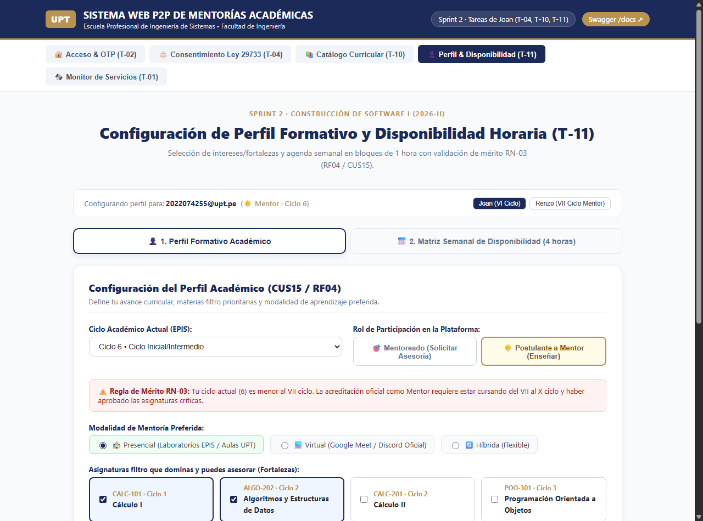  
*Figura 10.3: Formulario de perfil formativo y activación reactiva de alerta de mérito RN-03 (`ProfileAvailabilityView.tsx`).*

---

### 10.4. Matriz Semanal Interactiva de Disponibilidad Horaria (6×11)
Grilla interactiva semanal con 6 columnas (Lunes a Sábado) y 11 franjas horarias continuas de 1 hora (08:00 a 20:00), con marcado visual de bloques seleccionados en verde esmeralda, contador en vivo de horas comprometidas y atajos de selección masiva (*Mañanas*, *Tardes*, *Limpiar semana*).

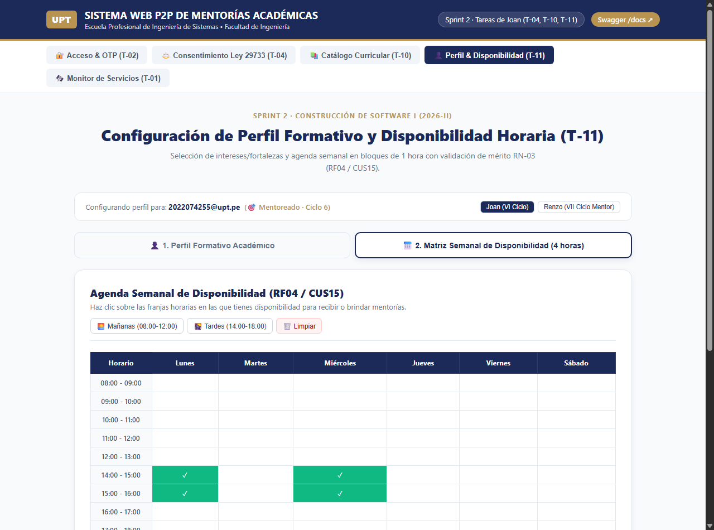  
*Figura 10.4: Matriz interactiva de disponibilidad semanal 6×11 con granularidad de 1 hora (`ProfileAvailabilityView.tsx`).*

---

### 10.5. Documentación Interactiva Swagger / OpenAPI de FastAPI (Sprint 2)
Interfaz interactiva Swagger UI expuesta en `/docs` evidenciando los 10 endpoints REST desarrollados para el Sprint 2 en los módulos de Salud, Catálogo, Autenticación, Consentimiento Ley 29733, Roles y Perfiles con Disponibilidad.

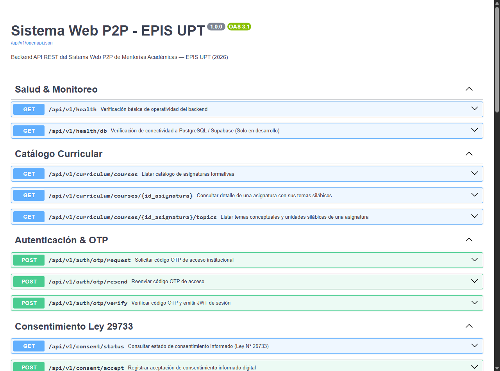  
*Figura 10.5: Interfaz interactiva Swagger UI con la totalidad de contratos REST del Sprint 2.*

---

### 10.6. Terminal de Pruebas de Backend (Pytest) y Reporte de Cobertura
Ejecución de la suite de 84 pruebas automatizadas en Pytest alcanzando el **90.64%** de cobertura en el backend, superando en más de 20 puntos porcentuales el umbral de calidad de RNF09.

  
*Figura 10.6: Terminal de ejecución de 84 pruebas de backend con 90.64% de cobertura.*

---

### 10.7. Terminal de Pruebas de Frontend (Vitest) y Reporte de Cobertura
Ejecución de la suite de 66 pruebas automatizadas en Vitest alcanzando el **91.10%** de cobertura en el frontend en 11 archivos de prueba con cero fallos.

  
*Figura 10.7: Terminal de ejecución de 66 pruebas de frontend con 91.10% de cobertura.*

---

## 11. Matriz Consolidada de Pruebas y Certificación de Cierre (DoD)

A continuación, se resume la batería de pruebas y se acredita el cumplimiento de los criterios de aceptación del Sprint 2.

### Cuadro 11.1: Distribución Consolidada de Pruebas Automatizadas (150 Tests)

| Entorno / Capa | Archivo de Pruebas | N.° Tests | Enfoque Evaluado | Cobertura Lograda |
| :--- | :--- | :---: | :--- | :---: |
| **Backend** | `tests/test_auth.py` | 13 | Validación @upt.pe, expiración, reuso, cooldown, persistencia DB. | 85% |
| **Backend** | `tests/test_curriculum.py` | 8 | Consulta de 5 materias filtro, filtros de ciclo, temarios y ORM. | 85% |
| **Backend** | `tests/test_health.py` | 7 | Endpoints `/health` y `/health/db`, resiliencia sin red. | 100% |
| **Backend** | `tests/test_security.py` | 6 | Criptografía, generación de OTP, firmas JWT y expiración. | 100% |
| **Backend** | `tests/test_session.py` | 10 | Lazy pooler, sanitización de credenciales y descarte seguro. | 89% |
| **Backend** | `tests/test_config.py` | 6 | Parsing de CORS, normalización de dialectos y máscara `repr`. | 93% |
| **Backend** | `tests/test_consent.py` | 5 | Persistencia Ley 29733, marcas UTC, IP auditoría, revocación RN-02. | 88% |
| **Backend** | `tests/test_roles.py` | 7 | Asignación base, mérito RN-03 (ciclo >= 7), revocación y sesión ORM. | 81% |
| **Backend** | `tests/test_profiles.py` | 11 | Perfiles, fronteras ciclo (1..10), reemplazo atómico agenda y solapamientos. | 73% |
| **Backend** | `tests/test_authorization.py` | 11 | Aislamiento entre usuarios, rechazo token inválido/expirado, denegación autopromoción y RLS. | 100% |
| **Frontend** | `src/services/__tests__/authService.test.ts` | 15 | Adaptadores de autenticación mock y API, timers y estados. | 89.94% |
| **Frontend** | `src/services/__tests__/apiAuthAdapter.test.ts` | 9 | Interacción REST real mediante fetch y manejo de errores. | 85.19% |
| **Frontend** | `src/services/__tests__/apiClient.test.ts` | 6 | Cliente HTTP, control de excepciones y salud de base de datos. | 75.00% |
| **Frontend** | `src/services/__tests__/consentService.test.ts`| 5 | Consentimiento Ley 29733, marcas UTC, persistencia mock/API. | 73.24% |
| **Frontend** | `src/services/__tests__/profileService.test.ts`| 5 | Perfiles, validación RN-03 en cliente, persistencia de agenda. | 71.73% |
| **Frontend** | `src/components/__tests__/LoginOtpView.test.tsx`| 9 | Renderizado de pasos 1, 2 y 3, feedback de error y temporizadores. | 94.52% |
| **Frontend** | `src/components/__tests__/CurriculumCatalogView.test.tsx`| 4 | Búsqueda reactiva, temario silábico, filtros y errores de red. | 94.54% |
| **Frontend** | `src/components/__tests__/ConsentModalView.test.tsx`| 4 | Renderizado legal Ley 29733, control de botones, aceptación y bloqueo RN-02. | 95.05% |
| **Frontend** | `src/components/__tests__/ProfileAvailabilityView.test.tsx`| 5 | Formulario perfil, alerta RN-03, grilla 6x11, atajos y guardado. | 90.18% |
| **Frontend** | `src/components/__tests__/HealthStatus.test.tsx`| 3 | Indicadores visuales de estado y reintento de conexión. | 100% |
| **Frontend** | `src/__tests__/App.test.tsx` | 1 | Navegación reactiva entre las 5 pestañas temáticas activas. | 99.32% |
| **TOTAL CONSOLIDADO** | **21 suites de prueba** | **150 tests** | **100% pruebas aprobadas sin fallos (0 fallos)** | **> 90.8% global** |

Fuente: Elaboración propia a partir de suites de pruebas ejecutadas con Pytest y Vitest.

El Cuadro 11.1 acredita empíricamente que la totalidad de los 150 casos de prueba automatizados se ejecutaron satisfactoriamente sin regresiones en las funcionalidades base del Sprint 1, sobrepasando en ambas capas de arquitectura el umbral del 70% estipulado en RNF09.

---

A continuación, se certifica el cumplimiento formal de los 6 criterios obligatorios de cierre fijados en el Definition of Done (*DoD*) para la aceptación integral del incremento de software.

### Cuadro 11.2: Acta de Aceptación Conjunta del Sprint 2 (Definition of Done)

| Criterio DoD | Exigencia Formal | Evidencia Empírica Verificada | Conformidad |
| :---: | :--- | :--- | :---: |
| **DoD-1: Requerimientos** | Cobertura funcional de RF02, RF03, RF04, RF05 y reglas RN-02 y RN-03. | Vistas de consentimiento, catálogo, perfil y matriz 6×11 operativas con endpoints REST y control de mérito. | ✅ Acreditado |
| **DoD-2: Cobertura Unit./Integ.**| Cobertura en líneas superior al 70.0% conforme a RNF09 en ambas capas. | **91.10% en Frontend** (66 pruebas) y **90.64% en Backend** (84 pruebas), sumando 150 pruebas sin fallos. | ✅ Acreditado |
| **DoD-3: Calidad Estática** | Cero errores de sintaxis, linteo o advertencias en ambos subsistemas. | `eslint .` (0 errores) y `ruff check .` / `ruff format --check .` (0 errores en 49 archivos conformes). | ✅ Acreditado |
| **DoD-4: Compilación y DDL** | Compilación de producción limpia y migraciones relacionales aplicadas. | `tsc -b && vite build` ejecutado en 602 ms; migración Alembic 002 y script RLS aplicados y verificados en Supabase. | ✅ Acreditado |
| **DoD-5: Seguridad y Aislamiento**| Aislamiento de perfiles privados y denegación de autopromoción (RNF02). | Endpoints protegidos por token Bearer JWT (rechazo 401/403) y RLS activo (`relrowsecurity = True` en 5 tablas). | ✅ Acreditado |
| **DoD-6: Documentación Formal** | Actualización de especificaciones y cumplimiento estricto de las 10 reglas. | Informe General `INFORME_GENERAL_SPRINT_02.md`, Evidencias `EVIDENCIA_PRUEBAS_SPRINT_02.md`, SRS y SAD actualizados. | ✅ Acreditado |

Fuente: Elaboración propia conforme a los acuerdos del Sprint Planning del Sprint 2.

La homologación de los 6 criterios del Definition of Done certifica la madurez y estabilidad técnica del incremento de software, autorizando la integración de las ramas correspondientes al repositorio principal.

---

## 12. Dictamen y Conclusión de Cierre del Sprint 2

El **Grupo 03 / C-SharkTeam** da por formalmente **CONCLUIDO Y APROBADO EL SPRINT 2** al haberse alcanzado con rigor metodológico y excelencia técnica el 100% de las tareas planificadas, los diagramas de diseño, los contratos de API REST, las políticas de persistencia relacional con RLS y las suites de pruebas automatizadas que certifican una cobertura global superior al 90%.

Queda habilitada formalmente la **Fase de Construcción del Sprint 3: Algoritmo de Recomendación Híbrido (*EdRecSys*) y Emparejamiento Top-k de Mentorías Académicas**.

---
*Fin del documento — Informe General de Cierre del Sprint 2.*
