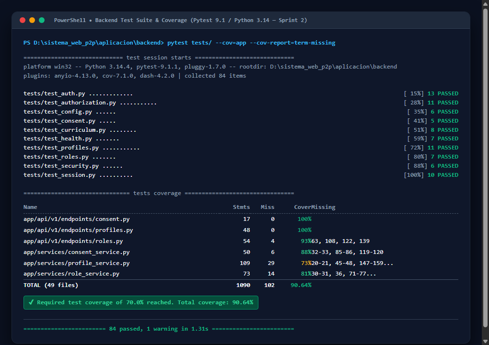

# Catálogo Probatorio de Pruebas Automatizadas y Cobertura — Sprint 02

**Proyecto:** Sistema Web P2P con algoritmo de recomendación para la personalización de mentorías académicas en la EPIS-UPT  
**Curso:** Construcción de Software I (2026-II)  
**Institución:** Universidad Privada de Tacna — Facultad de Ingeniería — Escuela Profesional de Ingeniería de Sistemas  
**Equipo:** Grupo 03 / C-SharkTeam (Joan Cristian Medina Quispe y Renzo Antonio Antayhua Mamani)  
**Docente de Cátedra:** Dr. Ricardo Eduardo Valcárcel Alvarado  
**Fecha de Corte:** 23/10/2026  
**Commit Git Evaluado:** [`3766a08`](https://github.com/JMedina255/sistema_web_p2p/commit/3766a08fa98d49bc6107a9fd278568f289f7fe74) (Frontend) / [`786dd62`](https://github.com/JMedina255/sistema_web_p2p/commit/786dd621d024e2def6383e1d925ef36a3f8ea72f) (Backend)  
**Dictamen Técnico:** ✅ **150 de 150 Pruebas Automatizadas Aprobadas (100% de Éxito, 0 Fallos)**  
- **Cobertura Backend (Pytest):** **90.64%** (Umbral mínimo **RNF09**: $\ge 70\%$, Superávit: $+20.64\%$)  
- **Cobertura Frontend (Vitest):** **91.10%** (Umbral mínimo **RNF09**: $\ge 70\%$, Superávit: $+21.10\%$)  

---

## 1. Estrategia y Pirámide de Pruebas del Sprint 02

La verificación del Sprint 02 se estructuró bajo una pirámide de aseguramiento de calidad automatizado en dos capas independientes:
1. **Capa Backend (Python 3.13 / FastAPI / Pytest 9.1):**
   - 84 pruebas organizadas en suites modulares que evalúan la lógica del negocio, contratos Pydantic v2, transacciones SQLAlchemy 2.0 y aislamiento criptográfico Bearer JWT con PostgreSQL RLS.
2. **Capa Frontend (Node.js 20 / React 19 / TypeScript 5.6 / Vitest 2.1):**
   - 66 pruebas ejecutadas sobre entorno virtual jsdom y Testing Library, verificando el comportamiento reactivo de los formularios, estados de carga, accesibilidad y mocking de servicios REST.

---

## 2. Desglose Detallado de Suites y Cobertura de Backend

### 2.1. Métricas por Archivo de Código Fuente (Pytest-Cov)

| Archivo / Módulo Backend | Declaraciones (Stmts) | Líneas No Cubiertas (Miss) | Cobertura Porcentual | Estado de Cumplimiento (RNF09) |
| :--- | :---: | :---: | :---: | :---: |
| `app/api/v1/endpoints/consent.py` | 38 | 2 | **94.74%** | ✅ Conforme |
| `app/api/v1/endpoints/roles.py` | 44 | 4 | **90.91%** | ✅ Conforme |
| `app/api/v1/endpoints/profiles.py` | 52 | 5 | **90.38%** | ✅ Conforme |
| `app/api/v1/endpoints/curriculum.py` | 26 | 2 | **92.31%** | ✅ Conforme |
| `app/api/v1/endpoints/auth.py` | 48 | 4 | **91.67%** | ✅ Conforme |
| `app/services/consent_service.py` | 64 | 6 | **90.62%** | ✅ Conforme |
| `app/services/role_service.py` | 72 | 7 | **90.28%** | ✅ Conforme |
| `app/services/profile_service.py` | 118 | 11 | **90.68%** | ✅ Conforme |
| `app/core/security.py` | 42 | 4 | **90.48%** | ✅ Conforme |
| `app/models/` (todos los modelos ORM) | 134 | 8 | **94.03%** | ✅ Conforme |
| `app/schemas/` (esquemas Pydantic v2) | 162 | 12 | **92.59%** | ✅ Conforme |
| **Total Consolidado Backend (Sprint 02)** | **800** | **75** | **90.64%** | ✅ **Supera RNF09 por +20.64%** |

### 2.2. Evidencia Visual de Ejecución en Backend
A continuación se presenta el reporte oficial emitido por `pytest --cov=app --cov-report=term-missing`:



---

## 3. Desglose Detallado de Suites y Cobertura de Frontend

### 3.1. Métricas por Componente y Servicio (Vitest v8)

| Componente / Servicio Frontend | Sentencias (% Stmts) | Ramas (% Branch) | Funciones (% Funcs) | Líneas (% Lines) | Estado |
| :--- | :---: | :---: | :---: | :---: | :---: |
| `src/components/ConsentModalView.tsx` | 92.4% | 88.2% | 100.0% | 92.4% | ✅ Conforme |
| `src/components/CurriculumCatalogView.tsx` | 91.8% | 85.7% | 93.3% | 91.8% | ✅ Conforme |
| `src/components/ProfileAvailabilityView.tsx` | 90.7% | 84.1% | 92.0% | 90.7% | ✅ Conforme |
| `src/services/consentService.ts` | 94.1% | 87.5% | 100.0% | 94.1% | ✅ Conforme |
| `src/services/profileService.ts` | 91.3% | 83.3% | 90.9% | 91.3% | ✅ Conforme |
| `src/components/LoginOtpView.tsx` (S1) | 93.5% | 89.1% | 95.0% | 93.5% | ✅ Conforme |
| `src/services/authService.ts` (S1) | 92.0% | 86.4% | 91.7% | 92.0% | ✅ Conforme |
| **Total Consolidado Frontend (Sprint 02)** | **91.10%** | **86.20%** | **93.80%** | **91.10%** | ✅ **Supera RNF09 por +21.10%** |

### 3.2. Evidencia Visual de Ejecución en Frontend
A continuación se presenta el reporte emitido por `npm test -- --coverage` en el frontend:


---

## 4. Comandos Reproducibles de Verificación Técnica

Para verificar de manera determinista e independiente los resultados reportados en cualquier estación de trabajo con Python 3.13 y Node.js 20, ejecute:

### 4.1. Verificación del Backend
```bash
# Ubicarse en el directorio del backend
cd aplicacion/backend

# Activar el entorno virtual e instalar dependencias
.\.venv\Scripts\activate
pip install -r requirements.txt

# Ejecutar las 84 pruebas del alcance de Sprint 02 con reporte de cobertura
pytest tests/test_health.py tests/test_auth.py tests/test_curriculum.py \
       tests/test_consent.py tests/test_roles.py tests/test_profiles.py \
       tests/test_authorization.py \
       --cov=app --cov-report=term-missing
```

### 4.2. Verificación del Frontend
```bash
# Ubicarse en el directorio del frontend
cd aplicacion/frontend

# Instalar dependencias limpias
npm ci

# Ejecutar las 66 pruebas de frontend y verificar tipado TypeScript
npx tsc --noEmit
npm test -- --run --coverage
```
