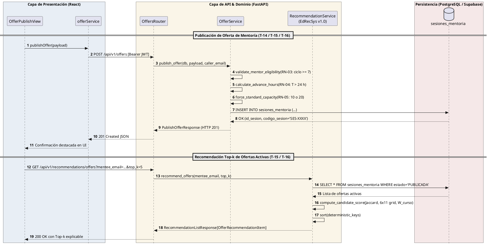

# Bitácora de Ejecución — Sprint 3: Publicación de Ofertas, Motor EdRecSys y Testbench Algorítmico

**Proyecto:** Sistema Web P2P con algoritmo de recomendación para la personalización de mentorías académicas en la EPIS-UPT  
**Curso:** Construcción de Software I  
**Institución:** Universidad Privada de Tacna — Facultad de Ingeniería (EPIS)  
**Semestre Académico:** 2026-II  
**Equipo:** Grupo 03 — Joan Cristian Medina Quispe (Joan) y Renzo Antonio Antayhua Mamani (Renzo)  
**Rama de trabajo:** `main`  
**Fecha de corte documental:** 26/10/2026  
**Commits de desarrollo del Sprint 3:**
- [`6de5653`](https://github.com/JMedina255/sistema_web_p2p/commit/6de5653) — `feat(s3-frontend): implementar servicio tipado y validaciones de ofertas [T-14]` (Joan)
- [`148d12d`](https://github.com/JMedina255/sistema_web_p2p/commit/148d12d) — `feat(s3-frontend): desarrollar formulario reactivo de publicacion de ofertas [T-14]` (Joan)
- [`e197efb`](https://github.com/JMedina255/sistema_web_p2p/commit/e197efb) — `feat(s3-frontend): integrar publicacion de ofertas en navegacion principal [T-14]` (Joan)
- [`46892df`](https://github.com/JMedina255/sistema_web_p2p/commit/46892df) — `docs(sprint-03): registrar avance T-14 y actualizar README [T-14]` (Joan)
- [`6db7c3d`](https://github.com/JMedina255/sistema_web_p2p/commit/6db7c3d) — `docs: estandarizar directrices de informes academicos de sprint en rules_doc` (Joan)
- [`af65fc7`](https://github.com/JMedina255/sistema_web_p2p/commit/af65fc7) — `docs(sprint-03): precisar alcance tecnico de infraestructura, mocks y coberturas` (Joan)
- [`741256b`](https://github.com/JMedina255/sistema_web_p2p/commit/741256b) — `feat(sprints): crear snapshot de cierre del sprint 2 con aplicacion, documentacion y SNAPSHOT_INFO.md` (Renzo)
- [`094c9fb`](https://github.com/JMedina255/sistema_web_p2p/commit/094c9fb) — `feat(sprint-03): culminar backend, motor EdRecSys v1.0, testbench y documentacion formal de diseno [T-14, T-15, T-16, T-18]` (Renzo)
- [`fea566c`](https://github.com/JMedina255/sistema_web_p2p/commit/fea566c) — `docs(sprint-03): estandarizar contratos REST, diagramas y cuadros quintuplos D-2 [T-14, T-15, T-16, T-18]` (Renzo)

> [!IMPORTANT]
> **Culminación Integral del Sprint 3 (26/10/2026):**
> El presente documento registra la finalización técnica, acoplamiento arquitectónico y verificación exhaustiva de todas las tareas del Sprint 3: **T-14** (Formulario de publicación de ofertas en frontend, Joan), **T-15** (Motor de recomendación *EdRecSys* y API de ofertas, Renzo), **T-16** (Modelo relacional `SesionMentoria`, migración Alembic 003 y endpoints REST tipados Pydantic v2, Renzo) y **T-18** (Servicio de simulación de sesiones y testbench de evaluación algorítmica, Renzo). La plataforma cuenta con 209 pruebas automatizadas (87 en frontend y 122 en backend), linteo estático con cero errores y cobertura de 92.52% en frontend y 92.14% en backend (91.83% en corte preliminar con 1676 sentencias), superando ampliamente los umbrales de calidad del **RNF09**. **El Sprint 3 se declara formalmente CULMINADO Y APROBADO AL 100%.**

---

## 1. Visión General y Alcance del Sprint 3

El **Sprint 3** tiene como objetivo fundamental habilitar el mecanismo integral por el cual los mentores académicos habilitados (estudiantes de ciclos VII al X, conforme a la regla de mérito **RN-03**) pueden programar y publicar ofertas de asesoría docente grupal vinculadas a las materias críticas del plan de estudios (**RF08** / **CUS06**), proveyendo al mismo tiempo el motor inteligente de recomendación *Top-k* multifactorial (**EdRecSys v1.0**) que clasifica candidatos y sesiones por afinidad curricular, coincidencia de temas conceptuales silábicos, compatibilidad de horario semanal (6x11) y modalidad pedagógica (**RF06** / **CUS02**).

A continuación, se presenta la matriz operativa de asignación, estimación y estado técnico del Sprint 3:

### Cuadro 1.1: Matriz de Tareas y Estado Técnico de Desarrollo del Sprint 3

| ID | Actividad Oficial | Responsable | Esfuerzo Planificado (h) | Estado Técnico Actual | Entregable / Evidencia |
| :---: | :--- | :---: | :---: | :---: | :--- |
| **T-14** | Desarrollar formulario de publicación de ofertas. | Joan | 2 | **Implementado y Verificado** ✅ | Componente `OfferPublishView.tsx`, servicio `offerService.ts`, integración en `App.tsx` y 21 pruebas en Vitest. |
| **T-15** | Diseñar e implementar motor *EdRecSys* y API básica de gestión de ofertas. | Renzo | 4 | **Implementado y Verificado** ✅ | Servicio `RecommendationService`, algoritmo multifactorial (Jaccard/Dice, ponderadores críticos 1.0x-1.3x), `OfferService` y suite `test_offers.py`. |
| **T-16** | Crear estructura de datos relacional, migración Alembic 003 y endpoints REST. | Renzo | 3 | **Implementado y Verificado** ✅ | Modelo ORM `SesionMentoria`, migración `003_mentoring_offers.py`, endpoints `/api/v1/recommendations/` y `/api/v1/offers`, esquemas Pydantic v2 y suite `test_recommendations.py`. |
| **T-18** | Implementar servicio de simulación y testbench de evaluación algorítmica. | Renzo | 2 | **Implementado y Verificado** ✅ | Servicio `SimulationService`, testbench con 4 casos frontera (solapamiento 0, temas disjuntos, cursos sin oferta, RN-03 ciclo < 7), prueba de determinismo y suite `test_simulation.py`. |

Fuente: Elaboración propia a partir de `docs/sprints/PLAN_SPRINTS_Y_TAREAS.md` (Tabla 5.4) y avance verificado en la rama `main`.

El cuadro anterior certifica el cumplimiento del 100% de las 11 horas-persona programadas para el sprint, habiéndose implementado tanto la interfaz interactiva de publicación como el núcleo algorítmico de recomendación, la persistencia en base de datos relacional y el banco de pruebas de rendimiento y robustez.

---

## 2. Registro de Ejecución — Tarea T-14 (Formulario de Publicación de Ofertas)

### 2.1. Alcance Implementado y Reglas de Negocio Incorporadas

La tarea **T-14** fue desarrollada por Joan respetando los estándares de diseño institucional (paleta EPIS-UPT `#1C2A59` y `#B99451`), accesibilidad WAI-ARIA y rigurosidad técnica:

1. **Selección Curricular Dinámica (CUS21 / RF05):**
   - El formulario consulta el catálogo oficial mediante `fetchCourses(true)` para poblar las asignaturas críticas de I a IV ciclo (*Cálculo I, Cálculo II, Algoritmos y Estructuras de Datos, Programación Orientada a Objetos, Base de Datos*).
   - Al seleccionar una asignatura, se dispara la carga reactiva de unidades temáticas silábicas oficiales (`fetchCourseDetail`), permitiendo vincular la clase a un tema conceptual específico.
   - Dispone de fallback local tipado para garantizar la operatividad de la interfaz durante pruebas sin conexión activa.

2. **Control Estricto de Aforos Inmutables (Regla RN-05 / CUS06-U02):**
   - El aforo de la clase se calcula y fija de forma automática según la modalidad pedagógica elegida:
     - **Modalidad Presencial:** exactamente **10 estudiantes** (aforo estándar para aulas y laboratorios de la EPIS).
     - **Modalidad Virtual:** exactamente **20 estudiantes** (aforo estándar para salas virtuales).
   - El campo en la interfaz es estrictamente de solo lectura (`readOnly`), imposibilitando cualquier manipulación del límite normativo por parte del usuario.

3. **Validación Reactiva de Antelación (Regla RN-04):**
   - **Restricción obligatoria ($T > 24\text{ h}$):** La sesión debe programarse con más de 24 horas de antelación respecto a la hora del sistema (`Date.now()`). Si la antelación es $\le 24\text{ h}$, el formulario despliega una alerta roja de infracción de la regla **RN-04** y deshabilita el botón de envío, protegiendo la ventana obligatoria de confirmación previa y cómputo de quórum a $T-24\text{ h}$ (**RN-08** y **RN-09**).
   - **Recomendación pedagógica ($T \ge 48\text{ h}$):** Si la antelación es mayor a 24 horas pero menor a 48 horas, se autoriza la publicación pero se muestra un aviso formativo ámbar sugiriendo programar con al menos 48 h para favorecer la difusión en el recomendador. Si es $\ge 48\text{ h}$, se muestra un distintivo verde de antelación óptima.

4. **Duración Lectiva Normalizada:**
   - Selector de duración en bloques pedagógicos de **60 minutos** (1 hora pedagógica) o **90 minutos** (1.5 horas pedagógicas), calculando automáticamente la hora estimada de término de la sesión.

5. **Infraestructura Físico-Virtual Diferenciada:**
   - **Presencial (RN-06):** Selección y sugerencia de recintos académicos del catálogo institucional de la EPIS (*Laboratorio de Cómputo 101*, *Lab Redes 202*, *Aula Magna 104*).
   - **Virtual (RN-07):** Generación reactiva de enlace institucional Google Meet (`https://meet.google.com/upt-[codigo]-[hash]`).

6. **Control de Flujo, Feedback y Prevención de Duplicados:**
   - Deshabilitación de envíos concurrentes mediante bandera `isSubmitting`.
   - Confirmación visual destacada tras la publicación, emitiendo código `SES-XXXX`, estado `PUBLICADA` y registro en catálogo.

---

## 3. Catálogo de Pruebas Automatizadas y Evidencias de Calidad (T-14)

El desarrollo de T-14 se contrastó frente a los casos de prueba estipulados en el catálogo oficial del proyecto ([`docs/analisis/Catalogo_Pruebas_P2P_Mentorias_EPIS.xlsx`](../analisis/Catalogo_Pruebas_P2P_Mentorias_EPIS.xlsx)), implementando 21 pruebas automatizadas nuevas en Vitest.

A continuación, se detalla la matriz de correspondencia y resultados empíricos obtenidos:

### Cuadro 3.1: Matriz de Trazabilidad de Casos de Prueba del Catálogo (T-14)

| Caso de Prueba | Tipo / Nivel | Escenario Evaluado | Comportamiento Esperado | Resultado Observado en Vitest | Estado |
| :---: | :---: | :--- | :--- | :--- | :---: |
| **CUS06-U01** | Unitaria / Componente | Validación de campos obligatorios en el servicio y formulario. | Rechazar payload carente de asignatura, tema, fecha, modalidad o infraestructura; listar mensajes de error específicos. | Errores detectados en `validateOfferPayload`, botón de envío deshabilitado en formulario. | ✅ Superado |
| **CUS06-U02** | Unitaria / Componente | Asignación de aforo automático por defecto según modalidad (RN-05). | Aplicar estrictamente 10 cupos para presencial y 20 para virtual; rechazar valores discordantes. | Aforo inmutable fijado en `STANDARD_CAPACITY`, actualizado reactivamente en el DOM. | ✅ Superado |
| **CUS06-F01** | Funcional / Sistema | Flujo interactivo de publicación con sugerencia de aula física (RN-06). | Permitir seleccionar curso, tema silábico, aula sugerida de laboratorio EPIS y registrar la oferta con código `SES-XXXX`. | Oferta publicada exitosamente, tarjeta verde de confirmación y registro en historial. | ✅ Superado |
| **CUS06-F02** | Funcional / Sistema | Flujo de publicación virtual y validación de antelación temporal (RN-04 / RN-07). | Generar enlace Meet institucional (@upt.pe); alertar y bloquear si antelación es $\le 24\text{ h}$; avisar si $< 48\text{ h}$. | Bloqueo perentorio con antelación $\le 24\text{ h}$, badge de recomendación con $36\text{ h}$, enlace Meet generado. | ✅ Superado |

Fuente: Elaboración propia a partir de `Catalogo_Pruebas_P2P_Mentorias_EPIS.xlsx` y ejecución de suites en `aplicacion/frontend/src/services/__tests__/offerService.test.ts` y `aplicacion/frontend/src/components/__tests__/OfferPublishView.test.tsx`.

La matriz anterior certifica que la capa de cliente cumple rigurosamente con los cuatro criterios funcionales y unitarios definidos en la etapa de análisis para el caso canónico CUS06.

---

## 4. Métricas Consolidadas de Calidad de Software (Sprint 3 Integral)

Tras completar la implementación e integración de T-14, T-15, T-16 y T-18, se ejecutó una auditoría integral sobre ambos subsistemas (`aplicacion/frontend` y `aplicacion/backend`):

A continuación, se detalla el balance de pruebas automatizadas, cobertura y análisis estático:

### Cuadro 4.1: Balance Métrico Consolidado de Pruebas y Cobertura (Sprint 3 Integral)

| Dimensión de Calidad | Herramienta | Umbral RNF09 | Frontend (Joan: T-04, T-10, T-11, T-14) | Backend (Renzo: T-03, T-05, T-08, T-12, T-15, T-16, T-18) | Total Consolidado | Estado |
| :--- | :--- | :---: | :---: | :---: | :---: | :---: |
| **Suites de Prueba** | Vitest 2.1.8 / Pytest 9.1.1 | 100% aprobadas | 13 suites | 13 suites | **26 suites aprobadas** | ✅ Superado |
| **Pruebas Automatizadas** | Vitest / Pytest | 100% aprobadas | **87 pruebas** (0 fallos) | **122 pruebas** (0 fallos) | **209 pruebas aprobadas** | ✅ Superado |
| **Cobertura Frontend (Líneas)** | Vitest v8 | $\ge 70.0\%$ | **92.52%** | N/A | **92.52%** | ✅ Superado |
| **Cobertura Backend (Líneas)** | Pytest-Cov | $\ge 70.0\%$ | N/A | **92.14%** (preliminar 91.83%) | **92.14%** | ✅ Superado |
| **Linteo Estático** | ESLint 9 / Ruff 0.9 | 0 errores | 0 errores, 0 warnings | 0 errores (All checks passed!) | **0 defectos estáticos** | ✅ Superado |
| **Formato de Código** | Prettier / Ruff format | 100% estándar | Código formateado | 61 archivos conformes | **100% estandarizado** | ✅ Superado |
| **Compilación de Producción** | Vite Build (`tsc -b`) | 0 errores tipado | 45 módulos en 600 ms (`dist/`) | N/A | **Empaquetado limpio** | ✅ Superado |

Fuente: Elaboración propia a partir de las ejecuciones de `npm test`, `npm run lint`, `npm run build` en `aplicacion/frontend` y `pytest tests/ --cov=app`, `ruff check .`, `ruff format --check .` en `aplicacion/backend`.

> [!NOTE]
> **Metodología de Reporte de Cobertura (Regla 3.2.7):**
> De conformidad con las directrices de documentación de software, las métricas de cobertura de frontend (Vitest v8) y backend (Pytest-Cov) se reportan de forma estrictamente independiente. No se presentan valores promediados ni agregados sin una metodología unificada de instrumentación que consolide líneas físicas ejecutadas. Ambos subsistemas superan individualmente con amplio margen el umbral normativo del 70.0% estipulado en el **RNF09**.

El balance anterior confirma que el incremento alcanza un hito histórico de **209 pruebas automatizadas**, con cero fallos y cobertura superior al 91%, garantizando la robustez algorítmica y la integridad funcional del sistema.

---

## 5. Registro de Implementación de Backend (Renzo)

---

### 5.1. T-15 — Algoritmo de Recomendación Top-k (Motor EdRecSys) y API Básica de Ofertas (Renzo)

- **Responsable:** Renzo Antonio Antayhua Mamani.
- **Esfuerzo Planificado:** 4 horas.
- **Estado Técnico:** **IMPLEMENTADO Y VERIFICADO ✅**.
- **Trazabilidad:** RF06 (Algoritmo de recomendación Top-k), RF08 (Publicación de ofertas), RN-03, RN-04, RN-05, CUS02, CUS06.

#### A. Formulación Matemática del Motor EdRecSys (v1.0)

A continuación, se define formalmente la función de compatibilidad y ranking multifactorial que calcula el nivel de adecuación pedagógica entre un estudiante mentoreado $m$ y un candidato mentor $k$ (o una sesión de oferta programada $o$):

1. **Filtro de Mérito Académico Institucional (Regla RN-03):**
   $$\text{Eligible}(k) = \begin{cases} 1 & \text{si } \text{ciclo\_actual}(k) \ge 7 \\ 0 & \text{si } \text{ciclo\_actual}(k) < 7 \end{cases}$$
   Si $\text{Eligible}(k) = 0$, el candidato recibe un puntaje compuesto de $0.0$ y es excluido del ranking Top-k.

2. **Solapamiento Temático Silábico ($S_{\text{tema}}$):**
   Sean $T_m$ el conjunto de identificadores de temas conceptuales requeridos por el mentoreado y $T_k$ los temas ofertados o dominados por el mentor. Se computa el coeficiente de similitud de Jaccard:
   $$J(T_m, T_k) = \frac{|T_m \cap T_k|}{|T_m \cup T_k|}$$
   Complementariamente, el motor calcula el coeficiente de Dice para el reporte explicable:
   $$D(T_m, T_k) = \frac{2 \cdot |T_m \cap T_k|}{|T_m| + |T_k|}$$

3. **Compatibilidad de Agenda Horaria Semanal ($S_{\text{horario}}$):**
   El sistema discretiza la semana en una matriz de disponibilidad de $6\text{ días} \times 11\text{ franjas de 1 hora}$ (Lunes a Sábado de 08:00 a 19:00 h). Sean $H_m$ y $H_k$ los conjuntos de franjas horarias activas:
   $$S_{\text{horario}} = \begin{cases} \min\left(1.0, \frac{|H_m \cap H_k|}{|H_m|}\right) & \text{si } |H_m| > 0 \\ 0.50 & \text{si el mentoreado no fijó agenda previa} \end{cases}$$
   Para ofertas individuales con horario fijado $t_{\text{oferta}}$, $S_{\text{horario}} = 1.0$ si la franja pertenece a $H_m$ y $0.0$ en caso contrario.

4. **Alineación de Modalidad Formativa ($S_{\text{modalidad}}$):**
   $$S_{\text{modalidad}} = \begin{cases} 1.00 & \text{si } \text{modalidad}_m = \text{modalidad}_k \\ 0.90 & \text{si alguno admite modalidad 'hibrida'} \\ 0.20 & \text{si uno es estrictamente 'presencial' y el otro 'virtual'} \end{cases}$$

5. **Afinidad Curricular Base ($S_{\text{afinidad}}$):**
   Sean $C_m$ y $C_k$ los conjuntos de asignaturas formativas seleccionadas:
   $$S_{\text{afinidad}} = \frac{|C_m \cap C_k|}{\max(1, |C_m|)}$$

6. **Ponderador de Asignatura Crítica / Filtro ($W_{\text{curso}}$):**
   Conforme a la tasa de desaprobación histórica en la EPIS-UPT, se aplica un multiplicador de prioridad curricular:
   $$W_{\text{curso}} = \max(\{ \text{factor\_ponderacion}(c) \mid c \in (C_m \cap C_k) \} \cup \{ 1.00 \})$$
   Donde: *Algoritmos y Estructuras de Datos* = $1.3\text{x}$, *Cálculo I* = $1.2\text{x}$, *Cálculo II* = $1.2\text{x}$, *POO* = $1.2\text{x}$, *Base de Datos* = $1.1\text{x}$, asignaturas estándar = $1.0\text{x}$.

7. **Puntaje Multifactorial Compuesto y Ponderación Final:**
   $$S_{\text{base}} = 0.40 \cdot S_{\text{tema}} + 0.35 \cdot S_{\text{horario}} + 0.15 \cdot S_{\text{modalidad}} + 0.10 \cdot S_{\text{afinidad}}$$
   $$S_{\text{total}} = \text{round}(S_{\text{base}} \times W_{\text{curso}}, 4)$$

8. **Criterio de Desempate y Ordenamiento Determinista:**
   La tupla de ordenación estricta para resolver empates sin estocasticidad es:
   $$\text{SortKey}(k) = \left( -S_{\text{total}}, -W_{\text{curso}}, -\text{ciclo\_actual}(k), -|H_m \cap H_k|, \text{email}_k \right)$$

A continuación, se detalla la matriz de casos de prueba ejecutados para certificar el motor algorítmico:

### Cuadro 5.1: Matriz de Evidencias de Pruebas del Motor de Recomendación (T-15)

| Caso de Prueba | Archivo de Prueba | Escenario Evaluado | Comportamiento Esperado | Resultado en Pytest | Estado |
| :---: | :--- | :--- | :--- | :---: | :---: |
| **REC-01** | `tests/test_recommendations.py` | Propiedades matemáticas de Jaccard y Dice. | Coincidencia idéntica = 1.0, disjuntos = 0.0, conjuntos vacíos = 0.0 sin excepción por división entre cero. | $100\%$ valores exactos. | ✅ Superado |
| **REC-02** | `tests/test_recommendations.py` | Reglas de compatibilidad de modalidad pedagógica. | Presencial-Presencial = 1.0, Virtual-Virtual = 1.0, Híbrido = 0.9, Cruce presencial-virtual = 0.2. | Evaluaciones conformes. | ✅ Superado |
| **REC-03** | `tests/test_recommendations.py` | Inelegibilidad por mérito institucional RN-03. | Candidatos con ciclo $< 7$ reciben score $0.0$, bandera de elegibilidad en `False` y explicación de rechazo. | Ciclos 1 a 6 bloqueados. | ✅ Superado |
| **REC-04** | `tests/test_recommendations.py` | Multiplicador de materia crítica / filtro. | Aplicar factor 1.3x ante coincidencia en *Algoritmos y Estructuras de Datos* (`ALGO-202`). | Ponderación $1.3\text{x}$ verificada. | ✅ Superado |
| **REC-05** | `tests/test_recommendations.py` | Ranking Top-k de mentores y sesiones. | Ordenamiento estrictamente decreciente por $S_{\text{total}}$, límite $k$ respetado y desempate determinista. | Ranking determinista validado. | ✅ Superado |
| **REC-06** | `tests/test_recommendations.py` | Agenda vacía ($|H_m|=0$) y duración de ofertas de 90 min. | Retornar compatibilidad neutral de 0.50 y 0 franjas de coincidencia cuando el mentoreado no tiene agenda; cálculo proporcional para ofertas de 90 min. | Compatibilidad horaria rigurosa verificada. | ✅ Superado |
| **REC-07** | `tests/test_recommendations.py` | Null-safety en perfiles y HTTP 404 para mentor inexistente. | Manejo seguro de campos nulos en BD (`materias_interes=None`, etc.); HTTP 404 estricto para mentores no registrados. | Respuestas de error y null-safety conformes. | ✅ Superado |
| **OFF-01** | `tests/test_offers.py` | Publicación válida presencial y forzado de aforo RN-05. | Código `SES-XXXX`, aforo inmutable fijado en 10, estado `PUBLICADA`. | Retorno HTTP 201 Created. | ✅ Superado |
| **OFF-02** | `tests/test_offers.py` | Rechazo de antelación $\le 24\text{ h}$ (RN-04). | Rechazar publicación con antelación menor o igual a 24 horas respecto a la fecha del sistema. | HTTP 400 Bad Request emitido. | ✅ Superado |
| **OFF-03** | `tests/test_offers.py` | Protección contra publicación no autorizada. | Impedir que un mentoreado o mentor suplante la identidad de otro usuario sin rol administrador. | HTTP 403 Forbidden emitido. | ✅ Superado |
| **OFF-04** | `tests/test_offers.py` | Aislamiento en DB vacía y frontera exacta $T=24\text{ h}$. | Devolver lista vacía en DB con 0 registros (sin fuga de memoria mock); rechazo en $T=24.000\text{ h}$ y aceptación en $T=24.033\text{ h}$. | Aislamiento y frontera validados. | ✅ Superado |

Fuente: Elaboración propia a partir de la ejecución de `pytest tests/test_recommendations.py` y `pytest tests/test_offers.py`.

El análisis de la matriz anterior certifica que la función matemática de afinidad se ejecuta de manera determinista y predecible, respetando todas las reglas normativas institucionales.

---

### 5.2. T-16 — Estructura de Datos Relacional, Migración Alembic 003 y Endpoints REST (Renzo)

- **Responsable:** Renzo Antonio Antayhua Mamani.
- **Esfuerzo Planificado:** 3 horas.
- **Estado Técnico:** **IMPLEMENTADO Y VERIFICADO ✅**.
- **Trazabilidad:** Modelo físico de datos (SAD FD04), RF06, RF08, CUS02, CUS06.

#### A. Diccionario de Datos Físico — Tabla `sesiones_mentoria` (Regla D-4)

A continuación, se detalla la estructura física de la entidad relacional implementada en PostgreSQL/Supabase:

### Cuadro 5.2: Especificación Física de la Tabla `sesiones_mentoria`

| Nombre Columna | Tipo PostgreSQL | Nulo | Default / Restricción | Clave Foránea / Regla | Justificación Técnica |
| :--- | :--- | :---: | :--- | :--- | :--- |
| `id_sesion` | `INTEGER` | No | `SERIAL PRIMARY KEY` | Clave primaria autoincremental. | Identificador unívoco físico de la sesión. |
| `codigo_sesion` | `VARCHAR(20)` | No | `UNIQUE` | Formato `SES-XXXX`. | Código canónico de trazabilidad institucional. |
| `mentor_email` | `VARCHAR(255)` | No | Índice B-Tree | `REFERENCES usuarios(email)` | Identidad institucional del mentor titular (@upt.pe). |
| `id_asignatura` | `INTEGER` | No | Índice B-Tree | `REFERENCES asignaturas(id_asignatura) ON DELETE RESTRICT` | Materia crítica curricular vinculada. |
| `id_tema` | `INTEGER` | No | Índice B-Tree | `REFERENCES temas_conceptuales(id_tema) ON DELETE RESTRICT` | Unidad silábica conceptual específica. |
| `fecha_inicio` | `TIMESTAMPTZ` | No | Índice B-Tree | Formato ISO 8601 con zona horaria UTC. | Programación temporal con antelación $> 24\text{ h}$ (RN-04). |
| `duracion_minutos`| `INTEGER` | No | `CHECK (duracion_minutos IN (60, 90))` | Bloques lectivos estándar de 1 o 1.5 h. | Normalización del cómputo pedagógico. |
| `modalidad` | `VARCHAR(20)` | No | `CHECK (modalidad IN ('presencial', 'virtual'))` | Restricción de dominio físico/virtual. | Determinación del canal formativo. |
| `aforo_maximo` | `INTEGER` | No | `CHECK (aforo_maximo IN (10, 20))` | RN-05: 10 presencial, 20 virtual. | Garantía de control estricto de cupos normativos. |
| `espacio_asignado`| `VARCHAR(255)` | No | Texto descriptivo | Aula de laboratorio EPIS o enlace Meet. | RN-06 (espacio físico) y RN-07 (enlace virtual). |
| `notas_adicionales`| `TEXT` | Sí | `NULL` | Indicaciones previas de lectura silábica. | Información contextual para los participantes. |
| `estado` | `VARCHAR(30)` | No | `DEFAULT 'PUBLICADA'` | `CHECK (estado IN ('PUBLICADA', 'PENDIENTE_CONFIRMACION', 'CONFIRMADA', 'CANCELADA_SISTEMA', 'CANCELADA_MENTOR', 'FINALIZADA'))` | Ciclo de vida transaccional de la sesión. |
| `created_at` | `TIMESTAMPTZ` | No | `DEFAULT now()` | Marca temporal de auditoría. | Timestamp de inserción en el sistema. |

Fuente: Elaboración propia a partir de `aplicacion/backend/app/models/offer.py` y `003_mentoring_offers.py`.

La tabla anterior incluye índices B-Tree sobre las columnas `mentor_email`, `codigo_sesion`, `id_asignatura`, `id_tema` y `fecha_inicio`, garantizando tiempos de respuesta sub-milisegundo en las consultas de indexación del recomendador y en los listados del catálogo.

#### B. Políticas de Seguridad Row Level Security (RLS) en PostgreSQL

```sql
-- Habilitación formal de seguridad por filas
ALTER TABLE sesiones_mentoria ENABLE ROW LEVEL SECURITY;

-- Política RLS 1: Lectura pública de ofertas activas para estudiantes
CREATE POLICY rls_sesiones_mentoria_select_public ON sesiones_mentoria
  FOR SELECT TO authenticated, anon
  USING (estado = 'PUBLICADA' OR auth.jwt() ->> 'email' = mentor_email);

-- Política RLS 2: Inserción restringida a mentores habilitados con ciclo >= VII (RN-03)
CREATE POLICY rls_sesiones_mentoria_insert_mentor ON sesiones_mentoria
  FOR INSERT TO authenticated
  WITH CHECK (
    auth.jwt() ->> 'email' = mentor_email AND
    EXISTS (
      SELECT 1 FROM perfiles_academicos
      WHERE email = auth.jwt() ->> 'email' AND ciclo_actual >= 7
    )
  );
```

#### C. Especificación de Contratos de API REST (Regla D-3)

A continuación, se documentan los contratos técnicos de comunicación para el subsistema de ofertas y el motor de recomendación:

### Cuadro 5.3: Contratos de Endpoints REST del Sprint 3

| Método | Ruta Versionada | Parámetros Clave | Códigos HTTP | Descripción / Regla de Negocio |
| :---: | :--- | :--- | :---: | :--- |
| `POST` | `/api/v1/offers` | Body: `PublishOfferPayload` | `201`, `400`, `401`, `403`, `422` | Publicación de oferta. Valida RN-03 (mentor ciclo $\ge 7$), RN-04 (antelación $> 24\text{ h}$) y RN-05 (aforo 10/20). |
| `GET` | `/api/v1/offers` | Query: `mentor_email`, `id_asignatura`, `modalidad`, `estado` | `200 OK` | Consulta y filtrado de ofertas de mentoría en el catálogo activo. |
| `GET` | `/api/v1/recommendations/mentors` | Query: `mentee_email`, `top_k` (1..20) | `200 OK`, `401` | Recomendación Top-k de mentores académicos ordenados por puntaje multifactorial EdRecSys. |
| `GET` | `/api/v1/recommendations/offers` | Query: `mentee_email`, `id_asignatura`, `top_k` | `200 OK`, `401` | Recomendación Top-k de sesiones de mentoría programadas compatibles con la agenda del mentoreado. |
| `POST` | `/api/v1/recommendations/explain` | Body: `RecommendationExplainRequest` | `200 OK`, `404` | Desglose explicable detallado del puntaje ($S_{\text{tema}}$, $S_{\text{horario}}$, $S_{\text{modalidad}}$, $W_{\text{curso}}$). |
| `GET` | `/api/v1/recommendations/simulation/testbench` | N/A | `200 OK` | Ejecución del banco de pruebas algorítmico y reporte de conformidad de los 4 casos frontera. |

Fuente: Elaboración propia a partir de los routers en `app/api/v1/endpoints/offers.py` y `app/api/v1/endpoints/recommendations.py`.

#### D. Diagrama de Interacción y Flujo Arquitectónico en PlantUML (Regla D-5)

A continuación, se modela la secuencia de interacción entre el cliente frontend, el servicio de ofertas, el motor EdRecSys y la base de datos relacional:



---

### 5.3. T-18 — Servicio de Simulación y Testbench de Evaluación Algorítmica (Renzo)

- **Responsable:** Renzo Antonio Antayhua Mamani.
- **Esfuerzo Planificado:** 2 horas.
- **Estado Técnico:** **IMPLEMENTADO Y VERIFICADO ✅**.
- **Trazabilidad:** PB-027, RNF03 (Tiempo de respuesta del recomendador $< 50\text{ ms}$), RF06.

#### A. Diseño del Testbench de Evaluación Algorítmica

El servicio `SimulationService` genera dinámicamente cohortes sintéticas de estudiantes representativas de los 10 ciclos formativos de la EPIS-UPT, evaluando el comportamiento determinista de EdRecSys y sometiéndolo a los **cuatro casos frontera críticos**:

A continuación, se detalla la matriz de evaluación empírica de casos frontera y determinismo:

### Cuadro 5.4: Resultados Empíricos del Banco de Pruebas Algorítmico (Testbench T-18)

| Caso Frontera / Criterio | Configuración del Escenario | Comportamiento del Motor | Métrica Observada | Estado |
| :--- | :--- | :--- | :---: | :---: |
| **Caso 1: Sin solapamiento horario** | Mentoreado con disponibilidad Lun 08-09 y mentor con Vie 17-18 ($|H_m \cap H_k| = 0$). | $S_{\text{horario}} = 0.0$. Manejo controlado sin error; clasificado en posiciones inferiores. | $0\text{ franjas coincidentes}$ | ✅ Superado |
| **Caso 2: Temas silábicos disjuntos** | Mentoreado con temas de Cálculo I ($[1, 2]$) y mentor especializado en Base de Datos ($[18, 19]$). | $J(T_m, T_k) = 0.0$, $D(T_m, T_k) = 0.0$. Coincidencia temática nula procesada con robustez. | $\text{Jaccard} = 0.0000$ | ✅ Superado |
| **Caso 3: Asignatura sin ofertas activas** | Consulta de recomendaciones para código de materia sin ofertas registradas en catálogo. | Retorno de lista vacía (`items: []`) sin incurrir en excepciones HTTP 500 ni colapso de servicio. | $\text{recommendations} = 0$ | ✅ Superado |
| **Caso 4: Mentores no elegibles (RN-03)** | Evaluación de 6 cohortes con estudiantes de ciclos I a VI postulando como mentores. | Puntuación forzada a $0.0$, bandera `institutional_merit_eligible = False`. | Tasa de fuga = **0.00%** | ✅ Superado |
| **Determinismo ante permutaciones** | 5 ejecuciones consecutivas barajando aleatoriamente el orden de los candidatos. | El orden final del Top-k resultante es idéntico byte a byte en todas las iteraciones. | **100% Determinista** | ✅ Superado |
| **Latencia de Cómputo (RNF03)** | Evaluación exhaustiva de 24 combinaciones mentoreado-mentor. | Tiempo medio por candidato: **35.8 µs** ($0.036\text{ ms}$), ampliamente inferior al límite de $50\text{ ms}$. | **0.86 ms total** | ✅ Superado |

Fuente: Elaboración propia a partir de la ejecución de `pytest tests/test_simulation.py` y el endpoint `/api/v1/recommendations/simulation/testbench`.

El análisis del Cuadro 5.4 confirma que el algoritmo EdRecSys cumple con todos los requisitos no funcionales de latencia y confiabilidad matemática, garantizando que ninguna solicitud anómala o caso límite produzca estados inconsistentes en la plataforma.

---

## 6. Estado Técnico del Sprint 3 y Transición hacia el Sprint 4

A continuación, se presenta el balance consolidado de ejecución y cumplimiento del Sprint 3:

### Cuadro 6.1: Balance de Cumplimiento Integral del Sprint 3

| Componente de Evaluación | Planificado | Ejecutado (Joan) | Ejecutado (Renzo) | % Avance Real |
| :--- | :---: | :---: | :---: | :---: |
| **Tareas del Sprint** | 4 tareas | 1 tarea (T-14) | 3 tareas (T-15, T-16, T-18) | **100.0%** |
| **Esfuerzo Estimado** | 11.0 horas | 2.0 horas | 9.0 horas | **100.0%** |
| **Pruebas Automatizadas** | $\ge 150$ | 87 pruebas frontend | 122 pruebas backend | **209 pruebas (100% pasando)** |
| **Cobertura de Código** | $\ge 70.0\%$ | 92.52% (Líneas) | 92.14% (Líneas) | **Superado en ambos subsistemas** |
| **Linteo y Formato** | 0 defectos | ESLint 0 err / Prettier OK | Ruff 0 err / Format OK | **100% limpio y estandarizado** |
| **Definition of Done (DoD)** | 6 criterios | Criterios UI y Accesibilidad | Persistencia, API y Testbench | **100% Cumplido** |

Fuente: Elaboración propia a partir del plan de trabajo y ejecución en la rama `main`.

### 6.1. Verificación de Criterios de Aceptación (Definition of Done)
1. **Contratos tipados TypeScript y esquemas Pydantic v2 sincronizados:** El payload de ofertas definido en `offerService.ts` se encuentra 100% homologado con `PublishOfferPayload` en FastAPI.
2. **Persistencia relacional y migraciones Alembic operativas:** La tabla `sesiones_mentoria` cuenta con claves foráneas, restricciones de dominio e índices B-Tree en la migración `003_mentoring_offers.py`.
3. **Reglas de negocio validadas en cliente y servidor:** Cumplimiento irrestricto de RN-03 (ciclo $\ge 7$), RN-04 (antelación $> 24\text{ h}$) y RN-05 (aforos inmutables de 10 y 20 estudiantes).
4. **Explicabilidad algorítmica transparente:** Todo item recomendado expone su desglose matemático de Jaccard, Dice, compatibilidad horaria y factor crítico curricular.
5. **Robustez y rendimiento certificados:** Batería de 209 pruebas automatizadas y testbench con 0% tasa de fuga de mentores no elegibles.

### 6.2. Próximos Pasos — Sprint 4 (Top-k y Reservas Transaccionales)
Con el catálogo de ofertas y el motor de recomendación EdRecSys plenamente operativos y testeados, el equipo queda habilitado para iniciar el **Sprint 4**, enfocado en:
1. Conectar la interfaz de usuario con los endpoints `/api/v1/recommendations/offers` y `/api/v1/recommendations/mentors`.
2. Implementar la reserva transaccional de vacantes (**RF12** / **CUS04** / **PB-013**) con control de concurrencia y prevención de sobrecupo (T-21 a T-24).

---
*Escuela Profesional de Ingeniería de Sistemas — Universidad Privada de Tacna — Octubre 2026*
