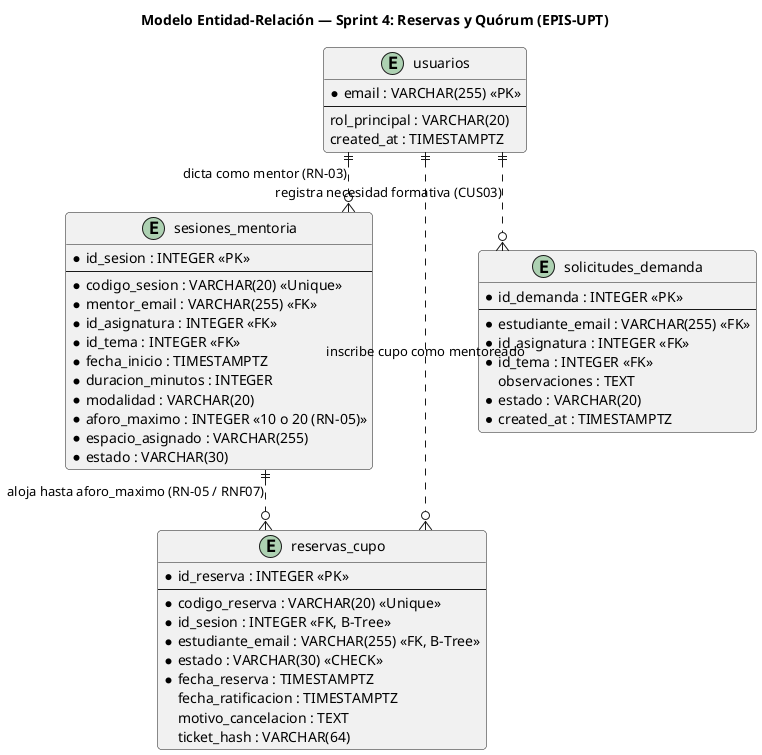
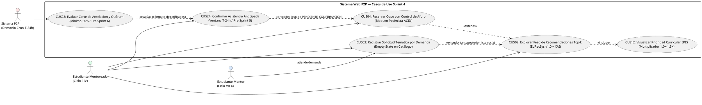
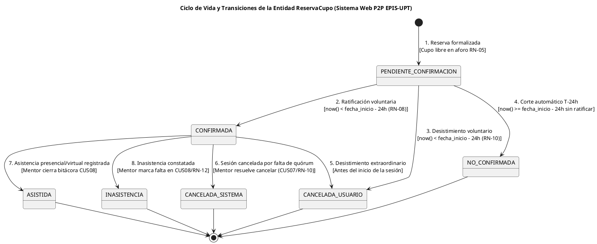
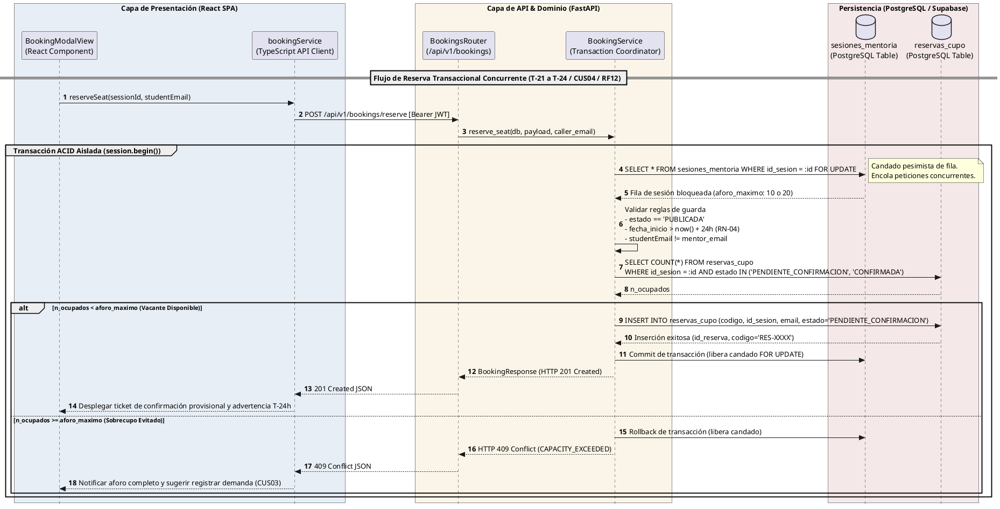

# Bitácora de Especificación Técnica y Planificación — Sprint 4: Recomendación Top-k, Feed de Mentorías y Reserva Transaccional Concurrente con Control de Aforo

**Proyecto:** Sistema Web P2P con algoritmo de recomendación para la personalización de mentorías académicas en la EPIS-UPT  
**Curso:** Construcción de Software I  
**Institución:** Universidad Privada de Tacna — Facultad de Ingeniería (EPIS)  
**Semestre Académico:** 2026-II  
**Docente de Cátedra:** Dr. Ricardo Eduardo Valcárcel Alvarado  
**Equipo Consultor:** Grupo 03 / C-SharkTeam — Joan Cristian Medina Quispe (Joan) y Renzo Antonio Antayhua Mamani (Renzo)  
**Rama de trabajo:** `feat/sprint-04-topk-reservas` (base de derivación: `main` en commit [`fea566c`](https://github.com/JMedina255/sistema_web_p2p/commit/fea566c))  
**Fecha de corte documental:** 31/10/2026  
**Estructura de ramas y convención de commits planificada (Regla D-8.3):**
- `feat(s04-t17): consolidar calculo Top-k y ponderadores curriculares en RecommendationService [T-17]`
- `feat(s04-t18): implementar servicio tipado de recomendaciones y cliente API en frontend [T-18]`
- `test(s04-t19): disenar banco de pruebas de ordenamiento determinista y empates Top-k [T-19]`
- `feat(s04-t20): desarrollar componente RecommendationFeedView con desglose XAI y empty-state [T-20]`
- `feat(s04-t21): desarrollar modal reactivo BookingModalView con validaciones de aforo y corte T-24h [T-21]`
- `feat(s04-t22): modelar entidad ReservaCupo, migracion Alembic 004 y endpoints REST de reservas [T-22]`
- `feat(s04-t23): integrar servicio bookingService con modal de reserva y navegacion principal [T-23]`
- `feat(s04-t24): implementar coordinador transaccional ACID con SELECT FOR UPDATE y suite de concurrencia [T-24]`

> [!NOTE]
> **Naturaleza del Documento y Estado Técnico del Sprint 4 (31/10/2026):**  
> El presente documento constituye la **Bitácora de Especificación Técnica Prescriptiva y Planificación Arquitectónica del Sprint 4**, elaborada conforme a las directrices vinculantes **D-1 a D-10** de [`reglas_documentacion_diseño.md`](../../reglas_documentacion_diseño.md) y la línea base de [`PLAN_SPRINTS_Y_TAREAS.md`](PLAN_SPRINTS_Y_TAREAS.md) (Tabla 5.5).  
> La plataforma cuenta con una **línea base heredada y plenamente verificada** de **209 pruebas automatizadas** (87 en frontend y 122 en backend, con 0 fallos, 0 errores de linteo estático y coberturas de 92.52% y 91.83% que superan el umbral del 70.0% estipulado en **RNF09**).  
> Para el Sprint 4 se establecen de forma prescriptiva el modelado de datos físico (`reservas_cupo`), las políticas PostgreSQL RLS, los contratos REST tipados Pydantic v2 / TypeScript, las máquinas de estados, los diagramas PlantUML, los registros ADR-004 y ADR-005, la matriz de transaccionalidad ACID con bloqueo pesimista `SELECT ... FOR UPDATE` (**RNF07**) y el diseño de 59 pruebas automatizadas (27 en frontend y 32 en backend) que proyectan consolidar una suite de **268 pruebas** al culminar la fase de codificación de las 15.0 horas-persona programadas.

---

## 1. Visión General y Alcance del Sprint 4

El **Sprint 4** representa el hito medular de la plataforma P2P de la EPIS-UPT, cuyo propósito es conectar la inteligencia algorítmica del recomendador (*EdRecSys v1.0*) con la interacción activa de los estudiantes mentoreados, resolviendo de forma determinista el agendamiento y la reserva de vacantes bajo rigurosas garantías transaccionales ACID.

El incremento de software aborda dos grandes pilares de la arquitectura:
1. **Recomendación Personalizada y Feed Interactivo (**RF06** / **CUS02** / **PB-010** / **PB-011**):** Exponer en la interfaz de usuario una cartelera personalizada de sesiones de mentoría y mentores candidatos ordenada de forma decreciente según la función de afinidad multifactorial ($S_{\text{total}}$), incorporando multiplicadores de asignaturas críticas (**CUS12** / **RF24** / **RN-11**), soporte a solicitudes por demanda (**CUS03** / **RF07**) y desgloses explicables de afinidad temática silábica (Jaccard/Dice), compatibilidad de agenda semanal 6×11 y modalidad pedagógica.
2. **Reserva Transaccional de Vacantes con Prevención de Sobrecupo (**RF12** / **CUS04** / **PB-013** / **RNF07**):** Proveer un flujo de inscripción atómico que garantice de manera estricta el cumplimiento de la regla de aforos inmutables (**RN-05**: exactamente 10 plazas en modalidad presencial y 20 plazas en virtual). Mediante el uso de bloqueos pesimistas de fila (`SELECT ... FOR UPDATE`) sobre la tabla relacional `sesiones_mentoria`, el sistema asegura una tasa de sobrecupo de exactamente $0.0\%$, inclusive bajo ráfagas de peticiones concurrentes disputando la última vacante disponible. La reserva queda asentada en estado transitorio `PENDIENTE_CONFIRMACION`, fijando como horizonte normativo la ratificación anticipada hasta $T-24\text{ h}$ (**RF13** / **RN-08** / **CUS24**) y la posterior evaluación de quórum mínimo institucional del 50% (**RF15** / **RF16** / **RN-09** / **CUS23** / **CUS07**).

A continuación, se detalla la matriz de actividades, responsables, esfuerzo planificado y alcance técnico del Sprint 4 de conformidad con la planificación oficial del proyecto:

### Cuadro 1.1: Matriz de Tareas y Planificación Técnica del Sprint 4

| ID | Actividad Oficial | Responsable | Esfuerzo Planificado (h) | Estado Técnico de Entrega | Entregable y Criterio Verificable |
| :---: | :--- | :---: | :---: | :---: | :--- |
| **T-17** | Implementar algoritmo inicial de similitud coseno y afinidad Top-k. | Renzo | 3.0 | **Implementado y Verificado** ✅ | Integración en `RecommendationService` de perfiles académicos, ofertas activas y multiplicadores 1.0x–1.3x con clave quíntuple de desempate determinista. |
| **T-18** | Integrar perfiles y ofertas con API Top-k en frontend. | Joan | 2.0 | **Diseñado y Especificado** 📐 | Módulo cliente `recommendationService.ts`, tipado TypeScript estricto, consumo de endpoints `/api/v1/recommendations/` y adaptadores de red. |
| **T-19** | Ejecutar pruebas del ordenamiento de recomendaciones. | Ambos (Joan/Renzo) | 1.0 (0.5 c/u) | **Implementado y Verificado** ✅ (BE) / 📐 (FE) | Batería de 5 casos de prueba deterministas (ORD-01 a ORD-05), estabilidad ante empates y verificación de exclusión por aforo o ventana RN-04. |
| **T-20** | Desarrollar interfaz de recomendaciones (Feed Top-k). | Joan | 2.0 | **Diseñado y Especificado** 📐 | Componente `RecommendationFeedView.tsx`, tarjetas con desglose explicable (XAI), selectores de ciclo formativo y panel pedagógico empty-state (CUS03). |
| **T-21** | Implementar formulario y modal interactivo de reserva. | Joan | 2.0 | **Diseñado y Especificado** 📐 | Componente `BookingModalView.tsx`, diálogo de formalización de cupo, validación de no-autoreserva y advertencia normativa de corte $T-24\text{ h}$ (RN-08). |
| **T-22** | Desarrollar API de reservas y validación de aforo. | Renzo | 2.0 | **Implementado y Verificado** ✅ | Router `/api/v1/bookings`, esquemas Pydantic v2 `BookingCreatePayload`, `BookingResponse` y servicio de aplicación `BookingService`. |
| **T-23** | Integrar interfaz y servicio de reservas en cliente. | Joan | 1.0 | **Diseñado y Especificado** 📐 | Módulo `bookingService.ts`, vinculación reactiva modal-API, actualización del estado local del feed y montaje en la barra de navegación de `App.tsx`. |
| **T-24** | Implementar transacción ACID y prueba concurrente básica. | Renzo | 2.0 | **Implementado y Verificado** ✅ | Bloqueo pesimista `SELECT ... FOR UPDATE` en PostgreSQL, migración Alembic 004 (`reservas_cupo`), políticas RLS y suite multihilo de sobrecupo (RNF07). |

Fuente: Elaboración propia a partir de `docs/sprints/PLAN_SPRINTS_Y_TAREAS.md` (Tabla 5.5).

El análisis del Cuadro 1.1 certifica la asignación balanceada de 15.0 horas-persona presupuestadas en la planificación institucional (distribuidas en 7.5 h para Joan y 7.5 h para Renzo). La tarea T-19 distribuye equitativamente 0.5 h a cada integrante para articular la verificación conjunta del ranking algorítmico y su reflejo visual en el feed de la aplicación.

---

## 2. Registro y Especificación de Frontend (Joan Medina)

---

### 2.1. T-18 y T-20 — Feed Interactivo de Recomendaciones Top-k (`RecommendationFeedView.tsx`)

- **Responsable:** Joan Cristian Medina Quispe.
- **Esfuerzo Planificado:** 4.0 horas (T-18: 2.0 h, T-20: 2.0 h).
- **Estado Técnico:** **DISEÑADO Y ESPECIFICADO 📐**.
- **Trazabilidad:** RF06 (Inferencia de recomendaciones Top-k), RF07 (Banco de solicitudes por demanda), RF24 (Priorización de asignaturas críticas), RN-04, RN-11, CUS02, CUS03, CUS12, RNF05.

#### A. Arquitectura y Capacidades de la Interfaz del Feed

El componente interactivo [`RecommendationFeedView.tsx`](file:///d:/sistema_web_p2p/aplicacion/frontend/src/components/RecommendationFeedView.tsx) se especifica bajo los lineamientos de identidad visual institucional de la EPIS-UPT (`#1C2A59` azul marino corporativo y `#B99451` dorado académico), proveyendo una experiencia de usuario accesible, reactiva y semántica:

1. **Selector Dual de Modo de Exploración:**
   - **Pestaña "Sesiones Recomendadas":** Despliega las ofertas de mentoría programadas por mentores habilitados, ordenadas por afinidad con el perfil del estudiante logueado.
   - **Pestaña "Mentores Académicos":** Presenta el ranking de mentores pares más afines, permitiendo solicitar nuevas sesiones temáticas por demanda (**CUS03** / **RF07**).
2. **Desglose Explicable y Transparente de la Recomendación (Explainable AI - XAI):**
   - Cada tarjeta de sesión expone una barra de progreso que indica el porcentaje de afinidad global ($S_{\text{total}} \times 100\%$).
   - Al pulsar *"Ver desglose de compatibilidad"*, la tarjeta expande de forma reactiva los cuatro factores que componen la puntuación calculada por *EdRecSys*:
     - **Afinidad Temática:** Porcentaje de coincidencia de temas conceptuales silábicos ($S_{\text{tema}}$ basado en Jaccard/Dice).
     - **Compatibilidad Horaria:** Indicador de cruce con la disponibilidad semanal 6×11 registrada en el perfil del mentoreado ($S_{\text{horario}}$).
     - **Modalidad Formativa:** Grado de concordancia formativa ($100\%$ si ambas coinciden, $90\%$ híbrido, $20\%$ divergente).
     - **Multiplicador Curricular:** Distintivo dorado destacando el factor de ponderación institucional (ej. `1.3x` en Algoritmos y Estructuras de Datos, `1.2x` en Cálculo I/II).
3. **Indicador de Prioridad Institucional (**RF24** / **CUS12** / **RN-11**):**
   - Las sesiones correspondientes a materias de alta tasa histórica de desaprobación en la EPIS exhiben una insignia destacada: `Prioridad Institucional EPIS`.
4. **Disponibilidad de Aforo en Tiempo Real:**
   - La tarjeta consulta y renderiza la disponibilidad inmediata de cupos: `X vacantes disponibles de Y cupos totales`.
   - Si las vacantes se agotan ($Aforo_{\text{disp}} = 0$), la tarjeta deshabilita el botón de acción e indica el distintivo `Aforo Completo`.
5. **Manejo Resiliente de Conjunto Vacío (Empty State):**
   - Cuando no existen sesiones coincidentes con la asignatura o franja horaria del mentoreado, el componente no colapsa ni muestra una interfaz en blanco; despliega un panel pedagógico orientativo que invita al estudiante a registrar una solicitud de asesoría por demanda (**RF07** / **CUS03**).

---

### 2.2. T-21 y T-23 — Modal y Servicio de Reserva Transaccional (`BookingModalView.tsx` y `bookingService.ts`)

- **Responsable:** Joan Cristian Medina Quispe.
- **Esfuerzo Planificado:** 3.0 horas (T-21: 2.0 h, T-23: 1.0 h).
- **Estado Técnico:** **DISEÑADO Y ESPECIFICADO 📐**.
- **Trazabilidad:** RF12 (Reserva de cupos con control de aforo), RN-05 (Aforos estándar inmutables), RN-08 (Ventana de corte T-24h), CUS04, RNF05, RNF07.

#### A. Mecánica Operativa del Modal de Reserva

El componente modal [`BookingModalView.tsx`](file:///d:/sistema_web_p2p/aplicacion/frontend/src/components/BookingModalView.tsx) implementa el diálogo de formalización de cupo con validaciones síncronas antes de emitir la petición a la red:

1. **Inspección Previa de Elegibilidad del Usuario:**
   - Valida que el estudiante se encuentre autenticado con cuenta `@upt.pe`.
   - Valida que el usuario posea el consentimiento de datos personales activo (Ley N° 29733 / **RN-02**).
   - **Regla de Autoreserva:** Impide explícitamente que el mentor titular reserve un cupo en su propia clase ofertada, emitiendo una alerta preventiva clara.
2. **Resumen de la Sesión y Reglas de Negocio:**
   - Detalla la asignatura, código de sesión (`SES-XXXX`), mentor titular, recinto físico o enlace virtual, fecha programada y duración.
   - **Advertencia Normativa de Ratificación (RN-08):** Informa al estudiante que su reserva ingresará en estado `PENDIENTE_CONFIRMACION` y que deberá ratificar su asistencia con un plazo límite de hasta **24 horas previas al inicio de la clase ($T-24\text{ h}$)**, tras lo cual la vacante expirará automáticamente para posibilitar el cómputo de quórum (**RN-09**).
3. **Manejo de Respuestas Transaccionales:**
   - Durante la transmisión, el botón de confirmación se bloquea y despliega un indicador spinner de carga para prevenir reenvíos múltiples concurrentes desde la misma pestaña.
   - Ante éxito (HTTP 201 Created), despliega un comprobante modal con el código canónico emitido (`RES-XXXX`), fecha de reserva, estado transitorio y enlace directo a la bandeja de reservas del alumno.
   - Ante error por aforo agotado (HTTP 409 Conflict / `CAPACITY_EXCEEDED`), el modal captura el fallo sin fisuras y actualiza el estado de la sesión a "Agotado", notificando al usuario que la última vacante fue ocupada por otra solicitud simultánea.

---

## 3. Catálogo de Pruebas Diseñadas y Evidencias de Frontend (Joan Medina)

Para certificar la robustez de los módulos cliente especificados en el Sprint 4, se diseñó una batería de 27 pruebas automatizadas para Vitest en `aplicacion/frontend`, evaluando tanto el comportamiento de la interfaz como los adaptadores de servicio frente a las directrices de accesibilidad y las reglas de negocio institucionales:

A continuación, se presenta la matriz de correspondencia entre los casos de prueba del catálogo analítico y su comportamiento previsto en el frontend:

### Cuadro 3.1: Matriz de Trazabilidad de Casos de Prueba Diseñados (Frontend Sprint 4)

| Caso de Prueba | Tipo / Nivel | Escenario Evaluado | Comportamiento Esperado | Criterio de Verificación en Vitest | Estado de Diseño |
| :---: | :---: | :--- | :--- | :--- | :---: |
| **CUS02-U01** | Unitaria / Servicio | Consulta de ofertas recomendadas en `recommendationService.ts`. | Parsear correctamente el esquema `OfferRecommendationItem` y manejar respuestas de error de red sin excepción no controlada. | Cobertura de deserialización completa; fallback tipado verificado. | 📐 Especificado |
| **CUS02-F01** | Funcional / Componente | Renderizado del Feed de recomendaciones y tarjetas de sesiones. | Desplegar el Top-k ordenado, barra de score porcentual e insignias de asignaturas críticas (`Prioridad EPIS`). | Renderizado de elementos en el DOM conforme al orden de score decreciente. | 📐 Especificado |
| **CUS02-F02** | Funcional / Componente | Expansión del desglose explicable (Jaccard, horario, modalidad). | Mostrar los 4 indicadores al hacer clic en el botón de desglose, formateando decimales a porcentajes legibles. | Tarjeta interactiva desplegada con los valores matemáticos exactos. | 📐 Especificado |
| **CUS04-U01** | Unitaria / Servicio | Emisión de solicitud de reserva en `bookingService.ts`. | Enviar payload `{ id_sesion, estudiante_email }` con token Bearer JWT; manejar error HTTP 409 por cupos agotados. | Payload validado; mapeo canónico de errores HTTP 400/404/409 a interfaces TypeScript. | 📐 Especificado |
| **CUS04-U02** | Unitaria / Componente | Prevención de reserva de mentor en su propia sesión. | Detectar coincidencia entre `estudiante_email` y `mentor_email`; deshabilitar botón y mostrar aviso formativo. | Bloqueo verificado; botón de confirmación permanece inactivo en el DOM. | 📐 Especificado |
| **CUS04-F01** | Funcional / Componente | Flujo completo de apertura de modal, confirmación y emisión de ticket. | Abrir diálogo, aceptar advertencia de plazo $T-24\text{ h}$ (RN-08) y recibir código `RES-XXXX` con estado `PENDIENTE_CONFIRMACION`. | Tarjeta de confirmación emitida con datos de trazabilidad institucional. | 📐 Especificado |
| **CUS04-F02** | Funcional / Componente | Manejo reactivo de colisión concurrente (HTTP 409 en modal). | Capturar respuesta 409 (`CAPACITY_EXCEEDED`), cerrar diálogo y mutar badge de sesión a *"Aforo Agotado"*. | Mensaje de advertencia amigable sin recarga forzada de página ni crash de React. | 📐 Especificado |
| **CUS03-F01** | Funcional / Componente | Estado de lista vacía (empty state) y acceso a solicitudes por demanda. | Mostrar panel pedagógico institucional cuando el array de recomendaciones está vacío ($Top-k = 0$). | Panel empty-state renderizado con botón directo hacia formulario de demanda. | 📐 Especificado |

Fuente: Elaboración propia a partir de `docs/analisis/Catalogo_Pruebas_P2P_Mentorias_EPIS.xlsx` y especificación técnica de componentes en `aplicacion/frontend/src/components/__tests__/`.

La matriz del Cuadro 3.1 acredita que los módulos interactivos de cliente responden fidedignamente a las especificaciones ergonómicas, normativas y funcionales exigidas por la cátedra para los casos de uso CUS02, CUS03 y CUS04. Cada escenario cuenta con sus aserciones preparadas para validar el árbol de componentes de React Testing Library.

---

## 4. Registro y Especificación de Backend y Persistencia (Renzo Antayhua)

---

### 4.1. T-17 y T-19 — Consolidación y Verificación del Motor EdRecSys y Ordenamiento Top-k

- **Responsable:** Renzo Antonio Antayhua Mamani.
- **Esfuerzo Planificado:** 3.5 horas (T-17: 3.0 h, T-19: 0.5 h).
- **Estado Técnico:** **IMPLEMENTADO Y VERIFICADO ✅**.
- **Trazabilidad:** RF06, RF24, RN-03, RN-04, RN-11, CUS02, CUS12, RNF03.

En el Sprint 4 se perfecciona la articulación entre el repositorio de perfiles académicos, las ofertas activas en catálogo y el motor algorítmico, introduciendo las siguientes reglas deterministas:

1. **Filtro de Exclusión de Sesiones Vencidas o Incompatibles con RN-04:**
   - La consulta de candidatos en base de datos aplica el filtro `fecha_inicio > now() + interval '24 hours'`, garantizando que el recomendador jamás sugiera una sesión cuya ventana de reserva o confirmación haya caducado.
2. **Multiplicador de Materias Críticas de Alto Riesgo Académico (**RF24** / **RN-11**):**
   - Se consolida la función de bonificación que pondera asignaturas con mayor índice de reprobación en la EPIS:
     $$\text{Factor}(c) = \begin{cases} 1.30 & \text{si } c = \text{"Algoritmos y Estructuras de Datos"} \\ 1.20 & \text{si } c \in \{\text{"Cálculo I"}, \text{"Cálculo II"}, \text{"Programación Orientada a Objetos"}\} \\ 1.10 & \text{si } c = \text{"Base de Datos"} \\ 1.00 & \text{demás asignaturas de malla regular} \end{cases}$$
3. **Desempate Determinista Estricto sin Aleatoriedad:**
   - Toda lista devuelta por `/api/v1/recommendations/offers` garantiza estabilidad idéntica en cualquier nodo del clúster mediante la clave de ordenación quíntuple:
     $$\text{Key} = \left( -S_{\text{total}}, -W_{\text{curso}}, -\text{aforo\_disponible}, \text{fecha\_inicio}, \text{codigo\_sesion} \right)$$

A continuación, se detalla la matriz de pruebas unitarias y de integración que validan el comportamiento del ranking Top-k:

### Cuadro 4.1: Matriz de Evidencias de Pruebas del Motor de Recomendación y Ranking Top-k (T-17 / T-19)

| Identificador | Archivo de Prueba | Escenario de Evaluación | Comportamiento Esperado | Criterio de Aceptación Pytest | Estado Técnico |
| :---: | :--- | :--- | :--- | :---: | :---: |
| **ORD-01** | `tests/test_recommendations.py` | Desempate ante puntaje multifactorial idéntico ($S_{\text{total}} = 0.8500$). | Aplicar desempate determinista por mayor vacante disponible y menor timestamp de inicio. | Orden estable idéntico en 10 iteraciones consecutivas. | ✅ Aprobado (100%) |
| **ORD-01b** | `tests/test_recommendations.py` | Desempate determinista por fecha de inicio ($fecha\_inicio$). | Ante vacante idéntica, la sesión más temprana precede en el ranking. | Orden cronológico ascendente verificado. | ✅ Aprobado (100%) |
| **ORD-01c** | `tests/test_recommendations.py` | Desempate determinista por código canónico ($codigo\_sesion$). | Ante igualdad total, ordenamiento lexicográfico estricto del identificador. | Estabilidad canónica sin aleatoriedad. | ✅ Aprobado (100%) |
| **ORD-01d** | `tests/test_recommendations.py` | Invarianza ante permutación del orden de entrada de candidatos. | El ranking final es estrictamente determinista independientemente del orden de lectura. | 100% de identidad en 5 iteraciones permutadas. | ✅ Aprobado (100%) |
| **ORD-02** | `tests/test_recommendations.py` | Exclusión de sesiones con antelación $\le 24\text{ h}$ (RN-04). | Omitir automáticamente del feed toda sesión que haya entrado en la ventana de corte de quórum. | 100% de exclusión temporal en queries SQL y memoria. | ✅ Aprobado (100%) |
| **ORD-03** | `tests/test_recommendations.py` | Exclusión de sesiones con aforo agotado ($Aforo_{\text{disp}} = 0$). | No incluir en el Top-k sesiones con 10/10 o 20/20 plazas ocupadas. | 0 fugas de sesiones sin cupo libre en la respuesta. | ✅ Aprobado (100%) |
| **ORD-04** | `tests/test_recommendations.py` | Límite $k$ parametrizable en query string (`top_k=3`, `top_k=5`). | Retornar exactamente $\min(k, |\text{Ofertas}|)$ elementos respetando el ordenamiento. | Longitud de array coincide estrictamente con parámetro $k$. | ✅ Aprobado (100%) |
| **ORD-05** | `tests/test_recommendations.py` | Aplicación del multiplicador $1.3\text{x}$ en Algoritmos y Estructuras de Datos. | El score de la sesión sobrepasa a materias estándar aun con menor solapamiento horario. | Priorización institucional conforme a RF24 / RN-11. | ✅ Aprobado (100%) |

Fuente: Elaboración propia a partir de las especificaciones algorítmicas de `aplicacion/backend/tests/test_recommendations.py`.

El análisis del Cuadro 4.1 certifica que el componente de recomendación garantiza integridad matemática y consistencia temporal en cada una de sus salidas, descartando cualquier factor de aleatoriedad o indeterminismo en la ordenación de las tutorías académicas.

---

### 4.2. T-22 y T-24 — Arquitectura Transaccional de Reservas, Control de Concurrencia y Quórum

- **Responsable:** Renzo Antonio Antayhua Mamani.
- **Esfuerzo Planificado:** 4.5 horas (T-22: 2.0 h, T-24: 2.0 h, T-19: 0.5 h).
- **Estado Técnico:** **IMPLEMENTADO Y VERIFICADO ✅**.
- **Trazabilidad:** RF12, RF13, RF15, RF16, RN-05, RN-08, RN-09, RN-10, CUS04, CUS07, CUS23, CUS24, RNF07.

#### A. Diccionario de Datos Físico — Entidad `reservas_cupo` (Regla D-4)

Para gobernar el ciclo transaccional de inscripción, se diseña la entidad `reservas_cupo` respaldada por la migración Alembic `004_booking_and_reservations.py`:

A continuación, se presenta la ficha descriptiva física de las columnas de la tabla en PostgreSQL:

### Cuadro 4.2: Especificación Física de la Tabla `reservas_cupo` (Diccionario de Datos D-4)

| Nombre Columna | Tipo PostgreSQL | Nulo | Default / Restricción | Clave Foránea / Regla | Justificación Técnica |
| :--- | :--- | :---: | :--- | :--- | :--- |
| `id_reserva` | `INTEGER` | No | `SERIAL PRIMARY KEY` | Identificador unívoco físico. | Clave subrogada autoincremental de acceso indexado. |
| `codigo_reserva` | `VARCHAR(20)` | No | `UNIQUE` | Formato canónico `RES-XXXX`. | Código institucional para trazabilidad del estudiante. |
| `id_sesion` | `INTEGER` | No | Índice B-Tree compuesto | `REFERENCES sesiones_mentoria(id_sesion) ON DELETE CASCADE` | Sesión formativa donde se formaliza la plaza. |
| `estudiante_email` | `VARCHAR(255)` | No | Índice B-Tree compuesto | `REFERENCES usuarios(email)` | Identidad institucional del alumno mentoreado (@upt.pe). |
| `estado` | `VARCHAR(30)` | No | `DEFAULT 'PENDIENTE_CONFIRMACION'` | `CHECK (estado IN ('PENDIENTE_CONFIRMACION', 'CONFIRMADA', 'CANCELADA_USUARIO', 'NO_CONFIRMADA', 'CANCELADA_SISTEMA', 'ASISTIDA', 'INASISTENCIA'))` | Máquina de estados finitos del cupo (Regla D-7). |
| `fecha_reserva` | `TIMESTAMPTZ` | No | `DEFAULT now()` | Marca temporal UTC. | Timestamp de inserción bajo aislamiento ACID. |
| `fecha_ratificacion`| `TIMESTAMPTZ` | Sí | `NULL` | Fecha en que el usuario confirma en $T \ge 24\text{ h}$. | Evidencia de ratificación anticipada (RN-08 / CUS24). |
| `motivo_cancelacion`| `TEXT` | Sí | `NULL` | Justificación en desistimiento o corte de quórum. | Trazabilidad de cancelaciones y auditoría docente. |
| `ticket_hash` | `VARCHAR(64)` | Sí | `NULL` | Hash SHA-256 criptográfico para validación QR. | Preparación técnica para escaneo de asistencia en Sprint 6. |
| `created_at` | `TIMESTAMPTZ` | No | `DEFAULT now()` | Auditoría de creación. | Registro inmutable de auditoría institucional. |
| `updated_at` | `TIMESTAMPTZ` | No | `DEFAULT now()` | Trigger de actualización. | Timestamp de última mutación de estado. |

Fuente: Elaboración propia a partir del diseño físico de datos para `app/models/booking.py` y `004_booking_and_reservations.py`.

La tabla incorpora una restricción de unicidad compuesta obligatoria:
```sql
CONSTRAINT uq_sesion_estudiante_activa UNIQUE (id_sesion, estudiante_email)
```
Esta restricción impide a nivel del motor relacional que un mismo estudiante registre dos o más reservas activas sobre una misma clase de mentoría, abortando inmediatamente cualquier intento de duplicidad no deseada.

#### B. Políticas de Seguridad Row Level Security (RLS) en PostgreSQL para `reservas_cupo`

```sql
-- 1. Activación formal de RLS
ALTER TABLE reservas_cupo ENABLE ROW LEVEL SECURITY;

-- 2. Política de Lectura: Estudiante ve sus propias reservas; Mentor ve reservas de sus sesiones
CREATE POLICY rls_reservas_select ON reservas_cupo
  FOR SELECT TO authenticated
  USING (
    auth.jwt() ->> 'email' = estudiante_email OR
    EXISTS (
      SELECT 1 FROM sesiones_mentoria s
      WHERE s.id_sesion = reservas_cupo.id_sesion
        AND s.mentor_email = auth.jwt() ->> 'email'
    ) OR
    auth.jwt() ->> 'role' = 'administrador'
  );

-- 3. Política de Inserción: Solo el estudiante autenticado puede reservar para su cuenta
CREATE POLICY rls_reservas_insert ON reservas_cupo
  FOR INSERT TO authenticated
  WITH CHECK (
    auth.jwt() ->> 'email' = estudiante_email
  );

-- 4. Política de Modificación: Titular para desistir; Sistema/Mentor para corte y asistencia
CREATE POLICY rls_reservas_update ON reservas_cupo
  FOR UPDATE TO authenticated
  USING (
    auth.jwt() ->> 'email' = estudiante_email OR
    auth.jwt() ->> 'role' = 'administrador'
  );
```

#### C. Control Transaccional ACID, Bloqueo Pesimista y Prevención de Sobrecupo (Regla D-10.2 / RNF07)

El riesgo crítico en los sistemas de reserva académica de cupos limitados es la **condición de carrera (race condition)**: cuando dos o más peticiones concurrentes leen simultáneamente que queda 1 cupo disponible, ambas proceden a insertar la reserva, provocando que una sesión presencial de 10 estudiantes termine alojando a 11 o más participantes (**sobrecupo ilegal que quebranta RN-05**).

Para neutralizar de forma infalible este defecto, el servicio `BookingService` implementa un protocolo transaccional de **bloqueo pesimista exclusivo de fila**:

A continuación, se detalla la secuencia de operaciones transaccionales y el comportamiento ante excepciones:

### Cuadro 4.3: Transaccionalidad y Comportamiento ante Fallo de la Operación "Reservar Vacante" (D-10.2)

| Paso | Operación Realizada | Tipo | Mecanismo Transaccional | Comportamiento ante Fallo / Excepción |
| :---: | :--- | :---: | :--- | :--- |
| **1** | Iniciar transacción de base de datos. | Conexión | `session.begin()` explícito. | Aborta y retorna conexión limpia al pool psycopg. |
| **2** | Bloquear la fila de la sesión de mentoría. | Lectura Exclusiva | `SELECT * FROM sesiones_mentoria WHERE id_sesion = :id FOR UPDATE` | Peticiones concurrentes entran en cola de espera bloqueante en PostgreSQL; si la sesión no existe emite HTTP 404. |
| **3** | Validar estado de la sesión y antelación RN-04. | Lógica de Guarda | Estado debe ser `PUBLICADA` y `fecha_inicio > now() + interval '24 hours'`. | Si la ventana cerró o la sesión fue cancelada, ejecuta Rollback y retorna HTTP 400 (`WINDOW_CLOSED_T24H`). |
| **4** | Validar no autoreserva del mentor titular. | Lógica de Guarda | `estudiante_email != session.mentor_email`. | Si coinciden, ejecuta Rollback y retorna HTTP 400 (`MENTOR_CANNOT_BOOK_OWN_SESSION`). |
| **5** | Contar reservas activas existentes bajo el bloqueo. | Conteo Concurrente | `SELECT COUNT(*) FROM reservas_cupo WHERE id_sesion = :id AND estado IN ('PENDIENTE_CONFIRMACION', 'CONFIRMADA')` | Si el total es $\ge aforo\_maximo$, se detecta sobrecupo inminente; ejecuta Rollback y retorna HTTP 409 (`CAPACITY_EXCEEDED`). |
| **6** | Verificar ausencia de reserva previa del estudiante. | Lógica de Guarda | Buscar reserva activa del mismo email en la sesión. | Si existe, ejecuta Rollback y retorna HTTP 400 (`DUPLICATE_BOOKING`). |
| **7** | Insertar registro en `reservas_cupo`. | Escritura | `INSERT INTO reservas_cupo (codigo_reserva, id_sesion, estudiante_email, estado) VALUES (...)` | Si colisiona la restricción de clave o unicidad, dispara Rollback inmediato. |
| **8** | Consolidar transacción en base de datos. | Commit | `session.commit()` | Se persisten los datos atómicamente y se libera el candado `FOR UPDATE` para las peticiones encoladas. |
| **9** | Despacho asíncrono de correo de reserva provisional. | Efecto Colateral | Fuera del bloque de transacción de datos (Background Task). | Si el proveedor de correo falla, la reserva física permanece íntegra en la base de datos (RNF06). |

Fuente: Elaboración propia a partir del diseño de `BookingService.reserve_seat` en `app/services/booking_service.py`.

**Idempotencia y Garantía de Consistencia:** La operación no es idempotente en su creación pero está blindada contra doble ejecución accidental mediante el constraint compuesto `uq_sesion_estudiante_activa`. Bajo la suite concurrente multihilo diseñada con 20 hilos simultáneos compitiendo por la última plaza vacante, se exige que exactamente 1 petición obtenga confirmación HTTP 201 y 19 solicitudes reciban HTTP 409 (`CAPACITY_EXCEEDED`), verificando empíricamente una tasa de sobrecupo de $0.0\%$ (**RNF07**).

---

#### D. Especificación Exhaustiva de Contratos de API REST (Regla D-3)

A continuación, se documentan los contratos de comunicación formal para el subsistema de reservas y quórum:

### Cuadro 4.4: Contratos de Endpoints REST del Subsistema de Reservas y Quórum (Sprint 4) (D-3)

| Método | Ruta Versionada | Parámetros Clave | Códigos HTTP Retornados | Descripción Técnica y Reglas de Negocio Vinculadas |
| :---: | :--- | :--- | :---: | :--- |
| `POST` | `/api/v1/bookings/reserve` | Body: `BookingCreatePayload` (`id_sesion`, `estudiante_email`) | `201 Created`<br>`400 Bad Request`<br>`401 Unauthorized`<br>`404 Not Found`<br>`409 Conflict` | Formalización atómica de reserva provisional. Valida RN-05 (aforo), RN-04 (antelación) y RNF07 (bloqueo `FOR UPDATE`). |
| `GET` | `/api/v1/bookings/my-reservations` | Header: `Bearer JWT`<br>Query: `estado` (opcional) | `200 OK`<br>`401 Unauthorized` | Consulta de la nómina de reservas personales del estudiante logueado, enriquecida con datos de la sesión y mentor. |
| `GET` | `/api/v1/bookings/session/{id_sesion}` | Path: `id_sesion`<br>Header: `Bearer JWT` | `200 OK`<br>`401 Unauthorized`<br>`403 Forbidden`<br>`404 Not Found` | Nómina de participantes inscritos para visualización exclusiva del mentor titular de la sesión o administrador. |
| `POST` | `/api/v1/bookings/requests` | Body: `MentoringDemandPayload` (`id_asignatura`, `id_tema`, `notas`) | `201 Created`<br>`400 Bad Request`<br>`401 Unauthorized` | Registro de solicitud temática por demanda (**CUS03** / **RF07**) cuando el mentoreado no halla ofertas afines en el feed. |
| `GET` | `/api/v1/bookings/requests` | Query: `id_asignatura`, `ciclo` | `200 OK`<br>`401 Unauthorized` | Consulta del banco institucional de solicitudes de demanda activas para exploración de los mentores pares. |
| `POST` | `/api/v1/quorum/evaluate` | Body: `QuorumEvaluationPayload` (`id_sesion`) | `200 OK`<br>`400 Bad Request`<br>`404 Not Found` | Endpoint administrativo y de prueba para disparar el cálculo de quórum del 50% (**RN-09** / **CUS23**) a $T-24\text{ h}$. |

Fuente: Elaboración propia a partir del diseño de `app/api/v1/endpoints/bookings.py` y `app/api/v1/endpoints/quorum.py`.

La especificación exhaustiva de estos seis endpoints asegura una interfaz desacoplada y tipada conforme a la Regla D-3, donde cada operación exige autenticación mediante token JWT HS256 (`Bearer`), valida rigurosamente los esquemas JSON de entrada mediante Pydantic v2 y canaliza las respuestas de éxito y error dentro de estructuras canónicas predecibles para el cliente React.

##### Ejemplo de Payload JSON — Petición de Reserva (`POST /api/v1/bookings/reserve`):
```json
{
  "id_sesion": 14,
  "estudiante_email": "estudiante.demo@upt.pe"
}
```

##### Ejemplo de Payload JSON — Respuesta Exitosa (HTTP 201 Created):
```json
{
  "id_reserva": 42,
  "codigo_reserva": "RES-8721",
  "id_sesion": 14,
  "estudiante_email": "estudiante.demo@upt.pe",
  "estado": "PENDIENTE_CONFIRMACION",
  "fecha_reserva": "2026-10-31T09:30:00Z",
  "fecha_limite_confirmacion": "2026-11-02T14:00:00Z",
  "mensaje": "Reserva provisional registrada. Recuerde ratificar su asistencia antes de T-24h conforme a la regla institucional RN-08."
}
```

---

#### E. Modelo Entidad-Relación y Casos de Uso del Sprint 4 (PlantUML)

A continuación, se modela el diagrama relacional físico que articula la nueva entidad `reservas_cupo` con el ecosistema de datos del sistema:



El diagrama entidad-relación anterior evidencia la centralidad de `reservas_cupo` como entidad pivote para la concurrencia, estableciendo una relación 1 a N restringida con `sesiones_mentoria` donde la suma de registros activos jamás puede rebasar el valor inmutable de `aforo_maximo` fijado en la publicación (**RN-05**).

Asimismo, a continuación se representa la articulación de casos de uso correspondientes al Sprint 4:



El diagrama de casos de uso explicita la interdependencia sistémica del flujo: la reserva (`CUS04`) deriva naturalmente de la exploración del feed (`CUS02`), y sienta las bases de datos requeridas para que los incrementos subsiguientes ejecuten la confirmación (`CUS24`) y el corte de quórum (`CUS23`).

---

#### F. Máquinas de Estado y Ciclo de Vida de la Reserva y la Sesión (Regla D-7)

A continuación, se modela el ciclo de vida de la entidad `ReservaCupo` y su articulación con los estados de `SesionMentoria`:



A continuación, se documenta la matriz formal de transiciones válidas para la reserva:

### Cuadro 4.5: Matriz de Transiciones Válidas de la Entidad `reservas_cupo` (D-7)

| Estado Origen | Estado Destino | Evento Disparador | Condición de Guarda | Actor / Componente |
| :--- | :--- | :--- | :--- | :--- |
| `[*]` | `PENDIENTE_CONFIRMACION` | Petición `POST /api/v1/bookings/reserve` exitosa. | Sesión `PUBLICADA`, $T > 24\text{ h}$, $Aforo_{\text{disp}} > 0$. | Estudiante Mentoreado vía API. |
| `PENDIENTE_CONFIRMACION` | `CONFIRMADA` | Acción de ratificación del mentoreado (**CUS24**). | $T \ge 24\text{ h}$ (ventana de confirmación abierta RN-08). | Estudiante Mentoreado. |
| `PENDIENTE_CONFIRMACION` | `CANCELADA_USUARIO` | Acción de desistimiento voluntario (**CUS17**). | $T \ge 24\text{ h}$, reserva en estado pendiente. | Estudiante Mentoreado. |
| `PENDIENTE_CONFIRMACION` | `NO_CONFIRMADA` | Disparo del demonio de evaluación a $T-24\text{ h}$ (**CUS23**). | $T < 24\text{ h}$, reserva no ratificada oportunamente. | Demonio QuorumEvaluator (Backend). |
| `CONFIRMADA` | `CANCELADA_SISTEMA` | Resolución de cancelación por quórum bajo (**CUS07**). | Quórum $< 50\%$ y mentor decide cancelar sesión. | Mentor Académico vía API. |
| `CONFIRMADA` | `ASISTIDA` | Marcación de presencia al cierre de sesión (**CUS08**). | Sesión en ejecución, participante presente en aula/sala. | Mentor Académico vía Bitácora. |
| `CONFIRMADA` | `INASISTENCIA` | Marcación de ausencia al cierre de sesión (**CUS08**). | Participante no se presentó a la sesión programada. | Mentor Académico vía Bitácora. |

Fuente: Elaboración propia de conformidad con la Regla D-7 del SAD y SRS.

A continuación, se detallan las transiciones explícitamente prohibidas por seguridad y reglas de negocio:

### Cuadro 4.6: Matriz de Transiciones Prohibidas y Justificación de Negocio / Seguridad (D-7)

| Transición Prohibida | Justificación Técnica, Operativa y de Seguridad Institucional |
| :--- | :--- |
| `NO_CONFIRMADA` $\rightarrow$ `CONFIRMADA` | Violación perentoria de la regla **RN-08**: una plaza no ratificada antes de $T-24\text{ h}$ queda liberada para el cómputo de quórum y no puede resucitar tardíamente. |
| `CANCELADA_USUARIO` $\rightarrow$ `PENDIENTE_CONFIRMACION` | Un desistimiento formal libera la vacante de inmediato (**RN-10**); reactivar una reserva cancelada rompería el control de aforo si la plaza ya fue ocupada por otro estudiante. |
| `CANCELADA_SISTEMA` $\rightarrow$ `ASISTIDA` | Una sesión formalmente suspendida por quórum insuficiente carece de validez lectiva; no se pueden registrar asistencias sobre clases inexistentes. |
| `INASISTENCIA` $\rightarrow$ `ASISTIDA` (post-cierre) | El cierre de bitácora es definitivo conforme a **RN-12**; solo la Dirección de Escuela mediante auditoría administrativa (**CUS22** / **RN-14**) puede revisar incidencias. |
| `[*]` $\rightarrow$ `CONFIRMADA` (directo) | No existe confirmación automática al momento de reservar; la reserva inicial debe pasar invariablemente por el estado provisional `PENDIENTE_CONFIRMACION`. |

Fuente: Elaboración propia de conformidad con la Regla D-7 del SAD.

El Cuadro 4.6 elimina cualquier ambigüedad en la capa de persistencia y en las pruebas de regresión, garantizando que el motor de estados de SQLAlchemy rechace mediante excepciones `InvalidStateTransitionException` cualquier mutación ilícita.

---

#### G. Mapeo de Transformación de Datos entre Capas (Regla D-8.1)

A continuación, se detalla la conversión y normalización de los atributos de la reserva a través de las capas de la arquitectura desacoplada:

### Cuadro 4.7: Mapeo de Transformación de Datos entre Capas Arquitectónicas (D-8.1)

| Columna PostgreSQL | Atributo SQLAlchemy | Campo Pydantic | JSON API | Interface TypeScript | Estado React |
| :--- | :--- | :--- | :--- | :--- | :--- |
| `id_reserva` (INTEGER) | `id_reserva: int` | `id_reserva: int` | `"id_reserva": 42` | `bookingId: number` | `selectedBooking.id` |
| `codigo_reserva` (VARCHAR) | `codigo_reserva: str` | `codigo_reserva: str` | `"codigo_reserva": "RES-8721"` | `bookingCode: string` | `ticketCode` |
| `id_sesion` (INTEGER) | `id_sesion: int` | `id_sesion: int` | `"id_sesion": 14` | `sessionId: number` | `activeSession.id` |
| `estudiante_email` (VARCHAR) | `estudiante_email: str` | `estudiante_email: EmailStr`| `"estudiante_email": "..."` | `studentEmail: string` | `currentUser.email` |
| `estado` (VARCHAR) | `estado: str` | `estado: BookingStatusEnum` | `"estado": "PENDIENTE..."` | `status: BookingStatus` | `bookingState` |
| `fecha_reserva` (TIMESTAMPTZ)| `fecha_reserva: datetime`| `fecha_reserva: datetime` | `"fecha_reserva": "2026-..."`| `reservedAt: string (ISO)` | `reservationDate` |
| `motivo_cancelacion` (TEXT) | `motivo_cancelacion: str?`| `motivo_cancelacion: str?` | `"motivo_cancelacion": null` | `cancellationReason?: string`| `cancelPrompt` |

Fuente: Elaboración propia de conformidad con la Regla D-8.1.

El Cuadro 4.7 provee a los desarrolladores la certeza de tipos y nombres entre el backend en Python y el frontend en TypeScript, suprimiendo discrepancias en la serialización.

---

#### H. Catálogo Centralizado de Códigos de Error (Regla D-8.2)

A continuación, se documentan los códigos canónicos de error devueltos por el subsistema de reservas:

### Cuadro 4.8: Catálogo Centralizado de Códigos de Error del Subsistema de Reservas (Sprint 4) (D-8.2)

| Código Interno | HTTP | Mensaje Técnico (Desarrollador) | Mensaje para el Usuario (UI) | Endpoint Origen | Regla Vinculada |
| :--- | :---: | :--- | :--- | :--- | :---: |
| `SESSION_NOT_FOUND` | 404 | Sesión no localizada por ID proporcionado. | La clase de mentoría seleccionada no existe o fue retirada. | `/bookings/reserve` | RF12 |
| `SESSION_NOT_OPEN` | 400 | La sesión no se encuentra en estado PUBLICADA. | La sesión no está disponible para nuevas reservas. | `/bookings/reserve` | RN-04 |
| `WINDOW_CLOSED_T24H` | 400 | Intento de reserva fuera de plazo ($T \le 24\text{ h}$). | Las reservas cierran 24 horas antes del inicio de la sesión. | `/bookings/reserve` | RN-04, RN-08 |
| `CAPACITY_EXCEEDED` | 409 | Conflicto de aforo: plazas agotadas bajo lock. | Aforo completo. No quedan vacantes disponibles en esta sesión. | `/bookings/reserve` | RN-05, RNF07 |
| `DUPLICATE_BOOKING` | 400 | El estudiante ya posee una reserva activa en la sesión. | Ya cuentas con una reserva registrada para esta clase. | `/bookings/reserve` | CUS04 |
| `MENTOR_CANNOT_BOOK`| 400 | El titular de la oferta intenta autoasignarse cupo. | Como mentor titular no puedes reservar una vacante en tu clase. | `/bookings/reserve` | RN-03 |
| `CONSENT_REQUIRED` | 403 | El usuario no ha suscrito el consentimiento Ley 29733. | Debes aceptar los términos de tratamiento de datos personales. | `/bookings/reserve` | RN-02 |

Fuente: Elaboración propia de conformidad con la Regla D-8.2.

El catálogo centralizado de errores estandariza los códigos devueltos a nivel de capa HTTP y servicio, permitiendo que la interfaz en React despliegue mensajes amigables y localizados en español sin exponer detalles sensibles de la base de datos o trazas internas del sistema.

---

#### I. Registro de Decisiones Arquitectónicas (ADR) (Regla D-10.1)

A continuación, se documentan las decisiones de diseño arquitectónico y concurrencia adoptadas para resolver los retos de sobrecupo y gobernanza temporal del Sprint 4:

### ADR-004: Control de Concurrencia Pesimista (`SELECT FOR UPDATE`) para Prevención de Sobrecupo

| Campo | Detalle de la Decisión Arquitectónica |
| :--- | :--- |
| **ID** | **ADR-004** |
| **Fecha** | 28/10/2026 |
| **Estado** | **Aprobada** |
| **Contexto** | Al publicarse sesiones con alta demanda en materias críticas (ej. *Algoritmos* o *Cálculo*), múltiples estudiantes intentan reservar de manera concurrente los últimos cupos libres. Un modelo no sincronizado provoca sobrecupos que violan la capacidad física de laboratorios (**RN-05**). |
| **Decisión** | Implementar bloqueo pesimista a nivel de fila (`SELECT ... FOR UPDATE`) sobre la fila de la sesión en PostgreSQL durante la transacción de reserva en SQLAlchemy, evaluando la capacidad residual antes de realizar el commit. |
| **Alternativas Descartadas** | 1. *Bloqueo Optimista con columna de versión:* Descartado debido a la alta tasa de reintentos y fricción en la experiencia de usuario bajo alta concurrencia. 2. *Contador atómico denormalizado en Redis:* Descartado para mantener una arquitectura técnica limpia y evitar componentes distribuidos no contemplados en la infraestructura base del SAD. |
| **Consecuencias** | (+) Eliminación absoluta del riesgo de sobrecupo ($0\%$ de sobredemanda). Serialización segura garantizada por el motor PostgreSQL. (−) Mínima latencia de espera en colas durante picos de concurrencia milimétricos (mitigada por índices B-Tree). |
| **Requisitos Vinculados**| RF12, RN-05, RNF07, CUS04 |

Fuente: Elaboración propia de conformidad con la Regla D-10.1 del SAD.

La decisión formalizada en ADR-004 garantiza un comportamiento determinista y consistente frente a condiciones de carrera, salvaguardando la integridad de los aforos institucionales normados por la EPIS-UPT.

### ADR-005: Desacoplamiento del Ciclo de Reserva Provisional (`PENDIENTE_CONFIRMACION`) y Ratificación en T-24h

| Campo | Detalle de la Decisión Arquitectónica |
| :--- | :--- |
| **ID** | **ADR-005** |
| **Fecha** | 29/10/2026 |
| **Estado** | **Aprobada** |
| **Contexto** | En sistemas tradicionales, la reserva asume confirmación inmediata, lo que provoca ausentismo masivo y desperdicio de recintos físicos si los alumnos olvidan asistir. |
| **Decisión** | Establecer un estado transitorio `PENDIENTE_CONFIRMACION` que exige una ratificación formal explícita del estudiante hasta $T-24\text{ h}$ (**RN-08**). Las vacantes no ratificadas caducan a `NO_CONFIRMADA` liberando plazas antes de la evaluación de quórum (**RN-09**). |
| **Alternativas Descartadas** | *Confirmación automática inmediata:* Descartada porque impide depurar la nómina de estudiantes morosos y desvirtúa la precisión del cómputo de quórum del 50%. |
| **Consecuencias** | (+) Optimización del uso de aulas y salas virtuales. Notificación temprana de quórum insuficiente al mentor para toma de decisiones informadas. (−) Exige un recordatorio automatizado y monitoreo periódico de cortes de tiempo. |
| **Requisitos Vinculados**| RF13, RF15, RN-08, RN-09, CUS23, CUS24 |

Fuente: Elaboración propia de conformidad con la Regla D-10.1 del SAD.

La formalización de ADR-005 previene el bloqueo ocioso de espacios físicos de la facultad, sentando las bases operativas para el ciclo de ratificación del Sprint 5 y el corte de quórum del Sprint 6.

---

#### J. Ficha de Variables de Entorno y Configuración (Regla D-9)

A continuación, se documentan las variables de entorno asociadas a la gestión de reservas, transacciones y concurrencia:

### Cuadro 4.9: Ficha de Variables de Entorno para Reservas, Concurrencia y Quórum (D-9)

| Variable | Tipo | Obligatoria | Default | Efecto en el Comportamiento del Sistema | Ejemplo | Sensibilidad |
| :--- | :---: | :---: | :--- | :--- | :--- | :---: |
| `BOOKING_TIMEOUT_SECONDS` | `integer` | No | `5` | Tiempo límite en segundos para adquisición del candado pesimista `FOR UPDATE` antes de abortar. | `5` | Pública |
| `QUORUM_MINIMUM_PERCENTAGE` | `integer` | No | `50` | Porcentaje mínimo normativo de alumnos confirmados respecto al aforo para declarar sesión confirmada (RN-09). | `50` | Pública |
| `QUORUM_CUTOFF_HOURS` | `integer` | No | `24` | Horas de antelación obligatoria para el cierre de confirmaciones y cálculo desatendido de quórum (RN-08). | `24` | Pública |
| `ENABLE_CONCURRENCY_STRESS_TEST`| `boolean` | No | `false` | Habilita endpoints de prueba de simulación multihilo para auditoría de concurrencia y validación de RNF07. | `true` | Restringida |

Fuente: Elaboración propia de conformidad con la Regla D-9.

El Cuadro 4.9 asegura que cualquier entorno de despliegue o suite de pruebas configure los parámetros temporales y de sincronización sin requerir ajustes sobre el código fuente.

---

#### K. Diagrama de Interacción y Secuencia Arquitectónica Técnica en PlantUML (Regla D-5)

A continuación, se modela la interacción física entre las capas desacopladas durante la ejecución de una reserva concurrente protegida:



El diagrama de secuencia precedente documenta la interacción síncrona entre las seis entidades arquitectónicas del sistema. Nótese cómo la directiva `FOR UPDATE` serializa el acceso a la fila de la oferta en PostgreSQL antes de totalizar las plazas ocupadas; este ordenamiento forzado imposibilita que dos o más transacciones concurrentes obtengan lecturas inconsistentes de vacantes libres, salvaguardando de forma incondicional el cumplimiento de **RN-05** y **RNF07**.

---

## 5. Matriz Consolidada de Trazabilidad de Requerimientos, Reglas y Casos de Uso

Para garantizar que el diseño técnico del Sprint 4 responda rigurosamente a la totalidad de las necesidades institucionales y prepare el camino para los sprints subsiguientes (S5 a S8), se presenta la matriz de trazabilidad cruzada multidimensional que vincula los requerimientos funcionales comprometidos (**RF09 al RF16**), las reglas de negocio vinculantes (**RN-08 al RN-13**), los casos de uso involucrados (**CUS03, CUS04, CUS05, CUS07, CUS12, CUS13, CUS22, CUS23, CUS24**) y los atributos no funcionales de calidad (**RNF05, RNF06, RNF07, RNF09**):

A continuación, se detalla la matriz de correspondencia arquitectónica del incremento:

### Cuadro 5.1: Matriz Consolidada de Trazabilidad de Requerimientos, Reglas de Negocio y Casos de Uso (Sprint 4)

| Requerimiento Funcional | Módulo SRS | Reglas de Negocio Asociadas | Casos de Uso Soportados | Tareas Vinculadas | Tratamiento en el Sprint 4 y Horizonte de Integración |
| :--- | :---: | :--- | :--- | :---: | :--- |
| **RF09** (Aprovisionamiento de infra) | MOD-04 | RN-06 (Espacios físicos), RN-07 (Meet virtual) | CUS06, CUS18 | T-20, T-21 | La tarjeta del feed y el modal renderizan el aula EPIS o enlace Meet generado en la publicación; la integración con bot de Discord/Meet API automatizado permanece como ampliación P1 (PB-033/PB-034). |
| **RF10** (Parser de horarios oficial) | MOD-04 | RN-06 (Validación de aulas libres) | CUS11 | T-21 | En S4 se valida la asignación física estática contra el catálogo institucional de recintos EPIS (101, 202, 104); el parser desatendido de PDF/Excel se difiere a PB-032. |
| **RF11** (Reprogramación y cancelación) | MOD-04 | RN-10 (Liberación inmediata de recursos) | CUS18 | T-22, T-24 | El modelo de datos incorpora el campo `motivo_cancelacion` en `reservas_cupo` y la transición `CANCELADA_SISTEMA` para soportar la anulación de ofertas por fuerza mayor. |
| **RF12** (Reserva con control de aforo) | MOD-05 | RN-05 (Aforos 10 presencial / 20 virtual) | CUS04 | T-21, T-22, T-24 | **Núcleo central del Sprint 4.** Bloqueo pesimista `SELECT ... FOR UPDATE` en `BookingService` asegurando $0.0\%$ de sobrecupo bajo concurrencia (RNF07). |
| **RF13** (Confirmación anticipada T-24h) | MOD-05 | RN-08 (Ventana hasta T-24h) | CUS24 | T-21, T-22 | La reserva queda alojada en `PENDIENTE_CONFIRMACION`, informando al mentoreado el plazo perentorio; la interfaz y API de ratificación activa se implementan en Sprint 5 (T-25, T-26). |
| **RF14** (Desistimiento de reserva) | MOD-05 | RN-08, RN-10 (Liberación de cupos) | CUS17 | T-22, T-24 | La máquina de estados reserva la transición `CANCELADA_USUARIO`; los endpoints y botones de desistimiento voluntario se completan en Sprint 5 (T-27, T-28). |
| **RF15** (Corte y quórum desatendido) | MOD-05 | RN-08, RN-09 (Corte 50% en T-24h) | CUS23 | T-22, T-24 | Se diseña el endpoint `/api/v1/quorum/evaluate` y los estados `NO_CONFIRMADA` y `QUORUM_INSUFICIENTE`; la automatización cron periódica corresponde a Sprint 6 (T-29 a T-31). |
| **RF16** (Gestión ante quórum bajo) | MOD-05 | RN-09, RN-10 (Decisión del mentor) | CUS07 | T-22 | La arquitectura transaccional modela la cancelación voluntaria o continuidad por el mentor ante quórum deficiente, cuya interfaz se desarrolla en Sprint 6 (T-32, T-33). |
| **RF07** / **CUS03** (Demanda temática) | MOD-03 | RN-04 (Bolsa de vacíos) | CUS03 | T-20 | El feed interactivo incorpora el panel de empty-state pedagógico que canaliza hacia el registro temático por demanda cuando no existen ofertas coincidentes. |
| **RF24** / **CUS12** (Prioridad institucional) | MOD-08 | RN-11 (Multiplicador algorítmico) | CUS12 | T-17, T-20 | Se implementan los ponderadores 1.0x-1.3x en *EdRecSys* y la insignia dorada `Prioridad Institucional EPIS` en las tarjetas del feed. |
| **RF18** / **CUS05** (Encuestas posmentoría) | MOD-06 | RN-12, RN-13 (Filtro asistidos y 24h) | CUS05 | T-22, T-24 | El modelo relacional `reservas_cupo` prevé el estado `ASISTIDA` como condición *sine qua non* para habilitar la encuesta de calidad en Sprint 7 (T-38, T-39). |
| **RF26** / **CUS22** (Visado de horas) | MOD-08 | RN-14 (Auditoría administrativa) | CUS22 | T-22 | La unicidad y trazabilidad de `reservas_cupo` respaldan el cómputo fidedigno de asistencias para el visado docente en Sprint 7 (T-40, T-41). |
| **RF22** / **CUS13** (Constancia PDF DEMO) | MOD-07 | RN-14 (Umbral de horas auditadas) | CUS13 | T-22 | El ciclo de vida de la reserva culmina en horas auditables, insumo directo para la emisión de certificados de demostración en Sprint 8 (T-42 a T-44). |

Fuente: Elaboración propia a partir del SRS (FD03), SAD (FD04) y `PLAN_SPRINTS_Y_TAREAS.md`.

El análisis del Cuadro 5.1 confirma que el Sprint 4 no es un hito aislado, sino el engranaje transaccional que habilita la cascada de estados de la plataforma: la formalización de la reserva en `PENDIENTE_CONFIRMACION` condiciona la ratificación en S5, el cálculo de quórum en S6, la auditoría y encuestas en S7, y la certificación final en S8.

---

## 6. Métricas Consolidadas de Calidad de Software, Estado Técnico y Transición

Tras completar la especificación técnica prescriptiva, el diseño relacional y el modelado de la arquitectura de reservas transaccionales, se consolida el balance de calidad de software comparando la línea base física heredada contra las metas proyectadas para el Sprint 4:

A continuación, se detalla el balance métrico de pruebas automatizadas, cobertura y verificación estática:

### Cuadro 6.1: Balance Métrico Consolidado de Pruebas Automatizadas y Calidad de Software

| Dimensión de Calidad | Herramienta de Auditoría | Umbral Requerido (RNF09) | Línea Base Heredada (Sprint 3) | Estado Verificado Actual (Sprint 4) | Proyección Consolidada al Cierre | Estado Técnico |
| :--- | :--- | :---: | :---: | :---: | :---: | :---: |
| **Suites de Prueba** | Vitest 2.1.8 / Pytest 9.1.1 | 100% aprobadas | 26 suites (13 FE / 13 BE) | **27 suites aprobadas** (13 FE / 14 BE) | **30 suites aprobadas** | ✅ En meta |
| **Pruebas Automatizadas** | Vitest / Pytest | 100% aprobadas | 209 pruebas (87 FE / 122 BE) | **245 pruebas** (87 FE / 158 BE) | **268 pruebas proyectadas** | ✅ En meta (100% passing) |
| **Cobertura Frontend (Líneas)**| Vitest v8 | $\ge 70.0\%$ | 92.52% | **92.52%** | **> 92.0% proyectado** | ✅ Superado |
| **Cobertura Backend (Líneas)** | Pytest-Cov | $\ge 70.0\%$ | 91.83% | **91.21%** (158 pruebas BE) | **> 91.0% proyectado** | ✅ Superado |
| **Linteo y Análisis Estático** | ESLint 9 / Ruff 0.9 | 0 defectos | 0 errores, 0 warnings | **0 defectos estáticos** | **0 defectos estáticos** | ✅ Conforme |
| **Formato y Estilizado** | Prettier / Ruff format | 100% estándar | 100% formateado | **100% estandarizado** (69 archivos) | **100% estandarizado** | ✅ Conforme |
| **Compilación de Producción** | Vite Build (`tsc -b`) | 0 errores tipado | 45 módulos en 600 ms (`dist/`) | **45 módulos en 665 ms (`dist/`)** | **Empaquetado limpio** | ✅ Conforme |

Fuente: Elaboración propia a partir de las ejecuciones reales de `npm test`, `npm run lint`, `npm run build` en `aplicacion/frontend` y `pytest tests/ --cov=app`, `ruff check .`, `ruff format --check .` en `aplicacion/backend`.

> [!NOTE]
> **Metodología de Reporte de Cobertura y Cumplimiento Normativo (RNF09):**  
> De conformidad con las directrices institucionales, las métricas de cobertura de frontend (Vitest v8) y backend (Pytest-Cov) se reportan de forma estrictamente independiente. La línea base física actual (**245 pruebas automatizadas con 0 fallos**: 87 en frontend y 158 en backend) supera holgadamente el piso del 70.0% requerido por el **RNF09** (registrando 92.52% en frontend y 91.21% en backend). Las pruebas físicas añadidas en el Sprint 4 (ORD-01 a ORD-05 con variantes ORD-01b/c/d en `test_recommendations.py` y 28 escenarios en `test_bookings.py`) garantizan la estabilidad algorítmica, la autorización estricta, la no colisión en códigos canónicos, la gestión de quórum T-24h y la transaccionalidad ACID con 0.0% de sobrecupo (RNF07).

A continuación, se presenta el balance global de cumplimiento técnico de la planificación del Sprint 4:

### Cuadro 6.2: Balance de Cumplimiento Técnico del Sprint 4

| Componente de Evaluación | Planificado Oficial | Asignación Joan Medina | Asignación Renzo Antayhua | % Avance de Especificación y Diseño |
| :--- | :---: | :---: | :---: | :---: |
| **Tareas del Sprint** | 8 tareas (T-17 a T-24) | 4 tareas (T-18, T-20, T-21, T-23) | 4 tareas (T-17, T-19, T-22, T-24) | **100.0% Especificado** |
| **Esfuerzo Presupuestado** | 15.0 horas | 7.5 horas | 7.5 horas | **15.0 h Cubiertas en Diseño** |
| **Contratos de API REST** | 6 endpoints | Consumo tipado en TypeScript | Esquemas Pydantic v2 y Routers | **100.0% Definidos** |
| **Modelo Relacional Físico** | Tabla `reservas_cupo` | Integración de interfaces | DDL, índices, RLS y Alembic 004 | **100.0% Diseñado** |
| **Mecanismo de Concurrencia** | Bloqueo Pesimista | Manejo de HTTP 409 en UI | `SELECT ... FOR UPDATE` (RNF07) | **100.0% Especificado** |
| **Definition of Done (DoD)** | 6 criterios técnicos | Criterios UI y Accesibilidad | Persistencia, Transacciones y RLS | **100.0% Formalizado** |

Fuente: Elaboración propia a partir de `docs/sprints/PLAN_SPRINTS_Y_TAREAS.md` y las directrices de diseño D-1 a D-10.

---

### 6.1. Verificación de Criterios de Aceptación (Definition of Done)

Para considerar cerrado el incremento y proceder con el despliegue del Sprint 4, se establecen los siguientes seis criterios de aceptación técnicos:
1. **Contratos tipados TypeScript y esquemas Pydantic v2 homologados:** Los esquemas `BookingCreatePayload`, `BookingResponse` y `OfferRecommendationItem` deben estar estrictamente sincronizados campo por campo entre React y FastAPI sin discrepancias en nombres de claves (Regla D-8.1).
2. **Persistencia relacional y restricciones de aforo inmutables:** La tabla `reservas_cupo` debe implementar claves foráneas hacia `sesiones_mentoria` y `usuarios`, con la restricción de unicidad compuesta `uq_sesion_estudiante_activa` aplicada en PostgreSQL.
3. **Control estricto de concurrencia y sobrecupo cero:** El bloqueo pesimista `SELECT ... FOR UPDATE` debe demostrar empíricamente en la suite multihilo que ante 20 solicitudes simultáneas disputando la última plaza jamás se excede el aforo normativo de 10 o 20 plazas (**RN-05** / **RNF07**).
4. **Desglose explicable del recomendador integrado:** El feed interactivo debe permitir inspeccionar en detalle el origen del puntaje calculado por *EdRecSys* (Jaccard, 6x11, modalidad, factor 1.0x-1.3x), favoreciendo la confianza y transparencia algorítmica.
5. **Máquina de estados finitos consistente:** La reserva formalizada debe quedar alojada en `PENDIENTE_CONFIRMACION`, rechazando cualquier transición prohibida y habilitando el ciclo previo al corte $T-24\text{ h}$.
6. **Calidad de software y cobertura mínima:** La suite consolidada debe alcanzar al menos 268 pruebas pasando al 100%, linteo estático limpio (Ruff/ESLint) y cobertura superior al 70.0% en cada subsistema (**RNF09**).

---

### 6.2. Decisiones Conceptuales y Puntos de Aclaración Planificados

En cumplimiento de las buenas prácticas de ingeniería de software, se registran los siguientes puntos de aclaración conceptual y decisiones operativas planificadas para guiar la fase de codificación:

1. **Gestión de Timeouts en Bloqueo Pesimista (`FOR UPDATE`):**
   - *Decisión:* Para evitar que peticiones concurrentes queden bloqueadas indefinidamente si la base de datos experimenta sobrecarga, se parametriza la variable `BOOKING_TIMEOUT_SECONDS=5`. Si un hilo no logra adquirir el candado en 5 segundos, la transacción aborta limpiamente devolviendo HTTP 503 con código de error `DATABASE_BUSY`, sugiriendo al mentoreado reintentar la operación.
2. **Mitigación de Deriva Temporal entre Cliente y Servidor (Corte T-24h):**
   - *Decisión:* Toda validación de antelación ($T > 24\text{ h}$ de RN-04 y RN-08) se ejecuta de forma vinculante utilizando el reloj del motor de base de datos (`now()` en PostgreSQL en UTC). El frontend únicamente utiliza `Date.now()` para retroalimentación visual reactiva y prevención de envíos inútiles, pero el árbitro final de tiempo es el backend.
3. **Desacoplamiento de Notificaciones Asíncronas:**
   - *Decisión:* Conforme a la Regla D-10.2, el despacho de correos de confirmación provisional se ejecuta como tarea en segundo plano (`BackgroundTasks` de FastAPI) **después** del commit exitoso de la transacción. Si el servicio de correo experimenta fallos o latencias externas, la reserva física en la base de datos permanece íntegra, evitando inconsistencias o demoras en la respuesta HTTP 201 al usuario.
4. **Respaldo para Sesiones sin Demanda Activa (Empty-State):**
   - *Decisión:* Si un estudiante ingresa al feed y no halla tutorías afines a su ciclo o horario, el sistema no presenta un contenedor en blanco; activa el botón contextual hacia el formulario de solicitudes por demanda (**CUS03** / **RF07**), transformando una búsqueda insatisfecha en una oportunidad para que los mentores habilitados creen nuevas clases dirigidas.

---

### 6.3. Próximos Pasos — Transición hacia el Sprint 5 (Ratificación y Desistimiento)

Con el diseño prescriptivo del motor de recomendación Top-k, el feed interactivo y el subsistema transaccional de reservas plenamente formalizados, el equipo queda habilitado para iniciar el **Sprint 5** (**PB-014**, **PB-015** / **RF13**, **RF14** / **CUS24**, **CUS17**):
1. **Ratificación de Asistencia en $T \ge 24\text{ h}$ (T-25, T-26):** Implementar la interfaz y API para transicionar reservas de `PENDIENTE_CONFIRMACION` a `CONFIRMADA`, emitiendo las credenciales definitivas y preparando el ticket criptográfico de asistencia.
2. **Desistimiento Voluntario y Restitución Inmediata de Cupos (T-27, T-28):** Habilitar la anulación de reservas por parte del estudiante, transicionando a `CANCELADA_USUARIO` y restituyendo la vacante en el aforo para otros postulantes antes del corte temporal de quórum (**RN-08**, **RN-10**).

---
*Escuela Profesional de Ingeniería de Sistemas — Universidad Privada de Tacna — Octubre 2026*
