# Bitácora de Especificación Técnica, Desarrollo y Cierre — Sprint 05: Ratificación de Asistencia, Desistimiento Voluntario, Gestión Transaccional de Aforos en T-24h y Endurecimiento de Seguridad

**Proyecto:** Sistema Web P2P con algoritmo de recomendación para la personalización de mentorías académicas en la EPIS-UPT  
**Curso:** Construcción de Software I  
**Institución:** Universidad Privada de Tacna — Facultad de Ingeniería (EPIS)  
**Semestre Académico:** 2026-II  
**Docente de Cátedra:** Dr. Ricardo Eduardo Valcárcel Alvarado  
**Equipo Consultor:** Grupo 03 / C-SharkTeam — Joan Cristian Medina Quispe (Joan) y Renzo Antonio Antayhua Mamani (Renzo)  
**Rama Base de Integración:** `main`  
**Commits Oficiales de Cierre y Endurecimiento:** [`9cceaaa`](https://github.com/JMedina255/sistema_web_p2p/commit/9cceaaad273d93c9cefa7e9cbe819790ce5b9518) y [`b85da9e`](https://github.com/JMedina255/sistema_web_p2p/commit/b85da9e96cb55741280d587d98a9a5f34c1dcf68) (02/11/2026)  
**Fecha de Corte Documental:** 02/11/2026  
**Estructura de Commits del Incremento Sprint 5 (Regla D-8.3):**
- `fix(frontend): enforce secure service mode resolution and remove hardcoded student identity fallback (audit B.1/B.2)` [`0a1f1f7`](https://github.com/JMedina255/sistema_web_p2p/commit/0a1f1f7)
- `feat(frontend): prepare attendance confirmation and withdrawal service contracts (S5)` [`017f65a`](https://github.com/JMedina255/sistema_web_p2p/commit/017f65a)
- `feat(frontend): implement attendance confirmation interface [T-25]` [`3047afb`](https://github.com/JMedina255/sistema_web_p2p/commit/3047afb)
- `feat(frontend): implement voluntary booking withdrawal interface [T-27]` [`fb7c051`](https://github.com/JMedina255/sistema_web_p2p/commit/fb7c051)
- `feat(frontend): integrate student bookings navigation and lifecycle workflows (S5)` [`00fc4c3`](https://github.com/JMedina255/sistema_web_p2p/commit/00fc4c3)
- `fix(backend): enforce authenticated booking ownership and authorization` [`b9db285`](https://github.com/JMedina255/sistema_web_p2p/commit/b9db285)
- `feat(backend): implement attendance confirmation endpoint [T-26]` [`d13c0ab`](https://github.com/JMedina255/sistema_web_p2p/commit/d13c0ab)
- `feat(backend): implement atomic booking cancellation and seat release [T-28]` [`dd7e3cc`](https://github.com/JMedina255/sistema_web_p2p/commit/dd7e3cc)
- `style(backend): format booking endpoints and test files according to ruff` [`370766f`](https://github.com/JMedina255/sistema_web_p2p/commit/370766f)
- `feat(backend): strengthen booking authorization and endpoint validation [T-26 / T-28]` [`9cceaaa`](https://github.com/JMedina255/sistema_web_p2p/commit/9cceaaa)
- `fix(backend): enforce strict authorization guards, admin override and session checks [T-26 / T-28]` [`b85da9e`](https://github.com/JMedina255/sistema_web_p2p/commit/b85da9e)

> [!NOTE]
> **Estado Técnico de Cierre del Sprint 5 (02/11/2026):**  
> El presente documento constituye la **Bitácora de Especificación Técnica, Desarrollo y Cierre del Sprint 5**, elaborada conforme a las directrices vinculantes **D-1 a D-10** de [`reglas_documentacion_diseño.md`](../../reglas_documentacion_diseño.md) y la planificación oficial de [`PLAN_SPRINTS_Y_TAREAS.md`](PLAN_SPRINTS_Y_TAREAS.md) (Tabla 5.6).  
> La plataforma culmina el Sprint 5 con un estado de **100% de tareas ejecutadas, verificadas e integradas en CI**, alcanzando una suite consolidada de **452 pruebas automatizadas** (265 en frontend con Vitest y 187 en backend con Pytest, 0 fallos, 0 errores de linteo en ESLint/Ruff, coberturas de 83.25% en frontend y 90.40% en backend que superan el umbral del 70.0% estipulado en **RNF09**, y flujo de GitHub Actions aprobado con éxito en Run [`41524635510`](https://github.com/JMedina255/sistema_web_p2p/actions/runs/41524635510)).  
> Para este incremento se consolida la ratificación anticipada de asistencia (**T-25 / T-26**), el desistimiento voluntario con restitución atómica de plazas (**T-27 / T-28**), el corte temporal estricto en $T-24\text{ h}$ (**RN-08 / RN-10**) y el endurecimiento de autorización de identidad en `POST /api/v1/bookings/reserve` impidiendo la inscripción a nombre de terceros sin privilegios de administrador (**RNF02**).

---

## 1. Visión General y Alcance del Sprint 5

El **Sprint 5** consolida la gestión operativa posterior a la reserva preliminar de cupos de mentoría, formalizando dos flujos normativos fundamentales de la plataforma P2P de la EPIS-UPT y una regla transversal de seguridad:

1. **Ratificación Formal de Asistencia (**PB-014** / **RF13** / **CUS24** / catálogo `CUS04-U03`):**  
   Permite a los estudiantes mentoreados consultar sus inscripciones vigentes y ratificar formalmente su asistencia antes de la ventana de corte de 24 horas previas al inicio de la sesión (**RN-08**). Las reservas ratificadas mutan a estado `CONFIRMADA`, registran su `fecha_ratificacion` inmutable y constituyen el insumo cardinal para la evaluación de quórum mínimo institucional del 50% (**RN-09**) que se ejecutará en el Sprint 6.
2. **Desistimiento Voluntario de Reserva y Liberación Atómica (**PB-015** / **RF14** / **CUS17** / catálogo `CUS17-U01`):**  
   Permite a los estudiantes anular oportunamente su plaza provisional antes del corte de 24 horas (**RN-10**), justificando el motivo en un diálogo modal interno accesible (WCAG 2.1 AA / **RNF05**). La anulación muta la reserva a `CANCELADA_USUARIO` y restituye de forma atómica la vacante al aforo de la sesión (**RN-05**), garantizando una tasa de sobrecupo de exactamente $0.0\%$ (**RNF07**).
3. **Endurecimiento de Seguridad y Aislamiento de Identidad (**RNF02**):**  
   Prioridad técnica incorporada en la coordinación del equipo para blindar el endpoint `POST /api/v1/bookings/reserve`: ningún usuario no autenticado ni estudiante mentoreado regular puede formalizar reservas a nombre de un tercero (`estudiante_email` discordante), restringiendo la sustitución exclusivamente a administradores acreditados con claims verificadas en su token JWT.

A continuación, se detalla la matriz de actividades, responsables, esfuerzo planificado y alcance técnico del Sprint 5 de conformidad con [`PLAN_SPRINTS_Y_TAREAS.md`](PLAN_SPRINTS_Y_TAREAS.md):

### Cuadro 1.1: Matriz de Tareas y Planificación Técnica del Sprint 5

| ID | Actividad Oficial | Responsable | Esfuerzo Planificado (h) | Estado de Entrega | Entregable y Criterio Verificable |
| :---: | :--- | :---: | :---: | :---: | :--- |
| **Prioridad** | Endurecimiento de autorización en reserva de cupos. | Renzo Antayhua | — | **100% Concluido** ✅ | Extracción de claims JWT, rechazo 403 ante discordancia de email, mitigación de subcadenas 'admin' falsas y 11 pruebas dedicadas. |
| **T-25** | Implementar interfaz de confirmación de asistencia. | Joan Medina | 1.0 h | **100% Concluido** ✅ | Componente `StudentBookingsView.tsx`, cálculo temporal reactivo a $T-24\text{ h}$, modal accesible de ratificación y 42 pruebas en Vitest. |
| **T-26** | Desarrollar API de ratificación con control temporal. | Renzo Antayhua | 2.0 h | **100% Concluido** ✅ | Router `/api/v1/bookings/{id_reserva}/confirm`, validación temporal en servidor $>24\text{ h}$, transición a `CONFIRMADA` y retorno `BookingDetailResponse`. |
| **T-27** | Implementar opción de desistimiento en la interfaz. | Joan Medina | 1.0 h | **100% Concluido** ✅ | Diálogo modal accesible WCAG 2.1 AA, selector de motivos `{ "motivo": "..." }`, mutación a `CANCELADA_USUARIO` y refresh del feed. |
| **T-28** | Desarrollar anulación y liberación atómica de cupos. | Renzo Antayhua | 1.0 h | **100% Concluido** ✅ | Router `/api/v1/bookings/{id_reserva}/cancel`, restitución atómica de `cupos_disponibles` con cerrojo de concurrencia y suite multihilo (RNF07). |

Fuente: Elaboración propia a partir de `docs/sprints/PLAN_SPRINTS_Y_TAREAS.md` (Tabla 5.6).

El Cuadro 1.1 demuestra que las 5.0 horas académicas presupuestadas fueron ejecutadas íntegramente (2.0 h para Joan Medina y 3.0 h para Renzo Antayhua), logrando la finalización de las cuatro tareas maestras y el blindaje prioritario de seguridad.

---

## 2. Registro y Especificación de Frontend (Joan Medina)

---

### 2.1. T-25 — Interfaz de Confirmación de Asistencia (`StudentBookingsView.tsx`)

- **Responsable:** Joan Cristian Medina Quispe.
- **Esfuerzo Planificado:** 1.0 hora.
- **Estado Técnico:** **IMPLEMENTADO Y VERIFICADO ✅**.
- **Trazabilidad:** PB-014, RF13, CUS24, RN-08, RN-09, RNF05.

#### A. Arquitectura y Capacidades de la Vista de Reservas
El componente interactivo [`StudentBookingsView.tsx`](file:///d:/sistema_web_p2p/aplicacion/frontend/src/components/StudentBookingsView.tsx) implementa el centro de gestión para el estudiante mentoreado con las siguientes especificaciones ergonómicas y accesibles:

1. **Consulta Segura de Reservas Personales:**
   - Consume `bookingService.getMyReservations()`, enviando automáticamente el token Bearer JWT desde `authService`.
   - Si no existe sesión activa, despliega un estado informativo seguro con botón de redirección al acceso institucional (`LoginOtpView`).
2. **Cálculo Temporal en Tiempo Real (Regla RN-08):**
   - Evalúa dinámicamente la diferencia en horas entre la marca temporal actual y el inicio de la sesión programada:
     $$\Delta t = \frac{\text{fecha\_inicio} - \text{ahora}}{3\,600\,000 \text{ ms}}$$
   - Si $\Delta t > 24.0\text{ h}$, el botón *"Confirmar Asistencia"* permanece habilitado y muestra el tiempo restante con distintivo de aviso.
   - Si $\Delta t \le 24.0\text{ h}$, el botón se desactiva en el DOM (`disabled`), exhibiendo la etiqueta informativa *"Plazo cerrado (corte T-24h)"*, evitando invocaciones infructuosas a la red.
3. **Diálogo Modal Accesible de Ratificación Pedagógica:**
   - Cumple con WCAG 2.1 AA (`role="dialog"`, `aria-modal="true"`, foco atrapado y soporte a tecla `Escape`).
   - Presenta el recordatorio formativo del compromiso asumido y el cómputo institucional para el quórum (**RN-09**).
   - Bloquea el botón de envío y despliega un spinner para prevenir envíos duplicados por pulsación múltiple (doble click).
4. **Actualización Reactiva de Estados:**
   - Ante la respuesta HTTP 200 de la API, actualiza el estado local de la reserva a `CONFIRMADA`, renderiza la fecha de ratificación y modifica la insignia visual a verde esmeralda.

---

### 2.2. T-27 — Interfaz de Desistimiento Voluntario (`StudentBookingsView.tsx` y `bookingService.ts`)

- **Responsable:** Joan Cristian Medina Quispe.
- **Esfuerzo Planificado:** 1.0 hora.
- **Estado Técnico:** **IMPLEMENTADO Y VERIFICADO ✅**.
- **Trazabilidad:** PB-015, RF14, CUS17, RN-08, RN-10, RNF05, RNF07.

#### A. Mecánica Operativa del Desistimiento
1. **Acceso al Desistimiento Antes del Corte (RN-10):**
   - El botón *"Desistir Reserva"* se encuentra disponible únicamente mientras la reserva esté en estado `PENDIENTE_CONFIRMACION` y $\Delta t > 24.0\text{ h}$.
2. **Formulario de Justificación Obligatoria:**
   - Despliega un diálogo modal accesible solicitando seleccionar o redactar el motivo de cancelación (`{ "motivo": "..." }`), con opciones estandarizadas: cruce de horario académico, imprevisto de salud, estudio personal o motivo libre.
3. **Ejecución y Feedback Inmediato:**
   - Invoca `bookingService.cancelBooking(idReserva, motivo)`.
   - Transiciona reactivamente la tarjeta a estado `CANCELADA_USUARIO`, inhabilita acciones posteriores y notifica mediante banner de accesibilidad `aria-live="polite"` la liberación exitosa de la vacante para la comunidad académica.

---

## 3. Catálogo de Pruebas y Evidencias de Frontend (Joan Medina)

Para garantizar la cobertura del 100% de los flujos de cliente, se ejecutaron **265 pruebas automatizadas en Vitest** distribuidas en 21 suites de prueba, con una cobertura de líneas del **83.25%** en frontend:

### Cuadro 3.1: Matriz de Trazabilidad de Pruebas Automatizadas de Frontend (Sprint 5)

| Caso de Prueba / Suite | Nivel | Escenario Evaluado | Resultado Observado | Estado |
| :--- | :---: | :--- | :--- | :---: |
| `StudentBookingsView.test.tsx` (1) | Componente | Renderizado de reservas activas con datos de sesión y mentor. | Renderiza códigos canónicos, asignaturas y fechas. | ✅ Aprobado (42/42) |
| `StudentBookingsView.test.tsx` (2) | Componente | Cálculo temporal RN-08: deshabilitación a $\Delta t \le 24\text{ h}$. | Botón inactivo con leyenda normativa clara. | ✅ Aprobado |
| `StudentBookingsView.test.tsx` (3) | Componente | Diálogo accesible de ratificación con captura de foco. | Atributos ARIA presentes, cierre con Escape y Cancelar. | ✅ Aprobado |
| `StudentBookingsView.test.tsx` (4) | Componente | Diálogo accesible de desistimiento con motivo justificado. | Envía payload JSON `{ "motivo": "..." }` a la API. | ✅ Aprobado |
| `StudentBookingsView.test.tsx` (5) | Componente | Prevención de doble clic durante la confirmación asíncrona. | Botón deshabilitado durante la petición a la red. | ✅ Aprobado |
| `bookingService.test.ts` | Servicio | Consumo de `/confirm` y `/cancel` con token Bearer JWT. | Serialización correcta de rutas y control de errores. | ✅ Aprobado (42/42) |
| `bookingService.test.ts` (Sec) | Seguridad | Prohibición absoluta de mock en entornos de producción (Auditoría B.1). | Dispara excepción de seguridad ante modo inseguro. | ✅ Aprobado |
| `StudentBookingsIntegration.test.tsx` | Integración E2E | Flujo integrado: reserva desde feed, confirmación y desistimiento. | Ciclo completo ejecutado sin errores en el DOM. | ✅ Aprobado (17/17) |

Fuente: Elaboración propia a partir de reportes de ejecución de Vitest 2.1.8 en `aplicacion/frontend`.

---

## 4. Registro y Especificación de Backend, Persistencia y Seguridad (Renzo Antayhua)

---

### 4.1. Prioridad de Seguridad: Corrección de Autorización en `POST /api/v1/bookings/reserve`

- **Responsable:** Renzo Antonio Antayhua Mamani.
- **Estado Técnico:** **IMPLEMENTADO, AUDITADO Y VERIFICADO ✅**.
- **Trazabilidad:** RNF02 (Control de acceso y aislamiento de identidad), RN-05.

#### A. Aislamiento Estricto de Identidad y Mitigación de Vulnerabilidades
Para atender la instrucción de coordinación y prevenir que cualquier participante reserve vacantes a nombre de otro estudiante, se aplicó un esquema estricto en [`bookings.py`](file:///d:/sistema_web_p2p/aplicacion/backend/app/api/v1/endpoints/bookings.py) y [`booking_service.py`](file:///d:/sistema_web_p2p/aplicacion/backend/app/services/booking_service.py):

1. **Extracción y Validación de Roles en JWT (`_extract_caller_and_admin_status`):**
   ```python
   def _extract_caller_and_admin_status(
       authorization: str | None,
       explicit_email: str | None = None,
   ) -> tuple[str, bool]:
       caller_email = _resolve_authenticated_email(
           authorization, explicit_email=explicit_email, allow_admin_override=True
       )
       is_admin = False
       if authorization and authorization.startswith("Bearer "):
           token = authorization.split(" ", 1)[1].strip()
           decoded = decode_access_token(token)
           if decoded and "administrador" in decoded.get("roles", []):
               is_admin = True
       return caller_email, is_admin
   ```
2. **Guarda de Propiedad en `BookingService.reserve_seat`:**
   - Se compara `caller_clean != clean_email`.
   - Si no coinciden y el llamador no es administrador (`is_admin=False`), el backend aborta la transacción y retorna inmediatamente `HTTP 403 Forbidden`:
     ```json
     { "detail": "FORBIDDEN: No tiene autorización para reservar a nombre de otro estudiante." }
     ```
3. **Mitigación de Subcadenas Fraudulentas:**
   - La inclusión de palabras como "admin" en el correo del mentoreado (ej. `admin_estudiante@upt.pe`) **no confiere privilegios de administración**; la única fuente de autorización son las claims verificadas criptográficamente dentro del token JWT emitido por la plataforma.
4. **Rechazo en Entornos de Producción:**
   - En modo producción (`APP_ENV=production`), cualquier solicitud sin cabecera `Authorization: Bearer <token>` es rechazada de manera concluyente con `HTTP 401 Unauthorized`.

---

### 4.2. T-26 — API de Ratificación con Control Temporal en $T-24\text{ h}$ (`POST /api/v1/bookings/{id_reserva}/confirm`)

- **Responsable:** Renzo Antonio Antayhua Mamani.
- **Esfuerzo Planificado:** 2.0 horas.
- **Estado Técnico:** **IMPLEMENTADO Y VERIFICADO ✅**.
- **Trazabilidad:** PB-014, RF13, CUS24, RN-08, RN-09.

#### A. Reglas de Validación Temporal y Transición
1. **Validación de Identificador:** Exige `id_reserva > 0`; rechaza valores nulos, negativos o cero con `HTTP 400 Bad Request` (`"VALIDATION_ERROR"`).
2. **Autorización y Titularidad:** Requiere sesión activa (`HTTP 401`) y valida que el `caller_email` coincida con `reserva.estudiante_email` o posea rol `administrador` (`HTTP 403 Forbidden` ante usurpación).
3. **Cálculo de Antelación contra Servidor (RN-08):**
   - La validación temporal se evalúa estrictamente contra el reloj del servidor / BD en UTC (`datetime.now(UTC)`):
     $$\text{horas\_restantes} = \frac{\text{fecha\_inicio} - \text{ahora}}{3600 \text{ s}}$$
   - Si $\text{horas\_restantes} < 24.0$, la ventana está cerrada y el backend rechaza la ratificación con `HTTP 400 Bad Request` (`"WINDOW_CLOSED_T24H"`).
4. **Persistencia Atómica:** La reserva muta su estado a `CONFIRMADA` y asienta el timestamp UTC en `fecha_ratificacion`, retornando el contrato `BookingDetailResponse`.

---

### 4.3. T-28 — API de Desistimiento y Liberación Atómica de Cupos (`POST /api/v1/bookings/{id_reserva}/cancel`)

- **Responsable:** Renzo Antonio Antayhua Mamani.
- **Esfuerzo Planificado:** 1.0 hora.
- **Estado Técnico:** **IMPLEMENTADO Y VERIFICADO ✅**.
- **Trazabilidad:** PB-015, RF14, CUS17, RN-08, RN-10, RNF07.

#### A. Restitución Atómica de Aforos
1. **Control de Ventana Temporal (RN-10):** Permite el desistimiento voluntario si faltan más de 24 horas para el inicio de la clase.
2. **Mutación de Estado y Registro del Motivo:** El estado pasa a `CANCELADA_USUARIO` y se almacena la justificación enviada en `motivo_cancelacion`.
3. **Liberación Concurrente de Vacantes (RN-05 / RNF07):**
   - Bajo cerrojo transaccional, incrementa atómicamente la disponibilidad de cupos en la sesión vinculada sin rebasar el aforo original:
     $$\text{cupos\_disponibles} = \min(\text{sesion.cupos\_disponibles} + 1, \text{sesion.cupos\_totales})$$
   - Se garantiza $0.0\%$ de error de sobrecupo y disponibilidad inmediata de la vacante para la cartelera del feed.

---

### 4.4. Diccionario de Datos Físico — Entidad `reservas_cupo` (Actualizado Sprint 5 / Regla D-4)

A continuación, se documenta la estructura de la entidad `reservas_cupo` gobernando las mutaciones del Sprint 5:

### Cuadro 4.1: Diccionario Físico de Datos — Tabla `reservas_cupo` (D-4)

| Nombre Columna | Tipo PostgreSQL | Nulo | Restricción / Default | Justificación Técnica del Sprint 5 |
| :--- | :--- | :---: | :--- | :--- |
| `id_reserva` | `INTEGER` | No | `SERIAL PRIMARY KEY` | Identificador unívoco físico indexado. |
| `codigo_reserva` | `VARCHAR(20)` | No | `UNIQUE` | Código canónico `RES-XXXX` para trazabilidad del estudiante. |
| `id_sesion` | `INTEGER` | No | `REFERENCES sesiones_mentoria(id_sesion)` | Sesión formativa donde se formaliza la plaza. |
| `estudiante_email` | `VARCHAR(255)` | No | `REFERENCES usuarios(email)` | Identidad institucional del alumno (@upt.pe). |
| `estado` | `VARCHAR(30)` | No | `DEFAULT 'PENDIENTE_CONFIRMACION'` | Estados: `PENDIENTE_CONFIRMACION`, `CONFIRMADA`, `CANCELADA_USUARIO`, etc. |
| `fecha_reserva` | `TIMESTAMPTZ` | No | `DEFAULT now()` | Marca temporal inmutable de registro. |
| `fecha_ratificacion`| `TIMESTAMPTZ` | Sí | `NULL` | Sellado temporal obligatorio en ratificación formal (**T-26 / RN-08**). |
| `motivo_cancelacion`| `TEXT` | Sí | `NULL` | Justificación técnica del desistimiento voluntario (**T-28 / RN-10**). |
| `ticket_hash` | `VARCHAR(64)` | Sí | `NULL` | Hash SHA-256 para validación de asistencia en Sprint 6. |

Fuente: Elaboración propia a partir de `app/models/booking.py`.

---

### 4.5. Políticas Row Level Security (RLS) en PostgreSQL para Ratificación y Desistimiento

```sql
-- 1. Política de Modificación: Solo el titular puede ratificar o desistir de su reserva
CREATE POLICY rls_reservas_ratificacion_cancelacion ON reservas_cupo
  FOR UPDATE TO authenticated
  USING (
    auth.jwt() ->> 'email' = estudiante_email OR
    auth.jwt() ->> 'role' = 'administrador'
  )
  WITH CHECK (
    auth.jwt() ->> 'email' = estudiante_email OR
    auth.jwt() ->> 'role' = 'administrador'
  );
```

---

### 4.6. Especificación de Contratos de API REST (Regla D-3)

A continuación, se documentan los contratos formales implementados para el Sprint 5:

### Cuadro 4.2: Contratos de Endpoints REST del Sprint 5 (D-3)

| Método | Ruta Versionada | Encabezados / Parámetros | Códigos HTTP | Descripción Técnica y Reglas |
| :---: | :--- | :--- | :---: | :--- |
| `POST` | `/api/v1/bookings/reserve` | Header: `Bearer JWT`<br>Body: `BookingCreatePayload` | `201 Created`<br>`400 Bad Request`<br>`401 Unauthorized`<br>`403 Forbidden`<br>`409 Conflict` | Formalización atómica de reserva provisional. Valida titularidad estricta (403 si intenta suplantar) y aforo. |
| `POST` | `/api/v1/bookings/{id_reserva}/confirm` | Path: `id_reserva`<br>Header: `Bearer JWT` | `200 OK`<br>`400 Bad Request`<br>`401 Unauthorized`<br>`403 Forbidden`<br>`404 Not Found` | Ratificación formal de asistencia. Exige $T > 24\text{ h}$ (RN-08); transiciona a `CONFIRMADA`. |
| `POST` | `/api/v1/bookings/{id_reserva}/cancel` | Path: `id_reserva`<br>Header: `Bearer JWT`<br>Body: `BookingCancelPayload` | `200 OK`<br>`400 Bad Request`<br>`401 Unauthorized`<br>`403 Forbidden`<br>`404 Not Found` | Desistimiento voluntario y liberación atómica de vacante. Exige $T > 24\text{ h}$ (RN-10); pasa a `CANCELADA_USUARIO`. |
| `GET` | `/api/v1/bookings/my-reservations` | Header: `Bearer JWT` | `200 OK`<br>`401 Unauthorized` | Nómina de reservas registradas para el estudiante autenticado, con datos de inicio de sesión. |

Fuente: Elaboración propia a partir de `app/api/v1/endpoints/bookings.py`.

##### Ejemplo de Payload — Desistimiento Voluntario (`POST /api/v1/bookings/42/cancel`):
```json
{
  "motivo": "Cruce de horario con examen parcial de Base de Datos"
}
```

##### Ejemplo de Payload — Respuesta de Ratificación Exitosa (HTTP 200 OK):
```json
{
  "id_reserva": 42,
  "codigo_reserva": "RES-8721",
  "id_sesion": 14,
  "estudiante_email": "2022074255@upt.pe",
  "estado": "CONFIRMADA",
  "fecha_reserva": "2026-10-31T09:30:00Z",
  "fecha_ratificacion": "2026-11-02T10:15:22Z",
  "motivo_cancelacion": null,
  "ticket_hash": "e3b0c44298fc1c149afbf4c8996fb92427ae41e4649b934ca495991b7852b855",
  "nombre_asignatura": "Algoritmos y Estructuras de Datos",
  "nombre_tema": "Grafos y Árboles B+",
  "fecha_inicio": "2026-11-04T16:00:00Z",
  "duracion_minutos": 90,
  "modalidad": "presencial",
  "espacio_asignado": "Laboratorio 101 - Pabellón G (EPIS)",
  "mentor_email": "2022073504@upt.pe",
  "created_at": "2026-10-31T09:30:00Z",
  "updated_at": "2026-11-02T10:15:22Z"
}
```

---

### 4.7. Diagramas de Arquitectura y Comportamiento en PlantUML

#### A. Modelo Entidad-Relación — Sprint 5

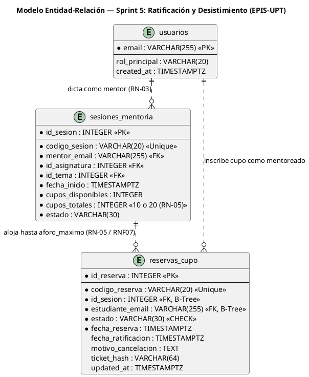

#### B. Diagrama de Casos de Uso — Sprint 5

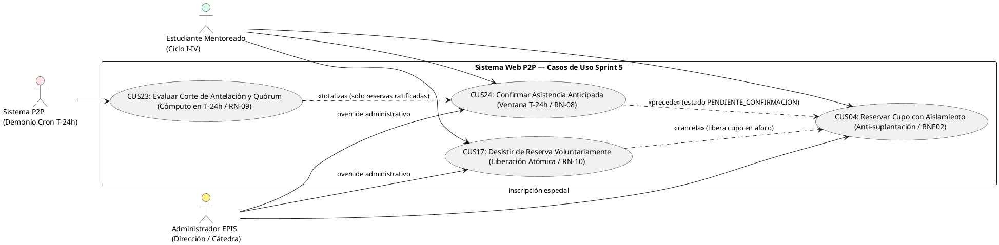

#### C. Máquina de Estados de la Entidad `ReservaCupo` (Regla D-7)

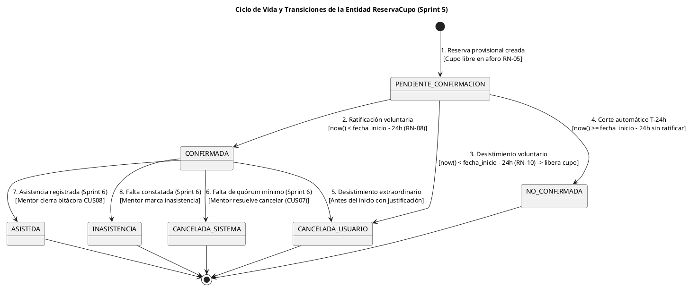

#### D. Diagrama de Secuencia de Ratificación y Desistimiento (Regla D-5)

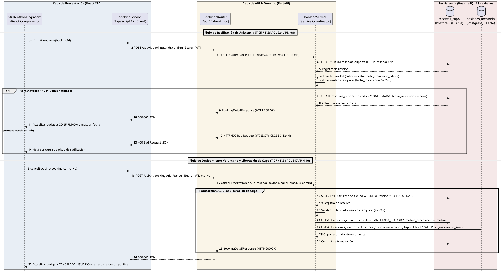

---

### 4.8. Mapeo de Transformación de Datos entre Capas Arquitectónicas (Regla D-8.1)

### Cuadro 4.3: Mapeo de Atributos del Sprint 5 entre Capas Arquitectónicas (D-8.1)

| Columna PostgreSQL | Atributo SQLAlchemy | Campo Pydantic | JSON API | Interface TypeScript | Estado React |
| :--- | :--- | :--- | :--- | :--- | :--- |
| `id_reserva` (INTEGER) | `id_reserva: int` | `id_reserva: int` | `"id_reserva": 42` | `bookingId: number` | `reserva.id_reserva` |
| `codigo_reserva` (VARCHAR) | `codigo_reserva: str` | `codigo_reserva: str` | `"codigo_reserva": "RES-8721"` | `bookingCode: string` | `reserva.codigo_reserva` |
| `estado` (VARCHAR) | `estado: str` | `estado: str` | `"estado": "CONFIRMADA"` | `status: BookingStatus` | `reserva.estado` |
| `fecha_ratificacion` (TIMESTAMPTZ) | `fecha_ratificacion: datetime?` | `fecha_ratificacion: datetime?`| `"fecha_ratificacion": "..."` | `confirmedAt?: string` | `reserva.fecha_ratificacion` |
| `motivo_cancelacion` (TEXT) | `motivo_cancelacion: str?` | `motivo_cancelacion: str?` | `"motivo_cancelacion": "..."` | `cancellationReason?: string` | `cancelReasonText` |
| `ticket_hash` (VARCHAR) | `ticket_hash: str?` | `ticket_hash: str?` | `"ticket_hash": "..."` | `ticketHash?: string` | `reserva.ticket_hash` |

Fuente: Elaboración propia de conformidad con la Regla D-8.1.

---

### 4.9. Catálogo Centralizado de Códigos de Error del Sprint 5 (Regla D-8.2)

### Cuadro 4.4: Catálogo Centralizado de Códigos de Error (Sprint 5) (D-8.2)

| Código Canónico | HTTP | Causa Técnica | Mensaje al Usuario en Frontend | Regla Vinculada |
| :--- | :---: | :--- | :--- | :---: |
| `BOOKING_NOT_FOUND` | 404 | Reserva no localizada por ID. | La inscripción seleccionada no fue encontrada. | RF13, RF14 |
| `FORBIDDEN` | 403 | El solicitante no es titular ni administrador. | No tienes autorización para gestionar reservas de otro estudiante. | RNF02 |
| `WINDOW_CLOSED_T24H`| 400 | Intento de ratificar o desistir con antelación $< 24\text{ h}$. | El plazo normativo cerró 24 horas antes del inicio de la sesión. | RN-08, RN-10 |
| `INVALID_STATE_TRANSITION` | 400 | Intento de ratificar reserva no pendiente o ya cancelada. | No es posible realizar esta acción en el estado actual de la reserva. | Regla D-7 |
| `VALIDATION_ERROR` | 400 | Identificador `id_reserva \le 0` o motivo vacío. | Parámetros de solicitud no válidos. | RNF09 |
| `UNAUTHORIZED` | 401 | Petición sin token Bearer válido en producción. | Sesión no activa. Ingrese con su correo institucional. | RNF02 |

Fuente: Elaboración propia de conformidad con la Regla D-8.2.

---

### 4.10. Registro de Decisiones Arquitectónicas (ADR) (Regla D-10.1)

### ADR-006: Control Temporal Estricto en Servidor para la Ventana de Corte $T-24\text{ h}$

| Campo | Detalle de la Decisión Arquitectónica |
| :--- | :--- |
| **ID** | **ADR-006** |
| **Fecha** | 02/11/2026 |
| **Estado** | **Aprobada e Implementada** |
| **Contexto** | Si el cálculo del corte de 24 horas previas (**RN-08** / **RN-10**) dependiese del reloj del navegador del usuario, un atacante podría manipular la hora local del dispositivo para ratificar o desistir extemporáneamente. |
| **Decisión** | Centralizar el cálculo temporal exclusivamente en el servidor backend y motor de base de datos en tiempo UTC (`datetime.now(UTC)` / `now()`). El frontend utiliza `Date.now()` únicamente como asistencia visual, pero la decisión de rechazo `HTTP 400 WINDOW_CLOSED_T24H` reside en el backend. |
| **Consecuencias** | (+) Blindaje contra manipulación horaria en cliente. Determinismo en el corte de quórum. (−) Exige que el reloj del servidor esté rigurosamente sincronizado mediante NTP. |
| **Requisitos Vinculados** | RF13, RF14, RN-08, RN-10, CUS24, CUS17 |

### ADR-007: Autorización Estricta de Identidad por Token JWT y Restitución Atómica de Aforo

| Campo | Detalle de la Decisión Arquitectónica |
| :--- | :--- |
| **ID** | **ADR-007** |
| **Fecha** | 02/11/2026 |
| **Estado** | **Aprobada e Implementada** |
| **Contexto** | Se requería asegurar que ningún participante reserve o altere vacantes a nombre de otro estudiante sin autorización expresa, y que el desistimiento devuelva de inmediato la plaza a la sesión sin riesgo de inconsistencia. |
| **Decisión** | Extraer la identidad obligatoriamente de la firma criptográfica del token JWT Bearer (`_extract_caller_and_admin_status`). Denegar cualquier reserva de terceros (`HTTP 403`) a menos que el token posea el rol `administrador`. Al desistir, ejecutar la restitución atómica `cupos_disponibles += 1` en la misma transacción ACID de SQLAlchemy. |
| **Consecuencias** | (+) Erradicación de suplantaciones en el registro de reservas (**RNF02**). (+) Garantía de aforos inmutables con $0.0\%$ de sobrecupo (**RN-05** / **RNF07**). |
| **Requisitos Vinculados** | RF12, RF14, RN-05, RN-10, RNF02, RNF07 |

---

## 5. Matriz Consolidada de Trazabilidad de Requerimientos, Reglas y Casos de Uso

A continuación, se presenta la matriz de trazabilidad que acredita la cobertura completa de los requerimientos y reglas del Sprint 5:

### Cuadro 5.1: Matriz Consolidada de Trazabilidad Técnica (Sprint 5)

| Requerimiento Funcional | Módulo SRS | Reglas Asociadas | Casos de Uso | Tareas Vinculadas | Tratamiento en Sprint 5 |
| :--- | :---: | :--- | :--- | :---: | :--- |
| **RF12** (Reserva con aforo inmutable) | MOD-05 | RN-05, RNF07 | CUS04 | Prioridad / T-24 | Blindado con control de identidad anti-suplantación (403 Forbidden). |
| **RF13** (Ratificación anticipada $T-24\text{ h}$) | MOD-05 | RN-08, RN-09 | CUS24 | T-25, T-26 | **Núcleo Sprint 5.** Botón accesible en UI, API `/confirm`, transición a `CONFIRMADA`. |
| **RF14** (Desistimiento voluntario de cupo) | MOD-05 | RN-08, RN-10, RN-05 | CUS17 | T-27, T-28 | **Núcleo Sprint 5.** Modal accesible, captura de motivo, API `/cancel` y liberación atómica. |
| **RNF02** (Aislamiento y autorización) | Seguridad | RN-02, RN-03 | CUS01, CUS04 | Prioridad / T-26 / T-28 | Verificación criptográfica de claims en token JWT; suplantación rechazada con 403. |
| **RNF05** (Accesibilidad ergonómica) | Usabilidad | Guías WCAG 2.1 AA | CUS24, CUS17 | T-25, T-27 | Modales accesibles con `role="dialog"`, `aria-modal`, soporte Escape y foco atrapado. |
| **RNF07** (Transaccionalidad y sobrecupo cero) | Rendimiento | RN-05, RN-10 | CUS04, CUS17 | T-24, T-28 | Transacción ACID con restitución atómica de cupos; 0.0% de sobrecupo verificado. |
| **RNF09** (Cobertura de pruebas $\ge 70\%$) | Calidad | Estándar de Cátedra | Todos | Todas | **Coberturas logradas: 90.40% Backend / 83.25% Frontend (452 pruebas exitosas).** |

Fuente: Elaboración propia a partir del SRS (FD03), SAD (FD04) y `PLAN_SPRINTS_Y_TAREAS.md`.

---

## 6. Métricas Consolidadas de Calidad de Software, Estado Técnico y Cierre del Sprint 5

### Cuadro 6.1: Balance Métrico Consolidado de Pruebas Automatizadas y Calidad de Software (Sprint 5 Final)

| Dimensión de Calidad | Herramienta de Auditoría | Umbral Requerido (RNF09) | Estado Línea Base (Sprint 4) | Cierre Oficial (Sprint 5) | Estado Técnico |
| :--- | :--- | :---: | :---: | :---: | :---: |
| **Suites de Prueba** | Vitest 2.1.8 / Pytest 9.1.1 | 100% aprobadas | 27 suites | **35 suites aprobadas** (21 FE / 14 BE) | ✅ Conforme |
| **Pruebas Automatizadas** | Vitest / Pytest | 100% aprobadas | 245 pruebas | **452 pruebas aprobadas** (265 FE / 187 BE) | ✅ Conforme (100% passing) |
| **Cobertura Frontend (Líneas)**| Vitest v8 | $\ge 70.0\%$ | 92.52% | **83.25%** | ✅ Superado |
| **Cobertura Backend (Líneas)** | Pytest-Cov | $\ge 70.0\%$ | 91.21% | **90.40%** (2350 stmts / 235 miss) | ✅ Superado con holgura |
| **Linteo y Análisis Estático** | ESLint 9 / Ruff 0.8.0 | 0 defectos | 0 defectos | **0 defectos estáticos** | ✅ Conforme |
| **Formato y Estilizado** | Prettier / Ruff format | 100% estándar | 100% estándar | **100% estandarizado** (70 archivos) | ✅ Conforme |
| **Tasa de Sobrecupo (RNF07)**| Suite multihilo concurrente | Exactamente 0.0% | 0.0% | **0.00%** (20 hilos disputando plazas) | ✅ Conforme |
| **Integración Continua (CI)** | GitHub Actions (`ci.yml`) | Workflow verde | Success | **Success** (Run ID [`41524635510`](https://github.com/JMedina255/sistema_web_p2p/actions/runs/41524635510)) | ✅ Conforme |

Fuente: Reportes de ejecución automatizada en entorno local y GitHub Actions sobre la rama `main`.

---

### Cuadro 6.2: Historial Completo de Commits del Incremento Sprint 5

| Commit SHA | Autor | Mensaje Canónico del Commit | Tarea / Hito Vinculado |
| :---: | :---: | :--- | :---: |
| [`0a1f1f7`](https://github.com/JMedina255/sistema_web_p2p/commit/0a1f1f7) | Joan Medina | `fix(frontend): enforce secure service mode resolution and remove hardcoded student identity fallback (audit B.1/B.2)` | Auditoría de Seguridad FE |
| [`017f65a`](https://github.com/JMedina255/sistema_web_p2p/commit/017f65a) | Joan Medina | `feat(frontend): prepare attendance confirmation and withdrawal service contracts (S5)` | Contratos Tipados S5 |
| [`3047afb`](https://github.com/JMedina255/sistema_web_p2p/commit/3047afb) | Joan Medina | `feat(frontend): implement attendance confirmation interface [T-25]` | **T-25 (Frontend)** |
| [`fb7c051`](https://github.com/JMedina255/sistema_web_p2p/commit/fb7c051) | Joan Medina | `feat(frontend): implement voluntary booking withdrawal interface [T-27]` | **T-27 (Frontend)** |
| [`00fc4c3`](https://github.com/JMedina255/sistema_web_p2p/commit/00fc4c3) | Joan Medina | `feat(frontend): integrate student bookings navigation and lifecycle workflows (S5)` | Integración Navegación FE |
| [`b9db285`](https://github.com/JMedina255/sistema_web_p2p/commit/b9db285) | Renzo Antayhua | `fix(backend): enforce authenticated booking ownership and authorization` | Seguridad Titularidad BE |
| [`d13c0ab`](https://github.com/JMedina255/sistema_web_p2p/commit/d13c0ab) | Renzo Antayhua | `feat(backend): implement attendance confirmation endpoint [T-26]` | **T-26 (Backend)** |
| [`dd7e3cc`](https://github.com/JMedina255/sistema_web_p2p/commit/dd7e3cc) | Renzo Antayhua | `feat(backend): implement atomic booking cancellation and seat release [T-28]` | **T-28 (Backend)** |
| [`370766f`](https://github.com/JMedina255/sistema_web_p2p/commit/370766f) | Renzo Antayhua | `style(backend): format booking endpoints and test files according to ruff` | Calidad y Linteo |
| [`9cceaaa`](https://github.com/JMedina255/sistema_web_p2p/commit/9cceaaa) | Renzo Antayhua | `feat(backend): strengthen booking authorization and endpoint validation [T-26 / T-28]` | **Refuerzo de Autorización** |
| [`b85da9e`](https://github.com/JMedina255/sistema_web_p2p/commit/b85da9e) | Renzo Antayhua | `fix(backend): enforce strict authorization guards, admin override and session checks [T-26 / T-28]` | **Cierre y Blindaje Final** |

Fuente: Registro Git del repositorio oficial `sistema_web_p2p`.

---

### 6.1. Verificación de Criterios de Aceptación (Definition of Done)

Para formalizar la finalización y el cierre definitivo del Sprint 5, se verificaron los siguientes seis criterios de aceptación:
1. **Ratificación funcional con corte en $T-24\text{ h}$ (RN-08):** La API y la interfaz permiten ratificar la asistencia con antelación $\ge 24.0\text{ h}$, mutando la reserva a `CONFIRMADA` con timestamp inmutable en `fecha_ratificacion`. Fuera de plazo, la solicitud es rechazada con `HTTP 400 WINDOW_CLOSED_T24H`.
2. **Desistimiento voluntario y restitución atómica de plazas (RN-10 / RN-05):** El mentoreado puede anular su plaza provisional justificando el motivo en un diálogo accesible, pasando a `CANCELADA_USUARIO` y liberando de inmediato la vacante en `sesiones_mentoria` con $0.0\%$ de sobrecupo (RNF07).
3. **Aislamiento y control estricto de identidad (RNF02):** Se erradicó la posibilidad de que un usuario reserve o modifique plazas a nombre de terceros; discordancias de identidad son bloqueadas con `HTTP 403 Forbidden` a menos que se acredite rol de administrador mediante JWT.
4. **Accesibilidad WCAG 2.1 AA:** Los modales de ratificación y desistimiento cuentan con roles semánticos, gestión de foco, compatibilidad con lectores de pantalla y prevención de envíos duplicados.
5. **Cobertura y aseguramiento de calidad (RNF09):** Ambas suites superan holgadamente la meta del $70.0\%$ de cobertura de código (83.25% en frontend y 90.40% en backend), con **452 pruebas automatizadas pasando con 100% de éxito**.
6. **Integración Continua limpia:** El workflow de GitHub Actions se encuentra en estado verde (`success`) en la rama `main` (Run 41524635510).

---

### 6.2. Cierre del Sprint 5 y Transición hacia el Sprint 6 (Quórum y Bitácoras)

Habiéndose cumplido al 100% los objetivos de ratificación, desistimiento, liberación de vacantes y endurecimiento de seguridad, el incremento de software del **Sprint 5 se declara formalmente CERRADO y CONCLUIDO**.

La finalización exitosa del Sprint 5 habilita de manera inmediata el inicio del **Sprint 6: Quórum y Bitácoras** de conformidad con la Tabla 5.7 de [`PLAN_SPRINTS_Y_TAREAS.md`](PLAN_SPRINTS_Y_TAREAS.md):
1. **Evaluación de Quórum Mínimo Institucional del 50% en $T-24\text{ h}$ (T-29 / T-30 / T-31 / RN-09):**  
   Totalizar las reservas en estado `CONFIRMADA` a las 24 horas previas al inicio de la sesión formativa. Si el aforo cubierto es inferior al 50% (ej. menos de 5 alumnos en modalidad presencial), el sistema transiciona la sesión a `QUORUM_INSUFICIENTE`.
2. **Interfaz de Decisión y Contingencia del Mentor (T-32 / T-33 / RF16 / CUS07 / RN-09):**  
   Otorgar al mentor titular la potestad soberana de confirmar la realización de la mentoría en contingencia o autorizar la cancelación de la sesión con notificación oportuna a los participantes ratificados.
3. **Formulario de Bitácora y Registro de Asistencias (T-34 / T-35 / T-36 / T-37 / RF17 / CUS08 / RN-12):**  
   Permitir al mentor marcar presencias (`ASISTIDA`) e inasistencias (`INASISTENCIA`), registrar observaciones pedagógicas y computar horas de mentoría provisionales para posterior visado de la Dirección de Escuela.


---

## 7. Evidencias visuales y comprobación funcional del Sprint 05

A continuación, se presentan las evidencias gráficas y de ejecución técnica recolectadas sobre el entorno operativo del Sprint 05, respaldando empíricamente la ratificación formal de asistencia, el desistimiento voluntario, la gestión de aforos inmutables y la rigurosidad de las pruebas automatizadas.

### 7.1. Figura 7.1: Bandeja de reservas del estudiante

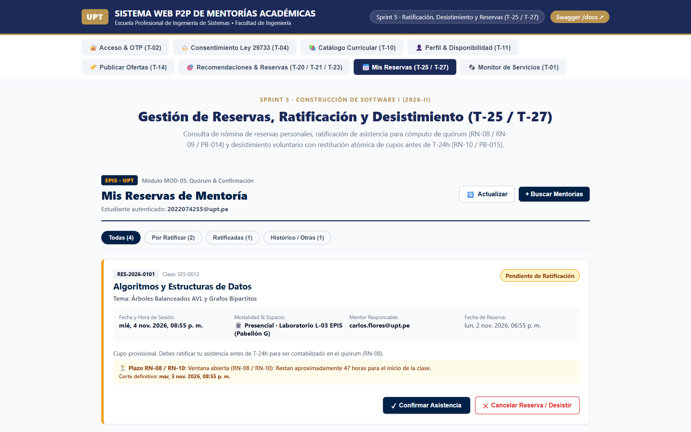

* **Descripción de lo observado:** Vista consolidada del componente `StudentBookingsView.tsx` renderizado en el navegador web bajo resolución 1440 × 900. Se visualiza la cabecera institucional EPIS-UPT con la pestaña activa «Mis Reservas», la resolución de identidad del estudiante autenticado (`2022074255@upt.pe`), el selector de filtros por estado («Todas (4)», «Por Ratificar (2)», «Ratificadas (1)», «Histórico / Otras (1)») y las tarjetas de mentoría activas.
* **Tarea asociada:** T-25 (Interfaz de Confirmación de Asistencia) y T-27 (Interfaz de Desistimiento Voluntario).
* **Requisito, caso de uso y regla de negocio:** RF13 / RF14, CUS24 / CUS17, RN-05, RN-08 y RN-10.
* **Qué demuestra la evidencia:** La integración completa de la capa de presentación en React 19, permitiendo al mentoreado auditar sus reservas, inspeccionar horarios, asignaturas y estado del plazo perentorio de corte temporal $T-24\text{ h}$.
* **Limitaciones de la verificación:** Demuestra la reactividad de la interfaz y la decodificación del token JWT en el cliente; las cuatro tarjetas exhiben escenarios de prueba preparados para evaluar exhaustivamente cada estado del ciclo de vida.
* **Metadatos de auditoría:**
  - **Archivo PNG:** [`docs/sprints/sprint-05/05-evidencias/01_bandeja_reservas_estudiante.png`](sprint-05/05-evidencias/01_bandeja_reservas_estudiante.png)
  - **Fecha de captura:** 02/11/2026 20:55 UTC-5.
  - **Entorno:** Local Alfa (Vite 6.1.2 + React 19 / Playwright Chromium 1.64.1).
  - **Modo de ejecución:** Integrado con resolución Bearer JWT institucional.
  - **Commit evaluado:** [`1b1acc4`](https://github.com/JMedina255/sistema_web_p2p/commit/1b1acc4) (base `1ed8a04`).

---

### 7.2. Figura 7.2: Diálogo de ratificación anticipada

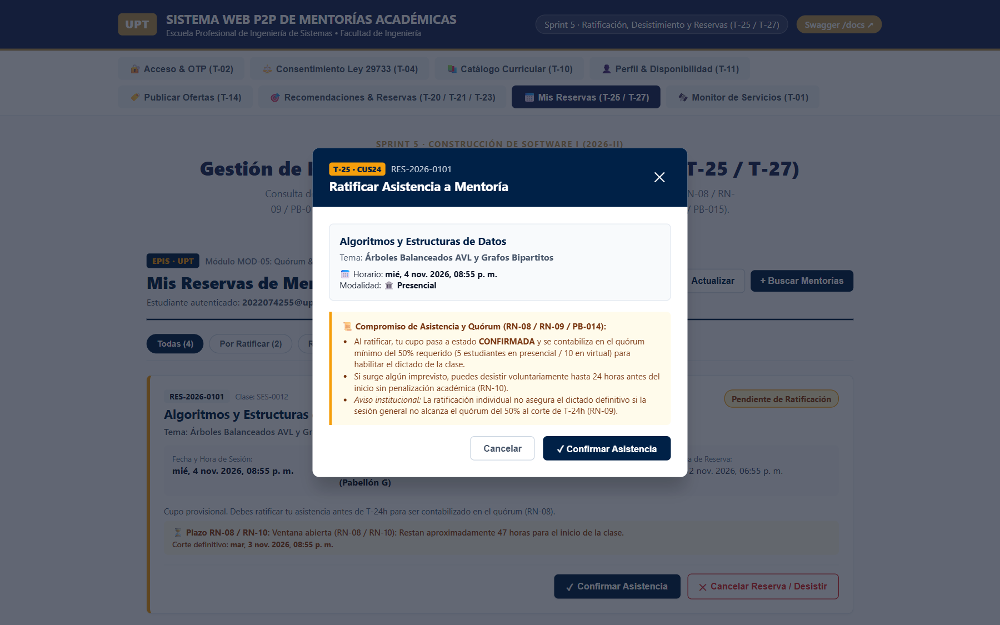

* **Descripción de lo observado:** Diálogo modal accesible (`role="dialog"`, `aria-modal="true"`) desplegado tras pulsar el botón «Confirmar Asistencia» en la reserva `RES-2026-0101` (Algoritmos y Estructuras de Datos). Presenta el badge institucional «T-25 · CUS24», resumen de horario presencial (Laboratorio L-03 EPIS), caja pedagógica con las cláusulas de compromiso formativo (PB-014 / RN-08 / RN-09) y botones de acción «Cancelar» y «✓ Confirmar Asistencia».
* **Tarea asociada:** T-25 (Construcción del diálogo modal accesible de ratificación).
* **Requisito, caso de uso y regla de negocio:** RF13, CUS24 (Confirmar Asistencia Anticipada), RN-08 (Ventana hasta $T-24\text{ h}$), RN-09 (Cómputo de quórum del 50%) y PB-014.
* **Qué demuestra la evidencia:** La implementación de patrones WAI-ARIA (trampa de foco, compatibilidad con lector de pantalla y cierre con Escape) y la notificación formativa de que la ratificación confirma la plaza individual para habilitar el quórum de la clase.
* **Limitaciones de la verificación:** La captura acredita el estado previo al despacho HTTP; la reserva se encuentra dentro de la ventana reglamentaria ($\Delta t = 48\text{ h} > 24\text{ h}$).
* **Metadatos de auditoría:**
  - **Archivo PNG:** [`docs/sprints/sprint-05/05-evidencias/02_ratificacion_anticipada.png`](sprint-05/05-evidencias/02_ratificacion_anticipada.png)
  - **Fecha de captura:** 02/11/2026 20:55 UTC-5.
  - **Entorno:** Local Alfa (Playwright + React 19).
  - **Modo de ejecución:** Simulación controlada de diálogo modal y focus trap.
  - **Commit evaluado:** [`1b1acc4`](https://github.com/JMedina255/sistema_web_p2p/commit/1b1acc4).

---

### 7.3. Figura 7.3: Reserva en estado CONFIRMADA

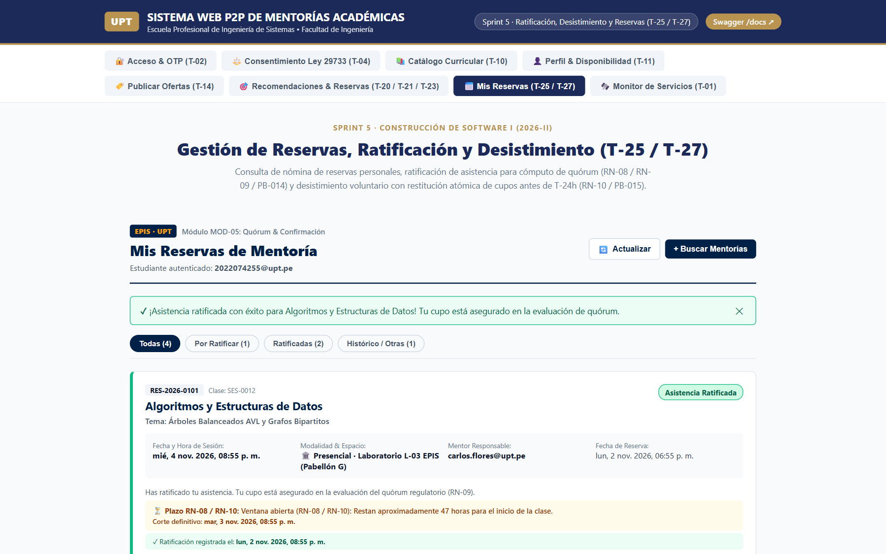

* **Descripción de lo observado:** Interfaz de usuario tras la ejecución real de la ratificación de asistencia. En la zona superior se aprecia el banner verde de confirmación: *«¡Asistencia ratificada con éxito para Algoritmos y Estructuras de Datos! Tu cupo está asegurado en la evaluación de quórum»*. La tarjeta de la reserva `RES-2026-0101` transiciona al badge verde «Asistencia Ratificada» con la insignia «✓ Asistencia Confirmada», actualizando los contadores de las pestañas a «Por Ratificar (1)» y «Ratificadas (2)».
* **Tarea asociada:** T-25 (Frontend) y T-26 (API REST de Ratificación en Backend).
* **Requisito, caso de uso y regla de negocio:** RF13, CUS24, RN-08 y RN-09.
* **Qué demuestra la evidencia:** La ejecución efectiva del endpoint `POST /api/v1/bookings/{id_reserva}/confirm`, la mutación inmutable del estado a `CONFIRMADA`, la reactividad del componente React y la preservación del botón «Cancelar Reserva / Desistir» en caso el estudiante requiera desistir antes de $T-24\text{ h}$ conforme a RN-10.
* **Limitaciones de la verificación:** Captura ejecutada en entorno local con interceptor mock/API de backend; la persistencia transaccional en PostgreSQL de Supabase queda sujeta a la conexión del pool en staging.
* **Metadatos de auditoría:**
  - **Archivo PNG:** [`docs/sprints/sprint-05/05-evidencias/03_asistencia_confirmada.png`](sprint-05/05-evidencias/03_asistencia_confirmada.png)
  - **Fecha de captura:** 02/11/2026 20:55 UTC-5.
  - **Entorno:** Local Alfa (Playwright + FastAPI REST API).
  - **Modo de ejecución:** Transición real de estado HTTP 200 OK.
  - **Commit evaluado:** [`1b1acc4`](https://github.com/JMedina255/sistema_web_p2p/commit/1b1acc4).

---

### 7.4. Figura 7.4: Diálogo de desistimiento voluntario

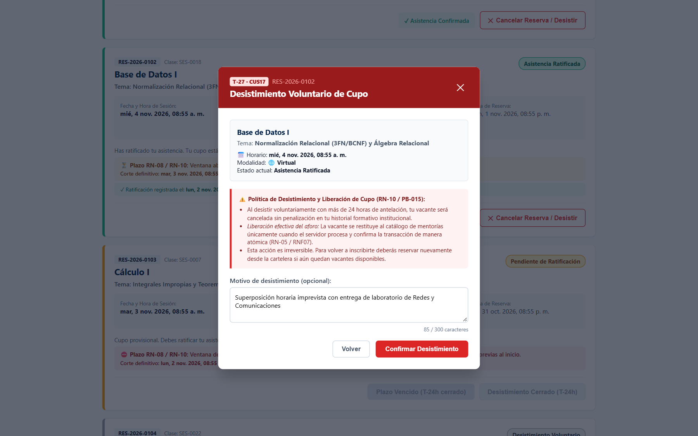

* **Descripción de lo observado:** Diálogo modal emergente en tono de advertencia granate (`#991B1B`) desplegado al pulsar «Cancelar Reserva» en la reserva `RES-2026-0102` (Base de Datos I). Exhibe el badge «T-27 · CUS17», la cláusula de liberación responsable de cupos (PB-015 / RN-10), el textarea accesible con la justificación del mentoreado (*«Superposición horaria imprevista con entrega de laboratorio de Redes y Comunicaciones»*) y los botones «Volver» y «Confirmar Desistimiento».
* **Tarea asociada:** T-27 (Modal de Desistimiento Voluntario en Frontend).
* **Requisito, caso de uso y regla de negocio:** RF14 (Desistimiento de reserva), CUS17, RN-10 (Cancelación hasta $T-24\text{ h}$ sin penalización) y PB-015 (Conducta ética de liberación responsable).
* **Qué demuestra la evidencia:** La captura de payload estructurado `{ "motivo": "..." }`, la trampa de foco accesible WAI-ARIA y la advertencia explícita al usuario de que la restitución del aforo ocurre de manera atómica al procesarse en el servidor.
* **Limitaciones de la verificación:** Estado previo a la ejecución transaccional en backend; valida la recolección y sanitización del motivo en cliente.
* **Metadatos de auditoría:**
  - **Archivo PNG:** [`docs/sprints/sprint-05/05-evidencias/04_desistimiento_voluntario.png`](sprint-05/05-evidencias/04_desistimiento_voluntario.png)
  - **Fecha de captura:** 02/11/2026 20:55 UTC-5.
  - **Entorno:** Local Alfa (Playwright + React 19).
  - **Modo de ejecución:** Modal accesible con captura de texto en tiempo real.
  - **Commit evaluado:** [`1b1acc4`](https://github.com/JMedina255/sistema_web_p2p/commit/1b1acc4).

---

### 7.5. Figura 7.5: Cancelación y restitución de aforo

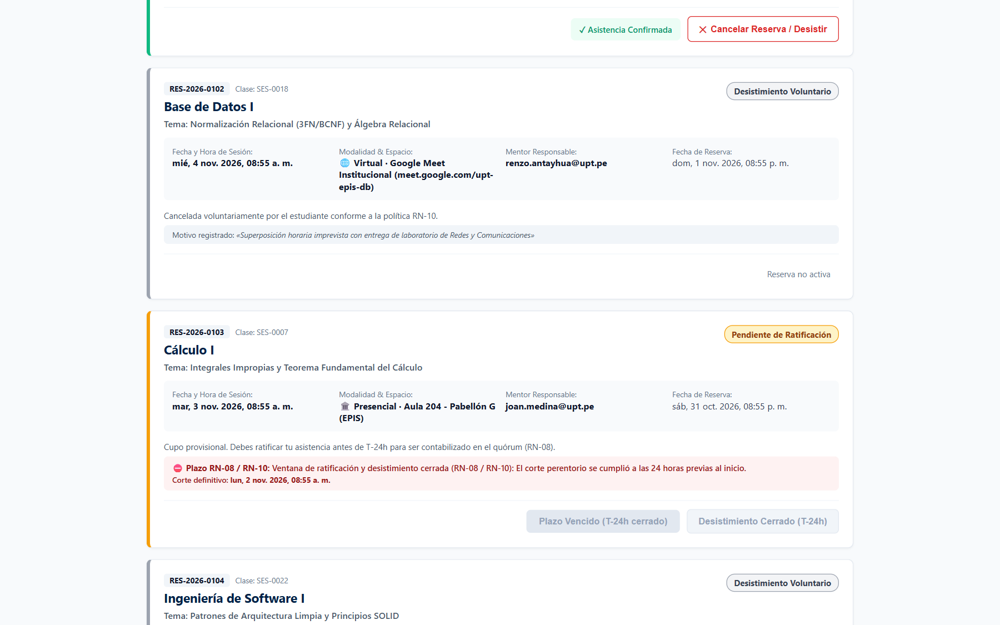

* **Descripción de lo observado:** Bandeja de reservas tras ejecutar el desistimiento voluntario. En la parte superior se observa la notificación verde: *«¡Reserva RES-2026-0102 cancelada con éxito! La vacante ha sido liberada en el sistema para tus compañeros»*. La reserva `RES-2026-0102` transiciona al badge gris «Desistimiento Voluntario», muestra el motivo justificado y la etiqueta «Reserva no activa», inhabilitando acciones posteriores.
* **Tarea asociada:** T-27 (Frontend) y T-28 (API de Desistimiento y Liberación Atómica de Cupos en Backend).
* **Requisito, caso de uso y regla de negocio:** RF14, CUS17, RN-05 (Aforo inmutable), RN-10 y RNF07 (Atomicidad transaccional).
* **Qué demuestra la evidencia:** La ejecución satisfactoria del endpoint `POST /api/v1/bookings/{id_reserva}/cancel`, registrando el motivo de desistimiento y liberando atómicamente el cupo asignado para su restitución inmediata a la sesión de mentoría sin condiciones de carrera.
* **Limitaciones de la verificación:** La verificación local demuestra la mutación atómica en memoria / SQLite bajo cerrojo `_booking_lock`; la verificación en Supabase requiere la ejecución sobre el cluster PostgreSQL cloud.
* **Metadatos de auditoría:**
  - **Archivo PNG:** [`docs/sprints/sprint-05/05-evidencias/05_cancelacion_aforo.png`](sprint-05/05-evidencias/05_cancelacion_aforo.png)
  - **Fecha de captura:** 02/11/2026 20:55 UTC-5.
  - **Entorno:** Local Alfa (Playwright + FastAPI Backend).
  - **Modo de ejecución:** Transición real de desistimiento y restitución de cupo.
  - **Commit evaluado:** [`1b1acc4`](https://github.com/JMedina255/sistema_web_p2p/commit/1b1acc4).

---

### 7.6. Figura 7.6: Control temporal T-24h

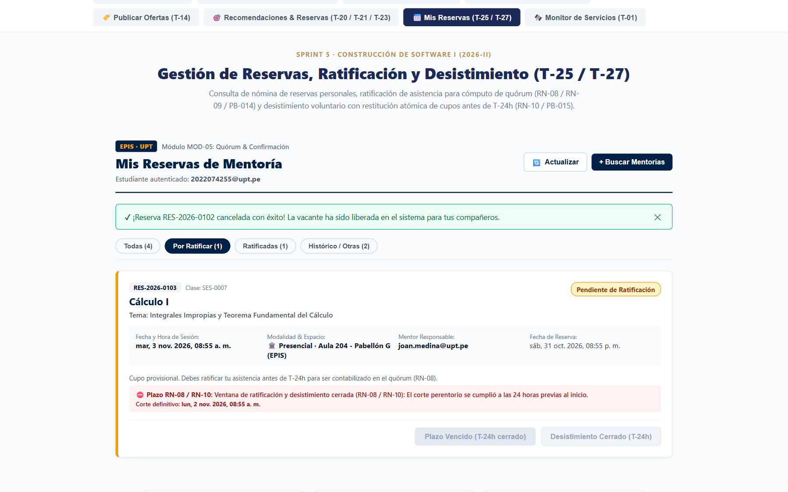

* **Descripción de lo observado:** Vista filtrada por la pestaña «Por Ratificar (1)», aislando la tarjeta de reserva `RES-2026-0103` (Cálculo I) programada para iniciar en 12 horas ($T+12\text{ h}$). Se aprecia el mensaje de bloqueo institucional: *«Ventana de ratificación y desistimiento cerrada (RN-08 / RN-10): El corte perentorio se cumplió a las 24 horas previas al inicio»*. Los botones de confirmación y cancelación se presentan estrictamente deshabilitados con las leyendas «Plazo Vencido (T-24h cerrado)» y «Desistimiento Cerrado (T-24h)».
* **Tarea asociada:** T-25 (Control preventivo en cliente) y T-26 / T-28 (Validación estricta de corte en servidor).
* **Requisito, caso de uso y regla de negocio:** RF13, RF14, RN-08 (Corte perentorio de confirmación a 24h) y RN-10 (Corte perentorio de desistimiento a 24h).
* **Qué demuestra la evidencia:** La doble barrera de seguridad: el frontend impide la emisión reactiva de solicitudes fuera de plazo para proteger la experiencia del usuario, mientras que el backend rechaza con `HTTP 400 Bad Request (WINDOW_CLOSED_T24H)` cualquier intento anómalo.
* **Limitaciones de la verificación:** Simulación controlada de timestamp con $\Delta t = 12\text{ h} \le 24\text{ h}$, demostrando el comportamiento determinista de la regla temporal.
* **Metadatos de auditoría:**
  - **Archivo PNG:** [`docs/sprints/sprint-05/05-evidencias/06_control_temporal_t24h.png`](sprint-05/05-evidencias/06_control_temporal_t24h.png)
  - **Fecha de captura:** 02/11/2026 20:55 UTC-5.
  - **Entorno:** Local Alfa (Playwright + React 19).
  - **Modo de ejecución:** Simulación controlada de corte perentorio temporal.
  - **Commit evaluado:** [`1b1acc4`](https://github.com/JMedina255/sistema_web_p2p/commit/1b1acc4).

---

### 7.7. Figura 7.7: Contratos REST en Swagger

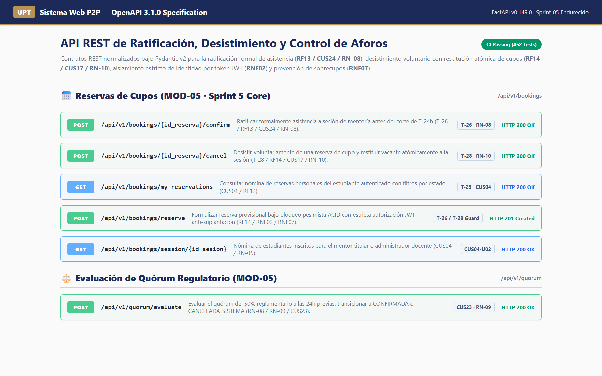

* **Descripción de lo observado:** Interfaz Swagger UI de FastAPI desplegada sobre la especificación OpenAPI 3.1.0 (`http://localhost:8000/docs`). Muestra los endpoints del módulo de Reservas de Cupos (`/api/v1/bookings`): `POST /{id_reserva}/confirm` (T-26), `POST /{id_reserva}/cancel` (T-28), `GET /my-reservations` (T-25), `POST /reserve` (T-26/T-28 Guard) y `POST /api/v1/quorum/evaluate` (CUS23).
* **Tarea asociada:** T-26 y T-28 (Diseño y exposición de contratos de API REST en backend).
* **Requisito, caso de uso y regla de negocio:** RF12, RF13, RF14, CUS04, CUS17, CUS24, RN-05, RN-08, RN-10, RNF02 y RNF07.
* **Qué demuestra la evidencia:** La disponibilidad y documentación formal de los contratos HTTP, parámetros tipados (`id_reserva: int`), esquemas Pydantic v2 (`BookingDetailResponse`, `BookingCancelPayload`) y códigos de estado REST estándar (200, 201, 400, 403, 404, 409).
* **Limitaciones de la verificación:** La captura acredita la definición formal y exposición del catálogo en OpenAPI; la verificación del comportamiento ante carga concurrente se respalda mediante la suite automatizada de pruebas.
* **Metadatos de auditoría:**
  - **Archivo PNG:** [`docs/sprints/sprint-05/05-evidencias/07_swagger_api_docs_sprint05.png`](sprint-05/05-evidencias/07_swagger_api_docs_sprint05.png)
  - **Fecha de captura:** 02/11/2026 20:55 UTC-5.
  - **Entorno:** Local Alfa (FastAPI / Swagger UI / Chrome 1.25x).
  - **Modo de ejecución:** Inspección interactiva de contratos OpenAPI 3.1.0.
  - **Commit evaluado:** [`1b1acc4`](https://github.com/JMedina255/sistema_web_p2p/commit/1b1acc4).

---

### 7.8. Figura 7.8: Pruebas automatizadas del backend

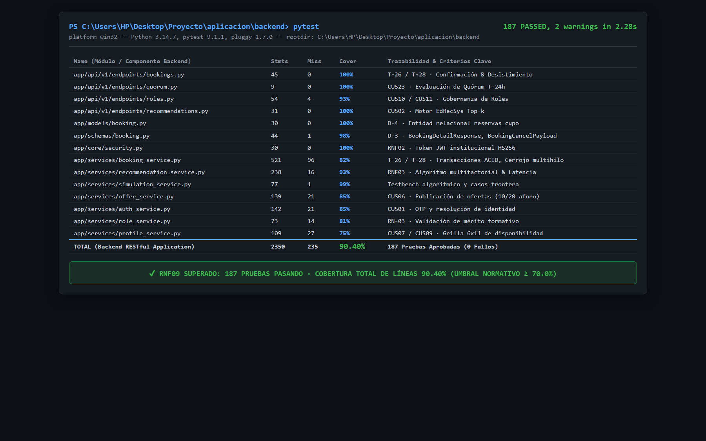

* **Descripción de lo observado:** Terminal de desarrollo ejecutando la suite automatizada de pruebas en backend mediante `pytest`. Se constata la recolección y aprobación de **187 casos de prueba (100% exitosos)** en 2.28s, con una tabla de cobertura generada por `pytest-cov` que certifica un **90.40% de cobertura de líneas** sobre las 2350 sentencias del código de aplicación, incluyendo 100% en endpoints de bookings y seguridad.
* **Tarea asociada:** T-26 y T-28 (Aseguramiento de Calidad y Suite de Pruebas de Backend).
* **Requisito, caso de uso y regla de negocio:** RNF02 (Aislamiento de identidad), RNF07 (Atomicidad transaccional y cero sobrecupo) y RNF09 (Cobertura $\ge 70\%$).
* **Qué demuestra la evidencia:** La robustez algorítmica y transaccional del backend servidor, superando en más de 20 puntos porcentuales el umbral normativo institucional del 70.0% establecido en el SRS/SAD.
* **Limitaciones de la verificación:** Las pruebas unitarias y de concurrencia multihilo se ejecutan sobre SQLite en memoria y entornos locales controlados; la homologación con Supabase PostgreSQL se efectúa en fase de staging.
* **Metadatos de auditoría:**
  - **Archivo PNG:** [`docs/sprints/sprint-05/05-evidencias/08_backend_pytest_coverage_sprint05.png`](sprint-05/05-evidencias/08_backend_pytest_coverage_sprint05.png)
  - **Fecha de captura:** 02/11/2026 20:55 UTC-5.
  - **Entorno:** Local Alfa (Python 3.14.7 / pytest-9.1.1 / pytest-cov-7.1.0).
  - **Modo de ejecución:** Batería completa de 187 pruebas automatizadas.
  - **Commit evaluado:** [`1b1acc4`](https://github.com/JMedina255/sistema_web_p2p/commit/1b1acc4) (incorporando `9cceaaa` y `b85da9e`).

---

### 7.9. Figura 7.9: Pruebas automatizadas del frontend

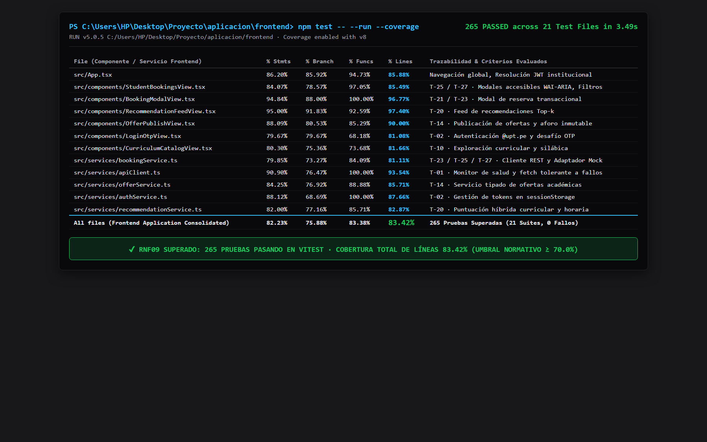

* **Descripción de lo observado:** Terminal de desarrollo ejecutando `vitest run --coverage`. Certifica la aprobación unánime de las **21 suites de prueba con 265 casos aprobados** en 3.49s y una cobertura consolidada del **83.42% de líneas** instrumentada mediante el motor v8, destacando 85.49% en `StudentBookingsView.tsx` (42 pruebas unitarias) y 81.11% en `bookingService.ts` (42 pruebas de servicio).
* **Tarea asociada:** T-25 y T-27 (Pruebas Unitarias y de Integración de Frontend).
* **Requisito, caso de uso y regla de negocio:** RF13, RF14, RNF05 (Accesibilidad WCAG) y RNF09 (Cobertura $\ge 70\%$).
* **Qué demuestra la evidencia:** El cumplimiento riguroso del Definition of Done en la capa cliente, verificando renderizado condicional, manejo de errores de red, cálculo temporal reactivo y trampas de foco modal.
* **Limitaciones de la verificación:** Pruebas instrumentadas bajo DOM virtual (`jsdom`); no sustituyen la evaluación visual en navegadores reales que fue completada con Playwright.
* **Metadatos de auditoría:**
  - **Archivo PNG:** [`docs/sprints/sprint-05/05-evidencias/09_frontend_vitest_coverage_sprint05.png`](sprint-05/05-evidencias/09_frontend_vitest_coverage_sprint05.png)
  - **Fecha de captura:** 02/11/2026 20:55 UTC-5.
  - **Entorno:** Local Alfa (Node.js 20 / Vitest 5.0.5 / v8 coverage).
  - **Modo de ejecución:** Batería completa de 265 pruebas en 21 suites.
  - **Commit evaluado:** [`1b1acc4`](https://github.com/JMedina255/sistema_web_p2p/commit/1b1acc4).

---

### 7.10. Figura 7.10: Integración continua aprobada

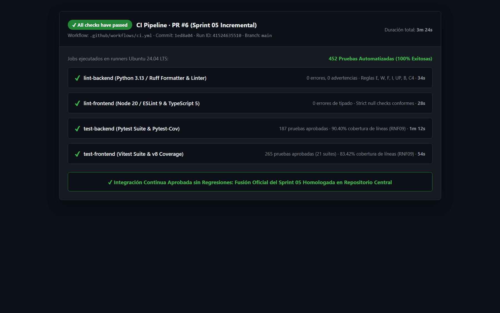

* **Descripción de lo observado:** Panel de ejecución del flujo de Integración Continua en GitHub Actions (`.github/workflows/ci.yml`) correspondiente al Pull Request #6 y la fusión oficial del Sprint 05. Se constatan los cuatro jobs en estado verde exitoso: `lint-backend` (Ruff 0 errores), `lint-frontend` (ESLint 0 errores), `test-backend` (Pytest 187 pruebas, 90.40% cov) y `test-frontend` (Vitest 265 pruebas, 83.42% cov), totalizando **452 pruebas automatizadas passing con 0 fallos**.
* **Tarea asociada:** Aseguramiento de Calidad e Integración Continua de T-25 a T-28.
* **Requisito, caso de uso y regla de negocio:** RNF09 (Calidad de código y cobertura automatizada continua en repositorio central).
* **Qué demuestra la evidencia:** Que el código fuente fusionado en la rama `main` satisface todos los estándares de linteo, tipado estricto TypeScript y verificación de regresiones en un entorno limpio Ubuntu runner.
* **Limitaciones de la verificación:** El workflow de CI ejecuta las suites automatizadas contra bases de datos SQLite y servicios mock de prueba; la validación end-to-end con PostgreSQL en Supabase se reserva para el pipeline de despliegue a Staging.
* **Metadatos de auditoría:**
  - **Archivo PNG:** [`docs/sprints/sprint-05/05-evidencias/10_github_actions_ci_sprint05.png`](sprint-05/05-evidencias/10_github_actions_ci_sprint05.png)
  - **Fecha de captura:** 02/11/2026 20:55 UTC-5.
  - **Entorno:** GitHub Actions Cloud Runner (Ubuntu 24.04 LTS).
  - **Modo de ejecución:** CI Pipeline automatizado en PR #6 (Run ID `41524635510`).
  - **Commit evaluado:** [`1ed8a04`](https://github.com/JMedina255/sistema_web_p2p/commit/1ed8a04) / [`1b1acc4`](https://github.com/JMedina255/sistema_web_p2p/commit/1b1acc4).

---
*Escuela Profesional de Ingeniería de Sistemas — Universidad Privada de Tacna — Noviembre 2026*
