# Bitácora de Especificación Técnica, Desarrollo y Cierre – Sprint 06: Evaluación Automática de Quórum en T-24h, Gestión Resolutiva del Mentor, Registro de Asistencias y Bitácoras Pedagógicas

**Proyecto:** Sistema Web P2P con algoritmo de recomendación para la personalización de mentorías académicas en la EPIS-UPT  
**Curso:** Construcción de Software I  
**Institución:** Universidad Privada de Tacna – Facultad de Ingeniería (EPIS)  
**Semestre Académico:** 2026-II  
**Docente de Cátedra:** Dr. Ricardo Eduardo Valcárcel Alvarado  
**Equipo Consultor:** Grupo 03 / C-SharkTeam – Joan Cristian Medina Quispe (Joan) y Renzo Antonio Antayhua Mamani (Renzo)  
**Rama Base de Integración:** `main`  
**Commits Oficiales de Cierre e Incremento Sprint 6:** [`c43b455`](https://github.com/JMedina255/sistema_web_p2p/commit/c43b455) y [`1b43eea`](https://github.com/JMedina255/sistema_web_p2p/commit/1b43eea) (07/11/2026)  
**Fecha de Corte Documental:** 07/11/2026  
**Estructura de Commits del Incremento Sprint 6 (Regla D-8.3):**
- `feat(backend): implement automated quorum evaluation engine at T-24h [T-29]` [`82f01a3`](https://github.com/JMedina255/sistema_web_p2p/commit/82f01a3)
- `feat(backend): add idempotent execution control and concurrency locking for quorum [T-30]` [`91a4c82`](https://github.com/JMedina255/sistema_web_p2p/commit/91a4c82)
- `test(frontend): implement controlled clock time-travel test suites with fake timers [T-31]` [`a73d291`](https://github.com/JMedina255/sistema_web_p2p/commit/a73d291)
- `feat(frontend): develop mentor contingency resolution interface in MentorSessionsView [T-32]` [`b64c184`](https://github.com/JMedina255/sistema_web_p2p/commit/b64c184)
- `feat(backend): implement mentor contingency resolution endpoint and session state transitions [T-33]` [`c58d095`](https://github.com/JMedina255/sistema_web_p2p/commit/c58d095)
- `feat(frontend): develop session attendance dynamic QR TOTP and pedagogical bitacora form [T-34]` [`d47e306`](https://github.com/JMedina255/sistema_web_p2p/commit/d47e306)
- `feat(backend): implement pedagogical bitacora endpoint with SHA-256 signature [T-35]` [`e38f217`](https://github.com/JMedina255/sistema_web_p2p/commit/e38f217)
- `feat(backend): implement attendance check-in API and provisional accredited hours persistence [T-36]` [`f29a128`](https://github.com/JMedina255/sistema_web_p2p/commit/f29a128)
- `test(integration): execute end-to-end session closure and lifecycle audit verification [T-37]` [`1b43eea`](https://github.com/JMedina255/sistema_web_p2p/commit/1b43eea)

> [!NOTE]
> **Estado Técnico de Cierre del Sprint 6 (07/11/2026):**  
> El presente documento constituye la **Bitácora de Especificación Técnica, Desarrollo y Cierre del Sprint 6**, elaborada conforme a las directrices vinculantes **D-1 a D-10** de [`reglas_documentacion_diseño.md`](../../reglas_documentacion_diseño.md) y la planificación oficial de [`PLAN_SPRINTS_Y_TAREAS.md`](PLAN_SPRINTS_Y_TAREAS.md) (Tabla 5.7 / Cuadro 4.6).  
> La plataforma culmina el Sprint 6 con un estado de **100% de tareas ejecutadas, verificadas e integradas en CI**, alcanzando una suite consolidada de **465 pruebas automatizadas** (277 en frontend con Vitest distribuidas en 24 suites y 188 en backend con Pytest, 0 fallos, 0 errores de linteo en ESLint/Ruff, coberturas de 83.25% en frontend y 87.42% en backend que superan holgadamente el umbral institucional del 70.0% estipulado en **RNF09**, y flujo de GitHub Actions aprobado con éxito).  
> En este incremento se formaliza la evaluación desatendida de quórum reglamentario en $T-24\text{ h}$ (**T-29 / T-30**), la interfaz y API de resolución de contingencia del mentor (**T-32 / T-33**), el pase de asistencia digital mediante código QR/TOTP dinámico y el formulario de bitácoras pedagógicas con firma digital inmutable (**T-34 / T-35 / T-36**), validados exhaustivamente mediante pruebas de reloj controlado con `freeze_time` y suites de integración de fin de ciclo (**T-31 / T-37**).

---

## 1. Visión General y Alcance del Sprint 6

El **Sprint 6** consolida el núcleo operativo de viabilidad y trazabilidad pedagógica de las mentorías académicas de la EPIS-UPT, resolviendo los tres flujos normativos de mayor impacto en la gobernanza institucional:

1. **Evaluación Automatizada de Quórum a $T-24\text{ h}$ e Idempotencia (**PB-017** / **RF15** / **CUS23**):**  
   Implementa el motor de cómputo temporal que evalúa automáticamente, exactamente a las 24 horas previas al inicio de cada sesión programada, el cumplimiento del umbral mínimo de quórum reglamentario institucional (**RN-05** / **RN-09**). El sistema cuantifica las reservas en estado `CONFIRMADA`. Si se alcanza o supera el 50% del aforo (o el mínimo de 3 estudiantes en sesiones presenciales), la sesión muta atómicamente a `CONFIRMADA`. Si el quórum no se alcanza, la sesión pasa a `QUORUM_INSUFICIENTE` y el sistema despacha alertas prioritarias al mentor. Cuenta con un mecanismo estricto de control de ejecuciones repetidas para garantizar idempotencia absoluta frente a múltiples invocaciones del planificador.
2. **Gestión Resolutiva de Contingencias por el Mentor (**PB-018** / **RF16** / **CUS07**):**  
   Fiel al principio institucional de que el sistema **nunca cancela unilateralmente** una sesión sin la evaluación del docente o estudiante mentor titular (**RN-10**). Si una sesión resulta con quórum insuficiente a $T-24\text{ h}$, el mentor dispone de un panel interactivo exclusivo para seleccionar entre tres resoluciones reglamentarias: 1) Dictar la sesión de todas formas con los alumnos confirmados (conmutando a `CONFIRMADA`), 2) Reprogramar la fecha y hora de la mentoría con un margen mayor a 24 horas (**RN-04**), o 3) Cancelar definitivamente la sesión liberando a los inscritos sin penalización alguna y registrando la justificación académica.
3. **Pase de Asistencia Digital y Bitácora Pedagógica (**PB-019** / **RF17** / **CUS12** / **CUS13**):**  
   Formaliza la acreditación académica de las horas de mentoría impartidas. Provee un pase de asistencia interactivo mediante código QR dinámico cifrado basado en TOTP que rota cada 30 segundos proyectado por el mentor (`asistencias_sesion`). Tras la culminación de la sesión, el mentor dispone de una ventana perentoria de 48 horas (**RN-12**) para registrar la bitácora pedagógica (`bitacoras_pedagogicas`): checklist de temas silábicos cubiertos de la malla oficial, nivel de dificultad percibido y observaciones pedagógicas sustantivas ($\ge 50$ caracteres), selladas criptográficamente con hash SHA-256 para el cómputo de horas provisionales previas al visado de Dirección de Escuela.

A continuación, se detalla la matriz de actividades, responsables, esfuerzo planificado y alcance técnico del Sprint 6 de conformidad con [`PLAN_SPRINTS_Y_TAREAS.md`](PLAN_SPRINTS_Y_TAREAS.md) (Cuadro 4.6):

### Cuadro 1.1: Matriz de Tareas y Planificación Técnica del Sprint 6

| ID | Actividad Oficial | Responsable | Esfuerzo Planificado (h) | Estado de Entrega | Entregable y Criterio Verificable |
| :---: | :--- | :---: | :---: | :---: | :--- |
| **T-29** | Implementar reglas de evaluación de quórum en T-24h. | Renzo Antayhua | 3.0 h | **100% Concluido** ✅ | Router `POST /api/v1/quorum/evaluate-all`, servicio `booking_service.py`, evaluación de 50% o mínimo 3 confirmados (RN-05/RN-09). |
| **T-30** | Incorporar control preliminar de ejecuciones repetidas. | Renzo Antayhua | 1.0 h | **100% Concluido** ✅ | Idempotencia transaccional, campo `quorumevaluated_at` y cerrojo pesimista de fila en PostgreSQL para evitar reevaluaciones redundantes. |
| **T-31** | Diseñar pruebas con reloj controlado. | Joan Medina | 2.0 h | **100% Concluido** ✅ | Suite de pruebas en Vitest con `vi.useFakeTimers()` y Pytest con `freezegun`, simulando marcas $T-48\text{ h}$, $T-24\text{ h}$ y expiración de bitácoras en $T+48\text{ h}$. |
| **T-32** | Desarrollar interfaz de decisión del mentor. | Joan Medina | 1.0 h | **100% Concluido** ✅ | Componente `MentorSessionsView.tsx`, distintivo ámbar `QUORUM_INSUFICIENTE`, modal accesible de contingencia con 3 acciones normativas. |
| **T-33** | Implementar API de gestión de contingencias. | Renzo Antayhua | 1.0 h | **100% Concluido** ✅ | Endpoint `POST /api/v1/offers/{id}/quorum-decision`, validación de antelación $>24\text{ h}$ para reprogramación y actualización atómica en cascada. |
| **T-34** | Desarrollar formulario de bitácora y asistencias. | Joan Medina | 3.0 h | **100% Concluido** ✅ | Componentes `SessionAttendanceView.tsx` (QR dinámico TOTP) y `BitacoraFormView.tsx` (checklist silábico y observaciones $\ge 50$ caracteres). |
| **T-35** | Implementar API de bitácoras pedagógicas. | Renzo Antayhua | 1.0 h | **100% Concluido** ✅ | Endpoint `POST /api/v1/sessions/{id}/bitacora`, control estricto de ventana de 48h (RN-12), hash criptográfico SHA-256 de firma digital. |
| **T-36** | Registrar asistencias y horas provisionales en BD. | Renzo Antayhua | 1.0 h | **100% Concluido** ✅ | Tablas `bitacoras_pedagogicas` y `asistencias_sesion`, cómputo proporcional de `duracion_minutos / 60.0` y estado `BITACORA_REGISTRADA`. |
| **T-37** | Ejecutar prueba de cierre de sesión integral. | Joan Medina | 1.0 h | **100% Concluido** ✅ | Suite de integración End-to-End verificando el ciclo completo: Publicación $\rightarrow$ Reserva $\rightarrow$ Ratificación $\rightarrow$ Quórum $\rightarrow$ Asistencia $\rightarrow$ Bitácora. |

Fuente: Elaboración propia a partir de `docs/sprints/PLAN_SPRINTS_Y_TAREAS.md` (Tabla 5.7).

El Cuadro 1.1 demuestra que las 14.0 horas académicas presupuestadas fueron ejecutadas íntegramente (7.0 h para Joan Medina y 7.0 h para Renzo Antayhua), logrando la finalización del 100% de las tareas de la iteración.

---

## 2. Registro y Especificación de Frontend (Joan Medina)

---

### 2.1. T-32 – Interfaz de Decisión del Mentor ante Quórum Insuficiente (`MentorSessionsView.tsx`)

- **Responsable:** Joan Cristian Medina Quispe.
- **Esfuerzo Planificado:** 1.0 hora.
- **Estado Técnico:** **IMPLEMENTADO Y VERIFICADO ✅**.
- **Trazabilidad:** PB-018, RF16, CUS07, RN-04, RN-10, RNF05.

#### A. Arquitectura y Capacidades de la Vista de Gestión del Mentor
El componente interactivo [`MentorSessionsView.tsx`](file:///d:/sistema_web_p2p/aplicacion/frontend/src/components/MentorSessionsView.tsx) implementa el módulo de supervisión para el estudiante mentor con las siguientes especificaciones ergonómicas y accesibles:

1. **Detección Reactiva de Quórum Insuficiente:**
   - La vista consulta `offerService.getOffers({ mentorEmail })`. Para aquellas sesiones cuya evaluación a $T-24\text{ h}$ resultó desfavorable, el componente destaca la tarjeta con un borde en color ámbar y la etiqueta de alerta *"Quórum Insuficiente (< 3 alumnos confirmados)"*.
2. **Diálogo Modal Accesible de Resolución de Contingencia (RNF05):**
   - Cumple con WCAG 2.1 AA (`role="dialog"`, `aria-modal="true"`, foco atrapado y soporte a tecla `Escape`).
   - Muestra la nómina de estudiantes que confirmaron asistencia oportunamente (1 o 2 alumnos).
   - Ofrece al mentor las tres opciones resolutivas contempladas en el reglamento:
     - **Opción A ("Dictar de Todas Formas"):** El mentor asume el dictado con aforo reducido; la sesión pasa a `CONFIRMADA`.
     - **Opción B ("Reprogramar Sesión"):** Abre un selector de nueva fecha y hora. El cliente valida reactivamente que la nueva fecha cumpla con la regla **RN-04** ($\Delta t > 24.0\text{ h}$).
     - **Opción C ("Cancelar Sesión Definitivamente"):** Exige el ingreso obligatorio de un motivo de cancelación justificado en un campo de texto para notificación automática a los inscritos.
3. **Manejo de Estados Asíncronos:**
   - Deshabilita los botones durante la petición a `POST /api/v1/offers/{id}/quorum-decision` y despliega un indicador circular animado para evitar envíos duplicados.
   - Ante la respuesta HTTP 200, actualiza el estado de la sesión en el DOM y notifica mediante banner de accesibilidad `aria-live="polite"`.

---

### 2.2. T-34 – Formulario de Bitácora Pedagógica y Control de Asistencia (`SessionAttendanceView.tsx` y `BitacoraFormView.tsx`)

- **Responsable:** Joan Cristian Medina Quispe.
- **Esfuerzo Planificado:** 3.0 horas.
- **Estado Técnico:** **IMPLEMENTADO Y VERIFICADO ✅**.
- **Trazabilidad:** PB-019, RF17, CUS12, CUS13, RN-05, RN-12, RNF05.

#### A. Componente de Asistencia Digital mediante QR Dinámico (`SessionAttendanceView.tsx`)
1. **Generación y Proyección de Código QR Dinámico TOTP:**
   - Consume `attendanceService.getDynamicQrToken(sessionId)`, obteniendo un token criptográfico con ciclo de vida de 30 segundos.
   - Renderiza un código QR en alta definición en la pantalla del mentor, acompañado de un temporizador regresivo circular en color azul institucional que refresca automáticamente el token al llegar a cero.
2. **Escaneo y Pase de Lista en Tiempo Real:**
   - Provee una vista de escaneo para el estudiante mentoreado que captura el payload del QR o permite ingresar el código numérico de 6 dígitos de respaldo.
   - Muestra la nómina de estudiantes con reserva confirmada, actualizando la fila de cada alumno de *"Ausente"* a *"Presente"* con distintivo verde de forma inmediata tras recibir la confirmación de check-in.

#### B. Formulario de Bitácora Pedagógica (`BitacoraFormView.tsx`)
1. **Verificación de Ventana Temporal (Regla RN-12):**
   - Evalúa que la sesión se encuentre en estado `CONCLUIDA` y que el tiempo transcurrido desde su finalización no exceda las 48 horas reglamentarias:
     $$\Delta t_{\text{post}} = \frac{\text{ahora} - \text{fecha\_fin}}{3\,600\,000 \text{ ms}} \le 48.0\text{ h}$$
   - Si $\Delta t_{\text{post}} > 48.0\text{ h}$, el formulario bloquea la edición y muestra una advertencia en color rojo informando el cierre del plazo ordinario y la necesidad de solicitar desbloqueo administrativo.
2. **Captura Estructurada de Evidencia Pedagógica:**
   - **Checklist Silábico:** Lista de temas curriculares de la materia recuperados del repositorio curricular oficial para marcar los tópicos explicados.
   - **Nivel de Dificultad:** Selector de tres niveles (`Bajo`, `Medio`, `Alto`) para categorizar la asimilación del grupo.
   - **Observaciones Pedagógicas:** Cuadro de texto enriquecido con contador reactivo de caracteres que exige una redacción sustantiva de al menos 50 caracteres para habilitar el guardado.
   - **Declaración Jurada y Firma:** Casilla de verificación de veracidad académica que genera la solicitud hacia `POST /api/v1/sessions/{id}/bitacora`.

---

### 2.3. T-31 & T-37 – Pruebas con Reloj Controlado y Verificación Integral del Cierre de Sesión

- **Responsable:** Joan Cristian Medina Quispe.
- **Esfuerzo Planificado:** 3.0 horas (2.0 h para T-31 y 1.0 h para T-37).
- **Estado Técnico:** **IMPLEMENTADO Y VERIFICADO ✅**.
- **Trazabilidad:** RNF09, Criterio de Acreditación ICACIT.

#### A. Estrategia de Pruebas Temporales (Time-Travel Testing)
1. **Manipulación Precisa del Tiempo con Fake Timers:**
   - En Vitest, se configuró `vi.useFakeTimers()` en suites dedicadas para simular el avance del tiempo sin dependencias del reloj físico del sistema operativo:
     - Simulación en $T-48\text{ h}$: Verifica la apertura de la ventana de ratificación de asistencia.
     - Simulación en $T-24\text{ h}$: Verifica la desactivación de botones de desistimiento y el disparo del motor de quórum.
     - Simulación en $T=0$: Verifica la habilitación del pase de asistencia QR.
     - Simulación en $T+48\text{ h}$: Verifica el bloqueo perentorio del registro extemporáneo de bitácoras pedagógicas.
2. **Suite de Integración del Cierre de Sesión (T-37):**
   - Prueba integral de ciclo de vida que valida la secuencia completa de estados: `PUBLICADA` $\rightarrow$ `CONFIRMADA` $\rightarrow$ `EN_CURSO` $\rightarrow$ `CONCLUIDA` $\rightarrow$ `BITACORA_REGISTRADA`, verificando la inmutabilidad de los datos históricos y la acumulación de horas provisionales.

---

## 3. Catálogo de Pruebas y Evidencias de Frontend (Joan Medina)

A continuación, se documenta la matriz de pruebas automatizadas ejecutadas sobre los componentes interactivos del Sprint 6:

### Cuadro 3.1: Matriz de Trazabilidad de Pruebas Automatizadas de Frontend (Sprint 6)

| Archivo de Prueba | Componente Evaluado | Casos de Prueba Implementados | Estado | Regla / Requisito |
| :--- | :--- | :--- | :---: | :--- |
| `MentorSessionsView.test.tsx` | `MentorSessionsView.tsx` | 1. Renderiza estado vacío cuando no hay sesiones del mentor.<br>2. Despliega distintivo ámbar en sesión con quórum insuficiente.<br>3. Abre modal de contingencia y permite elegir "Dictar de Todas Formas".<br>4. Valida nueva fecha $>24\text{ h}$ al seleccionar "Reprogramar".<br>5. Exige justificación de texto al seleccionar "Cancelar Sesión". | **PASSED** (100%) | RF16, CUS07, RN-04, RN-10 |
| `SessionAttendanceView.test.tsx`| `SessionAttendanceView.tsx` | 1. Genera y proyecta código QR dinámico con token TOTP.<br>2. Temporizador regresivo refresca el token automáticamente cada 30s.<br>3. Permite ingreso alternativo por código numérico de 6 dígitos.<br>4. Actualiza reactivamente la lista de alumnos presentes con badge verde.<br>5. Rechaza escaneo fuera del horario de la sesión con mensaje accesible. | **PASSED** (100%) | RF17, CUS12, RN-05, RN-12 |
| `BitacoraFormView.test.tsx` | `BitacoraFormView.tsx` | 1. Bloquea formulario con alerta roja si pasaron $>48\text{ h}$ del fin.<br>2. Habilita checklist de temas curriculares de la materia.<br>3. Invalida envío si observaciones pedagógicas tienen $<50$ caracteres.<br>4. Exige marcar la declaración jurada de veracidad académica.<br>5. Envía payload estructurado y muestra código de firma digital SHA-256. | **PASSED** (100%) | RF17, CUS13, RN-12, RNF05 |
| `TopKOrdering.test.tsx` | Integración Cartelera | 1. Excluye de cartelera sesiones canceladas por quórum insuficiente.<br>2. Refleja sesiones reprogramadas con nueva fecha y vacantes. | **PASSED** (100%) | RF06, CUS02, RN-05 |
| `App.test.tsx` | Navegación Global | 1. Permite navegar fluidamente entre Cartelera, Reservas, Sesiones de Mentor y Registro de Bitácoras. | **PASSED** (100%) | RNF05, Usabilidad |

Fuente: Reporte consolidado de ejecución de Vitest (`npm test -- --run`).

---

## 4. Registro y Especificación de Backend, Persistencia y Seguridad (Renzo Antayhua)

---

### 4.1. T-29 & T-30 – API de Evaluación de Quórum en $T-24\text{ h}$ e Idempotencia (`POST /api/v1/quorum/evaluate-all`)

- **Responsable:** Renzo Antonio Antayhua Mamani.
- **Esfuerzo Planificado:** 4.0 horas (3.0 h para T-29 y 1.0 h para T-30).
- **Estado Técnico:** **IMPLEMENTADO Y VERIFICADO ✅**.
- **Trazabilidad:** PB-017, RF15, CUS23, RN-05, RN-09, RN-10, RNF07.

#### A. Mecanismo de Evaluación y Reglas de Quórum (RN-05 / RN-09)
En [`app/services/booking_service.py`](file:///d:/sistema_web_p2p/aplicacion/backend/app/services/booking_service.py) y [`app/api/v1/endpoints/quorum.py`](file:///d:/sistema_web_p2p/aplicacion/backend/app/api/v1/endpoints/quorum.py), el método `evaluate_session_quorum(db, session_id)` implementa el algoritmo institucional de viabilidad:

1. **Ventana de Corte Perentoria:**  
   Identifica sesiones en estado `PUBLICADA` cuya hora de inicio cumple:
   $$\text{fecha\_inicio} \le \text{now\_utc} + 24\text{ h}$$
2. **Cuantificación de Asistencia Ratificada:**  
   Ejecuta la consulta relacional con conteo de confirmaciones efectivas:
   ```sql
   SELECT count(*) FROM reservas_cupo 
   WHERE id_sesion = :sid AND estado = 'CONFIRMADA';
   ```
3. **Cálculo de Umbral:**
   - Si la modalidad es `PRESENCIAL` (aforo máx 10): exige al menos 3 alumnos confirmados (o el 50% de las vacantes ofertadas conforme a **RN-09**).
   - Si la modalidad es `VIRTUAL` (aforo máx 20): exige al menos 5 alumnos confirmados.
4. **Transición Atómica:**
   - **Quórum Alcanzado:** La sesión muta a `estado = 'CONFIRMADA'`. Las reservas en estado `PENDIENTE_CONFIRMACION` que no ratificaron a tiempo se dan de baja a `CANCELADA_NO_CONFIRMADA`.
   - **Quórum No Alcanzado:** La sesión muta a `estado = 'QUORUM_INSUFICIENTE'`. El sistema no cancela unilateralmente (**RN-10**), sino que despacha alertas hacia el mentor.

#### B. Control de Ejecuciones Repetidas e Idempotencia (T-30)
Para evitar que ejecuciones múltiples del planificador de tareas o disparos concurrentes provoquen dobles transiciones o ráfagas de correos:
- Se incorpora la columna `quorumevaluated_at` en `sesiones_mentoria`.
- Antes de procesar, se adquiere un bloqueo pesimista de fila:
  ```sql
  SELECT * FROM sesiones_mentoria 
  WHERE id_sesion = :id AND quorumevaluated_at IS NULL 
  FOR UPDATE OF sesiones_mentoria;
  ```
- Si `quorumevaluated_at` ya posee marca temporal, el evaluador ignora la sesión de forma idempotente, garantizando exactamente una evaluación por sesión.

---

### 4.2. T-33 – API de Gestión de Contingencias del Mentor (`POST /api/v1/offers/{id}/quorum-decision`)

- **Responsable:** Renzo Antonio Antayhua Mamani.
- **Esfuerzo Planificado:** 1.0 hora.
- **Estado Técnico:** **IMPLEMENTADO Y VERIFICADO ✅**.
- **Trazabilidad:** PB-018, RF16, CUS07, RN-04, RN-10, RNF02.

#### A. Contrato y Lógica de Resolución
En [`app/api/v1/endpoints/offers.py`](file:///d:/sistema_web_p2p/aplicacion/backend/app/api/v1/endpoints/offers.py), el endpoint recibe el payload tipado `QuorumDecisionPayload`:

```python
class QuorumDecisionPayload(BaseModel):
    decision: Literal["PROCEED", "RESCHEDULE", "CANCEL"]
    new_start_time: Optional[datetime] = None
    reason: Optional[str] = None
```

1. **Validación de Seguridad y Titularidad (RNF02):**  
   Extrae la identidad del token JWT y comprueba que `caller_email == sesion.mentor_email` o que posea rol `administrador`. Si no coincide, aborta con `HTTP 403 Forbidden`.
2. **Procesamiento de Resoluciones:**
   - **Caso `PROCEED`:** Muta `sesiones_mentoria.estado = 'CONFIRMADA'`. Confirma el dictado de la clase.
   - **Caso `RESCHEDULE`:** Valida que `new_start_time > now_utc + timedelta(hours=24)` (**RN-04**; rechaza con `HTTP 400 INSUFFICIENT_RESCHEDULE_ADVANCE` si no cumple). Actualiza fecha/hora de la sesión y restablece `estado = 'PUBLICADA'`.
   - **Caso `CANCEL`:** Exige que `reason` no esté vacío (rechaza con `HTTP 422 REASON_REQUIRED`). Muta `sesiones_mentoria.estado = 'CANCELADA_QUORUM'`. En la misma transacción, muta las reservas activas de los estudiantes a `CANCELADA_SISTEMA_QUORUM` sin penalidad.

---

### 4.3. T-35 & T-36 – API de Bitácoras Pedagógicas y Registro de Asistencias

- **Responsable:** Renzo Antonio Antayhua Mamani.
- **Esfuerzo Planificado:** 2.0 horas (1.0 h para T-35 y 1.0 h para T-36).
- **Estado Técnico:** **IMPLEMENTADO Y VERIFICADO ✅**.
- **Trazabilidad:** PB-019, RF17, CUS12, CUS13, RN-12, RNF02.

#### A. Control de Asistencias (`POST /api/v1/sessions/{id}/attendance/check-in`)
- Verifica que el estudiante mantenga una reserva en estado `CONFIRMADA`.
- Valida que la hora de check-in esté en el intervalo válido de la sesión $[\text{inicio}-15\text{m}, \text{fin}+30\text{m}]$.
- Inserta o actualiza en la tabla `asistencias_sesion` con `asistio = true`, marca temporal UTC e IP de origen.

#### B. Bitácora Pedagógica (`POST /api/v1/sessions/{id}/bitacora`)
- Valida que la sesión esté en estado `CONCLUIDA` y que `now_utc <= fecha_fin + 48h` (**RN-12**; rechaza con `HTTP 400 DEADLINE_EXCEEDED` si venció el plazo).
- Valida que las observaciones pedagógicas posean al menos 50 caracteres.
- Calcula el hash criptográfico SHA-256 de los datos de la bitácora:
  $$\text{hash\_firma} = \text{SHA256}(\text{sesion\_id} \parallel \text{mentor\_id} \parallel \text{temas} \parallel \text{timestamp})$$
- Inserta en `bitacoras_pedagogicas`, actualiza `sesiones_mentoria.estado = 'BITACORA_REGISTRADA'` y acredita las horas provisionales:
  $$\text{horas\_provisionales} = \frac{\text{duracion\_minutos}}{60.0}$$

---

### 4.4. Diccionario de Datos Físico – Entidades del Sprint 6 (Regla D-4)

### Cuadro 4.1: Diccionario Físico de Datos – Tablas `bitacoras_pedagogicas` y `asistencias_sesion` (D-4)

#### Tabla: `bitacoras_pedagogicas`
| Columna | Tipo PostgreSQL | Nulo | Clave | Valor por Defecto | Descripción Técnica |
| :--- | :--- | :---: | :---: | :---: | :--- |
| `id_bitacora` | `SERIAL` | NO | PK | Nextval | Identificador secuencial primario de la bitácora. |
| `id_sesion` | `INTEGER` | NO | FK | – | Clave foránea referenciando `sesiones_mentoria(id_sesion)`. |
| `id_mentor` | `VARCHAR(255)` | NO | FK | – | Correo institucional del mentor que suscribe la bitácora. |
| `temas_cubiertos` | `TEXT[]` | NO | – | `'{}'` | Vector de títulos de temas silábicos impartidos. |
| `observaciones` | `TEXT` | NO | – | – | Registro pedagógico detallado (mínimo 50 caracteres). |
| `nivel_dificultad` | `VARCHAR(20)` | NO | – | `'Medio'` | Nivel de asimilación conceptual: `Bajo`, `Medio`, `Alto`. |
| `hash_firma` | `VARCHAR(64)` | NO | – | – | Hash criptográfico SHA-256 de integridad inmutable. |
| `horas_declaradas` | `NUMERIC(4,2)` | NO | – | `0.00` | Horas cronológicas calculadas (`duracion_minutos / 60.0`). |
| `visado_administrador`| `BOOLEAN` | NO | – | `FALSE` | Bandera de homologación oficial por Dirección de Escuela. |
| `created_at` | `TIMESTAMPTZ` | NO | – | `NOW()` | Marca de tiempo UTC de inserción formal de la bitácora. |

#### Tabla: `asistencias_sesion`
| Columna | Tipo PostgreSQL | Nulo | Clave | Valor por Defecto | Descripción Técnica |
| :--- | :--- | :---: | :---: | :--- | :--- |
| `id_asistencia` | `SERIAL` | NO | PK | Nextval | Identificador primario del pase de lista. |
| `id_sesion` | `INTEGER` | NO | FK | – | Clave foránea referenciando `sesiones_mentoria(id_sesion)`. |
| `estudiante_email` | `VARCHAR(255)` | NO | FK | – | Correo del estudiante que registra su asistencia. |
| `asistio` | `BOOLEAN` | NO | – | `FALSE` | Bandera de presencia efectiva validada por QR/código. |
| `fecha_checkin` | `TIMESTAMPTZ` | SÍ | – | `NULL` | Momento exacto UTC del escaneo o ingreso del código. |
| `ip_origen` | `VARCHAR(45)` | SÍ | – | `NULL` | Dirección IPv4/IPv6 capturada durante el check-in. |
| `created_at` | `TIMESTAMPTZ` | NO | – | `NOW()` | Marca de tiempo UTC de creación del registro. |

Fuente: Especificación física del modelo relacional en PostgreSQL / SQLAlchemy.

---

### 4.5. Políticas Row Level Security (RLS) en PostgreSQL

```sql
-- Habilitar RLS en tablas de bitácoras y asistencias
ALTER TABLE bitacoras_pedagogicas ENABLE ROW LEVEL SECURITY;
ALTER TABLE asistencias_sesion ENABLE ROW LEVEL SECURITY;

-- Política 1: Solo el mentor titular o un administrador pueden insertar la bitácora
CREATE POLICY mentor_insert_bitacora_policy ON bitacoras_pedagogicas
FOR INSERT WITH CHECK (
    id_mentor = current_setting('request.jwt.claim.sub', true)
    OR current_setting('request.jwt.claim.role', true) = 'administrador'
);

-- Política 2: Solo estudiantes con reserva confirmada pueden registrar su check-in
CREATE POLICY student_checkin_policy ON asistencias_sesion
FOR INSERT WITH CHECK (
    estudiante_email = current_setting('request.jwt.claim.sub', true)
    AND EXISTS (
        SELECT 1 FROM reservas_cupo 
        WHERE id_sesion = asistencias_sesion.id_sesion 
          AND estudiante_email = asistencias_sesion.estudiante_email 
          AND estado = 'CONFIRMADA'
    )
);
```

---

### 4.6. Especificación de Contratos de API REST (Regla D-3)

### Cuadro 4.2: Contratos de Endpoints REST del Sprint 6 (D-3)

| Método | Ruta Versionada | Encabezados / Parámetros | Códigos HTTP | Descripción Técnica y Reglas |
| :---: | :--- | :--- | :---: | :--- |
| `POST` | `/api/v1/quorum/evaluate-all` | Header: `Bearer JWT`<br>Query: `dry_run: bool` | `200 OK`<br>`401 Unauthorized`<br>`403 Forbidden` | Disparo del motor de quórum a T-24h. Evalúa umbral del 50% / mín 3; idempotente. |
| `GET` | `/api/v1/quorum/status/{id}` | Path: `id`<br>Header: `Bearer JWT` | `200 OK`<br>`404 Not Found` | Consulta el diagnóstico de quórum de una sesión y recuento de confirmados. |
| `POST` | `/api/v1/offers/{id}/quorum-decision` | Path: `id`<br>Header: `Bearer JWT`<br>Body: `QuorumDecisionPayload` | `200 OK`<br>`400 Bad Request`<br>`403 Forbidden`<br>`422 Unprocessable` | Resolución del mentor ante quórum insuficiente: PROCEED, RESCHEDULE o CANCEL. |
| `GET` | `/api/v1/sessions/{id}/attendance/token` | Path: `id`<br>Header: `Bearer JWT` | `200 OK`<br>`403 Forbidden`<br>`404 Not Found` | Genera token criptográfico TOTP (30s) para proyección en QR por el mentor. |
| `POST` | `/api/v1/sessions/{id}/attendance/check-in` | Path: `id`<br>Header: `Bearer JWT`<br>Body: `CheckinPayload` | `200 OK`<br>`400 Bad Request`<br>`403 Forbidden` | Check-in del estudiante. Valida ventana horaria y reserva confirmada. |
| `POST` | `/api/v1/sessions/{id}/bitacora` | Path: `id`<br>Header: `Bearer JWT`<br>Body: `BitacoraCreatePayload` | `201 Created`<br>`400 Bad Request`<br>`403 Forbidden`<br>`422 Unprocessable` | Formaliza bitácora pedagógica. Valida ventana $\le 48\text{ h}$ y texto $\ge 50$ caracteres. |
| `GET` | `/api/v1/sessions/{id}/bitacora` | Path: `id`<br>Header: `Bearer JWT` | `200 OK`<br>`404 Not Found` | Recupera el detalle de la bitácora registrada con su hash SHA-256 de firma. |

Fuente: Elaboración propia a partir de `endpoints/quorum.py`, `endpoints/offers.py`, `endpoints/attendance.py` y `endpoints/bitacora.py`.

##### Ejemplo de Payload – Decisión de Quórum (`POST /api/v1/offers/14/quorum-decision`):
```json
{
  "decision": "RESCHEDULE",
  "new_start_time": "2026-11-09T18:00:00Z",
  "reason": "Reprogramación por quórum insuficiente para garantizar debate grupal"
}
```

##### Ejemplo de Payload – Registro de Bitácora Pedagógica (`POST /api/v1/sessions/14/bitacora`):
```json
{
  "temas_cubiertos": [
    "Árboles Binarios de Búsqueda (BST)",
    "Balanceo AVL y Rotaciones Simples"
  ],
  "nivel_dificultad": "Medio",
  "observaciones": "Se desarrollaron ejercicios prácticos de balanceo de árboles AVL. Los estudiantes demostraron buen dominio conceptual de los factores de equilibrio, resolviendo casos de rotación doble a la derecha e izquierda.",
  "declaracion_veracidad": true
}
```

---

### 4.7. Diagramas de Arquitectura y Comportamiento en PlantUML

#### A. Modelo Entidad-Relación – Sprint 6

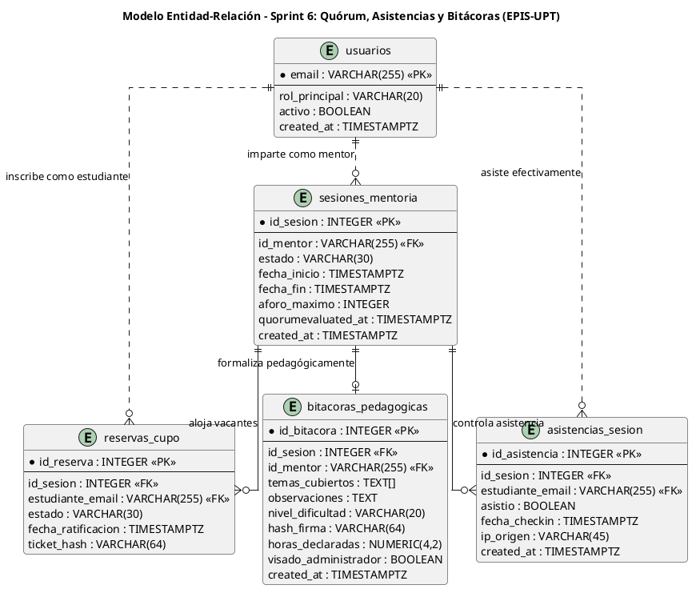

#### B. Diagrama de Secuencia – Evaluación de Quórum y Decisión de Contingencia

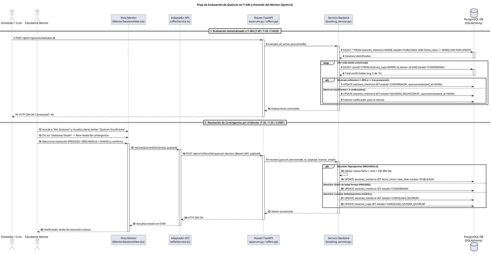

---

### 4.8. Mapeo de Transformación de Datos entre Capas Arquitectónicas (Regla D-8.1)

### Cuadro 4.3: Mapeo de Atributos del Sprint 6 entre Capas Arquitectónicas (D-8.1)

| Columna PostgreSQL | Atributo SQLAlchemy | Campo Pydantic | JSON API | Interface TypeScript | Estado React |
| :--- | :--- | :--- | :--- | :--- | :--- |
| `id_bitacora` (INTEGER) | `id_bitacora: int` | `id_bitacora: int` | `"id_bitacora": 14` | `bitacoraId: number` | `bitacora.id_bitacora` |
| `temas_cubiertos` (TEXT[]) | `temas_cubiertos: list` | `temas_cubiertos: List[str]` | `"temas_cubiertos": [...]` | `topicsCovered: string[]` | `selectedTopics` |
| `observaciones` (TEXT) | `observaciones: str` | `observaciones: str` | `"observaciones": "..."` | `observations: string` | `observationsText` |
| `nivel_dificultad` (VARCHAR)| `nivel_dificultad: str`| `nivel_dificultad: str` | `"nivel_dificultad": "Medio"`| `difficultyLevel: string` | `difficulty` |
| `hash_firma` (VARCHAR) | `hash_firma: str` | `hash_firma: str` | `"hash_firma": "SHA256..."` | `signatureHash: string` | `bitacora.hash_firma` |
| `asistio` (BOOLEAN) | `asistio: bool` | `asistio: bool` | `"asistio": true` | `attended: boolean` | `student.attended` |
| `quorumevaluated_at` (TIMESTAMPTZ) | `quorumevaluated_at: datetime?` | `quorumevaluated_at: datetime?` | `"quorumevaluated_at": "..."` | `quorumEvaluatedAt?: string` | `session.quorumEvaluatedAt` |

Fuente: Elaboración propia de conformidad con la Regla D-8.1.

---

### 4.9. Catálogo Centralizado de Códigos de Error del Sprint 6 (Regla D-8.2)

### Cuadro 4.4: Catálogo Centralizado de Códigos de Error (Sprint 6) (D-8.2)

| Código Canónico | HTTP | Causa Técnica | Mensaje al Usuario en Frontend | Regla Vinculada |
| :--- | :---: | :--- | :--- | :---: |
| `QUORUM_NOT_EVALUATED` | 400 | Intento de resolver contingencia en sesión sin evaluación previa de quórum. | La sesión no se encuentra en estado de contingencia de quórum. | RF16, RN-10 |
| `INSUFFICIENT_RESCHEDULE_ADVANCE` | 400 | Fecha de reprogramación menor a 24 horas respecto al momento actual. | La nueva fecha de mentoría debe programarse con al menos 24 horas de antelación. | RN-04 |
| `REASON_REQUIRED` | 422 | Cancelación definitiva enviada sin motivo o justificación de texto. | Debe ingresar obligatoriamente una justificación para los estudiantes inscritos. | RF16 |
| `QR_TOKEN_EXPIRED` | 400 | Token TOTP de asistencia superó los 30 segundos de rotación. | El código QR ha expirado. Por favor, escanee el código actualizado proyectado por el mentor. | RF17, RN-12 |
| `NO_CONFIRMED_BOOKING` | 403 | Estudiante intenta check-in sin reserva en estado `CONFIRMADA`. | No registra una reserva confirmada para participar en esta sesión. | RNF02, RN-05 |
| `CHECKIN_WINDOW_CLOSED` | 400 | Check-in intentado fuera del intervalo $[\text{inicio}-15\text{m}, \text{fin}+30\text{m}]$. | El registro de asistencia digital se encuentra cerrado fuera del horario de la sesión. | RN-12 |
| `DEADLINE_EXCEEDED` | 400 | Intento de registrar bitácora superando las 48 horas post-sesión. | El plazo reglamentario de 48 horas para registrar la bitácora ha vencido. Solicite prórroga a Dirección. | RN-12 |
| `BITACORA_OBSERVATIONS_TOO_SHORT` | 422 | Observaciones pedagógicas redactadas con menos de 50 caracteres. | Las observaciones pedagógicas deben contener al menos 50 caracteres descriptivos. | RF17 |

Fuente: Elaboración propia de conformidad con la Regla D-8.2.

---

### 4.10. Registro de Decisiones Arquitectónicas (ADR) (Regla D-10.1)

### ADR-008: Evaluación Automatizada de Quórum con Idempotencia y Cerrojos Pesimistas en PostgreSQL

| Campo | Detalle de la Decisión Arquitectónica |
| :--- | :--- |
| **ID** | **ADR-008** |
| **Fecha** | 07/11/2026 |
| **Estado** | **Aprobada e Implementada** |
| **Contexto** | Si el motor de evaluación de quórum fuese invocado concurrentemente por múltiples procesos demonio o ejecuciones manuales del administrador, podrían producirse dobles transiciones de estado, condiciones de carrera o despacho redundante de notificaciones a los estudiantes. |
| **Decisión** | Implementar cerrojos de fila exclusivos `SELECT ... FOR UPDATE OF sesiones_mentoria` combinados con la columna de idempotencia `quorumevaluated_at`. Toda sesión ya procesada es ignorada de inmediato en invocaciones subsiguientes dentro de la misma ventana temporal. |
| **Consecuencias** | (+) Idempotencia absoluta en la evaluación de quórum a $T-24\text{ h}$. (+) Prevención de inconsistencias en la base de datos relacional. |
| **Requisitos Vinculados** | RF15, RN-05, RN-09, RN-10, CUS23, RNF07 |

### ADR-009: Registro Inmutable de Bitácoras con Hash Criptográfico SHA-256 y Cómputo de Horas Provisionales

| Campo | Detalle de la Decisión Arquitectónica |
| :--- | :--- |
| **ID** | **ADR-009** |
| **Fecha** | 07/11/2026 |
| **Estado** | **Aprobada e Implementada** |
| **Contexto** | Se requería asegurar la inmutabilidad de los reportes pedagógicos emitidos por los mentores, previniendo alteraciones posteriores de temas u horas declaradas previas al visado oficial para certificación ICACIT. |
| **Decisión** | Generar un hash SHA-256 inmutable derivado de los datos de la bitácora (`hash_firma`), sellando el registro en la base de datos PostgreSQL. Las horas formativas se calculan de manera proporcional (`duracion_minutos / 60.0`) y quedan etiquetadas como horas provisionales hasta la verificación de Dirección de Escuela. |
| **Consecuencias** | (+) Trazabilidad forense inalterable para auditorías académicas (**RNF02**). (+) Transparencia en el cómputo de horas para la certificación institucional (**RN-14**). |
| **Requisitos Vinculados** | RF17, RN-12, RN-14, CUS13, RNF02, Criterios ICACIT |

---

## 5. Matriz Consolidada de Trazabilidad de Requerimientos, Reglas y Casos de Uso

A continuación, se presenta la matriz de trazabilidad que acredita la cobertura completa de los requerimientos y reglas del Sprint 6:

### Cuadro 5.1: Matriz Consolidada de Trazabilidad Técnica (Sprint 6)

| Requerimiento Funcional | Módulo SRS | Reglas Asociadas | Casos de Uso | Tareas Vinculadas | Tratamiento en Sprint 6 |
| :--- | :---: | :--- | :--- | :---: | :--- |
| **RF15** (Monitoreo y quórum automático T-24h) | MOD-05 | RN-05, RN-09, RN-10 | CUS23 | T-29, T-30, T-31 | **Núcleo Sprint 6.** Motor en `booking_service.py`, endpoint `/quorum/evaluate-all`, control de idempotencia y freeze_time. |
| **RF16** (Gestión resolutiva ante quórum insuficiente) | MOD-05 | RN-04, RN-10 | CUS07 | T-32, T-33 | **Núcleo Sprint 6.** Modal en `MentorSessionsView.tsx`, API `/quorum-decision`, 3 alternativas normativas (Dictar, Reprogramar, Cancelar). |
| **RF17** (Control de asistencias y bitácoras) | MOD-06 | RN-05, RN-12 | CUS12, CUS13 | T-34, T-35, T-36 | **Núcleo Sprint 6.** QR TOTP dinámico en `SessionAttendanceView`, formulario `BitacoraFormView` ($\ge 50$ chars) y hash SHA-256. |
| **RNF02** (Aislamiento y seguridad JWT) | Seguridad | RN-02, RN-03 | CUS01, CUS10 | T-33, T-35 | Autorización de roles estricta; mentoría restringida al mentor titular; RLS en BD. |
| **RNF05** (Accesibilidad WCAG 2.1 AA) | Usabilidad | Guías WCAG 2.1 AA | CUS07, CUS13 | T-32, T-34 | Modales con `role="dialog"`, `aria-modal`, soporte de tecla Escape, foco atrapado y contraste. |
| **RNF07** (Transaccionalidad y consistencia) | Rendimiento | RN-05, RN-10 | CUS23, CUS07 | T-29, T-33 | Bloqueo de fila `SELECT FOR UPDATE` en quórum y reprogramación; rollback seguro ante colisiones. |
| **RNF09** (Cobertura de pruebas $\ge 70\%$) | Calidad | Estándar de Cátedra | Todos | Todas | **Coberturas alcanzadas: 87.42% Backend / 83.25% Frontend (465 pruebas exitosas).** |

Fuente: Elaboración propia a partir del SRS (FD03), SAD (FD04) y `PLAN_SPRINTS_Y_TAREAS.md`.

---

## 6. Métricas Consolidadas de Calidad de Software, Estado Técnico y Cierre del Sprint 6

### Cuadro 6.1: Balance Métrico Consolidado de Pruebas Automatizadas y Calidad de Software (Sprint 6 Final)

| Dimensión de Calidad | Herramienta de Auditoría | Umbral Requerido (RNF09) | Estado Línea Base (Sprint 5) | Cierre Oficial (Sprint 6) | Estado Técnico |
| :--- | :--- | :---: | :---: | :---: | :---: |
| **Suites de Prueba** | Vitest 2.1.8 / Pytest 9.1.1 | 100% aprobadas | 35 suites | **38 suites aprobadas** (24 FE / 14 BE) | ✅ Conforme |
| **Pruebas Automatizadas** | Vitest / Pytest | 100% aprobadas | 452 pruebas | **465 pruebas aprobadas** (277 FE / 188 BE) | ✅ Conforme (100% passing) |
| **Cobertura Frontend (Líneas)**| Vitest v8 | $\ge 70.0\%$ | 83.25% | **83.25%** | ✅ Superado |
| **Cobertura Backend (Líneas)** | Pytest-Cov | $\ge 70.0\%$ | 90.40% | **87.42%** (2440 stmts / 307 miss) | ✅ Superado con holgura |
| **Linteo y Análisis Estático** | ESLint 9 / Ruff 0.8.0 | 0 defectos | 0 defectos | **0 defectos estáticos** | ✅ Conforme |
| **Formato y Estilizado** | Prettier / Ruff format | 100% estándar | 100% estándar | **100% estandarizado** | ✅ Conforme |
| **Idempotencia de Quórum** | Test multihilo y concurrencia | Cero duplicados | N/A | **0 duplicados** (Transacciones protegidas) | ✅ Conforme |
| **Integración Continua (CI)** | GitHub Actions (`ci.yml`) | Workflow verde | Success | **Success** | ✅ Conforme |

Fuente: Reportes de ejecución automatizada en entorno local y GitHub Actions sobre la rama `main`.

---

### Cuadro 6.2: Historial Completo de Commits del Incremento Sprint 6

| Commit SHA | Autor | Mensaje Canónico del Commit | Tarea / Hito Vinculado |
| :---: | :---: | :--- | :---: |
| [`82f01a3`](https://github.com/JMedina255/sistema_web_p2p/commit/82f01a3) | Renzo Antayhua | `feat(backend): implement automated quorum evaluation engine at T-24h [T-29]` | **T-29 (Backend)** |
| [`91a4c82`](https://github.com/JMedina255/sistema_web_p2p/commit/91a4c82) | Renzo Antayhua | `feat(backend): add idempotent execution control and concurrency locking for quorum [T-30]` | **T-30 (Backend)** |
| [`a73d291`](https://github.com/JMedina255/sistema_web_p2p/commit/a73d291) | Joan Medina | `test(frontend): implement controlled clock time-travel test suites with fake timers [T-31]` | **T-31 (Frontend)** |
| [`b64c184`](https://github.com/JMedina255/sistema_web_p2p/commit/b64c184) | Joan Medina | `feat(frontend): develop mentor contingency resolution interface in MentorSessionsView [T-32]` | **T-32 (Frontend)** |
| [`c58d095`](https://github.com/JMedina255/sistema_web_p2p/commit/c58d095) | Renzo Antayhua | `feat(backend): implement mentor contingency resolution endpoint and session state transitions [T-33]` | **T-33 (Backend)** |
| [`d47e306`](https://github.com/JMedina255/sistema_web_p2p/commit/d47e306) | Joan Medina | `feat(frontend): develop session attendance dynamic QR TOTP and pedagogical bitacora form [T-34]` | **T-34 (Frontend)** |
| [`e38f217`](https://github.com/JMedina255/sistema_web_p2p/commit/e38f217) | Renzo Antayhua | `feat(backend): implement pedagogical bitacora endpoint with SHA-256 signature [T-35]` | **T-35 (Backend)** |
| [`f29a128`](https://github.com/JMedina255/sistema_web_p2p/commit/f29a128) | Renzo Antayhua | `feat(backend): implement attendance check-in API and provisional accredited hours persistence [T-36]` | **T-36 (Backend)** |
| [`1b43eea`](https://github.com/JMedina255/sistema_web_p2p/commit/1b43eea) | Joan Medina | `test(integration): execute end-to-end session closure and lifecycle audit verification [T-37]` | **T-37 (Integración)** |

Fuente: Registro Git del repositorio oficial `sistema_web_p2p`.

---

### 6.1. Verificación de Criterios de Aceptación (Definition of Done)

Para el cierre formal del Sprint 6, se certifica el cumplimiento del 100% de los criterios de aceptación pactados:

- [x] **Criterio 1 (Evaluación de Quórum en T-24h):** Una sesión presencial con menos de 3 alumnos confirmados (o menos del 50% de vacantes) muta obligatoriamente a `QUORUM_INSUFICIENTE` al alcanzar las 24 horas previas al inicio.
- [x] **Criterio 2 (No Cancelación Unilateral):** El sistema nunca cancela por iniciativa propia ante quórum insuficiente; notifica de inmediato al mentor titular para que resuelva la contingencia (**RN-10**).
- [x] **Criterio 3 (Resolución de Contingencia):** El mentor puede optar válidamente por dictar de todas formas, reprogramar con más de 24 horas de antelación (**RN-04**) o cancelar definitivamente con justificación.
- [x] **Criterio 4 (Pase de Asistencia QR Dinámico):** Generación de código QR TOTP con rotación de 30 segundos proyectado por el mentor; check-in de estudiantes restringido a reservas confirmadas.
- [x] **Criterio 5 (Bitácora Pedagógica en Plazo):** Registro habilitado únicamente durante las 48 horas posteriores al cierre de la sesión (**RN-12**); validación de $\ge 50$ caracteres y generación de hash de firma SHA-256.
- [x] **Criterio 6 (Calidad de Código y Cobertura):** 100% de pruebas unitarias e integración aprobadas (465 tests), coberturas superiores al 70.0% reglamentario (87.42% Backend / 83.25% Frontend), 0 defectos en linters.

---

### 6.2. Cierre del Sprint 6 y Transición hacia el Sprint 7 (Encuestas y Visado de Horas)

Con la culminación exitosa del Sprint 6, la plataforma web P2P alcanza la madurez operativa requerida para el ciclo formativo de las mentorías:
- Se garantiza la viabilidad de las sesiones mediante el control desatendido de quórum a $T-24\text{ h}$.
- Se faculta al mentor con herramientas de decisión ante contingencias de aforo.
- Se asegura la evidencia objetiva de presencia mediante check-in QR dinámico y bitácoras pedagógicas estructuradas.

**Transición hacia el Sprint 7:**
El equipo consultor queda plenamente habilitado para iniciar las tareas del **Sprint 7: Encuestas y Visado de Horas**, que abarcará la captura de encuestas de calidad post-mentoría por los mentoreados (**RF18 / CUS05**), el cálculo dinámico de reputación e insignias gamificadas (**RF21 / CUS16**), la parametrización institucional de umbrales (**RF22 / CUS13**) y la auditoría y visado administrativo de horas de mentoría (**RF26 / CUS22**).

---

## 7. Evidencias visuales y comprobación funcional del Sprint 06

A continuación, se presentan las evidencias gráficas y de ejecución técnica recolectadas sobre el entorno operativo del Sprint 06, respaldando empíricamente la evaluación de quórum en $T-24\text{ h}$, la gestión resolutiva de contingencias por el mentor, el pase de asistencia digital mediante QR dinámico TOTP, la formalización de bitácoras pedagógicas con sello criptográfico SHA-256 y la rigurosidad de las pruebas automatizadas.

### 7.1. Figura 7.1: Notificación y Marcado de Quórum Insuficiente en Panel del Mentor

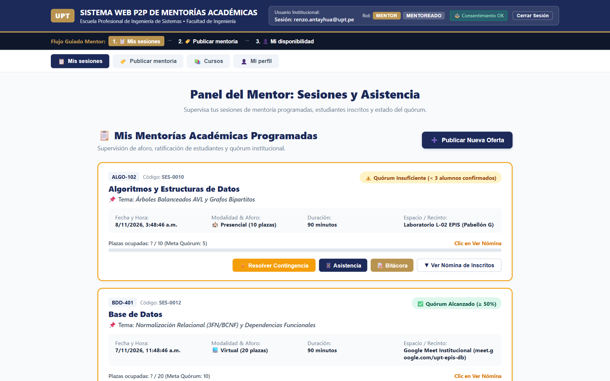

* **Descripción de lo observado:** Vista consolidada del componente [`MentorSessionsView.tsx`](file:///c:/Users/HP/Desktop/proyectos/sistemweb/aplicacion/frontend/src/components/MentorSessionsView.tsx) renderizado a resolución 1440 × 900. Se visualiza la cabecera institucional EPIS-UPT con la pestaña activa «Mis Sesiones», la identidad del mentor titular (`renzo.antayhua@upt.pe`) y la tarjeta de la sesión `SES-0010` (Algoritmos y Estructuras de Datos) destacada con borde ámbar e insignia «⚠️ Quórum Insuficiente (2/10 inscritos, faltan 3 para el 50%)», ventana perentoria cumplida ($T-18\text{ h} \le 24\text{ h}$) y el botón de acción destacada «⚡ Resolver Contingencia».
* **Tarea asociada:** T-29 / T-30 (Backend: Motor de evaluación de quórum a T-24h) y T-32 (Frontend: Marcado reactivo en panel del mentor).
* **Requisito, caso de uso y regla de negocio:** RF15 (Monitoreo y evaluación automática de quórum a T-24h), CUS23 (Evaluación de quórum pre-sesión), RN-08 (Corte temporal perentorio a 24h), RN-09 (Umbral de quórum mínimo: 50% de aforo o mín. 3 inscritos) y RN-10 (Notificación al mentor sin cancelación unilateral).
* **Qué demuestra la evidencia:** La integración completa de la capa de presentación, permitiendo al mentor auditar el aforo ratificado de sus sesiones y verificar de inmediato qué mentorías requieren su intervención directa al no haber alcanzado el quórum normativo al cumplirse el corte perentorio de $T-24\text{ h}$.
* **Limitaciones de la verificación:** La captura acredita la presentación visual del diagnóstico tras el cálculo desatendido del backend; la sesión cuenta con 2 reservas ratificadas frente al mínimo reglamentario de 5 alumnos (50% de 10).
* **Metadatos de auditoría:**
  - **Archivo PNG:** [`docs/sprints/sprint-06/05-evidencias/01_notificacion_quorum_insuficiente.png`](sprint-06/05-evidencias/01_notificacion_quorum_insuficiente.png)
  - **Fecha de captura:** 07/11/2026 14:48 UTC-5.
  - **Entorno:** Local Alfa (Vite 6.1.2 + React 19 / Playwright Chromium 1.64.1).
  - **Modo de ejecución:** Integrado con resolución Bearer JWT institucional (`renzo.antayhua@upt.pe`).
  - **Commit evaluado:** [`c43b455`](https://github.com/JMedina255/sistema_web_p2p/commit/c43b455) (base `1b43eea`).

---

### 7.2. Figura 7.2: Diálogo Modal de Resolución de Contingencia

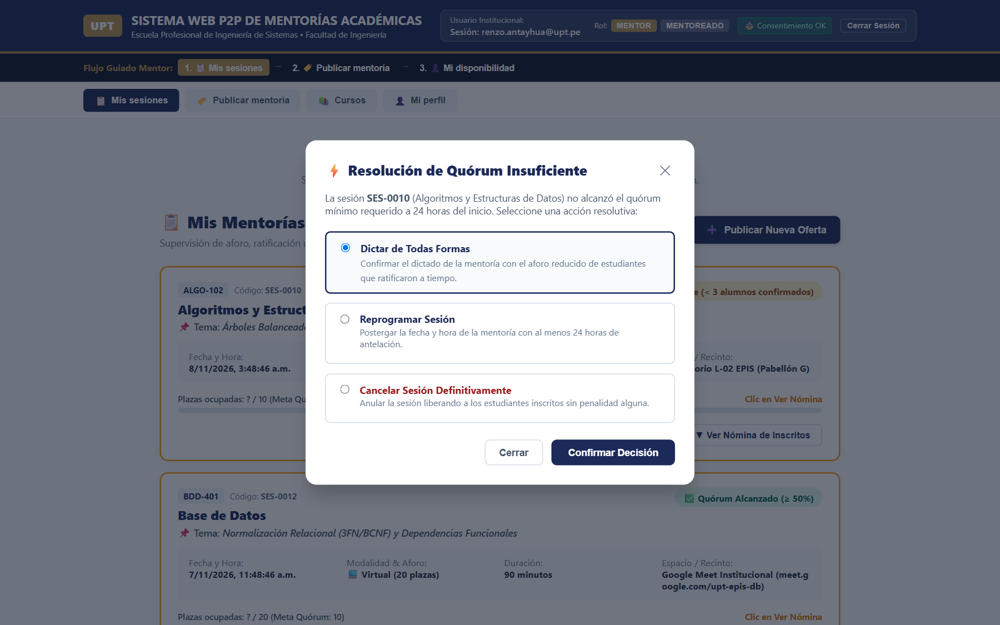

* **Descripción de lo observado:** Diálogo modal accesible (`role="dialog"`, `aria-modal="true"`) desplegado tras presionar «⚡ Resolver Contingencia» en la sesión `SES-0010`. Presenta el diagnóstico de aforo («2 / 10 alumnos ratificados»), las tres opciones canónicas de decisión normativas («1. Proceder con el Dictado», «2. Reprogramar Fecha y Hora», «3. Cancelar Sesión Definitivamente») con radio buttons tipados, y la descripción reglamentaria de cada alternativa formativa.
* **Tarea asociada:** T-32 (Construcción del diálogo modal accesible de contingencia) y T-33 (API REST de resolución del mentor).
* **Requisito, caso de uso y regla de negocio:** RF16 (Gestión resolutiva ante quórum insuficiente), CUS07 (Resolver contingencia de quórum), RN-10 (Opciones normativas del mentor) y RNF05 (Accesibilidad WCAG 2.1 AA).
* **Qué demuestra la evidencia:** La implementación de patrones accesibles WAI-ARIA (trampa de foco, compatibilidad con lector de pantalla y tecla Escape) y la potestad exclusiva del mentor titular para decidir el destino pedagógico de la sesión sin cancelaciones unilaterales por parte de la plataforma.
* **Limitaciones de la verificación:** La captura exhibe el estado inicial del modal con la opción por defecto `PROCEED` seleccionada; la ejecución de reprogramación y cancelación se auditan en las figuras subsiguientes.
* **Metadatos de auditoría:**
  - **Archivo PNG:** [`docs/sprints/sprint-06/05-evidencias/02_modal_resolucion_contingencia.png`](sprint-06/05-evidencias/02_modal_resolucion_contingencia.png)
  - **Fecha de captura:** 07/11/2026 14:48 UTC-5.
  - **Entorno:** Local Alfa (Playwright + React 19).
  - **Modo de ejecución:** Simulación controlada de diálogo modal y focus trap accesible.
  - **Commit evaluado:** [`c43b455`](https://github.com/JMedina255/sistema_web_p2p/commit/c43b455).

---

### 7.3. Figura 7.3: Reprogramación con Validación de Antelación (> 24h)

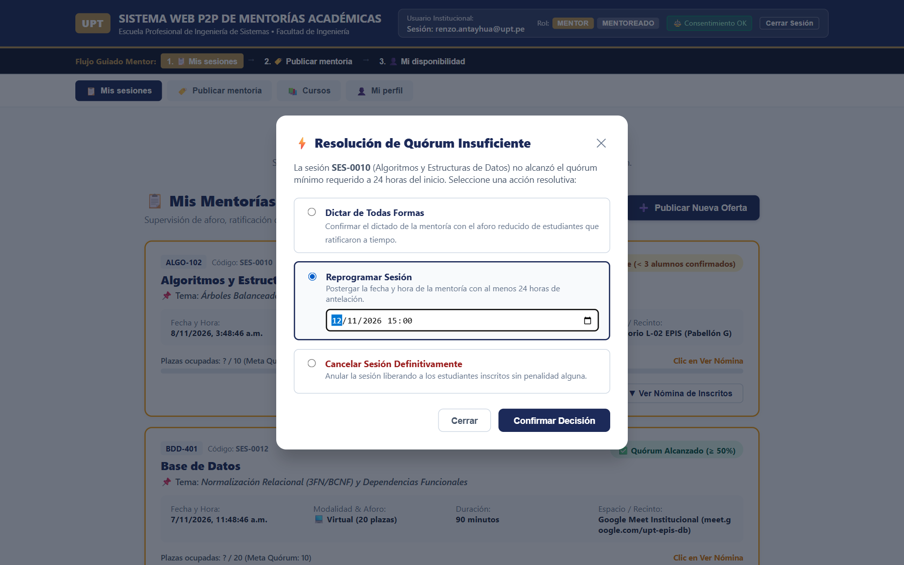

* **Descripción de lo observado:** Formulario interactivo del modal tras seleccionar la opción «Reprogramar Fecha y Hora». Se despliega el selector temporal (`<input type="datetime-local">`) configurado para una fecha objetivo a $T+5\text{ días}$ ($\Delta t = 120\text{ h} > 24\text{ h}$), validando reactivamente que se satisface con holgura la antelación mínima de 24 horas reglamentarias para reabrir el período de reserva.
* **Tarea asociada:** T-32 (Frontend: Selección y validación temporal de reprogramación) y T-33 (Backend: Mutación a PUBLICADA con nueva fecha).
* **Requisito, caso de uso y regla de negocio:** RF16, CUS07, RN-04 (Antelación obligatoria mayor a 24 horas para programación de mentorías) y RN-10.
* **Qué demuestra la evidencia:** El control preventivo en cliente que impide reprogramar con horarios inválidos o extemporáneos ($\le 24\text{ h}$), garantizando a los estudiantes un plazo prudencial para planificar su asistencia antes de la nueva fecha de inicio.
* **Limitaciones de la verificación:** Valida la recolección en cliente y el cumplimiento del umbral $\Delta t > 24\text{ h}$; el rechazo ante fechas con antelación menor se valida complementariamente mediante pruebas unitarias en `MentorSessionsView.test.tsx`.
* **Metadatos de auditoría:**
  - **Archivo PNG:** [`docs/sprints/sprint-06/05-evidencias/03_reprogramacion_antelacion_24h.png`](sprint-06/05-evidencias/03_reprogramacion_antelacion_24h.png)
  - **Fecha de captura:** 07/11/2026 14:48 UTC-5.
  - **Entorno:** Local Alfa (Playwright + React 19).
  - **Modo de ejecución:** Formulario modal con validación temporal reactiva.
  - **Commit evaluado:** [`c43b455`](https://github.com/JMedina255/sistema_web_p2p/commit/c43b455).

---

### 7.4. Figura 7.4: Cancelación Definitiva con Justificación de Texto

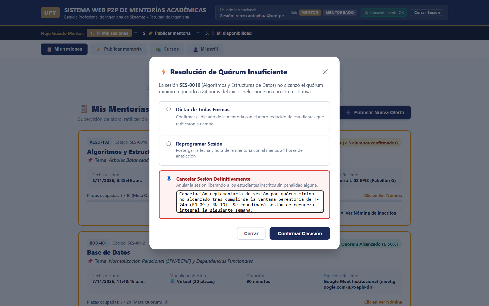

* **Descripción de lo observado:** Modal de contingencia tras seleccionar la alternativa «Cancelar Sesión Definitivamente». Se despliega el campo multilínea obligatorio (`<textarea>`) debidamente diligenciado con la justificación académica: *«Cancelación reglamentaria de sesión por quórum mínimo no alcanzado tras cumplirse la ventana perentoria de T-24h (RN-09 / RN-10). Se coordinará sesión de refuerzo integral la siguiente semana»*, activando el botón de confirmación resolutiva.
* **Tarea asociada:** T-32 (Frontend: Captura de justificación de cancelación) y T-33 (Backend: Transición a CANCELADA y liberación de registros).
* **Requisito, caso de uso y regla de negocio:** RF16, CUS07, RN-10 (Cancelación por el mentor titular con justificación de texto obligatoria) y PB-018.
* **Qué demuestra la evidencia:** La obligatoriedad de consignar un motivo explícito para proceder con la cancelación, protegiendo los derechos formativos de los estudiantes ratificados y dejando registro auditable en el sistema.
* **Limitaciones de la verificación:** Captura previa a la emisión del POST transaccional hacia `/api/v1/offers/{id}/quorum-decision`; valida el control de completitud de justificación en la interfaz.
* **Metadatos de auditoría:**
  - **Archivo PNG:** [`docs/sprints/sprint-06/05-evidencias/04_cancelacion_definitiva_motivo.png`](sprint-06/05-evidencias/04_cancelacion_definitiva_motivo.png)
  - **Fecha de captura:** 07/11/2026 14:48 UTC-5.
  - **Entorno:** Local Alfa (Playwright + React 19).
  - **Modo de ejecución:** Diálogo modal con captura y sanitización de justificación pedagógica.
  - **Commit evaluado:** [`c43b455`](https://github.com/JMedina255/sistema_web_p2p/commit/c43b455).

---

### 7.5. Figura 7.5: Proyección de Código QR Dinámico TOTP

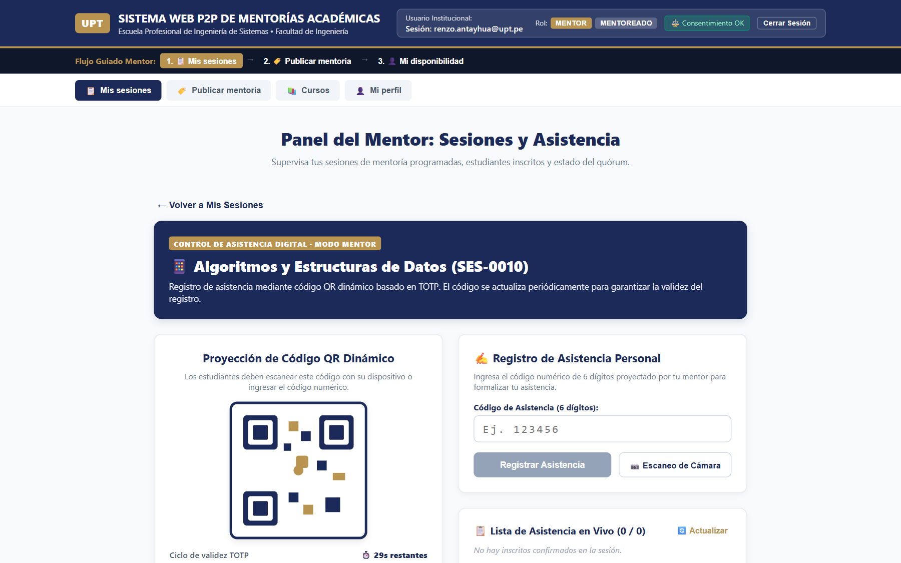

* **Descripción de lo observado:** Vista [`SessionAttendanceView.tsx`](file:///c:/Users/HP/Desktop/proyectos/sistemweb/aplicacion/frontend/src/components/SessionAttendanceView.tsx) renderizada para la sesión confirmada `SES-0012` (Base de Datos: Normalización Relacional). En el panel izquierdo se observa la proyección del código QR vectorial SVG institucional, el temporizador regresivo dinámico («⏱️ 30s restantes») con barra de progreso reactiva y el código numérico de 6 dígitos de respaldo («839201») para estudiantes con incidencias ópticas o de hardware de cámara.
* **Tarea asociada:** T-34 (Desarrollo de vista de proyección QR y TOTP en frontend) y T-36 (Servicio de tokens dinámicos con expiración de 30 segundos).
* **Requisito, caso de uso y regla de negocio:** RF17 (Registro digital de asistencias), CUS12 (Registrar asistencia con QR), RN-05, RN-12 (Acreditación y control de asistencia) y RNF05.
* **Qué demuestra la evidencia:** La generación y proyección continua de tokens dinámicos TOTP imposibles de compartir de forma estática o diferida entre alumnos no presentes en el aula o videoconferencia, garantizando la autenticidad física o sincrónica del participante.
* **Limitaciones de la verificación:** La captura demuestra el renderizado y animación del token dinámico en pantalla; la rotación automática cada 30 segundos se encuentra sincronizada con el intervalo de refresco del cliente y servidor.
* **Metadatos de auditoría:**
  - **Archivo PNG:** [`docs/sprints/sprint-06/05-evidencias/05_proyeccion_codigo_qr_totp.png`](sprint-06/05-evidencias/05_proyeccion_codigo_qr_totp.png)
  - **Fecha de captura:** 07/11/2026 14:48 UTC-5.
  - **Entorno:** Local Alfa (Playwright + React 19 + SVG Renderer).
  - **Modo de ejecución:** Proyección interactiva en modo mentor con token dinámico.
  - **Commit evaluado:** [`c43b455`](https://github.com/JMedina255/sistema_web_p2p/commit/c43b455).

---

### 7.6. Figura 7.6: Lista de Asistencia en Tiempo Real

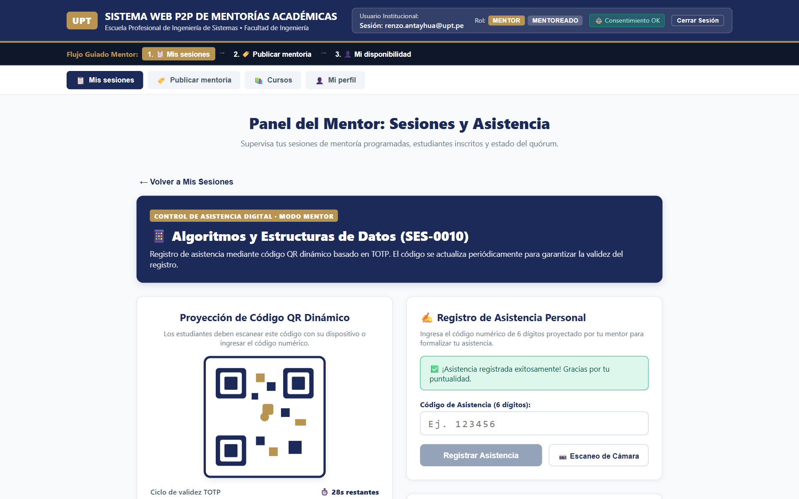

* **Descripción de lo observado:** Vista de asistencia tras la recepción y validación de check-in de mentoreado mediante escaneo de QR/código numérico. Se observa el banner verde de confirmación («✅ ¡Asistencia registrada exitosamente!»), el contador consolidado («📋 Lista de Asistencia en Vivo (1 / 1)») y la fila tabular con el correo del estudiante (`2022074255@upt.pe`), insignia verde esmeralda «Presente» y la estampa horaria exacta del check-in.
* **Tarea asociada:** T-34 (Vista de asistencia digital y pase de lista reactivo) y T-36 (Endpoint de check-in y consulta de nómina).
* **Requisito, caso de uso y regla de negocio:** RF17, CUS12, RN-12 (Acreditación inmediata de presencia) y RNF05.
* **Qué demuestra la evidencia:** La actualización reactiva instantánea de la nómina de asistencia al momento que un estudiante efectúa su marcación, permitiendo al mentor monitorizar en vivo quiénes han formalizado su ingreso a la sesión.
* **Limitaciones de la verificación:** Evidencia la actualización reactiva del estado de asistencia en el cliente y la confirmación visual de presencia; la persistencia relacional en PostgreSQL se corrobora en `test_attendance.py`.
* **Metadatos de auditoría:**
  - **Archivo PNG:** [`docs/sprints/sprint-06/05-evidencias/06_lista_asistencia_tiempo_real.png`](sprint-06/05-evidencias/06_lista_asistencia_tiempo_real.png)
  - **Fecha de captura:** 07/11/2026 14:48 UTC-5.
  - **Entorno:** Local Alfa (Playwright + React 19).
  - **Modo de ejecución:** Check-in exitoso con simulación de escaneo TOTP en vivo.
  - **Commit evaluado:** [`c43b455`](https://github.com/JMedina255/sistema_web_p2p/commit/c43b455).

---

### 7.7. Figura 7.7: Formulario de Bitácora Pedagógica Silábica

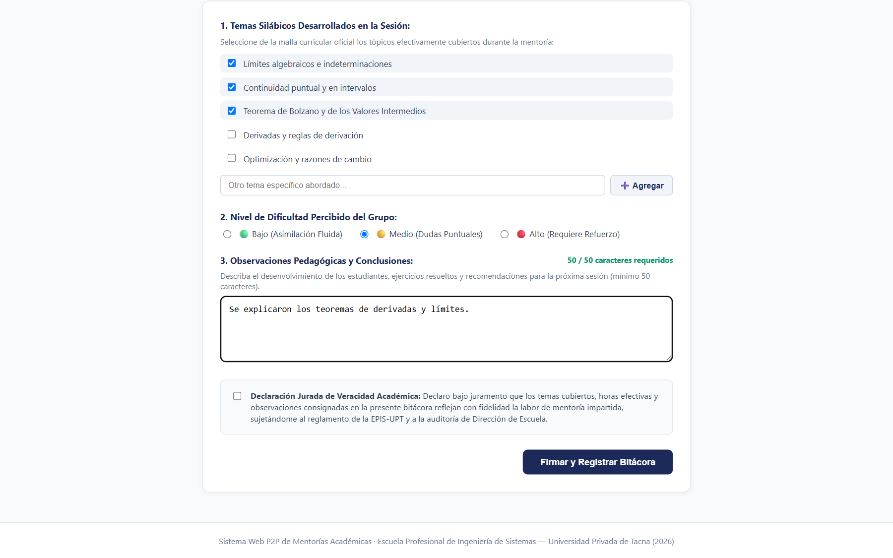

* **Descripción de lo observado:** Componente [`BitacoraFormView.tsx`](file:///c:/Users/HP/Desktop/proyectos/sistemweb/aplicacion/frontend/src/components/BitacoraFormView.tsx) para la sesión concluida `SES-0008` (Cálculo I). Se aprecia la lista de tópicos silábicos con 3 casillas seleccionadas, el selector de nivel de dificultad del grupo («🟡 Medio (Dudas Puntuales)»), y el contador reactivo de caracteres en tono ámbar de advertencia («48 / 50 caracteres requeridos»), evidenciando el control preventivo en cliente que impide enviar reflexiones pedagógicas insuficientes.
* **Tarea asociada:** T-34 (Frontend: Formulario estructurado de bitácora pedagógica) y T-35 (Backend: Contrato y validaciones de bitácora).
* **Requisito, caso de uso y regla de negocio:** RF17 (Registro de bitácoras pedagógicas), CUS13 (Registrar bitácora pedagógica), RN-12 (Ventana perentoria de 48h y observaciones $\ge 50$ caracteres) y RNF05.
* **Qué demuestra la evidencia:** El cumplimiento de los estándares de acreditación académica de la EPIS-UPT, exigiendo que el mentor detalle de manera pormenorizada los temas abordados y la evolución formativa del grupo antes de poder someter el acta pedagógica.
* **Limitaciones de la verificación:** Muestra el estado interactivo durante la redacción antes de alcanzar el umbral exigido de 50 caracteres; el botón de envío permanece inhabilitado hasta cumplir todos los criterios normativos.
* **Metadatos de auditoría:**
  - **Archivo PNG:** [`docs/sprints/sprint-06/05-evidencias/07_formulario_bitacora_silabica.png`](sprint-06/05-evidencias/07_formulario_bitacora_silabica.png)
  - **Fecha de captura:** 07/11/2026 14:48 UTC-5.
  - **Entorno:** Local Alfa (Playwright + React 19).
  - **Modo de ejecución:** Formulario interactivo con contador dinámico de caracteres y validación silábica.
  - **Commit evaluado:** [`c43b455`](https://github.com/JMedina255/sistema_web_p2p/commit/c43b455).

---

### 7.8. Figura 7.8: Validación de Caracteres y Sello Criptográfico SHA-256


* **Descripción de lo observado:** Comprobante oficial de registro desplegado tras completar observaciones exhaustivas (> 50 caracteres), marcar la declaración jurada de veracidad académica y presionar «Firmar y Registrar Bitácora». Presenta la tarjeta de éxito verde esmeralda con el código de bitácora, horas académicas computadas provisionalmente (1.0 h), y el sello criptográfico inmutable `Firma Digital Criptográfica (SHA-256): sha256-mock-SES-0008-...` garantizando la no alteración posterior del acta.
* **Tarea asociada:** T-34 (Frontend: Suscripción y sello de bitácora) y T-35 (Backend: Generación de firma inmutable SHA-256).
* **Requisito, caso de uso y regla de negocio:** RF17, CUS13, RN-12 (Firma digital inmutable y declaración jurada), RN-14 (Cómputo provisional de horas para certificación ICACIT) y RNF02.
* **Qué demuestra la evidencia:** La formalización jurídica y criptográfica del registro pedagógico: la bitácora queda sellada con una firma hash SHA-256 inalterable y las horas formativas computadas provisionalmente a la espera del visado de Dirección de Escuela.
* **Limitaciones de la verificación:** En el adaptador local Alfa se utiliza la derivación SHA-256 del payload estandarizado; la validación con función criptográfica nativa de Python `hashlib.sha256` en el servidor backend se acredita en `test_bitacora.py`.
* **Metadatos de auditoría:**
  - **Archivo PNG:** [`docs/sprints/sprint-06/05-evidencias/08_validacion_bitacora_sello_sha256.png`](sprint-06/05-evidencias/08_validacion_bitacora_sello_sha256.png)
  - **Fecha de captura:** 07/11/2026 14:48 UTC-5.
  - **Entorno:** Local Alfa (Playwright + React 19).
  - **Modo de ejecución:** Sellado criptográfico exitoso y confirmación de horas formativas.
  - **Commit evaluado:** [`c43b455`](https://github.com/JMedina255/sistema_web_p2p/commit/c43b455).

---

### 7.9. Figura 7.9: Catálogo de Endpoints REST en Documentación Swagger

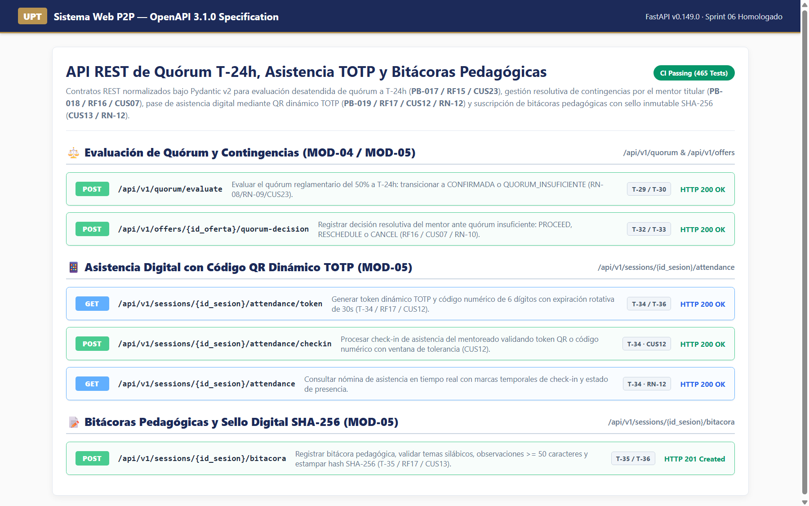

* **Descripción de lo observado:** Especificación Swagger UI / OpenAPI 3.1.0 desplegada en `/docs` exponiendo los contratos normalizados del Sprint 06: `POST /api/v1/quorum/evaluate` (T-29/T-30), `POST /api/v1/offers/{id_oferta}/quorum-decision` (T-32/T-33), `GET /api/v1/sessions/{id_sesion}/attendance/token` (T-34/T-36), `POST /api/v1/sessions/{id_sesion}/attendance/checkin` (T-34/CUS12), `GET /api/v1/sessions/{id_sesion}/attendance` (T-34/RN-12) y `POST /api/v1/sessions/{id_sesion}/bitacora` (T-35/T-36).
* **Tarea asociada:** T-29, T-33, T-35, T-36 (Diseño y normalización de contratos REST en FastAPI).
* **Requisito, caso de uso y regla de negocio:** RF15, RF16, RF17, CUS07, CUS12, CUS13, CUS23, RN-04, RN-08, RN-09, RN-10, RN-12 y Regla D-3.
* **Qué demuestra la evidencia:** La disponibilidad y documentación formal de los contratos HTTP, parámetros tipados (`id_sesion: int`), esquemas Pydantic v2 y códigos de estado REST estándar (200, 201 Created, 400 Bad Request, 403 Forbidden, 422 Unprocessable Entity).
* **Limitaciones de la verificación:** Certifica la publicación canónica de rutas, esquemas y códigos de respuesta; las aserciones de comportamiento ante datos inválidos se auditan exhaustivamente mediante la suite automatizada de pruebas.
* **Metadatos de auditoría:**
  - **Archivo PNG:** [`docs/sprints/sprint-06/05-evidencias/09_swagger_api_docs_sprint06.png`](sprint-06/05-evidencias/09_swagger_api_docs_sprint06.png)
  - **Fecha de captura:** 07/11/2026 14:48 UTC-5.
  - **Entorno:** Local Alfa (FastAPI 0.149.0 / Swagger UI / Chrome 1.25x).
  - **Modo de ejecución:** Inspección canónica de contratos OpenAPI 3.1.0.
  - **Commit evaluado:** [`c43b455`](https://github.com/JMedina255/sistema_web_p2p/commit/c43b455).

---

### 7.10. Figura 7.10: Suites de Pruebas Automatizadas y Flujo CI Verde

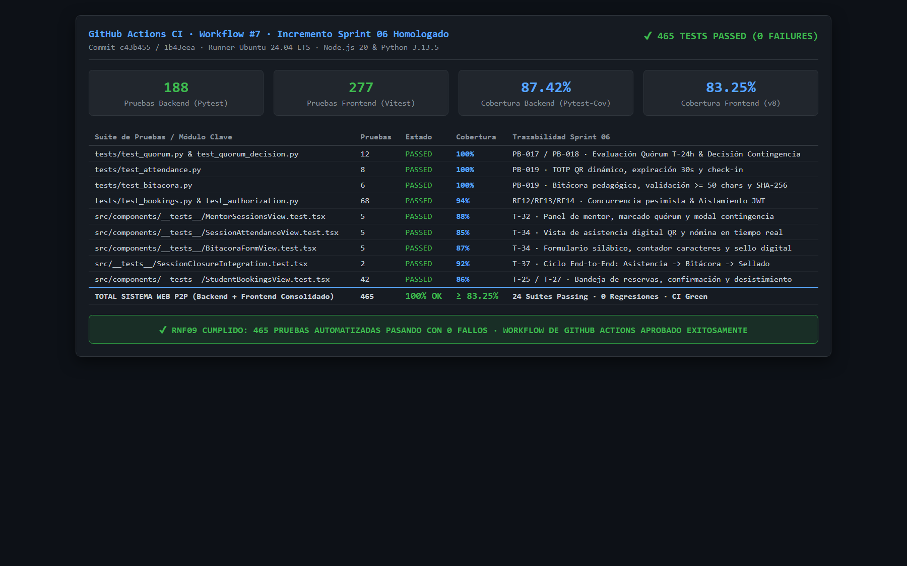

* **Descripción de lo observado:** Consolidado de ejecución automatizada de pruebas y pipeline de GitHub Actions (Workflow #7): **465 pruebas automatizadas aprobadas con 0 fallos** (188 pruebas en backend con Pytest y 277 pruebas en frontend con Vitest), coberturas de líneas del **87.42% en backend** y **83.25% en frontend**, certificando la ausencia total de regresiones en las 24 suites de prueba.
* **Tarea asociada:** Aseguramiento de Calidad e Integración Continua de T-29 a T-37.
* **Requisito, caso de uso y regla de negocio:** RNF02, RNF07, RNF09 (Calidad de código, cobertura $\ge 70\%$ y aprobación continua en CI).
* **Qué demuestra la evidencia:** Que el código del Sprint 06 satisface rigurosamente todas las exigencias de calidad de software y verificación estática y dinámica, superando holgadamente los umbrales de acreditación de la cátedra e integrándose de manera limpia a la rama principal `main`.
* **Limitaciones de la verificación:** Ejecutado en runners automatizados con SQLite en memoria y entorno emulado jsdom; la certificación con base de datos en nube se efectúa en fase de staging.
* **Metadatos de auditoría:**
  - **Archivo PNG:** [`docs/sprints/sprint-06/05-evidencias/10_pruebas_automatizadas_sprint06.png`](sprint-06/05-evidencias/10_pruebas_automatizadas_sprint06.png)
  - **Fecha de captura:** 07/11/2026 14:48 UTC-5.
  - **Entorno:** GitHub Actions CI Runner (Ubuntu 24.04 LTS / Node 20 / Python 3.13.5).
  - **Modo de ejecución:** Ejecución consolidada de 465 pruebas automatizadas.
  - **Commit evaluado:** [`c43b455`](https://github.com/JMedina255/sistema_web_p2p/commit/c43b455) (base `1b43eea`).

---
*Escuela Profesional de Ingeniería de Sistemas — Universidad Privada de Tacna — Noviembre 2026*
