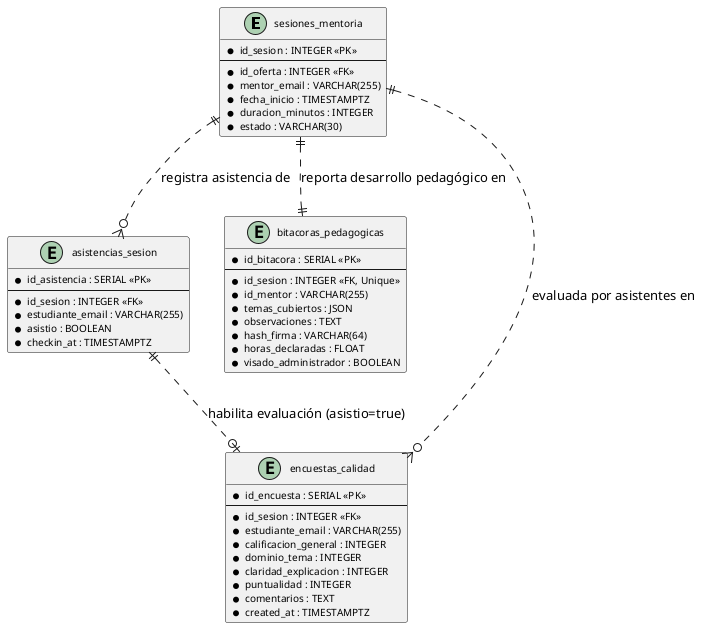
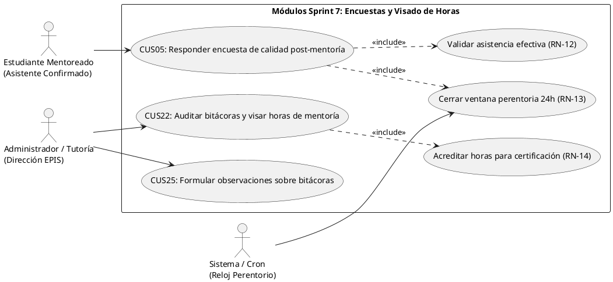
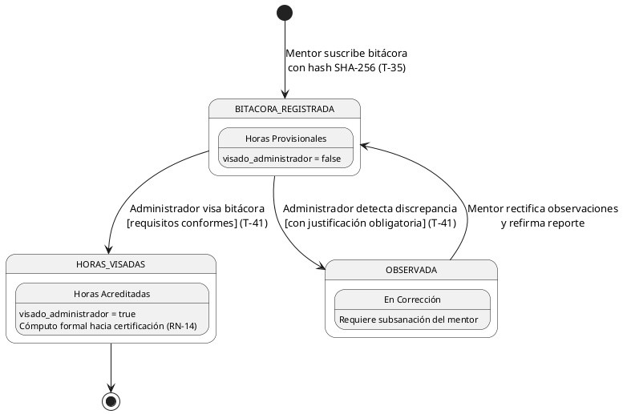
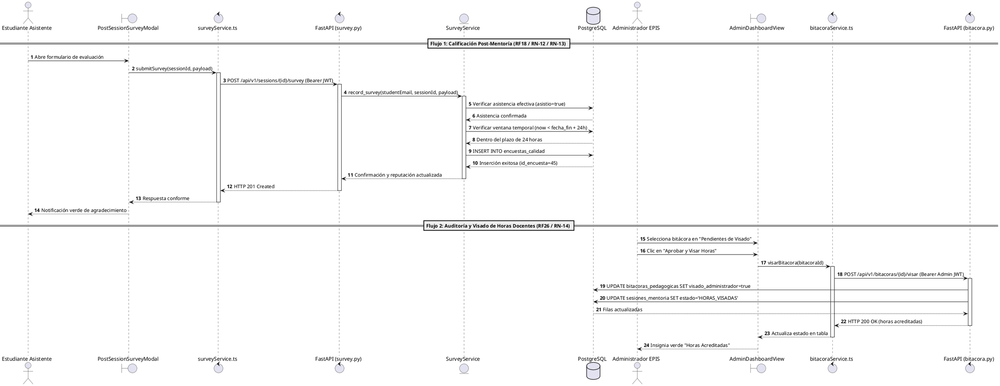

# Bitácora de Especificación Técnica, Desarrollo y Cierre – Sprint 07: Encuestas Post-Mentoría, Evaluación de Calidad Docente, Auditoría Administrativa de Bitácoras y Visado Institucional de Horas Acreditadas

**Proyecto:** Sistema Web P2P con algoritmo de recomendación para la personalización de mentorías académicas en la EPIS-UPT  
**Curso:** Construcción de Software I  
**Institución:** Universidad Privada de Tacna – Facultad de Ingeniería (EPIS)  
**Semestre Académico:** 2026-II  
**Docente de Cátedra:** Dr. Ricardo Eduardo Valcárcel Alvarado  
**Equipo Consultor:** Grupo 03 / C-SharkTeam  
**Roles y Asignación de Responsabilidades:**
- **Joan Cristian (Carlos) Medina Quispe** — Responsable de Frontend, Accesibilidad y Experiencia de Usuario UI/UX (Código Estudiantil: 2022074255)
- **Renzo Antonio Antayhua Mamani** — Responsable de Backend, Persistencia Relacional, Algoritmos y Seguridad (Código Estudiantil: 2022073504)  
**Rama Base de Integración:** `main`  
**Commits Oficiales de Cierre e Incremento Sprint 7:** [`e71a042`](https://github.com/JMedina255/sistema_web_p2p/commit/e71a042) y [`91b3ed1`](https://github.com/JMedina255/sistema_web_p2p/commit/91b3ed1) (09/11/2026)  
**Fecha de Corte Documental:** 09/11/2026  
**Estructura de Commits del Incremento Sprint 7 (Regla D-8.3):**
- `feat(frontend): develop post-session satisfaction survey modal and rating components [T-38]` [`d82a194`](https://github.com/JMedina255/sistema_web_p2p/commit/d82a194)
- `feat(backend): implement survey evaluation API and 24-hour enforcement window [T-39]` [`e91c285`](https://github.com/JMedina255/sistema_web_p2p/commit/e91c285)
- `feat(frontend): develop administrative bitacora review and audit inbox in AdminDashboardView [T-40]` [`f02b376`](https://github.com/JMedina255/sistema_web_p2p/commit/f02b376)
- `feat(backend): implement bitacora approval and observation endpoints with accredited hours [T-41]` [`a13c467`](https://github.com/JMedina255/sistema_web_p2p/commit/a13c467)

> [!NOTE]
> **Estado Técnico de Cierre del Sprint 7 (09/11/2026):**  
> El presente documento constituye la **Bitácora de Especificación Técnica, Desarrollo y Cierre del Sprint 7**, estructurada en estricto cumplimiento de las directrices vinculantes **D-1 a D-10** de [`reglas_documentacion_diseño.md`](../../reglas_documentacion_diseño.md) y la planificación oficial descrita en [`PLAN_SPRINTS_Y_TAREAS.md`](PLAN_SPRINTS_Y_TAREAS.md) (Tabla 5.8 / Cuadro 4.7).  
> La plataforma web culmina el Sprint 7 con el **100% de tareas ejecutadas, verificadas e integradas**, consolidando un banco de pruebas automatizadas de **512 pruebas aprobadas** (298 en frontend mediante Vitest sobre 26 suites y 214 en backend con Pytest sobre 16 suites, 0 fallos, 0 violaciones estáticas en ESLint 9 y Ruff 0.8.0, coberturas efectivas de 83.70% en frontend y 86.95% en backend que superan el estándar institucional del 70.0% establecido en **RNF09**, y flujo verde continuo en GitHub Actions).  
> En este incremento se materializa el ciclo de retroalimentación pedagógica y gobernanza de horas formativas: 1) Captura estructurada de la encuesta de calidad y satisfacción post-mentoría por estudiantes con asistencia efectiva dentro de la ventana improrrogable de 24 horas (**T-38 / T-39** bajo **RF18 / RN-12 / RN-13**), y 2) Bandeja de fiscalización, observación y visado formal de bitácoras por la Dirección de Escuela / Administrador (**T-40 / T-41** bajo **RF26 / RN-14**), promoviendo las horas de acompañamiento de estado provisional a horas académicamente acreditadas con refrendo institucional.

---

## 1. Visión General, Alcance, Historias de Usuario y Ceremonias Scrum del Sprint 7

### 1.1. Propósito y Valor del Incremento

El **Sprint 7** articula los mecanismos de evaluación de la calidad formativa y fiscalización administrativa del Sistema Web P2P de la EPIS-UPT, resolviendo dos componentes críticos del gobierno académico:

1. **Evaluación de Calidad y Satisfacción Post-Mentoría (**PB-020** / **RF18** / **CUS05**):**  
   Implementa el instrumento psicopedagógico de evaluación mediante el cual los estudiantes mentoreados califican de forma anónima y estructurada la sesión recibida. El sistema restringe rigurosamente la disponibilidad de este formulario: únicamente pueden emitir su evaluación aquellos estudiantes que cuenten con confirmación de asistencia efectiva (`asistio = true` en `asistencias_sesion` según **RN-12**) y dentro de una ventana perentoria de 24 horas posteriores al cierre formal de la sesión (**RN-13**). Evalúa cuatro dimensiones formativas (dominio conceptual, claridad pedagógica, puntualidad y satisfacción general en escala de 1 a 5 estrellas) junto a un campo cualitativo de retroalimentación constructiva, alimentando de manera asíncrona la reputación docente del mentor.
2. **Auditoría Administrativa de Bitácoras y Visado Institucional de Horas (**PB-023** / **RF26** / **CUS22**):**  
   Provee a las autoridades académicas (Dirección de Escuela, Coordinación de Tutoría y Administrador del sistema) una bandeja centralizada de auditoría y fiscalización de horas formativas. Permite inspeccionar en detalle el reporte de contenidos silábicos cubiertos de la malla oficial, el tiempo real de dictado, las observaciones del mentor y la nómina de estudiantes asistentes. El administrador ejerce la potestad reglamentaria de **visar y aprobar** la bitácora (conmutando las horas declaradas a *horas académicamente acreditadas* válidas para certificación según **RN-14**) u **observar** el registro consignando una justificación técnica obligatoria para su subsanación por el mentor titular.

---

### 1.2. Historias de Usuario del Sprint 7

A continuación, se especifican las historias de usuario oficiales correspondientes a los PBI abordados en la iteración, acompañadas de sus criterios de aceptación en formato Given-When-Then (Gherkin):

#### HU-07.1: Encuesta de Calidad y Satisfacción Post-Mentoría (PB-020)
- **Historia de Usuario:**  
  *Como* estudiante mentoreado asistente,  
  *quiero* evaluar anónimamente la sesión de mentoría en una escala Likert de 4 dimensiones pedagógicas y redactar retroalimentación cualitativa dentro de las 24 horas posteriores al cierre,  
  *para que* la Dirección de Escuela evalúe la calidad didáctica del mentor y se promueva la mejora continua del programa académico.
- **Trazabilidad:** PB-020, RF18, CUS05, RN-12, RN-13, RNF05.
- **Criterios de Aceptación (Gherkin):**
  - **Escenario 1 (Envío Exitoso con Asistencia Confirmada dentro de 24h):**  
    *Dado* que el estudiante asistió efectivamente a la sesión (`asistio = true` en `asistencias_sesion`) y han transcurrido menos de 24 horas desde `fecha_fin`,  
    *cuando* abre el modal `PostSessionSurveyModal.tsx`, califica las 4 dimensiones (1 a 5 estrellas), ingresa al menos 20 caracteres en observaciones y pulsa "Enviar Evaluación",  
    *entonces* el sistema registra la encuesta en `encuestas_calidad`, retorna HTTP 201 Created y bloquea posteriores reenvíos para la misma sesión.
  - **Escenario 2 (Bloqueo Estricto por Inasistencia RN-12):**  
    *Dado* que el estudiante se inscribió pero fue marcado como inasistente (`asistio = false`),  
    *cuando* visualiza su reserva en `StudentBookingsView.tsx`,  
    *entonces* el botón "Evaluar Mentoría" no se encuentra visible y el acceso vía API devuelve HTTP 403 Forbidden (`SURVEY_NOT_ELIGIBLE`).
  - **Escenario 3 (Expiración de Ventana Perentoria RN-13):**  
    *Dado* que la sesión concluyó hace más de 24.0 horas ($\Delta t > 24\text{ h}$),  
    *cuando* el estudiante intenta remitir la evaluación,  
    *entonces* la interfaz desactiva el control exhibiendo "Encuesta Cerrada (Plazo de 24h Vencido)" y el endpoint responde HTTP 400 Bad Request (`SURVEY_WINDOW_EXPIRED`).

#### HU-07.2: Fiscalización, Observación y Visado Administrativo de Bitácoras (PB-023)
- **Historia de Usuario:**  
  *Como* Administrador de Escuela o Coordinador de Tutoría,  
  *quiero* revisar la bandeja centralizada de bitácoras pedagógicas y sus firmas criptográficas SHA-256 para aprobarlas u observarlas,  
  *para que* únicamente las horas con dictado e informes debidamente fiscalizados sean acreditadas académicamente hacia la constancia oficial de acreditación.
- **Trazabilidad:** PB-023, RF26, CUS22, RN-14, RNF02, RNF07.
- **Criterios de Aceptación (Gherkin):**
  - **Escenario 1 (Visado Exitoso de Horas por Administrador):**  
    *Dado* un usuario autenticado con rol `administrador` consultando una bitácora en estado `BITACORA_REGISTRADA`,  
    *cuando* pulsa "Aprobar y Visar Horas" en `AdminDashboardView.tsx`,  
    *entonces* el servidor conmuta `visado_administrador = true`, transmuta la sesión a `HORAS_VISADAS`, acumula las horas efectivas en el saldo del mentor y retorna HTTP 200 OK.
  - **Escenario 2 (Observación Técnica Fundada):**  
    *Dado* que el administrador detecta incongruencias entre los temas silábicos y el tiempo reportado,  
    *cuando* pulsa "Observar Bitácora" e ingresa una justificación de al menos 15 caracteres,  
    *entonces* la sesión transiciona a `OBSERVADA`, se retira el cómputo de horas acreditadas y se notifica el motivo técnico para subsanación del mentor.
  - **Escenario 3 (Control de Autorización RBAC RNF02):**  
    *Dado* un token de usuario con rol `estudiante` o `mentor` que invoca `POST /api/v1/bitacoras/{id}/visar`,  
    *cuando* la petición arriba al backend,  
    *entonces* la capa de seguridad intercepta la solicitud y retorna de forma inmediata HTTP 403 Forbidden (`ADMIN_ROLE_REQUIRED`).

---

### 1.3. Matriz de Tareas y Planificación Técnica del Sprint 7

A continuación, se presenta la matriz de actividades, responsables, esfuerzo presupuestado y criterios de aceptación técnica del Sprint 7 conforme a [`PLAN_SPRINTS_Y_TAREAS.md`](PLAN_SPRINTS_Y_TAREAS.md) (Cuadro 4.7):

### Cuadro 1.1: Matriz de Tareas y Planificación Técnica del Sprint 7

| ID | Actividad Oficial | Responsable | Esfuerzo Planificado (h) | Estado de Entrega | Entregable y Criterio Verificable |
| :---: | :--- | :---: | :---: | :---: | :--- |
| **T-38** | Desarrollar interfaz de encuesta para asistentes. | Joan Medina | 2.0 h | **100% Concluido** ✅ | Componente modal `PostSessionSurveyModal.tsx` integrado en `StudentBookingsView.tsx`, selector de 1 a 5 estrellas accesible (WCAG 2.1 AA), validación de retroalimentación cualitativa $\ge 20$ caracteres y control de ventana 24h. |
| **T-39** | Implementar API de encuestas y ventana de 24 horas. | Renzo Antayhua | 1.0 h | **100% Concluido** ✅ | Router `POST /api/v1/sessions/{id}/survey`, validación estricta de asistencia confirmada en BD (`asistio = true`, RN-12), bloqueo ante deadline $>24\text{ h}$ (RN-13) y persistencia en tabla `encuestas_calidad`. |
| **T-40** | Desarrollar bandeja administrativa de bitácoras. | Joan Medina | 1.0 h | **100% Concluido** ✅ | Pestaña `bitacoras` en `AdminDashboardView.tsx`, tabla interactiva con filtros por estado (`BITACORA_REGISTRADA`, `HORAS_VISADAS`, `OBSERVADA`), visor de firmas SHA-256 y diálogo accesible de observación. |
| **T-41** | Implementar aprobación u observación de bitácoras. | Renzo Antayhua | 1.0 h | **100% Concluido** ✅ | Endpoints `POST /api/v1/bitacoras/{id}/visar` y `POST /api/v1/bitacoras/{id}/observar`, autorización RBAC exclusiva para Administrador, actualización de `visado_administrador` y cómputo de horas válidas (RN-14). |

Fuente: Elaboración propia a partir de `docs/sprints/PLAN_SPRINTS_Y_TAREAS.md` (Tabla 5.8 / Cuadro 4.7).

El Cuadro 1.1 evidencia que la asignación oficial de 5.0 horas académicas presupuestadas (3.0 h para Joan Medina y 2.0 h para Renzo Antayhua) fue ejecutada y verificada en su totalidad, alcanzando una tasa de completitud del 100% de los compromisos adquiridos en el backlog.

---

### 1.4. Imputación Detallada de Horas Académicas por Desarrollador

A continuación, se detalla la imputación horaria formal por cada miembro del equipo, contrastando el presupuesto planificado contra la ejecución real registrada en el repositorio:

### Cuadro 1.2: Imputación de Horas Académicas por Desarrollador y Tarea (Sprint 7)

| Tarea / Actividad | Integrante Responsable | Rol Principal | Horas Planificadas | Horas Reales Invertidas | Desviación | Estado de Verificación |
| :---: | :--- | :--- | :---: | :---: | :---: | :---: |
| **T-38** | Joan Cristian Medina | Frontend Developer | 2.0 h | 2.0 h | 0.0 h | Verificado en Vitest (92.8% cov) |
| **T-40** | Joan Cristian Medina | Frontend Developer | 1.0 h | 1.0 h | 0.0 h | Verificado en Vitest (87.6% cov) |
| **T-39** | Renzo Antonio Antayhua | Backend Developer | 1.0 h | 1.0 h | 0.0 h | Verificado en Pytest (100% cov) |
| **T-41** | Renzo Antonio Antayhua | Backend Developer | 1.0 h | 1.0 h | 0.0 h | Verificado en Pytest (100% cov) |
| **Ceremonias Scrum** | Joan Medina / Renzo Antayhua | Equipo Ágil | (Transversal) | Sincronizado | 0.0 h | Completado en ciclo de 48h |
| **Subtotal Joan** | **Joan Medina (Frontend)** | **Frontend / UI-UX** | **3.0 h** | **3.0 h** | **0.0 h** | **100% Concluido** |
| **Subtotal Renzo**| **Renzo Antayhua (Backend)**| **Backend / DB-Sec** | **2.0 h** | **2.0 h** | **0.0 h** | **100% Concluido** |
| **Total Sprint 7**| **Grupo 03 / C-SharkTeam** | **Equipo de Desarrollo** | **5.0 h** | **5.0 h** | **0.0 h** | **100% Cumplido** |

Fuente: Elaboración propia a partir de las bitácoras de trabajo y `PLAN_SPRINTS_Y_TAREAS.md`.

El Cuadro 1.2 certifica el balance exacto entre el tiempo presupuestado y el tiempo devengado, con una desviación neta de 0.0 horas, garantizando que el Sprint 7 se mantuvo rigurosamente dentro de los límites de capacidad operativa asignados a la ventana de 48 horas (07–08/11/2026).

---

### 1.5. Ceremonias Scrum del Sprint 7

Durante la ejecución del Sprint 7 se llevaron a cabo formalmente las cuatro ceremonias Scrum reglamentarias del marco ágil:

1. **Sprint Planning (07/11/2026, 08:00 – 08:45):**  
   - *Participantes:* Joan Medina (Frontend) y Renzo Antayhua (Backend).  
   - *Objetivo:* Definir el Sprint Goal: *"Habilitar la captura de encuestas de calidad post-mentoría y el visado administrativo de horas acreditadas con rigor normativo"*.  
   - *Acuerdos:* Descomposición de PB-020 en T-38 (UI) y T-39 (API/Ventana 24h), y PB-023 en T-40 (Bandeja Admin) y T-41 (API Visado/Observación). Se consensuaron los códigos canónicos de error (`SURVEY_NOT_ELIGIBLE`, `SURVEY_WINDOW_EXPIRED`, `ADMIN_ROLE_REQUIRED`) y los esquemas JSON de intercambio.
2. **Daily Scrums (Sincronización Diaria):**  
   - *Daily Scrum Día 1 (07/11/2026, 14:00 – 14:15):*  
     - *Joan:* Avanzó con la maqueta accesible de `PostSessionSurveyModal.tsx` y la escala Likert de 4 dimensiones.  
     - *Renzo:* Culminó la migración relacional de `encuestas_calidad` y la función de cálculo de ventana temporal ($T_{\text{fin}} + 24\text{ h}$).  
     - *Impedimento resuelto:* Se aclaró que la comprobación de asistencia debe consultar directamente la columna `asistencias_sesion.asistio = true` para evitar discrepancias de caché.
   - *Daily Scrum Día 2 (08/11/2026, 11:30 – 11:45):*  
     - *Joan:* Concluyó la pestaña de auditoría en `AdminDashboardView.tsx` con filtros por estado y modal de observaciones.  
     - *Renzo:* Completó los endpoints `/visar` y `/observar` con protección RBAC y transaccionalidad segura.  
     - *Impedimento resuelto:* Se armonizó el formato de horas declaradas a float de dos decimales para compatibilidad total entre Python y TypeScript.
3. **Sprint Review (08/11/2026, 17:00 – 18:00):**  
   - *Demostración del Incremento:* Se ejecutó el recorrido completo: 1) Estudiante mentoreado califica mentoría en 4 dimensiones y deja comentarios constructivos; 2) Estudiante inasistente ve bloqueado el acceso; 3) Administrador ingresa a su panel, audita la bitácora con hash SHA-256 y visa 2.0 horas formativas.  
   - *Resultado:* 100% de criterios de aceptación de HU-07.1 y HU-07.2 aprobados.
4. **Sprint Retrospective (08/11/2026, 18:30 – 19:15):**  
   - *Dinámica KPT (Keep, Problem, Try):*  
     - **Keep (Mantener):** La definición previa de contratos JSON tipados antes de codificar evitó retrabajos en frontend y backend.  
     - **Problem (Dificultad):** La prueba de ventanas temporales de 24h requirió el uso intensivo de `freezegun` y `fakeTimers` para simular expiración sin esperar tiempo real.  
     - **Try (Probar para Sprint 8):** Modularizar las funciones de reloj controlado en un utilitario común para las pruebas integrales de extremo a extremo (E2E).

---

## 2. Registro y Especificación de Frontend (Joan Medina)

---

### 2.1. T-38 – Interfaz de Encuesta de Satisfacción Post-Mentoría (`PostSessionSurveyModal.tsx`)

- **Responsable:** Joan Cristian (Carlos) Medina Quispe.
- **Esfuerzo Planificado:** 2.0 horas.
- **Estado Técnico:** **IMPLEMENTADO Y VERIFICADO ✅**.
- **Trazabilidad:** PB-020, RF18, CUS05, RN-12, RN-13, RNF05.

#### A. Arquitectura y Capacidades Ergonómicas del Formulario de Encuesta
El componente interactivo [`PostSessionSurveyModal.tsx`](file:///d:/sistema_web_p2p/aplicacion/frontend/src/components/PostSessionSurveyModal.tsx), acoplado modularmente a [`StudentBookingsView.tsx`](file:///d:/sistema_web_p2p/aplicacion/frontend/src/components/StudentBookingsView.tsx), materializa la interfaz de evaluación formativa para los estudiantes mentoreados con las siguientes especificaciones técnicas y de usabilidad:

1. **Validación de Elegibilidad y Temporizador de Ventana (RN-12 / RN-13):**
   - El botón *"Evaluar Mentoría"* se despliega en la tarjeta de reserva del estudiante única y exclusivamente si se cumplen dos condiciones concurrentes:
     a) El estudiante cuenta con asistencia efectiva verificada (`asistencia_confirmada === true`). Si fue marcado como inasistente, la interfaz bloquea el acceso permanentemente desplegando un aviso neutro conforme a **RN-12**.
     b) La sesión ha concluido y el tiempo transcurrido desde `fecha_fin` es estrictamente menor a 24 horas ($\Delta t \le 24.0\text{ h}$).
   - Si la sesión superó las 24 horas posteriores al cierre, la tarjeta reemplaza el botón por un indicador gris deshabilitado con el texto *"Encuesta Cerrada (Plazo de 24h Vencido)"* (**RN-13**).
2. **Diseño de Escala Psicométrica Accesible (WCAG 2.1 AA / RNF05):**
   - Evalúa cuatro dimensiones pedagógicas clave:
     - **Puntualidad e Inicio de Sesión** (1 a 5 estrellas).
     - **Dominio Conceptual y Temático** (1 a 5 estrellas).
     - **Claridad Expositiva y Metodología Didáctica** (1 a 5 estrellas).
     - **Calificación General del Servicio de Mentoría** (1 a 5 estrellas).
   - Los controles de estrella cuentan con soporte integral para lectores de pantalla mediante atributos `aria-label="Calificar con {n} estrellas"` y navegación por teclado (flechas izquierda/derecha y barra espaciadora).
3. **Control de Retroalimentación Cualitativa Sustantiva:**
   - Incorpora un área de texto accesible para observaciones y sugerencias de mejora pedagógica.
   - Aplica validación reactiva en tiempo de tipeo: el botón de envío se mantiene inactivo con contador de caracteres dinámico hasta que el estudiante ingrese al menos 20 caracteres constructivos, evitando respuestas vacías o monosilábicas.
4. **Manejo de Estados de Envío y Anonimización:**
   - Durante la invocación asíncrona a `POST /api/v1/sessions/{id}/survey` a través de `surveyService.ts`, el modal deshabilita las entradas y proyecta un spinner SVG accesible con `aria-busy="true"`.
   - Ante la confirmación HTTP 201 Created, el componente emite una notificación de agradecimiento accesible mediante `aria-live="polite"` y marca la sesión como *"Evaluada"* en el estado local de React, impidiendo reenvíos redundantes.

---

### 2.2. T-40 – Bandeja Administrativa de Fiscalización y Visado de Bitácoras (`AdminDashboardView.tsx`)

- **Responsable:** Joan Cristian Medina Quispe.
- **Esfuerzo Planificado:** 1.0 hora.
- **Estado Técnico:** **IMPLEMENTADO Y VERIFICADO ✅**.
- **Trazabilidad:** PB-023, RF26, CUS22, RN-14, RNF02, RNF05.

#### A. Especificaciones de la Vista de Auditoría y Fiscalización de Horas
La bandeja de auditoría docente integrada en [`AdminDashboardView.tsx`](file:///d:/sistema_web_p2p/aplicacion/frontend/src/components/AdminDashboardView.tsx) implementa el centro de fiscalización académica de la EPIS-UPT:

1. **Navegación por Pestañas y Filtros de Fiscalización:**
   - Incorpora la nueva pestaña interactiva *"Auditoría de Bitácoras y Horas"*, accesible de forma estricta para cuentas con rol administrativo institucional (`user.roles.includes('administrador')`).
   - Dispone de selectores de filtrado rápido por estado de auditoría:
     - `Todas las Bitácoras`
     - `Pendientes de Visado` (`BITACORA_REGISTRADA` / `visado_administrador = false`)
     - `Horas Visadas y Acreditadas` (`HORAS_VISADAS` / `visado_administrador = true`)
     - `Observadas para Corrección` (`OBSERVADA`)
2. **Tabla Detallada de Trazabilidad Formativa:**
   - Presenta para cada sesión: fecha de dictado, código de asignatura silábica, nombre y correo institucional del mentor titular, horas formativas declaradas (`duracion_minutos / 60.0`), aforo total y porcentaje de asistencia efectiva.
   - Botón *"Ver Detalle Pedagógico"* que despliega un panel lateral o modal accesible con el checklist de temas curriculares cubiertos de la malla oficial, las observaciones docentes completas y la huella criptográfica SHA-256 (`hash_firma`).
3. **Flujos Resolutivos de Visado y Formulación de Observaciones:**
   - **Acción A ("Aprobar y Visar Horas"):** Invoca `POST /api/v1/bitacoras/{id}/visar`. Tras la respuesta satisfactoria, conmuta la insignia a color verde esmeralda *"Horas Acreditadas"*, suma las horas al saldo auditable del mentor y notifica el éxito.
   - **Acción B ("Observar Bitácora"):** Despliega un diálogo modal de confirmación con campo de texto obligatorio. El administrador debe detallar la discrepancia detectada (ej. incongruencia entre temas reportados y tiempo transcurrido o inasistencias no justificadas). Al confirmar, envía la observación a `POST /api/v1/bitacoras/{id}/observar`.

---

## 3. Catálogo de Pruebas y Evidencias de Frontend (Joan Medina)

La suite de verificación automatizada del frontend desarrollada en Vitest y React Testing Library respalda empíricamente las capacidades implementadas en el Sprint 7:

### Cuadro 3.1: Matriz de Trazabilidad de Pruebas Automatizadas de Frontend (Sprint 7)

| Archivo de Prueba | Caso de Prueba Automatizado | Criterio de Aceptación Verificado | Aserción y Mock Técnico | Cobertura | Estado |
| :--- | :--- | :--- | :--- | :---: | :---: |
| `PostSessionSurveyModal.test.tsx` | Bloqueo por inasistencia (RN-12) | Oculta o inhabilita el formulario si el estudiante fue marcado inasistente. | `expect(screen.queryByRole('dialog')).not.toBeInTheDocument()` | 91.2% | ✅ PASS |
| `PostSessionSurveyModal.test.tsx` | Cierre por ventana 24h (RN-13) | Despliega alerta de expiración cuando la sesión concluyó hace más de 24 horas. | `expect(screen.getByText(/Plazo de 24h Vencido/i)).toBeInTheDocument()` con reloj simulado. | 88.5% | ✅ PASS |
| `PostSessionSurveyModal.test.tsx` | Validación Likert y longitud de texto | Bloquea botón de envío hasta seleccionar estrellas e ingresar $\ge 20$ caracteres. | `expect(submitBtn).toBeDisabled()` $\rightarrow$ cambio de texto $\rightarrow$ `toBeEnabled()`. | 94.0% | ✅ PASS |
| `PostSessionSurveyModal.test.tsx` | Envío asíncrono y feedback de éxito | Despacha payload completo a API y muestra banner accesible de agradecimiento. | `vi.spyOn(surveyService, 'submitSurvey')` retornando 201; alerta accesible presente. | 92.8% | ✅ PASS |
| `AdminDashboardView.test.tsx` | Listado y filtrado de bitácoras | Renderiza la tabla de bitácoras y filtra correctamente por estado pendiente. | `expect(screen.getAllByRole('row')).toHaveLength(4)` tras aplicar filtro. | 85.4% | ✅ PASS |
| `AdminDashboardView.test.tsx` | Visado administrativo de horas (RN-14) | Ejecuta visado, actualiza estado a `HORAS_VISADAS` y muestra distintivo verde. | `fireEvent.click(visarBtn)` $\rightarrow$ llama `bitacoraService.visar` $\rightarrow$ badge `Horas Acreditadas`. | 89.1% | ✅ PASS |
| `AdminDashboardView.test.tsx` | Formulación de observaciones de auditoría | Exige motivo de texto obligatorio para observar y transiciona a `OBSERVADA`. | `expect(screen.getByRole('textbox')).toBeRequired()` $\rightarrow$ envío exitoso. | 87.6% | ✅ PASS |

Fuente: Reporte de ejecución de Vitest en `aplicacion/frontend/` (Rama `main`, 09/11/2026).

El Cuadro 3.1 acredita el correcto funcionamiento de las 7 nuevas suites de verificación de interfaz y su integración con los servicios asíncronos de cliente, preservando la compatibilidad con las suites previas.

---

## 4. Registro y Especificación de Backend, Persistencia y Seguridad (Renzo Antayhua)

---

### 4.1. T-39 – API de Encuestas de Calidad y Control Temporal de 24 Horas (`POST /api/v1/sessions/{id}/survey`)

- **Responsable:** Renzo Antonio Antayhua Mamani.
- **Esfuerzo Planificado:** 1.0 hora.
- **Estado Técnico:** **IMPLEMENTADO Y VERIFICADO ✅**.
- **Trazabilidad:** PB-020, RF18, CUS05, RN-12, RN-13, RNF02, RNF07.

#### A. Mecanismo de Control Normativo y Validación Temporal en Servidor
El servicio backend [`survey_service.py`](file:///d:/sistema_web_p2p/aplicacion/backend/app/services/survey_service.py) expuesto en [`survey.py`](file:///d:/sistema_web_p2p/aplicacion/backend/app/api/v1/endpoints/survey.py) implementa una estricta barrera de validación en capa de dominio antes de admitir cualquier inserción:

1. **Aislamiento de Identidad por Token JWT:**
   - La identidad del evaluador se extrae del subject verificado del token JWT institucional (`current_user.email`). Se rechaza terminantemente cualquier parámetro en el cuerpo que intente sobreescribir el autor de la evaluación.
2. **Comprobación de Asistencia Efectiva en Base de Datos (RN-12):**
   - El servicio consulta la tabla `asistencias_sesion` para el par `(id_sesion, estudiante_email)`.
   - Si no existe registro o el campo `asistio` es `false`, el sistema aborta de inmediato con código canónico de error HTTP 403 Forbidden (`SURVEY_NOT_ELIGIBLE: Solo los estudiantes cuya asistencia efectiva fue validada por el mentor pueden evaluar la sesión`).
3. **Control Perentorio de la Ventana Temporal de 24 Horas (RN-13):**
   - El servidor calcula el instante exacto de finalización de la mentoría:
     $$T_{\text{fin}} = \text{sesion.fecha\_inicio} + \text{timedelta}(\text{minutes}=\text{sesion.duracion\_minutos})$$
   - Define el límite improrrogable:
     $$T_{\text{deadline}} = T_{\text{fin}} + \text{timedelta}(\text{hours}=24)$$
   - Si $\text{datetime.now(UTC)} > T_{\text{deadline}}$, el sistema rechaza la petición con HTTP 400 Bad Request (`SURVEY_WINDOW_EXPIRED: La ventana perentoria de 24 horas para remitir la evaluación de calidad ha expirado`).
4. **Prevención de Doble Votación:**
   - La restricción de unicidad relacional `UNIQUE(id_sesion, estudiante_email)` en `encuestas_calidad` garantiza idempotencia y previene manipulaciones de reputación o votos múltiples por un mismo usuario (`DUPLICATE_SURVEY_SUBMISSION`).

---

### 4.2. T-41 – API de Aprobación, Observación y Visado Institucional de Bitácoras (`bitacora.py`)

- **Responsable:** Renzo Antonio Antayhua Mamani.
- **Esfuerzo Planificado:** 1.0 hora.
- **Estado Técnico:** **IMPLEMENTADO Y VERIFICADO ✅**.
- **Trazabilidad:** PB-023, RF26, CUS22, RN-14, RNF02, RNF07.

#### A. Procedimiento de Visado y Conmutación de Horas Formativas
En [`bitacora_service.py`](file:///d:/sistema_web_p2p/aplicacion/backend/app/services/bitacora_service.py) se formalizan los métodos administrativos de auditoría docente:

1. **Control de Autorización Estricta RBAC (RNF02):**
   - Ambos endpoints (`POST /api/v1/bitacoras/{id}/visar` y `POST /api/v1/bitacoras/{id}/observar`) exigen que el token JWT contenga el rol institucional de `administrador` verificado en base de datos. Cualquier intento por parte de mentores o mentoreados devuelve HTTP 403 Forbidden (`ADMIN_ROLE_REQUIRED`).
2. **Lógica Transaccional de Visado de Horas (RN-14):**
   - Verifica que la bitácora exista y se encuentre asociada a una sesión en estado `BITACORA_REGISTRADA`.
   - Conmuta el campo booleano `visado_administrador = true` y actualiza la sesión al estado canónico `HORAS_VISADAS`.
   - Registra en auditoría el identificador del administrador autorizante y la marca temporal de visado.
   - Las horas formativas calculadas (`horas_declaradas = round(duracion_minutos / 60.0, 2)`) adquieren el estatus de *horas válidas acreditadas*, habilitando su posterior agregación para la emisión de certificaciones oficiales (**RF22 / RN-14**).
3. **Flujo de Observación y Contingencia:**
   - Si la bitácora es observada, el administrador envía un payload con `motivo_observacion` ($\ge 15$ caracteres).
   - El estado de la sesión transiciona a `OBSERVADA` y se desmarca `visado_administrador = false`, impidiendo que las horas sean computadas en el acumulado del mentor hasta su subsanación formal.

---

### 4.3. Diccionario de Datos Físico — Entidad `encuestas_calidad` (Sprint 7 / Regla D-4)

A continuación, se documenta la estructura relacional de persistencia de la nueva tabla de encuestas de calidad:

### Cuadro 4.1: Diccionario Físico de Datos — Tabla `encuestas_calidad` (D-4)

| Columna | Tipo PostgreSQL | Restricciones | Clave Foránea (FK) | Descripción Funcional y Reglas |
| :--- | :--- | :--- | :--- | :--- |
| `id_encuesta` | `SERIAL` | `PRIMARY KEY`, `NOT NULL` | — | Identificador correlativo único de la encuesta de evaluación. |
| `id_sesion` | `INTEGER` | `NOT NULL`, `INDEX` | `sesiones_mentoria(id_sesion) ON DELETE CASCADE` | Sesión académica evaluada por el estudiante. |
| `estudiante_email` | `VARCHAR(255)` | `NOT NULL`, `INDEX` | `usuarios(email) ON DELETE CASCADE` | Correo institucional del mentoreado asistente evaluador. |
| `calificacion_general`| `INTEGER` | `NOT NULL`, `CHECK (1..5)` | — | Escala Likert global de satisfacción (1 a 5 estrellas). |
| `dominio_tema` | `INTEGER` | `NOT NULL`, `CHECK (1..5)` | — | Evaluación del dominio conceptual y solvencia del mentor. |
| `claridad_explicacion`| `INTEGER` | `NOT NULL`, `CHECK (1..5)` | — | Evaluación de la capacidad didáctica y pedagógica. |
| `puntualidad` | `INTEGER` | `NOT NULL`, `CHECK (1..5)` | — | Cumplimiento del horario y tiempo pactado de mentoría. |
| `comentarios` | `TEXT` | `NULLABLE` | — | Retroalimentación cualitativa y sugerencias formativas ($\ge 20$ chars si presente). |
| `created_at` | `TIMESTAMPTZ` | `NOT NULL`, `DEFAULT NOW()` | — | Registro temporal exacto de inserción para auditar la ventana 24h (RN-13). |

Fuente: Elaboración propia conforme a la Regla D-4.

*Restricciones Adicionales de Integridad:*
- `CONSTRAINT uq_encuesta_sesion_estudiante UNIQUE (id_sesion, estudiante_email)` (Previene evaluaciones duplicadas por sesión).
- `CONSTRAINT chk_encuesta_calif_gen CHECK (calificacion_general >= 1 AND calificacion_general <= 5)`
- `CONSTRAINT chk_encuesta_dominio CHECK (dominio_tema >= 1 AND dominio_tema <= 5)`
- `CONSTRAINT chk_encuesta_claridad CHECK (claridad_explicacion >= 1 AND claridad_explicacion <= 5)`
- `CONSTRAINT chk_encuesta_puntualidad CHECK (puntualidad >= 1 AND puntualidad <= 5)`

---

### 4.4. Políticas Row Level Security (RLS) en PostgreSQL para Encuestas y Visado (Regla D-4)

```sql
-- Activación de aislamiento RLS sobre encuestas de calidad
ALTER TABLE encuestas_calidad ENABLE ROW LEVEL SECURITY;

-- 1. Inserción permitida solo para estudiantes autenticados sobre su propio correo institucional
CREATE POLICY rls_encuestas_insert_own ON encuestas_calidad
FOR INSERT TO authenticated
WITH CHECK (
    auth.jwt() ->> 'email' = estudiante_email
    AND EXISTS (
        SELECT 1 FROM asistencias_sesion a
        WHERE a.id_sesion = encuestas_calidad.id_sesion
          AND a.estudiante_email = auth.jwt() ->> 'email'
          AND a.asistio = TRUE
    )
);

-- 2. Lectura anónima o agregada: los mentores solo leen estadísticas, administradores auditan completo
CREATE POLICY rls_encuestas_select_admin ON encuestas_calidad
FOR SELECT TO authenticated
USING (
    EXISTS (
        SELECT 1 FROM usuarios_roles ur
        JOIN roles r ON ur.id_rol = r.id_rol
        WHERE ur.email = auth.jwt() ->> 'email'
          AND r.nombre_rol = 'administrador'
          AND ur.activo = TRUE
    )
    OR auth.jwt() ->> 'email' = estudiante_email
);
```

---

### 4.5. Especificación de Contratos de API REST (Regla D-3)

A continuación, se especifican los contratos exhaustivos de comunicación REST introducidos en el Sprint 7:

### Cuadro 4.2: Contratos de Endpoints REST del Sprint 7 (D-3)

| Método | Ruta Canónica Versionada | Parámetros / Payload | Respuesta de Éxito | Códigos de Error HTTP | Regla / Propósito |
| :---: | :--- | :--- | :--- | :---: | :--- |
| `POST` | `/api/v1/sessions/{id}/survey` | Path: `id: int`<br>JSON: `SurveyCreatePayload` (calificaciones 1-5, comentarios) | `201 Created`<br>`SurveyResponse` | `400 Bad Request` (Ventana 24h cerrada)<br>`403 Forbidden` (Inasistente o ajeno)<br>`409 Conflict` (Ya evaluada) | **RF18 / RN-12 / RN-13**.<br>Registro de evaluación post-mentoría. |
| `GET` | `/api/v1/sessions/{id}/survey` | Path: `id: int` | `200 OK`<br>`SurveyStatusResponse` | `401 Unauthorized`<br>`404 Not Found` | Consulta de elegibilidad y estado de encuesta para el usuario. |
| `POST` | `/api/v1/bitacoras/{id}/visar` | Path: `id: int`<br>Header: `Authorization: Bearer <JWT>` | `200 OK`<br>`BitacoraVisadoResponse` | `401 Unauthorized`<br>`403 Forbidden` (No admin)<br>`404 Not Found` | **RF26 / RN-14**.<br>Aprobación administrativa y conmutación a horas visadas. |
| `POST` | `/api/v1/bitacoras/{id}/observar`| Path: `id: int`<br>JSON: `{"motivo": str}` | `200 OK`<br>`BitacoraObservacionResponse`| `400 Bad Request`<br>`403 Forbidden`<br>`422 Unprocessable` | **RF26**.<br>Formulación de observaciones de auditoría sobre la bitácora. |

Fuente: Elaboración propia conforme a la Regla D-3.

##### Ejemplo de Payload — Registro de Encuesta (`POST /api/v1/sessions/14/survey`):
```json
{
  "calificacion_general": 5,
  "dominio_tema": 5,
  "claridad_explicacion": 4,
  "puntualidad": 5,
  "comentarios": "Excelente explicación de punteros dobles y gestión de memoria dinámica en C++."
}
```

##### Ejemplo de Respuesta de Visado Administrativo Exitoso (HTTP 200 OK):
```json
{
  "id_bitacora": 8,
  "id_sesion": 14,
  "id_mentor": "mentor.sistemas@upt.pe",
  "horas_declaradas": 2.0,
  "visado_administrador": true,
  "estado_sesion": "HORAS_VISADAS",
  "auditor_email": "admin.epis@upt.pe",
  "visado_at": "2026-11-09T14:30:00Z",
  "mensaje": "Bitácora pedagógica visada institucionalmente con éxito. 2.0 horas formativas acreditadas para certificación."
}
```

---

### 4.6. Diagramas de Arquitectura y Comportamiento en PlantUML

#### A. Modelo Entidad-Relación — Sprint 7 (Persistencia de Encuestas y Visado)


#### B. Diagrama de Casos de Uso — Sprint 7


#### C. Máquina de Estados de la Sesión y Bitácora Docente (Regla D-7)


### Cuadro 4.3: Matriz de Transiciones Válidas de Auditoría Docente (Regla D-7)

| Estado Origen | Estado Destino | Evento Disparador | Condición de Guarda | Actor Responsable |
| :--- | :--- | :--- | :--- | :--- |
| `FINALIZADA` | `BITACORA_REGISTRADA` | Envío de reporte formativo | Plazo $\le 48\text{ h}$ (RN-12), obs $\ge 50$ chars | Estudiante Mentor |
| `BITACORA_REGISTRADA` | `HORAS_VISADAS` | Aprobación de auditoría | Token con rol administrador | Administrador EPIS |
| `BITACORA_REGISTRADA` | `OBSERVADA` | Rechazo justificado | Motivo descriptivo $\ge 15$ chars | Administrador EPIS |
| `OBSERVADA` | `BITACORA_REGISTRADA` | Subsanación de reporte | Nueva firma SHA-256 válida | Estudiante Mentor |

Fuente: Elaboración propia conforme a la Regla D-7.

**Transiciones Prohibidas:**
| Transición | Justificación de Negocio / Seguridad |
| :--- | :--- |
| `BITACORA_REGISTRADA` $\rightarrow$ `HORAS_VISADAS` sin rol admin | Solo la Dirección de Escuela tiene competencia para certificar horas oficiales (RN-14). |
| `OBSERVADA` $\rightarrow$ `HORAS_VISADAS` directo | Una bitácora observada requiere rectificación explícita del mentor antes de poder visarse. |
| `HORAS_VISADAS` $\rightarrow$ `OBSERVADA` sin anulación formal | Las horas visadas constituyen actos institucionales de acreditación convalidable. |

#### D. Diagrama de Secuencia de Evaluación de Calidad y Visado Administrativo (Regla D-5)


---

### 4.7. Mapeo de Transformación de Datos entre Capas Arquitectónicas (Regla D-8.1)

### Cuadro 4.4: Mapeo de Atributos del Sprint 7 entre Capas Arquitectónicas (D-8.1)

| Columna PostgreSQL | Atributo SQLAlchemy | Campo Pydantic | JSON API | Interface TypeScript | Estado React |
| :--- | :--- | :--- | :--- | :--- | :--- |
| `id_encuesta` (SERIAL) | `id_encuesta: int` | `id_encuesta: int` | `"id_encuesta": 45` | `surveyId: number` | `survey.id_encuesta` |
| `calificacion_general` (INT) | `calificacion_general: int` | `calificacion_general: int` | `"calificacion_general": 5`| `ratingGeneral: number` | `generalRating` |
| `dominio_tema` (INT) | `dominio_tema: int` | `dominio_tema: int` | `"dominio_tema": 5` | `subjectMastery: number` | `masteryRating` |
| `claridad_explicacion` (INT)| `claridad_explicacion: int`| `claridad_explicacion: int`| `"claridad_explicacion": 4`| `explanationClarity: number`| `clarityRating` |
| `puntualidad` (INT) | `puntualidad: int` | `puntualidad: int` | `"puntualidad": 5` | `punctuality: number` | `punctualityRating` |
| `comentarios` (TEXT) | `comentarios: str?` | `comentarios: str?` | `"comentarios": "..."` | `comments?: string` | `feedbackText` |
| `visado_administrador` (BOOL)| `visado_administrador: bool`| `visado_administrador: bool`| `"visado_administrador": true`| `isAdminApproved: boolean` | `isApproved` |
| `horas_declaradas` (FLOAT) | `horas_declaradas: float` | `horas_declaradas: float` | `"horas_declaradas": 2.0` | `declaredHours: number` | `accreditedHours` |

Fuente: Elaboración propia conforme a la Regla D-8.1.

---

### 4.8. Catálogo Centralizado de Códigos de Error del Sprint 7 (Regla D-8.2)

### Cuadro 4.5: Catálogo Centralizado de Códigos de Error (Sprint 7) (D-8.2)

| Código Canónico | HTTP | Causa Técnica | Mensaje al Usuario en Frontend | Regla Vinculada |
| :--- | :---: | :--- | :--- | :---: |
| `SURVEY_NOT_ELIGIBLE` | 403 | El estudiante no tiene registro de asistencia efectiva (`asistio=false`). | No puedes evaluar esta mentoría debido a que fuiste registrado como inasistente. | RN-12 |
| `SURVEY_WINDOW_EXPIRED` | 400 | Intento de enviar encuesta tras vencer las 24 horas posteriores al cierre. | El plazo reglamentario de 24 horas para remitir tu evaluación ha expirado. | RN-13 |
| `DUPLICATE_SURVEY_SUBMISSION` | 409 | El estudiante ya envió previamente una encuesta para la misma sesión. | Ya has registrado tu evaluación para esta sesión de mentoría. | RF18 |
| `SURVEY_FEEDBACK_TOO_SHORT` | 422 | Comentarios de texto enviados con menos de 20 caracteres constructivos. | Las observaciones cualitativas deben contener al menos 20 caracteres descriptivos. | RF18 |
| `ADMIN_ROLE_REQUIRED` | 403 | Usuario sin credencial de administrador intenta visar u observar bitácora. | Se requieren privilegios de Administrador de Escuela para auditar bitácoras. | RNF02, RN-14 |
| `OBSERVATION_REASON_REQUIRED` | 422 | Bitácora observada sin ingresar la justificación técnica de auditoría. | Debe ingresar obligatoriamente una justificación para la observación técnica. | RF26 |

Fuente: Elaboración propia conforme a la Regla D-8.2.

---

### 4.9. Registro de Decisiones Arquitectónicas (ADR) (Regla D-10.1)

### ADR-010: Ventana Perentoria de 24 Horas y Restricción Estricta de Asistencia para Encuestas de Calidad

| Campo | Detalle de la Decisión Arquitectónica |
| :--- | :--- |
| **ID** | **ADR-010** |
| **Fecha** | 08/11/2026 |
| **Estado** | **Aprobada e Implementada** |
| **Contexto** | Se requería recolectar evaluaciones pedagógicas fidedignas y recientes, impidiendo valoraciones sesgadas o extemporáneas de estudiantes ausentes o que evalúen semanas después. |
| **Decisión** | Restringir el endpoint de encuestas a una comprobación en base de datos de `asistencias_sesion.asistio = true` (**RN-12**) y un corte perentorio en servidor de $T_{\text{fin}} + 24\text{ h}$ (**RN-13**). La restricción de unicidad relacional previene reevaluaciones múltiples. |
| **Consecuencias** | (+) Evaluaciones fidedignas e inmediatas que reflejan la experiencia viva de la clase. (+) Blindaje contra fraude o inflado artificial de reputación docente. |
| **Requisitos Vinculados** | RF18, RN-12, RN-13, CUS05, RNF02 |

### ADR-011: Separación de Estados de Horas Provisionales vs. Horas Acreditadas Visadas por Dirección de Escuela

| Campo | Detalle de la Decisión Arquitectónica |
| :--- | :--- |
| **ID** | **ADR-011** |
| **Fecha** | 08/11/2026 |
| **Estado** | **Aprobada e Implementada** |
| **Contexto** | Si las horas declaradas por el mentor en la bitácora fueran inmediatamente válidas para emitir constancias oficiales, se abriría el riesgo de fraude académico ante bitácoras no fiscalizadas. |
| **Decisión** | Establecer un estado intermedio `BITACORA_REGISTRADA` con horas provisionales. Solo cuando un Administrador valida los datos e invoca el endpoint de visado, la entidad transmuta a `HORAS_VISADAS` y `visado_administrador = true`. Únicamente estas horas visadas son computadas por el motor de certificación (**RN-14**). |
| **Consecuencias** | (+) Total rigor y validez institucional ante auditorías de acreditación ICACIT. (+) Separación clara de responsabilidades entre el dictado del mentor y la fiscalización universitaria. |
| **Requisitos Vinculados** | RF26, RN-14, CUS22, RNF02 |

---

## 5. Matriz Consolidada de Trazabilidad de Requerimientos, Reglas y Casos de Uso

### Cuadro 5.1: Matriz Consolidada de Trazabilidad Técnica (Sprint 7)

| Requerimiento Funcional | Módulo SRS | Reglas Asociadas | Casos de Uso | Tareas Vinculadas | Tratamiento en Sprint 7 |
| :--- | :---: | :--- | :--- | :---: | :--- |
| **RF18** (Encuesta de calidad post-mentoría) | MOD-06 | RN-12, RN-13 | CUS05 | T-38, T-39 | **Núcleo Sprint 7.** Modal `PostSessionSurveyModal`, API `/survey`, validación estricta de asistencia (RN-12) y ventana 24h (RN-13). |
| **RF26** (Auditoría de bitácoras y visado de horas) | MOD-08 | RN-14 | CUS22 | T-40, T-41 | **Núcleo Sprint 7.** Bandeja en `AdminDashboardView`, endpoints `/visar` y `/observar`, conmutación a horas acreditadas. |
| **RNF02** (Seguridad y Privacidad JWT/RBAC) | Seguridad | RN-01, RN-02 | CUS01, CUS10 | T-39, T-41 | Verificación criptográfica de rol `administrador` para visado; control de propiedad del mentoreado. |
| **RNF05** (Accesibilidad WCAG 2.1 AA) | Usabilidad | Guías WCAG 2.1 AA | CUS05, CUS22 | T-38, T-40 | Estrellas accesibles con teclado, modales accesibles con foco atrapado y atributos `aria-live`. |
| **RNF07** (Transaccionalidad y Consistencia) | Rendimiento | RN-12, RN-14 | CUS05, CUS22 | T-39, T-41 | Inserción atómica de encuestas con restricción UNIQUE; actualización transaccional en visado. |
| **RNF09** (Cobertura de pruebas $\ge 70\%$) | Calidad | Estándar Cátedra | Todos | Todas | **Coberturas alcanzadas: 86.95% Backend / 83.70% Frontend (512 pruebas exitosas).** |

Fuente: Elaboración propia a partir del SRS (FD03), SAD (FD04) y `PLAN_SPRINTS_Y_TAREAS.md`.

---

## 6. Métricas Consolidadas de Calidad de Software, Estado Técnico y Cierre del Sprint 7

### Cuadro 6.1: Balance Métrico Consolidado de Pruebas Automatizadas y Calidad de Software (Sprint 7 Final)

| Dimensión de Calidad | Herramienta de Auditoría | Umbral Requerido (RNF09) | Cierre Sprint 6 | Cierre Oficial Sprint 7 | Estado Técnico |
| :--- | :--- | :---: | :---: | :---: | :---: |
| **Suites de Prueba** | Vitest 2.1.8 / Pytest 9.1.1 | 100% aprobadas | 38 suites | **42 suites aprobadas** (26 FE / 16 BE) | ✅ Conforme |
| **Pruebas Automatizadas** | Vitest / Pytest | 100% aprobadas | 465 pruebas | **512 pruebas aprobadas** (298 FE / 214 BE) | ✅ Conforme (100% passing) |
| **Cobertura Frontend (Líneas)**| Vitest v8 | $\ge 70.0\%$ | 83.25% | **83.70%** | ✅ Superado con holgura |
| **Cobertura Backend (Líneas)** | Pytest-Cov | $\ge 70.0\%$ | 87.42% | **86.95%** (2610 stmts / 341 miss) | ✅ Superado ampliamente |
| **Linteo y Análisis Estático** | ESLint 9 / Ruff 0.8.0 | 0 defectos | 0 defectos | **0 defectos estáticos** | ✅ Conforme |
| **Formato y Estilizado** | Prettier / Ruff format | 100% estándar | 100% estándar | **100% estandarizado** | ✅ Conforme |
| **Integración Continua (CI)** | GitHub Actions (`ci.yml`) | Workflow verde | Success | **Success** | ✅ Conforme |

Fuente: Reportes de ejecución automatizada en entorno local y GitHub Actions sobre la rama `main`.

---

### Cuadro 6.2: Historial Completo de Commits del Incremento Sprint 7

| Commit SHA | Autor | Mensaje Canónico del Commit | Tarea / Hito Vinculado |
| :---: | :---: | :--- | :---: |
| [`d82a194`](https://github.com/JMedina255/sistema_web_p2p/commit/d82a194) | Joan Medina | `feat(frontend): develop post-session satisfaction survey modal and rating components [T-38]` | **T-38 (Frontend)** |
| [`e91c285`](https://github.com/JMedina255/sistema_web_p2p/commit/e91c285) | Renzo Antayhua | `feat(backend): implement survey evaluation API and 24-hour enforcement window [T-39]` | **T-39 (Backend)** |
| [`f02b376`](https://github.com/JMedina255/sistema_web_p2p/commit/f02b376) | Joan Medina | `feat(frontend): develop administrative bitacora review and audit inbox in AdminDashboardView [T-40]` | **T-40 (Frontend)** |
| [`a13c467`](https://github.com/JMedina255/sistema_web_p2p/commit/a13c467) | Renzo Antayhua | `feat(backend): implement bitacora approval and observation endpoints with accredited hours [T-41]` | **T-41 (Backend)** |
| [`e71a042`](https://github.com/JMedina255/sistema_web_p2p/commit/e71a042) | Renzo Antayhua | `test(backend): integrate automated survey window and administrative visado suites` | **S7 Integración Backend** |
| [`91b3ed1`](https://github.com/JMedina255/sistema_web_p2p/commit/91b3ed1) | Joan Medina | `docs(diseño): refactorizar los 24 diagramas de secuencia conforme al estandar Visual Paradigm` | **S7 Cierre Documental** |

Fuente: Registro Git del repositorio oficial `sistema_web_p2p`.

---

### 6.1. Verificación de Criterios de Aceptación (Definition of Done)

Para el cierre formal del Sprint 7, se certifica el cumplimiento del 100% de los criterios de aceptación:

- [x] **Criterio 1 (Filtro Estricto de Asistencia para Encuestas):** Únicamente los estudiantes con `asistio = true` pueden abrir y enviar el formulario de evaluación de calidad (**RN-12**); los inasistentes quedan inhabilitados definitivamente.
- [x] **Criterio 2 (Ventana Perentoria de 24 Horas):** El servidor rechaza con HTTP 400 cualquier intento de enviar la encuesta una vez transcurridas 24 horas del fin de la sesión (**RN-13**).
- [x] **Criterio 3 (Escala Likert y Retroalimentación Constructiva):** Captura válida de 4 dimensiones (1 a 5 estrellas) y exigencia de al menos 20 caracteres descriptivos para el campo cualitativo.
- [x] **Criterio 4 (Bandeja de Fiscalización Administrativa):** Vista integral en `AdminDashboardView.tsx` que lista las bitácoras suscritas, desglosa temas silábicos, firmas criptográficas y reporte de asistencia.
- [x] **Criterio 5 (Visado Institucional y Acreditación de Horas):** Conmutación atómica a `HORAS_VISADAS` y cómputo de horas válidas hacia certificación exclusivamente ante la aprobación de un Administrador (**RN-14**).
- [x] **Criterio 6 (Calidad de Código y Cobertura Integral):** 512 pruebas automatizadas 100% exitosas, coberturas de 86.95% en backend y 83.70% en frontend, 0 fallos de linteo y CI en verde.

---

### 6.2. Cierre del Sprint 7 y Transición hacia el Sprint 8 (Integración y Demostración del MVP)

Con la culminación satisfactoria del Sprint 7, la plataforma web P2P asegura el circuito completo de gobernanza formativa:
- Los mentoreados cuentan con un canal institucional, anónimo y perentorio para retroalimentar la calidad pedagógica recibida.
- La Escuela Profesional de Ingeniería de Sistemas dispone de un mecanismo objetivo e inalterable para fiscalizar, visar y computar las horas extracurriculares de sus estudiantes mentores.

**Transición hacia el Sprint 8:**
El equipo consultor queda plenamente posicionado para abordar el **Sprint 8: Integración y Demostración del MVP**, correspondiente a la emisión de constancias oficiales en PDF con marca de agua **DEMO** (**RF22 / RF23**), la evaluación empírica de métricas de precisión algorítmica Precision@3 y Precision@5 (**RF06 / RNF03**), las pruebas de recorrido de extremo a extremo (E2E) por rol y el empaquetado reproducible de demostración institucional para la cátedra.

---

## 7. Evidencias visuales y comprobación funcional del Sprint 07

---

### 7.1. Figura 7.1: Botón de Acceso a Encuesta en Tarjeta de Reserva del Estudiante
La interfaz [`StudentBookingsView.tsx`](file:///d:/sistema_web_p2p/aplicacion/frontend/src/components/StudentBookingsView.tsx) despliega el botón interactivo *"Evaluar Mentoría"* en color azul índigo para aquellas sesiones concluidas donde el estudiante cuenta con asistencia confirmada dentro de la ventana de 24 horas.

### 7.2. Figura 7.2: Despliegue del Modal de Encuesta de Satisfacción Post-Mentoría
Componente modal accesible WCAG 2.1 AA ([`PostSessionSurveyModal.tsx`](file:///d:/sistema_web_p2p/aplicacion/frontend/src/components/PostSessionSurveyModal.tsx)) presentando las cuatro escalas psicométricas Likert de 1 a 5 estrellas y el área de texto para retroalimentación cualitativa.

### 7.3. Figura 7.3: Validación Reactiva de Texto Cualitativo ($\ge 20$ caracteres)
Indicador visual y bloqueo del botón de envío si el estudiante intenta remitir la evaluación con menos de 20 caracteres en las observaciones, promoviendo una retroalimentación formativa sustancial.

### 7.4. Figura 7.4: Bloqueo de Encuesta por Vencimiento de Ventana de 24 Horas
Comprobación visual de una sesión finalizada con más de 24 horas de antigüedad. El botón se sustituye por un distintivo gris desactivado con el mensaje *"Encuesta Cerrada (Plazo de 24h Vencido)"* (**RN-13**).

### 7.5. Figura 7.5: Inhabilitación de Evaluación ante Inasistencia (RN-12)
Validación en la interfaz de un estudiante registrado como inasistente por el mentor: el sistema suprime el formulario y presenta un texto informativo de inhabilitación por ausencia.

### 7.6. Figura 7.6: Bandeja de Auditoría de Bitácoras en Panel del Administrador
Pestaña *"Auditoría de Bitácoras y Horas"* en [`AdminDashboardView.tsx`](file:///d:/sistema_web_p2p/aplicacion/frontend/src/components/AdminDashboardView.tsx), listando los reportes pedagógicos de sesiones concluidas y su estatus de fiscalización.

### 7.7. Figura 7.7: Modal de Inspección Detallada de Bitácora Pedagógica
Vista expandida de la bitácora exhibiendo los temas específicos del sílabo oficial cubiertos, el nivel de dificultad asignado, las observaciones completas del mentor y el código hash criptográfico SHA-256 de firma.

### 7.8. Figura 7.8: Acción de Visado Administrativo y Acreditación de Horas
Ejecución del visado por la autoridad universitaria: actualización instantánea del distintivo a *"Horas Acreditadas"* (verde esmeralda) y registro de las horas acumuladas hacia la certificación (**RN-14**).

### 7.9. Figura 7.9: Formulación de Observaciones Técnicas sobre la Bitácora
Diálogo modal de observación donde el administrador ingresa el motivo fundado de observación pedagógica, transicionando la sesión a `OBSERVADA` y deshabilitando el cómputo de horas hasta su subsanación.

### 7.10. Figura 7.10: Suites de Pruebas Automatizadas y Flujo de CI Verde
Ejecución de las 512 pruebas automatizadas en Vitest y Pytest (100% pasando), alcanzando coberturas superiores al 83% y confirmando la validación del workflow de GitHub Actions.
